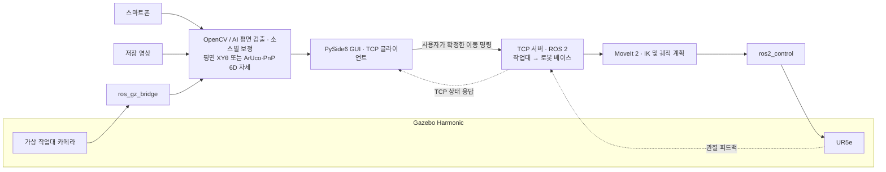

# EyetoArm

**카메라 영상으로 부품의 자세를 추정하고, Gazebo의 UR5e가 목표 자세에 도달하는지 검증하는 프로젝트입니다.**

EyetoArm · 4인 팀 · 전체 7주(기본 5주 + 그리퍼 확장 2주) · 시스템 설계 단계

## 프로젝트 취지

카메라 좌표계를 로봇 작업 좌표계로 바꾸는 **로봇 비전의 핵심 과정**을 입증합니다. 영상 처리 결과를 실제 설비가 쓸 수 있는 숫자(mm·도)로 만들어 보내는 경험이 목표입니다.

## 달성 목표

- 부품 중심과 장축 방향을 영상에서 추정
- 평면 캘리브레이션으로 px → mm 좌표 변환
- 좌표 패킷을 가상 로봇 TCP 서버로 송신하고 수신 확인

## 프로젝트 범위

| 단계 | 비전 | 로봇 시뮬레이션 |
|---|---|---|
| 1~3주차 · 평면 기본 | OpenCV 윤곽 검출을 기준으로 YOLO11n-seg 분할을 비교하고, Homography로 작업대 기준 `X·Y·θ` 추정 | UR5e가 고정 높이·방향의 접근점으로 이동. `θ`는 화면 표시와 비전 평가에 사용 |
| 4~5주차 · 6D 확장 | ArUco·PnP로 물체의 3D 위치와 방향 추정 | 물체 자세를 반영한 접근 목표로 UR5e의 끝단 위치·방향 제어. 5주차 말 기존 범위 평가와 기준 실행본 확보 |
| 6~7주차 · 그리퍼 확장 | 알려진 좌표 → 평면 결과로 2지 파지 목표 계산 | 그리퍼 4종(마그네틱·5지·3지·2지) 프로파일을 실행 전 선택 후 재시작해 적용, 2지 1종으로 부착 기반 최소 집기 |

영상 입력은 스마트폰 스트림, 저장 영상, Gazebo 카메라를 지원하도록 설계했습니다. 입력마다 보정 정보를 따로 관리합니다. 1~5주 기본 범위는 **가상 로봇의 접근 목표 도달**까지입니다. 6~7주 확장에서는 2지 1종으로 접근→닫기→조건 확인→부착→수직 상승→유지 확인까지의 **부착 기반 최소 집기**를 시연합니다. 접촉·마찰 기반 물리 파지, 정상 운반·정밀 놓기, 3지·5지 집기, 실행 중 그리퍼 교체, 실제 로봇 구동은 제외합니다.

AI는 **부품 1종의 평면 검출**에 한정해 YOLO11n-seg의 추가 학습·추론·평가를 계획합니다. OpenCV 기준 방식과 검출 성능·작업 좌표 오차·처리시간을 비교해 3주차 말 운영 채택 여부를 결정하며, 미달하거나 미검증이면 OpenCV 실행본으로 시연하고 AI 결과는 비교 실험으로 보고합니다. **6D 자세추정은 ArUco·PnP를 유지**하고, FoundationPose 기반 마커 없는 6D 추정은 후속 확장으로 둡니다. 상세 기준은 [A 상세설계 §7.1](docs/design/A담당_비전_상세설계.md#71-ai-기반-평면-검출)을 따릅니다. 이 내용은 설계이며 AI 구현·성능 검증 완료를 뜻하지 않습니다.

**그리퍼 확장(6~7주)** 은 A·B·D가 맡고 C에는 신규 업무를 배정하지 않습니다. 4종은 외형·기능 적용·집기 검증 상태를 따로 표시하며, 준비되지 않은 종류는 실행을 차단합니다. TCP 1.1은 바꾸지 않고 집기 명령은 별도 확장 계약으로 제안합니다. 확장은 5주차 기준 실행본과 분리된 확장 실행 모드(C 서버 미기동, B의 집기 순서 관리자만 팔을 움직임)에서 진행합니다. 추가 기간 2주는 실측 전 추정에 여유를 더한 기준 일정이며, 상세는 [그리퍼 확장 상세설계](docs/design/그리퍼_확장_상세설계.md)를 따릅니다. 이 역시 설계이며 그리퍼 모델·집기 구현이나 성공을 뜻하지 않습니다.

## 시스템 구성



GUI에서 유효한 목표를 확정하면 TCP 서버가 명령을 수락하고 로봇 베이스 기준의 접근 목표를 계산합니다. 정상 진행 상태는 `ACK → PLANNING → MOVING → REACHED`이며, 실패 시 `FAILED`를 반환합니다. `ACK`는 명령 수락이고, `REACHED`는 실제 시뮬레이션 끝단이 명령 목표의 위치·방향 허용치 안에 들어왔다는 뜻입니다.

GUI와 TCP 서버 사이의 연결만 끊기면 서버가 이미 수락한 이동은 계속 처리합니다. 재접속 후 GUI는 같은 명령 ID로 `GET_STATUS`를 보내 결과를 확인합니다. 취소는 별도의 `CANCEL` 요청으로 처리합니다.

## 개발 환경

| 구분 | 구성 |
|---|---|
| 호스트 | Windows 11, WSL2 Ubuntu 24.04 LTS, WSLg |
| 로봇 | ROS 2 Jazzy, Gazebo Harmonic, MoveIt 2, `ros2_control`, UR5e |
| 영상·GUI | Python, OpenCV, NumPy, PySide6 |
| 통신 | TCP 프로토콜 `1.1`, UTF-8 줄바꿈 구분 JSON. 영상은 ROS 2 토픽 또는 입력 모듈로 전달 |

## 팀 역할과 검증

| 담당 | 역할 |
|---|---|
| A | 공통 영상 입력, 부품·마커 검출, PnP, 평가 결과 취합. 6~7주: 그리퍼 시뮬레이션 적용·개폐·부착·보유 검출, 집기 시험 결과 취합 |
| B | 카메라 보정, 좌표 변환, 독립 정답 및 오차 평가. 6~7주: 집기 순서 관리, 파지 중심·공구 목표·부착 조건, MoveIt 공구 설정 |
| C | TCP 서버, ROS 2·MoveIt 2·Gazebo 통합, 로봇 이동·도달 판정(1~5주). 6~7주 신규 업무 없음 |
| D | PySide6 GUI, TCP 클라이언트, 송수신 기록, 로봇 외형 설계. 6~7주: 그리퍼 4종 외형·선택/적용/검증 상태 GUI, 확장 계약, 공통 실행 슬롯 |

비전 추정 오차, 명령 목표 대비 로봇 끝단 오차, 독립 정답 기준의 전체 도달 오차를 분리해 평가합니다. 실물 영상의 정답은 독립 측정으로, Gazebo 영상의 정답은 시뮬레이터에서 얻습니다. 3주차에 평면 통합시험을 마치고, 5주차에 6D 통합시험과 기준 실행본 확보를 마칩니다. 7주차에 그리퍼 확장 평가·기존 경로 회귀와 최종 발표 리허설을 진행합니다.

## 프로젝트 폴더 구조

```text
EyetoArm/
├── src/eyetoarm/       # Python 애플리케이션
│   ├── common/         # 공통 자료형·유틸리티
│   ├── inputs/         # 스마트폰·저장 영상·ROS 영상 입력
│   ├── vision/         # 윤곽·마커 검출, 평면·PnP 자세추정
│   ├── calibration/    # 렌즈·평면 보정 처리
│   ├── transforms/     # 좌표 변환·접근 목표 계산
│   ├── tcp/            # TCP 패킷·클라이언트 공통 처리
│   └── gui/            # PySide6 화면·조작
├── robot_ws/src/       # TCP 서버·MoveIt 연동용 ROS 2 패키지
├── simulation/
│   ├── worlds/         # Gazebo 작업대·카메라 배치
│   └── models/         # 부품·마커·로봇 외형 자료
├── config/
│   ├── calibration/    # 소스별 보정 프로파일
│   ├── sources/        # 영상 입력 설정
│   ├── tcp/            # 서버·클라이언트 공통 통신 설정
│   └── robot/          # 작업 범위·좌표 변환·도달 허용치
├── data/
│   ├── samples/        # 공유 가능한 소규모 예제 영상·이미지
│   └── raw/            # 로컬 촬영 원본 (Git 제외)
├── evaluation/
│   ├── ground_truth/   # 독립 정답·측정 조건
│   └── results/        # 선별한 평가표·최종 결과
├── scripts/            # 환경 점검·실행·평가 보조 스크립트
├── tests/
│   ├── unit/           # 모듈 단위 검증
│   └── integration/    # TCP·영상·로봇 통합 검증
├── recordings/         # 로컬 녹화 영상 (Git 제외)
├── rosbags/            # 로컬 ROS 2 토픽 기록 (Git 제외)
└── docs/
    ├── architecture/   # 시스템 아키텍처·개발 계획
    ├── design/         # 담당별 상세설계
    └── protocol/       # TCP 규약·스키마·시험 벡터
```

현재는 폴더 골격만 준비되어 있습니다. Python 패키지와 ROS 2 패키지의 실행·빌드 구성은 각 모듈 구현 시 추가합니다. TCP 서버의 ROS 2 노드와 로봇 연동은 `robot_ws/src/`에, GUI 클라이언트와 공통 통신 처리는 `src/eyetoarm/tcp/`에 둡니다.

보정·공유 설정과 최종 평가 자료는 Git으로 관리합니다. 로컬 원본·녹화·rosbag은 각 보관 폴더를 사용하고, 실행 중 생성되는 로그와 임시 결과는 `.gitignore`에 지정된 `logs/`·`outputs/`에 둡니다. 로컬 전용 설정은 `config/*.local.*` 또는 `.env`에 보관합니다.

## 설계 문서

전체 문서 구성은 [문서 안내](docs/README.md)를 참고합니다.

- [시스템 아키텍처와 7주 계획](docs/architecture/시스템_아키텍처_및_프로젝트_계획.md)
- [A 담당 비전 상세설계](docs/design/A담당_비전_상세설계.md)
- [B 담당 보정·좌표 상세설계](docs/design/B담당_보정_좌표_상세설계.md)
- [C 담당 로봇 서버 상세설계](docs/design/C담당_로봇서버_상세설계.md)
- [D 담당 GUI·TCP 상세설계](docs/design/D담당_GUI_TCP_상세설계.md)
- [그리퍼 선택·최소 집기 확장 상세설계 (6~7주)](docs/design/그리퍼_확장_상세설계.md)
- [TCP 패킷 정의서](docs/protocol/TCP_프로토콜_명세서.md), [요청·응답 JSON 스키마와 시험 벡터](docs/protocol/)

메시지 필드, 응답 구분, 재전송·취소·복구의 세부 규칙은 TCP 패킷 정의서를 기준으로 합니다.
