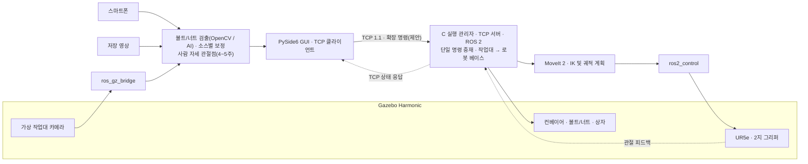

# EyetoArm

**카메라 영상으로 컨베이어 위 볼트·너트를 인식해 Gazebo의 UR5e가 규격별로 분류하고, 이어서 사람 자세로 로봇 동작을 제어하는 프로젝트입니다.**

EyetoArm · 4인 팀 · 5주(3주차 중간 발표, 5주차 최종 발표) · 시스템 설계 단계

## 프로젝트 취지

카메라 좌표계를 로봇 작업 좌표계로 바꾸는 **로봇 비전의 핵심 과정**을 입증합니다. 영상 처리 결과를 실제 설비가 쓸 수 있는 숫자(mm·도)로 만들어 보내는 경험이 목표입니다.

## 달성 목표

- 볼트·너트를 영상에서 검출하고 볼트 규격을 판정
- 평면 캘리브레이션으로 px → mm 좌표 변환
- 가상 로봇이 볼트를 규격별 상자에 넣고 너트를 공통 상자로 보내며, 실제 도착을 확인해 수량을 집계
- 사람 자세로 정해진 로봇 동작을 안전하게 실행(입력 유실 시 정지)
- 좌표 패킷을 가상 로봇 TCP 서버로 송신하고 수신 확인

## 프로젝트 범위

| 단계 | 비전 | 로봇 시뮬레이션 |
|---|---|---|
| 1~3주차 · 컨베이어 분류 | 볼트 2규격·너트 1규격 검출(OpenCV 기준선과 AI 분할 후보 비교), 작업대 기준 위치·장축각과 규격 판정 | 벨트 정지 → 정지 확인 → 재검출 → 2지 그리퍼 부착 기반 집기 → 볼트 규격별 상자 투입. 너트는 끝의 공통 상자로 배출. 3주차 중간 발표 |
| 4~5주차 · 사람 자세 제어 | 사전학습 자세 모델(후보 MediaPipe Pose Landmarker)로 관절점·신뢰도 추정 | 판정한 의도에 따라 UR5e 사전 동작 실행(기본 권장안), 입력 유실 시 정지. 5주차 최종 발표 |

전체 일정은 **5주 고정**입니다. 볼트 규격별 상자 2개와 너트 공통 상자는 현재 논의안이며, 최종 부품 모델은 M6×12·M6×40 볼트(축 길이로 구분)와 M6 너트입니다(사용자 확정). 길이 판정 기준점·허용 범위와 사람 제어 방식(사전 동작 선택형 또는 제한된 손 위치 연속 제어)은 미확정입니다. 5주 최소 구현안은 Gazebo 부착 기반 시연, 2지 그리퍼 1종, 한 개씩 겹침 없는 공급이며 이는 우선순위 제안입니다. 6D ArUco·PnP, 그리퍼 4종 교체, 움직이는 벨트 위 연속 집기, 실물·마찰 파지, 실제 로봇 구동은 후속 범위입니다. TCP 1.1의 6D 정의는 그대로 유지합니다.

영상 입력은 스마트폰 스트림, 저장 영상, Gazebo 카메라를 지원하도록 설계했습니다. 입력마다 보정 정보를 따로 관리합니다. 1~3주차 분류 입력은 저장 자료와 Gazebo이고, 스마트폰 실연결은 4~5주차 사람 자세 제어에서 사용합니다.

AI는 볼트·너트 검출에 추가 학습·추론·평가를 계획합니다. 단일 모델을 자동 확정하지 않고 소형 분할 후보(초기 제안 YOLO11n-seg·YOLOv8n-seg, 최대 2개)를 OpenCV 기준선과 같은 조건으로 비교해 3주차 말 운영 채택 여부를 결정하며, 미달하거나 미검증이면 OpenCV 경로로 시연합니다. 클래스 구성(3클래스 / 볼트·너트 + 치수 판정)은 A·B 파일럿으로 정합니다. 사람 자세 모델은 사전학습 모델 추론이며 학습을 필수로 두지 않습니다. 상세 기준은 [A 상세설계 §7.1](docs/design/A담당_비전_상세설계.md#71-ai-기반-평면-검출)을 따릅니다.

**담당 흐름.** A가 인식하고, B가 좌표·규격·목표를 계산하며, C가 로봇·그리퍼·벨트를 실행하고, D가 조작·통신·상태를 표시합니다. C는 기존 TCP 서버를 유지하면서 신규 로봇 실행(분류 순서, 단일 명령 중재, 모드 전환, 정지·복구)을 맡아 업무가 늘어납니다. 분류·벨트·사람 제어 명령은 TCP 1.1에 넣지 않고 별도 확장 명령 계약(제안)으로 정의합니다. 이 내용은 설계이며 구현·실행·성능 검증 완료를 뜻하지 않습니다.

## 시스템 구성



분류·벨트·사람 제어는 C의 실행 관리자가 확장 명령 계약(제안)으로 받아 하나의 실행 슬롯에서 처리합니다. 기존 TCP 1.1 경로에서는 GUI에서 유효한 목표를 확정하면 TCP 서버가 명령을 수락하고 로봇 베이스 기준의 접근 목표를 계산합니다. 정상 진행 상태는 `ACK → PLANNING → MOVING → REACHED`이며, 실패 시 `FAILED`를 반환합니다. `ACK`는 명령 수락이고, `REACHED`는 실제 시뮬레이션 끝단이 명령 목표의 위치·방향 허용치 안에 들어왔다는 뜻입니다.

GUI와 TCP 서버 사이의 연결만 끊기면 서버가 이미 수락한 이동은 계속 처리합니다. 재접속 후 GUI는 같은 명령 ID로 `GET_STATUS`를 보내 결과를 확인합니다. 취소는 별도의 `CANCEL` 요청으로 처리합니다.

## 개발 환경

| 구분 | 구성 |
|---|---|
| 호스트 | Windows 11, WSL2 Ubuntu 24.04 LTS, WSLg |
| 로봇 | ROS 2 Jazzy, Gazebo Harmonic, MoveIt 2, `ros2_control`, UR5e |
| 영상·GUI | Python, OpenCV, NumPy, PySide6 |
| 통신 | TCP 프로토콜 `1.1`, UTF-8 줄바꿈 구분 JSON. 영상은 ROS 2 토픽 또는 입력 모듈로 전달 |

## 팀 역할과 검증

| 담당 | 역할 |
|---|---|
| A | 공통 영상 입력, 카메라·센서 입력, 볼트/너트 데이터·라벨·학습·검출, 사람 자세 모델·관절점 출력, 통신 시험, 평가 결과 취합 |
| B | 카메라 보정, 좌표 변환, 규격 판정, 파지점·개구폭·목적지 좌표, 사람 자세→목표 매핑, 작업 범위, 독립 정답 및 오차 평가 |
| C | 기존 TCP 서버 유지, **신규 로봇 실행**: 경로 계획·실행, 그리퍼·벨트 실행, 분류 순서, 단일 명령 중재, 모드 전환, 정지·복구, 로봇·그리퍼·벨트 모델·실행 구성 |
| D | PySide6 GUI, TCP 클라이언트, 송수신 기록, 모드·벨트·그리퍼 상태와 상자별 수량 표시, 사람 제어 동의·활성화, 확장 명령 계약 초안·클라이언트, 시뮬레이션 외형 자산 |

분류 정확도·볼트 규격별 정밀도/재현율·상자 투입·누락/중복·너트 도착·처리 시간·정지 복구와, 사람 제어의 오동작·지연·유실 정지·모드 배타를 나눠 평가합니다. 정답은 공급 순서표와 독립 측정·시뮬레이터 정답 기록에서 얻습니다. 3주차 말 분류 실행본을 보존하고 중간 발표를, 5주차에 반복·오류 시험과 최종 발표를 진행합니다. 모든 평가는 아직 계획 단계입니다.

## 프로젝트 폴더 구조

```text
EyetoArm/
├── src/eyetoarm/       # Python 애플리케이션
│   ├── common/         # 공통 자료형·유틸리티
│   ├── inputs/         # 스마트폰·저장 영상·ROS 영상 입력
│   ├── vision/         # 윤곽·마커 검출, 평면·PnP 자세추정
│   ├── calibration/    # 렌즈·평면 보정 처리
│   ├── transforms/     # 좌표 변환·접근 목표 계산
│   ├── tcp/            # TCP 패킷·클라이언트 공통 처리
│   └── gui/            # PySide6 화면·조작
├── robot_ws/src/       # TCP 서버·MoveIt 연동용 ROS 2 패키지
├── simulation/
│   ├── worlds/         # Gazebo 작업대·카메라 배치
│   └── models/         # 부품·마커·로봇 외형 자료
├── config/
│   ├── calibration/    # 소스별 보정 프로파일
│   ├── sources/        # 영상 입력 설정
│   ├── tcp/            # 서버·클라이언트 공통 통신 설정
│   └── robot/          # 작업 범위·좌표 변환·도달 허용치
├── data/
│   ├── samples/        # 공유 가능한 소규모 예제 영상·이미지
│   └── raw/            # 로컬 촬영 원본 (Git 제외)
├── evaluation/
│   ├── ground_truth/   # 독립 정답·측정 조건
│   └── results/        # 선별한 평가표·최종 결과
├── scripts/            # 환경 점검·실행·평가 보조 스크립트
├── tests/
│   ├── unit/           # 모듈 단위 검증
│   └── integration/    # TCP·영상·로봇 통합 검증
├── recordings/         # 로컬 녹화 영상 (Git 제외)
├── rosbags/            # 로컬 ROS 2 토픽 기록 (Git 제외)
└── docs/
    ├── architecture/   # 시스템 아키텍처·개발 계획
    ├── design/         # 담당별 상세설계
    └── protocol/       # TCP 규약·스키마·시험 벡터
```

현재는 폴더 골격만 준비되어 있습니다. Python 패키지와 ROS 2 패키지의 실행·빌드 구성은 각 모듈 구현 시 추가합니다. TCP 서버의 ROS 2 노드와 로봇 연동은 `robot_ws/src/`에, GUI 클라이언트와 공통 통신 처리는 `src/eyetoarm/tcp/`에 둡니다.

보정·공유 설정과 최종 평가 자료는 Git으로 관리합니다. 로컬 원본·녹화·rosbag은 각 보관 폴더를 사용하고, 실행 중 생성되는 로그와 임시 결과는 `.gitignore`에 지정된 `logs/`·`outputs/`에 둡니다. 로컬 전용 설정은 `config/*.local.*` 또는 `.env`에 보관합니다.

## 설계 문서

전체 문서 구성은 [문서 안내](docs/README.md)를 참고합니다.

- [시스템 아키텍처와 5주 계획](docs/architecture/시스템_아키텍처_및_프로젝트_계획.md)
- [A 담당 비전 상세설계](docs/design/A담당_비전_상세설계.md)
- [B 담당 보정·좌표 상세설계](docs/design/B담당_보정_좌표_상세설계.md)
- [C 담당 로봇 서버 상세설계](docs/design/C담당_로봇서버_상세설계.md)
- [D 담당 GUI·TCP 상세설계](docs/design/D담당_GUI_TCP_상세설계.md)
- [컨베이어 분류 상세설계 (1~3주)](docs/design/컨베이어_분류_상세설계.md)
- [사람 자세 제어 상세설계 (4~5주)](docs/design/사람_자세_제어_상세설계.md)
- [그리퍼·로봇 실행 상세설계 (집기·중재·확장 명령 계약)](docs/design/그리퍼_확장_상세설계.md)
- [TCP 패킷 정의서](docs/protocol/TCP_프로토콜_명세서.md), [요청·응답 JSON 스키마와 시험 벡터](docs/protocol/)

메시지 필드, 응답 구분, 재전송·취소·복구의 세부 규칙은 TCP 패킷 정의서를 기준으로 합니다.
