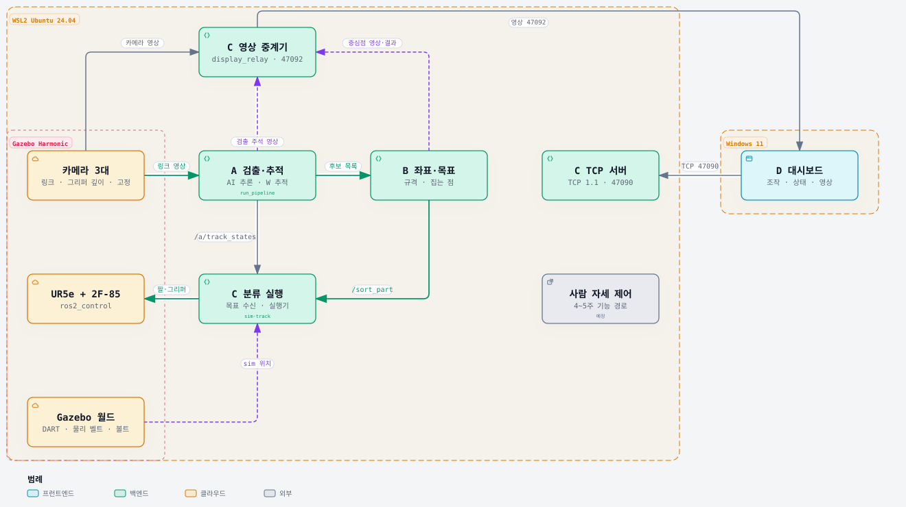

# EyetoArm

**카메라 영상으로 컨베이어 위 볼트·너트를 인식해 Gazebo의 UR5e가 규격별로 분류하고, 이어서 사람 자세로 로봇 동작을 제어하는 프로젝트입니다.**

EyetoArm · 4인 팀 · 5주(3주차 중간 발표, 5주차 최종 발표) · 구현·통합 시험 단계(2026-11-22 기준)

## 프로젝트 취지

카메라 좌표계를 로봇 작업 좌표계로 바꾸는 **로봇 비전의 핵심 과정**을 입증합니다. 영상 처리 결과를 실제 설비가 쓸 수 있는 숫자(mm·도)로 만들어 보내는 경험이 목표입니다.

## 달성 목표

- 볼트·너트를 영상에서 검출하고 볼트 규격을 판정
- 평면 캘리브레이션으로 px → mm 좌표 변환
- 가상 로봇이 볼트를 규격별 상자에 넣고 너트를 공통 상자로 보내며, 실제 도착을 확인해 수량을 집계
- 사람 자세로 정해진 로봇 동작을 안전하게 실행(입력 유실 시 정지)
- 좌표 패킷을 가상 로봇 TCP 서버로 송신하고 수신 확인

## 프로젝트 범위

| 단계 | 비전 | 로봇 시뮬레이션 |
|---|---|---|
| 1~3주차 · 컨베이어 분류 | 볼트 2규격·너트 1규격 검출(OpenCV 기준선과 AI 분할 후보 비교), 작업대 기준 위치·장축각과 규격 판정 | 벨트 정지 → 정지 확인 → 재검출 → 2지 그리퍼 부착 기반 집기 → 볼트 규격별 상자 투입. 너트는 끝의 공통 상자로 배출. 3주차 중간 발표 |
| 4~5주차 · 사람 자세 제어 | 사전학습 자세 모델(후보 MediaPipe Pose Landmarker)로 관절점·신뢰도 추정 | 판정한 의도에 따라 UR5e 사전 동작 실행(기본 권장안), 입력 유실 시 정지. 5주차 최종 발표 |

전체 일정은 **5주 고정**입니다. 볼트 규격별 상자 2개와 너트 공통 상자는 현재 논의안이며, 최종 부품 모델은 M3×20(BOLT_A)·M6×40(BOLT_B) 볼트(축 길이로 구분)와 M6 너트입니다. BOLT_A는 2026-11-20 팀 회의에서 그리퍼 크기 때문에 M6×12에서 M3×20으로 바꿨고, B 규격에는 길이 범위(BOLT_A 17~27 mm, BOLT_B 39~52 mm)와 종류별 기준 높이가 들어가 있습니다. 사람 제어 방식(사전 동작 선택형 또는 제한된 손 위치 연속 제어)은 미확정입니다. 5주 최소 구현안은 Gazebo 부착 기반 시연, 2지 그리퍼 1종, 한 개씩 겹침 없는 공급이며 이는 우선순위 제안입니다. 6D ArUco·PnP, 그리퍼 4종 교체, 움직이는 벨트 위 연속 집기, 실물·마찰 파지, 실제 로봇 구동은 후속 범위입니다. TCP 1.1의 6D 정의는 그대로 유지합니다.

영상 입력은 스마트폰 스트림, 저장 영상, Gazebo 카메라를 지원하도록 설계했습니다. 입력마다 보정 정보를 따로 관리합니다. 1~3주차 분류 입력은 저장 자료와 Gazebo이고, 스마트폰 실연결은 4~5주차 사람 자세 제어에서 사용합니다.

AI 검출은 YOLOv8n-seg 분할 모델 **S1-08**을 운영 모델로 채택했습니다(2026-11-21). 클래스는 볼트·너트 2개이고 볼트 규격은 B가 끝점 길이로 판정합니다. 볼트 양 끝점은 마스크에서 M2 방식으로 뽑습니다. Gazebo 장면에서 약한 자세(가로로 놓인 M3×20 등)를 보강한 재학습 후보(S1-09)를 평가 중이며, 교체는 미리 정한 합격 기준을 통과한 뒤 결정합니다. OpenCV 경로는 기준선으로 남아 있습니다. 사람 자세 모델은 사전학습 모델 추론이며 학습을 필수로 두지 않습니다. 상세 기준은 [A 상세설계 §7.1](docs/design/A담당_비전_상세설계.md#71-ai-기반-평면-검출)을 따릅니다.

**담당 흐름.** A가 인식하고, B가 좌표·규격·목표를 계산하며, C가 로봇·그리퍼·벨트를 실행하고, D가 조작·통신·상태를 표시합니다. 별도의 자동운전 모드는 없습니다. GUI에서 `START`하면 C가 준비를 확인하고 A·B 파이프라인을 활성화해 A 검출 → B 계산 → B가 C에 ROS 액션 목표 → C 로봇 실행이 이어지며, 정상 사이클은 부품마다 다시 승인하지 않습니다(사용자 확정). C는 기존 TCP 서버를 유지하면서 신규 로봇 실행(분류 순서, 단일 실행 관리자 중재, 정지·복구, 분류 목표 액션 서버)을 맡아 업무가 늘어납니다. 이 내용은 설계이며 구현·실행·성능 검증 완료를 뜻하지 않습니다.

## 시스템 구성

D 운영 GUI는 **Windows**, A·B·C와 ROS 2·MoveIt 2·Gazebo는 **WSL2**에서 실행합니다(사용자 확정). 아래 그림은 main 현재 구현의 개요입니다. 구현 상세 구성도와 미결 사항은 [시스템 계획 §2.1](docs/architecture/시스템_아키텍처_및_프로젝트_계획.md#21-시스템-아키텍처-v11), 데이터 흐름과 근거는 [§2.1.1](docs/architecture/시스템_아키텍처_및_프로젝트_계획.md#211-구현-구성도와-데이터-흐름-v17-2026-11-23-main-기준)을 기준으로 합니다.



[대화형 구성도 보기](https://didgustmd23.github.io/EyetoArm/images/system_overview.html) (저장소 파일: [system_overview.html](docs/images/system_overview.html))

그림 원본 정의는 [docs/images/system_overview.archify.json](docs/images/system_overview.archify.json)(Archify)입니다. 사람 자세 제어(4~5주)는 「예정」으로 표시했습니다.

- **자동 분류:** 목표는 GUI를 거치지 않고 B→C ROS 액션으로 전달합니다. C가 목표를 검증·계획·실행·취소하고 결과를 책임집니다.
- **GUI 명령:** C TCP 서버는 TCP 1.1 수동 이동과 TCP 1.2 분류 제어를 같은 포트에서 지원합니다. 대시보드에서 `--tcp-version 1.2`를 선택하면 START·STOP·E-STOP·RECOVER를 ROS 관리 실행 서비스에 전달합니다. `STOP` 접수 응답과 정지 완료 상태는 구분되며, E-STOP은 소프트웨어 요청이지 안전 정격 하드웨어 정지 장치가 아닙니다.
- **수동 이동(별도 경로):** GUI에서 사용자가 유효한 목표를 확정하면 TCP 1.1 `MOVE` 1건을 보내고, 서버가 수락해 로봇 베이스 기준 접근 목표를 계산합니다. 정상 진행 상태는 `ACK → PLANNING → MOVING → REACHED`이며 실패 시 `FAILED`입니다. `ACK`는 명령 수락, `REACHED`는 실제 시뮬레이션 끝단이 명령 목표의 위치·방향 허용치 안에 들어왔다는 뜻입니다. 분류 작업 중 수동 `MOVE` 거부 방식은 제안입니다.
- **연결 끊김:** GUI와 TCP 서버 사이 연결이 끊기는 것은 취소나 정지 완료가 아닙니다. 서버가 이미 수락한 작업은 계속 처리하고, 재접속 후 GUI는 `GET_STATUS`로 상태를 확인합니다. 수동 이동 취소는 `CANCEL`, 분류 정지는 `STOP`입니다.
- **영상 표시:** 영상은 로봇 명령 TCP로 보내지 않습니다. C 영상 중계기(`display_relay`, 포트 47092)가 링크 raw·A 검출(detect)·B 중심점(center)과 그리퍼·탑뷰 영상을 Windows GUI로 전달합니다. A 검출 영상은 중계기 입력 포트 47093으로 넘깁니다.

## 개발 환경

A 담당 Python 의존성은 가상환경에서 `pip install -r requirements.txt`로 설치합니다(실시간 AI 실행은 저장소 `.venv`의 Python을 씁니다). ROS·Gazebo·드라이버 선행조건과 설치·확인 절차는 [A 개발환경 설치 안내](docs/setup/A_개발환경_설치.md)를 따릅니다. 새 환경은 pip OpenCV를 사용하며 기존 `.venv`는 유지합니다.

현재 선택한 [S1-08 모델 가중치·실행 안내](models/vision/s1_08/README.md)는 저장소에 포함합니다. 학습 데이터와 전체 학습 출력은 포함하지 않습니다.

| 구분 | 구성 |
|---|---|
| 호스트 | Windows 11(D 운영 GUI), WSL2 Ubuntu 24.04 LTS(A·B·C·ROS·Gazebo, Gazebo 창은 WSLg) |
| 로봇 | ROS 2 Jazzy, Gazebo Harmonic, MoveIt 2, `ros2_control`, UR5e |
| 영상·GUI | WSL2: Python, OpenCV, NumPy / Windows: PySide6 GUI |
| 통신 | GUI↔C: TCP 프로토콜 `1.1`(수동 이동) 및 `1.2`(실행 제어), UTF-8 줄바꿈 구분 JSON. B→C: ROS 2 액션 `/sort_part`. 영상은 ROS 2 토픽과 C 영상 중계기로 전달하고 명령 TCP에 넣지 않음 |
| Gazebo 렌더링 | WSL2에서는 `GALLIUM_DRIVER=d3d12`와 `MESA_D3D12_DEFAULT_ADAPTER_NAME=NVIDIA`로 GPU 렌더링을 씁니다. 없으면 CPU 렌더링이 되어 카메라가 약 6 fps로 떨어집니다. GPU 렌더링에서 Gazebo 메모리가 계속 늘면 `MESA_EXTENSION_OVERRIDE="-GL_ARB_multi_draw_indirect -GL_ARB_draw_indirect"`를 더합니다(각자 실행 환경에서 설정, [A 상세설계 §6](docs/design/A담당_비전_상세설계.md)) |

## 실행

저장소 맨 위에서 ROS와 작업공간 환경을 불러온 뒤 실행합니다. C 패키지를 바꿨다면 먼저 `cd robot_ws && colcon build --packages-select robot_server_package`로 다시 빌드합니다.

```bash
source /opt/ros/jazzy/setup.bash
source robot_ws/install/setup.bash
ros2 launch scripts/c_stack.launch.py gui:=false start_a:=true start_b:=true
```

- `c_stack.launch.py`는 Gazebo 분류 셀, C TCP 서버·영상 중계기, A 실시간 검출(AI 추론은 별도 프로세스), B 목록 처리·중심점 발행을 함께 띄웁니다. 실시간 경로에서는 팔·그리퍼 영역의 오검출 제외가 기본으로 켜집니다.
- **실행 방식 `run_mode`**(기본 `single`): 같은 `ROS_DOMAIN_ID`·`GZ_PARTITION`에 이전 실행에서 남은 Gazebo·노드가 있으면 섞여서 컨트롤러 오류·검출 중단이 납니다.
  - `run_mode:=single`(기본): 시작 전에 같은 도메인·파티션의 남은 Gazebo·노드를 정리(SIGINT → 10초 → SIGTERM → 5초 → SIGKILL)한 뒤 실행합니다. 기본 포트(47090·47092·47093)를 다른 프로세스가 쓰고 있으면 그 프로세스는 끄지 않고 시작을 거부합니다. 다른 도메인·파티션의 실행은 건드리지 않습니다.
  - `run_mode:=multi`: 남은 Gazebo가 있어도 경고만 출력하고 실행합니다(여러 실행을 일부러 함께 띄울 때).
  - 끌 때(Ctrl+C·`kill`·터미널 창 닫기) 이 실행이 띄운 프로세스만 정리합니다. 처리 기록은 `logs/c_stack_guard_<시각>.log`에 남습니다.
  - 예: `ros2 launch scripts/c_stack.launch.py auto_sort:=true`(단일) / `ros2 launch scripts/c_stack.launch.py auto_sort:=true run_mode:=multi`
  - 이 처리는 `c_stack.launch.py`와 `dashboard_up.sh`(`dashboard_stack.launch.py`)에 있습니다. `sim_sort_cell.launch.py`를 단독으로 띄운 뒤에는 `pgrep -af "gz sim"`으로 남은 Gazebo가 없는지 확인합니다.
- **AI 설정 `ai_config`**(기본: 운영 모델 S1-08 `config/vision/ai_s1_08_axis_m2_viewbias.json`): 다른 모델로 돌릴 때만 줍니다. 상대 경로는 저장소 맨 위 기준이고, 파일이 없으면 아무것도 띄우지 않고 멈춥니다. 예: `ros2 launch scripts/c_stack.launch.py auto_sort:=true ai_config:=config/vision/ai_s1_09_axis_m2_viewbias.json`
- 컨베이어를 움직이려면 `ros2 run ros_gz_bridge parameter_bridge /world/sort_cell/set_pose@ros_gz_interfaces/srv/SetEntityPose`를 따로 띄웁니다. 모든 터미널의 `ROS_DOMAIN_ID`·`GZ_PARTITION`이 같아야 합니다.
- Windows 대시보드 실행과 외부 PC 연결은 [서버-대시보드 실행](docs/design/서버-대시보드%20실행.md)과 [대시보드 한 번에 실행](docs/design/대시보드_한번에_실행.md)을 따릅니다.
- A 파이프라인 단독 실행(저장 영상·실시간·옵션)은 `scripts/run_pipeline.py --help`와 [A 상세설계](docs/design/A담당_비전_상세설계.md) §3·§6·§9를 봅니다.

## 팀 역할과 검증

| 담당 | 역할 |
|---|---|
| A | 공통 영상 입력, 카메라 영상 입력·검출·추적·관측 출력(정지 후 재검출 포함), 볼트/너트 데이터·라벨·학습, 사람 자세 모델·관절점 출력, 통신 시험, 평가 결과 취합 |
| B | 카메라 보정, 좌표 변환, 규격 판정, 파지점·개구폭·목적지 좌표, 사람 자세→목표 매핑, 작업 범위, 독립 정답 및 오차 평가 |
| C | 기존 TCP 서버 유지, **신규 로봇 실행**: 경로 계획·실행, 그리퍼·벨트 실행, 분류 순서, 실행 피드백(벨트 정지·접촉·부착·보유·상자 도착 확인) 구성·판정과 수량 집계, 단일 실행 관리자 중재(운전 모드 없음), 정지·복구, 분류 목표 액션 서버, 로봇·그리퍼·벨트 모델·실행 구성 |
| D | Windows PySide6 GUI, TCP 클라이언트(수동 `MOVE`와 `START`·`STOP`·`RECOVER`), 송수신 기록, 분류 작업·벨트·그리퍼 상태와 상자별 수량 표시, 사람 제어 동의·활성화, TCP 명세 개정 제안 초안, 시뮬레이션 외형 자산 |

분류 정확도·볼트 규격별 정밀도/재현율·상자 투입·누락/중복·너트 도착·처리 시간·정지 복구와, 사람 제어의 오동작·지연·유실 정지·분류 작업과의 배타를 나눠 평가합니다. 정답은 공급 순서표와 독립 측정·시뮬레이터 정답 기록에서 얻습니다. 3주차 말 분류 실행본을 보존하고 중간 발표를, 5주차에 반복·오류 시험과 최종 발표를 진행합니다. A→B→C→D 통합 시험 결과와 남은 결함은 [A 통합시험 결과서](docs/design/A담당_통합시험_결과.md)에 기록합니다.

## 프로젝트 폴더 구조

```text
EyetoArm/
├── src/eyetoarm/       # Python 애플리케이션
│   ├── common/         # 공통 자료형·유틸리티
│   ├── inputs/         # 저장 영상·ROS 영상·그리퍼 깊이 입력
│   ├── vision/         # A 검출(OpenCV·AI)·끝점·추적·실시간 파이프라인
│   ├── calibration/    # 렌즈·평면 보정 처리(B)
│   ├── transforms/     # 좌표 변환·규격 판정·집기 목표(B)
│   ├── training/       # AI 학습·평가 실행 도구(A)
│   ├── commtest/       # TCP 통신 시험 도구(A)
│   ├── sorteval/       # 분류 결과 취합·판정 도구(A)
│   ├── pendant/        # 수동 조작 보조
│   ├── tcp/            # TCP 패킷·클라이언트 공통 처리
│   └── gui/            # PySide6 화면·조작
├── robot_ws/src/       # C ROS 2 패키지(TCP 서버·영상 중계기·분류 관리·인터페이스·MoveIt 설정)
├── dashboard-client/   # D Windows 대시보드
├── models/vision/      # 운영 AI 가중치(S1-08)
├── simulation/
│   ├── worlds/         # Gazebo 분류 셀
│   └── models/         # 부품·상자·로봇 외형 자료
├── config/
│   ├── calibration/    # 보정 프로파일·B 부품 규격(part_specs.json)
│   ├── vision/         # A 검출·추적·실시간 설정
│   ├── training/       # 학습 설정
│   ├── sources/        # 영상 입력 설정
│   ├── tcp/            # 서버·클라이언트 공통 통신 설정
│   ├── dds/            # 대용량 영상용 DDS 설정
│   ├── gui/            # 대시보드 설정
│   └── robot/          # 프레임·작업 범위·좌표 변환·도달 허용치
├── data/
│   ├── samples/        # 공유 가능한 소규모 예제 영상·이미지
│   ├── derived/        # 평가·학습용 가공 자료
│   └── raw/            # 로컬 촬영 원본 (Git 제외)
├── evaluation/
│   ├── ground_truth/   # 독립 정답·측정 조건
│   └── results/        # 선별한 평가표·최종 결과
├── scripts/            # 실행(launch·run_pipeline)·시험·평가 보조 스크립트
├── tests/
│   ├── unit/           # 모듈 단위 검증
│   └── integration/    # TCP·영상·로봇 통합 검증
├── recordings/         # 로컬 녹화 영상 (Git 제외)
├── rosbags/            # 로컬 ROS 2 토픽 기록 (Git 제외)
└── docs/
    ├── architecture/   # 시스템 아키텍처·개발 계획
    ├── design/         # 담당별 상세설계·협업 요청·실행 안내·통합시험 결과
    ├── setup/          # 개발환경 설치 안내
    └── protocol/       # TCP 규약·스키마·시험 벡터
```

**구현 상태(2026-11-22).** Gazebo 링크 카메라 영상 → A AI 검출·볼트 끝점·W 추적 → B 규격 판정·집기 목표 → C `/sort_part` 목표 전달, 그리고 A 검출·B 중심점 영상의 D 표시까지 한 번의 실행으로 동작합니다. B 시험 서버로 실제 집기를 확인한 적이 있으며, C 정식 분류 실행(`sort_manager`)·컨베이어 연동·사람 자세 제어는 진행 중입니다. 기능별 상태와 남은 결함은 [A 통합시험 결과서](docs/design/A담당_통합시험_결과.md)와 각 담당 상세설계를 봅니다.

보정·공유 설정과 최종 평가 자료는 Git으로 관리합니다. 로컬 원본·녹화·rosbag은 각 보관 폴더를 사용하고, 실행 중 생성되는 로그와 임시 결과는 `.gitignore`에 지정된 `logs/`·`outputs/`에 둡니다. 로컬 전용 설정은 `config/*.local.*` 또는 `.env`에 보관합니다.

## 설계 문서

전체 문서 구성은 [문서 안내](docs/README.md)를 참고합니다.

- [시스템 아키텍처와 5주 계획](docs/architecture/시스템_아키텍처_및_프로젝트_계획.md)
- [A 담당 비전 상세설계](docs/design/A담당_비전_상세설계.md)
- [B 담당 보정·좌표 상세설계](docs/design/B담당_보정_좌표_상세설계.md)
- [C 담당 로봇 서버 상세설계](docs/design/C담당_로봇서버_상세설계.md)
- [D 담당 GUI·TCP 상세설계](docs/design/D담당_GUI_TCP_상세설계.md)
- 컨베이어 분류(1~3주)·사람 자세 제어(4~5주)·그리퍼·로봇 실행의 기능 상세는 2026-11-11에 별도 문서를 없애고 시스템 계획 §2.6·§2.7과 A §13·B §15·C §16~§18·D §A.11에 통합했습니다.
- [TCP 패킷 정의서](docs/protocol/TCP_프로토콜_명세서.md), [요청·응답 JSON 스키마와 시험 벡터](docs/protocol/)
- 담당 간 협업 요청: [A](docs/design/A담당_협업_요청_초안.md)·[B](docs/design/B담당_협업_요청_초안.md)·[C](docs/design/C담당_협업_요청_초안.md)·[D](docs/design/D담당_협업_요청_초안.md)
- [A 통합시험 결과서](docs/design/A담당_통합시험_결과.md)

메시지 필드, 응답 구분, 재전송·취소·복구의 세부 규칙은 TCP 패킷 정의서를 기준으로 합니다.
