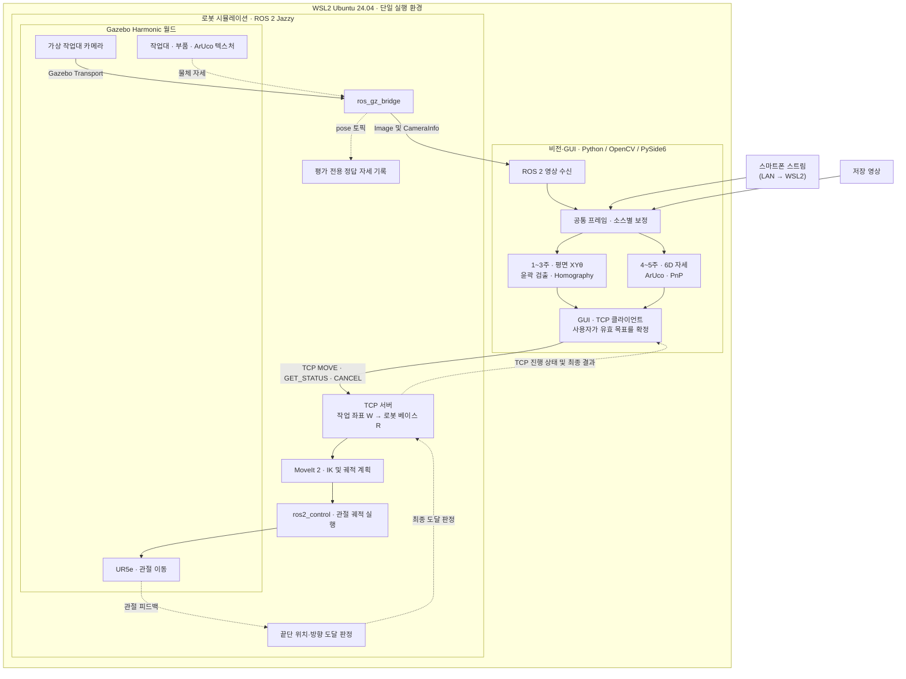

# EyetoArm — 머신 비전 3주 + 자세추정 2주 프로젝트 계획

문서 버전 1.1 · 4인 팀 · 5주 계획

최초 작성일 2026-11-06 · 수정일 2026-11-07 (대한민국 표준시)

## 0. 변경 이력

| 버전 | 날짜 | 주요 변경 |
|---|---|---|
| v1.0 | 2026-11-07 | 최초 공유본 |
| v1.1 | 2026-11-07 | 설계 검토 반영: 실행 환경을 WSL2 단일 구성으로 고정, TCP 메시지 스키마·오류 코드·재시도 정책 확정, `frame_id`→`image_seq` 이름 변경과 시간 기준 필드 추가, `CANCEL` 명령 추가, Gazebo 월드·마커 모델·정답 자세 취득 담당 배정, 평가 취합 담당을 C→A로 이동, 3주차 후반 오프라인 PnP 파일럿 허용, 평면 끝단 하향 방향 예시·θ 사용 정책·REACHED 허용치 조건 추가, 평면 정답 측정 불확실성과 부품 종횡비 조건 추가, WSL2 렌더링·네트워크 위험 추가 |
| v1.1 (2차 검토) | 2026-11-07 | `CANCEL`의 상태별 동작(`PLANNING` 중 계획 결과 폐기, `MOVING` 중 정지 확인, TCP 단절 시 표시) 정의, 서버 재시작 복구 절차와 컨트롤러 인터페이스 명시, `robot_ready`·`not_ready_reasons`·`active_command_id` 응답 필드와 준비 상태 조회 추가, 허용치를 계획·관절 실행·끝단 도달 3종으로 분리, 자동 재전송을 같은 연결·유효 목표로 제한, 스마트폰 스트림 연결 방향별 WSL2 설정 구분 |
| v1.1 (3차 검토) | 2026-11-07 | 이동 재개·재시작 복구의 종료 판단을 "액션 상태 목록의 goal 종료 + 최신 관절 피드백 정지"로 변경하고 빈 궤적은 보조 수단으로 격하, goal ID 기록과 ID 지정·전체 취소 절차 추가, 확인 불가 시 `RECOVERY_FAILED` 유지 후 수동 복구, 준비 조건에 `active_command_id == null` 추가(`ACK`~종료 동안 `robot_ready=false`, `BUSY` 우선), `UNKNOWN_COMMAND` 표시를 "명령 기록 없음 · 실행 여부 미확인"으로 수정하고 새 ID 발급을 `robot_ready=true`와 사용자 재확정 이후로 제한 |
| v1.1 (패킷 정의서 연결) | 2026-11-07 | TCP 세부 규약을 `TCP_프로토콜_명세서.md`로 분리하고 §2.4를 요약으로 지정, 검증 거부는 `state` 없는 거부로 통일(`stage=VALIDATION` 삭제), §2.4.1 `PC_RECEIVE` 예시 시각을 단조 시계 값으로 수정, §7 재접속 후 같은 `MOVE` 재전송을 시험 도구 전용으로 명시 |
| v1.1 (패킷 정의서 2차) | 2026-11-07 | TCP 세부 규약을 별도 문서로 관리, `MOVING` 중 취소의 최종 코드를 goal 종료 상태(`CANCELED`·`ABORTED`·`SUCCEEDED`)별로 분기, 재시작 시 명령 로그를 읽을 수 없으면 `RECOVERY_FAILED`로 보류 |
| v1.1 (패킷 정의서 3차) | 2026-11-07 | §2.4.4의 중복 판정 수치 규칙(쿼터니언 성분 비교)을 지우고 정의서 §7.3 참조로 대체, 실패 코드 `LOG_WRITE_FAILED`와 준비 조건 9번(`LOG_UNAVAILABLE`) 추가 |
| v1.1 (패킷 정의서 4차) | 2026-11-07 | 준비 조건 9번을 정의서와 맞춤: `NOT_READY`는 등록 기록 실패에만, 종료 상태는 로그 기록 후에만 알림 |
| v1.1 (패킷 정의서 5차) | 2026-11-07 | 기록 성공을 저장 확정(`flush` + `fsync`)으로 정의하고 §2.4.4에 반영, 재시작 시 일부만 남은·손상된 로그도 `RECOVERY_FAILED`로 보류 |
| v1.1 (문서 정리) | 2026-11-07 | TCP 상세 규약을 패킷 정의서로 모으고 역할·도달 판정 중복을 축약, 프로젝트명에 맞춰 파일명과 참조 정리 |
| v1.1 (개발 환경) | 2026-11-07 | 팀 공통 개발 도구·설치 순서·버전 기록·실행 재현 기준을 §2.5에 추가 |

## 1. 계획 수정의 기준

1~3주차에는 평면 머신 비전과 Gazebo UR5e 목표 이동을 독립 실행본으로 완성합니다. 4~5주차에는 기본 실행본을 유지하면서 6D 자세추정과 끝단 자세 이동을 추가합니다.

- 기본 3주 — 부품 윤곽 검출 → 작업 평면 X·Y·장축각 → TCP·GUI → Gazebo UR5e 접근점 이동 → 평면 및 로봇 도달 평가
- 추가 2주 — ArUco·PnP 6D 자세 → 작업 좌표 변환 → TCP·GUI 확장 → Gazebo UR5e 끝단 위치·방향 이동 → 6D 및 로봇 도달 평가

이 문서는 설계와 실행 계획을 기록합니다. 구현, 환경 설치, 실측은 주차별 계획에 따라 진행합니다.

시작일이 정해지지 않았으므로 일정은 달력 날짜 대신 1~5주차로 표시합니다. A~D의 실제 이름, 장비, 가용 시간과 숙련도는 미확인입니다. 계획 수립상 4인 모두 Python/OpenCV 기초가 있고 각자 주 15~20시간을 확보하며, 스마트폰 고정 거치대와 측정 도구를 확보할 수 있다고 가정했습니다. 확보 전에는 보정 정보가 있는 저장 영상과 Gazebo로 개발을 진행합니다. 실제 조건이 다르면 작업량을 조정해야 합니다.

## 2. 프로젝트 목표와 범위

최종 목표는 영상에서 부품 자세를 추정하고 TCP로 전달한 뒤, Gazebo의 UR5e 관절을 움직여 끝단이 목표 위치와 방향에 도달했는지 검증하는 것입니다.

| 구분 | 1~3주 기본 프로젝트 | 4~5주 자세추정 확장 |
|---|---|---|
| 대상 | 고정 높이의 정지 부품 1종. 윤곽 외접 최소 사각형의 장변/단변 비 1.5 이상 | 알려진 크기의 마커를 고정한 동일 부품 1종 |
| 위치 | 작업 평면 X·Y | 작업 좌표계 X·Y·Z |
| 방향 | 장축각 θ, 0~180° | 3차원 회전 |
| 방법 | 윤곽, Homography, 중심·장축 계산 | 마커 모서리, 카메라 보정, PnP |
| 가상 로봇 | 고정 접근 높이·방향으로 UR5e 이동 | 추정 높이·기울기를 반영해 UR5e의 끝단 위치·방향 제어 |
| GUI | 영상·ROI·장축·좌표·보정·통신 상태 | XYZ 축, 높이·방향·자세 유효 상태 추가 |
| 평가 | 평면 위치·각도·통신·시간, 로봇 도달 | 독립 정답 기반 3D 위치·회전·유효율·시간, 로봇 6D 도달 |

종횡비 조건은 장축각이 안정적으로 정의되도록 두는 것입니다. 정사각형·원형에 가까운 부품은 장축각이 흔들리므로 사용하지 않습니다.

6D 확장의 필수 범위는 마커 기반 자세추정, 작업 좌표 변환, TCP·GUI 확장, Gazebo UR5e 관절 이동, 비전 및 로봇의 정량 평가입니다. 범위는 정지 부품 1종과 목표 접근 자세 도달까지입니다. 실제·가상 집기와 놓기, 실제 로봇 구동, 딥러닝 학습·추론, 복수·겹침 물체 및 컨베이어 추적은 제외합니다.

### 2.1 시스템 아키텍처 v1.1

**실행 환경은 단일 구성으로 고정합니다.** Windows 11 호스트의 WSL2 Ubuntu 24.04에서 ROS 2 Jazzy, Gazebo Harmonic, MoveIt 2, `ros2_control`, Python/OpenCV 비전, GUI(PySide6, WSLg 창 표시), TCP 클라이언트와 서버를 모두 실행합니다. Windows는 호스트 역할만 합니다.

- 이유: 비전을 Windows와 WSL2 양쪽에서 실행할 수 있게 두면 ROS 2 토픽 수신, 보정 파일 경로, 의존성 설치가 두 벌이 되어 5주 일정에 부담이 됩니다.
- 스마트폰 스트림은 같은 LAN에서 WSL2로 직접 받습니다. 연결 방향에 따라 필요한 설정이 다르므로, 1주차에 사용할 스트리밍 앱의 **연결 방향을 먼저 확정**합니다.

  | 방식 | 연결 방향 | WSL2에서 필요한 설정 |
  |---|---|---|
  | **당겨오기 (권장)** | WSL2의 수신 프로그램이 스마트폰 앱의 스트림 주소(예: HTTP MJPEG, RTSP)에 접속 | WSL2에서 LAN으로 나가는 연결이라 기본 NAT 모드에서도 대개 동작합니다. 막히면 Windows 방화벽·VPN·공용 네트워크 프로필을 확인합니다. 포트 전달은 필요 없습니다. |
  | 보내기 | 스마트폰 앱이 WSL2 안의 수신기(예: RTMP·UDP·WebRTC 서버)로 영상을 보냄 | LAN에서 WSL2로 들어오는 연결입니다. (1) mirrored 네트워킹(`.wslconfig`의 `networkingMode=mirrored`) + Hyper-V 방화벽 인바운드 허용, 또는 (2) NAT 모드 + `netsh interface portproxy` + Windows 방화벽 인바운드 규칙. **`portproxy`는 TCP만 전달하므로 UDP 기반 전송에는 쓸 수 없습니다.** |

  당겨오기 방식 앱을 우선 고릅니다. 두 방식 모두 실패하면 Windows에서 영상만 받아 저장 영상으로 넘기는 우회로를 사용합니다.
- TCP 서버와 클라이언트가 모두 WSL2에 있으므로 TCP는 `127.0.0.1`로 접속합니다. 서버의 바인딩 주소와 포트는 설정 파일로 관리합니다.

실선은 영상과 명령의 흐름, 점선은 피드백·상태 응답·평가용 정답입니다. 정답 자세는 평가 기록에만 쓰고 비전 경로나 이동 명령에는 들어가지 않습니다. 명령 상태와 전이는 §2.4에서 정의합니다.

GUI는 원본 영상, 검출 오버레이, 자세, 보정 상태와 이동 상태를 표시합니다. 사용자가 유효한 현재 목표를 확정할 때 명령 1건을 보냅니다. 명령 처리 중 신규 이동 요청은 거부하고, 무검출·프로파일 불일치·만료된 프레임에서는 실행을 차단합니다. GUI에는 진행 중 명령을 멈추는 **정지 버튼(`CANCEL`)**을 항상 표시하고, TCP가 끊겨 취소를 보낼 수 없을 때는 그 상태를 버튼 옆에 표시합니다(§2.4.4).

### 2.2 공통 입력과 소스별 보정

공통 프레임에는 영상, 앱에서 부여한 프레임 순번 `image_seq`, `source_id`, 시각 `timestamp_ms`와 그 시간 기준 `timestamp_base`, PC 수신 시각, 해상도·크롭 정보, `calibration_id`를 담습니다. `frame_id`라는 이름은 ROS의 `header.frame_id`(카메라 광학 좌표계 이름)와 혼동되므로 앱 내부와 TCP에서는 사용하지 않습니다.

| `timestamp_base` | 의미 | 사용하는 소스 |
|---|---|---|
| `PC_RECEIVE` | PC 단조 시계 기준 수신 시각 | 스마트폰 (기본) |
| `PHONE_CAPTURE` | PC와 동기화된 촬영 시각 | 스마트폰 (앱이 제공하는 경우에만) |
| `SIM_TIME` | Gazebo `/clock` 기준 `Image.header.stamp` | Gazebo 카메라 |
| `VIDEO_POS` | 저장 영상의 재생 위치 | 저장 영상 |

- **스마트폰** — 대부분의 스트리밍 앱은 PC와 동기화된 촬영 시각을 제공하지 않으므로 `PC_RECEIVE`를 기본으로 합니다. 수신 대기열에는 최신 프레임만 남기고 PC 수신 후 경과 시간과 수신 중단을 검사합니다. 수신 전 지연(촬영→수신)은 화면에 표시한 시계를 촬영하는 방식 등으로 2주차에 따로 측정합니다. 동기화된 촬영 시각을 얻을 수 있으면 `PHONE_CAPTURE`로 촬영부터 사용자 실행까지의 경과 시간을 판정합니다.
- **Gazebo** — `Image.header.stamp`와 `/clock`을 같은 시뮬레이션 시간 기준으로 비교합니다. PC의 단조 시간으로 수신 중단도 감시해 시뮬레이션 일시 정지 중 이전 결과로 실행되는 것을 막습니다. 평가용 물체 정답 자세는 영상 stamp와 같은 시각의 값을 씁니다.
- **저장 영상** — 재생 위치를 기록하고 현재 선택된 프레임의 검출 결과로 실행합니다. 재생 위치를 건너뛰면 이전 결과를 폐기합니다.

| 소스 | 입력 경로 | 적용할 보정 |
|---|---|---|
| 스마트폰 | 고정 거치한 스마트폰의 실시간 스트림 → LAN → WSL2 | 해당 렌즈·해상도·크롭의 내부 파라미터 및 왜곡 계수와 설치 위치의 작업대 외부 변환·Homography. 거치 또는 영상 설정 변경 시 재확인 |
| 저장 영상 | MP4·AVI 등 디코딩 | 촬영 당시의 렌즈·해상도·크롭·카메라 배치에 대응하는 프로파일. 메타데이터나 보정값이 없으면 표시와 검출까지만 허용 |
| Gazebo 카메라 | Gazebo 월드의 카메라 센서 → Gazebo Transport → ros_gz_bridge → ROS 2 Image·CameraInfo → 비전 입력 | 시뮬레이션 카메라 설정과 광학 프레임 기준으로 계산한 내부 파라미터·왜곡 모델, 카메라→가상 작업대 변환과 평면 Homography. 장면·센서 설정 버전 기록 |

**Gazebo 카메라 좌표계 주의.** Gazebo 센서 링크는 X축이 전방이고, ROS 광학 좌표계는 Z축이 전방(X 오른쪽, Y 아래)입니다. 카메라 SDF에 `<optical_frame_id>`를 지정하고, CameraInfo의 `header.frame_id`가 광학 좌표계를 가리키는지, `T_S_C`가 광학 좌표계 기준으로 계산됐는지 1주차에 확인합니다. 축 오류의 가장 흔한 원인입니다.

프로젝트의 TCP 소켓은 로봇 명령·상태용으로만 사용하고, 영상은 ROS 2 토픽 또는 앱 내부 대기열로 전달합니다.

입력이나 보정 설정이 바뀌면 이전 결과를 폐기하고, 처리 중이던 이전 결과도 새 화면에 적용하지 않습니다. GUI는 실행 직전에 현재 소스·프레임·보정 설정의 일치와 유효 시간을 다시 확인합니다. 유효 시간은 2주차에 소스별 지연을 측정한 뒤 정합니다. 왜곡 보정된 픽셀로 PnP를 할 경우 보정 후 내부 파라미터와 그에 맞는 왜곡 모델을 사용합니다.

### 2.3 좌표 변환과 끝단 목표

| 프레임 | 정의 |
|---|---|
| C | 입력별 카메라 광학 좌표계 (Z 전방, X 오른쪽, Y 아래) |
| W | 실제 작업대 기준. 비전·TCP 작업 좌표의 공통 규약 (TCP의 `frame: work`) |
| S | Gazebo 가상 작업대 기준 |
| R | UR5e 베이스 기준. MoveIt 2 목표의 기준 |
| M / O / E | 각각 마커, 물체 기준점, UR5e 제어 끝단 기준 |

`T_A_B`는 B 좌표를 A 좌표로 옮기는 강체변환입니다. 작업대의 원점·축·높이 기준을 도면에 고정합니다. TCP는 mm와 도를 사용하고 ROS 2 위치는 m로 변환합니다. 아래 변환 곱의 모든 병진은 m로 통일합니다.

- **평면 모드** — 왜곡을 보정하고 해당 높이의 관측면 Homography로 윤곽을 작업 좌표로 옮긴 후 X·Y와 180° 주기의 장축각을 계산합니다. 로봇은 X·Y와 상판 기준 고정 접근 높이로 이동합니다. 끝단 방향은 작업대 W 기준의 고정 회전 `R_W_E_planar`로 설정하고, `R_R_E = R_R_S × R_S_W × R_W_E_planar`로 베이스 R 기준으로 변환합니다.
  - **θ 사용 정책** — 기본값에서 θ는 표시와 비전 평가에만 쓰고 로봇 방향에는 반영하지 않습니다. 선택 기능으로 끝단 yaw를 θ에 맞출 경우, θ와 θ+180°가 같은 장축이므로 현재 손목 관절에서 회전량이 작은 쪽을 고릅니다. 사용 여부는 설정값 `planar_use_theta_yaw`로 기록합니다.
- **실제 영상의 6D 모드** — PnP의 `T_C_M`과 측정된 마커·물체 오프셋 `T_M_O`를 사용해 `T_W_O = T_W_C × T_C_M × T_M_O`를 구합니다. 실제 작업대의 자세를 `T_S_W`로 가상 작업대에 대응시킵니다.
- **Gazebo 영상** — 같은 검출·PnP 경로를 거칩니다. 가상 카메라 보정의 `T_S_C`를 적용해 `T_S_O = T_S_C × T_C_M × T_M_O`를 구하고, `T_W_O = inverse(T_S_W) × T_S_O`로 공통 작업 좌표에 맞춥니다. 평면 모드에서도 가상 작업 평면과 공통 작업 평면의 대응을 적용합니다. 물체의 시뮬레이터 정답 자세는 평가에만 사용합니다.
- **서버의 접근 목표** — 6D 모드에서 `T_R_E_goal = T_R_S × T_S_W × T_W_O × T_O_E_goal`로 계산합니다. `T_O_E_goal`은 물체 기준 접근 위치·끝단 방향 오프셋이며, 부품 높이와 기울기가 바뀌면 목표 위치와 방향도 바뀝니다. 예를 들어 작업대 원점과 축이 일치하면 (120, 80) mm는 S에서 (0.120, 0.080) m입니다. UR5e 베이스와 작업대의 관계는 여전히 `T_R_S`로 적용합니다.

B는 작업대 원점과 축, 상판 기준 높이, `T_S_W`와 `T_R_S`, 실제 ROS 베이스·끝단 프레임 이름(예: `base_link`, `tool0`)을 설정에 기록합니다. MoveIt 2가 움직이는 링크와 도달 평가 기준점이 다르면 그 사이 변환도 기록합니다. C는 평면·6D 모두 같은 설정을 사용해 목표 변환을 검증합니다.

**변환 단위 시험 (시험값).** W와 S가 일치하고, S의 원점이 R 기준 `(0.500, 0.100, 0.200) m`이며 S가 R의 Z축 기준으로 +90° 회전했다고 가정합니다. 검출 위치 `(120, 80) mm`와 상판 위 접근 높이 `100 mm`를 적용하면 기대 목표 위치는 R 기준 `(0.420, 0.220, 0.300) m`입니다.

| 경우 | `R_W_E_planar` | R 기준 기대 방향 | 쿼터니언 `(x, y, z, w)` |
|---|---|---|---|
| 변환 시험 A | 항등회전 (끝단 Z축이 위를 향함, 실제 접근에는 쓰지 않음) | Z축 +90° | ≈ `(0, 0, 0.7071, 0.7071)` |
| 변환 시험 B · 하향 접근 예시 | X축 180° (끝단 Z축이 작업대를 향함) | `Rz(+90°) × Rx(180°)` = 축 `(1, 1, 0)/√2` 기준 180° | ≈ `(0.7071, 0.7071, 0, 0)` |

시험 B에서 끝단 Z축은 R 기준 `(0, 0, −1)`, 끝단 X축은 R 기준 `(0, 1, 0)`이 되어야 합니다. 실제 접근 방향은 사용하는 끝단 프레임(`tool0` 등)의 축 정의를 확인해 B가 확정하고, 시험값과 구분해 기록합니다. 6D는 기울어진 물체를 사용해 접근 위치와 끝단 방향이 함께 변하는지 추가 검증합니다.

C는 Gazebo 상판과 같은 크기·자세의 박스를 MoveIt 2 Planning Scene에 `workbench`로 등록합니다. 상판 표면이 S에서 `Z=0`이면 박스 중심의 높이는 상판 두께의 절반만큼 아래입니다. 박스의 위치·방향을 MoveIt 2 계획 프레임으로 변환하고, 등록이 확인될 때까지 이동을 보류합니다. 카메라 거치 구조물이 로봇 작업 공간에 있으면 함께 등록합니다.

MoveIt 2로 끝단 목표의 역기구학(IK)과 관절 제한·충돌 조건을 포함한 궤적 계획을 수행하고, 관절 컨트롤러로 Gazebo에서 실행합니다. 실행 결과와 관절 피드백으로 계산한 끝단 자세를 함께 확인해 도달을 판정합니다. 도달 불가 목표는 실패 사유를 기록합니다.

**허용치 3종.** 허용치는 기준 공간과 단위가 서로 달라 크기순으로 비교할 수 없습니다. 아래 세 가지를 각각 설정하고 같은 설정 파일에 함께 기록합니다.

| 허용치 | 기준 | 설정 위치 | 넘었을 때 |
|---|---|---|---|
| 계획 허용치 | MoveIt 2 목표의 위치(m)·방향(rad)·관절(rad) 허용치 | MoveGroup 목표 허용치 | 계획 결과가 목표에서 벗어남 → `PLAN_FAILED` |
| 관절 실행 허용치 | 궤적 컨트롤러의 관절별 목표 위치 허용치, `goal_time`, 정지 속도 허용치 | 컨트롤러 `constraints` 파라미터 | 컨트롤러가 실행 실패를 보고 → `EXEC_FAILED` |
| 끝단 도달 허용치 | 최종 관절 피드백의 순기구학으로 얻은 끝단과 `T_R_E_goal` 사이 위치(mm)·상대 회전각(°) | 서버 설정 | **컨트롤러가 성공을 보고해도** `FAILED`(`REACH_TOLERANCE`) |

`REACHED`는 계획과 관절 실행이 성공하고 끝단 도달 허용치를 통과했을 때만 반환합니다. 계획 허용치는 끝단 도달 허용치보다 충분히 엄격하게 잡아, 계획 정밀도가 도달 실패의 원인이 되지 않게 합니다. 세 값이 서로 맞는지는 크기 비교가 아니라, 2주차 로봇 단독 시험에서 계획·실행에 성공한 목표가 끝단 판정도 통과하는지로 확인합니다. 관절 실행의 정지 속도 허용치와 §2.4.5의 정지 임계값은 같은 값을 쓰거나 두 값의 관계를 기록합니다.

### 2.4 TCP 명령과 응답

> **세부 규약의 기준은 [`TCP_프로토콜_명세서.md`](../protocol/TCP_프로토콜_명세서.md)와 [요청·응답 스키마 및 시험 벡터](../protocol/)입니다.** 이 절은 요약이며, 내용이 다르면 정의서를 따릅니다. 정의서 §10에는 초안 검토 이력이 있습니다.

TCP는 UTF-8 줄바꿈 구분 JSON(한 줄에 메시지 1개)을 사용합니다. 모든 메시지에 `version`(현재 `"1.1"`)과 `type`을 둡니다. 클라이언트 요청은 `MOVE`, `GET_STATUS`, `CANCEL` 세 가지이고 서버 응답은 `STATUS` 하나입니다.

#### 2.4.1 요청 필드

| 요청 | 용도 | 필드·값 규칙 |
|---|---|---|
| `MOVE` | 사용자가 확정한 평면 또는 6D 목표 전달 | 패킷 정의서 §4.1~4.3 |
| `GET_STATUS` | 명령 ID가 있으면 명령 상태, 없으면 준비 상태 조회 | 패킷 정의서 §4.4 |
| `CANCEL` | 기존 명령 ID로 취소 요청 | 패킷 정의서 §4.5 |

필드표와 전송 예시는 패킷 정의서 §4·§11, 형식 검사는 요청 스키마를 기준으로 합니다. 프레임의 유효성 판정은 이 문서 §2.2를 따릅니다.

#### 2.4.2 상태 응답

서버 응답은 모두 `STATUS`이며, 명령 상태·거부·형식 오류·준비 응답으로 구분합니다. 필드와 응답 구분은 패킷 정의서 §4.6~4.7, 상태 전이는 §5를 따릅니다.

정상 흐름은 `ACK → PLANNING → MOVING → REACHED`이고, 수락 후 실패는 `FAILED`로 종료합니다. 서버는 한 번에 명령 한 건을 실행합니다. 로봇 끝단의 도달 판정은 이 문서 §2.3을 따릅니다.

#### 2.4.3 오류·거부 코드

오류 코드·실패 단계·준비 보류 사유는 패킷 정의서 §6을 단일 기준으로 합니다. 형식 위반과 값 위반의 분류 및 우선순위는 정의서 §7.2.1을 따릅니다. 검증 거부는 명령 상태를 만들거나 기존 명령의 상태를 바꾸지 않습니다.

#### 2.4.4 중복·재시도·연결 단절

같은 ID·같은 내용의 `MOVE`는 새로 실행하지 않습니다. GUI와 TCP 서버 사이의 연결이 끊겨도 수락한 명령은 계속 처리하며, GUI는 재접속 후 `GET_STATUS`로 결과를 확인합니다. 취소는 별도 `CANCEL` 요청으로 처리합니다.

| 상세 규칙 | 패킷 정의서 기준 절 |
|---|---|
| 직접 응답 순서·상태 알림 | §7.1·§7.4 |
| 중복 검사 순서·같은 내용의 판정 | §7.2~7.3 |
| 로그 보관·저장 확정·기록 실패 | §7.5~7.5.2 |
| 연결 단절·취소와 완료의 경합 | §7.6~7.7 |
| 준비 확인·송신·자동 재전송 | §8.1~8.3 |
| 수락 기록·연결 해제·재접속·취소·수신 처리 | §8.4~8.8 |
| 대기 시간·재전송 횟수 등 설정 | §9 |

로봇 실행 장애 후 이동 재개와 서버 재시작 복구는 아래 §2.4.5를 기준으로 합니다. GUI를 통한 취소가 불가능할 때 사용할 서버 측 정지 절차는 C가 컨트롤러 인터페이스와 수동 복구 절차에 맞춰 실행 설명서에 기록합니다.

서버의 실행 시간 초과, ROS 2·Gazebo 실행 연결 또는 관절 피드백 손실 시에는 `REACHED`를 보내지 않고 확인 가능한 실패 사유를 기록합니다. 진행 중인 궤적은 통신이 가능할 때 취소를 요청합니다. 명령의 실패 기록과 이동 재개 판단은 별도로 처리합니다.

#### 2.4.5 이동 재개 조건

서버는 다음을 모두 확인했을 때만 `robot_ready=true`로 둡니다. 각 조건이 깨지면 괄호 안의 사유 코드를 `not_ready_reasons`에 넣습니다.

1. 실행 슬롯이 비어 있음 — `active_command_id == null` (`COMMAND_ACTIVE`)
2. ROS 2·Gazebo 실행 연결이 정상이고 `/clock`이 진행 중 (`ROS_DISCONNECTED`, `SIM_PAUSED`)
3. 궤적 컨트롤러가 controller_manager에서 `active` 상태 (`CONTROLLER_INACTIVE`)
4. 궤적 액션 서버의 최신 상태 목록(`_action/status`)을 받았고, 그 안에 종료되지 않은 goal(`ACCEPTED`·`EXECUTING`·`CANCELING`)이 없음 (`TRAJECTORY_ACTIVE`, 상태 목록을 받지 못하면 `ACTION_STATUS_UNKNOWN`)
5. 최신 관절 피드백의 경과 시간이 허용치 이내 (`FEEDBACK_STALE`)
6. 모든 제어 관절의 속도가 정지 임계값 이내로 확인 구간 동안 유지 (`NOT_STOPPED`)
7. MoveIt 2 Planning Scene에 `workbench`가 등록됨 (`SCENE_NOT_READY`)
8. 재시작 복구 절차가 끝남 (`RECOVERING`, `RECOVERY_FAILED`)
9. 기록하지 못한 명령 로그가 없음 (`LOG_UNAVAILABLE`). 기록 실패 시 처리와 종료 알림 시점은 패킷 정의서 §7.5~7.5.2를 따릅니다.

**실행 슬롯과 준비 상태.** `ACK`를 보내는 순간 `active_command_id`에 그 명령을 넣고, 명령이 `REACHED` 또는 `FAILED`로 끝나고 조건 4~6이 다시 확인될 때까지 `robot_ready=false`를 유지합니다. `PLANNING` 중에는 관절이 정지해 있고 컨트롤러에 궤적도 없지만, 조건 1 때문에 준비 상태가 아닙니다. 새 `MOVE`의 거부 코드는 다음 우선순위로 정합니다.

1. 실행 슬롯이 차 있으면 `BUSY`
2. 슬롯은 비었지만 다른 조건이 깨졌으면 `NOT_READY`(사유 목록 포함)

**종료 확인의 기준.** 컨트롤러 상태 토픽의 기준 속도가 0이거나 관절이 정지해 있다는 것만으로는 이전 액션이 끝났다고 볼 수 없습니다. 또한 빈 궤적을 `<controller>/joint_trajectory` 토픽으로 보내면 현재 궤적은 덮어쓰지만 진행 중인 액션 goal을 종료시키지는 않습니다(Jazzy 궤적 컨트롤러의 preemption 정책). 그래서 이동 재개는 **액션 상태 목록에서 종료되지 않은 goal이 없음(조건 4)**과 **최신 관절 피드백의 정지(조건 5~6)**를 모두 확인해야 합니다. 빈 궤적은 수동 복구에서 자세를 유지하는 보조 수단으로만 쓰고, 종료 확인의 근거로 쓰지 않습니다.

피드백 최대 허용 경과 시간, 정지 속도 임계값, 확인 구간, 취소 대기 시간, 복구 대기 시간은 2주차 시험에서 정합니다. 하나라도 확인할 수 없으면 `robot_ready=false`를 유지하고 GUI에 보류 사유를 표시합니다. 상태 조회와 취소는 계속 허용합니다. GUI와 통신 100회 시험 도구는 매 송신 전에 `command_id` 없는 `GET_STATUS`로 `robot_ready`를 확인합니다.

**C가 사용하는 컨트롤러 인터페이스.** UR Gazebo 시뮬레이션의 궤적 컨트롤러(기본 `joint_trajectory_controller`, 실행 구성에서 실제 이름 확인)와 ROS 2 액션의 표준 인터페이스를 사용합니다. 1주차에 각 인터페이스의 실제 이름과 동작을 확인해 설정에 기록합니다.

| 용도 | 인터페이스 |
|---|---|
| 궤적 실행·결과 | 액션 `<controller>/follow_joint_trajectory` (`control_msgs/action/FollowJointTrajectory`) |
| goal 상태 목록 | 토픽 `<controller>/follow_joint_trajectory/_action/status` (`action_msgs/msg/GoalStatusArray`). 재시작한 노드가 구독 직후 최신 목록을 받는지 1주차에 확인 |
| goal 취소 | 서비스 `<controller>/follow_joint_trajectory/_action/cancel_goal` (`action_msgs/srv/CancelGoal`). goal ID 지정 취소, ID와 시각을 모두 0으로 두면 전체 goal 취소 |
| 기준 궤적·추종 오차 (참고용) | 토픽 `<controller>/controller_state` (`control_msgs/msg/JointTrajectoryControllerState`) |
| 관절 피드백 | 토픽 `/joint_states` |
| 컨트롤러 활성 여부 | controller_manager의 `list_controllers` 서비스 |
| 자세 유지 (보조) | 토픽 `<controller>/joint_trajectory`에 빈 궤적 발행. 액션 종료 확인 수단 아님 |

**goal ID 기록.** 서버는 궤적 goal의 ID를 명령 ID와 함께 로그에 기록합니다. rclpy `ActionClient.send_goal_async()`의 `goal_uuid` 인자로 ID를 미리 만들어 전송 **직전**에 기록하고, 이 방법을 쓸 수 없으면 goal 수락 직후 기록합니다. 1주차에 사용하는 클라이언트 라이브러리에서 어느 방식이 되는지 확인합니다.

**서버 재시작 복구 절차.** 서버가 재시작되면 이전 프로세스의 액션 goal 핸들이 사라집니다. 반면 `ros2_control` 컨트롤러는 별개 프로세스라 이전 궤적이 계속 실행 중일 수 있습니다. 그래서 서버는 `RECOVERING` 상태로 시작해 다음 순서로 복구합니다.

1. 명령 로그를 읽어 종료 상태가 없는 명령(`ACK`·`PLANNING`·`MOVING`에서 멈춘 기록)과 그 goal ID를 찾습니다.
2. 액션 상태 목록을 받아 종료되지 않은 goal이 있는지 확인합니다.
3. 종료되지 않은 goal이 있으면 취소 서비스로 취소를 요청합니다. 로그에 goal ID가 있으면 그 ID를 지정하고, 없거나 로그를 읽을 수 없으면 전체 goal 취소를 요청합니다.
4. 복구 대기 시간 안에 **상태 목록의 모든 goal이 종료 상태(`SUCCEEDED`·`CANCELED`·`ABORTED`)**가 되고, **최신 관절 피드백이 확인 구간 동안 정지**해 있는지 확인합니다.
5. 둘 다 확인되면 1의 명령을 `FAILED`(`SERVER_RESTARTED`, `stage=RECOVERY`)로 기록하고 `robot_ready`를 다시 판정합니다.
6. 하나라도 확인하지 못하면 — 명령 로그를 읽을 수 없거나 일부만 남은·손상된 기록이 있음(마지막 줄 LF 없음, 읽을 수 없는 줄, `seq` 누락·중복), 상태 목록을 받지 못함, 취소 요청 거부, goal이 종료되지 않음, 피드백이 오래됐거나 정지하지 않음 — `RECOVERY_FAILED`로 `robot_ready=false`를 유지하고 GUI에 "수동 복구 필요"를 표시합니다. 이 상태에서는 시간이 지나도 자동으로 준비 상태가 되지 않습니다. 명령 로그를 읽을 수 없거나 손상된 경우는 goal 취소와 정지가 확인돼도 보류합니다. 로그가 없으면 같은 `MOVE`의 중복 검사를 보장할 수 없기 때문입니다(패킷 정의서 §7.5).

**수동 복구 절차 (C, 실행 설명서에 기록).**

1. 궤적 컨트롤러를 비활성화하고, 상태 목록에서 goal이 종료됐는지 다시 확인합니다. 비활성화할 때 컨트롤러가 진행 중인 goal을 어떻게 처리하는지는 1주차에 확인해 기록합니다.
2. 필요하면 빈 궤적으로 현재 자세를 유지하고 컨트롤러를 다시 활성화합니다.
3. 그래도 종료나 정지를 확인할 수 없으면 Gazebo 시뮬레이션과 컨트롤러를 모두 재시작합니다.
4. 서버를 다시 시작해 재시작 복구 절차 1단계부터 반복합니다. 수동 복구로도 준비 상태가 되지 않으면 그 사실과 사유를 시험 기록에 남깁니다.

재시작 전에 끝난 명령은 로그에서 최종 상태를 읽어 `GET_STATUS`에 응답합니다.

### 2.5 개발 환경과 재현 기준

| 구분 | 팀 공통 구성 | 확인할 내용 |
|---|---|---|
| 호스트·개발 위치 | Windows 11 + WSL2 Ubuntu 24.04 LTS | 소스, 빌드, 실행은 WSL2의 Linux 파일시스템에서 진행합니다. Gazebo·RViz2·PySide6 창은 WSLg로 표시합니다. |
| 편집·형상 관리 | Git·GitHub, VS Code의 WSL 연결을 기본 편집 환경으로 사용 | 편집기의 터미널과 Python 인터프리터가 Ubuntu 쪽을 가리키는지 확인합니다. |
| ROS 2 개발 | ROS 2 Jazzy, `rclpy`, `rosdep`, `colcon` | ROS 패키지 의존성은 `package.xml`에 선언합니다. 팀 공통 작업공간을 빌드하고 기본 ROS 환경과 프로젝트 작업공간을 순서대로 불러옵니다. |
| 시뮬레이션·제어 | Gazebo Harmonic, UR5e용 `ur_simulation_gz`의 Jazzy 구성, MoveIt 2, `ros2_control`, `gz_ros2_control`, RViz2 | UR5e 시험 궤적 실행, 관절 피드백, MoveIt 2 계획과 작업대 충돌 객체 표시를 확인합니다. |
| 영상·GUI | Ubuntu 기본 Python, OpenCV, NumPy, PySide6, ROS 영상용 `cv_bridge` | 같은 Python 환경에서 `rclpy`, `cv_bridge`, `cv2.aruco`, `solvePnPGeneric` 및 PySide6를 불러오고 Gazebo 영상을 GUI에 표시합니다. |
| 영상·통신 연결 | 스마트폰·저장 영상·Gazebo 카메라, `ros_gz_bridge`, WSL2 내부 TCP | 스마트폰 스트림은 §2.1의 연결 방향에 따라 확인합니다. ROS 2에서 `Image`·`CameraInfo`·`/clock` 수신을 확인하고, 로봇 명령 TCP는 `127.0.0.1`의 공통 설정 포트를 사용합니다. |

**설치 및 확인 순서**

1. Windows에서 WSL2 Ubuntu 24.04와 WSLg를 준비하고, Ubuntu 쪽에서 Git·편집기·GUI 창이 열리는지 확인합니다.
2. ROS 2 Jazzy의 Ubuntu 패키지를 먼저 구성하고, Jazzy에 맞는 Gazebo Harmonic·브리지·UR5e·MoveIt 2 제어 패키지를 설치합니다. C가 시험 목표 하나를 실행해 실제 시뮬레이션 관절 피드백을 확인합니다.
3. A와 D가 Ubuntu 기본 Python을 기준으로 영상·GUI 의존성을 구성합니다. PySide6 등 추가 Python 패키지가 가상환경에 필요하면 Ubuntu 기본 Python으로 가상환경을 만들고, ROS·시스템 패키지에 접근할 수 있도록 구성합니다. OpenCV는 팀이 합의한 한 가지 설치 경로로 맞추고, 버전과 ArUco·PnP 동작을 확인합니다.
4. 팀원 각자가 동일한 설치 기록으로 실행을 재현합니다. 설치 기록에는 OS·WSL 버전, ROS·Gazebo·MoveIt·UR5e 패키지 버전 또는 커밋, Python·OpenCV·PySide6 버전, TCP 포트, 카메라 토픽과 렌더링 방식을 남깁니다. 최소 하드웨어 요구량은 가정하지 않고, 팀 PC와 발표용 PC에서 CPU·RAM·GPU, 카메라 수신률과 시뮬레이션 실시간 비율을 기록합니다.

## 3. 4인 기준 총 6개 업무

| 번호 | 업무 | 담당 | 기본 3주 책임 | 추가 2주 책임 |
|---|---|---|---|---|
| 1 | 영상 획득·검출·PnP | A | 공통 입력, ROI, 이진화, 윤곽, 검출 예외, Gazebo 카메라 센서 설정 | ArUco 텍스처 부품 모델, ArUco ID·모서리, PnP 및 카메라 기준 자세·품질 출력 |
| 2 | 보정·좌표·자세 계산 | B | 렌즈 보정, Homography, mm 중심·장축각, Gazebo 광학 프레임 확인, 시뮬레이터 정답 자세 취득 | 소스별 보정, 카메라→작업 좌표 변환, 마커→물체 오프셋, 6D 계산 |
| 3 | 가상 로봇·TCP 서버 | C | Gazebo 월드(작업대·부품·카메라 배치)와 Planning Scene, 좌표 검증, ACK·중복·취소 처리, ROS 2 서버, UR5e 평면 이동 | 6D 목표 변환·계획·관절 실행·도달 판정 |
| 4 | TCP 송신 클라이언트 | D | 패킷 송신, ACK 확인, timeout·같은 ID 재전송·상태 조회 | 평면/6D 모드 구분, 3D 위치·회전 전송 |
| 5 | GUI·모듈 통합 | D | 영상·좌표·장축·보정·통신 화면, 정지 버튼 | XYZ 축·방향 표시, 6D 상태·로그, 모드 연결 |
| 6 | 통합 시험·평가 | **A 총괄**, 전원 | 평면 오차·100회 송신·P95·로봇 도달·실패 사례 | 3D 정답·오차·유효율·지연·6D 도달·회귀 시험 |

역할 간 인계와 평가 책임은 다음과 같습니다.

- B가 작업대·로봇 베이스 변환 설정을 제공하고 C가 서버의 목표 계산에 적용합니다.
- 각 담당자는 자기 모듈의 시험과 오류 수정을 수행합니다. C는 로봇 도달 시험을 실행하고 로그를 생성하며, A는 전원의 평가 결과를 취합합니다. 서버·로봇 통합을 맡는 C의 부하를 고려한 분담입니다.
- 가상 로봇의 현재 자세는 C가 수집한 관절 피드백과 계산한 끝단 자세를 기준으로 삼습니다. D는 서버가 반환한 상태를 표시합니다.

## 4. 5주 일정 한눈에 보기

| 주차 | 단계 | 핵심 작업 | 주말 산출물·점검 |
|---|---|---|---|
| 1주차 | 기본 개발 1 | WSL2 단일 환경·네트워크 모드 확정, 공통 입력·좌표·패킷 규약, 윤곽 검출, Gazebo 월드 골격·카메라 토픽 확인, UR5e 시험 이동, GUI 골격 | 검출 데모, 공통 인터페이스, UR5e 시험 목표 이동, 카메라 토픽 Hz·RTF 기록 |
| 2주차 | 기본 개발 2 | 소스별 보정·mm 변환, TCP·GUI, UR5e 평면 이동 연결 및 1차 통합시험 | 영상부터 관절 이동·상태 표시까지 평면 시제품 |
| 3주차 | 기본 완료 | 평면 전체 경로 통합시험, 통신 100회, P95·UR5e 도달 평가, 오류 보완. 후반에 A·B의 오프라인 PnP 파일럿(선택) | 기본 프로젝트 실행본·평가표·재현 절차, 파일럿 기록 |
| 4주차 | 자세추정 추가 1 | 마커 검출·PnP 확정, 6D 전체 경로 1차 통합시험, 발표 자료 초안 작성 | 6D 시제품·통합시험 기록·발표 초안 |
| 5주차 | 자세추정 추가 2 | 최종 통합시험·독립 3D 평가, 3일차 시연본 확정, 4일차 리허설, 5일차 발표 | 최종 실행본·평가 보고서·발표 자료·예비 시연 영상 |

1~3주차에는 6D를 GUI·TCP·로봇과 통합하지 않습니다. 다만 4주차 부담을 줄이기 위해 다음을 미리 진행합니다.

- 마커 인쇄, 부착 구조, 높이 블록·각도 지그·측정 도구 확보 (1주차 계획, 3주차 말 확인)
- Gazebo용 ArUco 텍스처 부품 모델 (A, 3주차 말까지)
- **오프라인 PnP 파일럿 (A·B, 3주차 후반, 선택)** — 평면 기본 실행본의 평가와 결함 수정이 끝난 경우에만, 저장 영상과 Gazebo 정지 영상으로 ArUco 검출·`solvePnPGeneric`·작업 좌표 변환을 단독 스크립트로 시험합니다. 기본 실행본 코드에는 병합하지 않습니다. 결과는 4주차 1~2일차 파일럿의 출발점으로 쓰되, 4주차 파일럿 자료와 같이 최종 평가 자료와 분리합니다.

## 5. 1주차 — 실행 환경·촬영 환경·부품 검출·공통 규약

목표: 단일 실행 환경을 확정하고, 부품을 안정적으로 검출하며, 네 사람의 모듈이 연결될 기준을 만듭니다.

| 담당 | 작업 |
|---|---|
| A | 고정 스마트폰과 배경·조명 구성, 스트리밍 앱의 연결 방향(당겨오기/보내기) 확정과 그에 맞는 WSL2 수신 설정(§2.1), 저장 영상 입력, Gazebo 카메라 센서 설정과 토픽 수신률(Hz) 측정, 공통 프레임, ROI·윤곽 검출 |
| B | 원점·축·단위·중심·장축 정의, 렌즈 보정판·작업 기준점 설계, 카메라 보정 자료 수집, Gazebo 카메라 `optical_frame_id`와 CameraInfo 프레임 확인, Gazebo 물체 정답 자세 토픽 브리지 확인 |
| C | WSL2에서 Gazebo·MoveIt 2·UR5e 시험 목표 이동, Gazebo 월드 골격(작업대·부품·카메라 배치), 시뮬레이션 실시간 비율(RTF) 측정, 서버 골격과 §2.4 메시지·오류 코드 구현 착수 |
| D | WSLg에서 GUI 골격과 영상 표시, 테스트 좌표 송신, 서버 접속·ACK·로그 영역 연결, 정지 버튼 자리 |
| 전원 | 담당 파일·인터페이스 합의, 실측 절차 결정, 추가 2주용 마커·측정 지그 확보 계획, 각자 PC에서 같은 WSL2 환경 재현 절차 확인 |

공통 규약에는 `image_seq`·`timestamp_ms`·`timestamp_base`, 윤곽 좌표 기준, X·Y·각도 단위와 양의 회전 방향·0° 기준축, 검출 유효 여부, JSON 메시지 경계, 명령 ID(UUID), §2.4의 상태·오류 코드, timeout과 재전송 횟수를 포함합니다. 데이터가 준비되지 않은 모듈은 설명용 테스트 값으로 연결하되 실측 결과와 구분합니다.

**WSL2 렌더링 확인.** Gazebo 카메라 센서는 렌더링이 필요합니다. WSLg의 GPU 가속이 동작하지 않으면 소프트웨어 렌더링으로 떨어져 카메라 Hz와 RTF가 크게 낮아질 수 있습니다. 1주차에 카메라 해상도별 Hz와 RTF를 기록하고, 부족하면 카메라 해상도·갱신률을 낮추거나 Gazebo를 헤드리스(`-s`)로 실행하는 방안을 정합니다.

산출물: §2.5의 개발 환경 재현 기록(도구·패키지 버전, 네트워크 모드, 렌더링 방식, 팀원별 실행 확인 결과), 촬영 설정, 개발용 영상, 좌표계 그림, 검출 시제품, 패킷·상태·오류 코드 규약, GUI·서버 골격, Gazebo 월드 골격.

완료 기준:

- 정상 부품과 무물체 상태를 구분합니다.
- 테스트 패킷 1건에 일치 ID의 `ACK`가 돌아옵니다.
- 시험 목표를 입력해 Gazebo의 UR5e 관절 이동과 피드백을 확인합니다.
- Gazebo 카메라 영상이 비전 프로그램에 수신되고, 수신 Hz와 RTF가 기록되어 있습니다.
- 스마트폰 스트림의 연결 방향과 WSL2 수신 방식이 확정되어 있습니다.
- C가 궤적 컨트롤러의 액션, goal 상태 목록 토픽, goal 취소 서비스(ID 지정·전체 취소), goal ID 사전 기록 방식, 컨트롤러 비활성화 시 goal 처리 방식을 확인하고 실제 이름을 설정에 기록했습니다.

## 6. 2주차 — 평면 보정·TCP·GUI 통합

목표: 보정된 영상에서 계산한 X·Y·θ를 전달하고, Gazebo UR5e가 대응 접근점에 이동하도록 연결합니다.

| 담당 | 작업 |
|---|---|
| A | 검출 파라미터 조정, 잡음·잘림·퇴화 윤곽 처리, 종횡비 조건 미달 윤곽 무효 처리, 윤곽·프레임 정보 출력 고정 |
| B | 렌즈 보정, 평면 Homography, 윤곽의 mm 변환 후 중심·장축 계산, 독립 확인점 잔차 검증, 하향 접근 `R_W_E_planar` 확정 |
| C | 수치·단위·작업영역 검사와 중복·취소 처리, 작업대→베이스 변환, 평면 IK·관절 실행, 상태·`robot_ready` 응답, 계획·관절 실행·끝단 도달 허용치 설정, 재시작 복구 절차 구현 |
| D | 실제 측정값 송신, ACK·실패 표시, 원본 영상의 ROI·장축·좌표 표시, 보정·접속 상태 연결, 정지 버튼 동작 |
| 전원 | 영상 입력부터 UR5e 관절 실행과 도달 확인까지 시연, 좌표·축·단위 오류 점검, 시험 데이터·로그 형식 확정, 소스별 지연 측정과 유효 시간 결정 |

주의사항: 영상에서 얻은 각도를 그대로 mm 좌표와 조합하지 않습니다. 원근 조건에서는 윤곽을 작업 평면으로 옮긴 뒤 중심·장축을 계산합니다. 기준 평면과 부품 관측 면의 높이를 맞추고, 보정 당시의 해상도·크롭 좌표를 유지합니다.

통합시험 항목:

- 상판 위 정상 목표를 실행합니다.
- 상판 등록 전에는 계획 가능하지만 등록 후에는 로봇 링크와 상판이 겹쳐 거부되는 목표를 계획만 요청해 비교합니다.
- 오래된 스마트폰 프레임, 소스 전환 직후의 이전 결과, Gazebo 일시 정지에서 새 이동 명령이 생성되지 않는지 확인합니다.
- `MOVING` 중 `CANCEL`로 궤적이 멈추고 `FAILED`(`CANCELLED`, `EXECUTION`)가 기록되는지 확인합니다.
- `PLANNING` 중 `CANCEL`을 보낸 뒤 계획이 성공해도 궤적이 컨트롤러로 전송되지 않는지 확인합니다(액션 goal 전송 로그 0건).
- 로봇 단독 목표에서 계획·관절 실행에 성공한 목표가 끝단 도달 판정도 통과하는지 확인합니다. 끝단 도달 허용치를 일부러 매우 작게 잡아, 컨트롤러가 성공을 보고해도 `FAILED`(`REACH_TOLERANCE`)가 나오는지도 확인합니다.

산출물: 보정 파일과 적용 조건, 평면 통합 실행본, 좌표·송수신 CSV, 오류 처리 목록, 허용치·유효 시간·정지 판정 설정값.

완료 기준: 보정된 영상의 유효 좌표가 GUI와 서버에 일치하게 표시되고, Gazebo UR5e가 고정 접근 높이·하향 방향의 목표에 이동합니다. 무검출·보정 불가·범위 밖 좌표의 송신을 막고, 접속 끊김이 GUI를 멈추게 하지 않아야 합니다.

## 7. 3주차 — 기본 프로젝트 정량 평가·완료

목표는 평면 머신 비전과 Gazebo UR5e 이동을 독립 실행본으로 검증하고 고정하는 것입니다.

| 담당 | 작업 |
|---|---|
| A | 무검출·오검출 집계, 조명·배경·경계 조건 점검, 영상처리 시간 측정, **평가 결과 취합**. 후반에 오프라인 PnP 파일럿(선택) |
| B | 실제 영상은 독립 실측, Gazebo 영상은 시뮬레이터 정답으로 위치·각도 평가, 정답 측정 불확실성 산정. 후반에 오프라인 PnP 파일럿(선택) |
| C | 고유 명령 100개 수신 검증, 중복·잘못된 패킷·연결 종료·취소 시험, 평면 로봇 도달 시험 실행과 로그 생성 |
| D | ACK·timeout·재전송 로그, P95·GUI 응답성 측정, 실행·시연 절차 정리 |
| 전원 | 결함 수정과 영향 범위 재시험, 기본 실행본과 설정·데이터 보관 |

**연결 복구 시험.** 서버가 명령을 수락한 직후 GUI의 TCP 연결을 끊고, 재접속 후 같은 ID로 상태를 조회합니다. 별도로 **시험 도구**에서 같은 ID의 `MOVE`를 다시 보내 궤적 실행 요청이 한 번만 기록되는지 확인합니다. 이는 서버의 중복 방어 시험이며, GUI 운영 경로는 재접속 후 `GET_STATUS`만 보냅니다(§2.4.4).

**장애 시험.** 아래를 각각 재현합니다.

| 재현 | 확인할 결과 |
|---|---|
| 실행 시간 초과 | `REACHED` 없이 `FAILED`(`EXEC_FAILED`) |
| 관절 피드백 손실 | `REACHED` 없이 `FAILED`(`FEEDBACK_LOST`), 새 `MOVE`는 `NOT_READY` |
| `MOVING` 중 서버 재시작 (로그에 goal ID 있음) | `RECOVERING` 동안 `robot_ready=false`. 로그의 goal ID로 취소 → 액션 상태 목록에서 goal 종료 **및** 최신 관절 피드백 정지를 모두 확인한 뒤에만 이전 명령이 `FAILED`(`SERVER_RESTARTED`) |
| `MOVING` 중 서버 재시작 + 명령 로그 삭제 | 전체 goal 취소 요청 → 같은 확인 절차. 이전 명령 조회는 `UNKNOWN_COMMAND`, GUI는 "명령 기록 없음 · 실행 여부 미확인" |
| 재시작 복구 중 액션 상태 목록 수신 불가 또는 goal 미종료 | `RECOVERY_FAILED`로 `robot_ready=false` 유지, 시간이 지나도 자동 해제되지 않음. GUI에 "수동 복구 필요" → 수동 복구 절차 후 서버 재시작으로 해제 |
| 빈 궤적만 보내고 액션 종료는 확인하지 않음 (음성 대조) | 관절이 정지해도 goal이 종료 상태가 아니면 `robot_ready=false` 유지 |
| 연결만 복구되고 피드백이 오래됨 | 새 `MOVE`는 `NOT_READY`(`FEEDBACK_STALE`) |
| `PLANNING` 중 `robot_ready` 조회 | `robot_ready=false`, `not_ready_reasons`에 `COMMAND_ACTIVE`, `active_command_id`에 진행 중 ID |
| `PLANNING` 중 새 ID의 `MOVE` | `NOT_READY`가 아니라 `BUSY` |
| `PLANNING` 중 `CANCEL` | 계획이 성공해도 궤적 미전송, `FAILED`(`CANCELLED`, `PLANNING`) |
| `MOVING` 중 `CANCEL` | goal 종료 상태와 관절 정지 확인 후 `FAILED`(`CANCELLED`, `EXECUTION`) |
| TCP 끊긴 상태에서 정지 버튼 | GUI에 "미전송" 표시, 재접속 후 자동 전송 없음 |
| 연결 끊김 후 재접속 | `MOVE` 재전송 없이 `GET_STATUS`만 송신. `UNKNOWN_COMMAND`이면 "명령 기록 없음 · 실행 여부 미확인" 표시, `robot_ready=true` 확인과 사용자 재확정 후에만 새 ID |
| 실행 슬롯 비어 있음·goal 모두 종료·최신 정지 피드백 확인 | `robot_ready=true`, 새 ID의 `MOVE` 수락 |

**평면 시험 설계 예시.** 9위치 × 6각도 × 독립 재배치 2회 = 108배치. 같은 물체를 움직이지 않고 얻은 연속 프레임은 독립 배치로 세지 않습니다. 정답은 동일 검출값이나 Homography에서 역산하지 않습니다.

**평면 정답 작성.** 자로 직접 재면 측정 오차가 ±1 mm 수준이라 목표 2 mm와 비슷해집니다. 위치·각도 기준선이 인쇄된 격자 시트 또는 위치결정 핀·각도 가이드가 있는 지그에 부품을 맞춰 놓는 방식으로 정답을 만듭니다. 격자 인쇄 배율은 캘리퍼스로 확인하고, B가 지그 정답의 불확실성(배치 재현성 포함)을 반복 배치로 산정해 평가표에 함께 적습니다.

| 평면 KPI | 목표·측정 정의 |
|---|---|
| 위치 | 평균 2D 거리 오차 ≤ 2 mm를 제안하며 축별 MAE도 기록. 정답 불확실성 병기 |
| 각도 | 0~180° 주기의 최소 차이 평균 ≤ 3° |
| 통신 | 서버의 이동 가능 상태를 확인하고 유효한 새 ID를 한 건씩 순차 송신. 100개 중 일치 ID의 최초 수락 ACK 100개 목표 |
| 시간 | 시험에서 유효 자세 산출 즉시 전송해 영상 처리 시작→로컬 송신 완료 P95 ≤ 300 ms를 측정. 실제 GUI에서는 영상 처리 시작→유효 자세 산출과 사용자 실행→ACK를 별도 기록. 스마트폰 촬영→수신 지연은 별도 표기 |
| 실패 | 전체 시도 수와 무검출·오검출·방향 불가·송신 실패 수 공개 |

통신 100회 시험은 앞선 명령의 최종 상태를 확인하고, `command_id` 없는 `GET_STATUS`로 `robot_ready=true`를 확인한 다음 새 ID를 보냅니다. 같은 ID 재전송으로 복구된 ACK, `BUSY`, 중복 요청과 재접속 시험은 별도로 집계합니다. 300 ms 시험은 준비된 서버를 대상으로 시험 도구가 사용자 대기 없이 전송하는 방식으로 진행하며, 실제 GUI의 사용자 승인 절차는 유지합니다.

산출물: 기본 실행본, 보정·설정, 실측/예측 CSV, 통신 100회 기록, 평면 KPI 평가표, 정답 불확실성 기록, 장비 사양, 실행 설명서.

완료 기준: 영상→보정→XYθ→TCP→Gazebo 관절 이동→도달 상태 표시 흐름을 6D 모듈 없이 재현하고 평가 자료를 남깁니다. KPI 통과 여부는 소스별 측정값으로 판정합니다. 미달 항목은 원인과 한계를 기록하며 달성으로 표시하지 않습니다.

추가 2주 착수 조건은 평면 실행본의 재현, 도달·실패 확인과 로그 보관입니다. 중대한 통합 결함이 남으면 기본 기능 복구를 우선하고(오프라인 파일럿은 생략), 확장 일정에 미치는 영향을 기록합니다.

## 8. 4주차 — 6D 자세추정 구현·통합

목표: 물체의 X·Y·Z와 3차원 회전을 계산해 작업 좌표계로 변환하고, 송신·표시한 뒤 UR5e 끝단 자세 이동을 시연합니다.

알려진 실제 크기의 ArUco 마커를 부품에 단단히 부착하는 방법을 권장합니다. 마커 크기, 물체 기준점, 마커→물체의 고정된 위치·방향 차이를 측정합니다. 마커가 보이는 높이·기울기 범위를 정하고 범위 밖의 추정을 무조건 유효하게 처리하지 않습니다.

**단일 마커의 한계.** 단일 정사각형 마커의 PnP는 평면 내 위치보다 깊이(Z)와 면외 기울기 추정이 약하고, 마커가 작거나 멀수록 오차와 모호성이 커집니다. 파일럿에서 **마커 변 길이와 카메라 거리를 시험 변수**로 두고 화면상 마커 크기(픽셀)를 기록합니다. 정확도나 모호성이 받아들일 수 없는 수준이면 부품 면이 허용하는 범위에서 마커를 키우거나, 여러 마커로 된 작은 ArUco 보드로 바꾸는 대안을 4주차 2일차에 결정합니다.

| 담당 | 작업 |
|---|---|
| A | 마커 ID·모서리 검출, 코너 순서 확인, `solvePnPGeneric`, 카메라 기준 자세와 재투영 오차 출력, Gazebo 마커 모델 검출 확인 |
| B | 소스 보정 프로파일 제공, 카메라→작업 좌표 변환, 마커→물체 오프셋, 작업 좌표 자세 유효성 검사, Gazebo 정답 자세와 비교 |
| C | 6D 패킷 검증, 접근 자세 변환, 위치·방향 IK·관절 실행, 도달·실패 응답 |
| D | 평면/6D 모드 구분, 확장 패킷, 영상의 XYZ 축·높이·방향·유효 상태 표시, 6D 로그 |
| 전원 | 독립 정답용 지그 확인, 파일럿과 최종 평가 조건 분리, 6D 평가 목표·규약 고정 |

주중 진행 순서:

1. **1~2일차** — A와 B가 GUI·로봇 연결 전에 소수의 알려진 높이·기울기에서 ArUco 검출, PnP와 작업대 좌표 변환을 검증합니다. 3주차 오프라인 파일럿을 했다면 그 결과에서 출발합니다. 독립 정답을 기준으로 시험 범위, 재투영 오차 허용치, 후보 간 구분 기준, 마커 크기 유지·변경을 정합니다.
2. **3~4일차** — 파일럿에서 확인한 PnP·좌표 변환을 마커·물체·끝단 접근 자세에 적용하고, 패킷·GUI·서버를 통합합니다.
3. **5일차** — 다른 높이와 기울기에서 영상 입력부터 UR5e 도달 응답까지 1차 통합시험을 진행합니다. 무효 자세 처리를 확인합니다. 로봇 도달 허용치, 완료 대기 시간, 전체 오차 허용치와 최종 평가의 소스별 필수 표본 수를 정하고 5주차 평가용 설정을 고정합니다.

4주차 후반에는 D가 기존 아키텍처 그림과 평면 평가 결과로 발표 자료 초안을 작성합니다. A는 검출 예시와 평가 도표, B는 좌표 변환 설명, C는 로봇 시연 순서와 로그 예시를 준비합니다.

기술 기준:

- PnP에는 실제 3D 기준점, 대응 영상 점, 카메라 내부 파라미터와 왜곡 계수가 필요합니다.
- PnP의 위치·회전은 카메라 광학 좌표계 기준입니다. 작업판 기준 높이·방향을 얻으려면 카메라와 작업 좌표계의 관계를 적용해야 합니다.
- 원래의 3×3 평면 Homography만으로 임의 높이·기울기를 모두 변환하지 않습니다.
- OpenCV rvec의 세 성분을 그대로 Roll·Pitch·Yaw로 사용하지 않습니다. 내부 계산에는 회전행렬 또는 쿼터니언을 사용하고, TCP는 §2.4의 정규화된 `orientation_xyzw`(`w ≥ 0`)로 통일합니다. GUI에 각도로 표시할 경우 축과 회전 순서를 따로 명시합니다.
- 마커 중심과 물체 기준점의 고정 변환을 측정하고 물체 기준의 끝단 접근 오프셋을 정의합니다.
- 정사각형 마커의 네 모서리를 `SOLVEPNP_IPPE_SQUARE`가 요구하는 3D 점 순서(마커 좌표계에서 좌상·우상·우하·좌하)에 맞춰 대응시키고 `solvePnPGeneric()`으로 두 후보를 비교합니다. 카메라 앞에 있는지와 작업대 기준 높이·기울기 범위를 확인한 후 재투영 오차를 검사합니다. 유효한 두 후보가 비슷한 픽셀 오차로 서로 다른 자세를 설명하면 GUI에 **자세 모호**를 표시하고 이동을 차단합니다. "비슷함"의 기준(예: 두 후보 재투영 오차의 비)은 1~2일차 파일럿에서 정합니다. 정량 평가에서는 오차와 함께 유효 추정률과 모호성으로 제외된 건수를 보고합니다.
- `ACK`는 서버 수락을, `REACHED`는 시뮬레이션 끝단의 도달 판정 통과를 뜻합니다.

산출물: 6D 통합 시제품, 카메라·좌표 변환·오프셋 설정, 6D 패킷 규약, XYZ 축 표시, 시험 범위·목표·정답 작성법, 마커 크기 결정 기록.

완료 기준: 높이와 기울기가 달라지는 마커 부착 부품에서 계산한 자세가 GUI와 서버에 같은 좌표계로 전달됩니다. 유효 목표에서 UR5e 끝단 위치와 방향이 함께 바뀌는 것을 확인하고, 무효·만료된 결과는 송신 전에 차단합니다.

## 9. 5주차 — 6D 정량 평가·보완·최종 발표

6D 기능을 독립 정답으로 평가하고 평면 모드를 함께 재시험합니다. 3일차까지 시연본을 확정하고 4일차에는 발표와 시연을 리허설합니다.

| 담당 | 작업 |
|---|---|
| A | 거리·기울기·가림별 검출률, 검출 실패 원인, 정지 물체의 모서리 흔들림 평가, 평가 결과 취합 |
| B | 3D 위치·회전 오차, 기준점·좌표 변환 오차, 정지 자세의 흔들림 평가 |
| C | 6D 패킷·범위·상태 검증, 목표·피드백 위치/회전 오차와 실패 사례 로그 |
| D | 6D 패킷 100회 ACK, 처리시간·GUI 응답성, 평면/6D 모드 회귀 시험, 시연 기록 |
| 전원 | 평가·재시험, 슬라이드 검토, 발표 역할·시간 배분, 장비를 포함한 전체 리허설 |

주중 진행 순서:

1. **1~2일차 · 최종 통합시험** — 고정한 조건에서 영상 입력부터 UR5e 도달까지 시험합니다. 6D 정량 평가, 실패 조건, 평면 모드 회귀를 함께 확인하고 결과를 발표 자료에 반영합니다.
2. **3일차 · 결함 수정과 시연본 확정** — 시연과 평가에 영향을 주는 결함을 수정하고 해당 경로를 재시험합니다. 당일 종료 전에 실행본·설정·결과표를 고정합니다.
3. **4일차 · 발표 리허설** — 발표용 PC의 WSL2 환경에서 프로그램 시작, 평면·6D 시연, 결과 설명과 질의응답까지 시간을 재며 연습합니다. 정상 실행 화면을 녹화하고 시연 자료를 점검합니다.
4. **5일차 · 최종 점검과 발표** — 장비와 제출 자료를 점검한 뒤 발표합니다. 현장 연결이나 시뮬레이터 실행에 문제가 생기면 녹화 영상과 평가 로그로 시연 내용을 설명합니다.

6D 시험 설계 예시: 3위치 × 2높이 × 6가지 알려진 방향 × 독립 재배치 2회 = 72배치입니다. 36개 조건을 각각 두 번 배치하는 뜻이며 연속 프레임 72장을 뜻하지 않습니다. 6개 방향에는 물체의 실제 기울기 변화가 포함되어야 합니다. 높이와 평면 회전만 시험했다면 검증 범위를 그 조건으로 제한해 보고합니다.

이 표본 수는 교육용 제안입니다. 지그 준비와 정답 기록 시간을 파일럿에서 측정하고, 4주차 5일차까지 소스별 필수 표본 수와 전체 경로 시험에 쓸 대표 배치를 확정합니다. 5주차 1~2일차에 실행 가능한 분량으로 계획합니다. 파일럿 자료(3주차 오프라인 파일럿 포함)와 최종 평가 자료를 분리하고, 최종 평가를 보고 유리한 조건이나 기준만 골라 바꾸지 않습니다.

## 10. 자세추정 확장의 평가 기준

기존 2 mm·3°는 평면 프로젝트의 목표입니다. 6D에서 같은 수치를 자동으로 달성한다고 가정하지 않습니다. 장비·거리·마커 크기·정답 불확실성을 확인하지 않았으므로 이 계획서는 6D 정확도 임계값을 확정하지 않습니다.

4주차 2일까지 비전 파일럿과 독립 정답의 품질을 확인한 뒤 6D 비전 목표값과 자세 유효성 기준을 기록합니다. 로봇 도달과 전체 오차 기준은 4주차 5일차 통합시험에서 확정합니다. 정답 준비가 늦으면 정량 목표를 정할 수 없으므로 해당 지연을 일정 위험으로 관리합니다.

| 항목 | 측정·판정 방법 |
|---|---|
| 3D 위치 | mean(sqrt(ΔX²+ΔY²+ΔZ²)), 축별 오차, P95·최대값 |
| 3D 회전 | 정답과 추정 회전 사이 상대 회전의 각도; Euler 성분별 MAE로 대체하지 않음 |
| 유효 추정률 | 유효 자세 수/전체 시험 수; 무검출·오검출·무효 자세·모호 자세 별도 집계 |
| 반복 안정성 | 정지 물체의 위치·방향 변화와 갑작스러운 자세 전환 |
| 통신 | §7의 순차 송신 절차를 6D에 적용. 유효한 고유 명령 100개의 최초 수락 ACK와 일치 ID를 확인하고 재전송·장애 시험을 별도 집계 |
| 처리시간 | §7과 같은 방법으로 영상 처리 시작→로컬 송신 완료 P95를 측정. 영상 처리 시작→유효 자세 산출, 사용자 실행→ACK, ACK→로봇 최종 상태도 구분해 기록 |
| 범위 명시 | 시험한 높이·기울기·거리·가림, 마커 크기와 화면상 픽셀 크기, 카메라·해상도·CPU/GPU·렌더링 방식 기록 |

3D 정답은 치수가 확인된 작업 기준, 높이 블록, 알려진 각도의 회전·경사 지그 등으로 독립적으로 만듭니다. 동일 PnP의 결과를 정답으로 사용하지 않습니다. 물체 기준점·마커 오프셋도 별도로 측정합니다. 측정 불확실성이 목표 오차와 비슷하면 달성 여부를 단정하기 어렵습니다.

6D 기능 완료 기준은 유효·무효 구분, 일치하는 좌표계의 송신·표시, Gazebo UR5e의 위치·방향 도달과 실패 처리, 독립 정답 기준 위치·회전 오차·실패율 보고입니다. 정량 목표 달성 여부는 이와 별도로 소스별 측정값으로 판정합니다. 대칭 물체를 사용할 경우 동등한 자세의 기준도 평가 규약에 포함합니다.

### 10.1 실제 영상과 Gazebo 영상의 평가 구분

| 입력 | 비전의 독립 정답 | 결과 보고 |
|---|---|---|
| 실제 스마트폰·저장 영상 | 평면은 격자 시트·지그로 배치한 위치·각도, 6D는 높이 블록·각도 지그로 측정한 물체 자세. 저장 영상은 해당 프레임에 대응하는 측정 기록 사용 | 추정 오차, 조명·가림, 정답의 측정 불확실성 기록. 독립 정답이 없는 영상은 시연용 |
| Gazebo 카메라 | 영상 stamp와 같은 시뮬레이션 시각의 물체 자세를 pose 토픽에서 평가 전용으로 기록하고 공통 작업 좌표로 변환 | 장면·센서 설정과 오차를 별도 표로 기록 |

두 영상 경로 모두 로봇 평가는 Gazebo UR5e의 관절 실행과 끝단 도달을 대상으로 합니다. 비전 결과는 소스별로 보고합니다. 통신 100회 시험에서는 고유 명령의 수락 ACK와 재전송을 집계하고, 로봇 도달률은 별도 시험에서 측정합니다.

### 10.2 로봇 도달 평가 (평면 및 6D)

1. **로봇 단독 시험** — 베이스 기준으로 사전에 정의한 도달 가능 목표와 실패 예상 목표를 입력해 계획·관절 실행·상태 전이를 검증합니다. 평면 목표는 높이·방향을 고정하고 6D 목표는 높이와 기울기를 바꿉니다.
2. **전체 경로 시험** — 독립 정답이 있는 대표 배치를 미리 선정합니다. 로봇 베이스 기준의 정답 접근 목표, 명령 접근 목표, 실제 끝단 자세를 동일한 명령 ID에 연결합니다. 정답·명령 목표에는 동일한 작업대 변환과 끝단 접근 오프셋을 적용합니다. 정답 목표와 명령 목표의 차이(목표 추정 오차), 명령 목표와 끝단의 차이(실행 오차), 정답 목표와 끝단의 차이(전체 오차)를 각각 기록합니다. 6D에서는 위치 거리와 상대 회전각을 보고합니다. 전체 오차 허용치는 각 모드의 최종 시험 전에 정하며, 평면 비전 목표 2 mm·3°와 로봇의 `REACHED` 허용치는 별도로 관리합니다.
3. **판정 기준 확정** — 도달 판정과 허용치 구분은 §2.3을 따릅니다. 평면은 2주차 통합시험, 6D는 4주차 5일차 통합시험에서 위치·방향 허용치, 완료 대기 시간과 전체 오차 허용치를 정하고 최종 시험 전에 고정합니다.
4. **집계** — 사전에 정한 도달 가능 목표 중 `REACHED` 비율, 위치·방향 오차, ACK→최종 상태 시간을 기록합니다. 계획 불가, 관절 실행 오류, 시간 초과, 끝단 허용 오차 초과, 취소를 분리하고, 의도적으로 넣은 범위 밖 목표와 무효 입력은 별도 거부 시험으로 보고합니다. 로그는 명령 ID, 소스, 모드, 목표·도달 자세, 오차, 최종 상태와 실패 코드를 연결합니다.

**해석 주의.** Gazebo의 관절 컨트롤러는 이상적으로 동작하므로 실행 오차는 거의 0에 가깝게 나올 수 있습니다. 이 경우 로봇 도달 시험은 계획·실행·상태 처리가 올바른지를 확인하는 기능 검증이고, 시스템 정확도의 의미 있는 지표는 목표 추정 오차와 전체 오차라는 점을 보고서에 밝힙니다.

## 11. 최종 산출물과 제출 구성

1. 평면 XY·θ 기본 실행본과 재현 가능한 설정
2. 부품 1종의 마커 기반 6D 자세추정 확장 실행본
3. TCP 서버·클라이언트와 메시지·상태·오류 코드 규약, Gazebo UR5e의 ROS 2·MoveIt 2 실행 구성과 Gazebo 월드·마커 모델
4. 영상·좌표·XYZ 축·보정·통신 상태와 정지 버튼을 갖춘 GUI
5. 소스별 렌즈·평면 보정, 카메라→작업대→가상 작업대→로봇 베이스 변환과 마커·물체·끝단 오프셋 설정, 허용치 설정
6. 실제 측정 및 Gazebo 독립 정답, 예측·유효 상태·시간·송수신과 관절·도달 로그
7. 평면·6D 비전, TCP, 로봇 도달을 구분한 평가표, 정답 불확실성, 실패 사례
8. 실행 환경 구성 문서(WSL2·네트워크·렌더링), 실행 방법, 장비 사양, 담당 업무, 제한 사항, 발표 슬라이드·시연 순서표·예비 시연 영상

## 12. 일정 위험과 대응

| 위험 | 대응 |
|---|---|
| 3주차 기본 통합 미완료 | 평면 연결·로그 복구를 우선하고 선택 시각화 기능과 오프라인 파일럿을 생략 |
| 마커·측정 지그 준비 지연 | 1주차에 준비 항목과 확보 책임을 정하고 3주차 말까지 확인 |
| Gazebo 마커 텍스처 모델 미준비 | A가 3주차 말까지 준비. 늦으면 4주차 1~2일차는 실제 영상 파일럿만 진행 |
| B에게 보정·좌표 평가 집중 | A가 코너·PnP와 평가 취합, C가 로봇 로그, 전원이 정답 측정을 분담 |
| C에게 서버·ROS 2·Gazebo 집중 | 평가 취합을 A로 이동. Gazebo 카메라 센서·마커 모델은 A, 정답 자세 취득은 B가 분담 |
| WSL2에서 Gazebo·MoveIt 2 통합 지연 | 1주차에 UR5e 관절 이동과 피드백을 먼저 검증하고 전원이 환경 재현을 지원 |
| WSL2 렌더링 성능 부족(소프트웨어 렌더링) | 1주차에 카메라 Hz·RTF 측정. 카메라 해상도·갱신률 축소, Gazebo 헤드리스 실행 |
| 스마트폰 스트림의 WSL2 수신 불가 | 당겨오기 방식 앱 우선. 보내기 방식이면 mirrored 네트워킹 → (TCP 전송일 때만) portproxy → Windows 수신 후 저장 영상 경로 순으로 우회 |
| 서버 재시작 후 이전 궤적 상태 불명 | 재시작 복구 절차(§2.4.5)로 goal 종료와 관절 정지를 모두 확인하기 전까지 `robot_ready=false`. 확인 불가 시 `RECOVERY_FAILED` 유지 → 컨트롤러 비활성화·재활성화 → Gazebo 재시작 순 수동 복구 |
| 팀원 PC 간 환경 차이 | 설치 절차를 스크립트·문서로 고정하고 1주차에 전원 재현 확인 |
| 소스 전환 시 잘못된 보정 적용 | 프로파일 ID·해상도·크롭을 확인하고 불일치 시 명령을 차단 |
| D에게 통신·GUI 집중 | 1주차부터 모듈 인터페이스를 고정하고 화면은 필수 요소부터 구현 |
| Gazebo 광학 좌표계 축 오류 | 1주차에 `optical_frame_id`·CameraInfo 프레임 확인, 알려진 물체 자세로 변환 단위 시험 |
| 마커 모호성·가림·자세 뒤집힘 | 검증 가능한 조건부터 시작하고 무효 결과를 차단·기록. 필요 시 마커 확대·ArUco 보드로 전환 |
| 독립 정답 품질 부족 | 정확도 달성을 주장하지 않고 측정 한계와 기능 시연 범위를 명시 |
| 평가 중 구현 변경 | 변경 영향이 있는 시험을 다시 수행하고 사용 버전·조건 기록 |

## 13. 참고 자료

- [OpenCV 카메라 캘리브레이션](https://docs.opencv.org/4.x/dc/dbb/tutorial_py_calibration.html)
- [OpenCV 윤곽선 특징](https://docs.opencv.org/4.x/dd/d49/tutorial_py_contour_features.html)
- [OpenCV Homography](https://docs.opencv.org/4.x/d9/dab/tutorial_homography.html)
- [OpenCV PnP 자세추정](https://docs.opencv.org/4.x/d5/d1f/calib3d_solvePnP.html)
- [OpenCV ArUco 검출·자세추정](https://docs.opencv.org/4.x/d5/dae/tutorial_aruco_detection.html)
- [OpenCV 카메라 보정·회전 표현 API](https://docs.opencv.org/4.x/d9/d0c/group__calib3d.html)
- [Universal Robots UR5e 공식 기술 사양](https://www.universal-robots.com/manuals/EN/HTML/SW10_15/Content/prod-usr-man/complianceUR5e/H_g5_sections/appendix_g5/tech_spec_UR5e.htm)
- [Universal Robots 공식 ROS 2 Jazzy Gazebo 시뮬레이션 저장소](https://github.com/UniversalRobots/Universal_Robots_ROS2_GZ_Simulation/tree/jazzy)
- [MoveIt 2 Planning Scene의 충돌 객체 등록](https://moveit.picknik.ai/main/doc/tutorials/planning_around_objects/planning_around_objects.html)
- [ros2_controllers Jazzy joint_trajectory_controller · preemption 정책](https://control.ros.org/jazzy/doc/ros2_controllers/joint_trajectory_controller/doc/userdoc.html#preemption-policy)
- [ROS 2 액션 설계 · goal 상태](https://design.ros2.org/articles/actions.html#goal-states)
- [MoveIt 2 허용치 설정 참고](https://moveit.picknik.ai/main/doc/examples/move_group_interface/move_group_interface_tutorial.html#a-note-on-setting-tolerances)
- [ROS 2 Jazzy Gazebo 브리지 및 시뮬레이션 시간](https://github.com/gazebosim/ros_gz/tree/jazzy/ros_gz_bridge)
- [WSL 네트워킹 (mirrored 모드, LAN에서 WSL2 접속)](https://learn.microsoft.com/en-us/windows/wsl/networking#accessing-a-wsl-2-distribution-from-your-local-area-network-lan)
- [WSLg GUI 앱 실행](https://learn.microsoft.com/windows/wsl/tutorials/gui-apps)
- [VS Code에서 WSL로 개발하기](https://code.visualstudio.com/docs/remote/wsl)
- [ROS 2 Jazzy Ubuntu 패키지 설치](https://docs.ros.org/en/jazzy/Installation/Ubuntu-Install-Debs.html)
- [Gazebo Harmonic과 ROS 2 설치 조합](https://gazebosim.org/docs/harmonic/ros_installation/)
- [MoveIt 2 Ubuntu 패키지 설치](https://moveit.ai/install-moveit2/binary/)
- [Python Socket HOWTO](https://docs.python.org/3/howto/sockets.html)
- [Qt for Python QThread](https://doc.qt.io/qtforpython-6/PySide6/QtCore/QThread.html)

주차별 일정과 평가 기준은 이 프로젝트의 설계안입니다.

구현·장비 시험·실측 평가는 아직 수행하지 않았습니다. 6D 확장의 실제 소요 시간과 정확도는 촬영 조건, 준비물과 팀 가용 시간에 따라 달라집니다.
