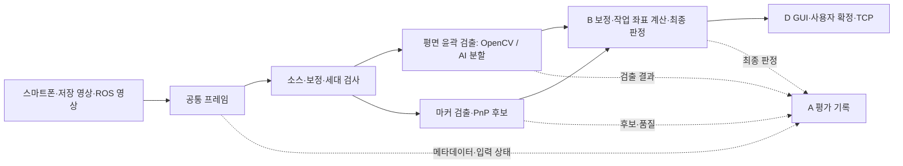

# A 담당 비전 상세설계

문서 버전 1.6 · 설계 초안 · 2026-11-10

| 버전 | 날짜 | 변경 |
|---|---|---|
| 1.0 | 2026-11-07 | 담당 경계, 영상 입력·검출·PnP 인터페이스, 평가와 작업 순서 작성 |
| 1.1 | 2026-11-07 | 검토 반영: 6D 최종 후보 결정을 B로 확정(§2·§5.3·§5.4·§8), 통신 시험 도구·실행·취합을 A로 확정하고 운영 경로와 시험 경로 구분(§2·§4·§9·§11), 마커 좌표계 M과 모서리 대응 계약(§8), OpenCV 확인 환경과 API 경로(§8), `run_id`·`image_seq` 수명(§5.1), 검출 설정 변경 시 세대·스냅샷 규칙(§5.4·§7), 판정 사유와 입력 상태 분리 및 분리 집계(§5.4·§6·§9), `PC_RECEIVE` 시각 관계(§5.1), 검증 항목 추가(§10), 미확정 항목 정리(§12) |
| 1.2 | 2026-11-07 | 수신 세대(`capture_generation`)와 처리 세대(`generation`) 구분, 동일 프레임 재처리 조건과 유효 시간 비연장(§5.1~§5.4), 처리 건수 구분과 검출률 분모를 처리 완료 수로 정의, 평가 실행 식별자 `eval_run_id`와 반복 처리 표본 제외(§9), 회귀 시험·시간 측정 분담(§9·§11), 검증 항목 추가(§10) |
| 1.3 | 2026-11-09 | AI 평면 검출 추가: YOLO11n-seg 초기 후보, OpenCV 기준 비교·3주차 말 운영 채택 결정(§7.1), 관측·설정·오류·평가·일정 반영. 6D는 ArUco·PnP 유지, FoundationPose는 후속 확장 |
| 1.4 | 2026-11-09 | 검토 반영: 계산용 윤곽의 관측면을 부품 윗면으로 정의(`contour_basis`), 전체 실루엣·그림자·가림 윤곽 금지와 `TOP_FACE_UNRESOLVED`, 라벨·평가 기준 일치(§2·§5.2·§5.4·§7·§7.1). 비전 처리 오류의 이동 후보 무효화 이벤트, `job_seq` 기반 적용 순서, D 송신 전 반영과 복구 조건, ACK 대기 중 원래 목표에 적용되는 무효화 시 자동 재전송 중단(§5.4·§7.1·§9). 관측면 판정은 A 책임이며 B 면적 검사는 보조 건전성 검사. 검증·미확정 항목 추가(§10·§12) |
| 1.5 | 2026-11-09 | 계획서 1.4(전체 7주)와 정합: 5주차를 기존 범위 평가·기준 실행본 확보로, 최종 발표를 7주차로 이동(§11). 6~7주 그리퍼 확장의 A 책임(그리퍼 실행 프로파일·시뮬레이션 적용, 2지 개폐·부착·보유 검출, 집기 시험 도구·결과 취합) 요약 신설(§13). 검토 반영: 확장 초기화·DetachableJoint 제약·런타임 시뮬레이션 피드백 역할 구분·확장 모드의 C 서버 부재(§13). 기존 1~5주 범위·절 번호 유지 |
| 1.6 | 2026-11-10 | 계획서 1.5(전체 5주)와 정합: 1~3주차 볼트·너트 컨베이어 분류 인식(데이터·라벨·학습·평가, 추적 ID·재검출, 카메라·도착 감지·접촉 센서 입력), 4~5주차 사람 자세 모델 관절점·신뢰도·시각·유효성 출력으로 변경(§1·§11·§12·§13). 6D 마커·PnP(§8)는 후속으로 표시하고 내용은 유지. 1.5의 6~7주 그리퍼 확장 A 책임(시뮬레이션 적용·순서 관리자 연동)은 대체: 로봇·그리퍼 모델·제어기·실행 구성은 C 소유 |

## 1. 목적과 적용 범위

담당 A의 목표는 스마트폰·저장 영상·Gazebo 카메라를 공통 입력으로 다루고, 로봇 실행에 필요한 인식 결과를 제공하는 것입니다. 1~3주차에는 컨베이어로 공급되는 볼트 2규격·너트 1규격을 검출하고(데이터·라벨·학습·평가, 추적 ID, 벨트 정지 후 재검출), 카메라·도착 감지·접촉 센서 입력을 구성합니다. 4~5주차에는 사람 자세 모델로 관절점·신뢰도·시각·유효성을 출력합니다. 평가에서는 검출 성능을 직접 측정하고, 통신 시험 도구를 구현해 통신·장애 시험을 실행하며, 전원의 결과를 취합합니다. 운영 비전 모듈은 팔·벨트 명령을 직접 만들지 않습니다.

AI는 볼트·너트 검출에 추가하며 OpenCV 기준 방식과 비교합니다. 초기 모델 후보는 YOLO11n-seg이고, 클래스 구성(정확히 3클래스 / `bolt`·`nut` + B의 치수 규격 판정)은 A·B 파일럿 제안입니다. 3주차 말 평가로 운영 채택 여부를 결정하고, 미달·미검증이면 OpenCV 경로를 운영·시연에 사용합니다(§7.1). 사람 자세 모델(후보 MediaPipe Pose Landmarker)은 사전학습 모델 추론이며 학습을 필수로 두지 않습니다. 6D 마커·PnP(§8)는 이번 5주 필수 범위에서 후속으로 옮겼으며, 기존 설계 내용은 후속 작업의 기준으로 유지합니다.

**관측면 주의.** §5.2의 윗면(`top_face`) 계약은 단일 판형 부품을 기준으로 정했습니다. 볼트(머리·축)와 너트에 그대로 성립한다고 보장하지 않으며, 부품별 관측면·라벨 기준은 B와 1~2주차에 재검토합니다(§12).

상위 기준은 [시스템 아키텍처 및 프로젝트 계획](../architecture/시스템_아키텍처_및_프로젝트_계획.md)이며, TCP 필드·상태·재시도 규칙은 [TCP 프로토콜 명세서](../protocol/TCP_프로토콜_명세서.md)를 따릅니다. 이 문서는 두 문서의 규칙을 재정의하지 않습니다.

공통 입력·담당 범위·주차별 목표는 기존 계획을 따릅니다. 아래 모듈 이름, 내부 자료형, 판정 사유·입력 상태 이름과 로그 열은 **구현 제안**입니다. 실제 영상 조건과 파일럿 결과로 정할 임계값은 확정값처럼 사용하지 않습니다. 이 문서 작성 시점에는 해당 모듈의 실행 코드가 없습니다.

## 2. 담당 경계와 인계

| 작업 | A의 책임 | 다른 담당과의 인계 |
|---|---|---|
| 공통 영상 입력 | 소스 어댑터, 메타데이터, 최신 프레임 관리, 입력 상태 보고 | D가 GUI의 소스 선택·시작·정지를 연결 |
| 평면 검출 | ROI, OpenCV 전처리 또는 AI 분할, 윤곽 후보, 영상 후보 필터, 대상 선택, 계산용 윗면 윤곽(§5.2 관측면), 픽셀 오버레이, 비전 처리 오류의 후보 무효화 이벤트(§5.4). AI 데이터·라벨·학습·추론·비교 결과 취합 | B가 윗면 윤곽을 작업 평면으로 변환하고 mm 중심·장축각 계산, 작업 평면 장축 유효성 판정. A·B·D가 운영 채택 기준·결과 확인 |
| 카메라 보정 | 촬영 자료 수집 지원, 프로파일 적용 조건 확인 | B가 보정 파라미터·Homography·광학 프레임 규약 제공 |
| 6D 추정 | 마커 ID·모서리, PnP 후보별 `T_C_M`·재투영 오차·카메라 앞 여부 제공, `MARKER_NOT_FOUND`·`PNP_FAILED` 판정 | B가 작업대 좌표 변환, 마커/물체 오프셋 적용, 높이·기울기 범위 검사, 모호성(`POSE_AMBIGUOUS`) 판정, 최종 후보 선택과 최종 자세 유효성 판정 |
| Gazebo 카메라·마커 | 카메라 센서 설정, 수신률 측정, 마커 텍스처 부품 모델 | C의 월드에 통합하고 B와 광학 프레임·정답 동기 확인 |
| 통신 시험 | 시험 시나리오, 통신 시험 도구 구현, 시험 실행, 결과 분석·취합 | D가 재사용 가능한 TCP 클라이언트·송수신 기록 기능 제공과 관련 결함 수정. C가 서버·로봇 기능, 서버 측 로그 제공과 관련 결함 수정. 서버 측 장애 주입과 로봇 상태 확인은 A가 C와 협력 |
| 평가 | 검출 실패·처리시간·입력 가용성 측정, 통신 시험 결과, 전원 결과 취합 | B가 독립 정답·오차, C가 로봇 도달·서버 로그, D가 GUI 응답 시간 기록 제공 |

**운영 경로와 시험 경로의 구분.**

- 운영 중 A의 비전 모듈은 로봇 명령이나 재시도를 직접 발생시키지 않습니다. A의 검출 성공만으로 이동 가능 상태를 만들지 않으며, B의 좌표·보정 검사와 D의 현재 프레임·준비 상태 확인을 통과한 목표만 사용자 확정 후 D가 송신합니다.
- 별도의 통신 시험 도구는 TCP 명세서와 시험 시나리오 범위에서 `MOVE`·`GET_STATUS`·`CANCEL`을 송신할 수 있습니다. 시험 도구도 TCP 명세서 §8의 클라이언트 규칙을 따릅니다.
- 시험 도구는 통신 로직을 따로 복제하지 않고 D가 제공하는 클라이언트 기능을 재사용합니다. 두 구현이 갈라지면 시험이 운영 클라이언트를 검증하지 못하기 때문입니다.
- 중복 `MOVE` 재송신 같은 장애 주입은 정상 운영 동작과 분리된 시험 모드에서만 실행합니다(TCP 명세서 §8.6).

## 3. 처리 구조와 대안

기존 프로젝트의 공통 입력 규약을 따라 **소스별 입력 어댑터와 공통 처리 파이프라인**을 사용하도록 제안합니다. 소스마다 검출 코드를 복제하면 수정과 평가 조건을 맞추기 어려워집니다. 모든 처리를 GUI 이벤트 안에 넣는 방식은 입력 지연이 화면 조작에 영향을 줄 수 있어 채택하지 않습니다.

입력 수신과 영상 처리는 GUI 스레드 밖에서 수행하고, D에게 결과 객체를 전달합니다. 실행 방식은 D와 연결 시 확정하되, GUI 객체는 GUI 스레드에서만 갱신합니다. 수신 대기열은 최신 프레임 1개를 유지하는 방식으로 제안합니다. 처리 중 프레임의 버퍼는 덮어쓰지 않고, 대기열에서 폐기한 프레임 수도 기록합니다(§9 처리 건수).

정답 자세·정답 파일은 평가 경로에서만 읽습니다. 검출 대상 선택, PnP 후보 선택, 이동 목표 생성에 정답을 사용하지 않습니다.

## 4. 모듈과 배치 위치

아래 파일은 구현 시 만들 예정인 구성입니다.

| 위치 | 제안 모듈 | 책임 |
|---|---|---|
| `src/eyetoarm/common/` | `types.py` | 프레임·관측·품질 자료형과 단위 규약 |
| `src/eyetoarm/inputs/` | `base.py`, `phone.py`, `video.py`, `ros_image.py` | 소스 열기·읽기·종료, 메타데이터·입력 상태 생성 |
| `src/eyetoarm/vision/` | `pipeline.py` | 모드 분기, 처리 세대·설정 스냅샷 확인, 결과 전달 |
| `src/eyetoarm/vision/` | `planar.py` | ROI·전처리·윤곽 검출·영상 후보 필터·대상 선택 |
| `src/eyetoarm/vision/` | `ai_detector.py` | AI 모델 로딩·추론, 마스크에서 윤곽 추출·원본 픽셀 좌표 복원 |
| `config/vision/` | AI 검출 설정 | 검출 방식, 모델·가중치 경로와 식별자, 대상 클래스, 신뢰도 기준, 입력 크기, 추론 장치. 구현 시 추가 |
| `src/eyetoarm/vision/` | `marker.py`, `pnp.py` | 마커 모서리와 PnP 후보·품질 출력. OpenCV API 분기 어댑터(§8) |
| `src/eyetoarm/vision/` | `overlay.py` | 프레임에 대응하는 ROI·윤곽·마커 표시 자료 |
| `config/sources/` | 소스별 설정 | 입력 종류, 영상 경로·토픽, ROI·검출 파라미터, 입력 제한시간 |
| `config/calibration/` | B 제공 프로파일 | 카메라·해상도·크롭·좌표 기준·보정 식별자 |
| `simulation/models/` | 마커 부품 모델 | 마커 이미지, 실제 크기, 텍스처 방향(§8의 M 정의) |
| `scripts/` | 검출 실행·평가 취합 도구, 통신 시험 도구 | 저장 자료 재현과 결과표 생성. 통신 시험 도구는 D의 `src/eyetoarm/tcp/` 클라이언트 기능을 재사용 |
| `tests/` | 단위·통합 검증 | 좌표 복원, 이전 결과 폐기, 오류와 통합 시나리오 |

보정 수치와 좌표 변환 구현은 기존 `calibration/`, `transforms/` 영역에서 B와 협업합니다. `common/types.py` 같은 공동 파일은 1주차에 필드와 변경 담당자를 합의합니다.

## 5. 내부 데이터 계약

### 5.1 공통 프레임 `FramePacket`

| 필드 | 의미·규칙 |
|---|---|
| `image` | 앱 내부의 BGR 영상 배열. 색상 순서는 입력 어댑터에서 통일 |
| `run_id` | 앱 실행 단위 식별자. 앱을 새로 실행하면 새로 발급. 내부 기록용이며 TCP 필드에 넣지 않음 |
| `source_id`, `image_seq` | 소스와 앱 내부 프레임 순번. 처리 결과와 원본을 연결하는 식별자. `image_seq`의 수명은 아래 「`image_seq` 수명」 |
| `timestamp_ms`, `timestamp_base` | 상위 계획의 시간 기준(TCP 명세서 §4.3). 서로 다른 기준의 시각끼리 직접 빼지 않음. `PC_RECEIVE`의 값은 아래 「시각 관계」 |
| `received_monotonic_ns` | 입력 어댑터가 프레임 수신 순간 한 번 취득한 PC 단조 시각. 모든 시간 기준에서 PC 수신 중단·경과 시간 감시용으로 유지 |
| `width`, `height`, `crop` | 원본 해상도와 적용 크롭. ROI와 구분 |
| `calibration_id` | 대응 프로파일 ID. 미지정 시 표시·픽셀 검출까지만 허용 |
| `capture_generation` | 수신 시점의 세대. 재처리해도 바뀌지 않음. 처리 작업의 `generation`(처리 세대)과 구분하며, 증가 조건과 두 세대의 관계는 §5.4 |
| `optical_frame` | ROS 영상의 광학 좌표계 이름. 앱의 `image_seq`와 구분 |

ROS의 원본 영상 stamp는 정답과의 대응을 위해 나노초 정밀도로 별도 보관하고, TCP용 ms 변환값과 구분합니다. ROI·표시용 축소를 적용했다면 원본 픽셀로 복원할 변환을 함께 관리합니다.

**`image_seq` 수명.**

- 하나의 `run_id` 안에서 새로 수신한 프레임마다 `image_seq`를 단조 증가시킵니다.
- 소스 변경·재접속·영상 탐색·ROS 시간 되감기로 초기화하지 않습니다. 이런 사건은 세대 증가로 구분합니다(§5.4). 저장 영상을 탐색한 뒤 다시 디코딩한 프레임은 새로 수신한 프레임이므로 새 `image_seq`를 받고, 재생 위치는 `timestamp_ms`(`VIDEO_POS`)에 남습니다.
- 이미 받은 같은 `FramePacket`을 다시 처리할 때(예: 정지 화면에서 검출 설정을 바꿔 재처리)는 프레임의 `run_id`·`source_id`·`image_seq`, 원본 시각(`timestamp_ms`·`timestamp_base`, ROS 원본 stamp), 수신 시각(`received_monotonic_ns`), `capture_generation`을 모두 유지합니다. 재처리 결과는 처리 세대(`generation`)와 검출 설정 식별자로 구분합니다. 재처리할 수 있는 조건은 §5.4입니다.
- 앱을 새로 실행하면 새 `run_id`를 발급하며, `image_seq`는 초기값에서 다시 시작할 수 있습니다.
- 평가 로그의 프레임 식별에는 `run_id`와 `image_seq`를 함께 쓰고 `source_id`도 기록합니다. `image_seq`만으로는 실행 간에 겹칠 수 있기 때문입니다.

**시각 관계.**

- 입력 어댑터는 프레임을 받은 순간 단조 시계(Python `time.monotonic_ns()`)를 **한 번** 읽어 `received_monotonic_ns`에 저장합니다.
- `timestamp_base == PC_RECEIVE`이면 `timestamp_ms = received_monotonic_ns // 1_000_000`입니다. 두 필드를 만들기 위해 시계를 따로 두 번 읽지 않습니다. 두 번 읽으면 같은 프레임의 두 시각이 어긋나, 지연 측정과 송신 전 유효 시간 판정의 기준이 달라집니다.
- `PHONE_CAPTURE`·`SIM_TIME`·`VIDEO_POS`에서는 `timestamp_ms`가 각 소스의 시간 기준을 따릅니다(TCP 명세서 §4.3). 이때도 `received_monotonic_ns`는 PC 수신 중단·경과 시간 감시용으로 유지합니다.

### 5.2 평면 관측 `PlanarObservation`

공통 프레임 식별자(`run_id`, `source_id`, `image_seq`)와 원본 프레임의 `capture_generation`, 처리 작업의 `generation`(처리 시작 시점의 현재 세대)과 검출 설정 식별자(§5.4), 픽셀 좌표 기준, 윤곽 점 배열, 후보 수, 선택 결과, 검출 유효 여부, 판정 사유와 처리시간을 담습니다. 원본·왜곡 보정 영상 중 어느 기준인지와 적용 프로파일을 명시합니다. 픽셀 중심·장축은 디버깅 표시용으로만 제공할 수 있습니다.

관측 결과는 처리를 **완료한** 작업에서만 만들며, 무검출 같은 정상적인 무효 판정도 완료된 결과입니다. 대기열 폐기, 세대 변경에 따른 작업 폐기, 처리 예외·중단은 관측 결과를 만들지 않고 처리 기록으로 남깁니다(§9). `PoseObservation`(§5.3)도 같습니다.

B가 사용하는 좌표는 명시된 기준에 맞춰 전달합니다. **왜곡 보정과 Homography의 순서·픽셀 기준을 B와 고정**하고 같은 보정을 두 번 적용하지 않습니다. B는 작업 평면으로 옮긴 윤곽에서 중심·장축을 계산합니다. 픽셀 각도를 작업대 각도로 간주하지 않습니다.

**관측면 — 계산용 윤곽이 가리키는 물리 면.** 평면 모드에서 B에게 넘기는 계산용 윤곽은 부품 **윗면**의 외곽입니다. B의 Homography가 윗면 높이(`plane_height_m`)로 만들어지고(B 상세설계 §6.1·§6.3), 평면 중심이 그 윤곽의 면적 중심이며(B 상세설계 §5.4), 물체 기준점 O와 평면 정답도 윗면 중심을 기준으로 하기 때문입니다(B 상세설계 §5.3·§10.2). 관측에는 윤곽이 어떤 면인지를 `contour_basis = "top_face"`로 기록합니다(이름은 구현 제안). B가 관측면 높이나 Homography 기준을 바꾸면 이 정의와 라벨·평가 기준을 함께 바꿉니다.

- 측면·그림자·가림을 포함한 전체 외곽(실루엣)은 윗면 윤곽이 아니며, 계산용 윤곽으로 넘기지 않습니다. 비스듬한 시점에서는 실루엣에 측면이 섞여, 윗면 높이로 옮겼을 때 중심이 밀리고 면적이 커집니다.
- 검출·표시용 **전체 물체 마스크**와 B에게 넘기는 **계산용 윗면 윤곽**을 구분합니다. 전체 물체 마스크는 대상 존재·후보 선택·오버레이에만 쓰고, B 입력이나 평가용 윤곽으로 쓰지 않습니다.
- 윗면 윤곽을 얻지 못하면(측면·그림자와 분리되지 않음, 윗면 일부가 가려짐) 가려진 경계를 추정해 채우지 않고 `TOP_FACE_UNRESOLVED`로 무효 처리합니다(§5.4). 영상 경계에 잘린 경우는 기존 `CONTOUR_CLIPPED`입니다.

> **기하 반례(설계 근거이며 구현 시험 결과가 아님).** 100×30×20 mm 직육면체의 윗면 중심이 W `(0, 0)`이고 카메라 중심이 W `(0, −300, 500)` mm일 때, 윗면·밑면 꼭짓점이 만드는 전체 실루엣을 `z = 20 mm` 평면으로 역투영하면 면적 중심 ≈ `(0, −5.61)` mm, 면적 ≈ 4117 mm²입니다. 실제 윗면은 중심 `(0, 0)`, 면적 3000 mm²입니다. 이런 실루엣이 정상 윗면 윤곽으로 받아들여지면 안 됩니다(§10).

AI 방식도 같은 윤곽·프레임·세대·관측면 계약을 따릅니다. 내부 관측에는 검출 방식, 모델·가중치 식별자, 대상 클래스와 신뢰도를 추가 기록하도록 제안합니다. 바운딩 박스 중심·영상 각도·모델 신뢰도를 작업 좌표·장축각·이동 유효성으로 직접 사용하지 않으며 TCP 필드는 추가하지 않습니다.

### 5.3 마커·PnP 관측 `PoseObservation`

§5.2와 같은 식별자(프레임 식별자, `capture_generation`, 처리 작업의 `generation`, 검출 설정 식별자)와 함께 마커 사전·ID, 마커 고유 방향 순서가 보존된 네 모서리(§8), 마커 변 길이(m), 사용한 카메라 파라미터 식별자, PnP 후보 목록을 담습니다. 후보마다 `T_C_M`, 재투영 오차와 카메라 앞 여부를 제공합니다. 내부 변환의 병진 단위는 m로 통일하고, 표시·TCP 경계에서만 mm로 바꿉니다.

A는 후보를 골라내지 않고 계산된 모든 후보와 그 품질을 B에게 전달합니다. A가 판정하는 무효는 마커를 찾지 못한 경우(`MARKER_NOT_FOUND`)와 후보를 하나도 계산하지 못한 경우(`PNP_FAILED`)뿐입니다. B가 작업대 좌표 변환, 높이·기울기 범위 검사, 모호성 판정과 최종 후보 선택을 담당하며, 그 결과(선택 후보, `POSE_OUT_OF_RANGE`·`POSE_AMBIGUOUS` 등 최종 자세 무효 판정)는 B의 작업대 기준 물체 자세 자료형으로 냅니다. 카메라 기준 자세(`PoseObservation`, A)와 작업대 기준 물체 자세(B)는 별도 자료형으로 구분합니다. rvec를 그대로 Euler 각도로 표시하거나 TCP에 넣지 않습니다.

### 5.4 무효 결과와 세대 검사

판정 사유와 입력 상태를 구분합니다. 판정 사유는 받은 프레임에 대한 검출·자세 판정 결과이고, 입력 상태는 프레임을 받지 못했거나 받기를 끝낸 사건입니다. 둘을 섞으면 검출 성능과 입력 장애가 같은 실패율로 합쳐집니다. 아래 이름은 모두 내부 사유·상태이며 **TCP 오류 코드에 추가하지 않습니다.** D는 사용자 설명으로 변환합니다.

**검출·자세 판정 사유** — 프레임 식별자(`run_id`, `source_id`, `image_seq`)와 함께 기록합니다.

| 사유 | 판정 주체 | 의미 |
|---|---|---|
| `NO_OBJECT` | A | ROI 안에 대상 후보 윤곽이 없음(무검출) |
| `MULTIPLE_OBJECTS` | A | 구분할 근거가 없는 복수 후보(§7 4단계) |
| `CONTOUR_CLIPPED` | A | 대상 후보가 ROI·영상 경계에 걸려 잘림 |
| `TOP_FACE_UNRESOLVED` | A | 대상은 있으나 계산용 윗면 윤곽을 얻지 못함: 측면·그림자와 분리되지 않음, 윗면 일부가 가려짐, AI 마스크가 윗면이 아닌 전체 실루엣으로 판단됨(§5.2 관측면) |
| `IMAGE_ASPECT_LOW` | A | 영상 후보 필터의 종횡비 조건 미달. 영상 비율에 대한 판정이며 부품의 실제 종횡비를 판정하지 않음 |
| `CALIBRATION_MISMATCH` | A | 프레임의 해상도·크롭·`calibration_id`가 프로파일 적용 조건과 다르거나 프로파일이 없음. 픽셀 검출까지만 허용 |
| `MARKER_NOT_FOUND` | A | 설정한 사전·ID의 마커를 검출하지 못함 |
| `PNP_FAILED` | A | 검출한 모서리로 PnP 후보를 하나도 계산하지 못함(해 없음, 계산 실패, 카메라 파라미터 불일치) |
| `DIRECTION_UNSTABLE` | B | 작업 평면으로 옮긴 윤곽의 장변/단변 비가 계획 조건(1.5) 미달이라 장축이 불안정 |
| `WORK_COORD_INVALID` | B | 보정·작업 좌표 변환 결과의 유효성 검사 실패 |
| `POSE_OUT_OF_RANGE` | B | 작업대 변환 후 높이·기울기 범위를 만족하는 후보가 없음 |
| `POSE_AMBIGUOUS` | B | 범위를 만족하는 서로 다른 자세의 후보가 판정 기준으로 구분되지 않음 |

**입력 상태** — 프레임이 없는 사건이므로 존재하지 않는 프레임 ID(`image_seq`)를 만들지 않습니다. `run_id`·`source_id`·이벤트 시각(PC 단조 시각)으로 기록합니다.

| 상태 | 의미 |
|---|---|
| `SOURCE_UNAVAILABLE` | 연결 불가·열기 실패(파일 없음, 스트림 접속 실패, 토픽 없음) |
| `FRAME_TIMEOUT` | 입력 제한시간 안에 새 프레임이 오지 않음(대기·수신 시간 초과, 스트림 중단, Gazebo 수신 중단) |
| `DECODE_FAILED` | 받은 데이터를 영상으로 해석하지 못함. `FramePacket`을 만들지 않음 |
| `END_OF_STREAM` | 저장 영상의 끝. 정상 종료일 수 있으므로 자동으로 검출 실패나 입력 장애에 포함하지 않음 |

**수신 세대와 처리 세대.** 파이프라인은 현재 세대 하나를 관리합니다. 이름은 구현 제안입니다.

| 이름 | 붙는 곳 | 값 |
|---|---|---|
| `capture_generation` | `FramePacket` | 프레임을 수신한 시점의 현재 세대. 재처리해도 바뀌지 않음 |
| `generation` | 처리 작업과 그 결과(`PlanarObservation`, `PoseObservation`) | 처리 작업을 시작한 시점의 현재 세대 |
| `job_seq` | 처리 작업과 그 결과, 비전 처리 오류 이벤트 | 한 `run_id` 안에서 처리 작업을 시작할 때마다 단조 증가하는 순번. 같은 세대 안에서 결과·오류의 선후를 정함 |

수신 직후 처리하는 일반적인 경우 두 값은 같습니다. 같은 프레임을 다시 처리하면 `capture_generation`은 그대로이고 `generation`만 새 세대가 됩니다.

**세대 증가 조건.** 다음 중 하나가 일어나면 현재 세대를 증가시킵니다.

- 소스 변경, 보정 프로파일 변경, 모드 변경
- 영상 탐색, 재접속, ROS 시뮬레이션 시각의 되감기
- 결과에 영향을 주는 검출 설정 변경: ROI, 이진화 방식·임계값, 노이즈 억제·형태학 필터, 면적 범위, 경계 여유, 검출 방식(OpenCV/AI), AI 모델·가중치·대상 클래스·신뢰도 기준·입력 크기·추론 장치, 마커 사전·ID·변 길이 등. 오버레이 색처럼 표시에만 쓰는 설정은 제외

**설정 스냅샷과 폐기.**

- 처리 작업은 시작할 때 그 시점의 현재 세대를 작업의 `generation`으로 삼고, 검출 설정 값·검출 설정 식별자와 함께 스냅샷으로 고정하며, 처리 중에 설정이 바뀌어도 스냅샷 값으로 계산합니다.
- 작업 완료 시 작업의 `generation`이 현재 세대와 다르면 결과를 버리고 세대 변경 폐기로 기록합니다(§9). 버린 작업을 기록할 때는 처리 당시의 설정 식별자를 그대로 쓰고, 이전 설정의 결과에 새 설정 식별자를 붙이지 않습니다.
- 세대가 증가하는 즉시 이전 세대의 결과는 현재 이동 후보로 사용할 수 없습니다. 파이프라인은 그 순간 현재 결과를 무효로 바꾸어 D에게 알립니다.
- 무검출 시 이전 유효 좌표를 현재 결과로 재사용하지 않습니다.

**동일 프레임 재처리의 조건.** 현재 선택된 프레임의 ROI·검출 파라미터를 바꿔 다시 처리하는 경우에만 이전 세대에 수신한 프레임을 새 처리 세대로 계산할 수 있습니다. 재처리 작업을 시작하기 전에 다음을 모두 확인합니다.

1. 그 프레임이 지금 선택된 프레임입니다(저장 영상의 현재 재생 위치, 정지 화면으로 고정한 프레임 등).
2. 그 프레임을 수신한 뒤 일어난 세대 증가가 모두 검출 설정 변경 때문입니다. 소스 전환·보정 변경·모드 변경·영상 탐색·재접속·ROS 시각 되감기로 세대가 바뀌었다면 그 프레임은 이미 폐기된 것이며, 현재 세대를 처리 세대로 붙여 다시 쓰지 않습니다.
3. 현재 소스와 보정 프로파일의 적용 조건(해상도·크롭·`calibration_id`)이 그 프레임에 유효합니다.

조건을 만족하면 `image_seq`와 수신 정보는 그대로 두고, 새 처리 세대와 새 검출 설정 식별자로 계산합니다. 재처리했다고 원본 프레임의 유효 시간이 갱신되지는 않습니다. 송신 전 유효 시간 판정은 원본 프레임의 시각(`received_monotonic_ns`, 또는 소스의 시간 기준)으로 하므로(계획서 §2.2), 오래된 프레임을 재처리해도 송신 가능 시간이 연장되지 않습니다.

**비전 처리 오류와 이동 후보 무효화.** 처리 예외·중단은 관측 결과를 만들지 않는다는 계약(§5.2)은 그대로 둡니다. 결과가 없으면 D의 화면에는 직전 정상 결과가 남을 수 있으므로, 파이프라인은 관측과 별도로 **후보 무효화 이벤트**를 D에게 보냅니다. 이름과 필드는 구현 제안이며 TCP 메시지·오류 코드에 추가하지 않습니다.

| 오류 종류 | 발생 | 프레임 식별자 |
|---|---|---|
| `MODEL_LOAD_FAILED` | 모델·가중치·추론 라이브러리를 불러오지 못함 | 없음. 가상의 `image_seq`를 만들지 않음 |
| `MODEL_CONFIG_INVALID` | 클래스 매핑·입력 크기·장치 등 검출 설정이 가중치·환경과 맞지 않음 | 없음(설정 적용 시) 또는 해당 작업의 값 |
| `INFERENCE_ERROR` | 처리 작업 중 추론·후처리 예외 | 해당 작업의 값 |
| `JOB_ABORTED` | 세대 변경이 아닌 이유로 현재 처리 작업이 중단됨(작업자 종료·제한시간 초과 등) | 해당 작업의 값 |

무효화 이벤트에는 `run_id`, `source_id`, 오류 종류, 원인 설명, 이벤트 시각(PC 단조 시각), 그 시점의 현재 세대 또는 작업의 `generation`, 검출 설정 식별자를 담고, 작업에서 생긴 오류라면 `job_seq`와 프레임 식별자(`image_seq`)를 더합니다. 세대 변경으로 이전 결과가 무효가 되는 경우(§5.4 「설정 스냅샷과 폐기」)도 같은 이벤트로 알립니다.

적용 규칙(파이프라인과 D 공통):

1. 이벤트의 `generation`이 현재 세대보다 오래되었으면 기록만 하고 현재 후보에 적용하지 않습니다. 세대가 바뀌는 순간 이전 후보는 이미 무효이므로, 늦게 도착한 옛 오류가 새 세대의 정상 결과를 무효화하지 않게 하기 위해서입니다.
2. 현재 세대의 작업 오류는 그 작업보다 먼저 시작한 작업의 후보(`job_seq`가 같거나 작은 결과)를 무효화합니다. 오류 작업보다 나중에 시작한 작업의 정상 결과는 무효화하지 않습니다.
3. 프레임이 없는 로딩·설정 오류는 현재 세대의 모든 후보를 무효화합니다.
4. 무효화된 뒤에는 오류가 해소되었다는 것만으로 실행을 다시 허용하지 않습니다. 현재 세대·현재 설정에서 오류 이후에 시작한 작업(`job_seq`가 더 큼)의 정상 결과가 B의 판정과 D의 실행 전 검사를 통과해야 새 후보가 됩니다.
5. 오류를 이유로 검출 방식을 OpenCV로 자동 전환하지 않습니다(§7.1).

D는 이 이벤트를 현재 표시·실행 가능 상태와 **아직 송신하지 않은 확정 스냅샷**에 적용하며, 준비 조회 응답을 받은 뒤 실제 `MOVE` 송신 직전 검사에도 반영합니다(D 상세설계 §A.3·§A.6). 확정 스냅샷이나 이미 보낸 명령의 원래 목표에 이벤트가 적용되는지는 위 규칙 1~3으로 판단합니다. 이벤트의 `generation`이 그 목표의 처리 세대와 같고, 프레임 없는 로딩·설정 오류이거나 오류 작업의 `job_seq`가 목표 작업의 `job_seq`보다 작지 않을 때 적용됩니다.

이미 서버로 보낸 명령은 이 내부 오류만으로 자동 취소하지 않습니다. 다만 ACK를 기다리는 동안 원래 목표에 적용되는 무효화가 오면, 그 목표는 TCP 명세서 §8.3의 재전송 조건("원래 목표가 아직 유효")을 만족하지 않으므로 D는 자동 재전송을 멈춥니다(D 상세설계 §A.6). 이는 재전송 중단일 뿐 서버에서 수락·실행된 명령의 취소나 실패 확정이 아니며, 같은 ID의 늦은 ACK·STATUS는 정상 반영합니다. 원래 목표와 무관한 이전 세대·이전 작업의 지연 오류는 재전송 조건을 바꾸지 않습니다. A의 비전 모듈은 이 경우에도 로봇 명령을 발생시키지 않습니다.

## 6. 입력 소스별 동작

| 소스 | A가 확인할 항목 | 실패·정지 처리 |
|---|---|---|
| 스마트폰 | 스트림 방향·주소, 해상도, 수신 시각, 실제 수신률 | 연결 불가는 `SOURCE_UNAVAILABLE`, 수신 중단은 `FRAME_TIMEOUT`으로 알리고 새 결과 생성을 중단. 재접속 시 새 세대 적용, `image_seq`는 이어서 증가 |
| 저장 영상 | 파일 열기, 현재 재생 위치, 프레임 선택·탐색 | 파일 없음(`SOURCE_UNAVAILABLE`), 해석 실패(`DECODE_FAILED`), 파일 끝(`END_OF_STREAM`)을 구분. 탐색 시 새 세대 적용과 이전 결과 폐기 |
| Gazebo | `Image`·`CameraInfo`·`/clock`, 광학 프레임, 센서 해상도·수신률 | stamp와 시뮬레이션 시간, PC 수신 중단을 함께 검사. 수신 중단은 `FRAME_TIMEOUT`. 정지 중 이전 결과 실행 차단 |

입력 객체의 제안 인터페이스는 `open(config)`, `read()`, `close()`입니다. `read()`는 새 프레임이 있으면 `FramePacket`을, 없으면 입력 상태를 돌려주며, 입력 상태에는 프레임 ID를 만들지 않습니다. ROS 입력은 콜백으로 최신 프레임을 갱신하고 `read()`는 그 스냅샷을 제공합니다. 종료·소스 전환 시 수신 작업과 연결 자원을 정리합니다. 무기한 대기하지 않도록 입력 제한시간은 설정으로 관리합니다.

Gazebo 센서 설정은 A가 준비하고 C가 월드 배치를 통합합니다. B와 `optical_frame_id`, CameraInfo, 보정 프로파일의 프레임 일치를 검증합니다. Gazebo 정답 기록은 B가 담당합니다.

## 7. 평면 검출 처리

아래 1~5단계는 처리 시작 시 고정한 설정 스냅샷(§5.4)으로 수행합니다. 기본은 OpenCV 경로이며 AI 경로는 §7.1에 따라 2~3단계를 분할 추론·마스크 윤곽 추출로 대체합니다. 후보 필터·대상 선택·원본 좌표 복원과 B의 판정은 공통으로 적용합니다.

1. 소스·해상도·크롭·프로파일을 확인하고 ROI를 적용합니다. 프로파일 조건이 맞지 않으면 `CALIBRATION_MISMATCH`로 표시하고 픽셀 검출까지만 진행합니다.
2. 명암 변환·노이즈 억제·이진화로 전경을 만듭니다. 이진화 방식과 파라미터는 소스별 파일럿에서 결정합니다.
3. 필요 시 형태학 처리 후 윤곽 후보를 구합니다. 면적·경계 잘림(`CONTOUR_CLIPPED`)·형상 조건과 영상 후보 필터의 종횡비 조건(`IMAGE_ASPECT_LOW`)으로 후보를 분류합니다. 선택한 대상에서 계산용 **윗면 윤곽**을 얻습니다(§5.2 관측면). 이진화 전경이 측면·그림자를 포함해 윗면과 분리되지 않거나 윗면 일부가 가려지면 `TOP_FACE_UNRESOLVED`입니다. 윗면을 분리하는 방법(카메라 배치·조명·배경·윗면 대비 등)은 1주차 촬영 조건과 2주차 파일럿에서 정합니다.
4. 대상 1개를 선택합니다. 후보가 없으면 `NO_OBJECT`, 여러 후보를 구분할 근거가 없으면 최대 면적 후보로 무조건 진행하지 않고 `MULTIPLE_OBJECTS`로 무효 처리합니다.
5. ROI·축소 좌표를 원본 기준으로 복원한 윗면 윤곽을 `contour_basis = "top_face"`와 함께 B에게 전달합니다.
6. B의 작업 평면 중심·장축·유효성 결과(`DIRECTION_UNSTABLE`, `WORK_COORD_INVALID` 포함)를 동일 프레임에 연결하고 D에게 표시 자료를 전달합니다.

대상 부품의 장변/단변 비 1.5 이상 조건은 상위 계획을 따릅니다. A의 영상 후보 필터(`IMAGE_ASPECT_LOW`)와 B의 작업 평면 장축 유효성 판정(`DIRECTION_UNSTABLE`)을 구분하고, 조명·원근 때문에 영상 비율만으로 물체의 실제 종횡비를 단정하지 않습니다. A의 필터는 명백히 다른 형상을 걸러내는 용도로 느슨하게 두고, 1.5 조건의 최종 판정은 B가 작업 평면에서 합니다.

소스별 설정에는 ROI, 이진화 방식, 노이즈 억제, 면적 범위, 경계 여유를 기록하고, 설정마다 검출 설정 식별자를 둡니다. 튜닝에 쓴 자료와 최종 평가 자료는 분리합니다. 영상·해상도 변경 시 파라미터를 무조건 재사용하지 않습니다.

### 7.1 AI 기반 평면 검출

이 절은 처음 단일 부품 기준으로 작성했고, 1.6부터 대상은 볼트 2규격·너트 1규격입니다. 클래스 구성과 부품별 관측면은 §12의 재검토 항목을 따릅니다.

**범위와 대안.** 부품의 평면 검출에 AI 학습·추론·평가를 추가합니다. OpenCV 윤곽 검출은 재현 가능한 기준 방식으로 유지합니다. 바운딩 박스 검출만으로는 B가 요구하는 부품 윤곽을 제공하기 어려우므로, 초기 후보는 인스턴스 분할 모델 YOLO11n-seg로 정합니다. 마스크 윤곽의 정확도는 별도 평가 대상이며 AI가 항상 OpenCV보다 우수하다고 가정하지 않습니다. FoundationPose와 AI 특징점 기반 6D 추정은 이번 5주 범위에서 제외하고 후속 확장으로 둡니다.

**처리 경로.** 공통 프레임 → 소스·보정·세대 검사 → AI 분할 → 대상 클래스·신뢰도·마스크 검사 → 공통 윤곽 필터·후보 선택 → 원본 픽셀 기준 **윗면 윤곽**(§5.2 관측면) → B의 작업 좌표 변환·중심·장축 계산·최종 판정 → D의 표시·사용자 확정·TCP 경로를 따릅니다. BGR 입력의 색상 순서는 추론 라이브러리의 계약에 맞추며, 라이브러리 내부 변환과 중복 적용하지 않습니다. ROI·리사이즈·패딩의 변환을 기록하고 역변환하여 §5.2의 픽셀 기준에 맞춥니다. YOLO 분할만으로 깊이·6D 자세를 얻었다고 해석하지 않습니다.

**모델과 데이터.** A는 대상 부품·배경·조명·거리·방향을 포함한 촬영 자료와 분할 라벨을 준비합니다. 사전학습 클래스에 해당 부품이 없거나 성능이 부족하면 추가 학습합니다.

라벨은 §5.2의 관측면 정의를 따릅니다. B에게 넘길 계산용 클래스는 부품 **윗면** 다각형으로 라벨하고, 측면·그림자는 윗면 라벨에 넣지 않습니다. 검출·표시용 전체 물체 클래스를 함께 두더라도 그 마스크는 B 입력에 쓰지 않습니다. 윗면이 일부 가려지거나 잘린 영상은 가려진 경계를 추정해 그리지 않고 "윗면 불완전"으로 표시해, 기대 처리 결과가 무효(`TOP_FACE_UNRESOLVED` 또는 `CONTOUR_CLIPPED`)인 평가 표본으로 씁니다. OpenCV 비교 기준과 평가 정답도 같은 윗면 정의를 씁니다. 클래스 이름과 라벨 도구는 구현 제안이며 1주차에 정합니다. 학습·검증·최종 평가 자료는 촬영 세션·원본 영상·독립 배치 단위로 분리하여 인접 프레임이 양쪽에 섞이지 않게 합니다. 임계값·모델 선택에는 최종 평가 자료를 쓰지 않습니다. Gazebo 정답은 평가 전용으로 유지하며 운영 검출·대상 선택에 사용하지 않습니다.

모델 설정에는 라이브러리 버전, 가중치 출처·버전·해시·경로, 클래스 매핑, 신뢰도 기준, 입력 크기와 추론 장치를 기록합니다. 가중치의 보관·공유·입수 절차를 남기고 개발 PC와 시연 PC에서 같은 설정으로 재현합니다. AI 의존성은 선택적으로 구성하여 OpenCV 경로를 단독 실행할 수 있게 합니다. 모델을 불러오는 데 성공한 것만으로 부품 검출이나 처리시간 검증을 완료했다고 보지 않습니다.

**실패 처리.** 유효한 대상 후보가 없으면 `NO_OBJECT`, 구분할 근거가 없는 복수 후보는 `MULTIPLE_OBJECTS`입니다. 최고 신뢰도·최대 면적 후보를 무조건 선택하지 않습니다. 경계 잘림은 공통 `CONTOUR_CLIPPED` 검사로 처리합니다. 마스크가 측면·그림자를 포함한 전체 실루엣이거나 윗면 일부가 가려졌다고 판단되면 `TOP_FACE_UNRESOLVED`입니다. 모델·가중치 로딩 실패(`MODEL_LOAD_FAILED`), 클래스 매핑 등 설정 오류(`MODEL_CONFIG_INVALID`), 추론 예외(`INFERENCE_ERROR`), 현재 작업 중단(`JOB_ABORTED`)은 정상 무검출과 구분해 원인을 기록합니다. 이들은 관측 결과를 만들지 않으며, 추론 예외·중단은 §9의 처리 예외·중단 건수로 집계합니다. 네 경우 모두 §5.4 「비전 처리 오류와 이동 후보 무효화」의 이벤트로 D에게 알려 현재 이동 후보와 송신 전 확정 스냅샷을 무효화하고, 이전 유효 결과를 현재 결과로 재사용하지 않습니다. 프레임이 생성되기 전 로딩에 실패했다면 가상의 프레임 ID를 만들지 않습니다. 다음 정상 결과가 §5.4의 복구 조건을 만족하기 전까지 실행을 다시 허용하지 않습니다.

추론 오류가 발생했다고 검출 방식을 자동 변경하지 않습니다. 운영 채택 결정 또는 명시적 설정 변경으로 OpenCV 경로를 선택할 때는 세대를 증가시키고 이전 결과를 폐기합니다. 두 방식 모두 A가 로봇 명령을 직접 발생시키지 않습니다.

**평가와 3주차 말 채택 결정.** A·B·D는 2주차 파일럿에서 아래 기준값·표본 수·조건을 기록하고 3주차 비교 평가 전에 고정합니다. §9의 기존 시간 측정 구간과 상위 계획의 제안 KPI를 참조하되, 새 수치를 임의로 확정하지 않습니다.

| 평가 항목 | 확인 내용·담당 |
|---|---|
| 검출 성능 | A: 동일한 독립 평가 자료에서 OpenCV/AI의 유효율·오검출·미검출·사유별 건수, 무대상·복수 후보·가림·경계 잘림·조명 변화. 복수·가림의 정상 처리를 확장 요구로 삼지 않고 무효 처리 확인에 사용 |
| 작업 좌표 정확도 | B: 같은 보정·픽셀 기준과 같은 관측면(윗면)으로 계산한 위치·장축각 오차, 유효 표본 수와 무효율. 모델 신뢰도나 분할 지표만으로 정확도를 대체하지 않음 |
| 관측면 유지 | A·B: 측면이 보이는 시점(작업 범위 구석·비스듬한 배치), 그림자, 부분 가림에서 두 방식의 계산용 윤곽이 윗면을 유지하거나 무효(`TOP_FACE_UNRESOLVED`·`WORK_COORD_INVALID`)로 처리되는지. 전체 실루엣이 정상 윗면 윤곽으로 받아들여진 건수를 따로 보고 |
| 처리시간·연동 | A: 순수 영상처리와 기존 전체 경로 구간을 구분. D: GUI 응답·최신 결과 반영·현재 이동 후보 무효화 확인. 시연 PC에서 Gazebo 등 실제 동시 실행 조건 기록 |
| 재현성과 실패 | A: 분리된 데이터·모델·설정으로 재현, 로딩·추론 실패와 설정 변경 중 결과 폐기, 오류 이벤트에 따른 후보 무효화(§5.4) 확인. D: 무효화가 화면·송신 전 스냅샷에 반영되는지 확인. 모의 추론 단위시험과 실제 모델 연동 시험을 구분 |

3주차 말 A가 비교 결과를 취합하고 A·B·D의 확인자·날짜·절차·결과·증거 경로와 채택 결정을 기록합니다. 필수 기준을 모두 확인한 경우에만 AI를 운영 방식으로 채택합니다. 미달·미검증·일정 지연이면 OpenCV 실행본으로 통합·시연하고 AI 결과는 비교 실험과 제한 사항으로 보고합니다. 미검증을 성능 실패로 단정하거나 미채택을 AI 검증 완료로 표현하지 않습니다. 4~5주차에는 AI 범위를 확대하지 않고 ArUco·PnP 통합과 최종 평가를 진행합니다.

모델 구조·과제와 실행 방법은 [Ultralytics YOLO11 공식 문서](https://docs.ultralytics.com/models/yolo11/)를 참조합니다. 위 내용은 설계이며 데이터·가중치 확보, 학습·추론 구현과 성능 검증은 아직 완료되지 않았습니다.

## 8. 마커 검출·PnP 확장 (후속, 이번 5주 필수 아님)

이 절은 후속 6D 확장의 기준으로 유지합니다. TCP 1.1의 `POSE_6D` 정의도 그대로입니다.

1. 사용할 마커 사전·ID·실제 변 길이 `L`(m)을 설정으로 고정하고 인쇄물·Gazebo 텍스처와 일치시킵니다.
2. 원본 또는 보정 영상의 마커 모서리를 검출하고 픽셀 기준을 기록합니다. 마커를 찾지 못하면 `MARKER_NOT_FOUND`입니다.
3. 아래 「마커 좌표계 M과 모서리 대응」에 따라 `SOLVEPNP_IPPE_SQUARE`의 3D 점과 영상 점을 대응시킵니다.
4. `solvePnPGeneric`의 후보별 `T_C_M`·재투영 오차·카메라 앞 여부를 산출합니다. 사용한 픽셀과 내부 파라미터·왜곡 모델을 일치시킵니다. 후보를 하나도 계산하지 못하면 `PNP_FAILED`입니다.
5. A는 후보를 골라내지 않고 모든 후보와 품질을 B에게 전달합니다. B가 작업대 좌표 변환 후 높이·기울기 범위를 검사하고, 모호성을 판정해 최종 후보를 선택합니다. 범위를 만족하는 후보가 없으면 `POSE_OUT_OF_RANGE`, 서로 다른 자세의 후보를 구분하지 못하면 `POSE_AMBIGUOUS`로 B가 무효 판정합니다.
6. A는 B의 판정 결과(선택 후보·사유)를 같은 프레임 식별자로 평가 로그에 기록합니다. 이전 프레임과 비슷하다는 이유만으로 모호성을 숨기지 않습니다.

**마커 좌표계 M과 모서리 대응.** 이 정의는 A의 PnP, B의 `T_M_O`, Gazebo 마커 텍스처가 함께 따르는 계약입니다.

| 항목 | 정의 |
|---|---|
| 원점 | 마커 중심 |
| +X | 마커 고유 방향에서 오른쪽 |
| +Y | 마커 고유 방향에서 위쪽 |
| +Z | 오른손 좌표계에 따른 마커 앞면(인쇄면) 바깥쪽 법선 (`Z = X × Y`) |

- "마커 고유 방향"은 마커 이미지를 사전에 정의된 정상 방향으로 놓았을 때의 방향입니다. M의 축은 마커에 고정되며 카메라 위치와 관계가 없습니다. +Z를 "카메라 쪽"으로 정의하지 않습니다. 마커가 기울거나 카메라가 옮겨져도 축은 그대로입니다.
- `SOLVEPNP_IPPE_SQUARE`의 3D 점은 다음 순서로 둡니다(`L`은 m).

  | 인덱스 | 마커 고유 방향의 모서리 | M 좌표 |
  |---|---|---|
  | 0 | 좌상 | `(−L/2, +L/2, 0)` |
  | 1 | 우상 | `(+L/2, +L/2, 0)` |
  | 2 | 우하 | `(+L/2, −L/2, 0)` |
  | 3 | 좌하 | `(−L/2, −L/2, 0)` |

- 검출한 모서리는 마커 고유 방향 기준 좌상→우상→우하→좌하 대응을 유지합니다. **화면상의 x·y 위치로 모서리를 다시 정렬하지 않습니다.** 마커가 화면에서 90°·180° 돌아가 있을 때 화면 기준으로 정렬하면 M의 축이 회전한 채로 PnP가 풀리고, 재투영 오차는 작게 나와 오류가 드러나지 않기 때문입니다.
- B의 마커→물체 변환 `T_M_O`와 Gazebo 마커 텍스처의 방향은 같은 M 정의를 사용합니다. Gazebo 모델에는 텍스처의 고유 방향이 모델 축과 어떻게 놓였는지 기록합니다.

**OpenCV 환경과 API.** 확인일 2026-11-07, A 개발 PC(WSL2 Ubuntu 24.04, 시스템 Python 3.12)에서 확인한 값입니다.

| 항목 | 확인 결과 |
|---|---|
| OpenCV 버전 | 4.6.0 |
| `cv2.aruco.ArucoDetector` | 없음 |
| `cv2.aruco.detectMarkers` | 있음 |
| `cv2.aruco.DetectorParameters_create` | 있음 |
| `cv2.solvePnPGeneric`, `cv2.SOLVEPNP_IPPE_SQUARE` | 있음 |

- 현재 환경에서는 기존 API(`detectMarkers`, `DetectorParameters_create`)를 쓰거나, `hasattr(cv2.aruco, "ArucoDetector")`처럼 기능 존재 여부에 따라 분기하는 어댑터를 `vision/marker.py`에 둡니다. 4.7 이후 예제의 API를 그대로 쓰지 않습니다.
- 이 PC의 환경을 팀 공통 확정 버전으로 간주하지 않습니다. 팀 공통 버전·설치 경로 확정은 §12의 미확정 항목입니다(계획서 §2.5).
- 실행 재현 기록에는 실제 OpenCV 버전과 사용한 API 경로(기존 API 또는 `ArucoDetector`)를 남깁니다.

마커 최소 픽셀 크기, 재투영 오차 한계, 후보 구분 기준은 후속 6D 착수 시 1~2일차 파일럿에서 A·B가 정합니다. 결정 전에는 성능 달성값으로 제시하지 않습니다. 재투영 오차 한계와 후보 구분 기준은 B의 최종 판정에 쓰입니다. 단일 마커가 부족하면 같은 기간에 크기 확대 또는 보드 적용을 결정하고 설정·자료 구조에 반영합니다.

Gazebo 모델에는 마커 텍스처 방향·변 길이·부품 기준점과의 배치 조건을 기록합니다. 모델 파일이 있는 것과 실제 카메라 영상에서 검출되는 것을 각각 확인합니다.

## 9. 평가·로그와 결과 취합

**식별자의 구분.** 프레임 식별과 평가 실행 식별을 섞지 않습니다. 둘 다 내부 기록용이며 TCP 필드에 추가하지 않습니다.

| 식별자 | 의미 |
|---|---|
| `run_id` + `image_seq` (+ `source_id` 기록) | 프레임 식별. 앱 실행 단위로 발급(§5.1) |
| `eval_run_id` (구현 제안) | 평가 실행 식별. 평가 도구가 평가를 시작할 때 발급하며 하나의 검출 설정 식별자에 대응. 설정을 바꾸면 새 `eval_run_id`. 하나의 평가 실행이 앱 재시작으로 여러 `run_id`에 걸칠 수 있음 |

**처리 기록(프레임 로그).** 처리 작업마다 `eval_run_id`(평가 중일 때), `run_id`, `source_id`, `image_seq`, `capture_generation`, 처리 작업의 `generation`, 모드, 영상 시각(`timestamp_ms`·`timestamp_base`), 보정·검출 설정 식별자, 처리 결과 구분(완료·세대 변경 폐기·예외·중단), 완료한 경우 검출 결과·판정 사유(판정 주체 포함), 후보 수와 처리시간을 기록합니다. 마커 모드에서는 ID·픽셀 크기·후보별 오차·B의 선택 결과를 추가합니다. 명령이 생성된 프레임은 D의 `command_id`와 연결해 C의 로봇 로그까지 추적합니다. 명령을 보내지 않은 프레임의 `command_id`는 비워 둡니다.

AI 평면 모드에서는 검출 방식, 모델·가중치 식별자, 클래스·신뢰도, 실제 입력 크기·추론 장치·라이브러리 버전도 처리 기록 또는 연결된 실행 메타데이터에 남깁니다. 모델 로딩 시간은 프레임 추론 시간과 분리하고, 모델 로딩 실패는 실행 오류 기록으로 남깁니다. OpenCV/AI 비교는 같은 평가 자료를 사용하되 방식·설정별로 서로 다른 `eval_run_id`로 집계합니다.

**처리 건수.** 실행(또는 평가 실행)마다 다음 건수를 따로 기록합니다. 대기열에서 버린 프레임과 처리 도중 사라진 작업을 검출 결과에 섞지 않기 위해서입니다.

| 건수 | 정의 |
|---|---|
| 수신 프레임 수 | `FramePacket`을 만든 프레임 수 |
| 처리 시작 수 | 처리 작업을 시작한 수. 최초 처리와 재처리를 나눠 기록 |
| 처리 완료 수 | 결과를 반환한 작업 수. 유효 결과 수와 무효 결과 수(사유별)로 나눔 |
| 대기열 폐기 수 | 수신했지만 처리를 시작하지 않고 최신 프레임 대기열에서 덮여 버려진 프레임 수. 실행 종료 시 남은 프레임 포함 |
| 세대 변경 폐기 수 | 처리 중 세대가 바뀌어 완료 시 버린 작업 수(§5.4) |
| 처리 예외·중단 수 | 예외로 끝났거나 종료·소스 정리로 중단된 작업 수 |
| 비전 처리 오류 이벤트 수 | §5.4의 오류 종류별 건수. 프레임 없는 로딩·설정 오류를 포함하며, 무효화를 적용한 건수와 오래된 세대라 기록만 한 건수를 나눔 |

- 최초 처리 기준으로 `수신 프레임 수 = 최초 처리 시작 수 + 대기열 폐기 수`, `처리 시작 수 = 처리 완료 수 + 세대 변경 폐기 수 + 처리 예외·중단 수`가 맞아야 합니다. 맞지 않으면 그 차이를 그대로 보고합니다.
- 처리 예외·중단을 숨긴 채 검출률만 보고하지 않습니다.

**입력 상태 로그.** 입력 상태(§5.4)는 처리 기록과 별도로 `run_id`, `source_id`, 이벤트 시각(PC 단조 시각), 상태, 지속 시간을 기록합니다. 프레임 ID 열은 두지 않습니다.

실행 로그는 `logs/`, 임시 이미지·도표는 `outputs/`에 둡니다. 최종 평가에 쓰는 선별 결과와 재현 조건은 `evaluation/results/`, 독립 정답은 `evaluation/ground_truth/`에 보관합니다. 큰 원본·녹화·토픽 기록은 기존 로컬 보관 폴더를 사용합니다.

**통신 시험 (A 담당).** A가 시험 시나리오 작성, 통신 시험 도구 구현, 시험 실행, 결과 분석·취합을 맡습니다(§2).

| 시험 범위 | 기준 | 협력 |
|---|---|---|
| 정상 송수신과 통신 100회 시험(평면·6D) | 계획서 §7·§10, TCP 명세서 §8.1~8.4 | — |
| 같은 ID의 중복 요청과 내용 충돌(`ID_CONFLICT`) | TCP 명세서 §7.2~7.3, `test_vectors.json`의 `dedupe` | — |
| 연결 단절·재접속·상태 조회 | 계획서 §7 연결 복구 시험, TCP 명세서 §8.5~8.6 | — |
| 취소·시간 초과·서버 재시작 등 장애 시험 | 계획서 §7 장애 시험, TCP 명세서 §13.1 | 서버 측 장애 주입·로봇 상태 확인은 C와 협력 |
| 로그 유실·명시적 초기화 관련 통합시험 | TCP 명세서 §7.8·§13.1 | C와 협력 |

- 시험 도구는 D가 제공하는 클라이언트·송수신 기록 기능을 재사용하고 TCP 명세서 §8의 클라이언트 규칙을 따릅니다. 장애 주입(재접속 후 같은 `MOVE` 재송신 등)은 시험 모드에서만 실행하고, 기록에 장애 주입 여부를 표시합니다.
- 수락 기록은 TCP 명세서 §8.4의 분류(`first_ack`, `accepted_after_resend`, `accepted_by_status`, `unconfirmed`)를 유지합니다. 클라이언트 기능의 결함은 D가, 서버·로봇 기능과 서버 측 로그의 결함은 C가 수정하고, A는 수정 후 영향받는 시험을 다시 실행합니다.

| 취합 항목 | 제공자 | A의 처리 |
|---|---|---|
| 판정 사유별 건수(무검출·다중 후보·경계 잘림·방향 불안정·모호 자세 등) | A·B | 판정 주체를 구분하고 조건·소스별 분모와 사유별 건수 공개 |
| 입력 상태 이벤트 건수·지속 시간 | A | 검출률과 분리해 입력 가용성으로 보고 |
| 평면·6D 추정 오차와 정답 불확실성 | B | 파일럿/최종 평가와 실제/Gazebo 결과 분리 |
| 최초 ACK·재전송·재접속·장애 시험 결과 | A(통신 시험 도구, D의 송수신 기록 사용) | TCP 명세서의 수락 분류 유지 |
| GUI 응답 시간·사용자 실행→ACK | D | 통신 시험 결과와 구분 |
| 서버 측 로그·장애 주입 결과 | C | 명령 ID로 시험 기록과 연결 |
| 명령 목표·끝단 오차·전체 오차·실패 코드 | B·C | 명령 ID로 연결하고 비전 오차와 구분 |
| 장비·환경·설정·사용 커밋·OpenCV 버전과 API 경로 | 전원 | 실행별 재현 정보와 함께 보관 |

상위 계획의 평면 2 mm·3°, 통신 100회, P95 300 ms는 제안 목표와 측정 조건을 그대로 참조합니다. A의 순수 영상처리 시간과 영상처리 시작→로컬 송신 완료 시간은 다른 열로 기록합니다. 사용자 대기·촬영→수신 지연·ACK 이후 로봇 실행 시간을 섞지 않습니다. 시간 측정 구간의 시작·종료 지점과 담당은 계획서 §7 「시간 측정 구간과 담당」을 따릅니다.

**회귀 시험·시간 측정 분담.** A는 비전·입력·통신 시험 도구의 회귀 시험과 그 처리 구간의 시간 측정을 맡습니다. D는 GUI 응답성·표시·조작·평면/6D 모드 전환의 회귀 시험과 GUI 구간 시간, C는 서버 상태 전이·로봇 실행·도달 판정의 회귀 시험과 관련 시간 기록을 맡습니다. 전체 경로 시험은 A가 결과를 취합하고, 각 담당이 자기 모듈의 검증·수정에 협력합니다(계획서 §3).

**집계와 분모.** 검출률과 입력 가용성은 따로 집계하고 각각의 분모를 명시합니다.

| 지표 | 분자 / 분모 |
|---|---|
| 프레임 검출률 | 유효 결과 수 / 처리 완료 수(무검출 등 정상적인 무효 결과 포함). 입력 상태 이벤트, 대기열 폐기, 세대 변경 폐기, 처리 예외·중단은 분모에 넣지 않고 각각 따로 보고 |
| 입력 가용성 | 입력 정상 구간 / 전체 시험 구간(시간 기준). 상태별 이벤트 수·지속 시간을 함께 보고. `END_OF_STREAM`은 장애로 세지 않음 |
| 시도 단위 유효율 | 유효 결과를 얻은 시도 수 / 사전에 정한 시험 시도 전체. 입력 상태 때문에 무효가 된 시도는 사유를 입력 상태로 따로 표시 |

예: 수신 10개 중 대기열에서 4개를 버리고 6개를 처리 완료했고, 완료 6개 중 유효 4개·무효 2개라면 프레임 검출률은 4/6이고, 대기열 폐기 4개는 따로 보고합니다.

**동일 프레임 재처리의 집계.** 같은 `eval_run_id`(같은 설정) 안에서 같은 프레임(`run_id`, `image_seq`)을 반복 처리해 독립 프레임 표본 수를 늘리지 않습니다. 반복 처리는 처리 시작 수(재처리)에는 기록하되, 검출률과 정확도에는 그 프레임의 첫 완료 결과 하나만 씁니다. 설정을 바꿔 재처리한 결과는 새 `eval_run_id`로 설정별로 나눠 집계합니다.

무효 결과를 정확도 평균에 0으로 넣지 않고 유효 표본 수와 무효율을 함께 보고합니다. 프레임 단위 처리 성능과 독립 재배치 단위 정확도 평가를 구분하고, 연속 프레임을 독립 배치로 세지 않습니다. 오검출은 독립 라벨 또는 시험 배치 기록으로 확인합니다.

## 10. 검증 시나리오와 완료 기준

아래는 구현 후 수행할 검증 계획입니다. 이 문서 작성 시점에는 실행 결과가 없습니다.

| 검증 | 기대 결과 |
|---|---|
| 세 입력 소스의 같은 처리 경로 | 소스·해상도·시각 기준이 식별된 공통 프레임 출력 |
| 파일 없음·스트림 단절·디코딩 실패·영상 끝 | `SOURCE_UNAVAILABLE`·`FRAME_TIMEOUT`·`DECODE_FAILED`·`END_OF_STREAM`이 구분되어 기록, 프레임 ID 미생성, GUI 응답 유지, 자원 정리 |
| 입력 상태와 검출 실패의 분리 집계 | 입력 상태 이벤트가 프레임 검출률 분모(처리 완료 수)에 들어가지 않음. `END_OF_STREAM`이 검출 실패·입력 장애로 집계되지 않음 |
| 검출률 분모와 처리 건수 | 수신 10개 중 대기열 폐기 4개·처리 완료 6개(유효 4·무효 2)이면 검출률 4/6, 대기열 폐기 4는 따로 보고. 세대 변경 폐기·처리 예외·중단도 따로 기록되고 §9의 건수 관계가 맞음 |
| AI 윤곽·실제 모델 연동 | 실제 모델의 마스크를 원본 픽셀 윤곽으로 복원하고 같은 보정으로 B의 위치·장축각 오차 평가. 모의 추론 시험만으로 실제 모델 통과를 주장하지 않음 |
| AI 실패·전환·세대 | 가중치 없음·클래스 불일치·추론 예외 시 기존 이동 후보 무효화. 모델·임계값·검출 방식 변경 중 이전 결과 폐기, 명시적 OpenCV 전환도 새 세대 적용 |
| 관측면: 측면이 보이는 시점 | 작업 범위 구석·비스듬한 카메라에서 OpenCV·AI 모두 계산용 윤곽이 윗면을 유지하거나 `TOP_FACE_UNRESOLVED`. 전체 실루엣이 윗면 윤곽으로 넘어가지 않음 |
| 관측면: 기하 반례 | §5.2의 반례 실루엣(면적 ≈ 4117 mm², 중심 ≈ (0, −5.61) mm)이 A의 관측면 검사에서 `TOP_FACE_UNRESOLVED`로 무효 처리되고 `contour_basis = top_face`로 B에 넘어가지 않음. B의 면적 검사는 보조 건전성 검사이며 이 판정의 근거로 삼지 않음 |
| 관측면: 면적이 겹치는 배치 | 정면 상부 카메라처럼 실루엣과 윗면의 면적이 같아지는 배치에서도 A가 윗면 대응을 판단하며, 정상 윗면이 면적 때문에 거부되지 않음(B 상세설계 §7.2 「면적 범위와 관측면」) |
| 관측면: 그림자·부분 가림 | 그림자가 붙은 전경, 윗면 일부를 가린 배치에서 가려진 경계를 추정해 채우지 않고 `TOP_FACE_UNRESOLVED`. 라벨의 "윗면 불완전" 표본과 결과가 일치 |
| 오류 후 실행 차단 | 정상 결과로 실행 가능한 상태에서 다음 작업이 `INFERENCE_ERROR` → 원본 프레임의 유효 시간이 남아 있어도 실행 불가, D 화면에 원인 표시 |
| 같은 프레임 재처리 실패 | 설정을 바꿔 같은 프레임을 재처리하다 예외 → 새 세대의 오류로 후보 무효, 이전 세대 결과가 되살아나지 않음 |
| 준비 조회 대기 중 오류 | D가 확정 스냅샷으로 준비 조회 응답을 기다리는 동안 오류 이벤트 → 응답이 `robot_ready = true`여도 `MOVE`를 보내지 않음 |
| 이전 세대의 지연 오류 | 세대 N+1의 정상 결과 뒤에 세대 N 작업의 오류가 도착 → 기록만 하고 N+1 후보는 유지. 같은 세대에서 나중에 시작한 작업의 정상 결과도 이전 작업의 오류로 무효화되지 않음 |
| 오류 후 복구 | 오류 이후 시작한 작업의 정상 결과가 B 판정·D 실행 전 검사를 통과한 뒤에만 실행 재허용. 검출 방식 자동 전환 없음 |
| 프레임 없는 로딩 실패 | `MODEL_LOAD_FAILED` 이벤트에 `image_seq`가 없고, 현재 세대의 모든 후보가 무효 |
| ACK 대기 중 무효화 | 첫 `MOVE` 송신 후 원래 목표에 적용되는 무효화 → ACK 시간 초과에도 추가 `MOVE` 0건, `수락 미확인` 표시, 새 ID 미발급. 이후 늦은 같은 ID의 ACK·STATUS는 정상 반영. 원래 목표와 무관한 이전 세대·이전 작업 오류로는 재전송이 멈추지 않음(D 상세설계 §A.8) |
| AI/OpenCV 비교·채택 | §7.1의 고정 기준·분리된 자료·시연 PC 조건으로 비교하고 3주차 말 결정과 증거 기록. 미달·미검증이면 OpenCV 운영과 AI 실험 결과를 구분 |
| ROI·표시 축소 후 알려진 점 복원 | B에게 전달되는 원본 픽셀 좌표가 기대 좌표와 일치 |
| 무검출·복수 후보·경계 잘림·영상 종횡비 미달 | 각 사유(A 판정)가 기록되고 이전 유효 좌표를 새 결과로 사용하지 않음 |
| 소스·보정·모드 전환 중 처리 완료 | 이전 세대 결과가 GUI·송신 후보에 적용되지 않음 |
| 검출 설정(ROI·이진화 등) 변경 중 처리 완료 | 이전 처리 세대의 완료 결과가 폐기되어 세대 변경 폐기로 기록됨. 기록에는 처리 당시 설정 식별자가 남고 새 설정 식별자가 붙지 않음. 설정 변경 즉시 이전 결과가 이동 후보에서 빠짐 |
| 재접속·소스 전환 후 `image_seq` | 같은 `run_id` 안에서 초기화 없이 계속 증가 |
| 설정 변경 후 같은 프레임 재처리 | `image_seq`·원본 시각·수신 시각·`capture_generation`이 유지되고, 새 처리 세대(`generation`)와 새 검출 설정 식별자로 계산됨 |
| 소스 전환·영상 탐색·재접속으로 폐기된 프레임 | 재처리 대상이 되지 않음. 현재 세대를 처리 세대로 붙여 다시 쓰이지 않음 |
| 오래된 프레임 재처리 | 원본 프레임 시각 기준의 송신 유효 시간이 연장되지 않음 |
| 같은 평가 실행 안의 반복 처리 | 같은 `eval_run_id`·같은 프레임의 반복 처리로 독립 프레임 표본 수가 늘지 않음. 설정을 바꾼 재처리는 다른 `eval_run_id`로 나뉘어 집계됨 |
| 저장 영상 탐색·ROS 시간 되감기 | 이전 시각의 결과 폐기, 새 세대로 시작. `image_seq`는 초기화되지 않음 |
| 로그 결합의 식별자 구분 | 프레임은 `run_id`·`image_seq`, 평가 실행은 `eval_run_id`로 식별되고 서로 대신 쓰이지 않음. 둘 다 TCP 메시지에 나타나지 않음 |
| `PC_RECEIVE` 시각 관계 | `timestamp_ms == received_monotonic_ns // 1_000_000`. 수신 1건당 단조 시계 1회 취득 |
| 보정 프로파일 없음·해상도 불일치 | `CALIBRATION_MISMATCH`. 픽셀 검출은 확인 가능하나 이동 목표는 유효 처리되지 않음 |
| 원근이 있는 부품·알려진 작업 평면 | B와 함께 작업 평면 윤곽에서 중심·각도를 검증 |
| 마커 순서·길이·프로파일 검사 | 알려진 자세에서 M의 축·단위(m)가 맞고 후보와 품질이 기록됨 |
| 회전 마커의 모서리 대응 | 마커를 면내 0°·90°·180°·270°로 돌려도 인덱스 0~3이 마커 고유 방향의 좌상·우상·우하·좌하에 대응하고, `T_C_M`의 회전이 그 각도만큼 바뀜. 화면 기준 재정렬이 일어나지 않음 |
| PnP 실패·서로 다른 모호 후보 | 후보 미계산은 A의 `PNP_FAILED`. 계산된 후보는 걸러지지 않고 모두 B에게 전달되며, 모호 후보는 B의 `POSE_AMBIGUOUS`로 단일 유효 자세로 강제 출력되지 않음 |
| Gazebo 정지·수신 중단 | `FRAME_TIMEOUT` 기록, 오래된 결과를 현재 이동 후보로 사용하지 않음 |
| 로그 결합 | 프레임→명령→로봇 결과가 `run_id`·`image_seq`·`command_id`로 연결되고 누락은 누락으로 표시 |
| 통신 시험 도구 | D의 클라이언트 기능을 재사용하고, 장애 주입은 시험 모드에서만 실행되며 기록에 표시됨 |

평면 완료는 입력→윤곽→B의 mm·각도→D의 표시·사용자 확정→C의 상태 확인 경로를 재현하고 검출 실패·측정 자료를 남기는 것입니다. 6D 완료는 높이·기울기 변화가 있는 마커에서 A의 후보·품질 출력이 B의 최종 판정(모호성 포함)과 작업 좌표 자세까지 연결되는 것입니다. 기능 완료와 수치 목표 달성은 별도로 판정합니다.

## 11. 주차별 작업 순서

| 주차 | A의 작업 순서 | 주말 산출물 |
|---|---|---|
| 1주차 | 저장 영상 → 스마트폰 → Gazebo 입력, 카메라·도착 감지·접촉 센서 입력 구성, 볼트/너트 촬영·데이터 분할 계획, OpenCV 기준 검출, B·C·D와 자료형 합의, 통신 시험 시나리오 초안, 자세 모델 후보 설치 가능성 조사 | 볼트·너트·무물체 검출 데모, 입력·센서 설정, 시험 시나리오 초안, 자세 모델 조사 기록 |
| 2주차 | 라벨·추가 학습, 추적 ID·정지 후 재검출, B의 규격 판정으로 인계, D의 클라이언트로 통신 시험 도구 구성과 1차 통합시험 통신 항목 실행 | 분류 경로의 인식 출력, 지연·실패 처리, 통신 시험 도구 |
| 3주차 | 분류 시험 실행·결과 취합, 통신 100회·중복·재접속·장애 시험(서버 측 장애 주입은 C 협력), AI/OpenCV 독립 비교와 말일 채택 결정, 중간 발표 도표 | 분류 평가 취합, AI 비교·채택 기록, 통신 시험 기록 |
| 4주차 | 자세 모델 실행, 관절점·신뢰도·시각·사람 수·유효성 출력, 유실 판정 자료 | 자세 인식 출력 |
| 5주차 | 분류·자세 제어 반복 시험 실행·취합, 비전·입력·통신 시험 도구 회귀 → 3일차 시연본 고정 → 4일차 리허설 → 5일차 발표 | 최종 평가 취합, 발표 도표 |

기존 통합 일정이 지연되면 AI 튜닝을 중단하고 OpenCV 경로를 우선 복구합니다.

첫 구현은 저장 영상 프레임 1개에서 윤곽을 얻어 원본 픽셀과 함께 출력하는 작은 경로로 시작합니다. 보정·TCP·로봇 연동을 한 번에 구현하지 않고 각 담당의 실제 결과를 순서대로 연결합니다.

## 12. 구현 전 확정할 항목

| 항목 | 결정 담당·시점 |
|---|---|
| AI 학습/검증/최종 평가 데이터 분리·라벨 기준·가중치 보관 및 재현 방법 | A, 1주차 |
| 윗면 라벨 클래스 이름·라벨 도구, OpenCV 경로의 윗면 분리 방법, 전체 실루엣 판단 방법 | A(B 확인), 1주차 촬영 조건 결정 및 2주차 파일럿 |
| 후보 무효화 이벤트의 전달 방식·필드 이름(`job_seq` 등) | A·D, 1주차 공통 자료형 합의 |
| AI 최종 모델·입력 크기·클래스·신뢰도 기준·추론 장치와 라이브러리 버전 | A, 2주차 파일럿, 3주차 비교 평가 전 고정 |
| AI/OpenCV 수치 채택 기준·표본 수·조건·GUI 연동 확인 절차 | A·B·D, 2주차 파일럿, 3주차 비교 평가 전 고정 |
| 실제 촬영 소스·해상도·배경·부품·ROI | A, 1주차 |
| 픽셀 좌표 기준·왜곡 보정 위치·프로파일 규약 | A·B, 1주차 인터페이스 합의 및 2주차 검증 |
| 공통 자료형·GUI 전달 방식·영상 버퍼 수명 | A·D, 1주차 |
| B의 작업대 기준 물체 자세 자료형과 B 판정 사유 이름 | A·B, 1주차 인터페이스 합의 |
| OpenCV 팀 공통 버전·설치 경로 | A·D, 1주차 (계획서 §2.5) |
| Gazebo 센서·브리지 토픽·광학 프레임 | A·B·C, 1주차 |
| 통신 시험 도구가 재사용할 D의 클라이언트 인터페이스 | A·D, 2주차 1차 통합시험 전 |
| 통신 장애 시험의 서버 측 장애 주입 방법 | A·C, 2주차 1차 통합시험 전 |
| 검출 필터·입력 제한시간·소스별 유효 시간 | A·B·D, 2주차 측정 후 |
| 볼트/너트 클래스 구성(3클래스 / 2클래스 + 치수 판정), 부품별 관측면·라벨 기준 | A·B, 1~2주차 파일럿, 3주차 평가 전 고정 |
| 자세 모델 설치 버전·출력 형식·유효성 기준(신뢰도·최신성·사람 수) | A(B·C 확인), 1주차 조사·4주차 1일차 |
| 도착 감지·접촉 센서 구성 | A·C, 1주차 |
| (후속) 마커 사전·ID·크기, 마커 최소 픽셀 크기·재투영 오차 한계·후보 구분 기준 | A·B, 후속 6D 착수 시 |
| 최종 표본 수·조건·평가 로그 열 | A 총괄, 3주차 분류 평가 전 및 4주차 사람 제어 평가 전 |

6D 최종 후보 결정(B)과 통신 시험 담당(A)의 분담, 마커 좌표계 M의 정의, AI를 평면 검출로 제한하고 6D에 ArUco·PnP를 유지하는 범위는 확정 사항이며 이 표에 두지 않습니다. YOLO11n-seg는 초기 모델 후보이고 실제 채택과 수치 기준은 파일럿·비교 평가로 결정합니다.

위 항목은 이미 합의된 것으로 간주하지 않습니다. 설정을 바꾸면 식별자와 변경 이유를 기록하고 영향받는 시험을 다시 수행합니다.

## 13. 컨베이어 분류·사람 자세 제어 — A 담당

세부 계약은 [컨베이어 분류 상세설계](컨베이어_분류_상세설계.md), [사람 자세 제어 상세설계](사람_자세_제어_상세설계.md), [그리퍼·로봇 실행 상세설계](그리퍼_확장_상세설계.md)(이하 "실행 설계")를 따릅니다. 이 절은 A의 책임만 요약합니다.

| 작업 | A의 책임 | 인계·협업 |
|---|---|---|
| 볼트/너트 인식 | 데이터·라벨·학습·평가, 클래스·신뢰도·윤곽, 추적 ID, 벨트 정지 후 재검출(새 세대) | B가 규격 판정·좌표, C가 분류 순서에서 사용 |
| 센서 입력 | 카메라, 상자별 도착 감지, 손가락 접촉 센서 입력 구성과 출력 | C가 부착 조건·도착 확인 판정에 사용 |
| 사람 자세 | 관절점(이미지 정규화·모델 world 좌표), visibility/presence, 시각·`image_seq`, 사람 수, 유효성·무효 사유 | B가 의도 판정·매핑, C가 유실 정지 판정 |
| 시험·취합 | 분류 시험 순서표(공급 순서·규격, 평가 정답), 통신 시험 도구, 결과 취합 | 각 담당이 자기 기능 시험 |

- 로봇·그리퍼·벨트 모델·제어기·실행 구성은 C 소유입니다. 1.5의 6~7주 그리퍼 확장에서 A가 맡던 시뮬레이션 적용과 순서 관리자 연동은 대체됐습니다.
- 도착 감지·접촉 판정에 쓰는 시뮬레이터 상태는 런타임 시뮬레이션 피드백이며 평가 정답(공급 순서표·정답 기록)과 역할이 다릅니다. 인식·목표 계산에 넣지 않습니다(실행 설계 §7.4).
- 모델 world 관절점은 사람 몸 기준 좌표이므로 로봇·작업대 절대 좌표로 내보내지 않습니다(사람 자세 제어 상세설계 §2).
- 운영 비전 모듈은 팔·벨트 명령을 직접 발생시키지 않습니다. 수락된 작업은 §5.4의 비전 무효화만으로 자동 취소되지 않습니다(실행 설계 §7.6).
