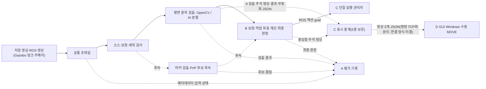
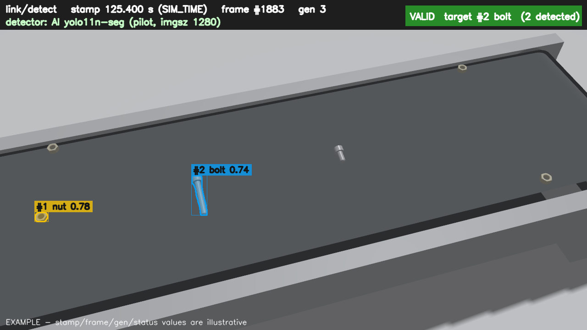

# A 담당 비전 상세설계

문서 버전 1.42 · 설계 초안 · 갱신 2026-11-28

| 버전 | 날짜 | 변경 |
|---|---|---|
| 1.0 | 2026-11-07 | 담당 경계, 영상 입력·검출·PnP 인터페이스, 평가와 작업 순서 작성 |
| 1.1 | 2026-11-07 | 검토 반영: 6D 최종 후보 결정을 B로 확정(§2·§5.3·§5.4·§8), 통신 시험 도구·실행·취합을 A로 확정하고 운영 경로와 시험 경로 구분(§2·§4·§9·§11), 마커 좌표계 M과 모서리 대응 계약(§8), OpenCV 확인 환경과 API 경로(§8), `run_id`·`image_seq` 수명(§5.1), 검출 설정 변경 시 세대·스냅샷 규칙(§5.4·§7), 판정 사유와 입력 상태 분리 및 분리 집계(§5.4·§6·§9), `PC_RECEIVE` 시각 관계(§5.1), 검증 항목 추가(§10), 미확정 항목 정리(§12) |
| 1.2 | 2026-11-07 | 수신 세대(`capture_generation`)와 처리 세대(`generation`) 구분, 동일 프레임 재처리 조건과 유효 시간 비연장(§5.1~§5.4), 처리 건수 구분과 검출률 분모를 처리 완료 수로 정의, 평가 실행 식별자 `eval_run_id`와 반복 처리 표본 제외(§9), 회귀 시험·시간 측정 분담(§9·§11), 검증 항목 추가(§10) |
| 1.3 | 2026-11-09 | AI 평면 검출 추가: YOLO11n-seg 초기 후보, OpenCV 기준 비교·3주차 말 운영 채택 결정(§7.1), 관측·설정·오류·평가·일정 반영. 6D는 ArUco·PnP 유지, FoundationPose는 후속 확장 |
| 1.4 | 2026-11-09 | 검토 반영: 계산용 윤곽의 관측면을 부품 윗면으로 정의(`contour_basis`), 전체 실루엣·그림자·가림 윤곽 금지와 `TOP_FACE_UNRESOLVED`, 라벨·평가 기준 일치(§2·§5.2·§5.4·§7·§7.1). 비전 처리 오류의 이동 후보 무효화 이벤트, `job_seq` 기반 적용 순서, D 송신 전 반영과 복구 조건, ACK 대기 중 원래 목표에 적용되는 무효화 시 자동 재전송 중단(§5.4·§7.1·§9). 관측면 판정은 A 책임이며 B 면적 검사는 보조 건전성 검사. 검증·미확정 항목 추가(§10·§12) |
| 1.5 | 2026-11-09 | 계획서 1.4(전체 7주)와 정합: 5주차를 기존 범위 평가·기준 실행본 확보로, 최종 발표를 7주차로 이동(§11). 6~7주 그리퍼 확장의 A 책임(그리퍼 실행 프로파일·시뮬레이션 적용, 2지 개폐·부착·보유 검출, 집기 시험 도구·결과 취합) 요약 신설(§13). 검토 반영: 확장 초기화·DetachableJoint 제약·런타임 시뮬레이션 피드백 역할 구분·확장 모드의 C 서버 부재(§13). 기존 1~5주 범위·절 번호 유지 |
| 1.6 | 2026-11-10 | 계획서 1.5(전체 5주)와 정합: 1~3주차 볼트·너트 컨베이어 분류 인식(데이터·라벨·학습·평가, 추적 ID·재검출, 카메라·도착 감지·접촉 센서 입력), 4~5주차 사람 자세 모델 관절점·신뢰도·시각·유효성 출력으로 변경(§1·§11·§12·§13). 6D 마커·PnP(§8)는 후속으로 표시하고 내용은 유지. 1.5의 6~7주 그리퍼 확장 A 책임(시뮬레이션 적용·순서 관리자 연동)은 대체: 로봇·그리퍼 모델·제어기·실행 구성은 C 소유 |
| 1.6 (검토 반영 2) | 2026-11-10 | **이전 설계 기록(정상 사이클 정지·재가동은 2026-11-15 재시작 절차 정정으로 대체):** `AUTO_SORT` 정상 사이클의 벨트 정지·재가동은 시작 승인 아래 C 자동 실행, 운영자 정지·오류·격리·복구 이후 재개만 A 확정(§2). `DIRECTION_UNSTABLE` 사유를 볼트에 한정(§5.4) |
| 1.6 (A 확정 반영) | 2026-11-10 | 최종 부품 모델 BOLT_A = M6×12, BOLT_B = M6×40(ISO 4762 육각 홈붙이 볼트), 너트 M6(ISO 4032) 확정(§1·§12). 스마트폰은 1주차에 어댑터·설정 형식만, 실연결은 4~5주차(§1·§11). C 월드 녹화는 월드 구성 완료 후 확보, 그 전에는 공개 저장 이미지로 진행(§11) |
| 1.6 (A 확정 반영 2) | 2026-11-10 | AI 검출 모델은 후보 비교 후 선정(A 확정 정책). 초기 비교 제안 YOLO11n-seg·YOLOv8n-seg 최대 2개(reviewer 제안) + OpenCV 기준선, 비교 조건·기록 지표(§1·§7.1·§12). 2주차 후보 파일럿, 3주차 말 채택, 미달·미검증 시 OpenCV 유지 |
| 1.6 (B·D 공동 결정 사안) | 2026-11-10 | §12.1 추가: B와 결정할 6건·D와 결정할 6건의 A 제안과 공동 확정 조건, 우선순위. A 제안이며 B·D 합의 아님 |
| 1.6 (단위 표현 정정) | 2026-11-10 | §12.1 B-06 행의 'B는 mm 좌표 출력' 표현을 B 상세설계 §5.5(결과 m, D가 표시·TCP 경계에서 mm 변환 한 번)에 맞춰 정정. [협업 요청 초안](A담당_협업_요청_초안.md) 연결 |
| 1.6 (공유 문서 보완) | 2026-11-10 | §7.1 라벨 문단에 윗면 규칙은 기존 판형 기준이며 볼트·너트 관측면·라벨 기준은 B-03 파일럿 전 미확정이라는 단서 추가(§1 관측면 주의 반영, 새 값 확정 없음). §1 문장 공백 정리 |
| 1.7 (재설계 정합화) | 2026-11-11 | A 확정 반영: A·B는 WSL의 내부 파이프라인(분리 ROS 인터페이스 없음), D GUI는 Windows, 자동 분류 목표는 B→C ROS 액션, 운전 모드 없이 START로 분류(§2·§3). Windows GUI로 인해 D 전달·버퍼 제안(§12.1 D-01~D-03)은 재검토 |
| 1.7 (기능 설계 통합) | 2026-11-11 | 2026-11-11 A 요청: 별도 기능 설계 3개(그리퍼·로봇 실행, 컨베이어 분류, 사람 자세 제어)를 시스템 계획과 A/B/C/D 상세설계로 통합하고 삭제. §13.1(분류용 A 출력)·§13.2(사람 관절점 출력) 신설, §13 재검출 세대 표현 정정 |
| 1.7 (실행 피드백 경계) | 2026-11-11 | 2026-11-11 A 확정 실행 피드백 경계: A는 카메라 입력·검출·추적·관측 출력과 C 정지 확인 결과를 받은 재검출만, 도착·접촉·부착·보유·벨트 정지·상자 도착 확인의 구성·수신·판정과 수량 집계(센서 설정 포함)는 C. §1·§2·§6·§11·§12·§13 갱신 |
| 1.7 (담당 경계 RB) | 2026-11-11 | 2026-11-11 담당 경계 RB-01~03 정리: 구현·수정 책임자/제공 정보/협력 담당 구분. §12 파이프라인 골격 유지 미결·Gazebo·장애 주입 행 |
| 1.7 (담당 결정) | 2026-11-11 | A 결정 2026-11-11: common/types.py 관리 A, A·B 파이프라인 실행 진입점 A(계산·액션 어댑터 B), 그리퍼 실행 혼합 설정 최종 관리 C, 동등 파지 후보 계산 B·실행 해 선택 C. B→C PICK_PLACE 목표 계약(제안) 구체화. §4·§12·§12.1 |
| 1.8 | 2026-11-12 | A 담당 전달 2026-11-12: B·D가 [협업 요청 초안](A담당_협업_요청_초안.md) 0.5의 A 제안 수락(원문 미확인, C는 회신 없음). §12.1 두 표에 상태 열 추가(수락으로 확정된 것과 남은 미결 구분), §12 해당 행·§1 구현 상태 문단에 반영. A 확정 날짜 일정(11-22 1~3주차 범위 구현 완료, 11-23부터 시험·발표 준비, 11-26 중간 발표)과 A 제안 일별 배치를 §11에 추가. 같은 날 A 확정 추가: 주말 포함 매일 작업, AI 비교 후보 3개(YOLOv8n-seg·YOLO11n-seg·YOLO26n-seg, §1·§7.1·§12의 '최대 2개' 정정), AI 라이브러리(PyTorch·ultralytics) 설치 승인(버전 미기록), 공개 데이터 재분할 채택(§12 데이터 분리 행, 방식은 A 제안). §7.1 참고 링크에 Ultralytics 공식 YOLOv8·YOLO26 문서 추가. 같은 날 AI 환경 설치 완료(reviewer 실행, A 승인) 후 설치 버전·실행 주의를 §7.1·§11.1·§12 AI 비교 후보 행에 기록 |
| 1.9 | 2026-11-12 | A 확정 2026-11-12(카메라·표시 경로): Gazebo 카메라 3대(링크·그리퍼·고정 탑뷰), 운영(검출) 카메라인 링크 카메라의 센서 설정·입력 요구는 A가 작성해 C에 공유하고 C가 월드·브리지에 통합(A 결정, C 회신 C-01 채택. 그리퍼·고정 카메라 설정 담당은 미결), A 검출 입력은 링크 카메라(베이스 또는 어깨 고정), 추적은 검출 기반 + 특징점 보조, 영상은 C가 D GUI로 전송(C 보유 5종: 링크 원본·A 검출 주석·B 중심점 주석·그리퍼 원본·고정 원본, D 요청에 따라 링크 채널 하나 + 그리퍼·고정 = 3개 영상), 결과·무효화 JSON 동봉. 그리퍼 카메라 표시용은 결정에서 도출(A에 알렸고 정정 없음). 표시 경로는 TCP 1.1 명령 연결과 분리(TCP 명세서 §0 유지), 연결 방식·포트·직렬화·토픽 이름은 미결. C 회신(C-01·03·04·05·07, A 담당 전달 원문) 사실 기록. 장착 링크 `base_link` 권장(A가 센서 설정에서 제안하는 값)·ROS 토픽 전달·원본 자동 전환·프레임 키·추적 세부·주석 검출기는 reviewer 제안. 같은 날 A 결정: 링크 채널 종류 코드 `raw`·`detect`·`center`(링크 채널에만), `source_id`·채널 코드·조합 표기는 reviewer 제안. 표시 경로 프로토콜 A 초안은 TCP 명세서 부록 B(미승인)에 두고 §3·§12에서 참조. §1·§2·§3·§5.1·§6·§11.1·§12·§12.1·§13·§13.1 |
| 1.9 (링크 카메라 설정) | 2026-11-12 | A 요청 2026-11-12(reviewer 지시): §6.1 신설. A가 C에 공유할 링크 카메라 센서 조각(`base_link` 자식 `link_cam_link`·광학 프레임 `link_cam_optical_frame`·`gz_frame_id`), 센서 초기값(15 Hz·1280×720·hfov 1.0), 주의 3개, 내부 파라미터 식, 브리지, `origin` 정하는 기준(화면 범위·화소 밀도·팔 가림), 입력 요구, 통합 뒤 확인 명령. 이름·값은 제안·초기값이고, 장착 `origin`은 자리표시. 같은 날 A 확정: 링크 카메라 시점 = 베이스 근처 경사 시점(§1·§6.1). 경사 시점 예시(기준 1 일부 충족, 기준 2 미충족 13~14 px, 기준 3 UNVERIFIED)와 `K`·헤더는 프로젝트 밖 사본 확인값(C 모델 미적용, C 통합·실연결 검증 아님). 탑뷰 배치는 시험용·채택 안 함. 15 px 충족 방안(거리·화각·해상도·기준)은 A·B·C 결정 필요 |
| 1.9 (공개 데이터 재분할) | 2026-11-12 | A 결정 2026-11-12(「재분할부터 지금 진행」): §12 데이터 분리 행의 A 제안 방식으로 재분할 실행. 줄기·결합·배정 규칙과 결과 수치, 남은 누수 한계(상관 0.80~0.95 같은 장면 쌍)를 §12에 기록하고 §11.1 11-15 칸의 재분할을 「11-12 앞당겨 완료」로 갱신. 원본 무수정, 목록 `data/splits/resplit_v1/` |
| 1.9 (화소 기준·재분할 v2) | 2026-11-12 | A 결정 2026-11-12: §6.1 기준 2를 「모델 입력에서 너트 짧은 변 ≥ 12 px(잠정, 공개 학습 데이터 하위 10%)」로 바꾸고 이전 원본 영상 15 px 기준을 대체함. 모델 입력 크기 식(원본 px × imgsz / max(ROI 폭, ROI 높이), imgsz 640 기본·1280 대안)을 넣고, 경사 예시·탑뷰 시험 배치를 기존 사본 영상으로 다시 계산함(Gazebo 재실행 없음). 결과는 imgsz 640에서 6.0~9.9 px로 미충족이라 `origin` 자리표시를 유지하고 방안 ①~④를 미결로 적음. §7 1단계에 벨트 ROI 잘라내기 후 imgsz 축소(A 제안)를 추가. 같은 날 재분할 v2(크기 구간 균형, `data/splits/resplit_v2/`)를 현재 목록으로 바꾸고 v1은 대체됨(보존), §12에 결과와 한계 기록 |
| 1.9 (AI 파일럿) | 2026-11-12 | A 결정 2026-11-12(「제안대로 진행」): §7.1에 2단계 전이 학습 방향(A 제안)을 추가함. 1단계 공개 데이터 → 2단계 Gazebo, 비교 3조건, Gazebo 평가 세트는 다른 장면으로 분리, 최종 판단은 Gazebo 평가 세트, 질감 변경 전달 예정 사실. yolo11n-seg 파일럿 결과를 §12 AI 비교 후보 행에 기록함: 640은 50 에포크 완료, 1280은 메모리 부족으로 3 에포크에서 중단돼 비교 미완. OpenCV 4.6 학습 경로 확인으로 「미검증」 문구를 갱신하고, 글꼴 내려받기·`val` 출력 경로 주의를 추가함. §6.1 방안 ①·④에 파일럿 결과를 연결함(결정 없음). §11.1의 11-15·11-16·11-17 칸 갱신 |
| 1.9 (Gazebo 평가 세트 도구) | 2026-11-12 | A 결정 2026-11-12: §7.1에 Gazebo 평가 세트 생성 도구(A 제안, 실행 전)의 방식·변수·시드 규칙·수집 방식·안전 장치·검증 상태를 기록함. 분할 카메라와 슬롯별 고유 라벨을 쓰고, 월드 사본은 `gz sdf -k`를 통과함. §11.1 11-16 칸 갱신 |
| 1.9 (1280 파일럿) | 2026-11-13 | A 요청 2026-11-12 「1280 학습 재실행」: imgsz 1280 파일럿 50 에포크 완료(메모리만 감시하는 A 결정 규칙). §12 AI 비교 후보 행에 640과의 비교(mAP50, 원본·0.5배 크기 구간 재현율, 640 학습·1280 추론, Gazebo 사본 영상 참고값)를 기록하고, §7.1 OpenCV 학습 경로 문장과 §6.1 방안 ①을 갱신함(결정 없음) |
| 1.9 (Gazebo 평가 세트 수집) | 2026-11-13 | A 결정 2026-11-13(「가제보 평가 세트 돌려」): §7.1 평가 세트 단락에 시험 실행으로 확인한 미검증 3항목, 본 수집 200장의 규모·크기 분포, 수집 중 고친 결함 2건, 비교 조건 ①(공개 데이터만) 3조합 결과 표를 기록함(결정 없음). §11.1 11-16 칸 갱신 |
| 1.9 (검출 주석 영상 표기) | 2026-11-13 | A 결정 2026-11-13: §3에 「검출 주석 영상(`detect`) 표기 항목(A 제안)」 표(부품별 윤곽선·반투명 채움·바운딩 박스·번호·클래스·신뢰도, 화면 공통 채널 이름·시각·`image_seq`·세대·운영 검출기·상태·무효 사유·선택 대상)와 예시 이미지(`images/A_detect_overlay_example.png`)를 추가함. 기존 「주석 영상에는 … 표기」 문장은 이 표를 가리키게 정리. 색·글꼴·위치는 구현 시 결정, 영상 표기 영문(제안) |
| 1.9 (저장 영상 입력 구현) | 2026-11-13 | A 확정 2026-11-13(「권고대로 확정하고 구현 지시해」): §4 구현 상태에 `inputs/video.py` 구현 요지를 기록함. 시각은 프레임 번호÷FPS(`VIDEO_POS`, `CAP_PROP_POS_MSEC` 미사용), 세대는 파이프라인이 주입, 인터페이스는 생성자 주입 방식(문서 `open(config)` 제안과 다름). 같은 날 A 결정: 손상 파일 열기 중 드문 멈춤을 알려진 한계로 기록(코드 수정 없음) |
| 1.9 (1단계 실험 계획) | 2026-11-13 | A 결정 2026-11-13(「실데이터로 yolo 전이 학습 실험을 한 후에 가제보 데이터를 도입할지 안할지 정하는게 좋다…지금 한개의 모델만 파일럿으로 테스트해본거잖아 단계로 진행하는게 맞다…실험하면서 기록하는게 중요」 → 「일단 실험 계획은 설계에 반영해줘」): §7.1 「2단계 전이 학습 방향」을 1단계 결과로 도입 여부를 정하는 조건부로 바꾸고, 「1단계 실험 계획」(후보 3개·고정 조건·평가·이후 단계·기록 규칙·미결)과 빈 「1단계 실험 기록」 표를 추가함. 「비교 조건 ① 결과」 단락 끝 문장 정리. §11.1 11-16·11-17 칸 갱신. 결정 없음: 미결 3항목(가중치 내려받기 승인, Gazebo 도입 판단 기준, 최종 판정용 평가 세트 분리) |
| 1.6 (검토 반영) | 2026-11-10 | 현재 4~5주 작업을 사람 자세 제어로 일치시키고 마커·PnP 항목(§2·§3·§4·§5.3·§9·§10)을 후속으로 표시, 클래스별 방향 필요 여부(볼트만 장축 조건, 너트는 방향 불필요)(§7), 모드별 운영 인계(`MOVE_TEST`·`AUTO_SORT`·`HUMAN`)(§2), 현재·후속 완료 기준 분리(§10) |
| 1.9 (파이프라인 검토점 1) | 2026-11-15 | A 요청 「상세설계 갱신」: §1·§4·§5.2·§5.4·§9·§11.1에 작업 1~3의 미커밋 구현 상태, F1 수정 후 직접 검증(관련 69건·회귀 241건, 중복 포함), 남은 작업 4~6·B/D 소비 호환 확인을 반영. 관측면의 기존 제안 이름 `contour_basis`를 공통 초안의 현 구현 필드 `observed_face`와 구분하고, 볼트·너트 관측면 미확정·기본값 금지를 명시(§7·§10 참조도 정합화). 새 관측면·운영 유효 판정·표시용 재처리 예외를 확정하지 않음 |
| 1.10 (파이프라인 작업 4) | 2026-11-15 | 작업 4 구현·검토 지시: §1·§4·§5.4·§9·§11.1에 작업 4 미커밋 구현 상태(무효화 적용 규칙 1~5, 중복 통지 `duplicate`·`applied`, 약한 참조 보관 정책, close·보존식)와 r1 지적 F1·F2 수정, r2 PASS(코어 단위 범위)와 실제 실행 결과를 반영. 작업 1~3 기록은 그대로 둠 |
| 1.11 (A→C 전달) | 2026-11-15 | **(같은 날 1.12로 대체됨)** A 확정 2026-11-15(reviewer 전달): A→C 표시 데이터는 별도 프로세스 + 로컬 소켓, 병목 실측 시 공유 메모리 검토. §3 「영상 표시 경로」 미결·A→C 항목과 §12 미결 행을 정합화하고 기존 A→C ROS 토픽 제안을 대체. 소켓 종류·프레이밍·주소·버퍼·재접속·순서·측정 기준은 미결로 기록. B→C 액션·Gazebo 카메라 ROS 수신은 무변 |
| 1.12 (A→C 같은 프로세스) | 2026-11-15 | A 확정 2026-11-15(reviewer 전달, 「그럼 일단 같은 프로세스로 구성하고 문제가 된다면 분리하는게 맞는거 같아」 → 「설계 원복시켜」): 1.11의 「별도 프로세스 + 로컬 소켓 우선」을 대체. A 파이프라인과 C를 같은 프로세스로 두고 객체·내부 대기열로 전달하며, 운용·통합 측정에서 문제가 확인되면 분리를 검토(로컬 소켓·공유 메모리는 그때의 선택지). §3 「A→C 전달」·미결 문장, §12 표시 경로 미결 행 정정. 과거 A→C ROS 토픽 제안은 되살리지 않음. A→B 호출·B→C 액션·Gazebo ROS 입력·명령 TCP·C→D 표시 연결 경계는 무변 |
| 1.13 (파이프라인 작업 6b) | 2026-11-15 | A 확정 2026-11-15(reviewer 전달, 「일단 개발값으로 10, 1로 넣고 운용 테스트하면서 조절」): 저장 입력 실행기에 검출 감시(설계 113 r3 A1: 같은 프로세스의 검출 전용 worker 스레드 1개 + 제어 흐름 감시)를 미커밋 구현. 개발 초기값 첫 검출 10 s·이후 1 s(운영 최종값 아님)와 CLI 조절 방법, 시간 초과·멈춤 처리, 실제 검증 범위·미검증을 §4·§9에 기록. A2(검출 자식 프로세스)는 채택하지 않음 |
| 1.14 (YOLO 파이프라인 1단계) | 2026-11-15 | A 요청 「구현 지시 전달」(reviewer 전달, 계획 `docs/superpowers/plans/2026-11-15-yolo-pipeline.md` r2): 저장 입력 파이프라인에 YOLO 분할 추론을 **표시용 무효 관측(valid=False)**으로 미커밋 연결(검토점 R1~R3 reviewer PASS, R4 실제 로컬 가중치 smoke). §4 ai_* 모듈 상태, §7.1 1단계 연결 상태·실측·미검증, §9 AI 기록 필드를 기록. 관측면·클래스 구성·보정·선택 규칙(2단계)과 B/C/D 연결은 미결·후속 |
| 1.14 (재시작 절차 정정) | 2026-11-15 | A 확인 「벨트 정지 후 재검출 이건 벨트가 정지한 후에 재시작시에 아냐?」 및 수정 요청 반영: 정상 분류는 이동 중 검출·집기. 재검출은 비상·이상 정지 뒤 재시작할 때 이전 목표·관측을 폐기하고 재시작 이후 새 프레임으로 처리하는 절차. §1·§2·§6.1·§11·§13의 정상 정지 집기·STOP_FOR_PICK·정지 전후 같은 세대 전제를 정정. 재시작 이벤트 필드·시각 경계·세대 대응은 C와 계약 확인 필요 |
| 1.15 (1단계 실험 S1-01~03 기록) | 2026-11-16 | A 지시 「후보 학습부터 시작하자」(reviewer 전달)로 실행한 후보 3개 학습을 추적 학습기(`scripts/train_candidates.py`, 미커밋)의 `register-legacy`로 원본 무변 등록하고 `eval`로 평가한 사실 값을 §7.1 「1단계 실험 기록」 표에 S1-01~03 행으로 추가(reviewer I4 검토에서 정확도·원본 보존 확인). 시간 값의 측정 경계(cold 정의)와 legacy 한계를 표 아래에 명시. §7.1 1단계 계획의 「아직 실행하지 않음」·가중치 내려받기 미결 문장을 현재 상태로 정정. 해석·후보 선택·Gazebo 도입 판단은 결정 없음 |
| 1.16 (링크 카메라 실시간 입력 구현 상태) | 2026-11-16 | A 지시(reviewer 전달, 「실시간 카메라 연결 구현 명세 전달 및 구현 착수」): §4 `inputs/` 행에 L0~L4 구현 상태만 기록. 설계 내용·결정 변경 없음. ROS 로컬 통신·Gazebo 실연결은 미실행 |
| 1.17 (실시간 입력 재접속 세대 정책) | 2026-11-16 | A 확정(reviewer 전달, #124 대안 0, 「우선 구현하고 운용 중 문제가 확인되면 변경」): Gazebo 링크 카메라 실시간 입력에서 영상 중단 뒤 첫 새 영상은 발행자 확인 없이 재접속으로 보고 세대를 올린다(일시 정지 재개 포함). 이 범위에서 기존 「중단 뒤 재개 세대 유지」 기대를 대체. 발행자 교체는 GID 집합으로 보완. 구현 상태만 §4 `inputs/` 행에 기록. 짧은 끊김 미감지·그래프 지연·메시지별 출처 미확정 한계 유지. C-07 재시작 시각 계약 구현 아님 |
| 1.18 (실시간 검출 확인 창 구현 상태) | 2026-11-16 | A 지시(reviewer 전달, 「다음 실시간 검출 확인 창 구현 명세 전달」): §4 `overlay.py` 행 아래에 A 개발 확인 창(`vision/live_view.py`, `scripts/view_live_detection.py`, 실행기 선택 인자 `display_sink`) 구현 상태만 기록. 설계 결정·공통형·B 소비 조건 변경 없음. 실제 창·ROS·Gazebo·GPU 통합은 미실행 |
| 1.19 (A→C 내부 연결부 구현 상태) | 2026-11-17 | A 지시(reviewer 전달, #142 「A→C 같은 프로세스」 다음 단계): §3 「A→C 전달」 끝과 §4 표에 A 측 내부 연결부(`vision/handoff.py`, 코어 읽기 전용 `invalidation_records`, 실행기 선택 인자 `handoff_sink`) 구현 상태만 기록. 설계 결정·공통형·B 소비 조건·TCP 변경 없음. C 진입점·소비·C→D 송신은 미연결·미합의 |
| 1.20 (A-6 추적 1차 구현 상태) | 2026-11-17 | A 지시(reviewer 전달 #151 「A-6 추적 1차 구현 명세」): §4 표와 §13.1 「추적 방식」 끝에 A 내부 인스턴스 추적 **표시·기록 실험**(`vision/tracking.py`, 실행기 선택 인자 `part_tracker`, CLI `--tracking`, JSONL `ai_tracks`·`tracking_failed`, 확인 창·A→C 연결부 `tracks`) 구현 상태만 기록. 공통형 `PlanarObservation.part_track_id`·B 전파·B 중복 방지 연결 없음, A-6 전체 완료 아님. 특징점 보조(2026-11-12 확정 방향)는 연속 자료 검증 뒤 2차 |
| 1.21 (일일 일정 현행화) | 2026-11-17 | A 요청 「일정표 정리」: §11.1에 실제 진행과 남은 일을 분리하고 11-18~22 작업 목표를 갱신. 학습·실시간 입력·내부 전달·추적 구현과 실연결 검증 범위를 구분하고 A→C ROS 토픽 계획을 같은 프로세스 내부 전달로 정정. 확정 기한과 다른 담당 계약은 변경하지 않음 |
| 1.22 (A-8 두 끝점 관측 구현 상태) | 2026-11-17 | A 지시(reviewer 전달 #157 「구현 명세 전달」, 계획 `_workspace/155_builder_a8_contract_plan.md` r1): §5.2에 `PlanarObservation.axis_endpoints_px`·축 끝점 경로 유효 조건·A 코어 raw 범위 검사의 미커밋 구현 상태만 기록. `b_gate`·D13·실제 생산자·B 소스 무변. 시험용 관측의 저장 입력 B 연결까지이며 실제 RGB 추출·운영 유효화·B 외 소비자 확인은 아님 |
| 1.23 (다중 물체의 평면 관측) | 2026-11-18 | §5.2에 물체별 검사와 후보 수에 따른 A→B 전달 계획 추가. 복수 후보 전달과 대상 선택·실행 경계는 A 협업 요청 B-09·C-09에서 확인 |
| 1.26 (일정 진행 대조 11-19) | 2026-11-19 | A 요청 「일정 최신화」: §11.1 11-18·11-19 행에 실제 진행(실시간 A→B 기록 전용·물체별 후보·M1 수정·결함 수정·통신 시험 도구)과 남은 일, 11-20 행에 볼트만 분류, 「현재 우선순위와 일정 위험」을 11-19 기준으로 갱신(11-17 문단은 이전 기록으로 보존) |
| 1.25 (재시작 처리 원칙 정합) | 2026-11-18 | A 지시 「문서 수정」: §1 목적 문단과 재시작 재검출 표 행의 「C의 재시작 확인 시각 이후 촬영된 새 프레임부터 처리」를 A 협업 요청 C-07의 대면 협의(2026-11-15) 「정지 전 목표·관측·대기 데이터 폐기, 재시작 후 새 데이터로 처리」로 맞춤. 세부 연결 규칙은 후속 확인 |
| 1.24 (A→B 입력 봉투) | 2026-11-18 | A 요청 「봉투 형식 추가」: §5.2에 현재 구현된 A→B 입력 봉투 `ObservationEnvelope`(`eyetoarm.b_input/1`)의 필드·생성 시 대조·B 입구 어댑터·실시간 공급·한계를 기록. 코드·B 문서 무변, B 확인 전 |
| 1.14 (링크 카메라 장착 확정) | 2026-11-15 | A 재확인: 링크 카메라 장착 부모는 upper_arm_link. §1·§6.1·§12의 베이스/어깨 선택·base_link 권장 문구를 현재 결정으로 대체. 이전 base_link XML·사본 측정은 시험 이력으로 보존. 팔 이동 중 촬영 시각 TF·보정·가림 검증은 별도 |
| 1.27 (D13 해제 승인·위험 기록) | 2026-11-20 | A 결정 「승인하고 위험으로 기록만해」: 실시간 B 소비 제한(계획 결정 D13) 해제를 해제 전 시험(#167 §4, 시험 목록 F6) 없이 승인. 위험과 남은 완화를 §11 「D13 해제 위험」에 기록. 해제 구현(실행기 거부 제거·B→C `on_output` 연결)은 별도 지시이며 이 버전에서 코드는 바뀌지 않음 |
| 1.28 (B 전달 신뢰도 고정) | 2026-11-20 | A 결정 「현재 값으로 픽스하고 변경하지 않음」: B 후보 자격에 별도 최소 신뢰도를 두지 않고 검출 기준 `conf_threshold` 0.05를 표시·B 전달 공통으로 고정. #219 조사 결과와 남은 위험을 §11에 기록 |
| 1.29 (AI 검출 모델 채택) | 2026-11-21 | A 결정 「팀원에게 모델까지 공유했으므로 공유한 S1-08로 채택」: 운영 검출 모델을 S1-08(YOLOv8n-seg, 선별 데이터+밝기 증강, `models/vision/s1_08/best.pt` sha256 `99be54c2…`, conf 0.05·imgsz 1280)로 확정. §7.1에 채택 기록·근거·남은 한계. AI/OpenCV 동일 조건 비교 실행은 채택 조건에서 뺌 |
| 1.30 (전체 기능 시험 결과) | 2026-11-21 | A 지시 「테스트 결과서 만들고 기록」: 전체 기능 시험(A 작업 기록 #249) 결과서 [A담당_통합시험_결과.md](A담당_통합시험_결과.md)를 만들고 §10에 결과 요약·결함 요약을 기록 |
| 1.31 (최근 구현 반영) | 2026-11-22 | AI 추론 별도 프로세스(실시간 AI 기본 켬), M2 끝점 창 계산, 링크↔그리퍼 W 추적 넘기기(옵션), 팔·그리퍼 투영 영역 검출 제외(`ARM_REGION`), 종류별 투영 높이·시야 보정(`axis_view_bias.by_spec`)을 §1·§3·§4·§5.4·§6·§9·§10·§12·§13.1에 반영하고 §7.2(볼트 끝점과 시야 보정)·§7.3(팔·그리퍼 투영 영역 제외)을 신설. 그리퍼 RGB-D를 「표시용」에서 「추적 보조 입력(옵션)」으로, 그리퍼 센서 주기를 40 Hz로, 105 mm 단일 높이 가정을 종류별 높이로 정정 |
| 1.32 (W 추적 중복·긴 후보, 통합 재시험) | 2026-11-22 | §13.1에 같은 볼트 이중 검출의 끝점 쌍 마스크 포함률 합치기(`mask_dup_contain` 0.85)·확정 게이트 안 긴 후보의 임시 트랙 금지(`length_near_confirmed`)·넘기기 켬의 모호 은퇴 사건(`retire`/`ambiguous`)과 재생 근거(A 작업 기록 #276·#279)를 추가하고 넘기기 끔 경로도 바뀜을 명시. §9 기록 표에 W 추적 계수 행 추가. §6에 Gazebo GPU 렌더링 변수·없을 때 약 6 fps(#256)·GPU 렌더링 장시간 메모리 증가(L-N2, Mesa 간접 그리기 차단으로 증가 없음 #282) 추가. §10에 통합 재시험(#281) 결과 요약과 [결과서](A담당_통합시험_결과.md) §9 연결, 검증 표에 W 추적 행 추가. 결과서 파일 이름 변경(날짜 제거)에 맞춰 1.30 행·§10의 링크 경로만 갱신 |
| 1.33 (2중 검출 대표·벨트 밖 제외, S1-09 평가) | 2026-11-22 | 코드 `1e57e9f`·`e938339` 기준으로 같은 볼트 2중 검출의 대표 선택(`DUPLICATE_MASK`, §7.2)과 벨트 밖 검출 제외(`OUTSIDE_BELT`, §7.4 신설)를 §4·§5.4·§7.2·§9에 반영. §7.1에 S1-09 설정(`ai_s1_09_axis_m2_viewbias.json`, 종류별 k 0.63/0.48)을 「평가 중, 미채택」으로 기록. §7.2 「종류 고르기」를 B 길이 범위 규칙(`db1f5c6`, #285)으로 정정. §7.3 남은 한계와 §10에 2026-11-22 이후 결과(A 작업 기록 #287~#297, [결과서](A담당_통합시험_결과.md) §10) 연결 |
| 1.34 (받은 요청 회신 정리: CA-01·CA-03·CA-04·DA-01) | 2026-11-22 | C 요청 CA-01·CA-03·CA-04와 D 요청 DA-01 ②~④에 대한 A 회신 근거를 현재 코드(HEAD `2850cb9`)·A 작업 기록(#256·#281·#288·#293) 기준으로 정리. §5.4에 실시간 입력 시각·세대 규칙표와 무효화 종류별 복구 경계(A→C 연결부 `msg_seq`) 추가, §6.1에 CA-01 A 측정 기록, §6.3(그리퍼·고정 카메라 현재 모델 위치와 담당표 제안) 신설, §1 카메라 담당 「미결」 문구를 §6.3 참조로 변경, §10 되감기 행과 §11 재설정 위험 행에 #281 E3 확인 표시. CA-01 종결과 CA-04 담당은 **A 결정 대기**. 설계 결정·코드 변경 없음 |
| 1.35 (C 실행기용 추적 흐름 설계) | 2026-11-23 | A 결정 2026-11-23: A가 A 쪽 추적 발행과 C 실행기(`gazebo_sort_executor.py`) 수정까지 맡음(C 합의). C 실행기(`744dc99`)가 Gazebo 정답 위치(`/world/sort_cell/pose/info`)로 대상 신원·위치·이동 중 따라가기를 하는 것을 A W 추적 흐름으로 바꾸는 설계를 §13.3에 신설(설계, 미구현). 메시지 초안 `TrackState`·`TrackStateArray`, 발행 조건, 시각·좌표 규칙, C 사용 방식, 정답과 실행 피드백 경계, 단계, 미결 항목. 계획 A 작업 기록 #303(`_workspace/303_builder3_plan_r1.md`, #302 결과로 안 다 확정). 코드·msg 무변 |
| 1.36 (C 실행 번호 연결, P2 `5099e65`) | 2026-11-23 | A 실시간 송신이 C 관리 실행 번호(`sort_job_id`·`run_epoch`)를 C `/c_sort_goal_receiver/get_run`(`GetSortRun`)으로 받아 `/sort_part` 목표에 채우는 동작(`sort_part.run_source`, 커밋 `5099e65`, A 작업 기록 #301 P2)을 §13.1에 반영. §9 기록 표에 송신 막음 사건·실행 변경 기록 행 추가. 시험 설정에 `require_track_id: true` 포함(#307 r1, `5099e65` 판의 누락 보완). D13 해제 위험 표의 「C `run_epoch` 미구현」·「목표 식별 필드 공백」을 현재 상태로 갱신(해소된 부분 삭선). 실측(관리 실행 Gazebo)은 미실행 |
| 1.37 (볼트 ISO 4017 육각 머리) | 2026-11-23 | A 결정 2026-11-23: 볼트 모델 `bolt_m3x20`·`bolt_m6x40`을 ISO 4762(둥근 머리 소켓)에서 ISO 4017(육각 머리 볼트)로 바꿈(M3×20 s 5.5·k 2·전체 22 mm, M6×40 s 10·k 4·전체 44 mm, 생성기 `scripts/generate_hex_bolt_models.py`, 원점·이름 유지). 둥근 머리가 DART 벨트에서 원뿔처럼 굴러 떨어지고, 감쇠·구름 마찰은 DART에서 쓸 수 없었음. 재학습 없이 S1-08·S1-09 검출은 같거나 나음. B 규격 값은 B-14로 요청(§1·§12). 근거: A 작업 기록 #317·#319·#323 |
| 1.38 (2026-11-24 커밋 반영) | 2026-11-24 | A 결정 2026-11-24: 커밋된 코드에 맞춰 갱신(설계 결정 변경 없음). §13.3 제목의 「설계, 미구현」을 현재 상태로 바꾸고 구현된 것과 설계로 남은 것을 구분, 확정 트랙의 볼트 종류 고정(`class_lock`, `f84aef5`) 추가. §13.1에 W 추적 밀림 초기화 규칙(추적 큐 대기로만 판정, `80a7ec2`)과 결과가 오지 않는 목표 놓아 주기(`result_watch`, `ff1d1fe`) 추가. §9 멈춤 행·기록 표와 §10 추론 별도 프로세스 행에 감독 스크립트 신호 전달·재시작 한도, 남은 공유 메모리 정리, 멈춤 때 `stall_threads.txt`(`23d30c8`), 단계별 시각 진단 `--stage-timing`(`6cfcaa4`) 반영. §10 시험 수를 2026-11-24 값으로 갱신. §3 「검출 주석 영상 표기 항목」 표에 유효 후보가 0일 때의 표시(제외된 검출을 회색·사유와 함께 그림, C 커밋 `5e99bd6`) 추가 |
| 1.39 (B 기다림 상한 0.1 s) | 2026-11-24 | A 결정 2026-11-24: §13.1 밀림 초기화 규칙의 시험값 `handoff_wait_s`를 0.02 → 0.1 s로 맞추고, 바꾼 이유와 효과(번호 없어 보내지 않은 목표 87~123 → 5, 466 → 31, 지연 변화 없음)를 적음(커밋 `d626e89`). 설계 결정 변경 없음 |
| 1.40 (90° 돌린 추론, 기본 꺼짐) | 2026-11-25 | A 결정 2026-11-25(「제안대로 진행」, A 작업 기록 #417·#425·#429): 가로로 누운 M3×20을 찾으려고 사진을 시계 방향으로 90° 돌려 한 번 더 추론하고 원래 결과와 R5 규칙으로 합치는 선택 기능을 §7.1에 추가하고 §10 시험 행을 더함. 설정 키 `rotate90_pass`가 없으면(운영 설정) 동작·설정 ID·기록이 지금과 같음. 켜는 설정은 `ai_s1_08_axis_m2_viewbias_rot90.json`(매 사진)·`…_rot90_n2.json`(두 장에 한 장). 운영 적용은 Gazebo 측정 뒤 A 결정 |
| 1.41 (4~5주차 담당 교대) | 2026-11-26 | 팀 결정: 4~5주차는 여러 역할을 경험하려고 담당을 바꿔 맡음(계획서 §8·§9 `A -> B`·`B -> D`·`C -> A`·`D -> C`). A는 4~5주차에 원래 C 작업(사람 자세 제어의 사전 동작 실행·입력 유실 정지·분류 작업과의 배타, 오류·정지 복구, 회귀, 실행 설명서)을 맡고, 1~3주차 A 작업은 그대로. 원래 A 몫인 스마트폰 실연결·자세 모델·관절점 출력(§13.2)은 4~5주차에 B가 맡음. §11 표의 4·5주차 행을 바꾸고 §11.2 4~5주차 날짜 일정(11-27~12-17, 최종 발표 12-17 목 예상)을 새로 둠 |
| 1.42 (§12.1 부품 표기, B로 넘어간 내용 삭제) | 2026-11-28 | §12.1 끝 문단 A 확정 사항의 최종 부품을 M6×12에서 M3×20으로 고침(2026-11-20 팀 회의 결정, §12 클래스 행과 맞춤). 설계 결정 변경 없음. §7.1 평가 장면 생성과 §10 통합시험 결과의 M6×12는 그때의 기록이라 그대로 둠. 4~5주차 담당 교대로 B가 맡게 된 스마트폰 실연결·자세 모델·관절점 출력을 지움: §1 목표 문장, §2 운영 경로의 관절점과 사람 자세 제어 흐름(계획서 §2.7·§11.2 참조로 바꿈), §3 그림의 스마트폰 입력·자세 경로, 모듈 표 `human_pose.py`·`phone.py`, 입력 소스 표 스마트폰 행, §10 완료 기준의 담당 표기, §12 자세 모델 행과 확정 사항의 스마트폰·사람 자세 표기, §13 제목·사람 자세 행·world 관절점 문장, §13.2 본문(번호만 남김), §1 AI 문단의 자세 모델 문장. 2026-11-11·11-15 구현 상태 기록은 그때 기록이라 그대로 둠. 1주차 계획과 변경 이력은 그때 기록이라 그대로 둠 |

## 1. 목적과 적용 범위

담당 A의 목표는 저장 영상·Gazebo 카메라를 공통 입력으로 다루고, 로봇 실행에 필요한 인식 결과를 제공하는 것입니다. 1~3주차에는 컨베이어로 공급되는 볼트 2규격·너트 1규격(최종 모델 BOLT_A = M3×20, BOLT_B = M6×40, 모두 ISO 4017 육각 머리 볼트(전체 22·44 mm), 너트 M6(ISO 4032), A 확정. BOLT_A는 2026-11-20 팀 회의에서 그리퍼 크기 때문에 M6×12에서 M3×20으로 바꿨고(B 규격 반영 B-12), 볼트 표준은 2026-11-23 A 결정으로 ISO 4762(둥근 머리 소켓)에서 ISO 4017로 바꿨다(B 규격 반영 B-14))을 저장 자료·Gazebo 입력에서 검출하고(데이터·라벨·학습·평가, 추적 ID, 비상·이상 정지 뒤 재시작 시 새 프레임 재검출), 카메라 입력을 구성합니다. 정상 분류는 벨트를 멈추지 않고 이동 중인 부품을 검출·집기하는 절차입니다. 재시작 때는 정지 전 목표·관측·대기 데이터를 폐기하고 재시작 후 새 데이터로 처리를 시작합니다(C 대면 협의 2026-11-15). 도착·접촉 등 실행 피드백은 C가 구성·판정합니다. 평가에서는 검출 성능을 직접 측정하고, 통신 시험 도구를 구현해 통신·장애 시험을 실행하며, 전원의 결과를 취합합니다. 운영 비전 모듈은 팔·벨트 명령을 직접 만들지 않습니다.

**카메라와 검출 입력(A 확정 2026-11-12).** Gazebo 카메라는 **3대**(링크 카메라, 그리퍼 카메라, 고정 카메라(탑뷰))입니다. **A의 검출 입력(운영 카메라)은 링크 카메라**이며, 링크 카메라의 장착 부모는 **`upper_arm_link`로 확정**했습니다(2026-11-13 요청·현재 A 재확인 2026-11-15). 링크 카메라 시점은 **베이스 근처에서 벨트를 비스듬히 내려다보는 경사 시점**입니다(A 확정 2026-11-12, 설정은 §6.1). 링크 카메라의 Gazebo 센서 설정과 입력 요구는 **A가 작성해 C에 공유**하고, C가 월드·브리지에 통합하며, A·B·C가 토픽·광학 프레임·`CameraInfo` 일치를 확인합니다(A 결정 2026-11-12, C 회신 C-01 채택). 그리퍼·고정(탑뷰) 카메라의 현재 모델 위치와 담당표 제안은 §6.3에 있습니다(위치 A·모델/센서/브리지 반영 C 제안, **A 결정 대기**). 카메라는 팔과 함께 움직이므로 촬영 시각(`SIM_TIME`)에 맞는 `base_link`→`upper_arm_link`→`link_cam_link`→`link_cam_optical_frame` TF와 보정을 사용합니다. 좌표 변환은 B, 모델·TF 통합은 C와 확인합니다. 이전 `base_link` 장착 제안과 특정 shoulder 관절 각도에서만 검출한다는 제안은 현재 장착 계약이 아닙니다. 그리퍼 카메라는 검출 입력이 아닙니다. 그리퍼 카메라 깊이 영상은 W 추적 넘기기(옵션, 기본 끔)에서 확정 트랙의 위치만 갱신하는 **추적 보조 입력**으로 쓰며, B 입력·C 목표 계약에는 들어가지 않습니다(§13.1). 추적은 **검출 기반 + 특징점 보조**입니다(A 확정, §13). 영상 표시 경로는 §3을 따릅니다.

AI는 볼트·너트 검출에 추가하며 OpenCV 기준 방식과 비교합니다. AI 검출 모델은 단일 모델을 자동 확정하지 않고 후보를 비교해 선정합니다(비교 후보: YOLOv8n-seg·YOLO11n-seg·YOLO26n-seg 3개, A 확정 2026-11-12, §7.1). 클래스 구성(정확히 3클래스 / `bolt`·`nut` + B의 치수 규격 판정)은 A·B 파일럿 제안입니다. 3주차 말 평가로 운영 채택 여부를 결정하고, 미달·미검증이면 OpenCV 경로를 운영·시연에 사용합니다(§7.1). 6D 마커·PnP(§8)는 이번 5주 필수 범위에서 후속으로 옮겼으며, 기존 설계 내용은 후속 작업의 기준으로 유지합니다.

**관측면 주의.** §5.2의 윗면(`top_face`) 계약은 단일 판형 부품을 기준으로 정했습니다. 볼트(머리·축)와 너트에 그대로 성립한다고 보장하지 않으며, 부품별 관측면·라벨 기준은 B와 1~2주차에 재검토합니다(§12).

상위 기준은 [시스템 아키텍처 및 프로젝트 계획](../architecture/시스템_아키텍처_및_프로젝트_계획.md)이며, TCP 필드·상태·재시도 규칙은 [TCP 프로토콜 명세서](../protocol/TCP_프로토콜_명세서.md)를 따릅니다. 이 문서는 두 문서의 규칙을 재정의하지 않습니다.

공통 입력·담당 범위·주차별 목표는 기존 계획을 따릅니다. 아래 모듈 이름, 내부 자료형, 판정 사유·입력 상태 이름과 로그 열은 **구현 제안**입니다. 실제 영상 조건과 파일럿 결과로 정할 임계값은 확정값처럼 사용하지 않습니다. **구현 상태(2026-11-11):** 공통 최소 자료형(`common/types.py`), 저장 이미지 입력(`inputs/base.py`·`inputs/stored_images.py`), 픽셀 좌표 기록(`vision/pixel_map.py`), 표시용 평면 윤곽 검출(`vision/planar.py`)과 재현 CLI(`scripts/run_vision.py`)를 작성해 단위 시험을 했습니다. 이것은 표시용(`display_only`, `valid=false`) 단계이며 운영 유효 판정·계산용 윤곽·B 좌표 변환·GUI 연동은 아직 없습니다. 나머지 모듈(아래 §4의 스마트폰·영상·ROS 입력, `pipeline.py`, AI 검출, 사람 자세 등)은 실행 코드가 없습니다. 2026-11-12 B·D의 A 제안 수락(§12.1)은 계약 원칙의 수락이며 위 구현 상태를 바꾸지 않습니다.

**현재 구현 상태 보완(2026-11-15):** 위 2026-11-11 기록 이후 저장 영상 입력(`inputs/video.py`, 11-13)과 파이프라인 작업 1~3(`vision/pipeline.py`·`pipeline_types.py`, 11-15, 커밋 92cbf0c)을 추가했습니다. 공통 관측·무효화 사건형, 세대·설정 전이, 최신 대기 프레임·소유 복사, 작업 시작·선택·재처리가 구현됐습니다. 이어서 **작업 4**(완료·실패·무효화 적용·종료, 11-15, 미커밋)를 구현해 코어 단위 시험을 통과했습니다. reviewer r1 지적(F1 사건 중복 반영·F2 문서 상태)을 수정했고 r2 독립 재검토에서 코어 단위 범위 PASS를 받았습니다(실제 detector·실행기·B/C/D 연결은 제외). 상세는 §4·§5.4·§9입니다. 검출 어댑터·JSONL(작업 5), 실행기(작업 6)는 아직 없습니다. ROS·스마트폰 입력, AI 운영 어댑터, 사람 자세와 실제 B/C/D 연결도 미구현·미검증입니다. 과거 문단의 “실행 코드 없음”은 당시 상태이며 현재는 이 보완과 §4를 따릅니다. 공통형의 B·D 소비 호환은 확인 요청 전이므로 전체 인계 완료가 아닙니다.

## 2. 담당 경계와 인계

| 작업 | A의 책임 | 다른 담당과의 인계 |
|---|---|---|
| 공통 영상 입력 | 소스 어댑터, 메타데이터, 최신 프레임 관리, 입력 상태 보고 | D가 GUI의 소스 선택·시작·정지를 연결 |
| 평면 검출 | ROI, OpenCV 전처리 또는 AI 분할, 윤곽 후보, 영상 후보 필터, 대상 선택, 계산용 윗면 윤곽(§5.2 관측면), 픽셀 오버레이, 비전 처리 오류의 후보 무효화 이벤트(§5.4). 링크 카메라 프레임에 검출을 그린 A 검출 주석 영상(A 표현 「YOLO 검출 영상」, A 확정 2026-11-12) 발행. AI 데이터·라벨·학습·추론·비교 결과 취합 | B가 윗면 윤곽을 작업 평면으로 변환하고 mm 중심·장축각 계산, 작업 평면 장축 유효성 판정. A·B·D가 운영 채택 기준·결과 확인 |
| 카메라 보정 | 촬영 자료 수집 지원, 프로파일 적용 조건 확인 | B가 보정 파라미터·Homography·광학 프레임 규약 제공 |
| (후속) 6D 추정 | 마커 ID·모서리, PnP 후보별 `T_C_M`·재투영 오차·카메라 앞 여부 제공, `MARKER_NOT_FOUND`·`PNP_FAILED` 판정 | B가 작업대 좌표 변환, 마커/물체 오프셋 적용, 높이·기울기 범위 검사, 모호성(`POSE_AMBIGUOUS`) 판정, 최종 후보 선택과 최종 자세 유효성 판정 |
| Gazebo 카메라 | 운영(검출) 카메라인 링크 카메라의 센서 설정(SDF)·입력 요구 작성과 C 공유, 수신(`inputs/ros_image.py`)·수신률 측정. (후속) 마커 텍스처 부품 모델. 도착·접촉 등 실행 피드백 센서 구성·판정은 C 소유(계획서 §2.6.2)로 A 범위가 아님 | C가 월드·브리지에 통합하고 A·B·C가 토픽·광학 프레임·`CameraInfo` 일치 확인(A 결정 2026-11-12, C 회신 C-01 채택). 그리퍼·고정 카메라 설정 담당은 미결. B와 광학 프레임·정답 동기 확인 |
| 영상 표시 | A 검출 주석 영상(링크 카메라)과 결과·무효화 JSON 발행 | B: 중심점 주석 영상(링크 카메라) 발행. C: 5종 영상(링크 원본·A 검출 주석·B 중심점 주석·그리퍼 원본·고정 원본) 보유, D 요청에 따라 링크 채널(`raw`(원본)/`detect`(검출 주석)/`center`(중심점) 중 하나) + 그리퍼·고정 = 3개 영상과 결과·무효화 JSON을 D에 전송. D: 표시·링크 채널 선택(A 확정 2026-11-12, §3) |
| 통신 시험 | 시험 시나리오, 통신 시험 도구 구현, 시험 실행, 결과 분석·취합 | D가 재사용 가능한 TCP 클라이언트·송수신 기록 기능 제공과 관련 결함 수정. C가 서버·로봇 기능, 서버 측 로그 제공과 관련 결함 수정. 서버 측 장애 주입과 로봇 상태 확인은 A가 C와 협력 |
| 평가 | 검출 실패·처리시간·입력 가용성 측정, 통신 시험 결과, 전원 결과 취합 | B가 독립 정답·오차, C가 로봇 도달·서버 로그, D가 GUI 응답 시간 기록 제공 |

**운영 경로와 시험 경로의 구분.**

- 운영 중 A의 비전 모듈은 관측(카메라 영상 기반 검출·추적)만 출력하고 로봇 명령이나 재시도를 직접 발생시키지 않습니다. A의 검출 성공만으로 이동 가능 상태를 만들지 않습니다. 이후 인계는 작업별로 다릅니다(계획서 §2.1 「작업별 실행 승인」). 운전 모드는 두지 않습니다(A 확정).
  - 수동 이동(TCP 1.1 `MOVE`): B의 좌표·보정 검사와 D의 현재 프레임·준비 상태 확인을 통과한 목표만 A 확정 후 D가 1건 송신
  - 분류 작업(기본 작업): `START`(GUI 입력)로 분류를 한 번 시작한 뒤, A의 관측 → (내부 파이프라인) B의 규격 판정·목표 → B가 ROS 액션 goal로 C에 전달 → C의 실행 관리자가 검증·실행(A 확정. goal 종류·필드는 제안). 정상 분류는 벨트를 멈추지 않고 이동 중 집기하며 부품마다 다시 승인하지 않음. 비상·이상 정지 뒤 재시작할 때는 이전 목표·관측을 폐기하고 재시작 이후 촬영된 새 프레임으로 재검출. 운영자 정지, 오류·격리·복구 이후의 재개는 운영자가 다시 `START`(제안)하고, 운영자 정지를 자동 재개하지 않음
  - 사람 자세 제어(4~5주 기능 경로, 운전 모드 아님): A 비전 모듈의 관측을 쓰지 않음. 흐름은 계획서 §2.7, 4~5주차 담당은 §11.2
- 영상 표시 경로(§3, A 확정 2026-11-12)는 D의 표시와 수동 `MOVE` 송신 전 검사용이며 로봇 명령 경로가 아닙니다. 로봇 명령은 D의 TCP(수동 `MOVE`, 분류 명령 개정 제안)와 B→C ROS 액션으로만 갑니다.
- 별도의 통신 시험 도구는 TCP 명세서와 시험 시나리오 범위에서 `MOVE`·`GET_STATUS`·`CANCEL`을 송신할 수 있습니다. 시험 도구도 TCP 명세서 §8의 클라이언트 규칙을 따릅니다.
- 시험 도구는 통신 로직을 따로 복제하지 않고 D가 제공하는 클라이언트 기능을 재사용합니다. 두 구현이 갈라지면 시험이 운영 클라이언트를 검증하지 못하기 때문입니다.
- 중복 `MOVE` 재송신 같은 장애 주입은 정상 운영 동작과 분리된 시험 모드에서만 실행합니다(TCP 명세서 §8.6).

## 3. 처리 구조와 대안

기존 프로젝트의 공통 입력 규약을 따라 **소스별 입력 어댑터와 공통 처리 파이프라인**을 사용하도록 제안합니다. 소스마다 검출 코드를 복제하면 수정과 평가 조건을 맞추기 어려워집니다. 모든 처리를 GUI 이벤트 안에 넣는 방식은 입력 지연이 화면 조작에 영향을 줄 수 있어 채택하지 않습니다.



A·B는 WSL의 한 파이프라인(같은 프로세스 제안)에서 자료형·함수 호출로 연결합니다(A 확정: 분리 ROS 인터페이스 없음). 운영 GUI는 Windows의 별도 프로세스이므로 A는 결과 객체를 D에게 직접 넘기지 않습니다(이전의 「D에게 결과 객체 전달」·버퍼 공유 제안은 같은 프로세스 전제였음). 입력 수신과 영상 처리는 A 파이프라인에서 수행하고, GUI 객체는 D가 GUI 스레드에서만 갱신합니다.

**프로세스 구성(2026-11-22 기준).** A 파이프라인은 WSL의 프로세스 하나이고, 실시간 AI 실행(`--ros-link --detector ai`)에서는 AI 추론만 **자식 프로세스 하나**로 분리합니다(기본 켬, `--no-infer-process`로 끔). 저장 영상·capture·평가 경로는 기본 끔이며 `--infer-process`로 켭니다. 시험에서 모델을 주입하면 자식으로 넘길 수 없으므로 끔이고, 주입하면서 켜면 인자 오류입니다. 분리 근거는 A 프로세스 안 Python 스레드(B center 영상 그리기·TF 수신·영상 수신)와 ultralytics 추론의 GIL 경합입니다(A 작업 기록 #258: c_stack 구성 링크 detect 16.7 Hz, GIL을 놓는 같은 비율의 CPU 부하로는 저하 없음).

- 부모는 영상을 공유 메모리 슬롯 2개로 넘기고 결과를 전용 socketpair로 받습니다. 요청 번호로 늦은 응답을 버리고, 취소는 유예 0.2 s 안에 처리합니다.
- 자식이 죽으면 그 작업은 `INFERENCE_ERROR`로 실패하고, 취소한 요청에 5 s 넘게 답이 없으면 멈춤으로 봅니다. 두 경우와 준비 실패는 실행을 종료 코드 1로 끝냅니다. 자동 재기동이나 단일 프로세스 대체 실행은 하지 않습니다.
- 자식은 SIGINT를 무시하고 부모 pid를 0.5 s마다 확인해 부모가 죽으면 끝납니다.
- 검출 감시(§9 작업 6b)는 부모의 검출 worker 스레드에서 그대로 돌고, 자식 추론 결과는 단일 프로세스와 같습니다(#259: Gazebo 링크 영상 100장, 인스턴스 343개, 100/100 동일). 수치는 §9.

**영상 표시 경로(A 확정 2026-11-12).** 영상은 서버(C)단에서 D GUI로 보냅니다. C는 링크 원본, A 검출 주석 영상(링크), B 중심점 주석 영상(링크), 그리퍼 원본, 고정 원본의 5종을 가지고, D의 요청에 따라 링크 채널을 `raw`(원본)/`detect`(검출 주석)/`center`(중심점) 중 하나로 정해 그리퍼·고정 영상과 함께 **3개 영상**을 D에게 보냅니다. 결과·무효화 JSON도 함께 보내 D가 측정값을 표시하고 수동 `MOVE` 송신 전에 검사합니다. 오버레이는 A·B가 영상에 그려 보내며 좌표값은 JSON에 있습니다. 이 경로는 TCP 1.1 명령 연결과 분리되며(TCP 명세서 §0 「영상은 이 TCP로 보내지 않음」 유지, TCP 1.1 스키마·명령 의미 변경 없음), 계획서 §2.1의 「GUI↔C TCP 하나」는 명령·상태 TCP 규칙으로 이 경로가 바꾸지 않습니다. **미결:** C→D 연결 방식·포트, 직렬화 형식, A→C 같은 프로세스 내부 전달 세부(아래 「A→C 전달」), B→C 표시 데이터 전달 방식(§12) (초안: [TCP 명세서 부록 B](../protocol/TCP_프로토콜_명세서.md), A 초안·미승인. 부록 B는 2026-11-12 A 초안 그대로이며, 그 B.3의 A→C ROS 토픽 행은 아래 「A→C 전달」의 현재 결정(같은 프로세스·객체/내부 대기열)을 반영하지 않습니다).

**영상 분류 코드(A 결정 2026-11-12).** 링크 채널의 종류 코드는 `raw`(원본)·`detect`(A 검출 주석 영상. 'yolo' 대신 쓰며, 운영 검출기가 OpenCV여도 같은 코드. 실제 검출기 종류는 영상 표기·결과 JSON에 따로 적음)·`center`(B 중심점 주석 영상)입니다. `original`이 아니라 `raw`로 확정입니다. 종류 선택은 **링크 채널에만** 있고, 그리퍼·고정 채널은 원본만 있어 종류 선택·종류 코드가 없습니다. D→C 선택 요청도 링크 채널의 종류 하나만 대상입니다. 이 `raw`는 B-01의 픽셀 좌표 기준 이름 `raw`(왜곡 보정 전 원본 픽셀)와 글자만 같고 다른 개념입니다. 아래는 reviewer **제안**(확정 아님): 카메라 `source_id` = `gz_link`·`gz_gripper`·`gz_fixed`(B `calibration_id` 제안 형식 `<source_id>_<w>x<h>_v<n>`에 들어감, 예 `gz_link_1280x720_v1`), 표시 채널 코드 = `link`·`gripper`·`fixed`(C·D가 확정), 조합 표기 `link/raw`·`link/detect`·`link/center`(그리퍼·고정에는 조합 표기 없음).

아래는 reviewer **제안**이며 확정이 아닙니다.

- **A→C 전달(A 확정 2026-11-15).** A 파이프라인과 C를 **같은 프로세스**로 우선 구성하고 A→C 표시 데이터(A 검출 주석 영상, 결과·무효화)는 **객체·내부 대기열**로 전달합니다(A 확정 2026-11-15, 같은 날 앞선 「별도 프로세스 + 로컬 소켓 우선」 결정을 대체). 실제 운용·통합 측정에서 서버 응답 지연·정지·장애 전파 같은 문제가 확인되면 별도 프로세스 분리를 검토하며, 그때 로컬 소켓·공유 메모리는 선택지일 뿐입니다(포트·소켓 종류·분리/전환 수치 미정). 같은 프로세스에서도 C의 요청 처리 흐름(명령 TCP 처리)을 영상 처리가 막지 않아야 하며, worker·스레드·스케줄링 방식은 미결입니다. **미결:** 내부 대기열의 형태·크기·폐기 정책(영상은 최신 우선, 결과·무효화는 버리지 않고 순서 보존 — 제안), 프로세스 구성과 실행 진입점, worker 방식, 분리를 검토할 판단 기준. A→B 내부 호출(분리 ROS 인터페이스 없음), B→C 로봇 목표 ROS 액션, Gazebo 카메라 ROS 입력, 명령 TCP, C→D 별도 표시 연결의 경계는 이 결정으로 바뀌지 않습니다. B 중심점 주석 영상·B 결과의 C 전달 방식은 미결입니다(B 확인 필요). 2026-11-12 A 제안이던 「A·B→C ROS 토픽」은 대체된 상태 그대로이며 되살리지 않습니다. 측정 근거: `_workspace/108_builder_a_to_c_transport_measurability.md`(Git 제외)의 임시 벤치는 비교 측정이 가능함을 확인했을 뿐, 이 선택의 성능을 증명하지 않습니다. **A 측 구현 상태(2026-11-17, #142, 미커밋):** A 내부 연결부 `vision/handoff.py`(`AToCHandoff`)와 실행기 선택 인자 `handoff_sink`(기본 None=꺼짐)를 구현하고 가짜 수신 측으로만 시험했습니다. 결과·무효화·입력 상태·실행 시작/끝은 순서 있는 제어 대기열(용량 64, **A 개발 기본값**이며 C 확정값 아님, 넘치면 버리지 않고 연결부 실패로 실행 종료 1), 영상은 현재 결과와 짝인 프레임 1장(최신 우선)이며, 주석 영상은 수신 측이 꺼낸 뒤 A helper(`annotate`)로 그립니다. 무효화 범위는 §5.4 규칙 1~3과 같습니다. 이 이름·형태는 A 내부 제안이며 C 공개 API가 아닙니다. C 실행 진입점·소비 방식(당김 API 또는 `publish_*` 제안)·asyncio 연결·C→D 직렬화·자동 복구·재시작 경계(C-07)는 C와 합의 전이라 미결 그대로입니다(계약 초안 `_workspace/142_builder2_a_c_handoff_contract.md`, Git 제외).
- 주석 영상이 일정 시간 오지 않으면 C가 링크 채널을 원본으로 자동 전환하고 「검출 중단」을 표시(제안). 주석 영상의 표기 항목은 아래 「검출 주석 영상(`detect`) 표기 항목」 표를 따름.
- 결과 JSON의 프레임 키는 링크 카메라 영상의 ROS `header.stamp`(`SIM_TIME`)이고, A 내부 식별자(`run_id`·`image_seq`·`generation`·`job_seq`)는 기록용(제안).
- 주석 영상에 그리는 검출기는 그 시점의 운영 검출기(11-25 AI 채택 전·미채택 시 OpenCV, 제안).

**검출 주석 영상(`detect`) 표기 항목 (A 제안, A 결정 2026-11-13으로 기록).**

| 구분 | 항목 | 비고 |
|---|---|---|
| 부품별 | 윤곽선(전체 물체 마스크)·반투명 채움 | 검출·표시용 전체 물체 마스크(§5.2)이며, B에게 넘기는 계산용 윗면 윤곽과 다름 |
| 부품별 | 바운딩 박스 | |
| 부품별 | 번호·클래스·신뢰도 라벨 | 클래스 구성은 B와 미결(파일럿은 bolt·nut 2클래스) |
| 화면 공통 | 채널 이름 `link/detect` | 조합 표기는 위 「영상 분류 코드」의 reviewer 제안 |
| 화면 공통 | 프레임 시각(`SIM_TIME`), 프레임 번호(`image_seq`), 세대 | 결과 JSON의 대응 키는 `stamp_ns`([TCP 명세서 부록 B](../protocol/TCP_프로토콜_명세서.md)) |
| 화면 공통 | 운영 검출기(OpenCV/AI, 모델 식별자) | 위 제안 목록의 「주석 영상에 그리는 검출기」와 같은 값 |
| 화면 공통 | 유효·무효 상태와 무효 사유, 선택된 대상 번호 | 무효 사유 코드는 §5.4 |
| 유효 후보가 0일 때(현재 구현) | 검출은 있는데 유효 후보가 하나도 없으면 제외된 검출을 모두 회색으로 그리고 라벨에 제외 사유를 붙임. 잘린 검출의 사유는 `CLIPPED`. 화면 위쪽에 안내 글 `NO ELIGIBLE CANDIDATES - showing rejected detections` | 왜 전부 제외됐는지 보이게 하려는 것. 유효 후보(제외 사유가 없고 잘리지 않은 검출)가 하나라도 있으면 범위 밖 검출(대상 아닌 클래스·낮은 신뢰도·팔 영역·벨트 밖·2중 검출로 빠진 것)은 그리지 않음. 범위 안에서 다른 사유로 제외된 검출은 그때도 회색과 사유로 그리고, 잘린 검출은 사유 없이 클래스 색으로 그림. 검출이 없으면 아무것도 그리지 않음. `live_view.py`의 `draw_detections`, C 커밋 `5e99bd6`(시험은 `a60ce4a`) |

색·글꼴·표기 위치는 정하지 않았으며 구현할 때 정합니다. 구현 주의(제안): OpenCV `putText`는 한글을 그리지 못하므로 영상 표기 문자열은 영문으로 씁니다.



예시. 검출 결과는 2026-11-12 파일럿 모델(공개 데이터 640 학습, imgsz 1280 추론)을 Gazebo 사본 영상에 적용한 실제 출력입니다. 상단의 시각·프레임 번호·세대·상태 값은 표기 예시용 임의 값입니다. 성능 근거가 아닙니다.

C→D 표시 연결은 별도 포트의 표시 연결 1개(영상 3채널 + JSON + D→C 링크 채널 선택 요청)를 제안하며, 결정은 C·D입니다. 수신 대기열은 최신 프레임 1개를 유지하는 방식으로 제안합니다. 처리 중 프레임의 버퍼는 덮어쓰지 않고, 대기열에서 폐기한 프레임 수도 기록합니다(§9 처리 건수).

정답 자세·정답 파일은 평가 경로에서만 읽습니다. 검출 대상 선택, PnP 후보 선택, 이동 목표 생성에 정답을 사용하지 않습니다.

## 4. 모듈과 배치 위치

아래는 구성 계획입니다. 「상태」 표시가 없는 항목은 아직 만들지 않았습니다. `common/types.py`·`inputs/base.py`·`inputs/stored_images.py`·`vision/planar.py`·`vision/pixel_map.py`·`scripts/run_vision.py`는 작성됨(표시용 단계, 위 상태 문단). `inputs/video.py`(저장 영상 입력)는 2026-11-13 구현했습니다. 시각은 `VIDEO_POS`이며 프레임 번호÷FPS(ms, 반올림)로 계산합니다(A 확정 2026-11-13). OpenCV 4.6에서 mp4v·FFV1은 영상 끝쪽 13~14프레임에서 `CAP_PROP_POS_MSEC`가 0이 되므로 이 값을 쓰지 않습니다. 세대는 파이프라인이 공급자로 주입합니다. 문서의 `open(config)` 대신 `stored_images.py`와 같은 생성자 주입 방식을 씁니다. 알려진 한계: OpenCV 4.6(FFmpeg)에서 손상된 파일(무작위 바이트 `.mp4`)을 열다가 드물게 멈출 수 있지만(reviewer 재현 30회 중 1회), 저장 영상은 열기 제한시간을 두지 않으므로(`FRAME_TIMEOUT`은 저장 영상 범위 제외, A 확정) 사람이 고른 파일만 쓰는 전제로 기록만 합니다(A 결정 2026-11-13).

| 위치 | 제안 모듈 | 책임 |
|---|---|---|
| `src/eyetoarm/common/` | `types.py` | 프레임·관측·품질 자료형과 단위 규약. **작성됨:** 최소형 `TimestampBase`·`InputStatus`·`FramePacket`·`InputStatusEvent`에 `PixelBasis`·`Contour`·`PlanarObservation`·`InvalidationKind`·`CandidateInvalidationEvent`를 추가(11-15, 미커밋·B/D 확인 전 제안). B 결과형 `WorkPlanarResult`는 미구현 |
| `src/eyetoarm/inputs/` | `base.py`, `video.py`, `ros_image.py`, `live_slot.py` | 소스 열기·읽기·종료, 메타데이터·입력 상태 생성. **링크 카메라 실시간 입력 L0~L4 구현(11-16, 미커밋, reviewer 검토 전):** `live_slot.py`(ROS 없는 수신 상태기: 최신 칸 1개·수신 epoch·경계 대기열·되감기 휴리스틱 필터)와 `ros_image.py`(`LiveLinkSource`, rclpy·cv_bridge 지연 import, 자기 Context·주입 가능, 전역 신호 처리기 미설치, QoS 비호환 진단). 실행기에 결과 공개 전 입력 반영 지점 A·B·C, CLI `--ros-link`, 추적 설정 `config/vision/ai_s1_01_live.json`(S1-01, imgsz 1280, conf 0.084). 단위시험만 실행했고 ROS 로컬 통신(L5)·Gazebo 실연결(L6)은 **미실행(UNVERIFIED)**. 임시값은 A 임시 개발값(계획 결정 D5 등, A 확정 아님). 근거·한계는 계획 `docs/superpowers/plans/2026-11-16-live-link-camera.md` r3. **재접속 세대 정책 수정(11-16, 미커밋, 검토 전):** A 확정 대안 0 — 영상 중단 뒤 첫 새 영상은 그 콜백에서 재접속 경계·새 세대(일시 정지 재개도 세대 +1), 발행자 교체는 GID 집합 비교, 같은 복구의 늦은 그래프 변화 1회 흡수(A 임시 5.0 s). 단위시험만, ROS·Gazebo 재시험 전(계획 r4) |
| `src/eyetoarm/vision/` | `pipeline.py` | **작업 1~3 구현(11-15, 커밋 92cbf0c):** 세대·설정 전이, 최신 대기 1개·활성 작업 1개, 수신·시작·선택·재처리. **작업 4 구현(11-15, 미커밋, reviewer r2 PASS·코어 단위 범위):** `complete`·`fail`·`apply_invalidation`·`close`, 무효화 적용 규칙 1~5, 중복 통지 멱등, 약한 참조 등록표(§5.4) |
| `src/eyetoarm/vision/` | `pipeline_types.py` | **작성됨(11-15, 커밋 92cbf0c):** 적용 프로파일·처리 설정·작업 스냅샷·상태·기록·계수의 A 내부형. 작업 4(커밋 d2d2c09)에서 `JobOutcome`에 `applied`·`duplicate`를 더하고 계수를 채웁니다. 작업 5(11-15, 미커밋)에서 `ProcessRecord`에 `eval_run_id`(기본 None)를 더했습니다 |
| `src/eyetoarm/vision/` | `pipeline_opencv.py` | **작업 5 구현(11-15, 미커밋):** `detect_planar` 결과를 표시용 무효 관측으로 변환(항상 `valid=False`, 계산용 윤곽·관측면·선택 번호 None, 사유 우선순위 `CALIBRATION_MISMATCH`>`TOP_FACE_UNRESOLVED`>`CONTOUR_CLIPPED`>`NO_OBJECT`, `candidate_count`=전체 후보 수). 검출 예외는 그대로 올려 `fail(INFERENCE_ERROR)`로 정리 |
| `src/eyetoarm/vision/` | `pipeline_records.py` | **작업 5 구현(11-15, 미커밋):** JSONL(`format_version` 1, kind `run_meta`·`process`·`event`·`queue_drop`·`input_state`). 최초 terminal·사건·폐기를 1회씩 기록하고 duplicate 응답은 재기록 안 함. 입력 상태 구간 지속 시간(PC 단조 시계). 실행기 연결은 작업 6 |
| `src/eyetoarm/vision/`, `scripts/` | `pipeline_runner.py`, `run_pipeline.py` | **작업 6a 구현(11-15, 미커밋):** 저장 이미지·영상 실행기. 단일 issuer·세대 공급자 주입, detector 동기 호출(겹침 없음), 정상→complete·예외→fail(INFERENCE_ERROR)·`JobCancelled`/KeyboardInterrupt→fail(JOB_ABORTED), finally close(유한 재시도, 임시 기본 3회·0.05 s), 기록 fail-stop, B 소비 조건 `b_gate`, 코어 `note_input_status`(입력 사건 시 현재 관측·선택 비움, 세대 불변). C·ROS·YOLO 미연결. **작업 6b 구현(11-15, 미커밋, reviewer r2 PASS·개발용 범위):** 검출 감시 기본 켬. 검출 전용 상주 worker 스레드 1개(`eyetoarm-detector`, 데몬)가 detector를 부르고 코어·기록·B 지점은 제어 흐름만 호출. 상한은 A 확정 개발 초기값 첫 검출 10 s·이후 1 s(`RunnerConfig.first_detect_timeout_s`·`detect_timeout_s`, CLI `--first-detect-timeout`·`--detect-timeout`, `--no-detect-timeout`은 6a 동기 경로). 유예 0.2 s·정리 한도 0.3 s·확인 간격 0.02 s는 A 임시 개발 기본안. 협조 취소는 선택(`detector_takes_token=True`일 때 `detector(job, CancelToken)`). 상세는 §9 |
| `src/eyetoarm/vision/` | `planar.py` | ROI·전처리·윤곽 검출·영상 후보 필터·대상 선택 |
| `src/eyetoarm/vision/` | `ai_detector.py` | AI 모델 로딩·추론, 마스크에서 윤곽 추출·원본 픽셀 좌표 복원. **YOLO 1단계 구현(11-15, 미커밋, R1~R3 reviewer PASS):** `ai_config.py`(`AiSegConfig`·엄격 JSON·설정 ID=정규 JSON sha256(가중치 경로 제외, method 포함)·`model_id`=계열@가중치 sha256 앞 16자), `ai_result.py`(`RawSegOutput`·`AiInstance`·`AiSegResult`·`ModelPrepareError`·`AiJobConfigError`), `ai_convert.py`(ROI 뷰·retina 마스크 → 원본 px 다각형, ROI 오프셋만), `ai_detector.py`(`AiSegDetector`: 생성자 I/O 없음, `prepare`에서 파일·sha256·환경 변수·지연 import·생성·task·names·장치 검사, 준비한 스레드에서만 predict). 코어 `PipelineSettings`·`JobOutcome`이 `PlanarConfig\|AiSegConfig`·`PlanarResult\|AiSegResult`를 받고 방식 일치를 검사한다. 관측은 항상 valid=False |
| `config/vision/` | AI 검출 설정 | 검출 방식, 모델·가중치 경로와 식별자, 대상 클래스, 신뢰도 기준, 입력 크기, 추론 장치. 형식은 `AiSegConfig` JSON(11-15). 로컬 가중치 경로·해시를 담는 개발 예시는 Git 제외 `_workspace/scenarios/yolo_pipeline/configs/`에만 두었다(운영 선정 아님, 추적 설정 파일 없음) |
| `src/eyetoarm/vision/` | `marker.py`, `pnp.py` (후속) | 마커 모서리와 PnP 후보·품질 출력. OpenCV API 분기 어댑터(§8) |
| `src/eyetoarm/vision/` | `overlay.py` | 프레임에 대응하는 ROI·윤곽·마커 표시 자료 |
| `src/eyetoarm/vision/`, `scripts/` | `live_view.py`, `view_live_detection.py` | **A 실시간 검출 확인 창(11-16, 미커밋, A 개발 확인 도구이며 D 운영 GUI 아님):** 링크 카메라 실시간 입력·AI 검출 결과를 OpenCV 창에서 같은 프레임의 원본·오버레이(박스·윤곽 반투명·클래스·신뢰도)로 표시. AI 관측은 표시용(valid=False) 그대로, 초록·승인 표시 없음. 실행기 `run(..., display_sink=None)`(기본 꺼짐)이 기록 뒤 최초 현재 적용 결과(`display_gate`: duplicate 아님·applied·현재 세대·수신 epoch 일치)와 입력 경계를 최신 1칸 전달 칸에 넘기고, 경계·실패 때 결과를 즉시 지움(마지막 원본은 LAST IMAGE로만 표시). 창은 메인 스레드, 실행기는 별도 스레드, 정지 뒤 유한 대기(A 임시 5 s). 단위시험(가짜 창·runner·소스)만 실행해 reviewer r1 정적 검토·단위 범위 PASS. 실제 Qt/WSLg 창·ROS 수신·Gazebo·GPU 표시는 **미실행(UNVERIFIED)**. 색·투명도(0.35)·창 주기(30 ms)·대기 상한은 A 임시 개발값. 근거·실행 안내는 `_workspace/138_builder2_live_detection_viewer_report.md` |
| `src/eyetoarm/vision/` | `handoff.py`, `pipeline.py`(`invalidation_records`), `pipeline_runner.py`(`handoff_sink`) | **A→C 내부 연결부(11-17, #142, 미커밋, A 내부 제안):** 같은 프로세스 C 수신 측에 결과·무효화·입력 상태·실행 시작/끝 메시지(순서 보존, 용량 64 A 개발값, 넘침·수신 측 실패는 fail-stop)와 현재 결과 짝 영상 1장을 넘깁니다. 실행기 `handoff_sink`는 기본 꺼짐이며 기존 기록·계수·`display_sink`·B 소비 조건은 그대로입니다. 표시용 관측은 valid=False 그대로 전달합니다. 가짜 수신 측 단위시험만 했고 실제 C 서버·D 송신·ROS·GPU 통합은 미실행·미합의입니다(§3 「A→C 전달」) |
| `src/eyetoarm/vision/`, `scripts/` | `tracking.py`, `pipeline_runner.py`(`part_tracker`), `live_view.py`·`handoff.py`(`tracks`), `pipeline_records.py`(`ai_tracks`·`tracking_failed`), `view_live_detection.py`·`run_pipeline.py`(`--tracking`) | **A-6 추적 1차(11-17, #151, 미커밋, 표시·기록 실험):** AI 검출 인스턴스에 검출 기반(픽셀 위치+촬영 시각 예측) 추적 번호를 붙입니다. 기본 꺼짐(`--tracking`으로 켬), 진입점이 프로세스당 번호 발급기 1개를 만들어 주입합니다. 모드는 M2 휴리스틱뿐이며(외부 카메라 정지 신호 M1은 인터페이스·가짜 신호 시험만) **팔 이동을 넘는 신원 연속성·중복 집기 방지·벨트/카메라 이동 구분을 보장하지 않습니다.** 번호는 확인 창·JSONL·A→C 연결부에만 실리고 `PlanarObservation`·B 목표로 가지 않습니다. 연결 파라미터는 A 개발 임시값이고 실제 연속 영상 성능은 미측정입니다 |
| `src/eyetoarm/vision/` | `ai_process.py`, `ai_process_child.py` | **AI 추론 별도 프로세스(#259, 커밋 5e413dc·ad90952·adb8373):** 부모 대리 객체 `ProcessAiSegDetector`와 자식 진입점. 두 쪽이 같은 `AiSegDetector.infer(frame, config_id)`를 씁니다. 켜는 규칙·실패 처리는 §3 「프로세스 구성」 |
| `src/eyetoarm/vision/` | `axis_endpoints.py`, `ai_convert.py` | 볼트 두 끝점 M2 추출. **창 계산(#265, 커밋 4432c89):** 마스크를 담는 최소 창에서 M2·다각형 래스터·겹침 IoU를 계산(§7.2) |
| `src/eyetoarm/vision/` | `bolt_spec.py`, `view_bias.py` | **종류별 투영 높이·시야 보정(#270, 커밋 196834d):** B 규격 종류 고르기, 시야 보정(C1)의 기존·종류별 형식(§7.2) |
| `src/eyetoarm/vision/` | `arm_occlusion.py`, `arm_region.py` | 팔·그리퍼 캡슐 근사(링크 기준 캡슐 7개, 촬영 시각 TF로 월드에 놓음). **검출 제외(#262, 커밋 130ec86):** `ARM_REGION`(§7.3) |
| `src/eyetoarm/vision/` | `belt_region.py` | **벨트 밖 검출 제외(#288, 커밋 e938339):** 마스크 표본을 벨트 윗면 높이 평면에 투영해 벨트 사각형 밖이면 `OUTSIDE_BELT`(§7.4). 팔 영역 제외 다음에 판정 |
| `src/eyetoarm/vision/` | `ai_convert.py`(`duplicate_groups`), `ai_result.py`(`reject_instances`) | **같은 볼트 2중 검출 대표 선택(#292, 커밋 1e57e9f):** 겹친 볼트 묶음이 같은 볼트 조건을 만족하면 하나만 남기고 나머지를 `DUPLICATE_MASK`로 둠(§7.2) |
| `src/eyetoarm/vision/`, `src/eyetoarm/inputs/` | `world_tracking.py`, `live_world_tracking.py`, `gripper_depth.py`, `inputs/ros_gripper_depth.py` | W 추적(작업 좌표 W에서 볼트 끝점·마스크를 짝지음, `--live-observation-out`의 기본 추적 공간). **그리퍼 넘기기(#257·#260, 커밋 cb5890e·bdac91b):** `--gripper-handoff`(기본 끔)와 그리퍼 깊이 관측(§13.1) |
| `config/vision/` | `ai_s1_08_axis_m2_viewbias.json`, `ai_s1_09_axis_m2_viewbias.json`, `arm_region_filter.json`, `belt_region_filter.json`, `world_tracker_test.json`·`world_tracker_gripper_test.json` | 운영 AI 설정(시야 보정 기존 형식 k 1.39 mm·평면 0.105 m, §7.2), S1-09 평가 설정(종류별 형식, **평가 중·미채택**, §7.1), 팔 영역 제외 기본 설정(§7.3), 벨트 밖 제외 기본 설정(여유·비율만, 벨트 사각형·높이는 `config/robot/frames.yaml`, §7.4), W 추적 시험 설정(넘기기는 `visibility`·`gripper` 블록 필수, 모든 키 필수). 팔 영역·W 추적 값은 A 개발 임시값(`status: test_only`) |
| `config/sources/` | 소스별 설정 | 입력 종류, 영상 경로·토픽, ROI·검출 파라미터, 입력 제한시간 |
| `config/calibration/` | B 제공 프로파일 | 카메라·해상도·크롭·좌표 기준·보정 식별자 |
| `simulation/models/` | (후속) 마커 부품 모델 | 마커 이미지, 실제 크기, 텍스처 방향(§8의 M 정의) |
| `scripts/` | 검출 실행·평가 취합 도구, 통신 시험 도구 | 저장 자료 재현과 결과표 생성. 통신 시험 도구는 D의 `src/eyetoarm/tcp/` 클라이언트 기능을 재사용 |
| `tests/` | 단위·통합 검증 | 좌표 복원, 이전 결과 폐기, 오류와 통합 시나리오 |

보정 수치와 좌표 변환 구현은 기존 `calibration/`, `transforms/` 영역에서 B와 협업합니다. `common/types.py`는 [공통 자료형 관리 초안](공통_자료형_관리_초안.md) §3 기준의 최소형으로 이미 작성돼 A 입력 모듈이 쓰고 있으며, 다시 승인 대기로 돌리지 않습니다. 앞으로의 필드 변경과 추가 자료형 구현은 같은 초안 §6의 변경 관리 절차를, 파일 관리·변경 반영·호환성 확인은 A입니다(A 결정 2026-11-11). B는 결과 필드의 의미·단위·유효 조건을 정의하고 D는 표시·소비 호환을 확인하며, 영향 담당 확인 뒤 A가 반영합니다. B 계산·D GUI 내부 결함은 각 담당 책임입니다([A 협업 요청 초안](A담당_협업_요청_초안.md) D-04). A·B 파이프라인 실행 진입점(설정 로딩·영상 입력 연결·A→B 호출 배선·종료 정리)도 A가 맡고, 계산 함수·액션 클라이언트 어댑터는 B가 구현·수정합니다(A 결정 2026-11-11).

**저장 이미지·공통형 변경 보완(2026-11-15):** `StoredImageSource`는 선택 키워드 `generation_provider=None`을 추가했습니다. None이면 기존 고정 `capture_generation`(명시한 값 포함)을 유지하고, 공급자가 있으면 성공한 새 프레임 생성마다 한 번 읽습니다. `current()`·읽기 실패·EOF·닫힌 입력에서는 공급자를 호출하지 않습니다. 새 공통 관측·사건형은 [공통 자료형 관리 초안](공통_자료형_관리_초안.md) §3.1·§3.3·§3.5에 맞춘 A 생산 측 구현이며 §6의 B·D 확인·생산→소비 검증·결정 기록은 아직 없습니다. 기존 최소형 수락과 새 형식의 소비 호환 확인을 구분합니다. 입력 사건 통지 API, 실행 진입점과 외부 전달은 후속 작업이며 이번 상태 코어 구현으로 완료된 것이 아닙니다.

## 5. 내부 데이터 계약

### 5.1 공통 프레임 `FramePacket`

| 필드 | 의미·규칙 |
|---|---|
| `image` | 앱 내부의 BGR 영상 배열. 색상 순서는 입력 어댑터에서 통일 |
| `run_id` | 앱 실행 단위 식별자. 앱을 새로 실행하면 새로 발급. 내부 기록용이며 TCP 필드에 넣지 않음 |
| `source_id`, `image_seq` | 소스와 앱 내부 프레임 순번. Gazebo 카메라 `source_id`는 `gz_link`·`gz_gripper`·`gz_fixed`를 제안(reviewer 제안, 확정 아님, §3 「영상 분류 코드」). A 검출 입력은 링크 카메라. 링크 채널 종류 코드 `raw`·`detect`·`center`는 표시 채널 구분이며 `source_id`가 아님. 처리 결과와 원본을 연결하는 식별자. `image_seq`의 수명은 아래 「`image_seq` 수명」 |
| `timestamp_ms`, `timestamp_base` | 상위 계획의 시간 기준(TCP 명세서 §4.3). 서로 다른 기준의 시각끼리 직접 빼지 않음. `PC_RECEIVE`의 값은 아래 「시각 관계」 |
| `received_monotonic_ns` | 입력 어댑터가 프레임 수신 순간 한 번 취득한 PC 단조 시각. 모든 시간 기준에서 PC 수신 중단·경과 시간 감시용으로 유지 |
| `width`, `height`, `crop` | 원본 해상도와 적용 크롭. ROI와 구분 |
| `calibration_id` | 대응 프로파일 ID. 미지정 시 표시·픽셀 검출까지만 허용 |
| `capture_generation` | 수신 시점의 세대. 재처리해도 바뀌지 않음. 처리 작업의 `generation`(처리 세대)과 구분하며, 증가 조건과 두 세대의 관계는 §5.4 |
| `optical_frame` | ROS 영상의 광학 좌표계 이름. 앱의 `image_seq`와 구분 |

ROS의 원본 영상 stamp는 정답과의 대응을 위해 나노초 정밀도로 별도 보관하고, TCP용 ms 변환값과 구분합니다. ROI·표시용 축소를 적용했다면 원본 픽셀로 복원할 변환을 함께 관리합니다.

**`image_seq` 수명.**

- 하나의 `run_id` 안에서 새로 수신한 프레임마다 `image_seq`를 단조 증가시킵니다.
- 소스 변경·재접속·영상 탐색·ROS 시간 되감기로 초기화하지 않습니다. 이런 사건은 세대 증가로 구분합니다(§5.4). 저장 영상을 탐색한 뒤 다시 디코딩한 프레임은 새로 수신한 프레임이므로 새 `image_seq`를 받고, 재생 위치는 `timestamp_ms`(`VIDEO_POS`)에 남습니다.
- 이미 받은 같은 `FramePacket`을 다시 처리할 때(예: 정지 화면에서 검출 설정을 바꿔 재처리)는 프레임의 `run_id`·`source_id`·`image_seq`, 원본 시각(`timestamp_ms`·`timestamp_base`, ROS 원본 stamp), 수신 시각(`received_monotonic_ns`), `capture_generation`을 모두 유지합니다. 재처리 결과는 처리 세대(`generation`)와 검출 설정 식별자로 구분합니다. 재처리할 수 있는 조건은 §5.4입니다.
- 앱을 새로 실행하면 새 `run_id`를 발급하며, `image_seq`는 초기값에서 다시 시작할 수 있습니다.
- 평가 로그의 프레임 식별에는 `run_id`와 `image_seq`를 함께 쓰고 `source_id`도 기록합니다. `image_seq`만으로는 실행 간에 겹칠 수 있기 때문입니다.

**시각 관계.**

- 입력 어댑터는 프레임을 받은 순간 단조 시계(Python `time.monotonic_ns()`)를 **한 번** 읽어 `received_monotonic_ns`에 저장합니다.
- `timestamp_base == PC_RECEIVE`이면 `timestamp_ms = received_monotonic_ns // 1_000_000`입니다. 두 필드를 만들기 위해 시계를 따로 두 번 읽지 않습니다. 두 번 읽으면 같은 프레임의 두 시각이 어긋나, 지연 측정과 송신 전 유효 시간 판정의 기준이 달라집니다.
- `PHONE_CAPTURE`·`SIM_TIME`·`VIDEO_POS`에서는 `timestamp_ms`가 각 소스의 시간 기준을 따릅니다(TCP 명세서 §4.3). 이때도 `received_monotonic_ns`는 PC 수신 중단·경과 시간 감시용으로 유지합니다.

### 5.2 평면 관측 `PlanarObservation`

공통 프레임 식별자(`run_id`, `source_id`, `image_seq`)와 원본 프레임의 `capture_generation`, 처리 작업의 `generation`(처리 시작 시점의 현재 세대)과 검출 설정 식별자(§5.4), 픽셀 좌표 기준, 윤곽 점 배열, 후보 수, 선택 결과, 검출 유효 여부, 판정 사유와 처리시간을 담습니다. 원본·왜곡 보정 영상 중 어느 기준인지와 적용 프로파일을 명시합니다. 픽셀 중심·장축은 디버깅 표시용으로만 제공할 수 있습니다.

관측 결과는 처리를 **완료한** 작업에서만 만들며, 무검출 같은 정상적인 무효 판정도 완료된 결과입니다. 대기열 폐기, 세대 변경에 따른 작업 폐기, 처리 예외·중단은 관측 결과를 만들지 않고 처리 기록으로 남깁니다(§9). `PoseObservation`(§5.3)도 같습니다.

**자료형 구현(2026-11-15, A 생산 측·B/D 확인 전):** 공통 초안 §3.3의 `PlanarObservation`을 추가했습니다. `valid=True`이면 `observed_face`·`calc_contour`·`selected_index`가 필수이고 `reason=None`입니다. 무효 관측은 비어 있지 않은 문자열 사유가 필수이며 None·빈 문자열·비문자열은 거부합니다(F1 수정 확인). `observed_face=None`이면 `calc_contour=None`이어야 합니다. 윤곽은 float32 (N, 2) 독립 복사·읽기 전용으로 보관하고, OpenCV 관측의 AI 전용 필드는 None입니다. 이는 생성·불변조건 검증이며 실제 검출기가 계산용 관측을 생산하거나 B가 소비하는 경로의 구현 완료가 아닙니다.

**A-8 볼트 두 끝점 관측 구현(2026-11-17, 미커밋, #157 · B 외 소비자 확인 전):** B 선택(B 협업 요청 §8.2 「B 선택」)에 따라 볼트는 머리 끝·축 끝 픽셀 두 점, 너트는 기존 `top_face` + 윗면 바깥 테두리 `calc_contour`입니다. 공통형에 마지막 필드 `axis_endpoints_px`(기본 None, float64 (2, 2), 행 0 = 머리 끝·행 1 = 축 끝, 전체 입력 영상 픽셀, 독립 복사·읽기 전용)와 관측면 예약어 `axis`를 추가했습니다. 끝점이 있으면 `axis`·`calc_contour = None`·볼트(또는 class None)만, 유효 axis는 끝점·`selected_index` 필수이며 조합 규칙은 공통 함수 `check_axis_path` 하나로 생성자와 A 코어가 함께 씁니다. A 코어(`_observation_mismatches`)는 생성 뒤 변조까지 다시 확인하고, `raw` 끝점이 `0 ≤ u ≤ width − 1`, `0 ≤ v ≤ height − 1` 밖이면 `adapter_contract_violation:axis_endpoints_px`로 실패 처리합니다(`undistorted` 범위 규칙 미결). `b_gate`는 윤곽을 직접 보지 않으므로 바꾸지 않았습니다. 시험용 관측(알려진 18/46 mm 볼트·r 5 mm 너트 윗면을 고정 자세로 투영)으로 A 코어 → `b_gate` → 실제 `BStage`(고정 TF) 저장 입력 연결, 내부 전달 RESULT의 끝점 보존, 재처리 시 새 검출 출력만 반영, JSONL 처리 기록 키 무변(끝점은 `calc_contour`처럼 기록하지 않음)을 확인했습니다. 실제 RGB에서 두 끝점(머리/끝 구분)·너트 윗면을 뽑는 생산, 그 오차·순서 뒤바뀜 검증, 운영 유효 관측, 실시간 B 호출 제한(D13) 해제는 하지 않았습니다. 머리 끝은 가상 축 기준점이라 영상에서 직접 보인다고 보장하지 않으며, 기준 높이 105.0/105.7 mm는 B 설정값으로 A 계약에 넣지 않았습니다.

#### A→B 입력 봉투 (현재 구현)

**현재 전달 형식(2026-11-18 기준, 구현 `vision/observation_envelope.py`, 커밋 ad932da 포함 · B 확인 전).** B-07에서 합의한 「`FramePacket`과 A 관측형을 넘기고 식별자를 보존」을 한 묶음으로 만든 것이 `ObservationEnvelope`입니다. 버전 이름은 `eyetoarm.b_input/1`이며 다른 버전은 받지 않습니다. 생성 함수 `make_observation_envelope`만 봉투를 만들고, 어긋난 값은 고치지 않고 `ObservationEnvelopeError`로 거부합니다(B를 부르지 않고 기록).

| 필드 | 타입 | 내용 |
| --- | --- | --- |
| `version` | `str` | `"eyetoarm.b_input/1"` |
| `frame` | `FramePacket` | 원본 영상과 프레임 정보(§5.1). 봉투가 복사하지 않음 |
| `observation` | `PlanarObservation` | 관측 하나(이 절). 볼트 끝점은 관측 안에 그대로 둠 |
| `capture` | `CaptureInfo` | `stamp_ns`(촬영 시각, `SIM_TIME` ns), `optical_frame`, `calibration_id`, `width`·`height`(CameraInfo 해상도) |
| `tf` | `CaptureTf \| None` | `parent`(world 프레임), `child`(광학 프레임), `stamp_ns`, `T_W_C`(float64 4×4 강체, 읽기 전용). 그 촬영 시각 TF가 없으면 None이고 B는 TF_UNAVAILABLE로 처리 |
| `correlation` | 매핑 | B `correlation_keys`로 계산해 고정: `run_id`, `capture_generation`, `generation`, `job_seq`, `detector_config_id`, `timestamp_ms`, `timestamp_base`, `capture_stamp_ns` |
| `extensions` | 매핑 | 이름 있는 선택 항목. 정의된 이름은 `ai_instances`(인스턴스 목록·RAW polygon), `tracking`(`part_track_id`)뿐이며 **A는 아직 채우지 않음** |
| `unsupported` | 매핑 | 모르는 확장 이름의 내용을 JSON 정규 문자열로 보존. 해석·계산 사용 안 함 |

- **생성 시 대조:** 관측 ↔ 프레임 식별자·보정 번호, 프레임 ↔ 촬영 정보(시각·광학 프레임·크기·보정 번호), 카메라 프로파일 ↔ 촬영 정보, TF ↔ 촬영 시각·광학 프레임·world 프레임, `T_W_C` 강체 여부.
- **B 입구:** `transforms/observation_envelope_adapter.ObservationEnvelopeAdapter`가 봉투 전체를 받습니다. 봉투 TF를 그 소비 동안만 B TF 조회 자리에 걸고(같은 프레임·같은 시각만, 50 ms 초과는 None), B 계산은 지금 계약대로 `BStage.consume(frame, observation)`만 부릅니다. 확장은 결과에 그대로 돌려줄 뿐 계산에 쓰지 않습니다. 이 어댑터는 B 파일을 바꾸지 않으려고 A가 새 파일로 둔 **B 검토 대상 제안**이며 B 승인 전입니다.
- **실시간:** `vision/live_observation_envelope.make_live_envelope`가 프레임의 `ros_stamp_ns`로 정확 촬영 시각 TF를 한 번 조회해(최신값 대체 없음, 상한 초과·시각 불일치·조회 실패는 `tf=None`) 같은 봉투를 만듭니다. #173 기록 전용 경로에만 연결되어 있고, 일반 실시간 실행의 B 소비는 D13으로 거부됩니다.
- **기록:** `to_record()`는 JSON 안전 요약(영상은 지문·모양만)이며 pickle·ROS 메시지 직렬화를 쓰지 않습니다.
- **한계:** 봉투에는 관측이 **하나**만 들어갑니다. 다중 후보는 아래 전환 순서에 따라 유효 후보 1개일 때만 이 봉투로 보내고, 목록 형식은 B-09 합의 뒤 정합니다. B-09의 TF 위치 미결(U-4)은 이 봉투가 이미 촬영 시각 TF를 프레임 공통으로 묶는다는 점을 기준으로 확인합니다.

#### 같은 프레임의 다중 물체 후보

**설계 방향(2026-11-18, 구현 전).** A는 같은 프레임에 보이는 물체마다 계산에 쓸 영상 좌표를 검사합니다. 볼트는 전체 입력 영상의 원본 픽셀 기준으로 머리 끝·축 끝을 순서대로 제공합니다(`axis_endpoints_px`). 너트 후보는 기존 윗면 외곽 계약을 따르며, 계산용 윗면을 확보하지 못한 검출은 표시·진단에 남깁니다.

- **프레임 공통 정보:** 같은 `FramePacket`의 영상, `run_id`·`source_id`·`image_seq`·`capture_generation`, 촬영 시각(`ros_stamp_ns` 등), 보정 ID와 광학 프레임, 처리 세대·작업 순번·검출 설정 ID를 보존합니다. 프레임 보정 정보나 현재성이 맞지 않으면 후보 전달을 차단합니다.
- **물체별 정보:** 프레임 안의 인스턴스 인덱스, 클래스, 신뢰도, 픽셀 좌표 기준, 계산용 점 또는 윤곽을 묶습니다. 검출 거부·잘림·끝점 추출 실패는 해당 물체에 적용합니다. 겹쳐 구분하기 어려운 후보를 보류하고 떨어져 있는 유효 후보는 남깁니다.
- **계산·선택:** B가 촬영 시각의 TF와 보정을 사용해 후보별 작업 좌표와 볼트 각도를 계산하고, 작업 범위와 우선순위를 평가해 물체 하나를 고르는 안을 협의합니다. C는 선택된 물체의 집기 시점 위치 예측과 도달·충돌·경로 검사를 맡습니다. 벨트 속도 설정과 실제 집기 시점 예측은 기존 B·C 협업 회신을 따릅니다.

**목표 전달 형식:** 프레임 정보와 영상은 한 번 묶고, 그 안에 같은 프레임의 유효 물체 관측 목록을 넣습니다. 유효 후보 1개와 2개 이상에서 같은 자료형을 씁니다. 후보 수에 따른 계산·비교·선택은 B가 처리합니다.

##### 후보 목록의 필드와 타입 (B-09 협의안)

같은 프로세스에서 읽기 전용 파이썬 객체를 전달합니다. 아래 이름과 타입은 구현 전 협의안입니다. 프레임 공통 데이터는 `FrameObservations`에 한 번 보관하고, 후보마다 `ObjectObservation`을 하나 둡니다.

| `FrameObservations` 변수 | 타입 | 의미 |
| --- | --- | --- |
| `version` | `str` | 새 목록 형식 식별자 후보 `eyetoarm.frame_observations/1` |
| `frame` | `FramePacket` | 기존 프레임을 재사용합니다. `image`는 BGR `uint8`의 NumPy 배열 `(H, W, 3)`이며 영상과 `run_id`·`source_id`·`image_seq`·`capture_generation`은 후보마다 복제하지 않습니다. |
| `capture` | `CaptureInfo` | `stamp_ns: int`(촬영 시각 ns), `optical_frame: str`, `calibration_id: str`, `width: int`, `height: int` |
| `camera` | `CameraProfile` | 해당 프레임의 CameraInfo에서 얻는 보정 정보. 보정 ID·해상도·광학 프레임을 `capture`와 대조합니다. |
| `tf` | `CaptureTf \| None` | 프레임 공통 TF. 있으면 `parent: str`, `child: str`, `stamp_ns: int`, `T_W_C: np.ndarray`(float64 `(4, 4)`, 카메라 광학 프레임 → TF 부모 프레임). 실시간 B 계산은 값이 있고 촬영 시각·광학 프레임이 일치할 때만 허용합니다. |
| `generation`, `job_seq` | 각각 `int` | 처리 세대와 작업 순번. `frame.capture_generation`과 구분합니다. |
| `detector_config_id` | `str` | 이 후보들을 만든 검출 설정 ID |
| `candidates` | `tuple[ObjectObservation, ...]` | **유효 후보 1개 이상**. 원래 인스턴스 인덱스 순서로 담습니다. 순서는 집기 우선순위와 별개입니다. 0개일 때는 계산 호출을 생략합니다. |

| `ObjectObservation` 변수 | 타입 | 의미 |
| --- | --- | --- |
| `instance_index` | `int` | 해당 프레임의 원래 검출 인덱스(0 이상, 목록 안에서 유일). 실행 간 또는 프레임 간 추적 ID와 구분합니다. |
| `class_name` | `str` | 검출 클래스. 현재 `bolt` 또는 `nut`. 볼트 규격 판정은 B가 합니다. |
| `confidence` | `float` | AI 검출 신뢰도(유한, 0~1). |
| `pixel_basis` | `PixelBasis` | 현재 AI에서 `RAW`. 어긋난 좌표계의 값으로 대신 계산하지 않습니다. |
| `observed_face` | `Literal["axis", "top_face"]` | 볼트 축 또는 윗면. 아랫줄의 두 기하 필드를 구분합니다. |
| `axis_endpoints_px` | `AxisEndpoints \| None` | 볼트 `axis`일 때 필수. NumPy float64 `(2, 2)`, 행 0 머리 끝, 행 1 축 끝, 열은 `[u, v]`. |
| `calc_contour` | `Contour \| None` | 윗면 `top_face`일 때 필수. NumPy float32 `(N, 2)`, 최소 3점, 열은 `[u, v]`. |

후보마다 `axis_endpoints_px`와 `calc_contour` 중 관측면에 맞는 하나만 채웁니다. 좌표 배열은 전처리 ROI를 되돌린 전체 프레임 기준의 유한한 값으로 전달하고, 입력 영상과 좌표 배열의 수신 측 변경을 금지합니다. TF를 묶는 위치와 조회 책임은 B-09에서 확인합니다. 결과 대응에는 `run_id`·`source_id`·`image_seq`·`generation`·`job_seq`와 `instance_index`를 사용합니다. 물체별 제외 사유는 A 진단에 기록하고 유효 후보 목록에는 넣지 않습니다.

| A 검사 후 유효 후보 | 목표 동작 |
| --- | --- |
| 0개 | B 계산 호출을 생략하고 물체별 제외 사유를 남깁니다. |
| 1개 | 원래 인스턴스 인덱스를 보존한 관측 1개를 같은 프레임의 목록에 담습니다. B는 해당 후보의 좌표와 유효성을 계산합니다. |
| 2개 이상 | 같은 형식으로 모든 유효 후보를 보냅니다. B는 각 후보의 좌표와 유효성을 계산한 뒤 선택 기준을 적용합니다. |

**전환 순서:** B가 목록을 받기 전에는 물체별 검사와 유효 후보 1개의 기존 `PlanarObservation` 전달까지 적용합니다. 이때 `selected_index`는 원래 인스턴스 인덱스입니다. 복수 유효 후보는 기록으로 남깁니다. 목록 계약이 합의되면 후보 1개와 복수 후보 모두 동일한 목록 경로로 전달합니다. 판정용 유효 후보 수는 기존 `candidate_count`와 구분해 기록합니다. 후보 목록 형식·대상 우선순위·실행 불가 시 다음 후보 처리 규칙은 [A 협업 요청 B-09·C-09](A담당_협업_요청_초안.md)에서 확인합니다. 실제 Gazebo 시험에서는 150프레임 모두 `MULTIPLE_OBJECTS`였고 두 볼트 모두 끝점 추출에 실패했습니다. 후보 선별 규칙과 끝점 추출 성능을 각각 검증합니다.

B가 사용하는 좌표는 명시된 기준에 맞춰 전달합니다. **왜곡 보정과 Homography의 순서·픽셀 기준을 B와 고정**하고 같은 보정을 두 번 적용하지 않습니다. B는 작업 평면으로 옮긴 윤곽에서 중심·장축을 계산합니다. 픽셀 각도를 작업대 각도로 간주하지 않습니다.

**관측면 — 계산용 윤곽이 가리키는 물리 면.** 기존 단일 판형 부품의 평면 계약에서 B에게 넘기는 계산용 윤곽은 부품 **윗면**의 외곽입니다. B의 Homography가 윗면 높이(`plane_height_m`)로 만들어지고(B 상세설계 §6.1·§6.3), 평면 중심이 그 윤곽의 면적 중심이며(B 상세설계 §5.4), 물체 기준점 O와 평면 정답도 윗면 중심을 기준으로 하기 때문입니다(B 상세설계 §5.3·§10.2). 기존 제안 이름 `contour_basis`에 해당하는 현 공통형 필드는 `observed_face`입니다. §1의 주의와 공통 초안 §3.3에 따라 볼트·너트의 관측면은 파일럿 전 미확정이므로 `top_face`를 기본값으로 채우지 않습니다. 미확정이면 None·계산용 윤곽 None·무효 사유를 함께 유지하며, 부품별 면 ID와 B 소비 필드 정합은 B와 확인해야 합니다. B가 관측면 높이나 Homography 기준을 바꾸면 이 정의와 라벨·평가 기준을 함께 바꿉니다.

- 측면·그림자·가림을 포함한 전체 외곽(실루엣)은 윗면 윤곽이 아니며, 계산용 윤곽으로 넘기지 않습니다. 비스듬한 시점에서는 실루엣에 측면이 섞여, 윗면 높이로 옮겼을 때 중심이 밀리고 면적이 커집니다.
- 검출·표시용 **전체 물체 마스크**와 B에게 넘기는 **계산용 윗면 윤곽**을 구분합니다. 전체 물체 마스크는 대상 존재·후보 선택·오버레이에만 쓰고, B 입력이나 평가용 윤곽으로 쓰지 않습니다.
- 윗면 윤곽을 얻지 못하면(측면·그림자와 분리되지 않음, 윗면 일부가 가려짐) 가려진 경계를 추정해 채우지 않고 `TOP_FACE_UNRESOLVED`로 무효 처리합니다(§5.4). 영상 경계에 잘린 경우는 기존 `CONTOUR_CLIPPED`입니다.

> **기하 반례(설계 근거이며 구현 시험 결과가 아님).** 100×30×20 mm 직육면체의 윗면 중심이 W `(0, 0)`이고 카메라 중심이 W `(0, −300, 500)` mm일 때, 윗면·밑면 꼭짓점이 만드는 전체 실루엣을 `z = 20 mm` 평면으로 역투영하면 면적 중심 ≈ `(0, −5.61)` mm, 면적 ≈ 4117 mm²입니다. 실제 윗면은 중심 `(0, 0)`, 면적 3000 mm²입니다. 이런 실루엣이 정상 윗면 윤곽으로 받아들여지면 안 됩니다(§10).

AI 방식도 같은 윤곽·프레임·세대·관측면 계약을 따릅니다. 내부 관측에는 검출 방식, 모델·가중치 식별자, 대상 클래스와 신뢰도를 추가 기록하도록 제안합니다. 바운딩 박스 중심·영상 각도·모델 신뢰도를 작업 좌표·장축각·이동 유효성으로 직접 사용하지 않으며 TCP 필드는 추가하지 않습니다.

### 5.3 마커·PnP 관측 `PoseObservation` (후속)

§5.2와 같은 식별자(프레임 식별자, `capture_generation`, 처리 작업의 `generation`, 검출 설정 식별자)와 함께 마커 사전·ID, 마커 고유 방향 순서가 보존된 네 모서리(§8), 마커 변 길이(m), 사용한 카메라 파라미터 식별자, PnP 후보 목록을 담습니다. 후보마다 `T_C_M`, 재투영 오차와 카메라 앞 여부를 제공합니다. 내부 변환의 병진 단위는 m로 통일하고, 표시·TCP 경계에서만 mm로 바꿉니다.

A는 후보를 골라내지 않고 계산된 모든 후보와 그 품질을 B에게 전달합니다. A가 판정하는 무효는 마커를 찾지 못한 경우(`MARKER_NOT_FOUND`)와 후보를 하나도 계산하지 못한 경우(`PNP_FAILED`)뿐입니다. B가 작업대 좌표 변환, 높이·기울기 범위 검사, 모호성 판정과 최종 후보 선택을 담당하며, 그 결과(선택 후보, `POSE_OUT_OF_RANGE`·`POSE_AMBIGUOUS` 등 최종 자세 무효 판정)는 B의 작업대 기준 물체 자세 자료형으로 냅니다. 카메라 기준 자세(`PoseObservation`, A)와 작업대 기준 물체 자세(B)는 별도 자료형으로 구분합니다. rvec를 그대로 Euler 각도로 표시하거나 TCP에 넣지 않습니다.

### 5.4 무효 결과와 세대 검사

판정 사유와 입력 상태를 구분합니다. 판정 사유는 받은 프레임에 대한 검출·자세 판정 결과이고, 입력 상태는 프레임을 받지 못했거나 받기를 끝낸 사건입니다. 둘을 섞으면 검출 성능과 입력 장애가 같은 실패율로 합쳐집니다. 아래 이름은 모두 내부 사유·상태이며 **TCP 오류 코드에 추가하지 않습니다.** D는 운영자용 설명으로 변환합니다.

**검출·자세 판정 사유** — 프레임 식별자(`run_id`, `source_id`, `image_seq`)와 함께 기록합니다.

| 사유 | 판정 주체 | 의미 |
|---|---|---|
| `NO_OBJECT` | A | ROI 안에 대상 후보 윤곽이 없음(무검출) |
| `MULTIPLE_OBJECTS` | A | 구분할 근거가 없는 복수 후보(§7 4단계) |
| `CONTOUR_CLIPPED` | A | 대상 후보가 ROI·영상 경계에 걸려 잘림 |
| `TOP_FACE_UNRESOLVED` | A | 대상은 있으나 계산용 윗면 윤곽을 얻지 못함: 측면·그림자와 분리되지 않음, 윗면 일부가 가려짐, AI 마스크가 윗면이 아닌 전체 실루엣으로 판단됨(§5.2 관측면) |
| `IMAGE_ASPECT_LOW` | A | 영상 후보 필터의 종횡비 조건 미달. 영상 비율에 대한 판정이며 부품의 실제 종횡비를 판정하지 않음 |
| `CALIBRATION_MISMATCH` | A | 프레임의 해상도·크롭·`calibration_id`가 프로파일 적용 조건과 다르거나 프로파일이 없음. 픽셀 검출까지만 허용 |
| `MARKER_NOT_FOUND` | A | 설정한 사전·ID의 마커를 검출하지 못함 |
| `PNP_FAILED` | A | 검출한 모서리로 PnP 후보를 하나도 계산하지 못함(해 없음, 계산 실패, 카메라 파라미터 불일치) |
| `DIRECTION_UNSTABLE` | B | 방향이 필요한 클래스(볼트)에서 작업 평면으로 옮긴 윤곽의 장변/단변 비가 계획 조건(1.5) 미달이라 장축이 불안정. 너트에는 적용하지 않음(B 상세설계 §7.2) |
| `WORK_COORD_INVALID` | B | 보정·작업 좌표 변환 결과의 유효성 검사 실패 |
| `POSE_OUT_OF_RANGE` | B | 작업대 변환 후 높이·기울기 범위를 만족하는 후보가 없음 |
| `POSE_AMBIGUOUS` | B | 범위를 만족하는 서로 다른 자세의 후보가 판정 기준으로 구분되지 않음 |

**AI 인스턴스 거부 사유.** 위 사유는 관측 단위입니다. AI 경로는 그 전에 인스턴스마다 비대상 클래스·점수 미달·기하 없음·작은 마스크·**`ARM_REGION`**(팔·그리퍼 투영 영역 안의 검출, §7.3)·**`OUTSIDE_BELT`**(벨트 윗면 밖의 검출, §7.4)·**`DUPLICATE_MASK`**(같은 볼트 2중 검출에서 대표가 아닌 쪽, §7.2)를 거부 사유로 기록합니다. 세 사유 모두 비대상 클래스·점수 미달처럼 **범위 밖**으로 다뤄 후보 수(`candidate_count`)와 관측 선택에서 빼며, 관측 무효 사유를 새로 만들지 않습니다. 겹쳐 구분하지 못한 볼트 묶음은 지금처럼 `MULTIPLE_CANDIDATES`로 무효입니다.

**입력 상태** — 프레임이 없는 사건이므로 존재하지 않는 프레임 ID(`image_seq`)를 만들지 않습니다. `run_id`·`source_id`·이벤트 시각(PC 단조 시각)으로 기록합니다.

| 상태 | 의미 |
|---|---|
| `SOURCE_UNAVAILABLE` | 연결 불가·열기 실패(파일 없음, 스트림 접속 실패, 토픽 없음) |
| `FRAME_TIMEOUT` | 입력 제한시간 안에 새 프레임이 오지 않음(대기·수신 시간 초과, 스트림 중단, Gazebo 수신 중단) |
| `DECODE_FAILED` | 받은 데이터를 영상으로 해석하지 못함. `FramePacket`을 만들지 않음 |
| `END_OF_STREAM` | 저장 영상의 끝. 정상 종료일 수 있으므로 자동으로 검출 실패나 입력 장애에 포함하지 않음 |

**수신 세대와 처리 세대.** 파이프라인은 현재 세대 하나를 관리합니다. 이름은 구현 제안입니다.

| 이름 | 붙는 곳 | 값 |
|---|---|---|
| `capture_generation` | `FramePacket` | 프레임을 수신한 시점의 현재 세대. 재처리해도 바뀌지 않음 |
| `generation` | 처리 작업과 그 결과(`PlanarObservation`, `PoseObservation`) | 처리 작업을 시작한 시점의 현재 세대 |
| `job_seq` | 처리 작업과 그 결과, 비전 처리 오류 이벤트 | 한 `run_id` 안에서 처리 작업을 시작할 때마다 단조 증가하는 순번. 같은 세대 안에서 결과·오류의 선후를 정함 |

수신 직후 처리하는 일반적인 경우 두 값은 같습니다. 같은 프레임을 다시 처리하면 `capture_generation`은 그대로이고 `generation`만 새 세대가 됩니다.

**세대 증가 조건.** 다음 중 하나가 일어나면 현재 세대를 증가시킵니다.

- 소스 변경, 보정 프로파일 변경, 모드 변경
- 영상 탐색, 재접속, ROS 시뮬레이션 시각의 되감기
- 결과에 영향을 주는 검출 설정 변경: ROI, 이진화 방식·임계값, 노이즈 억제·형태학 필터, 면적 범위, 경계 여유, 검출 방식(OpenCV/AI), AI 모델·가중치·대상 클래스·신뢰도 기준·입력 크기·추론 장치, 마커 사전·ID·변 길이 등. 오버레이 색처럼 표시에만 쓰는 설정은 제외

**설정 스냅샷과 폐기.**

- 처리 작업은 시작할 때 그 시점의 현재 세대를 작업의 `generation`으로 삼고, 검출 설정 값·검출 설정 식별자와 함께 스냅샷으로 고정하며, 처리 중에 설정이 바뀌어도 스냅샷 값으로 계산합니다.
- 작업 완료 시 작업의 `generation`이 현재 세대와 다르면 결과를 버리고 세대 변경 폐기로 기록합니다(§9). 버린 작업을 기록할 때는 처리 당시의 설정 식별자를 그대로 쓰고, 이전 설정의 결과에 새 설정 식별자를 붙이지 않습니다.
- 세대가 증가하는 즉시 이전 세대의 결과는 현재 이동 후보로 사용할 수 없습니다. 파이프라인은 그 순간 현재 결과를 무효로 바꾸어 D에게 알립니다.
- 무검출 시 이전 유효 좌표를 현재 결과로 재사용하지 않습니다.

**동일 프레임 재처리의 조건.** 현재 선택된 프레임의 ROI·검출 파라미터를 바꿔 다시 처리하는 경우에만 이전 세대에 수신한 프레임을 새 처리 세대로 계산할 수 있습니다. 재처리 작업을 시작하기 전에 다음을 모두 확인합니다.

1. 그 프레임이 지금 선택된 프레임입니다(저장 영상의 현재 재생 위치, 정지 화면으로 고정한 프레임 등).
2. 그 프레임을 수신한 뒤 일어난 세대 증가가 모두 검출 설정 변경 때문입니다. 소스 전환·보정 변경·모드 변경·영상 탐색·재접속·ROS 시각 되감기로 세대가 바뀌었다면 그 프레임은 이미 폐기된 것이며, 현재 세대를 처리 세대로 붙여 다시 쓰지 않습니다.
3. 현재 소스와 보정 프로파일의 적용 조건(해상도·크롭·`calibration_id`)이 그 프레임에 유효합니다.

조건을 만족하면 `image_seq`와 수신 정보는 그대로 두고, 새 처리 세대와 새 검출 설정 식별자로 계산합니다. 재처리했다고 원본 프레임의 유효 시간이 갱신되지는 않습니다. 송신 전 유효 시간 판정은 원본 프레임의 시각(`received_monotonic_ns`, 또는 소스의 시간 기준)으로 하므로(계획서 §2.2), 오래된 프레임을 재처리해도 송신 가능 시간이 연장되지 않습니다.

**비전 처리 오류와 이동 후보 무효화.** 처리 예외·중단은 관측 결과를 만들지 않는다는 계약(§5.2)은 그대로 둡니다. 결과가 없으면 D의 화면에는 직전 정상 결과가 남을 수 있으므로, 파이프라인은 관측과 별도로 **후보 무효화 이벤트**를 D에게 보냅니다. 이름과 필드는 구현 제안이며 TCP 메시지·오류 코드에 추가하지 않습니다.

| 오류 종류 | 발생 | 프레임 식별자 |
|---|---|---|
| `MODEL_LOAD_FAILED` | 모델·가중치·추론 라이브러리를 불러오지 못함 | 없음. 가상의 `image_seq`를 만들지 않음 |
| `MODEL_CONFIG_INVALID` | 클래스 매핑·입력 크기·장치 등 검출 설정이 가중치·환경과 맞지 않음 | 없음(설정 적용 시) 또는 해당 작업의 값 |
| `INFERENCE_ERROR` | 처리 작업 중 추론·후처리 예외 | 해당 작업의 값 |
| `JOB_ABORTED` | 세대 변경이 아닌 이유로 현재 처리 작업이 중단됨(작업자 종료·제한시간 초과 등) | 해당 작업의 값 |

무효화 이벤트에는 `run_id`, `source_id`, 오류 종류, 원인 설명, 이벤트 시각(PC 단조 시각), 그 시점의 현재 세대 또는 작업의 `generation`, 검출 설정 식별자를 담고, 작업에서 생긴 오류라면 `job_seq`와 프레임 식별자(`image_seq`)를 더합니다. 세대 변경으로 이전 결과가 무효가 되는 경우(§5.4 「설정 스냅샷과 폐기」)도 같은 이벤트로 알립니다.

적용 규칙(파이프라인과 D 공통):

1. 이벤트의 `generation`이 현재 세대보다 오래되었으면 기록만 하고 현재 후보에 적용하지 않습니다. 세대가 바뀌는 순간 이전 후보는 이미 무효이므로, 늦게 도착한 옛 오류가 새 세대의 정상 결과를 무효화하지 않게 하기 위해서입니다.
2. 현재 세대의 작업 오류는 그 작업보다 먼저 시작한 작업의 후보(`job_seq`가 같거나 작은 결과)를 무효화합니다. 오류 작업보다 나중에 시작한 작업의 정상 결과는 무효화하지 않습니다.
3. 프레임이 없는 로딩·설정 오류는 현재 세대의 모든 후보를 무효화합니다.
4. 무효화된 뒤에는 오류가 해소되었다는 것만으로 실행을 다시 허용하지 않습니다. 현재 세대·현재 설정에서 오류 이후에 시작한 작업(`job_seq`가 더 큼)의 정상 결과가 B의 판정과 D의 실행 전 검사를 통과해야 새 후보가 됩니다.
5. 오류를 이유로 검출 방식을 OpenCV로 자동 전환하지 않습니다(§7.1).

D는 이 이벤트를 현재 표시·실행 가능 상태와 **아직 송신하지 않은 확정 스냅샷**에 적용하며, 준비 조회 응답을 받은 뒤 실제 `MOVE` 송신 직전 검사에도 반영합니다(D 상세설계 §A.3·§A.6). 확정 스냅샷이나 이미 보낸 명령의 원래 목표에 이벤트가 적용되는지는 위 규칙 1~3으로 판단합니다. 이벤트의 `generation`이 그 목표의 처리 세대와 같고, 프레임 없는 로딩·설정 오류이거나 오류 작업의 `job_seq`가 목표 작업의 `job_seq`보다 작지 않을 때 적용됩니다.

이미 서버로 보낸 명령은 이 내부 오류만으로 자동 취소하지 않습니다. 다만 ACK를 기다리는 동안 원래 목표에 적용되는 무효화가 오면, 그 목표는 TCP 명세서 §8.3의 재전송 조건("원래 목표가 아직 유효")을 만족하지 않으므로 D는 자동 재전송을 멈춥니다(D 상세설계 §A.6). 이는 재전송 중단일 뿐 서버에서 수락·실행된 명령의 취소나 실패 확정이 아니며, 같은 ID의 늦은 ACK·STATUS는 정상 반영합니다. 원래 목표와 무관한 이전 세대·이전 작업의 지연 오류는 재전송 조건을 바꾸지 않습니다. A의 비전 모듈은 이 경우에도 로봇 명령을 발생시키지 않습니다.

**파이프라인 상태 구현(2026-11-15, 작업 1~3 커밋 92cbf0c, 작업 4 미커밋·r2 PASS):** 다음은 현 A 내부 API·정책이며 B/D와의 전달 API 확정이 아닙니다.

- `GenerationCause`는 소스·프로파일·모드·검출 설정 변경과 탐색·재접속·시뮬레이션 시각 되감기를 구분합니다. 탐색·재접속·되감기는 설정 값이 같아도 세대를 올리고, 설정 변경 원인은 실제 차이를 확인합니다. 검출 설정과 비검출 설정이 함께 바뀌면 비검출 전이로 취급합니다. 전이 시 현재 관측을 비우고 대기를 폐기하며 새 세대의 `GENERATION_CHANGED` 사건을 반환하고 `invalidation_applied_by_kind`에 1건 셉니다(같은 설정 no-op은 0건). 세대 전이는 오류 차단선이 아닙니다.
- `offer_frame()`은 수신 계약을 검사한 뒤 영상을 그 자리에서 독립 복사·쓰기 제한합니다. 같은 프레임 타입과 A 확장 필드 `source_ref`·`source_index`를 보존하며 생산자 버퍼가 대기 중 또는 실행 중 재사용돼도 작업 영상을 덮지 않습니다. 복사 비용 별도 기록은 없으며 순수 영상 처리 시간에 합산하지 않습니다.
- `start_next()`가 실제 작업을 시작할 때 선택 프레임을 정합니다. 작업은 frozen 설정·세대·새 job_seq를 보관합니다. 검출 설정만 바뀌면 선택은 유지하고, 소스·보정·모드·탐색·재접속·시각 되감기는 선택을 비웁니다. offer나 늦은 완료로 선택을 바꾸지 않습니다. close는 선택을 비웁니다. 입력 사건 시 선택을 비우는 실행 경로는 후속 작업 6입니다.
- `start_reprocess()`는 §5.4의 세 조건을 충족할 때만 선택된 소유 프레임을 재사용하고 원본 ID·시각·capture_generation을 보존합니다. **현재 프로파일 또는 calibration_id가 없으면 재처리를 거부합니다.** 저장 이미지·영상 소스는 현재 calibration_id=None이므로 표시용 재처리도 시작할 수 없습니다. 표시용 예외 허용은 미확정이며 이번 갱신으로 허용하지 않습니다.
- 현재 세대보다 오래된 캡처는 새 작업으로 시작하지 않고 폐기합니다. 미래 capture_generation은 수신 계약 오류로 거부하고 received에 세지 않는 A 내부 임시 정책입니다. 세대와 job_seq는 0에서 시작하며 job_seq는 세대 전이로 초기화하지 않습니다.
- **작업 4(완료·실패·중단·무효화):** `complete()`는 무효 관측(무검출 등)도 정상 완료로 세고 현재 관측을 그 관측으로 바꿉니다. 직전 유효 관측을 재사용하지 않습니다. 시작 뒤 세대가 바뀐 작업은 관측 없이 `DISCARDED_GENERATION`으로 끝나며 기록은 시작 당시 context를 씁니다. 관측의 run/source/image_seq/capture_generation/generation/job_seq/detector_config_id와 `job.frame.calibration_id`가 작업과 다르거나 관측·표시 결과 타입이 틀리면 그 작업만 `INFERENCE_ERROR`(cause `adapter_contract_violation:필드`)로 실패 처리합니다.
- 무효화 적용 규칙 1~5를 코어에 구현했습니다. 이전 세대 사건은 기록·ignored입니다. 현재 세대 작업 오류는 그 job_seq까지, 프레임 없는 오류는 그때까지 시작한 모든 작업까지 차단선을 세웁니다. 차단선 이하 작업의 늦은 완료는 COMPLETED로 세지만 현재 관측이 되지 않습니다(`applied=False`). `apply_invalidation()`은 출처(같은 run, 발행한 세대의 source·설정, 발급한 작업의 세대·image_seq)를 먼저 검증하고, 9개 필드가 같은 사건은 같은 통지로 무변 처리합니다. 옛 소스의 등록된 지연 사건은 계약 오류가 아니라 ignored입니다. 활성 작업을 끝내지 않습니다. 검출 방식을 자동 전환하지 않습니다.
- 내부 `JobOutcome`에 `applied`·`duplicate`(기본 False, 기존 6인자 생성자 호환)를 더했습니다. 이미 끝난 작업의 재통지는 `duplicate=True`·`applied=False`·관측/표시 결과 None이며, 최초 status·error·사건만 담고 결과·계수·사건을 다시 바꾸지 않습니다. applied는 B 전달 허가·로봇 실행 가능 판정이 아닙니다. 작업 판별은 job_seq 등록표의 `is` 비교이며 복제·위조·미발급 작업은 계약 오류입니다.
- 보관 정책: 등록표는 JobContext를 약한 참조로만 두고, 종료한 작업은 스칼라 요약만 남깁니다. 코어가 강하게 붙잡는 영상은 대기·선택·활성 프레임과 현재 관측뿐이며 단위 시험(weakref·gc)으로 회수를 확인했습니다. 작업·terminal 요약, 세대 이력, 사건·폐기 기록의 스칼라 메타데이터는 실행 길이에 비례해 늘어납니다. 전체 메모리 사용량이 일정하다는 뜻이 아닙니다.
- `close()`는 활성 작업을 실제 식별자의 `JOB_ABORTED`로 한 번 정리합니다(현재 세대 applied, 이전 세대 ignored, 세대 불변). 그 뒤 관측·선택을 비우고 대기를 `closed`로 폐기합니다. 종료 후 수신·설정 전이·무효화는 계약 오류, 시작은 None, 재호출은 빈 tuple입니다. 사건의 C/D 실제 전달, 처리 기록 JSONL(작업 5), 실행기의 duplicate 차단(작업 6)은 아직 검증하지 않았습니다.
- 진행 보장(순환 정지 조건 점검, 11-15): 관측 식별자 대조는 타입까지 같은지 봅니다(배열·bool·numpy 정수는 불일치). 생성 뒤 변조된 `valid`·`reason`도 비교 예외로 새지 않고 그 작업만 `adapter_contract_violation` 실패로 정리합니다. 그래서 잘못된 어댑터 출력 뒤에도 다음 작업이 시작됩니다. close는 시계를 상태 변경 전에 한 번만 읽고 검증해 중단 사건·대기 폐기에 같이 씁니다. 그래서 시계 예외·비정수이면 상태가 그대로이고 다시 부를 수 있으며, 정리 도중 실패해 중단 결과를 반환하지 못하는 일이 없습니다. 닫힘 표시는 정리를 마친 뒤에 합니다. 잘못된 fail 인자·위조 작업·변조 사건은 계약 오류이며 상태를 바꾸지 않습니다. **terminal 통지 자체가 없으면 코어는 활성 작업을 스스로 풀지 않습니다.** 세대 전이·무효화·새 프레임으로도 풀리지 않습니다. 후속 실행기(작업 6)는 worker 예외 때 `fail(INFERENCE_ERROR)`, 시간 초과·취소 때 `fail(JOB_ABORTED)`, 종료 때 `close()`를 반드시 부르고, 아직 도는 worker와 새 worker를 병렬로 돌리지 않아야 합니다. 자동 시간제한·강제 취소의 값과 방식은 작업 6 요구로 남깁니다(저장 영상 열기 제한시간 없음 결정과 별개).

**실시간 입력 시각·세대 규칙(현재 코드, 2026-11-22, C 요청 CA-03).** 아래는 HEAD `2850cb9` 코드 동작이며 새 결정이 아닙니다. 기본값은 A 임시 개발값입니다.

| 시각 필드 | 기준 | 단위 | 근거 |
|---|---|---|---|
| `ros_stamp_ns` | ROS `header.stamp`(Gazebo는 `SIM_TIME`) | ns | `inputs/ros_image.py:319` |
| `timestamp_ms` | `timestamp_base`를 따름: 실시간 `SIM_TIME`, 저장 영상 `VIDEO_POS`, 저장 이미지 `PC_RECEIVE` | ms | `ros_image.py:319`, `video.py:174`, `stored_images.py:99` |
| `received_monotonic_ns`·`event_monotonic_ns`·`published_monotonic_ns` | PC 단조 시각. 기준이 다른 시각끼리 빼지 않음 | ns | `common/types.py:17`, `vision/handoff.py:84` |

| 실시간 입력(`--ros-link`) 사건 | 감지 | A 동작 | 세대 | 근거 |
|---|---|---|---|---|
| 영상 끊김(일시정지 포함) | 마지막 수신 뒤 `frame_timeout_s`(1.0 s) 경과 | `FRAME_TIMEOUT` 입력 상태, 현재 관측·대기 비움(입력 오류로 세지 않음) | 그대로 | `live_slot.py:132,271-276,560-566`, `pipeline_runner.py:753-763`, `pipeline.py:523-539` |
| 끊김 뒤 재개 | 끊김 뒤 첫 새 영상 | `RECONNECT` 경계 | +1(`GENERATION_CHANGED`) | `live_slot.py:290`, `pipeline_runner.py:742-743` |
| 끊김 중 리셋 | 재개 첫 영상 stamp < 끊김 전 마지막 stamp | `SIM_TIME_REWIND` + `RECONNECT`, 되감기 필터 켬 | +1 | `live_slot.py:277-288` |
| `/clock` 되감기 | `/clock` 값 감소 | `SIM_TIME_REWIND`, 되감기 필터 켬 | +1 | `live_slot.py:333-345` |
| 영상 stamp 되감기 | stamp < 직전 stamp | `SIM_TIME_REWIND` | +1 | `live_slot.py:294-297` |
| 같은 stamp 재수신 | 직전과 같은 stamp | 버림(`duplicate_stamp`) | 그대로 | `live_slot.py:265-268` |
| 되감기 뒤 늦은 이전 영상 | 필터 중 stamp > `/clock` + 0.5 s | 버림, 30장 연속이면 필터 해제·알림(휴리스틱) | 그대로 | `live_slot.py:135-136,250-263` |
| 발행자 교체 | 영상 발행자 GID 집합 변화(재개 뒤 5 s 안은 흡수) | `RECONNECT` | +1 | `live_slot.py:390-421` |
| 경계 폭주 | 세대 전이가 1 s 안에 10회 초과 | 실행 실패 종료(`input_transition_storm`) | – | `pipeline_runner.py:87-88,720-731` |

- **실시간 기록 실행(`--live-observation-out`, B·C 연결 구성):** `SIM_TIME_REWIND`(Gazebo 재설정)를 감지하면 W 추적·B·C 송신을 닫고 **종료 코드 3**으로 끝냅니다. 자동 재시작은 없고 새 실행은 명령을 다시 실행합니다(`live_run_session.py:94-102`, `run_pipeline.py:417,1654-1655`). 확인 사례는 A 작업 기록 #281 E3입니다(재설정 3.0 s 뒤 종료 3, 재설정 뒤 B·C 목표 0건, D detect·center 0장). 이 인자가 없는 표시용 실행은 같은 실행에서 세대 +1로 계속합니다.
- **저장 자료 replay:** 저장 영상은 디코딩 순서·`VIDEO_POS` 시각이며 탐색하면 세대 +1(`SEEK`, `pipeline_runner.py:316-324`), 저장 이미지는 목록 순서·PC 수신 시각입니다. 둘 다 `calibration_id`가 없어 `CALIBRATION_MISMATCH`이고 B로 보내지 않습니다(#281 오프라인 S1). rosbag 재생 입력은 A에 없습니다.
- **미확인:** Gazebo 일시정지 실측(일시정지 중 `/clock` 발행 여부, 재개 시 `RECONNECT` 동작)은 하지 않았습니다. C 비상정지 뒤 재시작 사건(A 협업 요청 C-07)은 A가 받는 입력이 없으며 사건 이름·시각 필드가 정해지면 이 표에 행을 추가합니다.

**무효화 종류별 복구 경계(A→C 연결부, 현재 코드, D 요청 DA-01 ②~④).** A→C 연결부(`vision/handoff.py`)의 제어 메시지 `RUN_START`·`INVALIDATION`·`INPUT_STATUS`·`RESULT`·`CLEAR`·`RUN_END`는 공통 순번 `msg_seq`(1부터 단조, 같은 연결부에서 실행이 바뀌어도 초기화하지 않음)를 씁니다. 영상 칸은 같은 RESULT의 `msg_seq`를 싣고 수신 측은 `is_current(msg_seq)`로 현재 여부를 확인합니다(`handoff.py:61-69,84,417,488-492`). 현재 C 수신 측(`c_handoff_probe.py:250-264`)은 제어 메시지를 기록만 하고 현재 영상만 중계기로 넘기므로, `msg_seq`·무효화가 D까지 가지는 않습니다(C→D 형식은 C·D 협의).

| 사건 | 생기는 곳 | `job_seq`·`image_seq` | A 코어 효과 | 연결부 현재 결과 | 복구 |
|---|---|---|---|---|---|
| `GENERATION_CHANGED` | 설정 변경·입력 경계(재개·되감기·보정 변경)에서만 | None, `generation` = 새 세대 | 현재 관측·대기 비움. 오류 차단선 아님 | 사건 세대보다 작은 세대의 결과 제거 | 같은 실행에서 새 세대 결과 바로 수락 |
| `MODEL_LOAD_FAILED`·`MODEL_CONFIG_INVALID`(프레임 없음) | 모델 준비 실패·시간 초과, 추론 자식 준비 실패 | None | 현재 세대에서 시작한 모든 작업까지 차단 | 같은 세대 결과 제거 | 같은 실행은 회복하지 않음. 실행 실패로 끝나고(`RUN_END`) 다음 `RUN_START`부터 수락 |
| `INFERENCE_ERROR`·`JOB_ABORTED` | 작업 하나의 실패·중단 | 둘 다 값 | 그 세대의 그 `job_seq` 이하 차단 | 같은 세대·그 `job_seq` 이하 결과 제거 | 같은 실행의 다음 작업부터 수락 |
| `INPUT_STATUS`·`CLEAR`·`RUN_START`·`RUN_END` | 입력 상태·결과 보류·실행 시작/끝 | 사건형 아님 | – | 전부 제거 | `RUN_START` 뒤 새 결과 |

근거: `pipeline.py:518-519,634-662`, `pipeline_runner.py:892-905`, `common/types.py:305-309`, `handoff.py:626-631`. 두 경우는 세대 번호 크기가 아니라 `kind`로 구분합니다. 재시작 시각 대응(④)은 위 실시간 규칙표를 따르며, 실행이 다르면 `run_id`, 같은 실행 안에서는 세대로 구분하고 다른 실행끼리 stamp를 비교하지 않습니다.

## 6. 입력 소스별 동작

| 소스 | A가 확인할 항목 | 실패·정지 처리 |
|---|---|---|
| 저장 영상 | 파일 열기, 현재 재생 위치, 프레임 선택·탐색 | 파일 없음(`SOURCE_UNAVAILABLE`), 해석 실패(`DECODE_FAILED`), 파일 끝(`END_OF_STREAM`)을 구분. 탐색 시 새 세대 적용과 이전 결과 폐기 |
| Gazebo | 링크 카메라(A 센서 설정, C 통합)의 `Image`·`CameraInfo`·`/clock`, 광학 프레임, 장착 링크·변환, 센서 해상도·수신률. W 추적 넘기기를 켰을 때만 그리퍼 카메라 `/gripper_cam/depth_image`·`camera_info`(§13.1) | stamp와 시뮬레이션 시간, PC 수신 중단을 함께 검사. 수신 중단은 `FRAME_TIMEOUT`. 정지 중 이전 결과 실행 차단 |

입력 객체의 제안 인터페이스는 `open(config)`, `read()`, `close()`입니다. `read()`는 새 프레임이 있으면 `FramePacket`을, 없으면 입력 상태를 돌려주며, 입력 상태에는 프레임 ID를 만들지 않습니다. ROS 입력은 콜백으로 최신 프레임을 갱신하고 `read()`는 그 스냅샷을 제공합니다. 종료·소스 전환 시 수신 작업과 연결 자원을 정리합니다. 무기한 대기하지 않도록 입력 제한시간은 설정으로 관리합니다.

**Gazebo 렌더링 환경(WSL2).** Gazebo 카메라는 GPU 렌더링으로 띄웁니다. WSL2에서는 `GALLIUM_DRIVER=d3d12`와 `MESA_D3D12_DEFAULT_ADAPTER_NAME=NVIDIA`를 함께 줍니다. 변수가 없으면 OpenGL이 CPU 렌더링(llvmpipe)이 되어 실시간 비율 약 0.17, 영상 약 6~7 fps로 떨어집니다. 변수를 주면 0.77, 약 31 Hz입니다. `GALLIUM_DRIVER`만 주면 내장 GPU가 잡혀 22.9 Hz에 그칩니다(A 작업 기록 #256). 지금은 `/dev/dxg`가 있을 때만 `~/.bashrc`(대화형 셸)와 `~/.profile`(로그인 셸, #281 뒤 추가)에서 넣습니다. 로그인 셸이 아니면서 환경도 물려받지 않은 셸(`env -i bash -c` 등)에서 띄우면 여전히 CPU 렌더링이 됩니다(#281 S7). 렌더러는 `ogre2.log`의 `GL_RENDERER`로 확인합니다. **장시간 메모리:** GPU(d3d12) 렌더링에서 gz sim 메모리가 선형으로 늘었습니다(30분 637 → 3,227 MB, 약 +5.2 GB/h, CPU 렌더링 대조는 평탄, #281 L-N2). 이 PC(15.5 GB)에서는 약 2시간 연속 실행이 한계입니다. Mesa D3D12 간접 그리기 차단(`MESA_EXTENSION_OVERRIDE="-GL_ARB_multi_draw_indirect -GL_ARB_draw_indirect"`)을 주면 30분 617 → 617 MB로 증가가 없고, 링크·그리퍼 영상 화소 차이 0, A 검출 동일, 카메라 Hz·RTF가 같습니다. OpenGL은 4.6에서 3.3으로 내려가지만 Gazebo 최소 요구(3.3)를 만족하고 컴퓨트·테셀레이션은 유지됩니다(#282). A가 팀에 공유했으며 이 설정은 각자 실행 환경에서 적용합니다. 렌더링 환경 설정 자체는 C(시뮬레이션 환경) 범위이며, A 시험 절차는 이 조건을 기록합니다.

운영(검출) 카메라인 링크 카메라의 Gazebo 센서 설정과 입력 요구는 A가 준비해 C에 공유하고 C가 월드·브리지에 통합합니다(A 결정 2026-11-12, C 회신 C-01 채택). 그리퍼·고정 카메라의 센서 설정 담당은 미결입니다. 도착·접촉 등 실행 피드백 센서는 C가 구성합니다. B와 `optical_frame_id`, CameraInfo, 보정 프로파일의 프레임 일치를 검증합니다. Gazebo 정답 기록은 B가 담당합니다.

### 6.1 링크 카메라 센서 설정·입력 요구 (A 제안, C 공유용)

**2026-11-13 팔 카메라 매립 시험:** A 요청 “한번 해보고 이상하면 복구”에 따라
데모 팔 카메라의 외부 본체·장착대를 없애고 렌즈면만 표시하는 배치를 시험 적용합니다.
기존 각도·화각은 유지하고 광학 중심을 팔 표면 쪽으로 옮깁니다. 변경 전 파일은 로컬에 백업합니다.
운영 보정·기구 설계 확정이 아니며, 실제 영상·자기 가림 확인은 미실행입니다.

**2026-11-13 고정 CCTV 데모 추가:** 후속 A 요청으로 로봇 정면 위에서 작업 셀을
내려다보는 월드 고정 카메라 `overview_cam`을 추가합니다. Gazebo 영상은 `/overview_cam/image`이며,
A의 “연결은 하지 말고 직접 열겠다”는 지시에 따라 이 카메라의 ROS 브리지·RViz 구독이나 창 실행은 추가하지 않습니다.
현재 확정 설정은 §6.2, 직접 확인 방법은 [`simulation/README.md`](../../simulation/README.md#고정-cctv-카메라)에 기록합니다.
이는 과거 고정 탑뷰·센서 담당 미결 기록과 구분하는 데모 구현이며, 운영 보정·로봇 동작 검증 완료를 의미하지 않습니다.

**2026-11-13 그리퍼 RGB-D 데모 추가:** 후속 A 요청으로 `simulation/` 데모의
`robotiq_85_base_link`에 RGB-D 카메라를 추가하며, 후속 요청에 따라 앞면 중앙 매립형으로 배치합니다.
외부 하우징 없이 렌즈면만 표시합니다. 센서 값은 컬러·깊이 640×480, 갱신 40 Hz(현재 `simulation/` 값, 처음 15 Hz),
토픽 `/gripper_cam/image`·`/gripper_cam/depth_image`·`/gripper_cam/camera_info`입니다.
깊이 영상은 W 추적 넘기기(옵션)의 추적 보조 입력으로 씁니다(§13.1). 특정 실물 센서 선정이나 운영 검출·보정 계약의 확정이 아닙니다.
아래의 그리퍼 센서 담당·설정 미결 기술과는 구분하며, 현재 데모의 장착·실행법은
[`simulation/README.md`](../../simulation/README.md#그리퍼-rgb-d-카메라)에 기록합니다.

**2026-11-13 A 정정·데모 적용:** 카메라를 베이스 위 흰색 세로 몸체의 위쪽에 붙이라는 요청에 따라,
현재 링크 카메라 장착 부모는 `upper_arm_link`입니다(A 재확인 2026-11-15). `simulation/` 데모에도 같은 부모를 적용했습니다. 초기 대기 자세에서 높이는 약 0.50m입니다.
launch의 현재 매립 위치는 `-0.3420864 -0.0601521 0.1400000` m, 각도는
`1.5707963 0 -0.815927` rad이며 초기 대기 자세에서 로봇 정면 아래 약 43.3°를 봅니다.
xacro 단독은 별도의 기존 수평 시선 `1.5707963 0.6151567 -1.5715927` rad와
매립 위치 `-0.3400051 -0.0594480 0.0964437` m를 유지합니다. 각도는 모두 `upper_arm_link` 기준입니다.
아래 `base_link` 고정 조각과 사본 좌표는 이전 제안·시험 기록입니다. 현재 데모 장착값·실행법은
[`simulation/README.md`](../../simulation/README.md#로봇-링크-카메라)를 따릅니다. 관절 이동 시 카메라도 움직이므로
운영 계산에는 프레임 시각의 TF와 대응하는 보정이 필요합니다. 이 변경은 운영 보정·가림 검증 완료를 의미하지 않습니다.

이 절은 A가 C에 공유할 링크 카메라 설정입니다. 운영(검출) 입력은 링크 카메라이고, **장착 부모는 `upper_arm_link`로 확정**했습니다(A 재확인 2026-11-15). 현재 구현의 장착값·실행법은 위 데모 기록과 `simulation/README.md`를 따릅니다. C는 모델·브리지를 통합하고 A·B·C가 영상 헤더·CameraInfo·촬영 시각의 TF를 함께 확인합니다. 장착 결정과 구현 확인은 이동 중 보정·가림·시각 일치 시험 완료를 뜻하지 않습니다. 아래의 base_link 조각·사본 수치는 이전 고정 카메라 제안의 시험 기록으로만 보존하며 현재 모델에 적용하지 않습니다. 그리퍼·고정(탑뷰) 카메라의 센서 설정 담당은 미결입니다.

**현재 장착 (A 확정).** `upper_arm_link`에 `link_cam_link`를 고정하고 그 자식으로 `link_cam_optical_frame`을 둡니다. 광학 축은 z 앞, x 오른쪽, y 아래입니다. 부모 링크와의 상대 장착은 고정이지만 `base_link` 기준 카메라 자세는 관절 이동에 따라 변합니다. B는 촬영 시각의 TF를 사용하고, A·B·C는 이동 중 영상·CameraInfo·TF의 시각 일치를 검증해야 합니다.

**이전 base_link 고정 장착 제안 (시험 이력, 현재 적용 대상 아님).** 다음 XML과 뒤의 사본 수치는 11-12 고정 배치 시험 기록입니다. 현재 upper_arm_link 장착의 자세·시야 검증값으로 재사용하지 않습니다.

```xml
<!-- 이전 base_link 고정 장착 시험 조각. 현재 모델 적용 금지: 실제 장착은 upper_arm_link, 현재 값은 simulation/README.md 참조 -->
<link name="link_cam_link"/>
<joint name="link_cam_joint" type="fixed">
  <parent link="base_link"/><child link="link_cam_link"/>
  <origin xyz="미정" rpy="미정"/>  <!-- 자리표시(값 미정): 경사 시점(A 확정)의 값은 기준 1~3 확인 뒤 정함. 아래 사본 예시는 imgsz 640에서 기준 2 미충족이라 넣지 않음 -->
</joint>
<link name="link_cam_optical_frame"/>
<joint name="link_cam_optical_joint" type="fixed">
  <parent link="link_cam_link"/><child link="link_cam_optical_frame"/>
  <origin xyz="0 0 0" rpy="-1.5708 0 -1.5708"/>
</joint>
<gazebo reference="link_cam_link">
  <sensor name="link_cam" type="camera">
    <always_on>1</always_on>
    <update_rate>15</update_rate>
    <topic>link_cam/image</topic>
    <gz_frame_id>link_cam_optical_frame</gz_frame_id>
    <camera>
      <horizontal_fov>1.0</horizontal_fov>
      <image><width>1280</width><height>720</height><format>R8G8B8</format></image>
      <clip><near>0.05</near><far>5.0</far></clip>
    </camera>
  </sensor>
</gazebo>
```

센서 조각의 초기값(제안)은 갱신 15 Hz, 수평 화각 1.0 rad, 1280×720 `R8G8B8`, 클립 0.05~5 m입니다. 노이즈와 렌즈 왜곡은 넣지 않습니다. 현재 `simulation/` 데모의 링크 카메라 갱신 주기는 40 Hz이고, 실측 영상 수신은 약 26~29 Hz입니다(A 작업 기록 #259).

**주의 (제안).**
1. Gazebo는 URDF의 고정 링크를 부모 링크에 합칩니다. 그래서 `<gz_frame_id>`가 없으면 영상 헤더의 `frame_id`가 의도한 광학 프레임이 아니게 됩니다. 사본 확인에서 병합은 SDF 변환(`gz sdf -p`)으로만 확인했습니다. 센서가 `base_link`로 옮겨지고 `gz_frame_id`가 남는 것까지 봤습니다. 헤더 `frame_id`가 `link_cam_optical_frame`으로 나온 것은 월드 사본의 **정적 카메라 모델**에서 확인한 결과입니다. URDF 병합 상태에서 헤더가 맞게 나오는지는 C 통합 뒤 확인합니다.
2. Gazebo 카메라는 붙은 링크의 +X 방향을 봅니다. 광학 프레임(z 앞)과 축이 다르므로 센서는 `link_cam_link`에 두고 광학 프레임은 `frame_id`로만 씁니다.
3. 왜곡을 넣지 않으면 `CameraInfo`의 `D`가 모두 0이 됩니다. 이때 B-01의 `raw` 픽셀은 왜곡이 없는 픽셀과 같습니다(B 확인 필요). 이 `raw`는 영상 표시 종류 코드 `raw`(§3)와 다른 뜻입니다.

**내부 파라미터 식.** fx = fy = (W/2)/tan(hfov/2), cx = W/2, cy = H/2입니다. 초기값 W = 1280, H = 720, hfov = 1.0 rad을 넣으면 fx = fy = 640/tan(0.5) ≈ 1171.5, cx = 640.0, cy = 360.0입니다. 사본 확인에서 Gazebo가 낸 `K`는 1171.51, 640.0, 360.0으로 이 식과 맞았습니다(사본 확인값). C 통합 뒤 실제 `CameraInfo`의 `K`와 다시 맞춰 봅니다.

**브리지 (제안, C 통합 값으로 바꿀 수 있음).**
- `/link_cam/image@sensor_msgs/msg/Image[gz.msgs.Image`
- `/link_cam/camera_info@sensor_msgs/msg/CameraInfo[gz.msgs.CameraInfo`
- `/clock@rosgraph_msgs/msg/Clock[gz.msgs.Clock` (C-03 `SIM_TIME`용)

**자세(`origin`) 정하는 기준 (제안).** 기준이 되는 배치는 월드 `simulation/worlds/sort_cell.sdf`입니다. 로봇 `base_link`는 월드 원점에 놓이고, 컨베이어는 pose `0.55 0 0 0 0 1.5708`로 중심 (0.55, 0) m에서 −Y→+Y 방향으로 흐릅니다. 벨트 크기 1.2×0.2 m와 윗면 높이 Z 0.100 m는 [simulation/README.md](../../simulation/README.md)의 임시값(B 결정 전)입니다. `origin`은 아래 세 조건으로 정합니다.
1. 벨트 폭 전체와, 집기 위치 앞의 유입 구간(−Y 쪽)이 화면에 들어와야 합니다.
2. **모델 입력에서 너트 짧은 변이 12 px 이상**이어야 합니다(잠정, A 결정 2026-11-12). 근거는 공개 학습 데이터(재분할 train, 640×640) 너트 주석의 최소 외접 사각형 짧은 변 분포입니다. 하위 5% 10 px, 하위 10% 12 px, 중앙값 17 px이며 10 px 미만은 3.5%입니다. 학습 데이터에 흔히 있는 크기 범위 안에 들도록 하위 10%를 잠정 기준으로 둡니다. 최종 기준은 파일럿 학습 뒤 Gazebo 영상의 검출률로 정합니다(미결). 모델 입력 크기는 「원본 px × imgsz / max(ROI 폭, ROI 높이)」로 셉니다(letterbox 가정). imgsz 기본은 640(ultralytics 기본값, A 제안)이고, ROI는 영상에서 벨트 영역의 외접 사각형(§7 1단계 ROI)입니다. 대안으로 imgsz 1280이 있으며 연산량이 약 4배입니다(A 제안 대안). 원본 영상에서 10 mm는 벨트 윗면까지 깊이 d일 때 약 fx × 0.01 / d px이고, 경사 시점에서는 시선 방향 길이가 더 줄어듭니다.
3. 대기 자세에서도, C-07 비상·이상 정지 뒤 재시작하여 새 프레임으로 재검출할 때도 팔이 화면을 가리지 않아야 합니다.

**시점 (A 확정 2026-11-12)과 경사 시점 예시.** 링크 카메라 시점은 베이스 근처에서 벨트를 비스듬히 내려다보는 경사 시점입니다(A 확정). 벨트 위 탑뷰는 쓰지 않습니다. 카메라가 팔 작업 공간 안에 놓이고, 고정(탑뷰) 카메라와 시점이 겹치기 때문입니다.

아래 예시는 `base_link`(= 월드 원점) 기준 `xyz="0.20 -0.15 0.525" rpy="0 0.8626 -0.2783"`입니다(**사본 확인값, C 모델 미적용**). 베이스 중심에서 수평 0.25 m 떨어진 곳에서 벨트 (0.55, −0.25) 쪽을 약 49° 내려다봅니다. 영상 오른쪽이 유입 쪽(−Y)입니다. 각 기준의 결과는 다음과 같습니다.
- **기준 1 (화면 범위):** 계산상 벨트 폭 전체(X 0.45~0.65 m)가 Y −0.5~0.0 m 구간에서 화면에 들어옵니다. 유입단 Y −0.6 m는 먼 쪽(X 0.65)만 들어오고 가까운 쪽 모서리 (0.45, −0.6)은 화면 밖입니다(u ≈ 1402 px). 사본 영상에서도 벨트 끝이 오른쪽 위에 보였습니다. 집기 위치가 정해지지 않아 「집기 위치 앞」 범위가 충분한지는 남은 항목입니다.
- **기준 2 (모델 입력 너트 짧은 변 ≥ 12 px, 먼 쪽 기준):** **imgsz 640에서는 충족하지 못합니다.** 사본 영상에서 시험용 너트 윗면 마스크의 최소 외접 사각형 짧은 변을 재면 원본 기준 먼 쪽 (0.64, −0.49) 12.0 px, (0.64, −0.01) 17.6 px, 가까운 쪽 (0.46, −0.49) 16.3 px, (0.55, 0.00) 19.8 px입니다(사본 확인값. 윗면만 재므로 옆면까지 포함한 주석 윤곽보다 작게 나올 수 있음). 이 시점에서는 벨트가 영상 폭 전체를 가로지르므로 벨트 ROI가 1280×597 px이고, ROI를 적용해도 축소 배율이 640/1280 = 0.5로 같습니다. 그래서 모델 입력에서는 6.0~9.9 px입니다. imgsz 1280이면 축소가 없어 먼 쪽 12.0 px로 기준 경계에 걸리고 나머지는 16 px 이상입니다(아래 표).

| 배치(사본) | 너트 위치 | 원본 짧은 변 | imgsz 640, ROI 없음 | imgsz 640, 벨트 ROI | imgsz 1280, ROI 없음 | imgsz 1280, 벨트 ROI |
|---|---|---|---|---|---|---|
| 경사 예시(벨트 ROI 1280×597) | 먼 쪽 (0.64, −0.49) | 12.0 | 6.0 | 6.0 | 12.0 | 12.0 |
| 〃 | 먼 쪽 (0.64, −0.01) | 17.6 | 8.8 | 8.8 | 17.6 | 17.6 |
| 〃 | 가까운 쪽 (0.46, −0.49) | 16.3 | 8.2 | 8.2 | 16.3 | 16.3 |
| 〃 | 중간 (0.55, 0.00) | 19.8 | 9.9 | 9.9 | 19.8 | 19.8 |
| 탑뷰 시험 배치(채택 안 함, 벨트 ROI 1251×388) | 중간 (0.55, 0.00) | 17.0 | 8.5 | 8.7 | 17.0 | 17.4 |

단위는 모두 px입니다. ROI는 r1·r2 영상에서 벨트 고무 면(어두운 회색 영역)의 외접 사각형을 측정했고, 벨트 윗면 투영 계산(경사 1278×594, 탑뷰 1181×360)으로도 확인했습니다. ROI 없음은 1280×720 영상 전체를 긴 변 기준으로 줄인 값입니다.
- **기준 3 (팔 가림·로봇 기초 링크 가림):** **UNVERIFIED.** 사본에 로봇이 없습니다. 카메라는 베이스 원통 바깥에서 벨트 쪽을 보므로 계산상 베이스는 화면에 들어오지 않지만, 팔이 집기·대기 자세에서 화면을 가리는지와 카메라·받침대가 팔과 부딪히는지는 C 모델에서 확인해야 합니다.

경사 예시는 imgsz 640에서 기준 2를 충족하지 못하므로 위 조각의 `origin`은 자리표시로 둡니다. 부족분은 먼 쪽 너트 기준 6.0 px로 기준의 절반입니다. 경사 시점에서는 벨트가 영상 폭을 가로질러 ROI로 줄일 몫이 거의 없습니다. 그래서 「베이스 근처 + 경사 + 벨트 폭 전체 + 유입 구간」을 imgsz 640으로 맞추기는 어렵습니다. 맞추려면 아래 중 하나가 필요하며 아직 정하지 않았습니다(A·B·C 결정 필요).
① imgsz를 1280으로 올립니다. 연산량이 약 4배이고 먼 쪽은 12.0 px로 경계값입니다. 파일럿에서 1280 학습은 에포크당 약 36 s(640은 약 14 s), GPU 최대 5.9 GB였습니다. 공개 test를 0.5배로 줄인 실험에서 너트 <10 px(캔버스 기준) 재현율은 다음과 같습니다(n=36). 1280 학습·1280 추론 0.89, 640 학습·1280 추론 0.97, 640 학습·640 추론 0.78. 같은 원본 화소를 1280으로 추론하면 모델 입력에서 2배 크게 보이므로 개선이 큽니다. Gazebo 사본 영상 2장에서는 어느 조합도 6개 중 2개 이하만 검출해 결론을 낼 수 없습니다(§12 AI 비교 후보 행).
② 벨트 ROI를 둘 이상으로 나눠(타일) 각각 imgsz 640으로 추론합니다. 추론 횟수가 늘어납니다.
③ 카메라를 벨트에 더 가깝게 두거나 화각을 좁혀 원본 화소를 키웁니다. 화면 범위가 줄고 「베이스 근처」 범위인지 확인이 필요합니다.
④ 파일럿 학습 뒤 Gazebo 검출률로 기준을 다시 정합니다. 참고로 imgsz 640 파일럿 모델에 공개 test 영상을 0.5배로 줄여 넣으면, 너트 짧은 변 10 px 미만의 재현율이 0.78(n=36), 15~25 px에서는 0.97(n=37)이었습니다(실사진 축소 추정, Gazebo 결과 아님).

최종값은 이 결정과 C 통합 뒤 화면 확인으로 정합니다.

**입력 요구 (A → C, 제안).**

| 항목 | A가 요구하는 내용 |
|---|---|
| 토픽 | 영상 `/link_cam/image`, 보정 정보 `/link_cam/camera_info`(이름 제안, C 통합 값으로 바꾸면 A 설정값만 바꿈) |
| `frame_id` | 두 토픽 모두 `link_cam_optical_frame` |
| 인코딩 | `rgb8` |
| 해상도·주기 | 1280×720, 15 Hz(초기값). 실제 수신률은 C-05에서 같은 조건으로 측정 |
| 시각 | 헤더 stamp는 `SIM_TIME`(C-03). `/clock` 브리지 필수 |
| 왜곡 | 없음(`D` = 0) |
| 화면 범위·화소 밀도·가림 | 위 「자세 정하는 기준」 1~3 |
| 장착 변환 | 장착 부모는 `upper_arm_link`. B는 촬영 시각(`SIM_TIME`)의 `base_link`→`upper_arm_link`→`link_cam_optical_frame` TF를 좌표 계산에 사용. 정적 base_link 고정 카메라로 취급하지 않으며 실제 시각 일치는 공동 시험으로 확인 |

**통합 뒤 확인 명령 (미실행, C 통합 뒤).** `tf2_echo`는 프레임 연결 확인용입니다. 팔 이동 중 이미지 원본 stamp에 맞춘 TF 일치는 별도 공동 시험(C 협업 요청 CA-01)으로 확인합니다.
```bash
ros2 topic hz /link_cam/image
ros2 topic echo --once /link_cam/camera_info --field header
ros2 topic echo --once /link_cam/camera_info --field k
ros2 run tf2_ros tf2_echo base_link link_cam_optical_frame
```

**CA-01 A 측정(2026-11-21~22, A 작업 기록 #256·#281·#288·#293).**
- **발행:** 링크 1280×720·그리퍼 RGB-D 640×480·탑뷰 960×720 영상은 SIM 기준 40 Hz, SIM 간격 25 ms, 손실 0입니다(#256).
- **벽시계 Hz:** 40 × 실시간 비율입니다. CPU 렌더링(llvmpipe)은 RTF 0.15~0.17·6~7 Hz, GPU(D3D12 NVIDIA)는 RTF 0.69~0.77·27~31 Hz입니다(#256 c01·c02·c14, #281 G7). 30분 실행에서 fixed·gripper 27.7~28.1 Hz(#281 E6), main 기준 detect 26.2~28.1 Hz(#293).
- **촬영 시각 TF 조회:** B TF 대기 p50 0.39 ms·p95 3.0 ms, 50 ms 초과 0건(#281 E2).
- **팔 이동 중 TF·영상 일치(간접 확인):** 팔 복귀 중 그리퍼 부근 검출 5건이 촬영 stamp TF로 투영한 팔 영역에 겹쳐 제외됨(#281 E5, `arm_fraction` 0.97~1.0). 같은 stamp TF·영상을 저장해 다시 판정한 결과가 실시간과 같음(#293 r2). 관절 FK 카메라 자세와 기록 TF 차 위치 최대 0.29 mm·각도 최대 0.073°(#288).
- **미측정:** 영상 위 픽셀 단위 TF 오차, 팔 이동 중 CameraInfo 연속성. C 측 같은 조건 측정 공유는 없습니다.
- 이 값으로 CA-01을 종결할지는 **A 결정 대기**입니다.

**사본 확인 기록 (2026-11-12, 프로젝트 밖 사본, C 통합 아님).** 기록은 `_workspace/42_linkcam_check/`(Git 제외)에 있습니다. `simulation/` 원본은 그대로 두었습니다.
- **탑뷰 시험 배치(시험용·채택 안 함):** r1 확인에서 `base_link`(= 월드 원점) 기준 `xyz="0.55 -0.30 0.75" rpy="0 1.5708 0"`을 썼습니다. 벨트 중심선 위 0.75 m에서 똑바로 내려다보는 탑뷰이며, A 확정 시점(경사)이 아니라서 채택하지 않습니다. 이 배치에서 벨트 윗면까지 거리는 0.65 m이고, 화면에는 벨트 방향 약 0.71 m, 폭 방향 약 0.40 m가 들어옵니다(Y 약 −0.655~+0.055 m). 너트 맞변 10 mm는 계산상 약 18 px(1171.5 × 0.01 / 0.65)입니다. 영상 오른쪽이 −Y, 아래쪽이 로봇 쪽(−X)입니다. `rpy="0 1.5708 0"`은 짐벌 잠금 자세라 SDF로 바꾸면 `3.1416 1.5708 3.1416`으로 표기됩니다.
- **병합 확인(SDF 변환만):** 위 조각에 이 시험용 `origin`을 넣은 최소 xacro(`world`→더미 `base_link`→조각)를 `xacro`로 펼친 뒤 `gz sdf -p`로 바꿨습니다. 센서는 `base_link`에 합쳐졌고 pose는 시험용 배치와 같은 자세(`0.55 -0.30 0.75`, `rpy=(π, π/2, π)`)였습니다. `gz_frame_id`는 SDF 스키마에 없다는 경고가 나왔지만 센서 요소 안에 남았습니다. 이 변환 결과는 실행하지 않았습니다.
- **헤더 확인(정적 모델):** 월드 사본에 같은 pose의 **정적 카메라 모델**을 넣고 헤드리스 `gz sim`(gz-sim 8.15.0)과 `ros_gz_bridge`를 돌렸습니다. 결과는 `frame_id` `link_cam_optical_frame`, 인코딩 `rgb8`, 1280×720, `D` 0이었고 `K`는 위 식과 일치했습니다. URDF 병합 상태의 헤더는 확인하지 않았습니다(C 통합 뒤).
- **경사 시점 예시(r2):** 위 예시 pose로 월드 사본(`r2/sort_cell_linkcam_oblique.sdf`, 시험용 너트 3개 추가)을 같은 방법으로 실행했습니다. 헤더 `frame_id` `link_cam_optical_frame`, `rgb8`, 1280×720, `K`는 r1과 같았습니다. 계산한 투영 위치(예: (0.64, −0.49) → (1009, 146))와 영상 속 너트 위치(1008, 147)가 1~2 px 안에서 맞았습니다. 기록은 `r2/link_cam_frame.png`·`r2/nut_px.txt`·`r2/oblique_search.py`·`r2/region_search.py`에 있습니다. 프로세스는 PID(프로세스 그룹)로만 종료했습니다.
- 수신률은 약 1.5 Hz로 나왔습니다. 같은 시각에 다른 시뮬레이션이 돌아 부하 평균이 약 21이었으므로 15 Hz 설정을 평가하는 값이 아닙니다.

### 6.2 고정 CCTV 카메라 확정 설정

**A 확정 2026-11-13:** A가 직접 조정한 현재 파일 값을 로봇 동작 관찰용
고정 CCTV 카메라의 설정으로 정합니다. 위치·각도는 월드 좌표 기준이며 로봇 관절과 함께 움직이지 않습니다.
이 절은 CCTV 설정에만 적용하며, 팔 카메라 매립 시험과 그리퍼 RGB-D 설정을 변경하지 않습니다.

| 항목 | 확정값 |
|---|---|
| 모델·센서 | `overview_cam` / `overview_camera` (`camera`, `static=true`) |
| 위치 xyz | `2.04 0.02 1.99` m |
| 자세 roll·pitch·yaw | `0 0.7027648944 3.0981417582` rad |
| 구도 | 로봇 정면 위에서 약 40.3° 아래로 보는 경사 CCTV |
| 조준점 | 약 `(0.2, 0.1, 0.43)` m |
| 수평 화각 | **`1.0034063702` rad (약 57.49°)** |
| 영상 | **960×720 (4:3), `R8G8B8`** |
| 센서 갱신률 설정 | **15 Hz** — 실제 수신률 보장값이 아님 |
| 클립 near·far | `0.05` / `10.0` m |
| Gazebo 영상 토픽 | `/overview_cam/image` |
| 광학 프레임 이름 | `overview_cam_optical_frame` |
| 용도 | 로봇·컨베이어 동작 관찰, 운영 검출·작업 좌표 계산에는 연결하지 않음 |

설정 원본은 [월드의 `overview_cam` 배치](../../simulation/worlds/sort_cell.sdf)와
[고정 카메라 센서 모델](../../simulation/models/overview_camera/model.sdf)입니다.
이전 `1.1234063702` rad(약 64.37°)·80° 화각과 이전 원거리 위치는 조정 이력이며 현재 확정값이 아닙니다.
현재 화각으로 계산한 세로 화각은 약 44.72°이며, 이전의 “세로 화각 유지·가로 시야 25% 축소” 설명은
중간 조정값에 해당합니다.

분류 launch에서 `/overview_cam/image`를 ROS `sensor_msgs/msg/Image`로 브리지합니다.
RViz는 자동으로 띄우지 않으며, 실행자가 Image 표시를 추가해 해당 토픽을 선택합니다.
설정 확정과 검증 완료는 구분합니다. 최종 설정으로 로봇 이동 중 가림·화면 경계·실측 수신률을 확인한 기록은
아직 수집하지 않았으며, 이번 문서 갱신에서 Gazebo·RViz를 실행하지 않았습니다.

#### 6.2.1 카메라 실행·표시 명령

아래 명령은 WSL의 서로 다른 터미널에서 실행자가 직접 실행합니다.
Gazebo·브리지는 같은 `GZ_PARTITION`, 모든 ROS 프로그램은 같은 `ROS_DOMAIN_ID`를 사용합니다.
설치된 ROS 2 Jazzy와 UR5e·Robotiq 관련 패키지가 필요합니다. 실행 설정이나 카메라 배치를 바꿨다면
기존 Gazebo를 종료한 뒤 다시 실행해야 반영됩니다.

**터미널 1 — Gazebo·로봇·카메라 실행**

```bash
cd /home/yhs/EyetoArm
source /opt/ros/jazzy/setup.bash
export ROS_DOMAIN_ID=42
export GZ_PARTITION=eyetoarm_camera_preview

ros2 launch scripts/sim_sort_cell.launch.py
```

이 launch는 팔 카메라, 그리퍼 RGB-D와 CCTV의 ROS 브리지를 함께 실행합니다.
별도로 Gazebo만 실행하는 경우에는 다음 수동 브리지 명령을 사용할 수 있습니다.

**별도 Gazebo 실행 시에만 — CCTV Gazebo→ROS 영상 브리지**

```bash
source /opt/ros/jazzy/setup.bash
export ROS_DOMAIN_ID=42
export GZ_PARTITION=eyetoarm_camera_preview

ros2 run ros_gz_bridge parameter_bridge \
  '/overview_cam/image@sensor_msgs/msg/Image[gz.msgs.Image'
```

`Creating GZ->ROS Bridge` 로그 이후 대기하는 것이 정상입니다. 이 프로그램은 영상 창을 열지 않습니다.
브리지는 영상 확인 중 계속 실행해 둡니다. 생성 로그만으로 실제 영상 수신을 확인한 것은 아닙니다.

**터미널 2 — RViz 영상 창**

```bash
source /opt/ros/jazzy/setup.bash
export ROS_DOMAIN_ID=42

rviz2 -d /home/yhs/EyetoArm/simulation/rviz/cameras.rviz \
  --ros-args -p use_sim_time:=true
```

[카메라 RViz 설정](../../simulation/rviz/cameras.rviz)에는 다음 표시가 들어 있습니다.

| RViz 표시 이름 | 영상 토픽 |
|---|---|
| `Link Camera` | `/link_cam/image` |
| `Gripper RGB` | `/gripper_cam/image` |
| `Gripper Depth` | `/gripper_cam/depth_image` |

CCTV는 RViz에서 **Add → By display type → Image**를 추가한 뒤,
**Topic = `/overview_cam/image`**, **Reliability Policy = `Best Effort`**로 선택합니다.
ROS를 거치지 않고 확인하려면 Gazebo의 **⋮ → Image Display → `/overview_cam/image`**를 선택합니다.

수신 여부·실제 주기를 확인하려면 추가 터미널에서 다음을 실행합니다.

```bash
source /opt/ros/jazzy/setup.bash
export ROS_DOMAIN_ID=42
ros2 topic hz /overview_cam/image
```

설정 주기 15Hz와 실제 수신률은 다를 수 있습니다. 종료는 각 실행 터미널에서 **Ctrl+C**를 누릅니다.
위 명령은 실행 안내이며, 이번 문서 추가 과정에서는 프로그램 실행·연결을 하지 않았습니다.

### 6.3 그리퍼·고정 카메라 위치(현재 모델, C 요청 CA-04)

현재 저장소 모델 파일에서 읽은 값입니다(HEAD `2850cb9`, 수정 없음). 실제 TF와 대조하지는 않았습니다.

| 카메라 | 정의 위치 | 부모·위치 | 센서 | ROS 브리지 |
|---|---|---|---|---|
| 링크(A 검출 입력) | `simulation/models/ur5e_2f85/link_camera.urdf.xacro`, 장착 `ur5e_2f85.urdf.xacro:48` | `upper_arm_link`, launch 기본값 xyz (−0.3421, −0.0602, 0.1400) m, rpy (1.5708, 0, −0.8159) rad(`sim_sort_cell.launch.py:57-60`, xacro 기본값과 다름) | 1280×720, 40 Hz | `/link_cam/image`·`/link_cam/camera_info` |
| 그리퍼(RGB-D) | `simulation/models/ur5e_2f85/gripper_rgbd_camera.urdf.xacro`, 장착 `ur5e_2f85.urdf.xacro:54-55` | `robotiq_85_base_link` → `gripper_cam_link` xyz (0, 0, 0.008) m, rpy (0, −π/2, 0). 광학 `gripper_cam_optical_frame`은 링크 기준 xyz (0.0225, 0, 0), rpy (−π/2, 0, −π/2) | `rgbd_camera`, 640×480, 수평 화각 60°, 40 Hz, clip 0.01~5.0 m | `/gripper_cam/image`·`/gripper_cam/depth_image`·`/gripper_cam/camera_info` |
| 고정(탑뷰) | `simulation/models/overview_camera/model.sdf`, 배치 `simulation/worlds/sort_cell.sdf` | world 기준 (1.489, 0.131, 1.04) m, rpy (0, 0.6025, 3.1237) rad(A 조정 `c12d0ad`·`f4cd4ce`) | 960×720, 화각 1.0034 rad, 40 Hz | `/overview_cam/image` |
| 외형 확인 | `sort_cell.sdf` `appearance_check_cam` | world (1.35, −0.75, 0.85) m, rpy (0, 0.50, 2.55) | 1280×720, 2 Hz | 없음 |

- **그리퍼 광학 프레임(계산값):** `robotiq_85_base_link` 기준 위치 (0, 0, 0.0305) m, 광학 Z(시선) = 그리퍼 +Z(손가락 방향), 쿼터니언 xyzw (0, 0, −0.7071, 0.7071). xacro 두 고정 관절의 xyz·rpy를 곱한 값입니다.

| 카메라 | 위치·시점 결정 | 모델·센서 반영 | 브리지·launch | A 사용 |
|---|---|---|---|---|
| 링크 | A(§6.1, A 확정 2026-11-12) | C 통합(C-01) | C | 검출 입력 |
| 그리퍼 | A(위 값을 C에 전달) | C(로봇·그리퍼 모델) | C | W 추적 넘기기 깊이 보조(기본 끔) |
| 고정(탑뷰) | A(11-20 위치 조정) | C | C | 사용 안 함(D 표시용) |
| 외형 확인 | – | C | 없음 | 사용 안 함 |

위 담당표는 A 제안이며 확정은 **A 결정 대기**입니다.

## 7. 평면 검출 처리

아래 1~5단계는 처리 시작 시 고정한 설정 스냅샷(§5.4)으로 수행합니다. 기본은 OpenCV 경로이며 AI 경로는 §7.1에 따라 2~3단계를 분할 추론·마스크 윤곽 추출로 대체합니다. 후보 필터·대상 선택·원본 좌표 복원과 B의 판정은 공통으로 적용합니다.

1. 소스·해상도·크롭·프로파일을 확인하고 ROI를 적용합니다. AI 경로는 벨트 ROI를 잘라낸 뒤 imgsz로 줄여 추론합니다(A 제안, 너트 화소 기준은 §6.1 기준 2). 프로파일 조건이 맞지 않으면 `CALIBRATION_MISMATCH`로 표시하고 픽셀 검출까지만 진행합니다.
2. 명암 변환·노이즈 억제·이진화로 전경을 만듭니다. 이진화 방식과 파라미터는 소스별 파일럿에서 결정합니다.
3. 필요 시 형태학 처리 후 윤곽 후보를 구합니다. 면적·경계 잘림(`CONTOUR_CLIPPED`)·형상 조건과 영상 후보 필터의 종횡비 조건(`IMAGE_ASPECT_LOW`)으로 후보를 분류합니다. 선택한 대상에서 계산용 **윗면 윤곽**을 얻습니다(§5.2 관측면). 이진화 전경이 측면·그림자를 포함해 윗면과 분리되지 않거나 윗면 일부가 가려지면 `TOP_FACE_UNRESOLVED`입니다. 윗면을 분리하는 방법(카메라 배치·조명·배경·윗면 대비 등)은 1주차 촬영 조건과 2주차 파일럿에서 정합니다.
4. 대상 1개를 선택합니다. 후보가 없으면 `NO_OBJECT`, 여러 후보를 구분할 근거가 없으면 최대 면적 후보로 무조건 진행하지 않고 `MULTIPLE_OBJECTS`로 무효 처리합니다.
5. ROI·축소 좌표를 원본 기준으로 복원한 계산용 윤곽을 합의된 `observed_face`와 함께 B에게 전달합니다(§5.2). 볼트·너트의 관측면 미확정 상태에서 `top_face`를 자동 부여하거나 표시용 전체 윤곽을 승격하지 않습니다. 이 전달은 후속 구현 대상입니다.
6. B의 작업 평면 중심·장축·유효성 결과(`DIRECTION_UNSTABLE`, `WORK_COORD_INVALID` 포함)를 동일 프레임에 연결하고 D에게 표시 자료를 전달합니다.

**클래스별 방향 필요 여부.** 장변/단변 비 1.5 이상 조건은 방향(장축각)이 필요한 클래스, 즉 볼트에만 적용합니다. 너트는 방향 없이 자연 배출하므로 이 조건으로 무효가 되지 않습니다(정육각 너트의 최소 외접 사각형 비는 약 1.155). A는 클래스 후보를 내고, 클래스별 방향 필요 여부와 규격 유효성 판정은 B가 합니다(B 상세설계 §7.2 「클래스별 방향 필요 여부」). A의 영상 후보 필터(`IMAGE_ASPECT_LOW`)는 볼트 후보에만 쓰고, B의 작업 평면 장축 유효성 판정(`DIRECTION_UNSTABLE`)과 구분하며, 조명·원근 때문에 영상 비율만으로 물체의 실제 종횡비를 단정하지 않습니다. A의 필터는 명백히 다른 형상을 걸러내는 용도로 느슨하게 두고, 1.5 조건의 최종 판정은 B가 작업 평면에서 합니다.

소스별 설정에는 ROI, 이진화 방식, 노이즈 억제, 면적 범위, 경계 여유를 기록하고, 설정마다 검출 설정 식별자를 둡니다. 튜닝에 쓴 자료와 최종 평가 자료는 분리합니다. 영상·해상도 변경 시 파라미터를 무조건 재사용하지 않습니다.

### 7.1 AI 기반 평면 검출

이 절은 처음 단일 부품 기준으로 작성했고, 1.6부터 대상은 볼트 2규격·너트 1규격입니다. 클래스 구성과 부품별 관측면은 §12의 재검토 항목을 따릅니다.

**범위와 대안.** 부품의 평면 검출에 AI 학습·추론·평가를 추가합니다. OpenCV 윤곽 검출은 재현 가능한 기준 방식으로 유지합니다. 바운딩 박스 검출만으로는 B가 요구하는 부품 윤곽을 제공하기 어려우므로, 인스턴스 분할 후보를 비교해 선정합니다. 비교 후보는 소형 분할 모델 3개(YOLOv8n-seg, YOLO11n-seg, YOLO26n-seg — A 확정 2026-11-12)와 OpenCV 기준선입니다.

**후보 비교 조건.** 학습/검증/최종 평가 자료를 분리하고, 같은 목표 Gazebo 평가셋, 같은 하드웨어·해상도·전처리, 고정된 임계값·학습 예산으로 비교합니다. 정밀도·재현율·마스크 품질, 파이프라인 P95 지연, 미검출·오검출·무효율을 기록합니다. 분할 mAP만으로 규격 판정 성공을 주장하지 않습니다. 수치 채택 기준·가중치·라이브러리·라이선스·GPU 조건은 2주차 파일럿에서 정하고 최종 평가 전에 고정합니다. C 월드 완료 전에는 실사 자료 파일럿만 가능하며 이를 최종 Gazebo 성능으로 표현하지 않습니다. 일정 부족·기준 미달·미검증이면 OpenCV를 유지합니다. 마스크 윤곽의 정확도는 별도 평가 대상이며 AI가 항상 OpenCV보다 우수하다고 가정하지 않습니다. FoundationPose와 AI 특징점 기반 6D 추정은 이번 5주 범위에서 제외하고 후속 확장으로 둡니다.

**처리 경로.** 공통 프레임 → 소스·보정·세대 검사 → AI 분할 → 대상 클래스·신뢰도·마스크 검사 → 공통 윤곽 필터·후보 선택 → 원본 픽셀 기준 **윗면 윤곽**(§5.2 관측면) → B의 작업 좌표 변환·중심·장축 계산·최종 판정 → D의 표시·A 확정·TCP 경로를 따릅니다. BGR 입력의 색상 순서는 추론 라이브러리의 계약에 맞추며, 라이브러리 내부 변환과 중복 적용하지 않습니다. ROI·리사이즈·패딩의 변환을 기록하고 역변환하여 §5.2의 픽셀 기준에 맞춥니다. YOLO 분할만으로 깊이·6D 자세를 얻었다고 해석하지 않습니다.

**모델과 데이터.** A는 대상 부품·배경·조명·거리·방향을 포함한 촬영 자료와 분할 라벨을 준비합니다. 사전학습 클래스에 해당 부품이 없거나 성능이 부족하면 추가 학습합니다.

라벨은 §5.2의 관측면 정의를 따릅니다. 아래 윗면 규칙은 기존 단일 판형 부품 기준이며, 볼트·너트의 관측면과 라벨 기준은 B-03 파일럿 전까지 미확정입니다(§1 관측면 주의, §12.1). B에게 넘길 계산용 클래스는 부품 **윗면** 다각형으로 라벨하고, 측면·그림자는 윗면 라벨에 넣지 않습니다. 검출·표시용 전체 물체 클래스를 함께 두더라도 그 마스크는 B 입력에 쓰지 않습니다. 윗면이 일부 가려지거나 잘린 영상은 가려진 경계를 추정해 그리지 않고 "윗면 불완전"으로 표시해, 기대 처리 결과가 무효(`TOP_FACE_UNRESOLVED` 또는 `CONTOUR_CLIPPED`)인 평가 표본으로 씁니다. OpenCV 비교 기준과 평가 정답도 같은 윗면 정의를 씁니다. 클래스 이름과 라벨 도구는 구현 제안이며 1주차에 정합니다. 학습·검증·최종 평가 자료는 촬영 세션·원본 영상·독립 배치 단위로 분리하여 인접 프레임이 양쪽에 섞이지 않게 합니다. 임계값·모델 선택에는 최종 평가 자료를 쓰지 않습니다. Gazebo 정답은 평가 전용으로 유지하며 운영 검출·대상 선택에 사용하지 않습니다.

모델 설정에는 라이브러리 버전, 가중치 출처·버전·해시·경로, 클래스 매핑, 신뢰도 기준, 입력 크기와 추론 장치를 기록합니다. 가중치의 보관·공유·입수 절차를 남기고 개발 PC와 시연 PC에서 같은 설정으로 재현합니다. AI 의존성은 선택적으로 구성하여 OpenCV 경로를 단독 실행할 수 있게 합니다. 모델을 불러오는 데 성공한 것만으로 부품 검출이나 처리시간 검증을 완료했다고 보지 않습니다.

**AI 실행 환경 주의(2026-11-12 설치 기준, §12 AI 비교 후보 행).** ① 실행 시 환경 변수 `YOLO_AUTOINSTALL=false`를 반드시 설정합니다. 설정하지 않으면 ultralytics가 필요 패키지를 자동 pip 설치해 `opencv-python`이 들어와 apt OpenCV 4.6과 설치 경로가 겹칠 수 있습니다. ② ultralytics는 `opencv-python>=4.7`을 의존성으로 선언하지만, 현재 apt OpenCV 4.6.0에서는 가중치 로드·추론만 확인했습니다. 학습·증강 경로는 2026-11-12 파일럿 학습(yolo11n-seg)에서 OpenCV 4.6.0으로 오류 없이 돌았습니다. imgsz 640과 1280 모두 50 에포크를 마쳤습니다(1280은 첫 시도가 시스템 메모리 부족으로 중단돼 2026-11-13 workers 2로 다시 학습, §12 AI 비교 후보 행). 기본 증강(모자이크·HSV·뒤집기·이동·크기)만 확인했고, 다른 증강 설정은 확인하지 않았습니다. ③ `plots=False`와 `YOLO_OFFLINE=1`을 설정해도 첫 학습에서 글꼴 파일 `Arial.ttf`(755 KB)를 `~/.config/Ultralytics/`로 내려받았습니다. 네트워크가 없는 PC에서는 이 파일을 미리 두어야 합니다. ④ `val`의 `project`를 상대 경로로 주면 `runs/<task>/` 아래에 만들어지므로 절대 경로로 줍니다.

**2단계 전이 학습 방향(A 제안, A 결정 2026-11-12 「제안대로 진행」, 2026-11-13 A 결정으로 조건부).** 1단계에서 공개 데이터(재분할 v2)로 학습합니다. 2단계(Gazebo 영상으로 추가 학습)는 진행을 미리 정하지 않고, 아래 1단계 실험 결과를 보고 도입 여부를 정합니다. 도입하기로 결정하면 비교 조건은 셋입니다. ① 공개 데이터만 ② 공개 데이터 → Gazebo ③ 사전학습 가중치 → Gazebo만. 이때 Gazebo 평가 세트는 학습에 쓴 Gazebo 장면과 다른 장면(부품 배치 시드·위치·조명)으로 따로 만들고, 최종 판단은 이 Gazebo 평가 세트로 합니다. 공개 데이터 평가는 1단계 점검용입니다(실사진이라 Gazebo 장면과 도메인이 다름). Gazebo 영상 생성과 평가 세트는 A 확인 뒤 진행합니다. 부품·벨트 질감 변경은 A가 2026-11-13에 D·C 담당에게 전달할 예정입니다.

**1단계 실험 계획(A 결정 2026-11-13).** 공개 데이터로 후보 3개를 같은 조건에서 학습·평가해 기록하고, 그 결과로 Gazebo 데이터 도입(2단계) 여부를 A가 정합니다. 2026-11-16 후보 3개(S1-01~03)를 학습·평가했고 결과는 아래 「1단계 실험 기록」 표에 있습니다. Gazebo 도입 여부는 아직 정하지 않았습니다.
- **후보:** YOLOv8n-seg, YOLO11n-seg, YOLO26n-seg(A 확정 2026-11-12). S1-00 파일럿(YOLO11n-seg, §12 AI 비교 후보 행)에 이어 2026-11-16 세 후보를 같은 조건으로 학습했습니다(S1-01~03).
- **고정 조건:** 재분할 v2(`data/splits/resplit_v2/`), 학습 imgsz 640, 50 에포크, 고정 시드, ultralytics 기본 증강, 같은 GPU·라이브러리 버전(§12 AI 비교 후보 행의 설치 버전). 각 후보의 공식 COCO 사전학습 가중치에서 시작합니다.
- **평가:**
  - 공개 test(점검용): mAP50 박스·마스크, 크기 구간별 재현율. 재분할 뒤에도 같은 장면 쌍이 분할 사이에 남아 있어(§12 데이터 분리 행의 누수 한계) 실제보다 높게 나올 수 있습니다.
  - Gazebo 평가 세트 `gz_eval_v1` 200장(결정용): 640·1280 추론, 클래스별(볼트·너트)과 세부(BOLT_A/BOLT_B/NUT) 재현율, 오검출. 신뢰도 0.25, 마스크 IoU ≥ 0.5(아래 「비교 조건 ① 결과」 표와 같은 기준).
  - 그 밖: 추론 지연 P95, GPU 최대 메모리, 학습 시간.
- **이후 단계:** 가장 나은 후보로 imgsz·증강(크기 축소 등)을 한 번에 하나씩 바꿔 실험합니다.
- **기록 규칙:** 실험마다 번호(`S1-01`, `S1-02` …)를 붙이고 한 행씩 남깁니다. 조건(모델, 가중치 출처·해시, 학습 설정 전체, 데이터 목록, 시드, 라이브러리 버전), 결과(지표, 소요 시간), 해석을 적고, 실패·중단한 시도도 남깁니다. 원자료는 `outputs/`(Git 제외)에 두고, 요약은 아래 「1단계 실험 기록」 표에 이어 붙입니다. 기존 yolo11n-seg 파일럿 결과는 `S1-00`(참고, 기록 형식 이전)으로 봅니다.
- **미결(A 결정 필요, 값 미정):**
  - ~~YOLOv8n-seg·YOLO26n-seg 공식 가중치 내려받기 승인~~ → 2026-11-16 후보 학습 지시 아래 Ultralytics assets v8.4.0에서 내려받아 GitHub 공식 digest와 일치를 확인했습니다(기록 `outputs/s1_candidates/downloads/`, Git 제외). 세 가중치 해시는 아래 표에 있습니다.
  - Gazebo 도입 판단 기준. 결과를 보기 전에 고정합니다. A 제안 예시(정하지 않음): `gz_eval_v1`에서 세 부품(BOLT_A·BOLT_B·NUT) 재현율이 모두 0.9 이상이면 도입하지 않습니다.
  - 최종 판정용 Gazebo 평가 세트 분리 여부. 1단계에서 `gz_eval_v1`로 후보·설정을 고르면 이 세트는 조정용이 됩니다. A 제안: 시드가 다른 별도 세트를 같은 도구로 모아(수집 약 3분) 최종 판정용으로 남깁니다.

**Gazebo 평가 세트 생성 도구(A 제안, 2026-11-12 작성·실행 전, A 결정).** 비교 조건 ①(공개 데이터만)이 Gazebo 화면을 얼마나 검출하는지 재려고, 라벨 있는 Gazebo 평가 세트를 만드는 도구를 먼저 작성했습니다. 아직 실행하지 않았으며, 실행은 A가 확인한 시점에 합니다.
- **장면 생성(`scripts/gz_eval_scene.py`):** 원본 월드를 수정하지 않고 사본을 만듭니다. RGB 카메라와 같은 링크·같은 pose에 `segmentation` 카메라(semantic)를 두고, 부품 슬롯 18개(BOLT_A M6×12·BOLT_B M6×40·NUT M6 각 6개)에 `gz-sim-label-system`으로 슬롯마다 고유 라벨을 붙입니다. 라벨 값이 곧 부품 슬롯이라 인스턴스를 구분할 수 있습니다.
- **변수:** 표본마다 부품 수(1~6)·종류·벨트 위 위치(화면 안)·회전(yaw)을 바꿉니다. 묶음마다 카메라 pose(§6.1 경사 예시 ±0.05 m, 높이 0.40~0.65 m, 조준점 변동)와 조명 세기(0.75~1.0)를 바꿉니다.
- **시드:** 평가 시드는 9,000,000번대로 고정해 학습용 시드와 겹치지 않게 합니다.
- **수집(`scripts/gz_eval_capture.py`):** 묶음마다 `gz sim`을 한 번 띄우고, `set_pose_vector` 서비스(`gz service` CLI)로 부품 pose만 바꿔 가며 RGB·분할 라벨 영상을 `ros_gz_bridge`로 받습니다. 받은 결과는 `data/derived/gz_eval_v1/`(Git 제외)에 YOLO 분할 형식과 manifest(세부 클래스·월드 좌표·카메라 거리·짧은 변 px·시드·Gazebo 버전)로 씁니다.
- **안전 장치(스크립트 내장):** 고유 `GZ_PARTITION`과 `ROS_DOMAIN_ID`(기본 61)를 씁니다. 프로세스는 자기 프로세스 그룹만 종료하고 `pkill`을 쓰지 않습니다. 시작 전 가용 메모리(6 GiB 이상)와 GPU 사용량(8,000 MiB 이하)을 확인해 기준 밖이면 시작을 거부합니다. 다른 `gz sim`이 돌고 있으면 경고만 합니다. `--yes`가 없으면 사전 점검만 합니다.
- **검증 상태:** 생성한 월드 사본은 `gz sdf -k`를 통과했습니다. 2026-11-13 시험 실행(시험 시드 9,000,999, 표본 4개)에서 미검증 3항목을 확인했습니다. ① 분할 영상은 semantic이며 세 채널 값이 같고 배경은 0, 계획에 없는 라벨은 0개였습니다. ② static 슬롯도 `set_pose_vector`로 옮겨졌습니다. 마스크 중심이 예상 투영과 1~6 px 차이였고, 긴 볼트는 모델 원점이 머리 쪽이라 15~34 px 차이였습니다. ③ RGB·분할 프레임의 stamp 차이는 0이었습니다.
- **수집(2026-11-13, A 결정 「가제보 평가 세트 돌려」):** `data/derived/gz_eval_v1/`에 묶음 10개 × 표본 20개 = **200장**을 모았습니다(2분 48초, Gazebo 8.15.0). 부품은 663개(BOLT_A 204·BOLT_B 240·NUT 219)이고 모두 보였으며, 너무 작아 라벨을 쓰지 않은 부품은 0개입니다. 짧은 변(1280×720 영상 px)의 하위 5%/10%/중앙값은 BOLT_A 17.4/18.0/20.8, BOLT_B 17.3/17.8/21.0, NUT 17.4/18.0/21.3이고, 모두 15~25 px(약 85%)와 ≥25 px에 있습니다. imgsz 640 추론이면 모델 입력에서 이 값의 절반(약 9~12 px)입니다. 카메라 깊이는 0.39~0.72 m입니다. 수집 중 스크립트 결함 2건을 고쳤습니다. 묶음 사이에 이전 `/clock`이 남는 문제와 이전 브리지 메시지가 수신 큐에 남는 문제이며, 지금은 묶음마다 구독 노드를 새로 만듭니다.
- **비교 조건 ①(공개 데이터만) 결과 (결정 없음):** 신뢰도 0.25, 마스크 IoU ≥ 0.5 기준입니다.

| 모델(학습·추론 imgsz) | mAP50 박스/마스크 | 볼트 재현율 | 너트 재현율 | 세부 재현율 BOLT_A/BOLT_B/NUT | 오검출(볼트/너트) |
|---|---|---|---|---|---|
| 640·640 | 0.398 / 0.368 | 0.11 (444) | 0.01 (219) | 0.04 / 0.17 / 0.01 | 5 / 0 |
| 640·1280 | 0.847 / 0.818 | 0.51 (444) | 0.62 (219) | 0.27 / 0.72 / 0.62 | 17 / 0 |
| 1280·1280 | 0.215 / 0.176 | 0.03 (444) | 0.00 (219) | 0.01 / 0.05 / 0.00 | 0 / 0 |

공개 데이터만으로 학습한 모델은 Gazebo 화면에서 재현율이 낮습니다. 가장 나은 조합(640 학습·1280 추론)도 볼트 0.51·너트 0.62이고, 짧은 볼트(BOLT_A)는 0.27입니다. 1280으로 학습하면 공개 데이터에서는 더 좋았지만 Gazebo에서는 가장 나빴습니다. 공개 데이터를 2배로 키워 학습하면 모델이 본 부품 크기가 Gazebo 부품의 모델 입력 크기(약 17~25 px)보다 커지기 때문으로 보입니다(해석). 640 학습·640 추론에서는 모델 입력 12 px 미만 너트를 하나도 검출하지 못했습니다(n=159). 결과는 `outputs/pilot_640_1280/eval_gz/`(Git 제외)에 있습니다. Gazebo 데이터 도입(2단계)은 위 1단계 실험 계획대로 후보 3개를 기록한 뒤 A가 정합니다.

**1단계 실험 기록(위 1단계 실험 계획).** 실험마다 한 행을 붙입니다. `S1-00`(yolo11n-seg 파일럿, 기록 형식 이전)은 행으로 옮기지 않고 §12 AI 비교 후보 행과 위 「비교 조건 ① 결과」 표를 참고로 둡니다.

| 번호 | 모델·가중치(출처·해시) | 학습 설정(imgsz·에포크·시드·증강 등) | 데이터 목록 | 라이브러리 버전 | 공개 test mAP50 박스/마스크·크기 구간 재현율 | Gazebo 재현율 볼트/너트·BOLT_A/BOLT_B/NUT(추론 640·1280) | 오검출 | 추론 P95·GPU 최대·학습 시간 | 해석·실패·중단 |
|---|---|---|---|---|---|---|---|---|---|
| S1-01 | YOLOv8n-seg · Ultralytics assets v8.4.0 · `a7cd8f92…c63c423c` | imgsz 640 · 50 에포크 · 시드 0 · deterministic · batch 16 · workers 2 · ultralytics 기본 증강 · optimizer auto(로그 기준 AdamW lr 0.001667) | 재분할 v2 `data/splits/resplit_v2/`(fingerprint 일치) | torch 2.11.0+cu128 · ultralytics 8.4.211 | 0.947 / 0.905 · 재현율 볼트 0.87(301)·너트 0.95(84) · 볼트 <10 0.81(21), 10-12 1.00(9), 12-15 0.96(23), 15-25 0.86(36), ≥25 0.86(212) · 너트 15-25 0.95(22), ≥25 0.93(45)(<15는 n<20) | 640: 0.10 / 0.01 · 0.07 / 0.13 / 0.01 · 1280: 0.60 / 0.81 · 0.60 / 0.60 / 0.81 | 공개 41/2 · gz640 2/0 · gz1280 5/1 | P95 640 27.2 ms · 1280 30.3 ms · GPU 최대 71 / 147 MiB · 학습 631 s | 해석 미작성(A 판단 대기). 실패·중단 없음(run_all rc 0) |
| S1-02 | YOLO11n-seg · Ultralytics assets v8.4.0 · `55ed65c5…1dcbe152` | imgsz 640 · 50 에포크 · 시드 0 · deterministic · batch 16 · workers 2 · ultralytics 기본 증강 · optimizer auto(로그 기준 AdamW lr 0.001667) | 재분할 v2 `data/splits/resplit_v2/`(fingerprint 일치) | torch 2.11.0+cu128 · ultralytics 8.4.211 | 0.954 / 0.916 · 재현율 볼트 0.88(301)·너트 0.95(84) · 볼트 <10 0.81(21), 10-12 0.89(9), 12-15 0.96(23), 15-25 0.86(36), ≥25 0.89(212) · 너트 15-25 0.95(22), ≥25 0.93(45)(<15는 n<20) | 640: 0.11 / 0.17 · 0.02 / 0.18 / 0.17 · 1280: 0.45 / 0.95 · 0.23 / 0.65 / 0.95 | 공개 42/4 · gz640 2/3 · gz1280 5/7 | P95 640 22.8 ms · 1280 20.5 ms · GPU 최대 74 / 148 MiB · 학습 699 s | 해석 미작성(A 판단 대기). 실패·중단 없음(run_all rc 0) |
| S1-03 | YOLO26n-seg · Ultralytics assets v8.4.0 · `361fbfab…9b71e73f` | imgsz 640 · 50 에포크 · 시드 0 · deterministic · batch 16 · workers 2 · ultralytics 기본 증강 · optimizer auto(로그 기준 AdamW lr 0.001667) | 재분할 v2 `data/splits/resplit_v2/`(fingerprint 일치) | torch 2.11.0+cu128 · ultralytics 8.4.211 | 0.957 / 0.904 · 재현율 볼트 0.89(301)·너트 0.95(84) · 볼트 <10 0.76(21), 10-12 0.89(9), 12-15 0.96(23), 15-25 0.83(36), ≥25 0.91(212) · 너트 15-25 0.95(22), ≥25 0.93(45)(<15는 n<20) | 640: 0.00 / 0.02 · 0.01 / 0.00 / 0.02 · 1280: 0.06 / 0.59 · 0.08 / 0.04 / 0.59 | 공개 37/1 · gz640 2/0 · gz1280 37/0 | P95 640 36.4 ms · 1280 38.2 ms · GPU 최대 73 / 152 MiB · 학습 1154 s | 해석 미작성(A 판단 대기). 실패·중단 없음(run_all rc 0) |

표 S1-01~03의 조건과 한계(2026-11-16, 사실 값만):
- **학습:** 임시 실행기(`outputs/s1_candidates/train_candidate.py`·`run_all.sh`, Git 제외, 해시 기록)로 순차 학습했습니다. 추적 학습기 `register-legacy`가 원본을 이동·수정하지 않고 등록했습니다. 등록 전후·평가 뒤 원본 32파일의 sha256은 같았습니다. 이 실행기에는 콜백 기록(적용 인자·진행)이 없어 optimizer·lr은 학습 로그 문자열에서 읽은 값이고, 그 기록을 나중에 만들어 넣지 않았습니다. 공통 설정·데이터 fingerprint·공식 초기 가중치는 모두 일치(비교 가능)로 판정했습니다. 학습 시간은 실행기 기록(`run_info.json` wall_s)입니다.
- **평가:** 추적 평가 명령(`eval`, 설정 `config/training/s1_eval.json`, eval_config_id `17605e58…`)으로 `best.pt`를 평가했습니다(best sha256 S1-01 `68ed4d11…`, S1-02 `b889a77c…`, S1-03 `f5b44d31…`). 신뢰도 0.25, 마스크 IoU ≥ 0.5, 같은 클래스·신뢰도 높은 예측부터 일대일 매칭(위 「비교 조건 ① 결과」 표와 같은 기준)입니다. 공개 test 161장(볼트 301·너트 84), `gz_eval_v1` 200장(볼트 444·너트 219, 세부는 manifest 순서 대응)이며, 평가한 영상·라벨·manifest의 내용 해시를 평가 기록에 남겼습니다. 공개 test는 점검용이고(누수 한계, §12 데이터 분리 행), `gz_eval_v1`로 후보를 고르면 이 세트는 조정용이 됩니다(위 미결).
- **시간:** imgsz마다 새 프로세스·새 모델에서, Gazebo 영상 200장을 미리 메모리에 읽은 뒤 첫 호출 1회 → 워밍업 10회 → 본 측정 200회(`predict` 반환까지, batch 1, retina 마스크)로 쟀습니다. P95는 본 측정 200회 값입니다. 첫 호출(cold) 값(2.25~2.68 s)은 **계측 준비 뒤의 첫 `predict` 시간**입니다. 같은 순서의 경계 확인(2026-11-16, S1-01 가중치)에서 PyTorch CUDA 지연 초기화는 그 직전의 최대 메모리 초기화 호출에서 일어났습니다(약 0.11 s, 이 구간은 기록되지 않음). 첫 `predict`에는 CPU에 있던 모델의 GPU 이동·predictor 생성·첫 커널 준비가 들어갔습니다. 따라서 cold 값은 프로세스 시작부터의 전체 시작 지연이 아닙니다. GPU 최대는 `torch.cuda.max_memory_allocated`(텐서 할당) 기준 640/1280 값이며 장치 전체 사용량이 아닙니다. 다른 세션 gz sim·ax_ws는 0이었습니다. WSL2의 `nvidia-smi`는 GPU 사용 프로세스를 보고하지 않아 다른 GPU 부하가 없었다는 근거로 쓰지 않습니다.
- **원자료:** `outputs/training/s1_legacy/`(등록·평가 JSON·요약), `outputs/s1_candidates/`(학습 원본), 모두 Git 제외. 해석·후보 선택·Gazebo 도입 판단은 A 결정 전입니다.

**실패 처리.** 검출 대상이 없으면 `NO_OBJECT`입니다. 기존 AI 단일 축 경로는 복수 볼트를 `MULTIPLE_OBJECTS`로 처리합니다. 변경 계획에서는 §5.2의 물체별 검사 뒤 유효 후보 수를 사용합니다. 최고 신뢰도·최대 면적 후보를 무조건 선택하지 않습니다. 경계 잘림은 `CONTOUR_CLIPPED` 검사로 처리하며, 변경 계획에서는 해당 물체에 적용합니다. 마스크가 측면·그림자를 포함한 전체 실루엣이거나 윗면 일부가 가려졌다고 판단되면 `TOP_FACE_UNRESOLVED`입니다. 모델·가중치 로딩 실패(`MODEL_LOAD_FAILED`), 클래스 매핑 등 설정 오류(`MODEL_CONFIG_INVALID`), 추론 예외(`INFERENCE_ERROR`), 현재 작업 중단(`JOB_ABORTED`)은 정상 무검출과 구분해 원인을 기록합니다. 이들은 관측 결과를 만들지 않으며, 추론 예외·중단은 §9의 처리 예외·중단 건수로 집계합니다. 네 경우 모두 §5.4 「비전 처리 오류와 이동 후보 무효화」의 이벤트로 D에게 알려 현재 이동 후보와 송신 전 확정 스냅샷을 무효화하고, 이전 유효 결과를 현재 결과로 재사용하지 않습니다. 프레임이 생성되기 전 로딩에 실패했다면 가상의 프레임 ID를 만들지 않습니다. 다음 정상 결과가 §5.4의 복구 조건을 만족하기 전까지 실행을 다시 허용하지 않습니다.

추론 오류가 발생했다고 검출 방식을 자동 변경하지 않습니다. 운영 채택 결정 또는 명시적 설정 변경으로 OpenCV 경로를 선택할 때는 세대를 증가시키고 이전 결과를 폐기합니다. 두 방식 모두 A가 로봇 명령을 직접 발생시키지 않습니다.

**운영 모델 채택(A 결정 2026-11-21).** 운영 검출 모델은 **S1-08**입니다. YOLOv8n-seg, 선별 데이터 + 밝기 증강, `models/vision/s1_08/best.pt`(sha256 `99be54c2…`), 실시간 설정 conf 0.05·imgsz 1280(`config/vision/ai_s1_08_*.json`), 끝점 추출 M2(`ai_s1_08_axis_m2*.json`). 근거: 팀원에게 이미 공유한 모델이고, Gazebo 평가 세트 `gz_eval_v1`(conf 0.25)에서 후보 8개 중 볼트 재현율이 가장 높았습니다(0.87, 너트 0.97). 링크 카메라 세트 `gz_eval_green_link_v2`(conf 0.05)에서는 볼트 425/442를 맞게 찾았습니다. 이 결정으로 아래 「3주차 말 채택 결정」의 AI/OpenCV 동일 조건 비교 실행은 채택 조건이 아닙니다(비교는 참고 자료로 남길 수 있음). 남은 한계: 후보를 `gz_eval_v1`로 골랐으므로 이 세트는 조정용이 되었고 독립 판정 세트가 없습니다. 세운·기운 볼트 자료가 없습니다. 공개 test 볼트 재현율은 0.53으로 낮습니다(누수 한계가 있는 점검용).

**S1-09 평가(2026-11-22, 평가 중·미채택).** S1-09는 Gazebo 링크 카메라 자료로 다시 학습한 후보입니다(YOLOv8n-seg, `models/vision/s1_09/best.pt` sha256 `ac4176ee…`, A 작업 기록 #278). 평가 설정 `config/vision/ai_s1_09_axis_m2_viewbias.json`은 운영 S1-08 설정과 검출 조건(conf 0.05·imgsz 1280·M2 등)이 같고 가중치만 다릅니다. 시야 보정은 종류별 형식(`by_spec`)입니다: BOLT_A(M3×20) k 0.63 mm·`fit_plane_z_m` 0.102, BOLT_B(M6×40) k 0.48 mm·0.105(§7.2). **운영 모델은 S1-08 그대로이며, S1-09 교체는 A 결정 대기입니다.**

- **Gazebo 짝 비교(#293, S1-08 운영 설정 대비):** 유효 끝점 프레임 +40~50 %, 머리 판별 모호 88~130 → 6~29, 같은 볼트 2중 검출 무효 0, B 목표 중심 오차 p50 M3×20 약 1.0 → 0.36~0.51 mm, M6×40 1.07~1.51 → 0.44~0.61 mm. 집기 결과는 같습니다.
- **k 적합(V2 장면 재추론):** BOLT_A 0.63(95 % CI 0.35~0.88, n 30), BOLT_B 0.48(CI 0.12~0.83, n 32). S1-08의 k 1.39를 S1-09에 쓰면 M6×40 중심 p95가 1.33 → 2.08 mm로 나빠집니다.
- **남은 위험(#295):** 컨베이어 틈 너머 가로대 오검출(S1-09만, 실행마다 짧은 확정 번호 4~7개, B 목표 0)과 잡는 중 볼트 오제외(§7.3). 상세는 [결과서](A담당_통합시험_결과.md) §10.5입니다.

**90° 돌린 추론(선택, 기본 꺼짐, A 결정 2026-11-25, A 작업 기록 #417·#425·#429).** S1-08은 영상 가로 방향으로 누운 M3×20을 거의 찾지 못합니다(#348 평가 사진 15장 중 1장). 사진을 시계 방향으로 90° 돌려 한 번 더 추론하면 15장 모두 찾습니다(#417). 동작은 다음과 같습니다.

| 항목 | 내용 |
|---|---|
| 설정 | AI 설정의 선택 키 `rotate90_pass`: `direction`(`"cw"`만), `every_n`(1 이상, 몇 번째 추론마다 돌린 추론을 할지), `nms_iou`(0.5), `nut_veto_iou`(0.1). 키가 없으면 꺼짐이고 정규 JSON에 넣지 않아 기존 설정 ID가 그대로입니다(운영 `6af8c944…`). 키가 있으면 설정 ID가 바뀝니다. 축 추출기가 꺼진 설정에서도 켤 수 있습니다 |
| 처리 위치 | 추론 자식 프로세스의 `AiSegDetector.infer` 안. 그대로 추론 → (차례면) ROI crop을 돌려 같은 인자로 추론 → 마스크·상자를 원래 crop 좌표로 되돌림 → 합치기 → 기존 변환(`convert`). 부모 프로세스·추적·B·C 전달은 바뀌지 않습니다. `every_n`의 차례는 자식 안 호출 수로 셉니다 |
| 합치기(R5) | ① 돌린 쪽 볼트가 그대로 쪽 너트와 마스크 IoU ≥ `nut_veto_iou`면 버림(너트 우선). ② 남은 모두를 신뢰도 높은 순으로 보며 이미 남긴 같은 종류와 마스크 IoU ≥ `nms_iou`면 버림(그대로 결과끼리의 겹침도 포함). ③ 그대로 쪽 → 돌린 쪽, 각자 원래 순서. 마스크 IoU는 모델 상자가 겹치는 쌍만 계산합니다 |
| 기록 | 돌린 쪽에서 온 인스턴스 요약에 `source: "rot90"`, process 기록에 `rot_infer_ms`(돌린 추론 predict만), run_meta 검출 묶음에 `rotate90_pass`. `infer_ms`는 두 추론의 합입니다. 꺼져 있거나 그 사진에서 돌리지 않았으면 키가 없습니다 |
| 근거 수치(#417, 저장 사진) | 평가 사진 가로 M3×20 찾음 1 → 15/15(B 후보 자격 12). #407 운영 기록에서 놓친 M3 16개 중 15개가 찍힌 사진 30장: 지금 0 → 30(자격 25). 현재 월드 라벨 세트 B 후보 자격 309 → 378(정답 524). 잘못된 볼트 중 자격을 얻은 것 v3 22 → 23, v2 0 → 2(벨트 먼 쪽 레일) |
| 비용(추정, #425) | 사진당 평균 약 +19 ms(두 번째 추론 약 13 ms, 돌리기·되돌리기 약 2 ms, 새로 찾은 후보의 부모 처리 약 3.5 ms). 실행 기록 모의 계산으로 매 사진이면 초당 처리 25.4 → 22.4장, 두 장에 한 장이면 24.4장 |
| 확인하지 못한 것 | 팔·그리퍼가 화면에 보이는 자세의 오검출, 실시간에서 추적 확정까지의 연속 검출, 시야 보정 k(그대로 마스크에 맞춘 값)를 돌린 마스크에 쓸 때의 바닥 위치 오차. Gazebo 측정(합격 기준: M3×20 목표 8할 이상, 맞는 상자 비율 −5 %p 이내, `every_n` 1에서 초당 21장 이상·잃는 사진 0.2 이하, 잘못된 볼트로 나간 목표 0, 돌린 쪽에서만 나온 볼트가 확정 트랙·B로 간 것 0) 뒤 운영 적용을 A가 정합니다 |

**평가와 3주차 말 채택 결정.** A·B·D는 2주차 파일럿에서 아래 기준값·표본 수·조건을 기록하고 3주차 비교 평가 전에 고정합니다. §9의 기존 시간 측정 구간과 상위 계획의 제안 KPI를 참조하되, 새 수치를 임의로 확정하지 않습니다.

| 평가 항목 | 확인 내용·담당 |
|---|---|
| 검출 성능 | A: 동일한 독립 평가 자료에서 OpenCV/AI의 유효율·오검출·미검출·사유별 건수, 무대상·복수 후보·가림·경계 잘림·조명 변화. 복수·가림의 정상 처리를 확장 요구로 삼지 않고 무효 처리 확인에 사용 |
| 작업 좌표 정확도 | B: 같은 보정·픽셀 기준과 같은 관측면(윗면)으로 계산한 위치·장축각 오차, 유효 표본 수와 무효율. 모델 신뢰도나 분할 지표만으로 정확도를 대체하지 않음 |
| 관측면 유지 | A·B: 측면이 보이는 시점(작업 범위 구석·비스듬한 배치), 그림자, 부분 가림에서 두 방식의 계산용 윤곽이 윗면을 유지하거나 무효(`TOP_FACE_UNRESOLVED`·`WORK_COORD_INVALID`)로 처리되는지. 전체 실루엣이 정상 윗면 윤곽으로 받아들여진 건수를 따로 보고 |
| 처리시간·연동 | A: 순수 영상처리와 기존 전체 경로 구간을 구분. D: GUI 응답·최신 결과 반영·현재 이동 후보 무효화 확인. 시연 PC에서 Gazebo 등 실제 동시 실행 조건 기록 |
| 재현성과 실패 | A: 분리된 데이터·모델·설정으로 재현, 로딩·추론 실패와 설정 변경 중 결과 폐기, 오류 이벤트에 따른 후보 무효화(§5.4) 확인. D: 무효화가 화면·송신 전 스냅샷에 반영되는지 확인. 모의 추론 단위시험과 실제 모델 연동 시험을 구분 |

3주차 말 A가 비교 결과를 취합하고 A·B·D의 확인자·날짜·절차·결과·증거 경로와 채택 결정을 기록합니다. 필수 기준을 모두 확인한 경우에만 AI를 운영 방식으로 채택합니다. 미달·미검증·일정 지연이면 OpenCV 실행본으로 통합·시연하고 AI 결과는 비교 실험과 제한 사항으로 보고합니다. 미검증을 성능 실패로 단정하거나 미채택을 AI 검증 완료로 표현하지 않습니다. 4~5주차에는 AI 범위를 확대하지 않고 사람 자세 모델(사전학습 추론) 연동과 분류 회귀·최종 평가를 진행합니다. ArUco·PnP 통합은 후속입니다.

모델 구조·과제와 실행 방법은 Ultralytics 공식 문서([YOLOv8](https://docs.ultralytics.com/models/yolov8/), [YOLO11](https://docs.ultralytics.com/models/yolo11/), [YOLO26](https://docs.ultralytics.com/models/yolo26/))를 참조합니다. 위 내용은 설계이며 데이터·가중치 확보, 학습·추론 구현과 성능 검증은 아직 완료되지 않았습니다.

**YOLO 파이프라인 1단계 연결(2026-11-15, 미커밋, 검토점 R1~R3 reviewer PASS·R4 local smoke).** 계획 `docs/superpowers/plans/2026-11-15-yolo-pipeline.md` r2의 1단계(추론 연결)만 구현했습니다. **운영 유효 관측·운영 모델 선정이 아닙니다.**

| 항목 | 현재 구현 |
|---|---|
| 경로 | 저장 FramePacket → `AiSegConfig`(고정 설정 스냅샷) → ROI 뷰(BGR 그대로) → ultralytics `predict(retina_masks=True)` → 마스크(=crop 해상도)에서 `RETR_CCOMP` 윤곽 → ROI 오프셋만 더한 원본 px 다각형 → `AiSegResult` + 표시용 무효 `PlanarObservation` → 기존 terminal·기록·감시·CLI |
| 관측 | 항상 `valid=False`. 관측면·계산 윤곽·선택·표시 마스크·관측 단위 class/confidence는 None, 인스턴스별 클래스·점수는 표시 결과·기록에. 사유: CALIBRATION_MISMATCH > TOP_FACE_UNRESOLVED(대상이 여럿이어도, 개발 구현안 Q2) > CONTOUR_CLIPPED(거부 없이 잘림) > NO_OBJECT |
| 후보 판정 | 거부 순서 비대상 → 점수 미달 → 기하 없음(EMPTY) → 작은 마스크(SMALL). polygon 유무는 기하(바깥 윤곽 3점 이상·면적 > 0)로만 정함. `candidate_count`=대상·점수 통과 수 |
| 준비·감시 | 모델 준비(파일·sha256·`YOLO_AUTOINSTALL=false`/`YOLO_OFFLINE=1`·import·생성·task·names·장치)는 검출 worker에서 `model_load_timeout_s`(개발 10 s, **A 임시값**)로 감시. 첫 검출 10 s·이후 1 s(A 확정 개발값)는 그대로이며 준비가 첫 기회를 쓰지 않음. 준비 실패는 프레임 없는 MODEL_LOAD_FAILED·MODEL_CONFIG_INVALID 사건 1건 + 프레임 없이 종료 1. 작업 중 설정 불일치(ROI·시작 설정·class_map 밖 클래스)는 MODEL_CONFIG_INVALID 작업 실패, 출력 계약 위반(NaN 마스크·비retina 해상도 등)은 INFERENCE_ERROR. 자동 OpenCV 대체 실행 없음 |
| CLI | `scripts/run_pipeline.py --detector ai --ai-config JSON [--model-load-timeout SEC] [--log-instance-geometry]`. 기본은 `--detector opencv`이며 torch·ultralytics를 import하지 않음. 신뢰도 기준은 설정 JSON `conf_threshold`로 조절(ROS 파라미터 없음) |

R4 local smoke(실제 로컬 가중치 `outputs/pilot_640_1280/p640/weights/best.pt` = yolo11n-seg 640 학습, 추론 imgsz 1280, conf 0.25 개발 참고값, ultralytics 8.4.211·torch 2.11.0+cu128·RTX 5080, 저장 입력에 보정 프로파일 없음): Gazebo 평가 영상 20장(GPU·CPU·GPU+ROI 100,60,1080,600), 공개 test 20장(GPU), 합성 빈 영상 1장(GPU) 다섯 조건이 모두 종료 0·시간 초과 0·멈춤 0이었습니다. 다각형·박스는 원본(ROI 실행은 ROI) 범위 밖이 0개이고, 빈 영상은 인스턴스 0개였습니다. 첫 predict는 GPU 2.5~4.5 s·CPU 0.9 s, 이후 GPU 중앙값 8.8~13.0 ms·최댓값 41 ms, CPU 중앙값 52 ms이고, 준비는 0.86~2.9 s였습니다. 실제 Results는 retina 마스크가 crop 해상도(홀수 641×361 포함) uint8 0/1, 클래스 float32였습니다(비retina는 letterbox 736×1280이라 계약 검사가 거부). 좌표 이중 변환 확인용으로 평가 라벨과 비교한 IoU 중앙값은 0.75였습니다(평가 경로 참고값이며 검출 품질·valid 근거 아님). 증거는 `_workspace/evidence/2026-11-15-yolo-r4/`입니다.

미검증: 관측면·클래스 구성(2/3클래스)·보정·복수 후보 선택 규칙(2단계 진입 조건), B 계산 소비·C 같은 프로세스 통합·D 표시, 실제 카메라·장시간·동시 부하(Gazebo와 GPU 공유), GIL을 놓지 않는 import·CUDA 초기화·네이티브 호출에서의 감시, YOLOv8n-seg·YOLO26n-seg 가중치(PC에 없음), 검출 품질(이번 smoke는 경로 확인이며 성능 평가가 아님).

### 7.2 볼트 끝점과 시야 보정

이 절은 AI 경로에서 볼트 두 끝점(§5.2 `axis_endpoints_px`)을 만들고 B 입력 직전에 보정하는 규칙입니다. A는 끝점 픽셀을 정하고, mm 변환·중심·규격 판정은 B가 합니다.

**끝점 추출(M2)과 계산 창.** 운영 설정의 끝점 추출은 M2입니다(`ai_s1_08_axis_m2*.json`, §7.1). M2 입력, 다각형 래스터, 마스크 겹침 IoU는 영상 전체(720×1280)가 아니라 마스크 전경을 담는 최소 창(+여유)에서 계산하고 창 좌표를 프레임 좌표로 되돌립니다. 창 계산은 결과를 바꾸지 않아야 하며 설정 지문(`detector_config_id`)도 그대로입니다.

- 결과 동등성: 저장 검출 1,839장(마스크 4,961개)과 경계 변형 68,850건에서 끝점·판정 차이 0(A 작업 기록 #265).
- 시간: 결과 변환(`convert`) 장당 중앙 8.57 → 1.49 ms(p95 18.9 → 5.18 ms), `extract_m2` 중앙 3.00 → 0.40 ms(#265). 화면 속도는 카메라 속도가 상한이라 그대로이고 A의 처리 여유가 늘어납니다.

**같은 볼트 2중 검출의 대표 선택(#292, 커밋 1e57e9f).** 볼트 마스크끼리 IoU ≥ 0.5이면 겹침(`axis_overlap_with`)으로 보고, 겹친 묶음은 구분할 수 없어 무효(`MULTIPLE_CANDIDATES`)로 둡니다. AI가 볼트 하나를 거의 같은 두 인스턴스로 내는 경우에는 그 볼트로 목표가 나가지 않으므로, 아래 조건을 모두 만족하는 묶음만 같은 볼트로 보고 대표 하나를 남깁니다.

- **조건:** 묶음의 **모든 쌍**이 다음을 만족해야 합니다. 하나라도 어긋나면 묶음 전체가 지금처럼 무효입니다.
  - 마스크 IoU ≥ 0.9(`AXIS_DUP_IOU`)
  - 둘 다 끝점이 있음(잘림·추출기 사유 없음)
  - 끝점 차 ≤ 3 px(`AXIS_DUP_EP_PX`, 머리·축 끝 순서 무관)
- **대표:** 신뢰도가 가장 높은 것(같으면 작은 인덱스)입니다. 대표의 겹침 표시는 풀리고 `axis_diag.duplicates`에 나머지 인덱스를 남깁니다. 나머지는 `DUPLICATE_MASK`(범위 밖, §5.4)이고 축 필드를 비우며 `axis_diag`에 `duplicate_of`·`iou`·`ep_px`를 남깁니다.
- **상수·기록:** 문턱은 `AXIS_OVERLAP_IOU`처럼 코드 상수이고 설정 지문(`detector_config_id`)은 바뀌지 않습니다. `run_meta.detector.axis_dup`에 값을, 처리 기록 `axis_duplicates_merged`에 합친 수를 남깁니다(합친 것이 있을 때만).
- **하류:** 표시·W 추적·단계 T 관측·단계 L 목록이 같은 결과를 씁니다.
- **쓰지 않은 기준:** W 추적의 마스크 포함률(0.85, §13.1)은 쓰지 않습니다. 큰 마스크 하나가 맞닿은 두 볼트를 덮으면 잘못된 대표를 고를 수 있기 때문입니다. 길이가 다른 쌍(끝점 차 > 3 px)은 B에 넘길 길이를 정할 근거가 없어 무효로 둡니다.
- **근거(기록 재생):** #290 D1_c의 무효 7,244 → 1프레임, 66실행 합친 쌍 10,114개 중 다른 부품 합침 0. 실제로 맞닿은 서로 다른 볼트는 기록에 없어 합성 단위시험으로만 확인했습니다.

**시야 보정(C1).** 경사 시점의 AI 마스크는 카메라에서 먼 쪽으로 치우칩니다. A는 B 입력 직전에 두 끝점을 작업면에 투영하고, 축에 수직인 방향으로 카메라 쪽으로 같은 양(k·s, s는 축 수직 방향과 카메라→끝점 중점 수평 방향의 코사인) 옮긴 뒤 원본 픽셀로 재투영합니다. 길이와 축 각도는 바뀌지 않습니다. 투영 실패·카메라 바로 위·재투영 결과가 영상 밖이면 원 끝점과 사유를 남기고 관측을 바꾸지 않습니다. 보정은 B 입력 경로(실시간 관측 기록·capture)에만 적용하고 저장 이미지 경로(`--images`)에는 적용하지 않습니다. 설정은 `axis_view_bias`이고, 적용 모델(`valid_for_model_id`)이 운영 모델과 다르면 거부합니다.

| 형식 | 값 | 동작 |
|---|---|---|
| 기존(단일) | `k_mm`·`plane_z_m` 하나. 운영 `ai_s1_08_axis_m2_viewbias.json`은 k 1.39 mm·평면 0.105 m | 모든 볼트를 같은 평면·k로 보정. **지금 운영 동작** |
| 종류별(`by_spec`) | B 볼트 종류 이름별 `label`·`k_mm`·`fit_plane_z_m`(k를 잰 평면) | 볼트마다 B 규격 종류를 고르고, 그 종류의 `plane_z`로 투영·재투영하며 그 종류의 k로 보정. 투영 높이는 실행 때 B 규격 파일에서 읽음. 두 형식은 섞을 수 없음 |

**종류 고르기(#285, 커밋 db1f5c6).** 규칙은 B `_classify`와 같습니다. 종류마다 두 끝점을 **그 종류의 `plane_z`**로 투영한 길이 L을 잽니다. 그 종류에 `length_min`·`length_max`가 있으면 `length_min ≤ L ≤ length_max`, 없으면 `|L − total_length| ≤ length_tolerance`를 만족하는 종류가 후보입니다. 후보가 둘 이상이면 `|L − total_length|`가 가장 작은 것(같으면 B 규격 파일 순서가 앞선 것)을 고릅니다. 지금 B 규격(B-12)은 두 볼트 모두 범위가 있습니다(BOLT_A 17~27 mm, BOLT_B 39~52 mm). 맞는 종류가 없으면 보정하지 않습니다(`no_spec`). W 추적의 투영 높이도 같은 함수(`bolt_spec.select_spec`)로 고르며, 맞는 종류가 없으면 추적 유지를 위해 `total_length`에 가장 가까운 종류의 높이를 씁니다. 고른 종류는 볼트별 기록에 `spec`으로 남깁니다(종류별 형식일 때만).

**시작 검사.** 종류별 형식이면 실행 시작 때 B 규격 파일과 대조해, 종류 집합·라벨이 다르거나 `fit_plane_z_m`이 그 종류 `plane_z`와 0.5 mm 넘게 다르면 실행을 거부합니다(종료 2). 높이 1 mm 차는 중심을 약 1.2~1.4 mm 옮겨 k 효과와 비슷하므로 허용을 0.5 mm로 둡니다.

**수치 근거.**

- 높이: Gazebo 정지 장면(M3×20·M6×40 각 40장, A 작업 기록 #267)에서 M3×20 원점 z 중앙은 0.1019 m입니다. 0.105 평면으로 투영하면 중심이 카메라 쪽으로 3.97 mm 옮겨지므로, 단일 형식 C1(k 1.39)은 M3×20 중심 오차를 3.05 → 3.59 mm로 키웁니다.
- k: M6×40은 0.105 평면에서 1.17 mm로 기존 1.39와 차 0.22 mm여서 1.39를 유지합니다. M3×20은 0.102 평면에서 0.61 mm(n 14, 95 % CI 0.02~1.01, 잠정)입니다(#267·#270).
- 종류별 효과: 임시 B-12 규격(BOLT_A M3×20, `plane_z` 0.102 m)으로 재분석하면 M3×20 중심 오차가 중앙 3.59 → 0.91 mm(p95 4.50 → 1.49 mm)로 줄고, M6×40 끝점은 바이트 단위로 같습니다(중심 0.95 mm, #270). 지금 규격에서는 저장 영상 200장 재생 결과가 이전과 같습니다(#270).

**운영 전환.** 운영 설정은 아직 기존 형식이라 지금 동작은 바뀌지 않습니다. B-12(BOLT_A 규격과 B 계산의 종류별 높이·머리 높이)가 반영될 때 A가 운영 설정을 종류별 형식으로 바꾸고 실제 B 규격으로 다시 확인합니다. B가 모든 볼트를 한 높이로 계산하는 동안 BOLT_A 높이만 0.102 m로 바꾸면 M6×40의 B 중심 오차가 0.95 → 4.43 mm로 나빠지므로(#270) 두 변경은 같은 때 합니다.

**남은 한계.** k_A 표본이 14개뿐입니다. M3×20은 정지 장면 끝점 통과가 13/32(41 %)이고, 손실 대부분은 영상에서 가로로 놓인 볼트(yaw 67.5~112.5°)의 미검출입니다(#267). A 끝점 길이는 실제보다 약 4 mm 짧습니다(M3×20 중앙 −4.0 mm, #267). W 추적의 허용 밖 볼트를 표시하는 필드는 없습니다. Gazebo 집기 실측은 B 종류별 계산이 들어간 뒤 합니다.

### 7.3 팔·그리퍼 투영 영역 제외

**목적.** 팔이 집으러 내려가면 링크 카메라 영상 가장자리에 그리퍼 손가락이 걸리고, AI가 이를 볼트로 검출하면 B가 그 위치로 `PICK_PLACE`를 냅니다(A 작업 기록 #260·#262). A는 검출기 바로 뒤에서 이런 인스턴스를 `ARM_REGION`(범위 밖, §5.4)으로 제외합니다.

**판정.**

- 촬영 시각 TF로 팔·그리퍼를 캡슐 7개(forearm, wrist 1~3, 연결부, 그리퍼 몸체 2개, 반지름 0.016~0.05 m)로 월드에 놓습니다.
- 마스크 안 픽셀을 고르게 솎은 표본(최대 64개)마다, 「링크 카메라 → 그 픽셀의 볼트 평면(z 0.105 m) 교점」 선분이 캡슐(+`margin_mm` 0)을 지나는지 봅니다.
- 지나는 표본 비율이 `min_fraction` 0.6 이상이면 제외합니다. 캡슐이 실제보다 커서 여유는 0이고, 그리퍼 바로 아래 진짜 볼트를 빼지 않으려고 비율을 0.6으로 둡니다.
- 제외 뒤 관측을 다시 고르므로 표시·W 추적·B 입력이 같은 결과를 씁니다. 그리퍼가 쥔 볼트도 제외됩니다(의도).
- TF 조회가 실패하면 제외하지 않고 사유만 기록합니다.

**적용 경로.** `--ros-link --live-observation-out`(실시간 관측·B 입력 경로)에서 기본 켬이고, 설정은 `config/vision/arm_region_filter.json`, 끄기는 `--no-arm-region-filter`입니다. TF 수신기가 없는 일반 `--ros-link`(B 목표를 내지 않음)와 저장 입력에는 적용하지 않습니다. 캡슐 값은 W 추적 가림 판정(§13.1)의 `visibility.occluders`와 같은 값을 복사해 두며, 공유 파일로 합칠지는 미결입니다.

**수치 근거(#262, 격리 Gazebo, 팔이 집는 높이까지 내려가는 장면).**

| 지표 | 끔 | 켬 |
|---|---|---|
| 그리퍼 위치 `PICK_PLACE` | 159 | 0 |
| 쥐기 전 진짜 볼트 `PICK_PLACE` | 251 | 250 |
| 쥐기 전 진짜 볼트 오제외 | – | 0 |
| 그리퍼가 쥔 볼트 목표 | 38 | 0 |
| 링크 detect | 25.99 Hz | 26.42 Hz |

캡슐 거리 계산은 인스턴스 3개 기준 0.44 ms입니다(#262).

**남은 한계.** 팔 그림자 오검출과 필터와 무관한 고정 위치 오검출이 남아 있으며, 검출기 재학습 과제와 함께 판단합니다. 캡슐은 근사이고 판정 평면은 0.105 m 하나입니다. 팔이 크게 들어오는 장면(A 작업 기록 #295 R2)에서 그리퍼 위치 `PICK_PLACE`는 0이었지만, 그리퍼가 잡는 높이에 멈춘 구간에서 그리퍼 밖으로 튀어나온 진짜 M3×20이 S1-09 23프레임 제외됐습니다. 이 구간을 기준에서 어떻게 볼지는 A 결정 대기입니다. 손가락 끝 링크는 캡슐에 없어 그 작은 조각 검출은 남습니다.

### 7.4 벨트 밖 검출 제외

**목적.** 벨트에서 떨어져 바닥에 있는 볼트나 분류함 테두리를 AI가 볼트로 검출하면, B가 그 위치로 `PICK_PLACE`를 냅니다. A 작업 기록 #287에서는 바닥에 떨어진 M3×20으로 벨트 높이 목표가 6번 더 나갔습니다. A는 검출기 뒤에서 이런 인스턴스를 `OUTSIDE_BELT`(범위 밖, §5.4)로 제외합니다(#288, 커밋 e938339).

**판정.**

- 마스크 안 픽셀을 고르게 솎은 표본(최대 64개, `max_samples`)의 광선을 촬영 시각 TF로 **벨트 윗면 높이 평면**(`frames.yaml` `belt.top_z` 0.100 m)에서 자릅니다.
- 교점이 벨트 사각형(`frames.yaml` `belt`의 중심·길이·폭·방향에서 만든 W 축 정렬 사각형 x 0.450~0.650, y −0.630~0.630 m)을 사방 `margin_mm` 10만큼 넓힌 범위 안에 드는 비율을 잽니다. 평면과 만나지 않는 표본은 밖으로 셉니다.
- 비율이 `min_inside_fraction` 0.5보다 작으면 제외합니다.
- **판정 평면을 볼트 평면이 아니라 벨트 윗면 높이로 두는 이유:** 보이는 바닥 점의 광선은 벨트 윗면을 지나지 않습니다(지나면 벨트에 가려 보이지 않음). 그래서 교점이 사각형 밖에 떨어지며, 이 판정은 「영상에 투영한 벨트 윗면 다각형 안」 판정과 같습니다.
- **여유·비율:** 여유 10 mm는 벨트 먼 쪽 가장자리 볼트 윗면의 높이 밀림(약 9 mm)을 흡수합니다. 비율 0.5는 가장자리에 걸친 볼트를 절반 이상 안이면 남기려는 값입니다.
- 팔 영역 제외(§7.3) 다음에 판정하고, 이미 범위 밖인 인스턴스는 판정하지 않습니다. 제외 뒤 관측을 다시 고르므로 표시·W 추적·B 입력이 같은 결과를 씁니다.
- 카메라 TF 조회가 실패하거나 판정 중 오류가 나면 제외하지 않고 사유만 기록합니다.

**적용 경로.** `--ros-link --live-observation-out`에서 실제 TF를 쓸 때 기본 켬입니다. 설정은 `config/vision/belt_region_filter.json`(`status: test_only`, 여유·비율·표본 수·world 프레임만. 사각형·높이는 `frames.yaml`에서 읽음)이고, 다른 파일은 `--belt-region-filter JSON`, 끄기는 `--no-belt-region-filter`입니다. 주입 TF 실행은 명시했을 때만 켭니다. 저장 입력·평가 경로에는 적용하지 않습니다. 시작 줄은 `BELT REGION FILTER ON … top_z=0.100 rect=x[0.450,0.650] y[-0.630,0.630] margin=10mm min_inside=0.5`입니다.

**수치 근거(저장 기록 재생, #288).**

| 지표 | 결과 |
|---|---|
| 바닥에 떨어진 볼트로 나간 목표(#287 DART) | 6/6 제외 |
| 벨트 위 진짜 볼트 오제외 | 0/4,691(가장자리 20 mm 안 0/217), Bullet 장면 0/23,958 |
| 바닥·상자 안 검출 | 1,008/1,008 제외 |
| 여유 0 | 가장자리에 걸친 진짜 볼트 114/456 제외 |
| 판정 시간 | 인스턴스당 중앙 0.15 ms, p95 0.33 ms |

실측(#293 r2, main `194fa99`)에서는 S1-08의 분류함 테두리 오검출을 5,316건 제외했고, 정답 부품 위 제외는 0이었습니다.

**남은 한계.**

- 그리퍼에 들려 벨트 위 공중에 있는 볼트는 교점이 벨트 안이면 통과합니다. 이 경우는 팔 영역 필터(§7.3)가 맡습니다.
- 벨트 먼 쪽 가장자리 너머 바닥 가운데 교점이 x 0.650~0.660 m에 들어오는 좁은 띠는 여유 때문에 통과할 수 있습니다.
- 시뮬 컨베이어의 레일·벨트 사이 틈 너머로 보이는 벨트 아래 가로대는 교점이 가장자리 밖 0~10 mm에 떨어져 통과합니다(S1-09에서만 검출, #295 R1). 여유·비율 조정 여부는 A 결정 대기입니다.

## 8. 마커 검출·PnP 확장 (후속, 이번 5주 필수 아님)

이 절은 후속 6D 확장의 기준으로 유지합니다. TCP 1.1의 `POSE_6D` 정의도 그대로입니다.

1. 사용할 마커 사전·ID·실제 변 길이 `L`(m)을 설정으로 고정하고 인쇄물·Gazebo 텍스처와 일치시킵니다.
2. 원본 또는 보정 영상의 마커 모서리를 검출하고 픽셀 기준을 기록합니다. 마커를 찾지 못하면 `MARKER_NOT_FOUND`입니다.
3. 아래 「마커 좌표계 M과 모서리 대응」에 따라 `SOLVEPNP_IPPE_SQUARE`의 3D 점과 영상 점을 대응시킵니다.
4. `solvePnPGeneric`의 후보별 `T_C_M`·재투영 오차·카메라 앞 여부를 산출합니다. 사용한 픽셀과 내부 파라미터·왜곡 모델을 일치시킵니다. 후보를 하나도 계산하지 못하면 `PNP_FAILED`입니다.
5. A는 후보를 골라내지 않고 모든 후보와 품질을 B에게 전달합니다. B가 작업대 좌표 변환 후 높이·기울기 범위를 검사하고, 모호성을 판정해 최종 후보를 선택합니다. 범위를 만족하는 후보가 없으면 `POSE_OUT_OF_RANGE`, 서로 다른 자세의 후보를 구분하지 못하면 `POSE_AMBIGUOUS`로 B가 무효 판정합니다.
6. A는 B의 판정 결과(선택 후보·사유)를 같은 프레임 식별자로 평가 로그에 기록합니다. 이전 프레임과 비슷하다는 이유만으로 모호성을 숨기지 않습니다.

**마커 좌표계 M과 모서리 대응.** 이 정의는 A의 PnP, B의 `T_M_O`, Gazebo 마커 텍스처가 함께 따르는 계약입니다.

| 항목 | 정의 |
|---|---|
| 원점 | 마커 중심 |
| +X | 마커 고유 방향에서 오른쪽 |
| +Y | 마커 고유 방향에서 위쪽 |
| +Z | 오른손 좌표계에 따른 마커 앞면(인쇄면) 바깥쪽 법선 (`Z = X × Y`) |

- "마커 고유 방향"은 마커 이미지를 사전에 정의된 정상 방향으로 놓았을 때의 방향입니다. M의 축은 마커에 고정되며 카메라 위치와 관계가 없습니다. +Z를 "카메라 쪽"으로 정의하지 않습니다. 마커가 기울거나 카메라가 옮겨져도 축은 그대로입니다.
- `SOLVEPNP_IPPE_SQUARE`의 3D 점은 다음 순서로 둡니다(`L`은 m).

  | 인덱스 | 마커 고유 방향의 모서리 | M 좌표 |
  |---|---|---|
  | 0 | 좌상 | `(−L/2, +L/2, 0)` |
  | 1 | 우상 | `(+L/2, +L/2, 0)` |
  | 2 | 우하 | `(+L/2, −L/2, 0)` |
  | 3 | 좌하 | `(−L/2, −L/2, 0)` |

- 검출한 모서리는 마커 고유 방향 기준 좌상→우상→우하→좌하 대응을 유지합니다. **화면상의 x·y 위치로 모서리를 다시 정렬하지 않습니다.** 마커가 화면에서 90°·180° 돌아가 있을 때 화면 기준으로 정렬하면 M의 축이 회전한 채로 PnP가 풀리고, 재투영 오차는 작게 나와 오류가 드러나지 않기 때문입니다.
- B의 마커→물체 변환 `T_M_O`와 Gazebo 마커 텍스처의 방향은 같은 M 정의를 사용합니다. Gazebo 모델에는 텍스처의 고유 방향이 모델 축과 어떻게 놓였는지 기록합니다.

**OpenCV 환경과 API.** 확인일 2026-11-07, A 개발 PC(WSL2 Ubuntu 24.04, 시스템 Python 3.12)에서 확인한 값입니다.

| 항목 | 확인 결과 |
|---|---|
| OpenCV 버전 | 4.6.0 |
| `cv2.aruco.ArucoDetector` | 없음 |
| `cv2.aruco.detectMarkers` | 있음 |
| `cv2.aruco.DetectorParameters_create` | 있음 |
| `cv2.solvePnPGeneric`, `cv2.SOLVEPNP_IPPE_SQUARE` | 있음 |

- 현재 환경에서는 기존 API(`detectMarkers`, `DetectorParameters_create`)를 쓰거나, `hasattr(cv2.aruco, "ArucoDetector")`처럼 기능 존재 여부에 따라 분기하는 어댑터를 `vision/marker.py`에 둡니다. 4.7 이후 예제의 API를 그대로 쓰지 않습니다.
- 이 PC의 환경을 팀 공통 확정 버전으로 간주하지 않습니다. 팀 공통 버전·설치 경로 확정은 §12의 미확정 항목입니다(계획서 §2.5).
- 실행 재현 기록에는 실제 OpenCV 버전과 사용한 API 경로(기존 API 또는 `ArucoDetector`)를 남깁니다.

마커 최소 픽셀 크기, 재투영 오차 한계, 후보 구분 기준은 후속 6D 착수 시 1~2일차 파일럿에서 A·B가 정합니다. 결정 전에는 성능 달성값으로 제시하지 않습니다. 재투영 오차 한계와 후보 구분 기준은 B의 최종 판정에 쓰입니다. 단일 마커가 부족하면 같은 기간에 크기 확대 또는 보드 적용을 결정하고 설정·자료 구조에 반영합니다.

Gazebo 모델에는 마커 텍스처 방향·변 길이·부품 기준점과의 배치 조건을 기록합니다. 모델 파일이 있는 것과 실제 카메라 영상에서 검출되는 것을 각각 확인합니다.

## 9. 평가·로그와 결과 취합

**식별자의 구분.** 프레임 식별과 평가 실행 식별을 섞지 않습니다. 둘 다 내부 기록용이며 TCP 필드에 추가하지 않습니다.

| 식별자 | 의미 |
|---|---|
| `run_id` + `image_seq` (+ `source_id` 기록) | 프레임 식별. 앱 실행 단위로 발급(§5.1) |
| `eval_run_id` (구현 제안) | 평가 실행 식별. 평가 도구가 평가를 시작할 때 발급하며 하나의 검출 설정 식별자에 대응. 설정을 바꾸면 새 `eval_run_id`. 하나의 평가 실행이 앱 재시작으로 여러 `run_id`에 걸칠 수 있음 |

**처리 기록(프레임 로그).** 처리 작업마다 `eval_run_id`(평가 중일 때), `run_id`, `source_id`, `image_seq`, `capture_generation`, 처리 작업의 `generation`, 모드, 영상 시각(`timestamp_ms`·`timestamp_base`), 보정·검출 설정 식별자, 처리 결과 구분(완료·세대 변경 폐기·예외·중단), 완료한 경우 검출 결과·판정 사유(판정 주체 포함), 후보 수와 처리시간을 기록합니다. 마커 모드에서는 ID·픽셀 크기·후보별 오차·B의 선택 결과를 추가합니다. 명령이 생성된 프레임은 D의 `command_id`와 연결해 C의 로봇 로그까지 추적합니다. 명령을 보내지 않은 프레임의 `command_id`는 비워 둡니다.

AI 평면 모드에서는 검출 방식, 모델·가중치 식별자, 클래스·신뢰도, 실제 입력 크기·추론 장치·라이브러리 버전도 처리 기록 또는 연결된 실행 메타데이터에 남깁니다. 모델 로딩 시간은 프레임 추론 시간과 분리하고, 모델 로딩 실패는 실행 오류 기록으로 남깁니다. **구현(2026-11-15, YOLO 1단계, 미커밋):** JSONL `run_meta`의 `detector` 묶음(방식·설정 ID·model_id·가중치 경로·sha256·클래스 맵·대상·임계값·imgsz·장치·ROI 등), 준비 성공 1줄 `model_ready`(준비 ms·model_source·ultralytics·torch 버전·장치 이름·환경 변수), `process`의 끝 필드 `method`·`model_id`·`infer_ms`(predict 호출만)·`ai_instances`(인스턴스별 클래스·점수·거부·잘림·면적, **기본 기록**), 선택 `ai_geometry`(박스·다각형·조각/구멍 수, `--log-instance-geometry`). 준비 실패는 프레임 없는 사건 줄이며 원래 원인은 기록 실패와 별도로 stderr에도 남깁니다. `format_version`은 1을 유지합니다(키·kind 추가, A 내부). OpenCV/AI 비교는 같은 평가 자료를 사용하되 방식·설정별로 서로 다른 `eval_run_id`로 집계합니다.

**처리 건수.** 실행(또는 평가 실행)마다 다음 건수를 따로 기록합니다. 대기열에서 버린 프레임과 처리 도중 사라진 작업을 검출 결과에 섞지 않기 위해서입니다.

| 건수 | 정의 |
|---|---|
| 수신 프레임 수 | 파이프라인 수신 계약을 통과한 offer 수. 오래된 캡처로 폐기한 프레임은 포함하고, 다른 run/source·미래 캡처 등 계약 오류는 제외. 입력 소스가 생성한 전체 프레임 수와 필요 시 별도로 구분 |
| 처리 시작 수 | 처리 작업을 시작한 수. 최초 처리와 재처리를 나눠 기록 |
| 처리 완료 수 | 결과를 반환한 작업 수. 유효 결과 수와 무효 결과 수(사유별)로 나눔 |
| 대기열 폐기 수 | 수신했지만 최초 처리를 시작하지 않은 프레임의 폐기 수. 최신 대기 교체·오래된 캡처 거부·세대 전이·입력 사건·종료 시 남은 대기의 폐기를 사유별 한 번 집계. 이미 시작한 작업·선택 프레임·재처리는 다시 세지 않음 |
| 세대 변경 폐기 수 | 처리 중 세대가 바뀌어 완료 시 버린 작업 수(§5.4) |
| 처리 예외·중단 수 | 예외로 끝났거나 종료·소스 정리로 중단된 작업 수 |
| 비전 처리 오류 이벤트 수 | §5.4의 오류 종류별 건수. 프레임 없는 로딩·설정 오류를 포함하며, 무효화를 적용한 건수와 오래된 세대라 기록만 한 건수를 나눔 |

- 최초 처리 기준으로 `수신 프레임 수 = 최초 처리 시작 수 + 대기열 폐기 수`, `처리 시작 수 = 처리 완료 수 + 세대 변경 폐기 수 + 처리 예외·중단 수`가 맞아야 합니다. 맞지 않으면 그 차이를 그대로 보고합니다.
- 처리 예외·중단을 숨긴 채 검출률만 보고하지 않습니다.

**현재 구현 범위(2026-11-15):** `PipelineCounters`의 12개 계수를 모두 채웁니다(작업 4, 미커밋). 구현된 폐기 사유는 `replaced_by_newer`·`stale_capture_generation`·`generation_changed`·`closed`이며, `input_status`는 열거만 있고 동작은 작업 6 대상입니다. 무효 완료는 사유별 완료로 세고 `failed`에 넣지 않습니다. 무효화 계수는 오류 4종과 `GENERATION_CHANGED`를 kind 키로 나눕니다. `QueueDropRecord`는 원본 식별자·수신 세대·시각과 폐기 사유·시각을 메모리에 남기며 가짜 job_seq를 만들지 않습니다. 실행 중 수신 보존식에는 pending 1개 여부를 더하고, 작업 보존식에는 active 작업 수를 더합니다. 종료 후 `received = first_started + queue_dropped`, `first_started + reprocess_started = completed + generation_discarded + failed + aborted`를 혼합 사례 단위 시험으로 확인했습니다(가짜 detector 관측, 메모리 내 계수). **작업 5(11-15, 미커밋):** `pipeline_records.py`가 처리 기록·사건·대기 폐기·입력 상태를 JSONL에 1회씩 씁니다. duplicate 응답은 다시 쓰지 않고, 응답의 사건과 코어 사건 목록의 같은 사건은 1줄입니다. 기록은 시작 당시 원본 시각·설정 ID·세대·reason을 씁니다. `eval_run_id`는 A §9의 「처리 작업마다」 요구에 따라 `ProcessRecord.eval_run_id`에 두고, 같은 값을 `run_meta`에도 씁니다. 평가 도구가 발급한 값만 받으며 평가가 아니면 None입니다(A가 만들지 않음). 로그 쓰기 실패는 기록 오류로 올라가고, 코어 계수·terminal 상태를 바꾸거나 실패로 다시 세지 않습니다(기록기의 성공·실패 줄 수는 따로 셈). 쓰기·flush 실패나 짧은 쓰기는 기록 여부가 불확실하므로 기록기를 실패 상태로 고정합니다(fail-stop). 그 뒤 기록은 하지 않고, 기록이 확인되지 않은 처리·사건·폐기 수를 보고해 실행을 오류로 끝냅니다(실행기는 작업 6). 그래서 정확히 1회 기록은 기록 실패가 없는 실행에서만 보장합니다. 입력 상태 지속 시간은 PC 단조 시계 차이입니다. 단위 시험(합성 영상·가짜 관측)으로 확인했습니다. **작업 6a(11-15, 미커밋):** `pipeline_runner.run`과 CLI `scripts/run_pipeline.py`가 저장 이미지·짧은 영상을 끝까지 처리해 위 기록을 남깁니다. 입력 사건은 `note_input_status`로 대기를 `input_status`로 폐기하고 현재 관측·선택을 비웁니다. 종료 코드는 0(EOF·max_frames·정지 요청으로 끝났고 처리 실패·입력 오류 없음), 1(입력 없음·연속 입력 오류 상한·기록/소비자 실패·중단·close 실패, 또는 끝까지 처리했지만 작업 처리 실패나 입력 오류가 1건 이상), 2(인자·설정 오류)입니다. 작업 실패·입력 오류는 그 자리에서 멈추지 않고 기록한 뒤 계속 처리하고 마지막에 누적해 1로 보고합니다(계획 r4 「1=처리·전달·기록 실행 오류」와 맞춤). `JobCancelled`로 정리한 의도적 취소와 세대 폐기는 실패로 세지 않습니다. 저장 입력은 보정 프로파일이 없어 표시용 사유가 `CALIBRATION_MISMATCH`입니다. 실제 C 통합·서버 영향은 미검증입니다.

**작업 6b — 검출 감시(2026-11-15, 미커밋, reviewer r2 PASS·개발용 저장 입력 범위).** A 확정 개발 초기값(「일단 개발값으로 10, 1로 넣고 운용 테스트하면서 조절」)으로 저장 입력 실행기의 검출을 감시합니다. 운영 최종값이나 최악 실행 시간 보장이 아니며, 운영 장비·실제 카메라·동시 부하에서 다시 정합니다.

| 항목 | 현재 구현 |
|---|---|
| 구조 | 같은 프로세스의 검출 전용 worker 스레드 1개 + 제어 흐름 감시(설계 113 r3 A1). worker는 받은 `JobContext`를 그대로 detector에 넘기고 반환·예외를 용량 1 칸으로 돌려줌. 코어·기록·B 지점은 제어 흐름만 호출. A2(검출 자식 프로세스)는 채택하지 않음. 추론 별도 프로세스(§3, GIL 경합 해소용)를 켜도 worker가 부르는 detector가 대리 객체로 바뀔 뿐 이 감시 구조·기한·유예 규칙은 같음 |
| 상한 | 첫 검출 10 s(run 한 번에서 detector에 실제로 넘긴 최초 작업 하나), 이후 1 s. 최초 작업이 실패·취소·시간 초과로 끝나도 다음은 1 s. 정지 요청으로 시작하지 않은 작업은 첫 기회를 쓰지 않음. 모델 재적재는 범위 밖 |
| 조절 | `RunnerConfig(first_detect_timeout_s=…, detect_timeout_s=…)`, CLI `--first-detect-timeout SEC`·`--detect-timeout SEC`. 둘 다 None 또는 `--no-detect-timeout`이면 감시 끔(6a 동기 호출). 한쪽만 None은 설정 오류 |
| 시간 경계 | 제어 흐름이 worker에 작업을 넘기기 직전부터 결과를 꺼내거나 기한을 판정할 때까지. 실측(#114)의 검출 함수 호출 경계에 스레드 전달 지연이 더해짐. 파일 열기·디코딩·B 지점·기록은 포함 안 함 |
| 판정 | 대기 루프마다 결과 → 정지 요청 → 기한 순서로 하나만 판정. 시간 초과는 `JOB_ABORTED`(원인 `detect_timeout`) 1회, 실행기 `timeouts`로 따로 세고 종료 1. 정지 요청은 `JOB_ABORTED`(원인 `stop_requested`), 실패로 세지 않음 |
| 늦은 결과 | 시간 초과·정지 뒤 worker가 실제로 반환할 때까지 다음 작업을 시작하지 않음(유예 0.2 s). 유예 안 반환은 코어 duplicate 응답으로 버림(기록·B 없음) |
| 멈춤 | 유예 안에 반환하지 않으면 STALLED: 새 검출 금지, 정지 사유 `worker_stalled`, 종료 1. stderr에 worker 생존(job_seq·경과)·미확인 기록 수. 저장 입력 CLI 범위이며 C 서버 종료·재시작 정책이 아님. **멈춤 진단(`23d30c8`):** 멈춤으로 판정한 때와 정리 때까지 worker가 돌고 있을 때, 모든 스레드의 이름·번호·호출 위치를 stderr에 남기고 실시간 실행(`--live-observation-out`)은 출력 폴더의 `stall_threads.txt`에도 덧붙임(`pipeline_runner.thread_dump`, `RunnerConfig.stall_dump_path`). 기록 실패는 실행 결과를 바꾸지 않음. 감독 스크립트(`scripts/run_pipeline_supervisor.py`)는 종료 3(재설정 감지)에만 다시 띄우므로 `worker_stalled`(종료 1)는 그대로 끝남 |
| 정리 | close 때 BUSY면 취소 표지 후 정리 한도(0.3 s) 안 반환 대기 → 종료 표지 → 유한 join → 남은 결과 버림(수 보고). IDLE worker가 안 끝나면 「worker thread did not stop」으로 종료 1. 데몬 스레드이지만 자원 회수를 보장하지 않음 |
| 협조 취소 | `run(..., detector_takes_token=True)`일 때만 `detector(job, CancelToken)`(읽기 전용 `cancelled`·`wait`). 기본은 기존 `detector(job)`. OpenCV·YOLO 단일 호출 안에서는 확인할 수 없어 효과가 제한적 |

확인한 범위: 가짜 detector 단위·결합 시험(멈춤 시험은 시험 전용 자식 프로세스 격리, 부모 기한 소유)과 실제 이미지 161장 CLI 실행(기본 10/1에서 시간 초과 0, 일부러 5 ms로 줄이면 반환하는 OpenCV 호출의 시간 초과가 유예 안에 정리됨). **미검증:** GIL을 오래 놓지 않는 네이티브 호출에서 감시가 도는지, 제어 흐름 자체의 블로킹(입력·B 지점·기록 I/O), 같은 프로세스 C 통합과 명령 응답 영향, 실제 카메라·장시간·동시 부하 운용, YOLO 파이프라인 연결.

**추론 프로세스·시야 보정·팔 영역·넘기기 기록(2026-11-22).** 기본으로 꺼진 기능은 키를 더하지 않아 이전 기록과 같습니다.

| 기능 | 기록 |
|---|---|
| 추론 별도 프로세스 | 시작 줄 `run_pipeline: infer_process=on source=default`, `run_meta`·요약에 켜짐 여부와 출처(`default`·`argument`), `run_meta.detector.infer_process`(켰을 때만), 요약 `infer_process`(복사·왕복·자식 처리·IPC 시간의 중앙·p95, 장치 이름, torch 스레드 수) |
| 시야 보정 | 볼트별 `applied`·`s`·`delta_mm`·`reason`. 종류별 형식이면 `spec`(고른 종류)·투영 높이·k·종류별 길이를 더함 |
| 팔 영역 제외 | 요약 `arm_region_filter`, `run_meta` 키, `live/arm_region.jsonl` |
| 벨트 밖 제외(§7.4) | 요약 `belt_region_filter`(켜짐·출처·경로·sha256·`frames_path`·`frames_sha256`, 계수·판정 시간), `run_meta` 키, `live/belt_region.jsonl`(제외·TF 실패·오류가 있는 프레임만, 인스턴스별 `inside_fraction`·`center_w_top_mm`) |
| 2중 검출 대표(§7.2) | `run_meta.detector.axis_dup`(`iou`·`ep_px`, 축 경로 설정일 때), 처리 기록 `axis_duplicates_merged`(합친 것이 있을 때만), 인스턴스 `rejected: DUPLICATE_MASK`·`axis_diag` |
| W 추적 넘기기 | `world_tracks.jsonl`에 `gripper_frame`·`track_event`(카메라 전환·은퇴 사유·복귀 오프셋)·hold 예측(옵션을 켰을 때만) |
| W 추적 중복·긴 후보(§13.1) | 넘기기 켬·끔 공통으로 요약 `world_tracking.tracker`에 `dup_merged_endpoint_contain`·`length_near_confirmed` 키가 늘고, `world_tracks.jsonl` 배정 reason에 `length_near_confirmed`가 나올 수 있음. 넘기기 켬은 `retire` 사건 reason `ambiguous`와 `handoff.retire_by_reason.ambiguous` |
| C 실행 번호 연결(§13.1, `sort_part.run_source`) | 블록이 있을 때만 키가 늘고, 없으면 이전 기록과 같음. `live/sort_part.jsonl`에 송신 막음 사건 `skip:run_unknown`·`skip:run_inactive`·`skip:run_changed`, 상태 줄 `run_state`(활성·번호가 바뀔 때), 실행 변경 줄 `run_changed`, 송신기 줄의 `sort_job_id`·`run_epoch`. 요약 `sort_part.run_source`(`status`, `counts`: `snapshots`·`query_failed`·`state_changes`·`run_changes`·`retry_cleared`·`refresh_requests`, `query_failures`, `last`, `applied`)와 `sort_part.config.run_source`. 시작 줄 `run_pipeline: sort_part run_source=managed service=… service_seen=… first=…`(서비스가 안 보이면 경고 줄) |
| W 추적 밀림 초기화·진단(§13.1, `80a7ec2`) | 요약 `world_tracking.lag`에 `pending_high`가 늘어남(B가 추적 결과를 기다리다 못 받은 비율이 `pending_ratio_limit`을 넘는 구간이 시작될 때마다 1, 트랙은 건드리지 않음). `lag_resets`·`lag_reset_log`와 `world_tracks.jsonl`의 `lag_reset` 줄(`lag_ms`·`pending_ratio`·`queue_len`·`skipped`)은 추적 큐 대기로 초기화한 경우만 남음 |
| 결과가 오지 않는 목표 놓아 주기(§13.1, `sort_part.result_watch`, `ff1d1fe`) | `live/sort_part.jsonl`에 `result:UNKNOWN`(`reason`: `SERVER_LOST`·`RESULT_TIMEOUT`·`RUN_CHANGED`), 다시 묻기 `reask_result`(`why`: `after_s`·`server_back`)·`reask_error`, 서버 보임 변화 `server_lost`·`server_back`, 놓아 준 뒤 늦게 온 결과 `late_result:<상태>`, 송신 막음 `skip:result_unknown_track`, 감시 오류 `result_watch_error`. 요약 `sort_part.result_watch`(`source`: `default`·`config`, `check_s`·`reask_after_s`·`result_limit_s`, `released`·`blocked`·`run_changed_abandoned`, `unknown_tracks`, `client`: `checks`·`reasks`·`unknown`·`late_results`·`server_lost`·`server_back`·`errors`). 기본으로 켜져 있어 설정 블록이 없어도 요약 키가 생김 |
| 확정 트랙 종류 고정(§13.3, `track_stream` 설정의 `class_lock`, `f84aef5`) | 요약 `world_tracking.track_stream`에 설정 `class_lock`(없으면 `null`)과 판정 계수 `class_lock`(`first`·`same`·`kept_near_arm`·`kept_drop`·`pending`·`switched`·`overwrite`). `world_tracks.jsonl` 프레임 줄의 `stream.class_lock`(그 사진의 종류를 받아들이지 않았거나 바꾼 트랙만: `part_track_id`·`decision`·`spec`·`class`·`streak`) |
| 추론 프로세스 남은 공유 메모리 정리(`23d30c8`) | 추론 대리 객체가 준비할 때 `/dev/shm`의 남은 영상 슬롯 파일을 정리(`ai_process.sweep_orphan_slots`, 조건은 §10 「추론 별도 프로세스」 행) |
| 단계별 시각 진단(`--stage-timing PATH`, `6cfcaa4`) | 기본 꺼짐. `--live-observation-out` 실시간 경로에서만 쓸 수 있고(없으면 인자 오류), PATH는 새 파일이어야 함. 켜면 시작 줄 `run_pipeline: STAGE TIMING ON path=…`, 끝 줄 `run_pipeline: stage timing {marks, error}`. PATH는 JSONL이며 단계 줄은 `{"kind":"mark","stage":…,"image_seq":…,"t_ns":단조 시각 ns,"tid":OS 스레드 번호, …}`. 단계 이름은 `taken`(프레임 꺼냄, `received_ns`·`stamp_ns`)·`detected`·`handle`(`status`)·`offered`(`reason`)·`track_queued`·`track_start`·`tracked`·`published`(`msg_kind`·`publish_sim_ns`·`capture_ns`)·`b_start`·`b_done`·`c_detect_start`·`c_detect_done`. 5 s마다 스레드 이름표 줄 `{"kind":"threads","t_ns":…,"threads":{OS 스레드 번호: 이름}}`을 남겨 바깥 표본기의 스레드별 CPU와 맞출 수 있음. 판정·다른 기록 형식·출력은 바뀌지 않고, 쓰기 실패는 진단만 멈춤(`src/eyetoarm/vision/stage_timing.py`) |

**추론 프로세스 실측(A 작업 기록 #259, 격리 Gazebo, NVIDIA 렌더링, 조건마다 90 s).**

| 구성 | 추론 프로세스 | 링크 detect | 처리 비율 | 추론 시간 중앙 |
|---|---|---|---|---|
| 기본 검출 | 끔 / 켬 | 28.9 / 28.7 Hz | 96 % / 96 % | 13.2 / 12.0 ms |
| c_stack 구성 | 끔 | 16.7 Hz | 53 % | 41.1 ms |
| c_stack 구성 | 켬 | 28.0 Hz | 97 % | 12.4 ms |

메모리는 약 0.1~0.2 GiB 늘고 시작 준비 시간(1.5~1.9 s)은 늘지 않습니다. 실시간 기본 켬 확인에서 링크 detect 26.06 Hz가 그 회차 카메라 26.11 Hz와 같았습니다(#259). 지금 상한은 카메라 속도이며, TensorRT는 순전파만 대체해 절감이 2~4 ms로 추정되어 보류합니다(A 결정, #264).

**입력 상태 로그.** 입력 상태(§5.4)는 처리 기록과 별도로 `run_id`, `source_id`, 이벤트 시각(PC 단조 시각), 상태, 지속 시간을 기록합니다. 프레임 ID 열은 두지 않습니다.

실행 로그는 `logs/`, 임시 이미지·도표는 `outputs/`에 둡니다. 최종 평가에 쓰는 선별 결과와 재현 조건은 `evaluation/results/`, 독립 정답은 `evaluation/ground_truth/`에 보관합니다. 큰 원본·녹화·토픽 기록은 기존 로컬 보관 폴더를 사용합니다.

**통신 시험 (A 담당).** A가 시험 시나리오 작성, 통신 시험 도구 구현, 시험 실행, 결과 분석·취합을 맡습니다(§2).

| 시험 범위 | 기준 | 협력 |
|---|---|---|
| 정상 송수신과 통신 100회 시험(TCP 1.1 평면 경로. 6D는 후속) | 계획서 §7·§10, TCP 명세서 §8.1~8.4 | — |
| 같은 ID의 중복 요청과 내용 충돌(`ID_CONFLICT`) | TCP 명세서 §7.2~7.3, `test_vectors.json`의 `dedupe` | — |
| 연결 단절·재접속·상태 조회 | 계획서 §7 연결 복구 시험, TCP 명세서 §8.5~8.6 | — |
| 취소·시간 초과·서버 재시작 등 장애 시험 | 계획서 §7 장애 시험, TCP 명세서 §13.1 | 서버 측 장애 주입·로봇 상태 확인은 C와 협력 |
| 로그 유실·명시적 초기화 관련 통합시험 | TCP 명세서 §7.8·§13.1 | C와 협력 |

- 시험 도구는 D가 제공하는 클라이언트·송수신 기록 기능을 재사용하고 TCP 명세서 §8의 클라이언트 규칙을 따릅니다. 장애 주입(재접속 후 같은 `MOVE` 재송신 등)은 시험 모드에서만 실행하고, 기록에 장애 주입 여부를 표시합니다.
- 수락 기록은 TCP 명세서 §8.4의 분류(`first_ack`, `accepted_after_resend`, `accepted_by_status`, `unconfirmed`)를 유지합니다. 클라이언트 기능의 결함은 D가, 서버·로봇 기능과 서버 측 로그의 결함은 C가 수정하고, A는 수정 후 영향받는 시험을 다시 실행합니다.

| 취합 항목 | 제공자 | A의 처리 |
|---|---|---|
| 판정 사유별 건수(무검출·다중 후보·경계 잘림·방향 불안정·모호 자세 등) | A·B | 판정 주체를 구분하고 조건·소스별 분모와 사유별 건수 공개 |
| 입력 상태 이벤트 건수·지속 시간 | A | 검출률과 분리해 입력 가용성으로 보고 |
| 평면 추정 오차와 정답 불확실성(6D는 후속) | B | 파일럿/최종 평가와 실제/Gazebo 결과 분리 |
| 최초 ACK·재전송·재접속·장애 시험 결과 | A(통신 시험 도구, D의 송수신 기록 사용) | TCP 명세서의 수락 분류 유지 |
| GUI 응답 시간·운영자 실행→ACK | D | 통신 시험 결과와 구분 |
| 서버 측 로그·장애 주입 결과 | C | 명령 ID로 시험 기록과 연결 |
| 명령 목표·끝단 오차·전체 오차·실패 코드 | B·C | 명령 ID로 연결하고 비전 오차와 구분 |
| 장비·환경·설정·사용 커밋·OpenCV 버전과 API 경로 | 전원 | 실행별 재현 정보와 함께 보관 |

상위 계획의 평면 2 mm·3°, 통신 100회, P95 300 ms는 제안 목표와 측정 조건을 그대로 참조합니다. A의 순수 영상처리 시간과 영상처리 시작→로컬 송신 완료 시간은 다른 열로 기록합니다. 운영자 대기·촬영→수신 지연·ACK 이후 로봇 실행 시간을 섞지 않습니다. 시간 측정 구간의 시작·종료 지점과 담당은 계획서 §7 「시간 측정 구간과 담당」을 따릅니다.

**회귀 시험·시간 측정 분담.** A는 비전·입력·통신 시험 도구의 회귀 시험과 그 처리 구간의 시간 측정을 맡습니다. D는 GUI 응답성·표시·조작·평면/6D 좌표 표현(`mode` 필드) 전환의 회귀 시험과 GUI 구간 시간, C는 서버 상태 전이·로봇 실행·도달 판정의 회귀 시험과 관련 시간 기록을 맡습니다. 전체 경로 시험은 A가 결과를 취합하고, 각 담당이 자기 모듈의 검증·수정에 협력합니다(계획서 §3).

**집계와 분모.** 검출률과 입력 가용성은 따로 집계하고 각각의 분모를 명시합니다.

| 지표 | 분자 / 분모 |
|---|---|
| 프레임 검출률 | 유효 결과 수 / 처리 완료 수(무검출 등 정상적인 무효 결과 포함). 입력 상태 이벤트, 대기열 폐기, 세대 변경 폐기, 처리 예외·중단은 분모에 넣지 않고 각각 따로 보고 |
| 입력 가용성 | 입력 정상 구간 / 전체 시험 구간(시간 기준). 상태별 이벤트 수·지속 시간을 함께 보고. `END_OF_STREAM`은 장애로 세지 않음 |
| 시도 단위 유효율 | 유효 결과를 얻은 시도 수 / 사전에 정한 시험 시도 전체. 입력 상태 때문에 무효가 된 시도는 사유를 입력 상태로 따로 표시 |

예: 수신 10개 중 대기열에서 4개를 버리고 6개를 처리 완료했고, 완료 6개 중 유효 4개·무효 2개라면 프레임 검출률은 4/6이고, 대기열 폐기 4개는 따로 보고합니다.

**동일 프레임 재처리의 집계.** 같은 `eval_run_id`(같은 설정) 안에서 같은 프레임(`run_id`, `image_seq`)을 반복 처리해 독립 프레임 표본 수를 늘리지 않습니다. 반복 처리는 처리 시작 수(재처리)에는 기록하되, 검출률과 정확도에는 그 프레임의 첫 완료 결과 하나만 씁니다. 설정을 바꿔 재처리한 결과는 새 `eval_run_id`로 설정별로 나눠 집계합니다.

무효 결과를 정확도 평균에 0으로 넣지 않고 유효 표본 수와 무효율을 함께 보고합니다. 프레임 단위 처리 성능과 독립 재배치 단위 정확도 평가를 구분하고, 연속 프레임을 독립 배치로 세지 않습니다. 오검출은 독립 라벨 또는 시험 배치 기록으로 확인합니다.

## 10. 검증 시나리오와 완료 기준

아래는 구현 후 수행할 검증 계획입니다. 이 문서 작성 시점에는 실행 결과가 없습니다.

| 검증 | 기대 결과 |
|---|---|
| 세 입력 소스의 같은 처리 경로 | 소스·해상도·시각 기준이 식별된 공통 프레임 출력 |
| 파일 없음·스트림 단절·디코딩 실패·영상 끝 | `SOURCE_UNAVAILABLE`·`FRAME_TIMEOUT`·`DECODE_FAILED`·`END_OF_STREAM`이 구분되어 기록, 프레임 ID 미생성, GUI 응답 유지, 자원 정리 |
| 입력 상태와 검출 실패의 분리 집계 | 입력 상태 이벤트가 프레임 검출률 분모(처리 완료 수)에 들어가지 않음. `END_OF_STREAM`이 검출 실패·입력 장애로 집계되지 않음 |
| 검출률 분모와 처리 건수 | 수신 10개 중 대기열 폐기 4개·처리 완료 6개(유효 4·무효 2)이면 검출률 4/6, 대기열 폐기 4는 따로 보고. 세대 변경 폐기·처리 예외·중단도 따로 기록되고 §9의 건수 관계가 맞음 |
| AI 윤곽·실제 모델 연동 | 실제 모델의 마스크를 원본 픽셀 윤곽으로 복원하고 같은 보정으로 B의 위치·장축각 오차 평가. 모의 추론 시험만으로 실제 모델 통과를 주장하지 않음 |
| AI 실패·전환·세대 | 가중치 없음·클래스 불일치·추론 예외 시 기존 이동 후보 무효화. 모델·임계값·검출 방식 변경 중 이전 결과 폐기, 명시적 OpenCV 전환도 새 세대 적용 |
| 관측면: 측면이 보이는 시점 | 작업 범위 구석·비스듬한 카메라에서 OpenCV·AI 모두 계산용 윤곽이 윗면을 유지하거나 `TOP_FACE_UNRESOLVED`. 전체 실루엣이 윗면 윤곽으로 넘어가지 않음 |
| 관측면: 기하 반례 | §5.2의 반례 실루엣(면적 ≈ 4117 mm², 중심 ≈ (0, −5.61) mm)이 A의 관측면 검사에서 `TOP_FACE_UNRESOLVED`로 무효 처리되고 `observed_face = top_face`인 계산용 윤곽으로 B에 넘어가지 않음. B의 면적 검사는 보조 건전성 검사이며 이 판정의 근거로 삼지 않음 |
| 관측면: 면적이 겹치는 배치 | 정면 상부 카메라처럼 실루엣과 윗면의 면적이 같아지는 배치에서도 A가 윗면 대응을 판단하며, 정상 윗면이 면적 때문에 거부되지 않음(B 상세설계 §7.2 「면적 범위와 관측면」) |
| 관측면: 그림자·부분 가림 | 그림자가 붙은 전경, 윗면 일부를 가린 배치에서 가려진 경계를 추정해 채우지 않고 `TOP_FACE_UNRESOLVED`. 라벨의 "윗면 불완전" 표본과 결과가 일치 |
| 오류 후 실행 차단 | 정상 결과로 실행 가능한 상태에서 다음 작업이 `INFERENCE_ERROR` → 원본 프레임의 유효 시간이 남아 있어도 실행 불가, D 화면에 원인 표시 |
| 같은 프레임 재처리 실패 | 설정을 바꿔 같은 프레임을 재처리하다 예외 → 새 세대의 오류로 후보 무효, 이전 세대 결과가 되살아나지 않음 |
| 준비 조회 대기 중 오류 | D가 확정 스냅샷으로 준비 조회 응답을 기다리는 동안 오류 이벤트 → 응답이 `robot_ready = true`여도 `MOVE`를 보내지 않음 |
| 이전 세대의 지연 오류 | 세대 N+1의 정상 결과 뒤에 세대 N 작업의 오류가 도착 → 기록만 하고 N+1 후보는 유지. 같은 세대에서 나중에 시작한 작업의 정상 결과도 이전 작업의 오류로 무효화되지 않음 |
| 오류 후 복구 | 오류 이후 시작한 작업의 정상 결과가 B 판정·D 실행 전 검사를 통과한 뒤에만 실행 재허용. 검출 방식 자동 전환 없음 |
| 프레임 없는 로딩 실패 | `MODEL_LOAD_FAILED` 이벤트에 `image_seq`가 없고, 현재 세대의 모든 후보가 무효 |
| ACK 대기 중 무효화 | 첫 `MOVE` 송신 후 원래 목표에 적용되는 무효화 → ACK 시간 초과에도 추가 `MOVE` 0건, `수락 미확인` 표시, 새 ID 미발급. 이후 늦은 같은 ID의 ACK·STATUS는 정상 반영. 원래 목표와 무관한 이전 세대·이전 작업 오류로는 재전송이 멈추지 않음(D 상세설계 §A.8) |
| AI/OpenCV 비교·채택 | §7.1의 고정 기준·분리된 자료·시연 PC 조건으로 비교하고 3주차 말 결정과 증거 기록. 미달·미검증이면 OpenCV 운영과 AI 실험 결과를 구분 |
| ROI·표시 축소 후 알려진 점 복원 | B에게 전달되는 원본 픽셀 좌표가 기대 좌표와 일치 |
| 무검출·복수 후보·경계 잘림·영상 종횡비 미달 | 각 사유(A 판정)가 기록되고 이전 유효 좌표를 새 결과로 사용하지 않음 |
| 소스·보정·좌표 표현 전환 중 처리 완료 | 이전 세대 결과가 GUI·송신 후보에 적용되지 않음 |
| 검출 설정(ROI·이진화 등) 변경 중 처리 완료 | 이전 처리 세대의 완료 결과가 폐기되어 세대 변경 폐기로 기록됨. 기록에는 처리 당시 설정 식별자가 남고 새 설정 식별자가 붙지 않음. 설정 변경 즉시 이전 결과가 이동 후보에서 빠짐 |
| 재접속·소스 전환 후 `image_seq` | 같은 `run_id` 안에서 초기화 없이 계속 증가 |
| 설정 변경 후 같은 프레임 재처리 | `image_seq`·원본 시각·수신 시각·`capture_generation`이 유지되고, 새 처리 세대(`generation`)와 새 검출 설정 식별자로 계산됨 |
| 소스 전환·영상 탐색·재접속으로 폐기된 프레임 | 재처리 대상이 되지 않음. 현재 세대를 처리 세대로 붙여 다시 쓰이지 않음 |
| 오래된 프레임 재처리 | 원본 프레임 시각 기준의 송신 유효 시간이 연장되지 않음 |
| 같은 평가 실행 안의 반복 처리 | 같은 `eval_run_id`·같은 프레임의 반복 처리로 독립 프레임 표본 수가 늘지 않음. 설정을 바꾼 재처리는 다른 `eval_run_id`로 나뉘어 집계됨 |
| 저장 영상 탐색·ROS 시간 되감기 | 이전 시각의 결과 폐기, 새 세대로 시작. `image_seq`는 초기화되지 않음. 실시간 규칙은 §5.4 「실시간 입력 시각·세대 규칙」(B·C 연결 실행은 종료 3, #281 E3 확인) |
| 로그 결합의 식별자 구분 | 프레임은 `run_id`·`image_seq`, 평가 실행은 `eval_run_id`로 식별되고 서로 대신 쓰이지 않음. 둘 다 TCP 메시지에 나타나지 않음 |
| `PC_RECEIVE` 시각 관계 | `timestamp_ms == received_monotonic_ns // 1_000_000`. 수신 1건당 단조 시계 1회 취득 |
| 보정 프로파일 없음·해상도 불일치 | `CALIBRATION_MISMATCH`. 픽셀 검출은 확인 가능하나 이동 목표는 유효 처리되지 않음 |
| 원근이 있는 부품·알려진 작업 평면 | B와 함께 작업 평면 윤곽에서 중심·각도를 검증 |
| 클래스별 방향 유효성 | 정상 너트(종횡비≈1.155)는 방향 조건으로 무효가 되지 않아 B가 `NUT`로 판정하고 `NUT_PASS`로 진행. 종횡비 1.5 미만 볼트는 `DIRECTION_UNSTABLE`로 집기 차단 |
| (후속) 마커 순서·길이·프로파일 검사 | 알려진 자세에서 M의 축·단위(m)가 맞고 후보와 품질이 기록됨 |
| (후속) 회전 마커의 모서리 대응 | 마커를 면내 0°·90°·180°·270°로 돌려도 인덱스 0~3이 마커 고유 방향의 좌상·우상·우하·좌하에 대응하고, `T_C_M`의 회전이 그 각도만큼 바뀜. 화면 기준 재정렬이 일어나지 않음 |
| (후속) PnP 실패·서로 다른 모호 후보 | 후보 미계산은 A의 `PNP_FAILED`. 계산된 후보는 걸러지지 않고 모두 B에게 전달되며, 모호 후보는 B의 `POSE_AMBIGUOUS`로 단일 유효 자세로 강제 출력되지 않음 |
| Gazebo 정지·수신 중단 | `FRAME_TIMEOUT` 기록, 오래된 결과를 현재 이동 후보로 사용하지 않음 |
| 로그 결합 | 프레임→명령→로봇 결과가 `run_id`·`image_seq`·`command_id`로 연결되고 누락은 누락으로 표시 |
| 통신 시험 도구 | D의 클라이언트 기능을 재사용하고, 장애 주입은 시험 모드에서만 실행되며 기록에 표시됨 |
| 추론 별도 프로세스 | 같은 입력에서 단일 프로세스와 결과 동일. 자식 죽음·멈춤·준비 실패는 실행 종료 1. 시험 뒤 남는 자식 프로세스·공유 메모리 0. 실시간 AI는 기본 켬, `--no-infer-process`로 끔. **정지 신호와 남은 공유 메모리(`23d30c8`):** 감독 스크립트는 SIGINT·SIGTERM·SIGHUP을 `run_pipeline`에 한 번 넘기고 끝나기를 기다림(15 s 뒤 SIGTERM, 다시 5 s 뒤 SIGKILL, `--stop-wait`·`--term-wait`). 정지 신호 뒤에는 다시 띄우지 않음. 종료 3 뒤 재시작은 600 s 안 3회까지(`--max-restarts`·`--restart-window`). `run_pipeline`은 SIGHUP도 정지 요청으로 받고 정리가 끝날 때까지 신호 처리기를 유지함. 추론 대리 객체는 닫을 때 소켓과 영상 슬롯 파일을 항상 지움. 준비할 때는 이름이 `eyetoarm_infer_<pid>_<16진 12자>`이고, 같은 계정 소유의 일반 파일이며, 그 pid가 자기 자신이 아니고 죽었거나 좀비(끝났지만 회수되지 않음)이고, 읽을 수 있는 어느 프로세스도 열거나 매핑하지 않은 슬롯 파일만 지움. 강제 종료(SIGKILL)로 남은 파일은 다음 시작 때 정리됨. 감독 스크립트는 C가 관리하는 파일이며 이 변경은 C 합의로 A가 넣음 |
| M2 창 계산 | 전체 영상 계산과 끝점·판정이 비트 단위로 같고 설정 지문 무변 |
| 90° 돌린 추론(§7.1) | 키가 없으면 predict 1회·설정 ID·기록 키가 지금과 같음. 켜면 두 번째 predict가 시계 방향으로 돌린 crop을 같은 인자로 받고, 되돌린 마스크·상자가 원래 좌표와 일치(왕복 시험), R5 합치기(너트 우선·같은 종류 IoU 경계 포함·순서), `every_n` 교대, 별도 프로세스와 같은 결과. #417 저장 결과 775장에서 #417 R5와 같은 인스턴스(#429) |
| 종류별 시야 보정 | 기존 형식은 이전과 기록·지문 동일. 종류별 형식은 B 규격과 라벨·평면이 맞지 않으면 시작 거부(종료 2). B-12 뒤 실제 B 규격으로 종류별 중심 오차 재확인 |
| 팔·그리퍼 영역 제외 | 그리퍼 위치 `PICK_PLACE` 0, 쥐기 전 진짜 볼트 오제외 0. TF 조회 실패 시 제외 없이 사유 기록 |
| W 추적 넘기기 | 옵션 끔이면 기존 추적 결과·계수·기록 동일. 켬이면 하강·가림 구간에서 번호 유지, 오연결 0 |
| W 추적 중복·긴 후보 | 같은 볼트 이중 검출은 하나로 합쳐 확정 번호 유지, 나란히 붙은 두 볼트는 합치지 않음. 확정 트랙 게이트 안의 길이만 다른 후보는 새 임시 트랙을 만들지 않음. 저장 기록 재생에서 다른 정답 부품 오연결 0 |

**현재 5주 완료 기준.** 분류 완료는 입력→볼트/너트 검출→B의 규격 판정·목표→C의 분류 순서(볼트 정지 집기·너트 자연 배출)→도착 확인→D의 수량 표시 경로를 재현하고(START로 시작, B→C는 ROS 액션) 검출 실패·측정 자료를 남기는 것입니다. 사람 제어 완료는 관절점·유효성 출력→의도 판정→사전 동작 실행·유실 정지 경로를 재현하는 것입니다(4~5주차 담당은 §11.2). TCP 1.1 수동 이동(`MOVE`) 경로(입력→윤곽→B의 mm·각도→D의 A 확정→C의 상태 확인)는 회귀로 유지합니다. **후속 6D 완료 기준(이번 5주 필수 아님).** 6D 완료는 높이·기울기 변화가 있는 마커에서 A의 후보·품질 출력이 B의 최종 판정(모호성 포함)과 작업 좌표 자세까지 연결되는 것입니다. 기능 완료와 수치 목표 달성은 별도로 판정합니다.

**전체 기능 시험 결과(2026-11-21, A 작업 기록 #249).** 상세는 [통합시험 결과서](A담당_통합시험_결과.md)입니다. main `3f0b8df` 기준, 실시간 통합(Gazebo) 6장면과 비실시간 8항목을 시험했습니다. A 실행 한 번으로 detect(W 추적 번호)·B center·목록 단계 목표 송신(사진당 1개)·C TCP 상태 응답·D 쪽 raw·detect·center 수신이 함께 동작했고, 벨트 0.02 m/s에서 볼트 번호가 끝까지 유지되며 번호 없는 송신은 0이었습니다. 실제 로봇 집기는 BOLT_B(M6×40) 성공, BOLT_A(M3×20)는 B 규격 기준 높이(105 mm, M6×12 기준)와 실제 높이(102 mm) 차이로 6회 실패했습니다. 30분 장시간에서 영상 공급 일정·수신 중단 0·A 메모리 +39 MB/h였습니다. A 결함은 단위시험의 운영 포트(47093) 송신, 팔 동작마다 W 번호 새로 발급, 종류별 투영 높이 미반영(시작 검사), 재설정 종료 코드 0, 문서 낡음입니다. B는 BOLT_A 규격(B-12), C는 중계기 캐시·다중 생산자·TCP `RECOVERY_FAILED`·실행 묶음, D는 집기 데모의 M6×12 가정입니다. 기능 기준표 상태: 통과 F2·F3·F7(시험 서버)·F10·N4·N9, 부분 F1·F4·F5·F8·F11·F13·F14·N2·N8·N10·N11, 실패 F6(표시 경로), 미시험 F9·F12·N1·N12.

**최근 구현 확인 결과(2026-11-22, 시험 수는 2026-11-24).** 단위시험(`tests/unit`, 커밋 `6cfcaa4`, 2026-11-24)은 2227 통과·실패 1(`test_cli_opencv_run_imports_no_torch`)·건너뜀 1(`launch` 모듈 없음)·수집 오류 6(D 시험 6개 파일, PySide6 없음)입니다. 공개 학습 데이터(`data/raw`)가 없는 새 작업 사본에서는 그 데이터를 쓰는 시험 2개가 더 건너뛰어 2225 통과·건너뜀 3입니다. 이전 값은 `tests` 전체(통합 시험 포함) 1990 passed·기존 실패 2(`test_cli_opencv_run_imports_no_torch`·`test_load_truth_from_world`)·환경 오류 19였습니다(2026-11-22, A 작업 기록 #262·#270 병합 기준). W 추적 넘기기 실측(#257·#260, 격리 Gazebo, 벨트 20 mm/s, M3×20·M6×40, 동작 전후 번호 유지)은 아래와 같고, 오연결 0·추적 초기화 0, 그리퍼 관측 위치 오차는 최대 약 2 mm입니다. 추론 프로세스·M2 창·시야 보정·팔 영역 제외 수치는 §9·§7.2·§7.3에 있습니다. 위 11-21 시험의 BOLT_A 높이 차(105 mm 대 102 mm)는 A 쪽 종류별 투영 높이(§7.2)와 B-12로 다루며, 운영 전환 전입니다.

| 장면 | 넘기기 끔 | 넘기기 켬 |
|---|---|---|
| 볼트 위 접근 | 20/20 | 20/20 |
| 집는 높이까지 하강, 벨트 이동 | 5/20 | 16/20 |
| 집는 높이까지 하강, 벨트 정지 | 2/8 | 7/8 |

**통합 재시험(2026-11-22, A 작업 기록 #281).** 상세는 [결과서](A담당_통합시험_결과.md) §9입니다. main `bcaca5f` 기준, GPU 렌더링으로 실시간 7장면과 비실시간 8항목을 다시 시험했습니다. 추론 별도 프로세스·M2 창 계산·팔 영역 제외·W 추적 중복 합치기와 긴 후보 처리는 기본값으로 동작해 통과했습니다. 넘기기는 회귀 통과이고, 종류별 시야 보정은 지금 B 규격과 맞지 않아 시작 거부되는 것이 정상입니다. 벨트 이동에서 두 볼트 번호가 끝까지 유지됐고, 30분 장시간에서 처리 42,142·송신 833 모두 성공·문제 0이었습니다. 11-21 결함 중 단위시험 운영 포트 송신(A-1), 재설정 종료 코드(A-4), 재설정 뒤 캐시 재전송(C-2) 등이 해소됐습니다. 팔 동작마다 새 번호(A-2), 빈 목록 center 없음(A-5), C TCP `RECOVERY_FAILED`(C-3)는 남았습니다. 새 결함은 B 시험 서버의 M6×40 집기 실패(L-N1, 높음, B·C), GPU 렌더링 gz 메모리 +5.2 GB/h(L-N2, Mesa 간접 그리기 차단으로 증가 없음 확인 #282), 전 기능 구성 처리율 84~87 %·수신→수락 p95 205~247 ms(L-N3), A 부모 RSS +70 MB/h(L-N4, 관찰), 분류함 테두리 오검출(L-N5), 저장 입력의 종류별 설정 거부(O-N1)입니다. 이 문서의 G6 누락(O-N2)은 1.32 §13.1에서 해결했습니다. 단위시험은 `tests/unit` 1984 passed·기존 실패 2·수집 오류 6(PySide6)입니다.

**2026-11-22 이후 결과(A 작업 기록 #287~#297).** 상세는 [결과서](A담당_통합시험_결과.md) §10입니다.

- **집기:** 물리 엔진 DART에서 M6×40 집기는 4/4로 L-N1이 해소됐습니다. Bullet에서는 그리퍼 닫기가 끝나지 않습니다. launch 기본값은 C가 DART로 되돌렸습니다(`c8cbc7b`).
- **M3×20:** 손끝 0.0543 m에서는 0/31(끝까지 닫힘)이었고, B 기록상 0.0533 m에서 성공했습니다(`1dce381`).
- **검출 보완:** 벨트 밖 제외(§7.4)와 2중 검출 대표 선택(§7.2)이 들어갔습니다.
- **S1-09:** 평가 중입니다(§7.1).
- **벨트 이동 중 집기:** 집는 시각 위치 예측이 없어 실패합니다(C-12).

## 11. 주차별 작업 순서

| 주차 | A의 작업 순서 | 주말 산출물 |
|---|---|---|
| 1주차 | 저장 영상 입력 → Gazebo 입력(C 월드 구성 완료 후, 녹화도 그 뒤 확보) · 스마트폰 어댑터·설정 형식만 준비, 카메라 입력 구성, 볼트/너트 촬영·데이터 분할 계획, OpenCV 기준 검출, B·C·D와 자료형 합의, 통신 시험 시나리오 초안, 자세 모델 후보 설치 가능성 조사 | 볼트·너트·무물체 검출 데모, 입력·카메라 센서 설정, 시험 시나리오 초안, 자세 모델 조사 기록 |
| 2주차 | 라벨·추가 학습, 추적 ID·비상·이상 정지 뒤 재시작 시 재검출, B의 규격 판정으로 인계, D의 클라이언트로 통신 시험 도구 구성과 1차 통합시험 통신 항목 실행 | 분류 경로의 인식 출력, 지연·실패 처리, 통신 시험 도구 |
| 3주차 | 분류 시험 실행·결과 취합, 통신 100회·중복·재접속·장애 시험(서버 측 장애 주입은 C 협력), AI/OpenCV 독립 비교와 말일 채택 결정, 중간 발표 도표 | 분류 평가 취합, AI 비교·채택 기록, 통신 시험 기록 |
| 4주차 | (담당 교대, 원래 C 작업) 사전 동작 계획·실행, 속도·범위 제한, 입력 유실·오래된 입력 정지 판정, 분류 작업과의 실행 슬롯 배타 | 사전 동작 실행·유실 정지 시제품, 1차 통합 기록 |
| 5주차 | (담당 교대, 원래 C 작업) 오류·정지 복구, 분류·사람 제어·TCP 1.1 회귀, 실행 설명서 → 시연본 고정 → 리허설 → 발표 | 회귀·복구 시험 기록, 실행 설명서 |

### 11.1 날짜 일정 (2026-11-12 A 확정 + A 제안)

**A 확정(2026-11-12):** ① **2026-11-22까지 A의 1~3주차 범위 구현 완료** ② **2026-11-23부터 시험·발표 준비** ③ **중간 발표 2026-11-26** ④ **주말 포함 매일 작업**. 위 표의 1~3주차 작업을 이 날짜 안에 넣습니다. 4~5주차는 담당 교대 뒤의 일정이며 §11.2에 따로 둡니다.

아래 일별 배치는 **A 제안**이며 A·팀 확정이 아닙니다. **2026-11-19 진행 대조**를 반영했습니다. 향후 날짜는 작업 목표이며 B·C·D의 회신·구현 일정을 확정하는 표가 아닙니다. 모듈 구현·시험과 실제 연결 완료를 구분합니다. ~~취소선~~은 해당 문구 범위의 완료를 뜻하며 남은 일의 완료를 뜻하지 않습니다.

| 날짜 | 작업과 실제 진행 | 남은 일·완료 조건 |
|---|---|---|
| 11-12 목 | ~~AI 환경 설치·공개 데이터 재분할 v2·후보 환경 준비 수행~~ | 데이터 분리·라벨 품질 한계는 평가에 계속 표시 |
| 11-13 금 | ~~저장 영상 입력 구현, 고정 평가 카메라 Gazebo 200장 확보, 통신 시험 시나리오 초안 작성~~ | 고정 카메라 자료와 운영 링크 카메라 자료를 구분 |
| 11-14 토 ~ 11-15 일 | ~~파이프라인 코어·관측형·무효화·세대·완료/오류/종료·기록 경로를 순차 구현·검증~~. ~~링크 카메라 장착 부모 upper_arm_link 확정~~ | 아래 11-15 기록은 당시 검토 범위의 이력. 현재 전체 진척을 뜻하지 않음 |
| 11-16 월 | ~~S1-01~03 3후보 학습·평가, 추적 가능한 학습기, 실시간 ROS 입력·장애/복구 시험 수행~~ | OpenCV 계산용 윤곽은 미완료. 표시용 검출과 구분 |
| 11-17 화 | ~~S1-07(선별 데이터)·S1-08(밝기 증강) 학습·평가 및 conf 비교~~. 현재 실시간 확인 모델은 S1-08/conf 0.05/imgsz1280. ~~초록 벨트 링크 카메라 평가 자료 v2 200장 확보~~. ~~A→C 내부 전달 모듈과 추적 표시·기록 구현·단위 검증 완료~~ | 실제 A→B·A→C 제품 연결은 미완료. builder2 #152 볼트 연속 자료·실추론 검증 진행, builder #153 너트 연속 자료 준비 할당. 두 작업의 완료 보고·정합 검토·추적 평가가 필요 |
| 11-18 수 | ~~연속 영상 추적 파일럿 검증~~(11-17 #152~#158, 제품 수정 중단·분열은 알려진 한계로 기록). ~~저장 입력 실제 AI→B 연결~~(2c6e5ab). 계획 초과: ~~실시간 A→B 기록 전용 연결(#173)~~, ~~리셋 감지 시 실행 종료·철회·새 실행~~(C-07 대면 합의대로), ~~물체별 축 후보 판정(#174)~~, ~~M1 머리 계단 수정·기울기 잘림 표시(#177)~~로 실시간 볼트 B 계산 147건 기록, ~~실패 은폐 결함 수정(#180)~~. PR #87~#92 병합 | 특징점 보조는 미구현. 실시간 B 결과의 정확도(축 방향 약 17 mm 차이) 미확인. 일반 실시간 실행의 B 소비는 D13으로 막혀 있고, B→C 목표 송신(`/sort_part`)·중심점 표시 송신은 미연결 |
| 11-19 목 | ~~D의 TcpClient를 재사용하는 통신 시험 도구~~(#183, a7b70e0: S1~S4, 수락 4분류 기록·취합, 시험 모드 장애 주입, 수정하지 않은 C 서버의 로컬 모의 상대에서 100회 실행). 장시간 메모리·순환 측정(#181) 진행 | 로컬 모의 결과만 있음(실서버·로봇 시험 아님). 서버 측 장애(재시작·로그 손상)는 C 협력 후. 연속 추적의 가림·프레임 누락·카메라 이동 검증은 미착수 |
| 11-20 금 | **목표:** 분류 시험 순서표·정답 형식·AI/OpenCV 동일 조건 비교 도구(분류 대상은 볼트만, A 결정 2026-11-19), 준비된 계약에 따른 Gazebo→A→B→C 1차 통합 | 계산용 관측·촬영 시각 TF/보정·C 소비 경로가 선행조건. 미충족 시 독립 가능한 부분까지만 검증하고 미연결 구간을 명시. A→C는 같은 프로세스 객체·내부 대기열이며 별도 ROS 토픽을 만들지 않음 |
| 11-21 토 | **목표:** 통합 결함 수정·회귀, 지연·실패·입력 복구·오래된 결과 차단 확인 | 단위 검증과 실제 B/C/D 연결 결과를 분리하고 남은 필수 미검증을 취합 |
| 11-22 일 | **기한:** A의 1~3주차 범위 구현 완료, 검증된 실행본 고정 | 미완료·미검증을 별도 목록으로 남기며 날짜 도달만으로 완료 처리하지 않음. 새 모델 튜닝보다 계산용 입력·연결 결함 해결 우선 |
| 11-23 월 ~ 11-25 수 | 분류 시험, 통신 100회·중복·재접속·장애 시험, AI/OpenCV 비교와 운영 채택 판단, 결과 취합·발표 도표 | S1-08 현재 선택과 전체 분류 경로의 운영 채택·KPI 달성을 구분 |
| 11-26 목 | **기한:** 중간 발표 | 검증된 범위·실패 사례·미검증과 한계를 함께 제시 |

**현재 우선순위와 일정 위험(2026-11-19).** 분류 대상은 볼트만이며 너트는 검출·표시만 합니다(A 결정 2026-11-19). 볼트 관측은 두 끝점으로 저장 입력과 실시간 기록 전용 경로에서 B 계산까지 이어졌습니다. 11-22까지 남은 핵심은 ① 분류 시험 순서표·정답 형식·AI/OpenCV 비교 도구, ② B→C 연결 범위 결정(중심점 표시 통로를 로봇 목표와 분리해 열지, D13 해제 근거로 재설정 뒤 이전 영상 0건 측정, C `/sort_part` 서버 확인), ③ 실시간 B 결과 정확도(약 17 mm 차이) 원인 확인, ④ 통신 시험의 실서버 실행(C 협력)입니다.

**D13 해제 위험(A 승인 2026-11-20, 위험 수용).** A는 실시간 B 소비 제한(D13) 해제를 해제 전 시험 없이 승인했습니다. 따라서 아래 위험은 측정·완화 확인 없이 **수용된 위험**입니다.

| 위험 | 결과 | 지금 있는 완화 | 측정 안 한 것 |
|---|---|---|---|
| Gazebo 재설정(시각 되감기) 직후, 감지 전 짧은 구간에 이전 실행 영상이 B까지 도달 | 이전 위치로 C 목표가 나가 팔이 빈 자리를 집으러 움직임 | 되감기 감지 시 실행 종료·이전 결과 철회, 자동 재시작 없음(새 실행은 새 프로세스·새 구독), 미래 stamp 휴리스틱 필터 | 재설정 N회 뒤 이전 영상 B·C 도달 0건(F6, #167 §4 시험 1). #281 E3에서 1회 확인(B·C 목표 0건, D detect·center 0장) |
| 재접속·발행자 교체·CameraInfo 변경 경계 뒤 이전 세대 프레임 | 같음 | 수신 epoch·세대 폐기, 보정 번호 대조 | #167 §4 시험 2·3 |
| 경계 폭주 | 실행 중단 지연 | 1초 10회 상한(D5) | #167 §4 시험 5 |
| 재설정 식별 연동 없음(D13 (c)) | 위 위험의 보장 수단 부재 | ~~없음(C `run_epoch` 미구현)~~ → C `744dc99`가 관리 실행(`--run-state`)에서 `run_epoch`를 발급·검사하고(`SORT_RUN_MISMATCH`), A `5099e65`가 목표에 채움(§13.1). Gazebo 재설정을 C 새 실행으로 볼지는 C 결정(미결, 지금은 재시작한 A가 같은 번호를 다시 받아 보냄) | 관리 실행 Gazebo 실측(A 작업 기록 #301 P1 장면 M), 재설정 경계 |
| 목표 식별 필드 공백(~~`sort_job_id`·`run_epoch` 빈 값~~, ~~`valid_until_ns` 0~~) | C가 오래된 목표를 거르지 못함 | B 클라이언트의 같은 종류 결과 대기 중 송신 안 함. 관리 실행에서는 A `5099e65`가 `sort_job_id`·`run_epoch`를 채움(비관리 실행은 여전히 빈 값이며 C도 검사하지 않음). `valid_until_ns`는 B가 촬영 시각 + 2 s로 채우고 C `744dc99` 실행기가 `GOAL_EXPIRED`로 검사(`gazebo_sort_executor.py:199-207`) | 관리 실행 Gazebo 실측(#301 P1 장면 M) |

**실측 사례(2026-11-20, #214 S4, 가짜 C 서버):** 월드 리셋 명령 뒤 347 ms에 실행이 닫혔고, 그 사이 수락 2건 중 1건(리셋 명령 +320.8 ms)이 C로 송신됐습니다. A 기록에서는 철회(revoke)됐지만 가짜 C는 그 목표를 완료(SUCCEEDED)했습니다. B 클라이언트에 취소 기능이 없어 이미 보낸 목표는 되돌리지 못합니다. 닫힘 뒤 시작한 송신은 0건이었습니다. 이 1건은 표 1행 위험이 실제로 일어난 것이며 수용 범위 안입니다.

촬영 시각 TF 정확 조회(최신 TF 대체 없음)는 구현·실측되어 이 위험 목록에 넣지 않았습니다. 사고가 나거나 위 측정이 가능해지면 F6부터 측정해 이 표를 갱신합니다.

**B 전달 신뢰도(A 결정 2026-11-20, 고정).** B 후보 자격(`ai_result.axis_candidate_reason`)에는 신뢰도 조건을 두지 않고, 검출 기준 `conf_threshold` 0.05를 화면 표시와 B 전달에 같이 씁니다. 근거 조사(#219, `gz_eval_green_link_v2` 200장·정답 볼트 442): 0.05에서 B 후보 173건 중 오검출 1건(너트를 볼트로, 점수 0.078), 0.10 이상이면 오검출 0·맞는 볼트 172→167. 이 결정으로 **낮은 점수 오검출이 B·C 목표로 갈 수 있는 위험(평가 세트 기준 B 후보의 약 0.6%)을 수용**합니다. B 후보 부족의 주원인은 신뢰도가 아니라 축 추출 실패(맞는 볼트 검출 425 중 253)입니다.

**(이전 기록, 2026-11-17)** A 내부에서 가능한 연속 추적·성능 측정·통신 시험/취합 도구를 진행하면서, 계산용 관측과 실제 A→B→C 연결의 선행조건을 관리합니다. 전체 마스크는 표시용이고 현재 AI/OpenCV 관측은 `valid=False`, `calc_contour=None`입니다. 계산 기준 후보 자료 전달은 실제 RGB 계산 입력 확보가 아니며, A 측 내부 전달 모듈 구현도 C 소비·C→D 송신 완료가 아닙니다. C-07 비상·이상 재시작 계약은 일반 영상 중단·재접속 시험으로 대체하지 않습니다.

**학습·데이터 범위.** 공개 데이터 기반 후보 비교와 S1-07/08 재학습·평가는 수행했습니다. Gazebo 자료는 현재 평가·검증용이며, Gazebo 학습 도입과 §7.1 비교 3조건은 조건부 제안으로 남습니다. 이번 일정 정리는 Gazebo 학습 착수나 추가 학습을 확정하지 않습니다. 학습·평가 산출물은 `outputs/training/`, `outputs/conf_sweep/`, 연속 자료 작업 기록은 로컬 `_workspace/152_builder2_tracking_sequence_validation_report.md`와 `_workspace/153_builder_nut_tracking_capture_report.md`(작성 예정)에 보존합니다.

**11-15 실제 진행 기록 — 파이프라인 검토점 1(작업 1~3):** builder가 자료형·세대 전이·큐·스냅샷·작업 시작·재처리와 저장 이미지 세대 공급자를 구현했습니다(미커밋). Codex는 무효 관측 사유 누락(F1)을 재현해 수정 요청했고, 수정 후 아래 시험을 직접 재실행했습니다. 검토 수준은 A 순수 코어 단위·회귀이며 로봇·Gazebo·B/C/D 통합 확인이 아닙니다.

| 확인자·날짜 | 명령·대상 | 결과·증거 |
|---|---|---|
| Codex · 2026-11-15 | `PYTHONPATH=src .venv/bin/python -m pytest tests/unit/test_pipeline_types.py tests/unit/test_pipeline.py tests/unit/test_stored_input.py -q -rs -rx` | 종료 0, 69 passed(새 자료형·코어 47건 + 저장 입력 22건), skip/xfail 보고 없음 |
| Codex · 2026-11-15 | 기존 A 13개 파일 회귀: COCO 변환·공통형·크기 평가·Gazebo 평가 도구·입력형·OpenCV 설정·픽셀 복원·평면 검출·재분할·기존 CLI·저장 이미지·영상 | 종료 0, 241 passed, skip/xfail 보고 없음. 이전 기준선 237건 + 저장 이미지 신규 4건. 위 69건과 저장 입력 시험이 겹치므로 합산하지 않음 |
| Codex · 2026-11-15 | 독립 재현 `2026-11-15-pipeline-reason-probe.py`: 무효 관측에 reason=None 명시 | 수정 전 1건 실패(ValueError 미발생), 수정 후 1건 OK·종료 0. 원문 기대값 유지 |

로컬 증거는 `_workspace/codex-reviews/2026-11-15-pipeline-checkpoint1-review-r2.md`와 같은 폴더의 재현 스크립트에 있습니다(Git 제외). 이번 문서 갱신은 기존 직접 실행 기록의 반영이며 시험을 새로 실행한 기록이 아닙니다. F1 수정 범위는 PASS지만 **전체 인계는 UNVERIFIED**입니다. 공통 초안 §6의 B·D 소비 호환 확인은 요청 전이며, 작업 4~6과 실제 ROS/B/C/D 연결은 남아 있습니다. 전체 프로젝트 시험 PASS를 주장하지 않습니다.

최신 대기 정책에서는 검출 설정 전이도 대기 이미지를 폐기하므로 저장 입력의 모든 이미지가 처리된다는 보장은 없습니다. 폐기 사유·수를 별도 해석해야 하며, calibration_id=None인 저장 입력의 표시용 재처리는 현행 조건상 거부됩니다(§5.4). 이번 갱신으로 표시용 재처리 예외나 새 단계 착수를 승인하지 않습니다.

**11-15 실제 진행 기록 — 파이프라인 작업 4(미커밋):** builder가 `complete`·`fail`·`apply_invalidation`·`close`와 시험(`tests/unit/test_pipeline_terminal.py` 신규, `test_pipeline.py`의 내부 조작을 실제 API로 전환)을 구현했습니다. 위 작업 1~3 기록과 별개입니다. 검토 수준은 A 순수 코어 단위 시험(가짜 detector 관측)이며 B/C/D 실연결이 아닙니다.

| 확인자·날짜 | 명령·대상 | 결과·증거 |
|---|---|---|
| builder · 2026-11-15 | 착수 전 기준 15파일(`_workspace/codex-reviews/2026-11-15-pipeline-commit-preparation.md`) | 종료 0, 288 passed, skip/xfail 0 |
| Codex · 2026-11-15 | 같은 15파일 + `test_pipeline_terminal.py` | 종료 0, 319 passed(기존 287 + 신규 32; 미구현 확인 시험 1건 삭제). 독립 probe에서 apply→fail/close 동일 사건 2건 기록을 재현해 **r1 FAIL**(F1). 이 문서 상태 표기 불일치(F2) |
| builder · 2026-11-15 | F1 수정(경로와 관계없이 같은 9필드 사건은 1회 반영) 뒤 같은 16파일, Codex probe | 16파일 종료 0, 323 passed(신규 4건 추가), skip/xfail 0. probe 종료 0(1 test OK). 수정을 되돌리면 새 시험 2건 실패 |
| Codex · 2026-11-15 | r2 재검토: 같은 16파일, probe, `git diff --check`, 변경 문서 링크·코드 블록 | 모두 종료 0. 323 passed, probe 1 test OK. **r2 PASS**(작업 4 코어 구현·F1/F2 수정 범위), 추가 지적 없음 |
| builder · 2026-11-15 | 순환 정지 조건 점검(reviewer 지시): 같은 16파일 + `tests/unit/test_pipeline_liveness.py`(신규 9건, 고정 시드 0~19 × 250순환 = 시작 작업 5,688건), reviewer probe | 수정 전 probe 종료 1(배열 식별자 8 subtest 오류, 작업이 활성으로 남음). 수정 후 17파일 종료 0, 332 passed, skip/xfail 0. probe의 「수정 전 예외 발생」 단언 1건만 의도대로 실패하고 나머지 4건 통과 |
| Codex · 2026-11-15 | 순환 진행 보장 r1: 같은 17파일, probe 배열 시험만 재실행 | 332 passed, 종료 0. **UNVERIFIED**: close 후반 시계 예외 경로(L1) 확인 요청 |
| builder · 2026-11-15 | L1 재현: 중단 정리 뒤 두 번째 시계 조회 예외 → 첫 close가 중단 결과를 반환하지 못하고, 재시도는 빈 tuple(결과 인계 누락, 사건·계수 중복은 없음). 시계 1회 조회로 수정, 시험 2건 추가 | 17파일 종료 0, 334 passed, skip/xfail 0. 수정 전 코드에서는 L1 시험 실패(builder 변이 확인) |
| Codex · 2026-11-15 | 순환 진행 보장 r2: 같은 17파일(`timeout 60s`), dedup probe, 배열 probe 시험, `git diff --check` | 모두 종료 0, 334 passed. **r2 PASS**(순환 정지 조건 수정·L1 보완 범위, 코어 수준). 실제 worker·통지 유실 감시·취소·장시간 실측은 미검증이며, terminal 통지 누락은 작업 6 실행기에서 구현·검증 |

전체 `tests`는 PySide6 미설치로 D GUI 시험 4건 수집 오류가 남습니다(환경 제약, A 범위 외, 전체 PASS 아님). r2 PASS는 작업 4 코어 단위 범위입니다. 실제 detector 관측 생산, 작업 5 어댑터·JSONL, 작업 6 실행기의 duplicate 외부 차단, 공통형 B·D 소비 호환, C→D 표시·YOLO·Gazebo·로봇은 포함하지 않습니다. 스칼라 메타데이터 증가와 장시간 메모리 미측정은 한계로 남고, `MODEL_CONFIG_INVALID`의 적용 전 거부 흐름은 작업 6 전에 정합화합니다.

- **AI 채택 결정 시점(A 제안):** 위 표의 「3주차 말 채택」을 이 일정에서는 11-25까지(중간 발표 전)로 둡니다.
- **지연 시 축소 순서(A 제안):** AI 후보 수 축소 → AI 경로는 실험 기록만 남기고 OpenCV로 운영(아래 기존 규칙). 4~5주차 일정은 §11.2를 따릅니다.
- **2026-11-12 A 확정으로 해제된 미결:** 주말 작업(주말 포함 매일 작업), AI 비교 후보 수(3개: YOLOv8n-seg·YOLO11n-seg·YOLO26n-seg, §7.1), AI 라이브러리 설치(승인, 11-12 설치 완료·버전 기록, §12 AI 비교 후보 행), 공개 데이터 재분할(채택, 방식은 A 제안, §12 데이터 분리 행).

기존 통합 일정이 지연되면 AI 튜닝을 중단하고 OpenCV 경로를 우선 복구합니다.

첫 구현은 저장 영상 프레임 1개에서 윤곽을 얻어 원본 픽셀과 함께 출력하는 작은 경로로 시작합니다. 보정·TCP·로봇 연동을 한 번에 구현하지 않고 각 담당의 실제 결과를 순서대로 연결합니다.

### 11.2 4~5주차 날짜 일정 (2026-11-26 팀 결정 + A 제안)

**팀 결정(2026-11-26):** 4~5주차는 여러 역할을 경험하려고 담당을 바꿔 맡습니다([계획서](../architecture/시스템_아키텍처_및_프로젝트_계획.md) §8·§9의 `A -> B`·`B -> D`·`C -> A`·`D -> C`). 표의 작업 내용은 그대로이고 맡는 사람만 바뀝니다.

| 4~5주차 작업(원래 담당) | 맡는 사람 |
|---|---|
| 스마트폰 실연결, 자세 모델 실행, 관절점·신뢰도·시각·유효성 출력(원래 A) | B |
| 기준 자세 보정, 의도 판정, 의도→사전 동작 매핑, 작업 범위·속도 제한 값(원래 B) | D |
| 사전 동작 계획·실행, 속도·범위 제한, 입력 유실·오래된 입력 정지 판정, 분류 작업과의 슬롯 배타 / 오류·정지 복구, 분류·사람 제어·TCP 1.1 회귀, 실행 설명서(원래 C) | **A** |
| 동의·활성화 스위치, 작업 상태 표시, 관절점·의도 오버레이, 정지 버튼, 명령 송신 / GUI 회귀, 시연 기록, 최종 발표 자료(원래 D) | C |

1~3주차 A 작업(영상 입력·검출·추적·B 인계·평가 취합)과 그 산출물은 A가 계속 맡고, 4~5주차에는 분류 회귀로 유지합니다. A가 맡는 일의 설계 기준은 [C 상세설계](C담당_로봇서버_상세설계.md) §16.8.2(작업과 명령 출처)·§16.8.3(실행 슬롯과 작업별 조건)·§18(실행 제한·입력 유실 정지), 계획서 §2.7·§10.4입니다. C 상세설계는 원래 C 문서이므로 A는 고치지 않고 참조하며, 바꿀 점은 협업 요청으로 냅니다.

**기간:** 2026-11-27(금) ~ 2026-12-17(목). **최종 발표는 12-17(목) 예상**이며 확정되면 이 표를 맞춥니다. 1~3주차처럼 주말을 넣어 배치했습니다(주말 작업 여부는 팀 확정 전).

아래 날짜별 배치는 **A 제안**입니다. 다른 담당(B·C·D)의 일정을 정하는 표가 아니며, 날짜에 도달했다고 완료로 적지 않습니다. 현재 C 쪽 사람 자세 제어 코드는 빈 파일(`robot_server_package/human_control.py`, 0줄)뿐이므로 처음부터 만든다고 보고 배치했습니다.

| 날짜 | 작업 | 완료 조건 |
|---|---|---|
| 11-27 금 | 인계: 원래 C 담당에게 실행 관리자·실행 슬롯·`gazebo_sort_executor`·TCP 서버 구조와 남은 일을 넘겨받음. 사람 제어 방식 재확인(정해지지 않으면 사전 동작 선택형, 계획서 §2.7) | 인계 목록과 미결 목록 기록. 제어 방식 결정 기록 |
| 11-28 토 ~ 11-29 일 | 사전 동작 집합(3~4개 제안)과 실행 가능성: 동작마다 Gazebo에서 계획·실행, 속도·가속도 배율, 작업 범위·관절 제한·충돌 확인. 의도→동작 번호 목록은 의도 판정 담당(D)과 맞춤 | 동작마다 계획 성공·실행·정지 확인 기록. 동작 번호 목록 합의 |
| 11-30 월 ~ 12-02 수 | 실행 슬롯에 사람 자세 제어 작업 추가: 동의·활성화 뒤에만 진입, 진입 조건(분류 작업 정지 확인·슬롯 빔·미종료 goal 없음·관절 정지·보유 `DETACHED`, `HELD`·`HOLD_UNKNOWN` 거부), `HUMAN_MOTION` 거부 사유(`INPUT_STALE`·`NOT_ENABLED`), 분류 작업과의 배타 | 분류 중·보유 중·보유 불명에서 진입 거부 시험 통과. 정상 조건에서 동작 1개 실행 |
| 12-03 목 ~ 12-05 토 | 입력 유실 정지: 추적 유실·오래된 입력·여러 사람·신뢰도 저하·GUI 하트비트 시간 초과에서 새 동작을 막고, 이미 수락한 동작도 취소 요청 → goal 종료·정지 확인. 자동 재개 없음. 시간 초과 값은 명령 송신 담당(C)과 맞춤 | 유실 주입 시험에서 정지 확인까지 시간 기록, 자동 재개 0건 |
| 12-06 일 ~ 12-08 화 | 1차 통합: 관절점 출력(B) → 의도 판정(D) → 사전 동작 실행(A), 동의·활성화·정지 버튼(C). 분류 회귀 | 계획서 §8 완료 기준: 정한 의도가 사전 동작 하나로 실행, 유실·오래된 입력에서 새 동작 차단과 진행 중 동작 정지 확인, 분류 중·보유 중·불명에서 진입 안 함. 미연결 구간은 따로 표시 |
| 12-09 수 ~ 12-11 금 | 반복·오류 시험: 사람 제어 유실 정지·작업 배타 반복, 오류·정지 뒤 복구, 분류·TCP 1.1 회귀(계획서 §9 1~2일차, §10.4 지표) | 시도마다 확인자·날짜·절차·결과·증거 경로. 무효 시도도 분모에 넣음 |
| 12-12 토 ~ 12-13 일 | 결함 수정과 재시험 | 고친 결함마다 재시험 기록. 남은 결함은 목록으로 |
| 12-14 월 | 시연본 고정: 실행본·설정·결과표 고정(계획서 §9 3일차) | 고정 커밋과 설정 기록 |
| 12-15 화 | 실행 설명서 작성, 결과 취합 | 처음 보는 사람이 설명서만으로 분류·사람 제어를 띄울 수 있음 |
| 12-16 수 | 리허설: 발표용 PC에서 분류·사람 제어 시연과 질의응답 연습, 정상 실행 화면 녹화(계획서 §9 4일차) | 예비 시연 영상 확보 |
| 12-17 목 | 최종 점검과 발표(예상). 문제가 생기면 녹화 영상과 평가 기록으로 설명 | — |

**지연 시 축소 순서(A 제안):** 사전 동작 수를 줄임 → 연속 추종은 하지 않음(계획서 §2.7, 이번 필수 아님) → 입력 유실 정지와 작업 배타는 줄이지 않음(안전 조건). 1차 통합이 12-08까지 안 되면 미연결 구간을 기록하고 팀이 범위를 다시 정합니다.

## 12. 구현 전 확정할 항목

| 항목 | 결정 담당·시점 |
|---|---|
| AI 학습/검증/최종 평가 데이터 분리·라벨 기준·가중치 보관 및 재현 방법. **공개 데이터 재분할 채택(A 확정 2026-11-12):** 공개 분할의 valid 33/315장·test 27/172장이 train과 32×32 정규화 상관 ≥ 0.98(연속 촬영·같은 영상 프레임이 분할 간 섞임, §7.1 자료 분리 위반). 방식(A 제안): 파일명의 촬영 시각·순번과 영상 유사도로 장면 묶음을 만들어 묶음 단위로 배정하고, 원본은 수정하지 않고 분할 목록 파일만 만듦. **A 제안 방식으로 실행(2026-11-12, A 결정 「지금 진행」):** 스크립트 `scripts/resplit_dataset.py`, 첫 목록 `data/splits/resplit_v1/`(**대체됨**: 크기 분포 쏠림, valid 너트 짧은 변 하위 5% 25 px. 비교용으로 보존). 줄기 규칙: 파일명 `.rf.` 앞이 원본 줄기이고 같은 줄기의 사본(train 줄기당 최대 3장, 뒤집기·회전·잡음 등 증강 사본으로 추정)은 한 묶음. 결합: 회색조 32×32 정규화 상관 ≥ 0.95(뒤집기·90° 회전 8가지 중 최댓값) 또는 같은 파일명 계열에서 번호 순위 차 3 이하이면서 상관 ≥ 0.85. 배정: 묶음 단위, 줄기 수 기준 80/10/10, Bolt·Nut 주석 비율을 함께 맞추는 탐욕 배정, 시드 20261112. valid·test는 줄기당 1장(파일명 정렬 첫 사본), train은 사본 모두. v1 결과: 줄기 1,604개 → 묶음 547개(최대 286줄기, train 배정). train 2,809장(1,282줄기, Bolt 5,328·Nut 1,637), valid 161장(161줄기, Bolt 323·Nut 105), test 161장(161줄기, Bolt 330·Nut 106). 분할 간 상관 ≥ 0.95·≥ 0.98 쌍 0(최대 0.948), 재실행 목록 차이 0. **남은 한계:** 상관 0.80~0.95 쌍도 눈으로 보면 대부분 같은 장면의 연속 촬영이며, valid·test 줄기 322개 중 42개는 train에 상관 ≥ 0.90인 이웃이 있음(전역 축소 영상 상관의 한계. 임계값을 0.92로만 내려도 한 묶음이 378줄기로 뭉침). 촬영 회차 단위로 떼어 내는 더 엄격한 분리는 미결. Roboflow 전처리가 640×640 늘이기(Stretch)라 화소 크기별 검출률은 원본 크기와 다름. 형식 변환(YOLO 라벨)은 다음 파일럿 단계. **현재 목록 v2 `data/splits/resplit_v2/`(2026-11-12 A 결정, 크기 분포 균형):** 묶음·줄기 규칙은 v1과 같고, 배정 비용에 클래스별 크기 구간 몫을 더했습니다. 크기는 주석 다각형 최소 외접 사각형의 짧은 변(640×640 기준)이고, 구간은 <15 / 15~25 / ≥25 px입니다. 가중치는 줄기 4·클래스 1·크기 1입니다. 크기 가중치를 0으로 두면 v1 목록과 같게 나옵니다. v2 결과는 train 2,772장(1,281줄기), valid 162장(162줄기), test 161장(161줄기)입니다. 너트 짧은 변은 하위 5%/10%/중앙값 기준으로 train 10.3/12.1/17.1 px, valid 15.3/20.1/43.0 px(v1 25.2/31.8/42.8), test 11.7/12.3/27.0 px입니다. 가장 작은 크기 구간(<15)의 너트는 valid 3개, test 17개입니다. 분할 간 상관 ≥ 0.95 쌍은 0이고 재실행 목록 차이도 0입니다. **남은 한계:** 대표 사본 기준 가장 작은 구간(<15)의 너트 246개 중 226개가 40줄기를 넘는 묶음 3개(150·78·44줄기)에 들어 있고, 이 묶음은 train에 먼저 배정됩니다. 그래서 크기 균형 항만으로는 valid·test의 작은 너트를 크게 늘릴 수 없습니다. 이 묶음들을 valid·test에 넣을 수 있게 하면 작은 너트가 한 분할의 한 장면에만 몰립니다. 또 valid 너트 수가 105개에서 60개로 줄었습니다. 작은 너트 검출률을 재는 평가 자료는 Gazebo 영상으로 따로 만드는 방안을 제안합니다(미결) | A, 1주차 |
| 윗면 라벨 클래스 이름·라벨 도구, OpenCV 경로의 윗면 분리 방법, 전체 실루엣 판단 방법 | A(B 확인), 1주차 촬영 조건 결정 및 2주차 파일럿 |
| 후보 무효화 이벤트의 전달 방식·필드 이름(`job_seq` 등) | A·D, 1주차 공통 자료형 합의. **2026-11-12 D가 A 제안 수락**(전달 필드·가짜 ID 금지·결과 메시지와 같은 경로·순서, §12.1). 이벤트·필드 최종 이름과 재접속 뒤 맞추는 방법은 미결 |
| AI 비교 후보는 3개(YOLOv8n-seg·YOLO11n-seg·YOLO26n-seg, A 확정 2026-11-12). 최종 선정 모델·입력 크기·클래스·신뢰도 기준·학습 예산·추론 장치(GPU 조건)와 라이브러리 버전·가중치 라이선스. AI 라이브러리(PyTorch·ultralytics) 설치는 A 승인(2026-11-12)이며 설치 실행은 A, 저장소 `.venv`(`--system-site-packages`)에 설치하고 apt OpenCV 4.6을 유지(pip `opencv-python` 미설치, `requirements.txt` 규칙). **설치 완료(2026-11-12, reviewer 실행):** `.venv`(`--system-site-packages`), torch 2.11.0+cu128·torchvision 0.26.0+cu128, ultralytics 8.4.211(`--no-deps`, 의존성은 분리 설치), NumPy 1.26.4·OpenCV 4.6.0(apt) 유지, pip `opencv-python` 미설치, GPU RTX 5080(`cuda:0`). 후보 3개의 공식 가중치(Ultralytics assets v8.4.0) 로드와 GPU 추론 1회를 확인했으며, 이는 성능 근거가 아닙니다(처리시간 측정 조건 비고정, COCO 사전학습이라 볼트·너트 검출 없음). 실행 시 `YOLO_AUTOINSTALL=false` 필수, OpenCV 4.6에서 학습·증강 경로는 미검증(§7.1 AI 실행 환경 주의). 가중치 보관·공유 위치는 미결(11-16 학습 시작 전 결정). 팀 공통 버전으로 간주하지 않음. **파일럿 학습(2026-11-12, 공개 데이터 1단계, A 결정 「제안대로 진행」):** yolo11n-seg 공식 사전학습 가중치(임시 보관 `outputs/weights/`), 재분할 v2를 YOLO 형식으로 변환(`scripts/coco_to_yolo_seg.py`, 파일럿용 2클래스 bolt·nut, 클래스 구성은 B와 미결), 시드 0, ultralytics 기본 증강, `YOLO_AUTOINSTALL=false`·`YOLO_OFFLINE=1`·`plots=False`. imgsz 640(batch 16, workers 4)은 50 에포크, 711 s(첫 에포크 약 41 s, 이후 약 14 s), GPU 최대 2.7 GB. 결과는 val mAP50 박스 0.952·마스크 0.941, test mAP50 박스 0.951·마스크 0.891입니다. test 재현율(신뢰도 0.25, 마스크 IoU ≥ 0.5)은 볼트 0.89(n=301)·너트 0.95(n=84)이고, 너트 짧은 변 15~25 px 0.95(n=22), ≥25 px 0.93(n=45)입니다. 짧은 변 <15 구간은 모두 n<20이라 결론에 쓰지 않습니다. test 영상을 0.5배로 줄여 640 캔버스 가운데에 둔 추가 실험(작은 물체 표본을 늘린 대략 추정, Gazebo 대체 아님)에서는 너트 <10 px 0.78(n=36), 15~25 px 0.97(n=37), 볼트 <10 px 0.79(n=71)였습니다. imgsz 1280(batch 8)은 첫 시도(workers 4)가 3 에포크 뒤 WSL 시스템 메모리 부족(OOM)으로 종료됐습니다. 그 뒤 두 번은 다른 세션 실행과 겹쳐 감시 규칙으로 중지했습니다. **2026-11-13 재학습(workers 2, 메모리만 감시하는 A 결정 규칙)**은 50 에포크를 마쳤습니다. 1806 s(에포크당 약 36 s), GPU 최대 5.9 GB, 가장 낮은 가용 메모리 2.9 GiB입니다. 결과는 val mAP50 박스 0.974·마스크 0.964, test mAP50 박스 0.965·마스크 0.926(640은 0.951·0.891)이고, test 재현율은 볼트 0.89·너트 0.95로 640과 같습니다. 0.5배 축소 test의 너트 <10 px 재현율(n=36)은 1280 학습·1280 추론 0.89, 640 학습·1280 추론 0.97, 640 학습·640 추론 0.78입니다. 볼트 <10 px(n=71)는 각각 0.92·0.93·0.79입니다. 추론 크기만 1280으로 올려도(640 학습) 작은 물체 재현율이 크게 올랐습니다. 다만 원본 크기 val에서는 640 학습·1280 추론의 마스크 mAP50이 0.785로 떨어졌습니다(큰 물체 너트 ≥25 px 재현율 0.67, n=46). 그래서 학습 크기와 추론 크기를 맞추는 편이 안정적입니다. Gazebo 사본 영상 2장(참고값, 결론 아님)에서 검출한 부품 수는 다음과 같습니다. 탑뷰 3개 중 640/640 2, 640/1280 3, 1280/1280 1. 경사 6개 중 0, 2, 0. 공개 데이터만으로 학습한 모델은 Gazebo 화면에서 약합니다(Gazebo 평가 세트 필요). 추론 시간 간이 측정(무작위 영상, batch 1, **성능 근거 아님**)은 yolo11n-seg 640 중앙값 7.6 ms·p95 10.6 ms, 1280 중앙값 7.9 ms·p95 19.5 ms입니다. 평가 스크립트는 `scripts/eval_size_recall.py`이고 크기는 주석 다각형 최소 외접 사각형 짧은 변입니다 | A, 2주차 후보 파일럿, 3주차 비교 평가 전 고정 |
| AI/OpenCV 수치 채택 기준·표본 수·조건·GUI 연동 확인 절차 | A·B·D, 2주차 파일럿, 3주차 비교 평가 전 고정 |
| 실제 촬영 소스·해상도·배경·부품·ROI | A, 1주차 |
| 픽셀 좌표 기준·왜곡 보정 위치·프로파일 규약 | A·B, 1주차 인터페이스 합의 및 2주차 검증. **2026-11-12 B가 A 제안 수락**(raw 전달, B가 보정·변환, 보정 한 번, ROI·축소 좌표는 A가 원본 해상도로 복원·변환 정보 기록, §12.1). 프로파일 필드 이름은 미결 |
| 공통 자료형 관리는 A로 결정(A 결정 2026-11-11); 남은 확인은 B·D의 소비 호환·미구현형 필드 정의 시점. GUI 전달 방식·영상 버퍼 수명. **Windows GUI 표시 경로 — 경로 확정(A 확정 2026-11-12, §3):** A 검출 주석 영상·B 중심점 주석 영상·결과·무효화 JSON → C → D(링크 채널 하나 + 그리퍼·고정 = 3개 영상, JSON 동봉). 오버레이는 A·B가 영상에 그려 보냄. TCP 1.1 명령 연결과 분리(명세서 §0 유지). **남은 미결:** C→D 연결 방식·포트, 직렬화 형식, A→C 같은 프로세스 내부 전달 세부(A 확정 2026-11-15: A 파이프라인과 C를 같은 프로세스로 두고 객체·내부 대기열로 전달, 문제가 확인되면 분리 검토. 대기열·worker·분리 판단 기준 미결, §3. 같은 날 앞선 「별도 프로세스 + 로컬 소켓 우선」은 대체됨), B→C 표시 데이터 전달 방식 (초안: [TCP 명세서 부록 B](../protocol/TCP_프로토콜_명세서.md), A 초안·미승인. 부록 B의 A→C ROS 토픽 행은 이전 제안이며 현재 결정의 근거는 §3 「A→C 전달」). **2026-11-12 D가 Windows GUI 기준 A 제안 수락**(기존 최소형 계속 사용·이후 변경은 공통 자료형 초안 §6, 내부 전달과 OS 간 결과 메시지 분리, 내부 버퍼 규칙, OS 간 표시는 직렬화·수신 후 표시 버퍼 D 관리). 직렬화 형식·표시 영상 해상도·압축·주기와 미구현형 필드 정의 시점은 미결(경로와 오버레이 방식은 2026-11-12 A 확정으로 해소) | A·D(표시 연결은 C·D), 1주차(표시 연결 방식은 1~2주차) |
| B의 작업대 기준 물체 자세 자료형과 B 판정 사유 이름 | A·B, 1주차 인터페이스 합의 |
| OpenCV 팀 공통 버전·설치 경로 | A·D, 1주차 (계획서 §2.5) |
| Gazebo 카메라 3대(링크·그리퍼·고정 탑뷰). 링크(운영·검출) 카메라 센서 설정·입력 요구는 A 작성·C 공유, 브리지 토픽과 월드·실행 구성은 C 통합, 토픽·광학 프레임·`CameraInfo` 일치는 A·B·C 확인(A 결정 2026-11-12, C 회신 C-01 채택). 남은 일: A의 링크 카메라 설정 작성·공유(장착 부모 `upper_arm_link` A 확정, 촬영 시각의 동적 TF·CameraInfo 일치는 공동 확인), 그리퍼·고정 카메라 설정 담당(미결) | A(링크 설정)·C(통합)·B(광학 프레임), 링크 설정 11-15 |
| 통신 시험 도구가 재사용할 D의 클라이언트 인터페이스 | A·D, 2주차 1차 통합시험 전. **2026-11-12 D가 A 제안 수락**(WSL에서 `TcpClient` 직접 재사용, GUI 모듈과 분리, 장애 주입은 시험 모드만). 공개 API 범위·이벤트 루프 조건 등 구체값은 미결 |
| 통신 장애 시험의 서버 측 장애 주입 방법(주입 수단 구현은 C, A는 시나리오에서 사용) | A·C, 2주차 1차 통합시험 전 |
| 검출 필터·입력 제한시간·소스별 유효 시간 | A·B·D, 2주차 측정 후 |
| 볼트/너트 클래스 구성(3클래스 / 2클래스 + 치수 판정), 부품별 관측면·라벨 기준. 최종 부품 모델은 A 확정(볼트 M3×20·M6×40, ISO 4017 육각 머리, 너트 M6). BOLT_A는 2026-11-20 팀 회의로 M6×12에서 M3×20으로 바꿨고(B-12 반영), 볼트 표준은 2026-11-23 ISO 4017로 바꿨다(B 규격 반영 B-14 대기) | A·B, 1~2주차 파일럿, 3주차 평가 전 고정. 2026-11-12 B가 파일럿 방식(A 제안) 수락. 최종 클래스 구성·관측면은 파일럿 결과 전 미결 |
| (2026-11-11 C로 이관) 도착 확인·접촉 등 실행 피드백 구성 — C 소유, [C 상세설계 §16.11](C담당_로봇서버_상세설계.md). A 확정 항목 아님 | C |
| (후속) 마커 사전·ID·크기, 마커 최소 픽셀 크기·재투영 오차 한계·후보 구분 기준 | A·B, 후속 6D 착수 시 |
| 운영 시야 보정의 종류별 형식 전환과 k_A 최종값(지금 0.61 mm 잠정, §7.2) | A·B, B-12 반영과 같은 때 |
| W 추적 넘기기 기본값, 팔 영역 제외·W 추적 설정값(A 개발 임시값), 캡슐 설정 공유 파일 통합, c_stack에서 넘기기를 쓰기 위한 C launch 인자 | A(값·기본값), C(launch 인자), 실측 뒤 |
| 남은 추적·검출 문제: AI 중복 검출이 확정 W 번호를 끝내는 모호 규칙, 가림 판정 근사 오판 약 14 %(#257), 팔 그림자·고정 위치 오검출(§7.3) | A, 검출기 재학습 과제와 함께 |
| 최종 표본 수·조건·평가 로그 열 | A 총괄, 3주차 분류 평가 전 및 4주차 사람 제어 평가 전 |

6D 최종 후보 결정(B)과 통신 시험 담당(A)의 분담, 마커 좌표계 M의 정의, AI를 볼트·너트 평면 검출에 쓰고 6D ArUco·PnP를 후속으로 둔 범위는 확정 사항이며 이 표에 두지 않습니다. YOLOv8n-seg·YOLO11n-seg·YOLO26n-seg는 비교 후보(A 확정 2026-11-12)이고 실제 채택과 수치 기준은 파일럿·비교 평가로 결정합니다.

위 항목은 이미 합의된 것으로 간주하지 않습니다. 설정을 바꾸면 식별자와 변경 이유를 기록하고 영향받는 시험을 다시 수행합니다.

### 12.1 B·D 공동 결정 사안과 A 제안

위 표의 B·D 관련 항목을 A가 먼저 초안을 제시하고 담당과 호환성을 확인하는 방식으로 정리합니다. **2026-11-12 B·D가 [협업 요청 초안](A담당_협업_요청_초안.md) 0.5의 A 제안을 수락했습니다(A 담당 전달, 원문 미확인).** 수락한 것은 「A 제안」의 내용 그대로입니다. 「공동 확정 조건」 가운데 A 제안이 미결·파일럿으로 남긴 부분은 「상태(2026-11-12)」 열에 미결로 적었고 확정값이 아닙니다. 협업 요청 0.5에서 A 무관으로 삭제된 행은 수락 대상이 아닙니다. 너트 방향 불필요와 B의 최종 판정 책임은 이미 확정된 규칙이라 재승인 대상이 아닙니다.

**B와 결정할 사안**

| 사안 | A 제안 | 공동 확정 조건 | 관련 절 | 상태(2026-11-12) |
|---|---|---|---|---|
| 픽셀·왜곡 보정 | A가 원본(raw) 픽셀 윤곽을 전달하고, B가 왜곡 보정과 작업 좌표 변환을 맡음 | 영상/점 보정 적용 순서·담당·프로파일 필드. 보정은 한 번만 적용 | §5.2, §12 픽셀 좌표 기준 행 | A 제안 수락(B-01). 미결: 프로파일 필드 이름 |
| ROI·표시 축소 복원 | A가 ROI·표시 축소 좌표를 원본 해상도 좌표로 복원하고 변환 정보를 함께 기록 | B가 기대하는 원점·스케일, width/height/crop/`calibration_id` 불일치 처리 | §5.1 | A 제안 수락(B-02). 미결: 프로파일 필드 이름, 불일치 무효 사유 이름은 제안 그대로 |
| 부품 관측면·기준점 | 표시용 전체 마스크와 계산용 윤곽을 구분하고, 부품별 관측면을 파일럿으로 정함 | 볼트 머리/축·너트의 관측면·기준점·변환 평면. 판형 `top_face`를 강제하지 않음 | §1 관측면 주의, §5.2 | A 제안 수락(B-03). 미결: 볼트·너트의 실제 관측면·기준점(파일럿 결과) |
| 볼트 길이 판정 | 머리 포함 전체 길이와 축 길이 중 영상에서 안정적인 기준을 파일럿으로 선택 | 측정 기준점·투영 보정·허용 범위·`UNRESOLVED` 조건 | 계획서 §2.6.1, B 상세설계 §13 | 계산용 윤곽 범위(머리 포함/축)를 파일럿으로 비교하는 A 제안 수락(B-04). 미결: 비교 결과, B의 기준점·허용 범위·`UNRESOLVED` 조건 |
| AI 클래스 | 공개 자료를 활용하는 Bolt/Nut 2클래스 + B 치수 판정을 우선 검토(2클래스 채택 확정 아님) | 3클래스 대안과 같은 조건으로 파일럿해 결정 | §7.1, §12 클래스 행 | A 제안 수락(B-05). 미결: 최종 클래스 구성(3주차 평가 전 고정) |
| A→B→D 자료형 | A는 픽셀 후보, B는 작업 좌표(m, B §5.5)·볼트 각도·규격·최종 유효성을 출력하고 D가 표시·TCP 경계에서 mm로 한 번 변환(너트 방향 불필요·B 최종 판정은 기존 확정 규칙) | 필드·단위·무효 사유·자료형 변경 담당, D 전달 호환성 | §5.2·§7, B 상세설계 §7.2 | 수락 대상 아님(협업 요청 0.5에서 B 내부 사항으로 삭제). A→B 전달형·식별자 보존은 협업 요청 B-07에서 수락 |

**D와 결정할 사안**

| 사안 | A 제안 | 공동 확정 조건 | 관련 절 | 상태(2026-11-12) |
|---|---|---|---|---|
| 결과 전달·스레드 | 처리와 영상 수신은 GUI 밖, 화면 갱신은 GUI 스레드에서. **2026-11-11 재검토:** GUI가 Windows 별도 프로세스이므로 프로세스 간 전달 방식이 필요 | D가 제공할 전달 API(시그널/대기열 등)와 동기화 | §3 | A 제안 수락(D-01, Windows GUI 기준 0.5 내용). 경로는 A 확정(2026-11-12, A·B→C→D, §3). 미결: C→D 연결 방식·포트·직렬화 형식 |
| 버퍼·대기열 | 최신 대기 프레임 1개, 처리 중 영상 보존, 폐기 수 기록. **재검토:** 원본 버퍼 공유·복사 제안은 같은 프로세스 전제. 파이프라인 안의 대기열 규칙은 유지 | 메모리 소유권·복사/참조·수명, 표시 구조와의 호환성 | §3, §9 | A 제안 수락(D-02). 오버레이 방식은 A 확정(2026-11-12, A·B가 영상에 그려 보냄, 좌표값은 JSON). 미결: 표시 영상 해상도·압축·주기, C→D 연결 방식 |
| 무효화 이벤트 | 처리 세대·작업 순번·원인·프레임 식별자를 전달(A §5.4 순서·적용 규칙 유지) | 이름·전달 방식·프레임 없는 오류 처리·D 수신 반영 | §5.4 | A 제안 수락(D-03). 결과와 함께 JSON으로 C를 거쳐 D에 보냄(A 확정 2026-11-12). 미결: 이벤트·필드 최종 이름, JSON 형식, 재접속 뒤 맞추는 방법 |
| 공통 자료형 | 최소형(`TimestampBase`·`InputStatus`·`FramePacket`·`InputStatusEvent`)은 초안 기준으로 작성·사용 중. 파일 관리·변경 반영·호환성 확인은 A(A 결정 2026-11-11) | B는 결과 필드의 의미·단위·유효 조건 정의, D는 표시·소비 호환 확인, 영향 담당 확인 뒤 A가 반영 | §4, §12, 협업 요청 D-04 | A 제안 수락(D-04). 미결: 미구현형 필드 정의 시점 |
| 공통 설치 환경 | 현재 확인된 시스템 OpenCV 4.6.0·NumPy 1.26.4 구성을 출발점으로 제안 | D 환경·PySide6 호환·버전·설치 경로를 확인해 팀 기준 선정. 현 PC가 곧 팀 표준은 아님 | §12 OpenCV 행 | 수락 대상 아님(협업 요청 0.5에서 D 단독 결정·A 무관으로 삭제) |
| 통신 시험 API | A 시험 도구가 D 클라이언트를 재사용 | 공개 함수·이벤트·오류/응답·제공 일정. 별도 운영 클라이언트를 중복 구현하지 않음 | §2, §12 클라이언트 행 | A 제안 수락(D-06). 미결: 공개 API 범위·이벤트 루프 조건 등 구체값 |

- 우선 확정: 픽셀·보정 기준, 공통 자료형, 버퍼·결과 전달 방식(경로는 2026-11-12 확정, 연결 방식·형식 미결). 이후 파일럿 확정: 길이 허용 범위, 관측면, AI 클래스 구성.
- A 확정 사항(최종 부품 M3×20·M6×40 볼트와 M6 너트(BOLT_A는 2026-11-20 팀 회의로 M6×12에서 바뀜, §12 클래스 행), C 월드 완료 후 녹화, AI 후보 비교 선정)은 그대로 유지합니다.
- B·D가 A 제안을 수락했지만(2026-11-12), 상태 열의 미결 항목(전달 기술·직렬화, 관측면·길이 파일럿 결과, 프로파일 필드 이름 등)이 정해지고 실제 연결을 확인하기 전에는 정상 좌표·GUI 연동 완료로 표현하지 않습니다. A의 저장 입력·픽셀 실험은 계속 진행합니다.

## 13. 컨베이어 분류 — A 담당

세부 계약은 [계획서 §2.6](../architecture/시스템_아키텍처_및_프로젝트_계획.md), [계획서 §2.7](../architecture/시스템_아키텍처_및_프로젝트_계획.md), [C 상세설계 §16](C담당_로봇서버_상세설계.md)를 따릅니다. 이 절은 A의 책임만 요약합니다.

| 작업 | A의 책임 | 인계·협업 |
|---|---|---|
| 볼트/너트 인식 | 데이터·라벨·학습·평가, 클래스·신뢰도·윤곽, 추적 ID(검출 기반 + 특징점 보조, A 확정 2026-11-12, §13.1). 정상 분류는 이동 중 검출, 비상·이상 정지 뒤 재시작할 때는 이전 목표·관측을 폐기하고 새 프레임으로 재검출 | B가 규격 판정·좌표, C가 분류 순서에서 사용 |
| 카메라 입력 | 링크 카메라 센서 설정·입력 요구(C에 공유), 영상 입력·검출·추적·관측 출력, A 검출 주석 영상·결과·무효화 JSON 발행 | B가 좌표 계산·중심점 주석 영상, C가 월드·브리지 통합과 D 표시 전송 |
| 비상·이상 정지 뒤 재시작 시 재검출 | 정지 전 목표·관측·대기 데이터를 폐기하고, 재시작 후 새 데이터로 처리를 시작(C 대면 협의 2026-11-15). 재시작 이벤트 필드·촬영 시각 경계·세대 전이·replay 세부 연결은 후속으로 C와 확인하며, 매 집기마다 정지하는 절차나 `STOP_FOR_PICK` result를 전제로 하지 않음 | [A 협업 요청 C-07](A담당_협업_요청_초안.md#c-07-비상이상-정지-뒤-재시작-입력과-시각-대응), C 협업 요청 CA-02(2026-11-15 초안) |
| 시험·취합 | 분류 시험 순서표(공급 순서·규격, 평가 정답), 통신 시험 도구, 결과 취합 | 각 담당이 자기 기능 시험 |

- 로봇·그리퍼·벨트 모델·제어기·실행 구성은 C 소유입니다. 1.5의 6~7주 그리퍼 확장에서 A가 맡던 시뮬레이션 적용과 순서 관리자 연동은 대체됐습니다.
- A는 도착·접촉 센서 구성과 로봇 실행 상태 판정을 맡지 않습니다(C 소유, 2026-11-11 A 확정 경계). C가 도착 확인·접촉 판정에 쓰는 시뮬레이터 상태는 런타임 시뮬레이션 피드백이며 평가 정답(공급 순서표·정답 기록)과 역할이 다릅니다. 인식·목표 계산에 넣지 않습니다(C 상세설계 §16.7.4).
- 운영 비전 모듈은 팔·벨트 명령을 직접 발생시키지 않습니다. 수락된 작업은 §5.4의 비전 무효화만으로 자동 취소되지 않습니다(C 상세설계 §16.7.6).

### 13.1 분류용 A 출력 (제안 · 구 「컨베이어 분류 상세설계」 3.1절)

부품마다 `part_track_id`(검출 구역에서 부여한 추적 ID), 클래스 후보·신뢰도, 픽셀 윤곽 또는 마스크, 프레임 정보(`image_seq`·시각·`capture_generation`), 유효성·무효 사유를 냅니다. 운영 비전 모듈은 벨트·로봇 명령을 직접 만들지 않습니다. A의 출력은 분리 ROS 인터페이스가 아니라 A·B 내부 파이프라인의 자료형·함수 호출로 B에 전달합니다(A 확정).

**추적 방식.** 객체 추적은 **검출 기반 + 특징점 보조**입니다(A 확정 2026-11-12). 세부는 reviewer **제안**(확정 아님): 프레임별 검출을 벨트 이동량 예측으로 이전 트랙과 짝지어 `part_track_id`를 유지하고, 검출이 빠진 프레임만 특징점(광학 흐름 등)으로 보간합니다. 근거: Gazebo 볼트·너트·벨트가 단색 재질이라 특징점이 적고 같은 규격끼리 기술자가 비슷해, 특징점 단독 추적은 ID 교환 위험이 있습니다(`simulation/models/*/model.sdf` 재질). **구현 상태(2026-11-17, #151 1차, 미커밋):** 검출 기반 연결(인스턴스 박스 중심을 촬영 시각 기준 등속 예측과 짝지음, 모호하면 번호 없음)만 A 내부 표시·기록 실험으로 구현했습니다(§4 표). 특징점 보조는 연속 시퀀스 검증 뒤 2차로 미뤘고, 벨트 이동량(C 속도)·작업 평면(B 변환) 예측은 쓰지 않습니다(1차 기준, 작업 평면 추적은 아래 W 추적). `part_track_id`를 B에 넘기는 공통형 변경은 부품별 유효 관측(B 협업 A-1)·카메라 정지 확인 신호·연속 자료 평가와 B·D 확인 뒤입니다.

**W 추적과 그리퍼 넘기기(2026-11-22).** 실시간 관측 경로(`--live-observation-out`)의 기본 추적 공간은 작업 좌표 W입니다. 볼트 끝점(없으면 마스크)을 촬영 시각 TF로 벨트 평면(투영 높이는 §7.2 종류 고르기)에 올려 짝짓습니다. 번호는 A 내부 추적 번호이고 설정값은 A 개발 임시값입니다. 팔이 볼트를 집으러 내려가면 볼트가 링크 화면 밖으로 나가거나 팔에 가려 번호가 1.5 s 만에 끊기고, 다시 보이면 새 번호가 붙었습니다(A 작업 기록 #249). `--gripper-handoff`(W 추적 전용, 기본 끔)는 이를 다음 규칙으로 보완합니다. 끄면 기존 동작·기록과 같습니다.

- **그리퍼 깊이 관측:** `/gripper_cam/depth_image`·`camera_info`를 촬영 시각 TF로 월드에 역투영해, 받침면 위 0.8~30 mm 성분의 끝점·윗면을 구합니다. 별도 스레드에서 최대 10 Hz로 계산합니다. 근접 시점의 RGB AI는 대상 검출 21/84로 쓸 수 없어 쓰지 않습니다(#255).
- **갱신 범위:** 그리퍼 관측은 **확정 트랙의 위치만** 갱신합니다. 번호·클래스·속도를 바꾸지 않고 새 번호를 만들지 않으며, B 입력도 바꾸지 않습니다. 링크보다 늦게 처리된 관측은 그 시각의 예측으로 짝짓되 추적 시각을 앞당기지 않고, 마지막 링크 갱신보다 500 ms 넘게 이르면 버립니다.
- **만료:** 화면 안인데 못 본 시간만 1.5 s로 셉니다. 링크·그리퍼 두 화면 모두 밖이면 30 s, 팔에 가려지면 15 s까지 유지합니다(A 결정). 가림은 팔·그리퍼 캡슐 7개(§7.3과 같은 값)를 TF로 투영해 판정합니다.
- **예측:** 링크에 안 보이는 트랙은 보이는 확정 트랙의 1 s 이상 기준선 속도 중앙값(벨트 공통 속도)으로 예측하고 다음 링크 갱신까지 유지합니다. 25 ms 차분은 실제 20 mm/s를 28~32 mm/s로 과대 추정했습니다(#257). 링크 카메라→트랙 선분이 캡슐 + 30 mm 안을 지나는 트랙(영상에 걸린 그리퍼 손가락 오검출)은 공통 속도에서 빼고, 쓸 트랙이 2개 미만이면 직전 값을 유지합니다(#260).
- **가림 경계:** 확정 트랙 예측 30 mm 안의 잘린·마스크 후보는 새 임시 트랙을 만들지 않고 「보임」만 반영합니다.

**같은 볼트 이중 검출과 긴 후보(2026-11-22, A 작업 기록 #276·#279).** 아래 두 규칙은 넘기기 켬·끔 모두에 적용되므로, **옵션을 끈 W 추적 경로의 결과·계수·기록도 바뀝니다**(§9 기록 표). 값은 A 개발 임시값(`world_tracker_test.json`·`world_tracker_gripper_test.json`)입니다.

- **끝점 쌍의 마스크 포함률 합치기(#276):** 한 볼트에 끝점 길이가 다른 인스턴스 둘이 나오면(#274 분류의 같은 볼트 이중 검출), 두 끝점 쌍이 3 mm 안이 아니어도 두 입력 모두 마스크가 있고 포함률이 `mask_dup_contain`(0.85, 마스크가 낀 쌍과 같은 문턱) 이상이면 하나로 합칩니다. 남는 쪽은 기존 순서(끝점 입력 → conf 높은 쪽)입니다. 계수 `dup_merged_endpoint_contain`. 마스크가 없는 입력(`mask_fallback` 끔)에는 끝점 규칙만 씁니다.
- **확정 게이트 안 긴 후보(#279):** 같은 클래스 **확정** 트랙의 게이트 안인데 길이 비(`length_ratio_max` 1.4 초과)로만 짝지어지지 못한 끝점 후보는, 어느 트랙과도 짝지어지지 않아도 새 임시 트랙을 만들지 않고 `untracked`(reason `length_near_confirmed`)로 둡니다. 이전에는 이 후보가 임시 트랙이 되어 다음 프레임에 확정·임시 모호를 만들고 확정 번호까지 끝냈습니다. 판정 순서는 `low_confidence` → (켬) `near_confirmed` → `length_near_confirmed` → `track_capacity` → 새 임시입니다. 임시 트랙과 길이만 다른 후보, 확정 둘이 겨루는 모호, 길이 비 안의 확정·임시 다툼은 그대로입니다.
- **모호 은퇴 사건(#279, 넘기기 켬만):** 모호로 끝난 확정 번호에 `retire` 사건(reason `ambiguous`, 만료 사건과 같은 필드)을 남기고 `handoff.retire_by_reason.ambiguous`로 셉니다. 임시 트랙은 번호가 없어 사건이 없습니다.
- **근거(저장 기록 재생):** #274의 59실행 재생에서 같은 볼트 이중 검출 10건이 10건 모두 합쳐졌고(모호 0), 다른 정답 부품을 합친 경우는 0입니다(#276). 넘기기 끔 33실행 재생에서 확정 게이트 안 긴 후보로 번호가 끝난 9건이 0건이 됐고, 새로 생긴 오연결은 0입니다(#279). 넘기기 켬 실행은 그리퍼·가림 입력을 기록으로 다시 만들 수 없어 단위시험으로만 확인했습니다. 실시간 확인은 #281 E2(포함률 합침 3회, 번호 변경 0)·E5(`length_near_confirmed` 10회)입니다.
- **알려진 한계:** 짧은 오검출 확정 트랙(손가락 등) 게이트 안을 지나는 진짜 볼트는 그 동안 새 번호가 늦어집니다(재생 4구간, 최대 800 ms). 그 볼트의 길이 비 안 후보가 오검출 번호를 이어받은 사례가 1건 있습니다(이전 규칙에서는 모호로 둘 다 끝나고 새 번호). 손가락 오검출은 팔 영역 제외(§7.3)가 먼저 빼며, 위 4구간은 모두 팔 영역 제외가 꺼진 기록입니다. 포개진 두 볼트는 포함률이 높아 합쳐질 수 있습니다(기존 마스크 규칙과 같은 한계, 기록에 장면 없음).

**밀림 초기화 규칙(`80a7ec2`, 2026-11-24).** W 추적 스레드는 자기 처리가 밀렸다고 보면 모든 트랙을 끝내고 번호를 새로 매깁니다(추적 흐름에는 `kind=reset`, 사유 `lag`).

- **판정:** 추적 큐에서 기다린 시간 `lag_ms`가 `lag_limit_ms`를 넘는 일이 `lag_persist_n`번 이어질 때만 초기화합니다. 한 번 초기화하면 `lag_cooldown_ms` 동안 다시 하지 않습니다.
- **진단으로만 남긴 값:** B가 추적 결과를 `handoff_wait_s` 안에 받지 못한 비율(최근 `window_n`건)이 `pending_ratio_limit`을 넘는 구간은 `pending_high`로 세기만 하고 트랙은 건드리지 않습니다. 이전에는 이 비율도 밀림으로 쳐서 초기화했습니다.
- **바꾼 이유:** 이 비율은 B가 추적기보다 먼저 물어도 올라갑니다. 기록된 초기화는 모두 이 비율 때문이었고 그때 큐 대기는 최대 22 ms였습니다. B 중심점 영상을 끈 실행에서는 초기화 89회, C 목표 33건 중 31건이 추적 놓침(`TRACK_LOST`)으로 끝났습니다.
- **값(시험값):** `handoff_wait_s` 0.1, `lag_limit_ms` 300, `window_n` 20, `pending_ratio_limit` 0.5, `lag_persist_n` 5, `lag_cooldown_ms` 2000(`world_tracker_test.json`·`world_tracker_gripper_test.json`의 `live` 블록). 설정 키는 바뀌지 않았습니다.
- **확인:** 이동 벨트 공급 시험을 다시 돌린 결과 초기화 2 → 0, 89 → 0, 추적 놓침 1 → 0, 31 → 0, C 성공 4/13 → 5/10, 0/33 → 3/11이었습니다(커밋 `80a7ec2` 기록).
- **B 기다림 상한(`d626e89`, 2026-11-24):** `handoff_wait_s`를 0.02에서 0.1 s로 올렸습니다. B가 바쁠 때는 추적이 20 ms 안에 끝나지 않는 일이 많아, 그 사진의 목표가 번호 없이 끝나 보내지지 않았기 때문입니다. 이동 벨트 공급 시험에서 번호가 없어 보내지 않은 목표가 87~123 → 5건(B 중심점 영상을 끈 실행은 466 → 31건)으로 줄었고, 촬영→발행 지연은 그대로였습니다. 기다림은 B 처리 스레드에서만 일어나 A 처리 고리를 늦추지 않습니다.

실측 결과는 §10 「최근 구현 확인 결과」입니다. 넘기기 기본값과 c_stack 적용(C launch 인자)은 실측 뒤 A가 정합니다(§12).

**C 실행 번호 연결(`sort_part.run_source`, 커밋 `5099e65`, A 작업 기록 #301 P2).** C 관리 실행(`sort_goal_receiver --run-state`, C `744dc99`)은 목표의 `sort_job_id`·`run_epoch`가 C 실행 번호와 다르면 `SORT_RUN_MISMATCH`로 거부합니다(`sort_manager.py:168-170`). 이동 벨트 집기(`--moving-belt`)는 관리 실행에서만 켜집니다. B `BStage`에는 이 값의 자리가 있지만(「C가 START 수락 때 발급 → 파이프라인이 넣어 줌」) 채우는 코드가 없었습니다. 그래서 A 실시간 송신 설정에 선택 블록 `sort_part.run_source`를 두었습니다.

- **조회:** C `/c_sort_goal_receiver/get_run`(`GetSortRun`)을 다음 세 시점에 묻습니다. 서비스 이름은 코드에 고정하지 않고 설정에 적습니다.
  - 시작 때 1회(`server_wait_s` 동안 서비스를 기다리고 첫 답을 `call_timeout_s`까지 기다림)
  - `poll_s`마다
  - `SORT_RUN_MISMATCH` 결과를 받은 직후
- **송신 조건:**

  | 상황 | 처리 |
  |---|---|
  | 번호를 모르거나 마지막 답이 `stale_s`보다 오래됨 | 보내지 않음(`skip:run_unknown`) |
  | C 실행이 꺼져 있음(`active=false`) | 보내지 않음(`skip:run_inactive`) |
  | 목표를 만든 뒤 실행이 바뀜 | 보내지 않음(`skip:run_changed`) |
  | 그 밖 | 목표에 `sort_job_id`·`run_epoch`를 넣어 보냄 |

  보내지 않은 경우는 B 중복 기록을 풉니다.
- **실행이 바뀔 때:** (job, epoch)가 바뀌면 다음을 합니다.
  - 모든 B 단계에 새 번호를 넣습니다. B 대기 목표는 B `_dedupe`가 epoch 변화를 보고 다음 처리에서 비웁니다(B 파일 무변).
  - A 재시도 기억(번호별 실패 수·실패 위치)을 비우고 `run_changed`를 기록합니다.
  - 이미 보낸 목표는 취소하지 않습니다. 다른 실행에서 보낸 목표의 결과는 재시도 기억에 넣지 않습니다.
- **C 서비스가 없을 때:** 실행은 계속하고 송신만 막습니다. 시작 줄에 경고를 남깁니다.
- **값:** `poll_s` 0.5 s·`call_timeout_s` 1.0 s·`stale_s` 2.0 s는 시험값이며 운영값이 아닙니다(`config/vision/live_observation_sort_part_managed_test.json`).
- **블록이 없을 때:** 송신·기록·시작 줄이 이전과 같습니다. 정지 벨트(비관리) 실행에는 영향이 없습니다.
- **남은 것:**
  - Gazebo 재설정을 C 새 실행으로 볼지(C 결정)
  - B 중복 방지를 (job, epoch) 기준으로 바꿀지(지금 C 동작에서는 job이 바뀔 때 epoch도 오름)
  - 조회 주기 사이 실행 변경으로 옛 번호 목표가 최대 `poll_s` 동안 `SORT_RUN_MISMATCH`로 실패할 수 있음
  - 실제 C 서비스 조회와 관리 실행 실측(#301 P1 장면 M)
- **추적 필수:** 관리 실행은 이동 집기·추적 번호 대상이므로 `--tracking`과 함께 씁니다. 실행기는 `--tracking`일 때 `sort_part.require_track_id`를 필수로 요구합니다. 이 값(`true`)은 시험 설정에 포함돼 있습니다. `5099e65` 판에는 빠져 있어 시작이 거부됐고, A 작업 기록 #307 r1에서 넣었습니다(미커밋).

**결과가 오지 않는 목표 놓아 주기(`sort_part.result_watch`, 커밋 `ff1d1fe`, 2026-11-24).** C가 부품을 옮기는 도중 꺼졌다가 다시 켜지면 그 목표의 결과가 A에 오지 않습니다. A는 그 번호를 「진행 중」으로 붙잡고 새 목표를 보내지 않아, C가 다시 켜져도 분류가 이어지지 않았습니다. 그래서 A 실시간 송신기가 수락된 목표마다 결과를 감시합니다.

- **켜기:** 기본으로 켜져 있습니다(A 결정). 설정 블록 `sort_part.result_watch`가 없으면 기본값을 쓰고, 블록을 두면 세 키를 모두 적습니다.

  | 키 | 기본값 | 뜻 |
  |---|---|---|
  | `check_s` | 1.0 | 점검 주기 |
  | `reask_after_s` | 30.0 | 결과가 이만큼 없으면 결과를 다시 물음(`result_limit_s`보다 작아야 함) |
  | `result_limit_s` | 120.0 | 결과를 기다리는 한도 |

  시간은 모두 단조 시계 기준입니다(시뮬 시각 아님).
- **놓아 주는 경우:** 놓아 준 목표는 결과 `UNKNOWN`으로 기록하고 사유를 붙입니다.

  | 사유 | 조건 |
  |---|---|
  | `SERVER_LOST` | 결과가 `reask_after_s` 넘게 없거나 액션 서버가 사라졌다 다시 보여 결과를 다시 물었는데, 서버가 「그 목표를 모른다」고 답함 |
  | `RESULT_TIMEOUT` | `result_limit_s`를 넘김 |
  | `RUN_CHANGED` | 관리 실행 번호(`sort_job_id`·`run_epoch`)가 바뀜. 이전 실행으로 보낸 진행 중 목표가 대상 |

- **놓아 준 뒤:**
  - 그 추적 번호의 집기 목표는 실행 번호가 바뀔 때까지 다시 보내지 않습니다(`skip:result_unknown_track`). C가 그 볼트를 놓았는지 알 수 없어 두 번 집는 것을 막기 위함입니다.
  - 실패로 세지 않으므로 재시도 기억에 넣지 않습니다.
  - 원래 결과가 늦게 오면 `late_result:<상태>`로 기록만 합니다.
- **범위:** B 파일은 바꾸지 않았습니다. B `SortPartClient` 내부 모양에 기대는 부분은 단위시험 4개로 고정했습니다(`tests/unit/test_sort_part_result_watch.py`).
- **확인:** 실제 `SortPart` 액션과 C 대역을 강제 종료·재시작한 시험에서 0.2 s 안에 놓아 주고 다음 목표를 보냈습니다(커밋 `ff1d1fe` 기록). C가 다시 켜진 뒤 팔을 관측 자세로 돌리는 것은 C 쪽 일이며 이 변경에 들어 있지 않습니다.
- **기록:** §9 기록 표.

### 13.2 (삭제) 사람 자세 관측 출력

4~5주차 담당 교대로 B가 맡아 이 문서에서 지웠습니다(§11.2). 절 번호는 다른 곳의 §13.3 참조를 유지하려고 남깁니다.

### 13.3 C 실행기용 추적 흐름 (구현됨, 값은 시험값 · A 결정 2026-11-23)

**현재 상태(2026-11-24).** 이 절은 설계로 쓴 뒤 구현했습니다. 아래 본문의 설계 문장은 그대로 두고, 구현된 것과 설계로만 남은 것을 여기서 구분합니다.

| 구분 | 내용 | 근거 |
|---|---|---|
| 구현됨 | 메시지 `TrackStateArray`·`TrackState`(`robot_ws/src/eyetoarm_interfaces/msg/`), A 발행 `run_pipeline --track-stream JSON`(기본 꺼짐, 토픽 `/a/track_states`, 상한 20 Hz, 큐 깊이 10) | `b6644ed` |
| 구현됨 | C 실행기 `--pose-source {sim,track}`(기본 `sim`), 번호로 대상 선택, 아래 실패 사유, 정답 비교 기록 `--sim-truth-log`, 닫은 직후 그리퍼에 가장 가까운 부품으로 실행 결과 판정 | `bc8ff00` |
| 구현됨 | 정지 벨트 집기에서 볼트가 멈출 때까지 접근 높이에서 기다렸다가 하강 | `34f106b` |
| 구현됨 | 확정 트랙의 볼트 종류 고정(아래 「볼트 종류 고정」) | `f84aef5` |
| 구현됨 | 운영 경로 적용: `scripts/c_stack.launch.py`의 `auto_sort:=true`가 A에 `--track-stream config/vision/track_stream_test.json --gripper-handoff`를, C에 `--pose-source track`을 줌 | `scripts/c_stack.launch.py` |
| 시험값 | C 쪽 한도: 추적 정보 나이 500 ms(`TRACK_STALE`), 직전 예측과 25 mm(`TRACK_JUMP`), 목표 관측과 25 mm, 정지 판정 3 mm(`track_stream_tracker.py`의 `STALE_NS`·`JUMP_M`·`OBSERVATION_M`·`STILL_M`). A 쪽 `track_stream_test.json` 값 | 실측으로 조정 |
| 설계로만 남음 | 아래 「미결 항목」 표에서 「남음」으로 적은 것, 「남은 위험」의 대책 | — |

- 구현 뒤 사유가 둘 늘었습니다: `TRACK_INVALID`, `TRACK_AXIS_UNKNOWN`(`track_stream_tracker.py`).

**목적.** C 실행기 `gazebo_sort_executor.py`(C `744dc99`)는 Gazebo 정답 위치(`/world/sort_cell/pose/info`)를 직접 구독합니다. 이 값을 다음에 씁니다.

- 대상 신원: 이름 고정 `BOLT_A→part_00`·`BOLT_B→part_01`(`:15-16`, `:152`)
- 관측 25 mm 확인(`:222-223`)
- 속도·경과 보정(`:212-221`)
- 정지 확인(`:138-139`)
- 이동 중 따라가기(`:300-332`)

이는 [C 상세설계 §16.7.4](C담당_로봇서버_상세설계.md)의 「런타임 피드백은 … 비전·목표·계획용 부품 자세·`MOVE`에 넣지 않습니다」와 §16.7.5의 「계획용 자세 출처 … 런타임 피드백·정답으로 보정하지 않음」에 어긋납니다. A가 W 추적(§13.1) 결과를 ROS 토픽으로 내고, C 실행기가 이를 위치 출처로 쓰도록 바꿉니다. A가 C 실행기 수정까지 맡습니다(A 결정 2026-11-23, C 합의). 계획은 A 작업 기록 #303입니다.

**메시지**(`eyetoarm_interfaces`에 추가됨 `b6644ed`. 아래 표는 설계 때의 요약이며 지금 파일과 같음)

| 메시지 | 필드(요약) |
|---|---|
| `TrackStateArray` | `kind`(`frame`·`reset`·`marker`), `run_id`, `source_id`, `image_seq`, `generation`, `tracker_epoch`, `capture_stamp_ns`, `timestamp_base`, `frame_id`, `publish_stamp_ns`, `belt_velocity_mm_per_s`, `reset_reason`, `handoff_on`, `tracks[]` |
| `TrackState` | `part_track_id`(목표와 같은 문자열), `part_class`, `state`(`VISIBLE`·`PREDICTED`·`OCCLUDED`·`GRIPPER`), `position_mm`, `velocity_mm_per_s`, `velocity_source`(`TRACK`·`BELT_COMMON`·`NONE`), `axis_yaw_deg`([-90, 90)으로 접음), `length_mm`, `endpoint_a_mm`·`endpoint_b_mm`, `last_hit_stamp_ns`, `last_hit_camera`, `confirmed` |

- **토픽·QoS·주기(시험값):** `/a/track_states`. RELIABLE·KEEP_LAST 10·VOLATILE. 링크 프레임 처리마다 1건, 상한 20 Hz. 상한 때문에 `frame`을 건너뛰어도 `reset`·`marker`는 건너뛰지 않습니다.
- **시각·좌표:** `SortPart.action`과 같습니다(mm, `base_link`(= world), SIM_TIME ns). `capture_stamp_ns`는 그 링크 프레임의 촬영 시각이고, 키 이름은 `CenterOverlay`와 같습니다. `position_mm`은 촬영 시각 위치(보이지 않으면 예측), z는 투영 높이(§7.2)입니다.

**발행 조건(A)**

- **켜기:** W 추적에서만 켭니다. `--track-stream` 기본은 끔이고, 끄면 기존 출력·기록과 같습니다.
- **대상:** 확정 번호(`part_track_id` 있음)만 냅니다. 임시·모호·`untracked`는 내지 않습니다.
- **재설정·실행 끝:** 추적 재설정 때 `kind=reset`, 실행 끝에 `kind=marker`를 냅니다. 세대·범위가 바뀌면 `tracker_epoch`가 오릅니다.
- **스레드:** 추적 스레드는 유한 큐에 넣기만 하고 발행은 별도 스레드가 합니다.
- **기록:** 지연(촬영 → 발행)을 `world_tracks.jsonl`에 기록합니다.
- **볼트 종류 고정(`class_lock`, `f84aef5`, 2026-11-24):** 추적 흐름의 `part_class`는 사진마다 끝점 길이로 고른 종류입니다. 팔·그리퍼가 볼트를 가리면 끝점 길이가 짧게 재져(M6×40이 약 42 → 32 mm) 종류가 `BOLT_B`에서 `BOLT_A`로 바뀌었고, C가 종류 불일치(`TRACK_CLASS_MISMATCH`)로 집기를 멈췄습니다(이동 벨트 기능 시험 4건). 그래서 확정 트랙은 처음 정한 종류를 유지합니다.
  - **세지 않는 사진:** 다음 사진은 종류를 바꾸는 근거로 세지 않습니다.
    - 팔 근처: 링크 카메라 → 후보 중심 선분이 팔·그리퍼 가림 캡슐 + `near_arm_mm` 안을 지남
    - 급감: 끝점 길이가 직전에 센 사진보다 `drop_mm` 넘게 짧음. 이 사진의 길이가 다음 기준이 되므로, 정말 짧은 볼트로 바뀌었다면 첫 장만 빠집니다.
  - **바꾸는 조건:** 세는 사진이 `switch_frames`장 연속으로 새 종류일 때만 바꿉니다. 지금 종류의 세는 사진이 오면 연속이 끊깁니다. 세지 않는 사진은 연속을 늘리지도 끊지도 않습니다.
  - **투영 높이:** 고정된 종류의 투영 높이(§7.2)를 그대로 씁니다.
  - **재설정:** 추적을 재설정하면 종류도 잊습니다.
  - **설정:** 추적 흐름 설정 파일의 선택 블록 `class_lock`입니다. 세 키를 모두 적습니다. 블록이 없으면 사진마다 종류를 덮어쓰는 이전 동작과 같습니다.

    | 키 | 조건 | 시험값(`config/vision/track_stream_test.json`) |
    |---|---|---|
    | `switch_frames` | 정수 ≥ 1 | 3 |
    | `near_arm_mm` | ≥ 0 | 30 |
    | `drop_mm` | > 0 | 5 |

  - **확인:** 저장된 16실행(확정 트랙 288개) 재생에서 종류가 바뀌었던 4개 트랙이 모두 `BOLT_B`로 유지됐고 다른 트랙은 바뀌지 않았습니다(커밋 `f84aef5` 기록).
  - **코드·기록:** `src/eyetoarm/vision/track_class_lock.py`. 기록 키는 §9 기록 표.

**C 실행기의 사용 방식(구현됨 `bc8ff00`·`34f106b`)**

- **위치 출처 선택:** `--pose-source {sim,track}`. `sim`은 지금 동작으로, 비교·회귀용으로 남깁니다. `track`이면 목표의 `part_track_id`로 트랙을 고르고, 기존 `PoseTracker`와 같은 `pose()`·`recent_motion()`을 현재 SIM 시각 예측으로 제공합니다.
- **새 실패 사유:**

  | 사유 | 조건 |
  |---|---|
  | `TRACK_ID_MISSING` | 목표에 번호 없음 |
  | `TRACK_NOT_FOUND` | 수신 배열에 그 번호 없음 |
  | `TRACK_CLASS_MISMATCH` | 종류 다름 |
  | `TRACK_STALE` | 마지막 수신이 오래됨(500 ms, 시험값) |
  | `TRACK_LOST` | 실행 중 번호 사라짐, `reset`, epoch 변화 |
  | `TRACK_JUMP` | 수신 위치가 직전 예측과 25 mm 넘게 어긋남 |
  | `TRACK_HANDOFF_OFF` | 이동 집기인데 A 인계 꺼짐 |

- **25 mm 확인:** 같은 번호의 트랙 위치(목표 촬영 시각 예측)와 `observed_position_mm`의 비교로 바꿉니다. 사유 이름(`PART_NOT_AT_OBSERVATION`)은 유지합니다.
- **정지 확인:** 정답 2 mm 대신 A 벨트 공통 속도와 트랙 위치 변화로 판정합니다. 문턱은 A 추적 잡음 실측 뒤 정합니다.
- **정답의 역할:** 정답은 선택 옵션 `--sim-truth-log`의 비교 기록으로만 남깁니다. 실행 결정에는 넣지 않습니다.

**정답과 실행 피드백의 경계.** 위치·신원·움직임은 A 값을 씁니다. 들어 올림(`:286`, `:335-345`)·보유(`:292-294`)·상자 도착(`:369-388`) 판정은 C 실행 피드백(§16.7.4가 허용하는 시뮬레이터 상태)이므로 시뮬 상태를 써도 됩니다. 다만 부품 이름은 고정 매핑 대신 닫기 직후 그리퍼 기준 최근접 부품으로 정하는 안을 제안합니다. 신원이 정답에서 오지 않게 하고, 같은 종류가 여럿인 장면에서도 동작하게 하려는 것입니다(미결). 실제 로봇에서는 이 판정을 그대로 쓸 수 없다는 한계는 §16.7.4와 같습니다.

**단계**

1. msg 추가 + A 발행 + 단위시험
2. C 실행기 전환 + 단위시험(`sim` 무변 확인)
3. Gazebo 실측: 정지·이동, S1-08/S1-09, 정답 비교 기록, #301 하네스
4. 문서 반영과 C 공유

**안 선택(A 작업 기록 #302 반영).** 세 안을 비교했습니다: 송신 시 예측만(가), 이 추적 흐름(나), 그리퍼 카메라 보조(다). 기준은 이동 집기의 축 직각 허용 오차 `E_tol`입니다. (손끝 간격 − 축 지름) / 2로 계산하며, M3×20 ±2.0~3.2 mm, M6×40 ±1.8~2.7 mm입니다. 정지 집기(완전 열림)는 ±11~12.7 mm입니다.

| 안 | 축 직각 p95 | 판정 |
|---|---|---|
| 가(A 속도 × 17 s) | 약 13 mm(추정) | 미충족 |
| 나(인계 켬) | 하강 M3 1.84·M6 1.22 mm, 잡는 높이 M3 5.6·M6 2.4 mm | 하강 충족, 잡는 높이는 M3 미충족·M6 경계 |
| 다(나 + 그리퍼 깊이) | 잡는 높이 2.2~2.8 mm | 허용 안, 여유 작음 |

- **선택(확정):** **안 다**입니다. 안 나에 그리퍼 인계 켬을 더하며, 인계 켬은 Gazebo 실측(3단계)의 필수 조건입니다. 마지막 잡는 높이 구간에 그리퍼 깊이 위치를 씁니다.
  - 그리퍼 깊이로 갱신된 위치(`state=GRIPPER`)가 있으면 그것을 쓰고, 없으면 링크 예측으로 진행하며 그 사실을 기록합니다.
  - `track` 모드 이동 집기는 A 인계(`--gripper-handoff`)를 켰을 때만 허용합니다. 인계를 끈 구성은 p95가 25~60 mm였습니다.
- **25 mm 확인:** 확정 번호 위치가 정답 25 mm 안에 든 비율이 현재 main에서 100 %입니다.
- **남은 위험:** 잡는 높이 M3 2.8 mm는 허용 상한에 붙어 있습니다. 실측 성공률이 모자라면 다음 중 하나가 필요합니다(A·C 결정).
  - 이동 집기 개구 확대(C 결정)
  - 그리퍼 깊이 정확도 개선
  - 가려지기 직전 관측 치우침 분석
- **미검증(#302 §8):** 위 판정은 모두 저장 기록의 오프라인 모사입니다.
  - 17·20 s 직접 표본이 거의 없습니다(n ≤ 1).
  - C가 A 위치로 실제로 집는 폐루프 기록이 없습니다.
  - 벨트 재출발 기록이 없습니다.
  - 이 항목들은 실측에서 확인합니다.

**미결 항목**

| 항목 | 정할 곳 | 현재 상태(2026-11-24) |
|---|---|---|
| 메시지 이름·필드 확정과 소유(공용 `eyetoarm_interfaces`) | C 합의 | 파일은 추가됨(`b6644ed`). 소유 확정은 남음 |
| 기존 정답 경로를 남길지와 기본값 | A 제안: 남김, 실측 합격 전 `sim` | 제안대로 구현(기본 `sim`). 운영 경로 `auto_sort`는 `track` |
| 실행 결과 판정의 부품 이름 결정 방식 | A·C | 닫은 직후 그리퍼에 가장 가까운 부품으로 구현(`bc8ff00`) |
| 주기·오래됨 기준 | 지연 실측 뒤 A | 남음(20 Hz·500 ms는 시험값) |
| A 발행 기본값과 c_stack 적용 | 실측 뒤 A | 발행 기본은 꺼짐, `auto_sort:=true`에서만 켬. 기본값 확정은 남음 |
| 같은 종류 여러 개 장면 시험 월드 | A(시험용, 운영 월드 무변) | 남음 |
