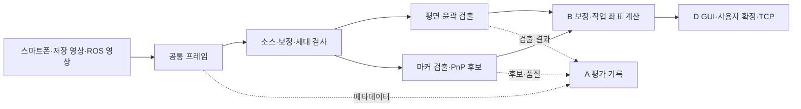

# A 담당 비전 상세설계

문서 버전 1.0 · 설계 초안 · 2026-11-07

| 버전 | 날짜 | 변경 |
|---|---|---|
| 1.0 | 2026-11-07 | 담당 경계, 영상 입력·검출·PnP 인터페이스, 평가와 작업 순서 작성 |

## 1. 목적과 적용 범위

담당 A의 목표는 스마트폰·저장 영상·Gazebo 카메라를 공통 입력으로 다루고, 부품의 윤곽 또는 마커에서 좌표 계산에 필요한 관측값을 제공하는 것입니다. 1~3주차에는 평면 검출을 완성하고, 4~5주차에는 마커 기반 PnP를 추가합니다. 평가에서는 검출 성능을 직접 측정하고 B·C·D의 결과를 취합합니다.

상위 기준은 [시스템 아키텍처 및 프로젝트 계획](../architecture/시스템_아키텍처_및_프로젝트_계획.md)이며, TCP 필드·상태·재시도 규칙은 [TCP 프로토콜 명세서](../protocol/TCP_프로토콜_명세서.md)를 따릅니다. 이 문서는 두 문서의 규칙을 재정의하지 않습니다.

공통 입력·담당 범위·주차별 목표는 기존 계획을 따릅니다. 아래 모듈 이름, 내부 자료형, 오류 사유와 로그 열은 **구현 제안**입니다. 실제 영상 조건과 파일럿 결과로 정할 임계값은 확정값처럼 사용하지 않습니다. 이 문서 작성 시점에는 해당 모듈의 실행 코드가 없습니다.

## 2. 담당 경계와 인계

| 작업 | A의 책임 | 다른 담당과의 인계 |
|---|---|---|
| 공통 영상 입력 | 소스 어댑터, 메타데이터, 최신 프레임 관리 | D가 GUI의 소스 선택·시작·정지를 연결 |
| 평면 검출 | ROI, 전처리, 윤곽 후보, 대상 선택, 픽셀 오버레이 | B가 보정된 윤곽을 작업 평면으로 변환하고 mm 중심·장축각 계산 |
| 카메라 보정 | 촬영 자료 수집 지원, 프로파일 적용 조건 확인 | B가 보정 파라미터·Homography·광학 프레임 규약 제공 |
| 6D 추정 | 마커 ID·모서리, PnP 후보, 카메라 기준 자세·재투영 오차 | B가 작업 좌표 변환·마커/물체 오프셋 적용·최종 자세 유효성 판정 |
| Gazebo 카메라·마커 | 카메라 센서 설정, 수신률 측정, 마커 텍스처 부품 모델 | C의 월드에 통합하고 B와 광학 프레임·정답 동기 확인 |
| TCP 시험 | 시험 입력과 적합성 벡터 활용, 결과 취합 | D가 클라이언트·송수신 기록, C가 서버·로봇 실행 구현 |
| 평가 | 검출 실패·처리시간 측정, 전원 결과 취합 | B가 독립 정답·오차, C가 로봇 도달 로그, D가 통신·GUI 시간 기록 제공 |

A의 검출 성공만으로 이동 가능 상태를 만들지 않습니다. B의 좌표·보정 검사와 D의 현재 프레임·준비 상태 확인을 통과한 목표만 사용자 확정 후 송신합니다. A가 로봇 명령이나 재시도를 직접 발생시키지 않습니다.

## 3. 처리 구조와 대안

기존 프로젝트의 공통 입력 규약을 따라 **소스별 입력 어댑터와 공통 처리 파이프라인**을 사용하도록 제안합니다. 소스마다 검출 코드를 복제하면 수정과 평가 조건을 맞추기 어려워집니다. 모든 처리를 GUI 이벤트 안에 넣는 방식은 입력 지연이 화면 조작에 영향을 줄 수 있어 채택하지 않습니다.

입력 수신과 영상 처리는 GUI 스레드 밖에서 수행하고, D에게 결과 객체를 전달합니다. 실행 방식은 D와 연결 시 확정하되, GUI 객체는 GUI 스레드에서만 갱신합니다. 수신 대기열은 최신 프레임 1개를 유지하는 방식으로 제안합니다. 처리 중 프레임의 버퍼는 덮어쓰지 않고, 폐기한 프레임 수도 기록합니다.

정답 자세·정답 파일은 평가 경로에서만 읽습니다. 검출 대상 선택, PnP 후보 선택, 이동 목표 생성에 정답을 사용하지 않습니다.

## 4. 모듈과 배치 위치

아래 파일은 구현 시 만들 예정인 구성입니다.

| 위치 | 제안 모듈 | 책임 |
|---|---|---|
| `src/eyetoarm/common/` | `types.py` | 프레임·관측·품질 자료형과 단위 규약 |
| `src/eyetoarm/inputs/` | `base.py`, `phone.py`, `video.py`, `ros_image.py` | 소스 열기·읽기·종료와 메타데이터 생성 |
| `src/eyetoarm/vision/` | `pipeline.py` | 모드 분기, 처리 세대 확인, 결과 전달 |
| `src/eyetoarm/vision/` | `planar.py` | ROI·전처리·윤곽 검출·대상 선택 |
| `src/eyetoarm/vision/` | `marker.py`, `pnp.py` | 마커 모서리와 PnP 후보·품질 출력 |
| `src/eyetoarm/vision/` | `overlay.py` | 프레임에 대응하는 ROI·윤곽·마커 표시 자료 |
| `config/sources/` | 소스별 설정 | 입력 종류, 영상 경로·토픽, ROI·검출 파라미터 |
| `config/calibration/` | B 제공 프로파일 | 카메라·해상도·크롭·좌표 기준·보정 식별자 |
| `simulation/models/` | 마커 부품 모델 | 마커 이미지, 실제 크기, 텍스처 방향 |
| `scripts/` | 검출 실행·평가 취합 도구 | 저장 자료 재현과 결과표 생성 |
| `tests/` | 단위·통합 검증 | 좌표 복원, 이전 결과 폐기, 오류와 통합 시나리오 |

보정 수치와 좌표 변환 구현은 기존 `calibration/`, `transforms/` 영역에서 B와 협업합니다. `common/types.py` 같은 공동 파일은 1주차에 필드와 변경 담당자를 합의합니다.

## 5. 내부 데이터 계약

### 5.1 공통 프레임 `FramePacket`

| 필드 | 의미·규칙 |
|---|---|
| `image` | 앱 내부의 BGR 영상 배열. 색상 순서는 입력 어댑터에서 통일 |
| `source_id`, `image_seq` | 소스와 앱 내부 순번. 처리 결과와 원본을 연결하는 식별자 |
| `timestamp_ms`, `timestamp_base` | 상위 계획의 시간 기준. 서로 다른 기준의 시각끼리 직접 빼지 않음 |
| `received_monotonic_ns` | PC 수신 중단·경과 시간 검사용 내부 시각 |
| `width`, `height`, `crop` | 원본 해상도와 적용 크롭. ROI와 구분 |
| `calibration_id` | 대응 프로파일 ID. 미지정 시 표시·픽셀 검출까지만 허용 |
| `generation` | 소스·보정·모드 전환 또는 영상 탐색 때 증가시키는 내부 처리 세대 |
| `optical_frame` | ROS 영상의 광학 좌표계 이름. 앱의 `image_seq`와 구분 |

ROS의 원본 영상 stamp는 정답과의 대응을 위해 나노초 정밀도로 별도 보관하고, TCP용 ms 변환값과 구분합니다. ROI·표시용 축소를 적용했다면 원본 픽셀로 복원할 변환을 함께 관리합니다.

### 5.2 평면 관측 `PlanarObservation`

공통 프레임 식별자, `generation`, 픽셀 좌표 기준, 윤곽 점 배열, 후보 수, 선택 결과, 검출 유효 여부, 사유와 처리시간을 담습니다. 원본·왜곡 보정 영상 중 어느 기준인지와 적용 프로파일을 명시합니다. 픽셀 중심·장축은 디버깅 표시용으로만 제공할 수 있습니다.

B가 사용하는 좌표는 명시된 기준에 맞춰 전달합니다. **왜곡 보정과 Homography의 순서·픽셀 기준을 B와 고정**하고 같은 보정을 두 번 적용하지 않습니다. B는 작업 평면으로 옮긴 윤곽에서 중심·장축을 계산합니다. 픽셀 각도를 작업대 각도로 간주하지 않습니다.

### 5.3 마커·PnP 관측 `PoseObservation`

공통 식별자와 함께 마커 사전·ID, 순서가 보존된 네 모서리, 마커 크기, 사용한 카메라 파라미터 식별자, PnP 후보 목록을 담습니다. 후보마다 `T_C_M`, 재투영 오차와 카메라 앞 여부를 제공합니다. 내부 변환의 병진 단위는 m로 통일하고, 표시·TCP 경계에서만 mm로 바꿉니다.

A는 PnP 후보를 B에게 전달하며, B의 작업대 높이·기울기 검사 결과와 결합해 최종 후보를 결정합니다. 카메라 기준 자세와 작업대 기준 물체 자세는 별도 자료형으로 구분합니다. rvec를 그대로 Euler 각도로 표시하거나 TCP에 넣지 않습니다.

### 5.4 무효 결과와 세대 검사

내부 사유 예시는 `SOURCE_UNAVAILABLE`, `NO_FRAME`, `NO_OBJECT`, `MULTIPLE_OBJECTS`, `DIRECTION_UNSTABLE`, `CALIBRATION_MISMATCH`, `MARKER_NOT_FOUND`, `PNP_FAILED`, `POSE_AMBIGUOUS`입니다. **TCP 오류 코드에 추가하지 않습니다.** D는 사용자 설명으로 변환하고, 검출 실패 결과에도 프레임 식별자를 유지합니다.

소스 변경·보정 변경·모드 변경·영상 탐색 시 `generation`을 증가시키고 대기 결과를 폐기합니다. 작업 완료 시 현재 세대와 다르면 결과를 버립니다. 순번이 초기화될 수 있는 재접속과 ROS 시뮬레이션 시각의 되감기도 새 세대로 처리합니다. 무검출 시 이전 유효 좌표를 현재 결과로 재사용하지 않습니다.

## 6. 입력 소스별 동작

| 소스 | A가 확인할 항목 | 실패·정지 처리 |
|---|---|---|
| 스마트폰 | 스트림 방향·주소, 해상도, 수신 시각, 실제 수신률 | 입력 실패를 알리고 새 결과 생성을 중단. 재접속 시 새 세대 적용 |
| 저장 영상 | 파일 열기, 현재 재생 위치, 프레임 선택·탐색 | 파일 끝·해석 실패를 구분. 탐색 전 결과 폐기 |
| Gazebo | `Image`·`CameraInfo`·`/clock`, 광학 프레임, 센서 해상도·수신률 | stamp와 시뮬레이션 시간, PC 수신 중단을 함께 검사. 정지 중 이전 결과 실행 차단 |

입력 객체의 제안 인터페이스는 `open(config)`, `read()`, `close()`입니다. ROS 입력은 콜백으로 최신 프레임을 갱신하고 `read()`는 그 스냅샷을 제공합니다. 종료·소스 전환 시 수신 작업과 연결 자원을 정리합니다. 무기한 대기하지 않도록 입력 제한시간은 설정으로 관리합니다.

Gazebo 센서 설정은 A가 준비하고 C가 월드 배치를 통합합니다. B와 `optical_frame_id`, CameraInfo, 보정 프로파일의 프레임 일치를 검증합니다. Gazebo 정답 기록은 B가 담당합니다.

## 7. 평면 검출 처리

1. 소스·해상도·크롭·프로파일을 확인하고 ROI를 적용합니다.
2. 명암 변환·노이즈 억제·이진화로 전경을 만듭니다. 이진화 방식과 파라미터는 소스별 파일럿에서 결정합니다.
3. 필요 시 형태학 처리 후 윤곽 후보를 구합니다. 면적·경계 잘림·형상 조건으로 후보를 분류합니다.
4. 대상 1개를 선택합니다. 여러 후보를 구분할 근거가 없으면 최대 면적 후보로 무조건 진행하지 않고 무효 처리합니다.
5. ROI·축소 좌표를 원본 기준으로 복원해 B에게 윤곽을 전달합니다.
6. B의 작업 평면 중심·장축·유효성 결과를 동일 프레임에 연결하고 D에게 표시 자료를 전달합니다.

대상 부품의 장변/단변 비 1.5 이상 조건은 상위 계획을 따릅니다. A의 영상 후보 필터와 B의 작업 평면 장축 유효성 검사를 구분하고, 조명·원근 때문에 영상 비율만으로 물체의 실제 종횡비를 단정하지 않습니다.

소스별 설정에는 ROI, 이진화 방식, 노이즈 억제, 면적 범위, 경계 여유를 기록합니다. 튜닝에 쓴 자료와 최종 평가 자료는 분리합니다. 영상·해상도 변경 시 파라미터를 무조건 재사용하지 않습니다.

## 8. 마커 검출·PnP 확장

1. 사용할 마커 사전·ID·실제 변 길이를 설정으로 고정하고 인쇄물·Gazebo 텍스처와 일치시킵니다.
2. 원본 또는 보정 영상의 마커 모서리를 검출하고 픽셀 기준을 기록합니다.
3. 상위 계획의 `SOLVEPNP_IPPE_SQUARE` 점 순서에 맞는 3D 점과 영상 점을 대응시킵니다. B와 마커 좌표축·모서리 순서를 도식으로 확인합니다.
4. `solvePnPGeneric`의 후보별 카메라 기준 자세·재투영 오차를 산출합니다. 사용한 픽셀과 내부 파라미터·왜곡 모델을 일치시킵니다.
5. B가 작업대 변환 후 높이·기울기 범위를 검사합니다. 가능한 후보가 없거나 서로 다른 자세의 후보를 구분하지 못하면 무효 처리합니다.
6. 선택 결과와 모호성 사유를 기록합니다. 이전 프레임과 비슷하다는 이유만으로 모호성을 숨기지 않습니다.

마커 최소 픽셀 크기, 재투영 오차 한계, 후보 구분 기준은 4주차 1~2일차 파일럿에서 A·B가 정합니다. 결정 전에는 성능 달성값으로 제시하지 않습니다. 단일 마커가 부족하면 같은 기간에 크기 확대 또는 보드 적용을 결정하고 설정·자료 구조에 반영합니다.

Gazebo 모델에는 마커 텍스처 방향·변 길이·부품 기준점과의 배치 조건을 기록합니다. 모델 파일이 있는 것과 실제 카메라 영상에서 검출되는 것을 각각 확인합니다.

## 9. 평가·로그와 결과 취합

프레임마다 `run_id`, 소스, 모드, 세대, 영상 순번·시각, 보정·검출 설정 식별자, 검출 결과·무효 사유, 후보 수와 처리시간을 기록합니다. 마커 모드에서는 ID·픽셀 크기·후보별 오차·선택 결과를 추가합니다. 명령이 생성된 프레임은 D의 `command_id`와 연결해 C의 로봇 로그까지 추적합니다. 명령을 보내지 않은 프레임의 ID는 비워 둡니다.

실행 로그는 `logs/`, 임시 이미지·도표는 `outputs/`에 둡니다. 최종 평가에 쓰는 선별 결과와 재현 조건은 `evaluation/results/`, 독립 정답은 `evaluation/ground_truth/`에 보관합니다. 큰 원본·녹화·토픽 기록은 기존 로컬 보관 폴더를 사용합니다.

| 취합 항목 | 제공자 | A의 처리 |
|---|---|---|
| 무검출·오검출·다중 후보·방향 불가 | A | 조건·소스별 분모와 사유별 건수 공개 |
| 평면·6D 추정 오차와 정답 불확실성 | B | 파일럿/최종 평가와 실제/Gazebo 결과 분리 |
| 최초 ACK·재전송·재접속·GUI 시간 | D | TCP 명세서의 수락 분류 유지 |
| 명령 목표·끝단 오차·전체 오차·실패 코드 | B·C | 명령 ID로 연결하고 비전 오차와 구분 |
| 장비·환경·설정·사용 커밋 | 전원 | 실행별 재현 정보와 함께 보관 |

상위 계획의 평면 2 mm·3°, 통신 100회, P95 300 ms는 제안 목표와 측정 조건을 그대로 참조합니다. A의 순수 영상처리 시간과 영상처리 시작→로컬 송신 완료 시간은 다른 열로 기록합니다. 사용자 대기·촬영→수신 지연·ACK 이후 로봇 실행 시간을 섞지 않습니다.

유효율의 분모에는 사전에 정한 시험 시도 전체를 사용합니다. 무효 결과를 정확도 평균에 0으로 넣지 않고 유효 표본 수와 무효율을 함께 보고합니다. 프레임 단위 처리 성능과 독립 재배치 단위 정확도 평가를 구분하고, 연속 프레임을 독립 배치로 세지 않습니다. 오검출은 독립 라벨 또는 시험 배치 기록으로 확인합니다.

## 10. 검증 시나리오와 완료 기준

| 검증 | 기대 결과 |
|---|---|
| 세 입력 소스의 같은 처리 경로 | 소스·해상도·시각 기준이 식별된 공통 프레임 출력 |
| 파일 없음·스트림 단절·영상 끝 | 구분된 입력 상태, GUI 응답 유지, 자원 정리 |
| ROI·표시 축소 후 알려진 점 복원 | B에게 전달되는 원본 픽셀 좌표가 기대 좌표와 일치 |
| 무검출·복수 후보·경계 잘림 | 사유가 기록되고 이전 유효 좌표를 새 결과로 사용하지 않음 |
| 소스·보정·모드 전환 중 처리 완료 | 이전 세대 결과가 GUI·송신 후보에 적용되지 않음 |
| 저장 영상 탐색·ROS 시간 되감기 | 이전 시각의 결과 폐기, 새 세대·시간 기준으로 시작 |
| 보정 프로파일 없음·해상도 불일치 | 픽셀 검출은 확인 가능하나 이동 목표는 유효 처리되지 않음 |
| 원근이 있는 부품·알려진 작업 평면 | B와 함께 작업 평면 윤곽에서 중심·각도를 검증 |
| 마커 순서·길이·프로파일 검사 | 알려진 자세에서 축·단위가 맞고 후보와 품질이 기록됨 |
| PnP 실패·서로 다른 모호 후보 | 단일 유효 자세로 강제 출력하지 않음 |
| Gazebo 정지·수신 중단 | 오래된 결과를 현재 이동 후보로 사용하지 않음 |
| 로그 결합 | 프레임→명령→로봇 결과가 연결되고 누락은 누락으로 표시 |

평면 완료는 입력→윤곽→B의 mm·각도→D의 표시·사용자 확정→C의 상태 확인 경로를 재현하고 검출 실패·측정 자료를 남기는 것입니다. 6D 완료는 높이·기울기 변화가 있는 마커의 후보·모호성을 처리하고 B의 작업 좌표 자세까지 연결하는 것입니다. 기능 완료와 수치 목표 달성은 별도로 판정합니다.

## 11. 주차별 작업 순서

| 주차 | A의 작업 순서 | 주말 산출물 |
|---|---|---|
| 1주차 | 저장 영상 공통 입력 → 스마트폰 수신 → Gazebo 수신, ROI·윤곽 검출, B·D와 자료형 합의 | 픽셀 검출 데모, 입력 설정, 카메라 Hz·프레임 규약 |
| 2주차 | B의 프로파일 적용·픽셀 인계 → D의 오버레이·GUI 연결 → C까지 평면 통합, 지연·실패 처리 측정 | 유효/무효가 구분된 평면 경로, 소스별 지연·설정·로그 |
| 3주차 | 검출 실패 조건 평가 → 전원 결과 취합 → 회귀 확인, Gazebo 마커 모델 준비 | 평면 평가표·재현 자료·마커 모델. 기본 완료 후에만 오프라인 PnP 파일럿 선택 |
| 4주차 | 1~2일차 A·B PnP 파일럿 → 3~4일차 통합 → 5일차 검증 | 마커·PnP 경로, 확정 시험 범위·품질 기준·평가 계획 |
| 5주차 | 1~2일차 최종 평가 → 3일차 시연본 고정 → 4일차 리허설 → 5일차 발표 | 소스별 최종 평가표·실패 사례·검출 예시·발표 도표 |

첫 구현은 저장 영상 프레임 1개에서 윤곽을 얻어 원본 픽셀과 함께 출력하는 작은 경로로 시작합니다. 보정·TCP·로봇 연동을 한 번에 구현하지 않고 각 담당의 실제 결과를 순서대로 연결합니다.

## 12. 구현 전 확정할 항목

| 항목 | 결정 담당·시점 |
|---|---|
| 실제 촬영 소스·해상도·배경·부품·ROI | A, 1주차 |
| 픽셀 좌표 기준·왜곡 보정 위치·프로파일 규약 | A·B, 1주차 인터페이스 합의 및 2주차 검증 |
| 공통 자료형·GUI 전달 방식·영상 버퍼 수명 | A·D, 1주차 |
| Gazebo 센서·브리지 토픽·광학 프레임 | A·B·C, 1주차 |
| 검출 필터·입력 제한시간·소스별 유효 시간 | A·B·D, 2주차 측정 후 |
| 마커 사전·ID·크기·모서리 순서·후보 판정 | A·B, 모델 준비 및 4주차 1~2일차 |
| 최종 표본 수·조건·평가 로그 열 | A 총괄, 평면 최종 시험 전 및 4주차 5일차 |

위 항목은 이미 합의된 것으로 간주하지 않습니다. 설정을 바꾸면 식별자와 변경 이유를 기록하고 영향받는 시험을 다시 수행합니다.
