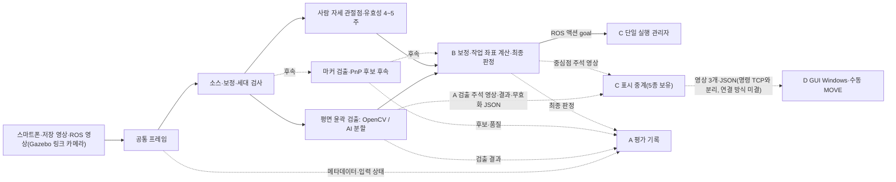

# A 담당 비전 상세설계

문서 버전 1.9 · 설계 초안 · 2026-11-12

| 버전 | 날짜 | 변경 |
|---|---|---|
| 1.0 | 2026-11-07 | 담당 경계, 영상 입력·검출·PnP 인터페이스, 평가와 작업 순서 작성 |
| 1.1 | 2026-11-07 | 검토 반영: 6D 최종 후보 결정을 B로 확정(§2·§5.3·§5.4·§8), 통신 시험 도구·실행·취합을 A로 확정하고 운영 경로와 시험 경로 구분(§2·§4·§9·§11), 마커 좌표계 M과 모서리 대응 계약(§8), OpenCV 확인 환경과 API 경로(§8), `run_id`·`image_seq` 수명(§5.1), 검출 설정 변경 시 세대·스냅샷 규칙(§5.4·§7), 판정 사유와 입력 상태 분리 및 분리 집계(§5.4·§6·§9), `PC_RECEIVE` 시각 관계(§5.1), 검증 항목 추가(§10), 미확정 항목 정리(§12) |
| 1.2 | 2026-11-07 | 수신 세대(`capture_generation`)와 처리 세대(`generation`) 구분, 동일 프레임 재처리 조건과 유효 시간 비연장(§5.1~§5.4), 처리 건수 구분과 검출률 분모를 처리 완료 수로 정의, 평가 실행 식별자 `eval_run_id`와 반복 처리 표본 제외(§9), 회귀 시험·시간 측정 분담(§9·§11), 검증 항목 추가(§10) |
| 1.3 | 2026-11-09 | AI 평면 검출 추가: YOLO11n-seg 초기 후보, OpenCV 기준 비교·3주차 말 운영 채택 결정(§7.1), 관측·설정·오류·평가·일정 반영. 6D는 ArUco·PnP 유지, FoundationPose는 후속 확장 |
| 1.4 | 2026-11-09 | 검토 반영: 계산용 윤곽의 관측면을 부품 윗면으로 정의(`contour_basis`), 전체 실루엣·그림자·가림 윤곽 금지와 `TOP_FACE_UNRESOLVED`, 라벨·평가 기준 일치(§2·§5.2·§5.4·§7·§7.1). 비전 처리 오류의 이동 후보 무효화 이벤트, `job_seq` 기반 적용 순서, D 송신 전 반영과 복구 조건, ACK 대기 중 원래 목표에 적용되는 무효화 시 자동 재전송 중단(§5.4·§7.1·§9). 관측면 판정은 A 책임이며 B 면적 검사는 보조 건전성 검사. 검증·미확정 항목 추가(§10·§12) |
| 1.5 | 2026-11-09 | 계획서 1.4(전체 7주)와 정합: 5주차를 기존 범위 평가·기준 실행본 확보로, 최종 발표를 7주차로 이동(§11). 6~7주 그리퍼 확장의 A 책임(그리퍼 실행 프로파일·시뮬레이션 적용, 2지 개폐·부착·보유 검출, 집기 시험 도구·결과 취합) 요약 신설(§13). 검토 반영: 확장 초기화·DetachableJoint 제약·런타임 시뮬레이션 피드백 역할 구분·확장 모드의 C 서버 부재(§13). 기존 1~5주 범위·절 번호 유지 |
| 1.6 | 2026-11-10 | 계획서 1.5(전체 5주)와 정합: 1~3주차 볼트·너트 컨베이어 분류 인식(데이터·라벨·학습·평가, 추적 ID·재검출, 카메라·도착 감지·접촉 센서 입력), 4~5주차 사람 자세 모델 관절점·신뢰도·시각·유효성 출력으로 변경(§1·§11·§12·§13). 6D 마커·PnP(§8)는 후속으로 표시하고 내용은 유지. 1.5의 6~7주 그리퍼 확장 A 책임(시뮬레이션 적용·순서 관리자 연동)은 대체: 로봇·그리퍼 모델·제어기·실행 구성은 C 소유 |
| 1.6 (검토 반영 2) | 2026-11-10 | `AUTO_SORT` 정상 사이클의 벨트 정지·재가동은 시작 승인 아래 C 자동 실행, 사용자 정지·오류·격리·복구 이후 재개만 사용자 확정(§2). `DIRECTION_UNSTABLE` 사유를 볼트에 한정(§5.4) |
| 1.6 (사용자 확정 반영) | 2026-11-10 | 최종 부품 모델 BOLT_A = M6×12, BOLT_B = M6×40(ISO 4762 육각 홈붙이 볼트), 너트 M6(ISO 4032) 확정(§1·§12). 스마트폰은 1주차에 어댑터·설정 형식만, 실연결은 4~5주차(§1·§11). C 월드 녹화는 월드 구성 완료 후 확보, 그 전에는 공개 저장 이미지로 진행(§11) |
| 1.6 (사용자 확정 반영 2) | 2026-11-10 | AI 검출 모델은 후보 비교 후 선정(사용자 확정 정책). 초기 비교 제안 YOLO11n-seg·YOLOv8n-seg 최대 2개(reviewer 제안) + OpenCV 기준선, 비교 조건·기록 지표(§1·§7.1·§12). 2주차 후보 파일럿, 3주차 말 채택, 미달·미검증 시 OpenCV 유지 |
| 1.6 (B·D 공동 결정 사안) | 2026-11-10 | §12.1 추가: B와 결정할 6건·D와 결정할 6건의 A 제안과 공동 확정 조건, 우선순위. A 제안이며 B·D 합의 아님 |
| 1.6 (단위 표현 정정) | 2026-11-10 | §12.1 B-06 행의 'B는 mm 좌표 출력' 표현을 B 상세설계 §5.5(결과 m, D가 표시·TCP 경계에서 mm 변환 한 번)에 맞춰 정정. [협업 요청 초안](A담당_협업_요청_초안.md) 연결 |
| 1.6 (공유 문서 보완) | 2026-11-10 | §7.1 라벨 문단에 윗면 규칙은 기존 판형 기준이며 볼트·너트 관측면·라벨 기준은 B-03 파일럿 전 미확정이라는 단서 추가(§1 관측면 주의 반영, 새 값 확정 없음). §1 문장 공백 정리 |
| 1.7 (재설계 정합화) | 2026-11-11 | 사용자 확정 반영: A·B는 WSL의 내부 파이프라인(분리 ROS 인터페이스 없음), D GUI는 Windows, 자동 분류 목표는 B→C ROS 액션, 운전 모드 없이 START로 분류(§2·§3). Windows GUI로 인해 D 전달·버퍼 제안(§12.1 D-01~D-03)은 재검토 |
| 1.7 (기능 설계 통합) | 2026-11-11 | 2026-11-11 사용자 요청: 별도 기능 설계 3개(그리퍼·로봇 실행, 컨베이어 분류, 사람 자세 제어)를 시스템 계획과 A/B/C/D 상세설계로 통합하고 삭제. §13.1(분류용 A 출력)·§13.2(사람 관절점 출력) 신설, §13 재검출 세대 표현 정정 |
| 1.7 (실행 피드백 경계) | 2026-11-11 | 2026-11-11 사용자 확정 실행 피드백 경계: A는 카메라 입력·검출·추적·관측 출력과 C 정지 확인 결과를 받은 재검출만, 도착·접촉·부착·보유·벨트 정지·상자 도착 확인의 구성·수신·판정과 수량 집계(센서 설정 포함)는 C. §1·§2·§6·§11·§12·§13 갱신 |
| 1.7 (담당 경계 RB) | 2026-11-11 | 2026-11-11 담당 경계 RB-01~03 정리: 구현·수정 책임자/제공 정보/협력 담당 구분. §12 파이프라인 골격 유지 미결·Gazebo·장애 주입 행 |
| 1.7 (담당 결정) | 2026-11-11 | 사용자 결정 2026-11-11: common/types.py 관리 A, A·B 파이프라인 실행 진입점 A(계산·액션 어댑터 B), 그리퍼 실행 혼합 설정 최종 관리 C, 동등 파지 후보 계산 B·실행 해 선택 C. B→C PICK_PLACE 목표 계약(제안) 구체화. §4·§12·§12.1 |
| 1.8 | 2026-11-12 | 사용자 전달 2026-11-12: B·D가 [협업 요청 초안](A담당_협업_요청_초안.md) 0.5의 A 제안 수락(원문 미확인, C는 회신 없음). §12.1 두 표에 상태 열 추가(수락으로 확정된 것과 남은 미결 구분), §12 해당 행·§1 구현 상태 문단에 반영. 사용자 확정 날짜 일정(11-22 1~3주차 범위 구현 완료, 11-23부터 시험·발표 준비, 11-26 중간 발표)과 A 제안 일별 배치를 §11에 추가. 같은 날 사용자 확정 추가: 주말 포함 매일 작업, AI 비교 후보 3개(YOLOv8n-seg·YOLO11n-seg·YOLO26n-seg, §1·§7.1·§12의 '최대 2개' 정정), AI 라이브러리(PyTorch·ultralytics) 설치 승인(버전 미기록), 공개 데이터 재분할 채택(§12 데이터 분리 행, 방식은 A 제안). §7.1 참고 링크에 Ultralytics 공식 YOLOv8·YOLO26 문서 추가. 같은 날 AI 환경 설치 완료(reviewer 실행, 사용자 승인) 후 설치 버전·실행 주의를 §7.1·§11.1·§12 AI 비교 후보 행에 기록 |
| 1.9 | 2026-11-12 | 사용자 확정 2026-11-12(카메라·표시 경로): Gazebo 카메라 3대(링크·그리퍼·고정 탑뷰), 운영(검출) 카메라인 링크 카메라의 센서 설정·입력 요구는 A가 작성해 C에 공유하고 C가 월드·브리지에 통합(사용자 결정, C 회신 C-01 채택. 그리퍼·고정 카메라 설정 담당은 미결), A 검출 입력은 링크 카메라(베이스 또는 어깨 고정), 추적은 검출 기반 + 특징점 보조, 영상은 C가 D GUI로 전송(C 보유 5종: 링크 원본·A 검출 주석·B 중심점 주석·그리퍼 원본·고정 원본, D 요청에 따라 링크 채널 하나 + 그리퍼·고정 = 3개 영상), 결과·무효화 JSON 동봉. 그리퍼 카메라 표시용은 결정에서 도출(사용자에게 알렸고 정정 없음). 표시 경로는 TCP 1.1 명령 연결과 분리(TCP 명세서 §0 유지), 연결 방식·포트·직렬화·토픽 이름은 미결. C 회신(C-01·03·04·05·07, 사용자 전달 원문) 사실 기록. 장착 링크 `base_link` 권장(A가 센서 설정에서 제안하는 값)·ROS 토픽 전달·원본 자동 전환·프레임 키·추적 세부·주석 검출기는 reviewer 제안. 같은 날 사용자 결정: 링크 채널 종류 코드 `raw`·`detect`·`center`(링크 채널에만), `source_id`·채널 코드·조합 표기는 reviewer 제안. 표시 경로 프로토콜 A 초안은 TCP 명세서 부록 B(미승인)에 두고 §3·§12에서 참조. §1·§2·§3·§5.1·§6·§11.1·§12·§12.1·§13·§13.1 |
| 1.9 (링크 카메라 설정) | 2026-11-12 | 사용자 요청 2026-11-12(reviewer 지시): §6.1 신설. A가 C에 공유할 링크 카메라 센서 조각(`base_link` 자식 `link_cam_link`·광학 프레임 `link_cam_optical_frame`·`gz_frame_id`), 센서 초기값(15 Hz·1280×720·hfov 1.0), 주의 3개, 내부 파라미터 식, 브리지, `origin` 정하는 기준(화면 범위·화소 밀도·팔 가림), 입력 요구, 통합 뒤 확인 명령. 이름·값은 제안·초기값이고, 장착 `origin`은 자리표시. 같은 날 사용자 확정: 링크 카메라 시점 = 베이스 근처 경사 시점(§1·§6.1). 경사 시점 예시(기준 1 일부 충족, 기준 2 미충족 13~14 px, 기준 3 UNVERIFIED)와 `K`·헤더는 프로젝트 밖 사본 확인값(C 모델 미적용, C 통합·실연결 검증 아님). 탑뷰 배치는 시험용·채택 안 함. 15 px 충족 방안(거리·화각·해상도·기준)은 A·B·C 결정 필요 |
| 1.9 (공개 데이터 재분할) | 2026-11-12 | 사용자 결정 2026-11-12(「재분할부터 지금 진행」): §12 데이터 분리 행의 A 제안 방식으로 재분할 실행. 줄기·결합·배정 규칙과 결과 수치, 남은 누수 한계(상관 0.80~0.95 같은 장면 쌍)를 §12에 기록하고 §11.1 11-15 칸의 재분할을 「11-12 앞당겨 완료」로 갱신. 원본 무수정, 목록 `data/splits/resplit_v1/` |
| 1.9 (화소 기준·재분할 v2) | 2026-11-12 | 사용자 결정 2026-11-12: §6.1 기준 2를 「모델 입력에서 너트 짧은 변 ≥ 12 px(잠정, 공개 학습 데이터 하위 10%)」로 바꾸고 이전 원본 영상 15 px 기준을 대체함. 모델 입력 크기 식(원본 px × imgsz / max(ROI 폭, ROI 높이), imgsz 640 기본·1280 대안)을 넣고, 경사 예시·탑뷰 시험 배치를 기존 사본 영상으로 다시 계산함(Gazebo 재실행 없음). 결과는 imgsz 640에서 6.0~9.9 px로 미충족이라 `origin` 자리표시를 유지하고 방안 ①~④를 미결로 적음. §7 1단계에 벨트 ROI 잘라내기 후 imgsz 축소(A 제안)를 추가. 같은 날 재분할 v2(크기 구간 균형, `data/splits/resplit_v2/`)를 현재 목록으로 바꾸고 v1은 대체됨(보존), §12에 결과와 한계 기록 |
| 1.9 (AI 파일럿) | 2026-11-12 | 사용자 결정 2026-11-12(「제안대로 진행」): §7.1에 2단계 전이 학습 방향(A 제안)을 추가함. 1단계 공개 데이터 → 2단계 Gazebo, 비교 3조건, Gazebo 평가 세트는 다른 장면으로 분리, 최종 판단은 Gazebo 평가 세트, 질감 변경 전달 예정 사실. yolo11n-seg 파일럿 결과를 §12 AI 비교 후보 행에 기록함: 640은 50 에포크 완료, 1280은 메모리 부족으로 3 에포크에서 중단돼 비교 미완. OpenCV 4.6 학습 경로 확인으로 「미검증」 문구를 갱신하고, 글꼴 내려받기·`val` 출력 경로 주의를 추가함. §6.1 방안 ①·④에 파일럿 결과를 연결함(결정 없음). §11.1의 11-15·11-16·11-17 칸 갱신 |
| 1.9 (Gazebo 평가 세트 도구) | 2026-11-12 | 사용자 결정 2026-11-12: §7.1에 Gazebo 평가 세트 생성 도구(A 제안, 실행 전)의 방식·변수·시드 규칙·수집 방식·안전 장치·검증 상태를 기록함. 분할 카메라와 슬롯별 고유 라벨을 쓰고, 월드 사본은 `gz sdf -k`를 통과함. §11.1 11-16 칸 갱신 |
| 1.9 (1280 파일럿) | 2026-11-13 | 사용자 요청 2026-11-12 「1280 학습 재실행」: imgsz 1280 파일럿 50 에포크 완료(메모리만 감시하는 사용자 결정 규칙). §12 AI 비교 후보 행에 640과의 비교(mAP50, 원본·0.5배 크기 구간 재현율, 640 학습·1280 추론, Gazebo 사본 영상 참고값)를 기록하고, §7.1 OpenCV 학습 경로 문장과 §6.1 방안 ①을 갱신함(결정 없음) |
| 1.6 (검토 반영) | 2026-11-10 | 현재 4~5주 작업을 사람 자세 제어로 일치시키고 마커·PnP 항목(§2·§3·§4·§5.3·§9·§10)을 후속으로 표시, 클래스별 방향 필요 여부(볼트만 장축 조건, 너트는 방향 불필요)(§7), 모드별 운영 인계(`MOVE_TEST`·`AUTO_SORT`·`HUMAN`)(§2), 현재·후속 완료 기준 분리(§10) |

## 1. 목적과 적용 범위

담당 A의 목표는 스마트폰·저장 영상·Gazebo 카메라를 공통 입력으로 다루고, 로봇 실행에 필요한 인식 결과를 제공하는 것입니다. 1~3주차에는 컨베이어로 공급되는 볼트 2규격·너트 1규격(최종 모델 BOLT_A = M6×12, BOLT_B = M6×40(ISO 4762 육각 홈붙이 볼트), 너트 M6(ISO 4032), 사용자 확정)을 저장 자료·Gazebo 입력에서 검출하고(데이터·라벨·학습·평가, 추적 ID, C의 정지 확인 결과를 받은 뒤 재검출), 카메라 입력을 구성합니다. 도착·접촉 등 실행 피드백은 C가 구성·판정합니다. 4~5주차에는 스마트폰을 실제로 연결해(1주차에는 어댑터·설정 형식만 준비) 사람 자세 모델로 관절점·신뢰도·시각·유효성을 출력합니다. 평가에서는 검출 성능을 직접 측정하고, 통신 시험 도구를 구현해 통신·장애 시험을 실행하며, 전원의 결과를 취합합니다. 운영 비전 모듈은 팔·벨트 명령을 직접 만들지 않습니다.

**카메라와 검출 입력(사용자 확정 2026-11-12).** Gazebo 카메라는 **3대**(링크 카메라, 그리퍼 카메라, 고정 카메라(탑뷰))입니다. **A의 검출 입력(운영 카메라)은 링크 카메라**이며, 링크 카메라는 로봇 베이스 또는 어깨에 고정합니다. 링크 카메라 시점은 **베이스 근처에서 벨트를 비스듬히 내려다보는 경사 시점**입니다(사용자 확정 2026-11-12, 설정은 §6.1). 링크 카메라의 Gazebo 센서 설정과 입력 요구는 **A가 작성해 C에 공유**하고, C가 월드·브리지에 통합하며, A·B·C가 토픽·광학 프레임·`CameraInfo` 일치를 확인합니다(사용자 결정 2026-11-12, C 회신 C-01 채택). 그리퍼·고정(탑뷰) 카메라의 센서 설정 담당은 **미결**입니다(참고 제안: 그리퍼 카메라는 C 소유 로봇·그리퍼 모델에 장착되므로 장착은 C, 설정 담당은 C와 결정). 장착 링크는 A가 센서 설정에서 `base_link`를 제안합니다(제안: `shoulder_link`는 1번 관절(shoulder_pan)과 함께 회전하므로 어깨 장착이면 「1번 관절이 정해진 각도일 때만 검출 유효」 규칙이 필요. 장착 링크는 C 모델과 맞춰 확인, 좌표는 B). 그리퍼 카메라는 표시용이며 검출 입력이 아닙니다(사용자 결정에서 도출, 사용자에게 알렸고 정정 없음). 추적은 **검출 기반 + 특징점 보조**입니다(사용자 확정, §13). 영상 표시 경로는 §3을 따릅니다.

AI는 볼트·너트 검출에 추가하며 OpenCV 기준 방식과 비교합니다. AI 검출 모델은 단일 모델을 자동 확정하지 않고 후보를 비교해 선정합니다(비교 후보: YOLOv8n-seg·YOLO11n-seg·YOLO26n-seg 3개, 사용자 확정 2026-11-12, §7.1). 클래스 구성(정확히 3클래스 / `bolt`·`nut` + B의 치수 규격 판정)은 A·B 파일럿 제안입니다. 3주차 말 평가로 운영 채택 여부를 결정하고, 미달·미검증이면 OpenCV 경로를 운영·시연에 사용합니다(§7.1). 사람 자세 모델(후보 MediaPipe Pose Landmarker)은 사전학습 모델 추론이며 학습을 필수로 두지 않습니다. 6D 마커·PnP(§8)는 이번 5주 필수 범위에서 후속으로 옮겼으며, 기존 설계 내용은 후속 작업의 기준으로 유지합니다.

**관측면 주의.** §5.2의 윗면(`top_face`) 계약은 단일 판형 부품을 기준으로 정했습니다. 볼트(머리·축)와 너트에 그대로 성립한다고 보장하지 않으며, 부품별 관측면·라벨 기준은 B와 1~2주차에 재검토합니다(§12).

상위 기준은 [시스템 아키텍처 및 프로젝트 계획](../architecture/시스템_아키텍처_및_프로젝트_계획.md)이며, TCP 필드·상태·재시도 규칙은 [TCP 프로토콜 명세서](../protocol/TCP_프로토콜_명세서.md)를 따릅니다. 이 문서는 두 문서의 규칙을 재정의하지 않습니다.

공통 입력·담당 범위·주차별 목표는 기존 계획을 따릅니다. 아래 모듈 이름, 내부 자료형, 판정 사유·입력 상태 이름과 로그 열은 **구현 제안**입니다. 실제 영상 조건과 파일럿 결과로 정할 임계값은 확정값처럼 사용하지 않습니다. **구현 상태(2026-11-11):** 공통 최소 자료형(`common/types.py`), 저장 이미지 입력(`inputs/base.py`·`inputs/stored_images.py`), 픽셀 좌표 기록(`vision/pixel_map.py`), 표시용 평면 윤곽 검출(`vision/planar.py`)과 재현 CLI(`scripts/run_vision.py`)를 작성해 단위 시험을 했습니다. 이것은 표시용(`display_only`, `valid=false`) 단계이며 운영 유효 판정·계산용 윤곽·B 좌표 변환·GUI 연동은 아직 없습니다. 나머지 모듈(아래 §4의 스마트폰·영상·ROS 입력, `pipeline.py`, AI 검출, 사람 자세 등)은 실행 코드가 없습니다. 2026-11-12 B·D의 A 제안 수락(§12.1)은 계약 원칙의 수락이며 위 구현 상태를 바꾸지 않습니다.

## 2. 담당 경계와 인계

| 작업 | A의 책임 | 다른 담당과의 인계 |
|---|---|---|
| 공통 영상 입력 | 소스 어댑터, 메타데이터, 최신 프레임 관리, 입력 상태 보고 | D가 GUI의 소스 선택·시작·정지를 연결 |
| 평면 검출 | ROI, OpenCV 전처리 또는 AI 분할, 윤곽 후보, 영상 후보 필터, 대상 선택, 계산용 윗면 윤곽(§5.2 관측면), 픽셀 오버레이, 비전 처리 오류의 후보 무효화 이벤트(§5.4). 링크 카메라 프레임에 검출을 그린 A 검출 주석 영상(사용자 표현 「YOLO 검출 영상」, 사용자 확정 2026-11-12) 발행. AI 데이터·라벨·학습·추론·비교 결과 취합 | B가 윗면 윤곽을 작업 평면으로 변환하고 mm 중심·장축각 계산, 작업 평면 장축 유효성 판정. A·B·D가 운영 채택 기준·결과 확인 |
| 카메라 보정 | 촬영 자료 수집 지원, 프로파일 적용 조건 확인 | B가 보정 파라미터·Homography·광학 프레임 규약 제공 |
| (후속) 6D 추정 | 마커 ID·모서리, PnP 후보별 `T_C_M`·재투영 오차·카메라 앞 여부 제공, `MARKER_NOT_FOUND`·`PNP_FAILED` 판정 | B가 작업대 좌표 변환, 마커/물체 오프셋 적용, 높이·기울기 범위 검사, 모호성(`POSE_AMBIGUOUS`) 판정, 최종 후보 선택과 최종 자세 유효성 판정 |
| Gazebo 카메라 | 운영(검출) 카메라인 링크 카메라의 센서 설정(SDF)·입력 요구 작성과 C 공유, 수신(`inputs/ros_image.py`)·수신률 측정. (후속) 마커 텍스처 부품 모델. 도착·접촉 등 실행 피드백 센서 구성·판정은 C 소유(계획서 §2.6.2)로 A 범위가 아님 | C가 월드·브리지에 통합하고 A·B·C가 토픽·광학 프레임·`CameraInfo` 일치 확인(사용자 결정 2026-11-12, C 회신 C-01 채택). 그리퍼·고정 카메라 설정 담당은 미결. B와 광학 프레임·정답 동기 확인 |
| 영상 표시 | A 검출 주석 영상(링크 카메라)과 결과·무효화 JSON 발행 | B: 중심점 주석 영상(링크 카메라) 발행. C: 5종 영상(링크 원본·A 검출 주석·B 중심점 주석·그리퍼 원본·고정 원본) 보유, D 요청에 따라 링크 채널(`raw`(원본)/`detect`(검출 주석)/`center`(중심점) 중 하나) + 그리퍼·고정 = 3개 영상과 결과·무효화 JSON을 D에 전송. D: 표시·링크 채널 선택(사용자 확정 2026-11-12, §3) |
| 통신 시험 | 시험 시나리오, 통신 시험 도구 구현, 시험 실행, 결과 분석·취합 | D가 재사용 가능한 TCP 클라이언트·송수신 기록 기능 제공과 관련 결함 수정. C가 서버·로봇 기능, 서버 측 로그 제공과 관련 결함 수정. 서버 측 장애 주입과 로봇 상태 확인은 A가 C와 협력 |
| 평가 | 검출 실패·처리시간·입력 가용성 측정, 통신 시험 결과, 전원 결과 취합 | B가 독립 정답·오차, C가 로봇 도달·서버 로그, D가 GUI 응답 시간 기록 제공 |

**운영 경로와 시험 경로의 구분.**

- 운영 중 A의 비전 모듈은 관측(카메라 영상 기반 검출·추적·관절점)만 출력하고 로봇 명령이나 재시도를 직접 발생시키지 않습니다. A의 검출 성공만으로 이동 가능 상태를 만들지 않습니다. 이후 인계는 작업별로 다릅니다(계획서 §2.1 「작업별 실행 승인」). 운전 모드는 두지 않습니다(사용자 확정).
  - 수동 이동(TCP 1.1 `MOVE`): B의 좌표·보정 검사와 D의 현재 프레임·준비 상태 확인을 통과한 목표만 사용자 확정 후 D가 1건 송신
  - 분류 작업(기본 작업): `START`(GUI 입력)로 분류를 한 번 시작한 뒤, A의 관측 → (내부 파이프라인) B의 규격 판정·목표 → B가 ROS 액션 goal로 C에 전달 → C의 실행 관리자가 검증·실행(사용자 확정. goal 종류·필드는 제안). 정상 분류 사이클의 벨트 정지(`BELT_STOP`)·재가동(`RESTART`)은 최초 시작 승인 아래 C가 자동 실행하며 부품마다 다시 승인하지 않음. 사용자 정지, 오류·격리·복구 이후의 재개는 사용자가 다시 `START`(제안)하고, 사용자 정지를 자동 재개하지 않음
  - 사람 자세 제어(4~5주 기능 경로, 운전 모드 아님): 사용자 동의·활성화 후 A의 관절점 → B의 의도 판정 → C가 의도마다 사전 동작 하나 실행. 활성화 상태가 승인이며 유실 시 정지·재활성화 필요
- 영상 표시 경로(§3, 사용자 확정 2026-11-12)는 D의 표시와 수동 `MOVE` 송신 전 검사용이며 로봇 명령 경로가 아닙니다. 로봇 명령은 D의 TCP(수동 `MOVE`, 분류 명령 개정 제안)와 B→C ROS 액션으로만 갑니다.
- 별도의 통신 시험 도구는 TCP 명세서와 시험 시나리오 범위에서 `MOVE`·`GET_STATUS`·`CANCEL`을 송신할 수 있습니다. 시험 도구도 TCP 명세서 §8의 클라이언트 규칙을 따릅니다.
- 시험 도구는 통신 로직을 따로 복제하지 않고 D가 제공하는 클라이언트 기능을 재사용합니다. 두 구현이 갈라지면 시험이 운영 클라이언트를 검증하지 못하기 때문입니다.
- 중복 `MOVE` 재송신 같은 장애 주입은 정상 운영 동작과 분리된 시험 모드에서만 실행합니다(TCP 명세서 §8.6).

## 3. 처리 구조와 대안

기존 프로젝트의 공통 입력 규약을 따라 **소스별 입력 어댑터와 공통 처리 파이프라인**을 사용하도록 제안합니다. 소스마다 검출 코드를 복제하면 수정과 평가 조건을 맞추기 어려워집니다. 모든 처리를 GUI 이벤트 안에 넣는 방식은 입력 지연이 화면 조작에 영향을 줄 수 있어 채택하지 않습니다.



A·B는 WSL의 한 파이프라인(같은 프로세스 제안)에서 자료형·함수 호출로 연결합니다(사용자 확정: 분리 ROS 인터페이스 없음). 운영 GUI는 Windows의 별도 프로세스이므로 A는 결과 객체를 D에게 직접 넘기지 않습니다(이전의 「D에게 결과 객체 전달」·버퍼 공유 제안은 같은 프로세스 전제였음). 입력 수신과 영상 처리는 A 파이프라인에서 수행하고, GUI 객체는 D가 GUI 스레드에서만 갱신합니다.

**영상 표시 경로(사용자 확정 2026-11-12).** 영상은 서버(C)단에서 D GUI로 보냅니다. C는 링크 원본, A 검출 주석 영상(링크), B 중심점 주석 영상(링크), 그리퍼 원본, 고정 원본의 5종을 가지고, D의 요청에 따라 링크 채널을 `raw`(원본)/`detect`(검출 주석)/`center`(중심점) 중 하나로 정해 그리퍼·고정 영상과 함께 **3개 영상**을 D에게 보냅니다. 결과·무효화 JSON도 함께 보내 D가 측정값을 표시하고 수동 `MOVE` 송신 전에 검사합니다. 오버레이는 A·B가 영상에 그려 보내며 좌표값은 JSON에 있습니다. 이 경로는 TCP 1.1 명령 연결과 분리되며(TCP 명세서 §0 「영상은 이 TCP로 보내지 않음」 유지, TCP 1.1 스키마·명령 의미 변경 없음), 계획서 §2.1의 「GUI↔C TCP 하나」는 명령·상태 TCP 규칙으로 이 경로가 바꾸지 않습니다. **미결:** C→D 연결 방식·포트, 직렬화 형식, A·B→C 전달 토픽 이름·형식(§12) (초안: [TCP 명세서 부록 B](../protocol/TCP_프로토콜_명세서.md), A 초안·미승인).

**영상 분류 코드(사용자 결정 2026-11-12).** 링크 채널의 종류 코드는 `raw`(원본)·`detect`(A 검출 주석 영상. 'yolo' 대신 쓰며, 운영 검출기가 OpenCV여도 같은 코드. 실제 검출기 종류는 영상 표기·결과 JSON에 따로 적음)·`center`(B 중심점 주석 영상)입니다. `original`이 아니라 `raw`로 확정입니다. 종류 선택은 **링크 채널에만** 있고, 그리퍼·고정 채널은 원본만 있어 종류 선택·종류 코드가 없습니다. D→C 선택 요청도 링크 채널의 종류 하나만 대상입니다. 이 `raw`는 B-01의 픽셀 좌표 기준 이름 `raw`(왜곡 보정 전 원본 픽셀)와 글자만 같고 다른 개념입니다. 아래는 reviewer **제안**(확정 아님): 카메라 `source_id` = `gz_link`·`gz_gripper`·`gz_fixed`(B `calibration_id` 제안 형식 `<source_id>_<w>x<h>_v<n>`에 들어감, 예 `gz_link_1280x720_v1`), 표시 채널 코드 = `link`·`gripper`·`fixed`(C·D가 확정), 조합 표기 `link/raw`·`link/detect`·`link/center`(그리퍼·고정에는 조합 표기 없음).

아래는 reviewer **제안**이며 확정이 아닙니다.

- A·B→C 전달은 ROS 토픽(제안). 주석 영상(A 검출, B 중심점) 각 1개, 결과·무효화 JSON은 토픽 하나(`std_msgs/String` JSON, reliable QoS)로 순서를 보장. 토픽 이름·형식은 C와 결정. A→B는 기존대로 내부 호출(분리 ROS 인터페이스 없음 유지).
- 주석 영상이 일정 시간 오지 않으면 C가 링크 채널을 원본으로 자동 전환하고 「검출 중단」을 표시(제안). 주석 영상에는 프레임 시각·상태(정상/무효 사유)·운영 검출기(OpenCV/AI)를 표기.
- 결과 JSON의 프레임 키는 링크 카메라 영상의 ROS `header.stamp`(`SIM_TIME`)이고, A 내부 식별자(`run_id`·`image_seq`·`generation`·`job_seq`)는 기록용(제안).
- 주석 영상에 그리는 검출기는 그 시점의 운영 검출기(11-25 AI 채택 전·미채택 시 OpenCV, 제안).

C→D 표시 연결은 별도 포트의 표시 연결 1개(영상 3채널 + JSON + D→C 링크 채널 선택 요청)를 제안하며, 결정은 C·D입니다. 수신 대기열은 최신 프레임 1개를 유지하는 방식으로 제안합니다. 처리 중 프레임의 버퍼는 덮어쓰지 않고, 대기열에서 폐기한 프레임 수도 기록합니다(§9 처리 건수).

정답 자세·정답 파일은 평가 경로에서만 읽습니다. 검출 대상 선택, PnP 후보 선택, 이동 목표 생성에 정답을 사용하지 않습니다.

## 4. 모듈과 배치 위치

아래는 구성 계획입니다. 「상태」 표시가 없는 항목은 아직 만들지 않았습니다. `common/types.py`·`inputs/base.py`·`inputs/stored_images.py`·`vision/planar.py`·`vision/pixel_map.py`·`scripts/run_vision.py`는 작성됨(표시용 단계, 위 상태 문단).

| 위치 | 제안 모듈 | 책임 |
|---|---|---|
| `src/eyetoarm/common/` | `types.py` | 프레임·관측·품질 자료형과 단위 규약. **작성됨:** 최소형 `TimestampBase`·`InputStatus`·`FramePacket`·`InputStatusEvent`. 관측·결과·사건형은 미구현 |
| `src/eyetoarm/inputs/` | `base.py`, `phone.py`, `video.py`, `ros_image.py` | 소스 열기·읽기·종료, 메타데이터·입력 상태 생성 |
| `src/eyetoarm/vision/` | `pipeline.py` | 모드 분기, 처리 세대·설정 스냅샷 확인, 결과 전달 |
| `src/eyetoarm/vision/` | `planar.py` | ROI·전처리·윤곽 검출·영상 후보 필터·대상 선택 |
| `src/eyetoarm/vision/` | `ai_detector.py` | AI 모델 로딩·추론, 마스크에서 윤곽 추출·원본 픽셀 좌표 복원 |
| `config/vision/` | AI 검출 설정 | 검출 방식, 모델·가중치 경로와 식별자, 대상 클래스, 신뢰도 기준, 입력 크기, 추론 장치. 구현 시 추가 |
| `src/eyetoarm/vision/` | `human_pose.py` | (제안) 사람 자세 모델 추론, 관절점·신뢰도·시각·유효성 출력(4~5주) |
| `src/eyetoarm/vision/` | `marker.py`, `pnp.py` (후속) | 마커 모서리와 PnP 후보·품질 출력. OpenCV API 분기 어댑터(§8) |
| `src/eyetoarm/vision/` | `overlay.py` | 프레임에 대응하는 ROI·윤곽·마커 표시 자료 |
| `config/sources/` | 소스별 설정 | 입력 종류, 영상 경로·토픽, ROI·검출 파라미터, 입력 제한시간 |
| `config/calibration/` | B 제공 프로파일 | 카메라·해상도·크롭·좌표 기준·보정 식별자 |
| `simulation/models/` | (후속) 마커 부품 모델 | 마커 이미지, 실제 크기, 텍스처 방향(§8의 M 정의) |
| `scripts/` | 검출 실행·평가 취합 도구, 통신 시험 도구 | 저장 자료 재현과 결과표 생성. 통신 시험 도구는 D의 `src/eyetoarm/tcp/` 클라이언트 기능을 재사용 |
| `tests/` | 단위·통합 검증 | 좌표 복원, 이전 결과 폐기, 오류와 통합 시나리오 |

보정 수치와 좌표 변환 구현은 기존 `calibration/`, `transforms/` 영역에서 B와 협업합니다. `common/types.py`는 [공통 자료형 관리 초안](공통_자료형_관리_초안.md) §3 기준의 최소형으로 이미 작성돼 A 입력 모듈이 쓰고 있으며, 다시 승인 대기로 돌리지 않습니다. 앞으로의 필드 변경과 미구현 관측·결과·사건형 추가는 같은 초안 §6의 변경 관리 절차를, 파일 관리·변경 반영·호환성 확인은 A입니다(사용자 결정 2026-11-11). B는 결과 필드의 의미·단위·유효 조건을 정의하고 D는 표시·소비 호환을 확인하며, 영향 담당 확인 뒤 A가 반영합니다. B 계산·D GUI 내부 결함은 각 담당 책임입니다([A 협업 요청 초안](A담당_협업_요청_초안.md) D-04). A·B 파이프라인 실행 진입점(설정 로딩·영상 입력 연결·A→B 호출 배선·종료 정리)도 A가 맡고, 계산 함수·액션 클라이언트 어댑터는 B가 구현·수정합니다(사용자 결정 2026-11-11).

## 5. 내부 데이터 계약

### 5.1 공통 프레임 `FramePacket`

| 필드 | 의미·규칙 |
|---|---|
| `image` | 앱 내부의 BGR 영상 배열. 색상 순서는 입력 어댑터에서 통일 |
| `run_id` | 앱 실행 단위 식별자. 앱을 새로 실행하면 새로 발급. 내부 기록용이며 TCP 필드에 넣지 않음 |
| `source_id`, `image_seq` | 소스와 앱 내부 프레임 순번. Gazebo 카메라 `source_id`는 `gz_link`·`gz_gripper`·`gz_fixed`를 제안(reviewer 제안, 확정 아님, §3 「영상 분류 코드」). A 검출 입력은 링크 카메라. 링크 채널 종류 코드 `raw`·`detect`·`center`는 표시 채널 구분이며 `source_id`가 아님. 처리 결과와 원본을 연결하는 식별자. `image_seq`의 수명은 아래 「`image_seq` 수명」 |
| `timestamp_ms`, `timestamp_base` | 상위 계획의 시간 기준(TCP 명세서 §4.3). 서로 다른 기준의 시각끼리 직접 빼지 않음. `PC_RECEIVE`의 값은 아래 「시각 관계」 |
| `received_monotonic_ns` | 입력 어댑터가 프레임 수신 순간 한 번 취득한 PC 단조 시각. 모든 시간 기준에서 PC 수신 중단·경과 시간 감시용으로 유지 |
| `width`, `height`, `crop` | 원본 해상도와 적용 크롭. ROI와 구분 |
| `calibration_id` | 대응 프로파일 ID. 미지정 시 표시·픽셀 검출까지만 허용 |
| `capture_generation` | 수신 시점의 세대. 재처리해도 바뀌지 않음. 처리 작업의 `generation`(처리 세대)과 구분하며, 증가 조건과 두 세대의 관계는 §5.4 |
| `optical_frame` | ROS 영상의 광학 좌표계 이름. 앱의 `image_seq`와 구분 |

ROS의 원본 영상 stamp는 정답과의 대응을 위해 나노초 정밀도로 별도 보관하고, TCP용 ms 변환값과 구분합니다. ROI·표시용 축소를 적용했다면 원본 픽셀로 복원할 변환을 함께 관리합니다.

**`image_seq` 수명.**

- 하나의 `run_id` 안에서 새로 수신한 프레임마다 `image_seq`를 단조 증가시킵니다.
- 소스 변경·재접속·영상 탐색·ROS 시간 되감기로 초기화하지 않습니다. 이런 사건은 세대 증가로 구분합니다(§5.4). 저장 영상을 탐색한 뒤 다시 디코딩한 프레임은 새로 수신한 프레임이므로 새 `image_seq`를 받고, 재생 위치는 `timestamp_ms`(`VIDEO_POS`)에 남습니다.
- 이미 받은 같은 `FramePacket`을 다시 처리할 때(예: 정지 화면에서 검출 설정을 바꿔 재처리)는 프레임의 `run_id`·`source_id`·`image_seq`, 원본 시각(`timestamp_ms`·`timestamp_base`, ROS 원본 stamp), 수신 시각(`received_monotonic_ns`), `capture_generation`을 모두 유지합니다. 재처리 결과는 처리 세대(`generation`)와 검출 설정 식별자로 구분합니다. 재처리할 수 있는 조건은 §5.4입니다.
- 앱을 새로 실행하면 새 `run_id`를 발급하며, `image_seq`는 초기값에서 다시 시작할 수 있습니다.
- 평가 로그의 프레임 식별에는 `run_id`와 `image_seq`를 함께 쓰고 `source_id`도 기록합니다. `image_seq`만으로는 실행 간에 겹칠 수 있기 때문입니다.

**시각 관계.**

- 입력 어댑터는 프레임을 받은 순간 단조 시계(Python `time.monotonic_ns()`)를 **한 번** 읽어 `received_monotonic_ns`에 저장합니다.
- `timestamp_base == PC_RECEIVE`이면 `timestamp_ms = received_monotonic_ns // 1_000_000`입니다. 두 필드를 만들기 위해 시계를 따로 두 번 읽지 않습니다. 두 번 읽으면 같은 프레임의 두 시각이 어긋나, 지연 측정과 송신 전 유효 시간 판정의 기준이 달라집니다.
- `PHONE_CAPTURE`·`SIM_TIME`·`VIDEO_POS`에서는 `timestamp_ms`가 각 소스의 시간 기준을 따릅니다(TCP 명세서 §4.3). 이때도 `received_monotonic_ns`는 PC 수신 중단·경과 시간 감시용으로 유지합니다.

### 5.2 평면 관측 `PlanarObservation`

공통 프레임 식별자(`run_id`, `source_id`, `image_seq`)와 원본 프레임의 `capture_generation`, 처리 작업의 `generation`(처리 시작 시점의 현재 세대)과 검출 설정 식별자(§5.4), 픽셀 좌표 기준, 윤곽 점 배열, 후보 수, 선택 결과, 검출 유효 여부, 판정 사유와 처리시간을 담습니다. 원본·왜곡 보정 영상 중 어느 기준인지와 적용 프로파일을 명시합니다. 픽셀 중심·장축은 디버깅 표시용으로만 제공할 수 있습니다.

관측 결과는 처리를 **완료한** 작업에서만 만들며, 무검출 같은 정상적인 무효 판정도 완료된 결과입니다. 대기열 폐기, 세대 변경에 따른 작업 폐기, 처리 예외·중단은 관측 결과를 만들지 않고 처리 기록으로 남깁니다(§9). `PoseObservation`(§5.3)도 같습니다.

B가 사용하는 좌표는 명시된 기준에 맞춰 전달합니다. **왜곡 보정과 Homography의 순서·픽셀 기준을 B와 고정**하고 같은 보정을 두 번 적용하지 않습니다. B는 작업 평면으로 옮긴 윤곽에서 중심·장축을 계산합니다. 픽셀 각도를 작업대 각도로 간주하지 않습니다.

**관측면 — 계산용 윤곽이 가리키는 물리 면.** 평면 모드에서 B에게 넘기는 계산용 윤곽은 부품 **윗면**의 외곽입니다. B의 Homography가 윗면 높이(`plane_height_m`)로 만들어지고(B 상세설계 §6.1·§6.3), 평면 중심이 그 윤곽의 면적 중심이며(B 상세설계 §5.4), 물체 기준점 O와 평면 정답도 윗면 중심을 기준으로 하기 때문입니다(B 상세설계 §5.3·§10.2). 관측에는 윤곽이 어떤 면인지를 `contour_basis = "top_face"`로 기록합니다(이름은 구현 제안). B가 관측면 높이나 Homography 기준을 바꾸면 이 정의와 라벨·평가 기준을 함께 바꿉니다.

- 측면·그림자·가림을 포함한 전체 외곽(실루엣)은 윗면 윤곽이 아니며, 계산용 윤곽으로 넘기지 않습니다. 비스듬한 시점에서는 실루엣에 측면이 섞여, 윗면 높이로 옮겼을 때 중심이 밀리고 면적이 커집니다.
- 검출·표시용 **전체 물체 마스크**와 B에게 넘기는 **계산용 윗면 윤곽**을 구분합니다. 전체 물체 마스크는 대상 존재·후보 선택·오버레이에만 쓰고, B 입력이나 평가용 윤곽으로 쓰지 않습니다.
- 윗면 윤곽을 얻지 못하면(측면·그림자와 분리되지 않음, 윗면 일부가 가려짐) 가려진 경계를 추정해 채우지 않고 `TOP_FACE_UNRESOLVED`로 무효 처리합니다(§5.4). 영상 경계에 잘린 경우는 기존 `CONTOUR_CLIPPED`입니다.

> **기하 반례(설계 근거이며 구현 시험 결과가 아님).** 100×30×20 mm 직육면체의 윗면 중심이 W `(0, 0)`이고 카메라 중심이 W `(0, −300, 500)` mm일 때, 윗면·밑면 꼭짓점이 만드는 전체 실루엣을 `z = 20 mm` 평면으로 역투영하면 면적 중심 ≈ `(0, −5.61)` mm, 면적 ≈ 4117 mm²입니다. 실제 윗면은 중심 `(0, 0)`, 면적 3000 mm²입니다. 이런 실루엣이 정상 윗면 윤곽으로 받아들여지면 안 됩니다(§10).

AI 방식도 같은 윤곽·프레임·세대·관측면 계약을 따릅니다. 내부 관측에는 검출 방식, 모델·가중치 식별자, 대상 클래스와 신뢰도를 추가 기록하도록 제안합니다. 바운딩 박스 중심·영상 각도·모델 신뢰도를 작업 좌표·장축각·이동 유효성으로 직접 사용하지 않으며 TCP 필드는 추가하지 않습니다.

### 5.3 마커·PnP 관측 `PoseObservation` (후속)

§5.2와 같은 식별자(프레임 식별자, `capture_generation`, 처리 작업의 `generation`, 검출 설정 식별자)와 함께 마커 사전·ID, 마커 고유 방향 순서가 보존된 네 모서리(§8), 마커 변 길이(m), 사용한 카메라 파라미터 식별자, PnP 후보 목록을 담습니다. 후보마다 `T_C_M`, 재투영 오차와 카메라 앞 여부를 제공합니다. 내부 변환의 병진 단위는 m로 통일하고, 표시·TCP 경계에서만 mm로 바꿉니다.

A는 후보를 골라내지 않고 계산된 모든 후보와 그 품질을 B에게 전달합니다. A가 판정하는 무효는 마커를 찾지 못한 경우(`MARKER_NOT_FOUND`)와 후보를 하나도 계산하지 못한 경우(`PNP_FAILED`)뿐입니다. B가 작업대 좌표 변환, 높이·기울기 범위 검사, 모호성 판정과 최종 후보 선택을 담당하며, 그 결과(선택 후보, `POSE_OUT_OF_RANGE`·`POSE_AMBIGUOUS` 등 최종 자세 무효 판정)는 B의 작업대 기준 물체 자세 자료형으로 냅니다. 카메라 기준 자세(`PoseObservation`, A)와 작업대 기준 물체 자세(B)는 별도 자료형으로 구분합니다. rvec를 그대로 Euler 각도로 표시하거나 TCP에 넣지 않습니다.

### 5.4 무효 결과와 세대 검사

판정 사유와 입력 상태를 구분합니다. 판정 사유는 받은 프레임에 대한 검출·자세 판정 결과이고, 입력 상태는 프레임을 받지 못했거나 받기를 끝낸 사건입니다. 둘을 섞으면 검출 성능과 입력 장애가 같은 실패율로 합쳐집니다. 아래 이름은 모두 내부 사유·상태이며 **TCP 오류 코드에 추가하지 않습니다.** D는 사용자 설명으로 변환합니다.

**검출·자세 판정 사유** — 프레임 식별자(`run_id`, `source_id`, `image_seq`)와 함께 기록합니다.

| 사유 | 판정 주체 | 의미 |
|---|---|---|
| `NO_OBJECT` | A | ROI 안에 대상 후보 윤곽이 없음(무검출) |
| `MULTIPLE_OBJECTS` | A | 구분할 근거가 없는 복수 후보(§7 4단계) |
| `CONTOUR_CLIPPED` | A | 대상 후보가 ROI·영상 경계에 걸려 잘림 |
| `TOP_FACE_UNRESOLVED` | A | 대상은 있으나 계산용 윗면 윤곽을 얻지 못함: 측면·그림자와 분리되지 않음, 윗면 일부가 가려짐, AI 마스크가 윗면이 아닌 전체 실루엣으로 판단됨(§5.2 관측면) |
| `IMAGE_ASPECT_LOW` | A | 영상 후보 필터의 종횡비 조건 미달. 영상 비율에 대한 판정이며 부품의 실제 종횡비를 판정하지 않음 |
| `CALIBRATION_MISMATCH` | A | 프레임의 해상도·크롭·`calibration_id`가 프로파일 적용 조건과 다르거나 프로파일이 없음. 픽셀 검출까지만 허용 |
| `MARKER_NOT_FOUND` | A | 설정한 사전·ID의 마커를 검출하지 못함 |
| `PNP_FAILED` | A | 검출한 모서리로 PnP 후보를 하나도 계산하지 못함(해 없음, 계산 실패, 카메라 파라미터 불일치) |
| `DIRECTION_UNSTABLE` | B | 방향이 필요한 클래스(볼트)에서 작업 평면으로 옮긴 윤곽의 장변/단변 비가 계획 조건(1.5) 미달이라 장축이 불안정. 너트에는 적용하지 않음(B 상세설계 §7.2) |
| `WORK_COORD_INVALID` | B | 보정·작업 좌표 변환 결과의 유효성 검사 실패 |
| `POSE_OUT_OF_RANGE` | B | 작업대 변환 후 높이·기울기 범위를 만족하는 후보가 없음 |
| `POSE_AMBIGUOUS` | B | 범위를 만족하는 서로 다른 자세의 후보가 판정 기준으로 구분되지 않음 |

**입력 상태** — 프레임이 없는 사건이므로 존재하지 않는 프레임 ID(`image_seq`)를 만들지 않습니다. `run_id`·`source_id`·이벤트 시각(PC 단조 시각)으로 기록합니다.

| 상태 | 의미 |
|---|---|
| `SOURCE_UNAVAILABLE` | 연결 불가·열기 실패(파일 없음, 스트림 접속 실패, 토픽 없음) |
| `FRAME_TIMEOUT` | 입력 제한시간 안에 새 프레임이 오지 않음(대기·수신 시간 초과, 스트림 중단, Gazebo 수신 중단) |
| `DECODE_FAILED` | 받은 데이터를 영상으로 해석하지 못함. `FramePacket`을 만들지 않음 |
| `END_OF_STREAM` | 저장 영상의 끝. 정상 종료일 수 있으므로 자동으로 검출 실패나 입력 장애에 포함하지 않음 |

**수신 세대와 처리 세대.** 파이프라인은 현재 세대 하나를 관리합니다. 이름은 구현 제안입니다.

| 이름 | 붙는 곳 | 값 |
|---|---|---|
| `capture_generation` | `FramePacket` | 프레임을 수신한 시점의 현재 세대. 재처리해도 바뀌지 않음 |
| `generation` | 처리 작업과 그 결과(`PlanarObservation`, `PoseObservation`) | 처리 작업을 시작한 시점의 현재 세대 |
| `job_seq` | 처리 작업과 그 결과, 비전 처리 오류 이벤트 | 한 `run_id` 안에서 처리 작업을 시작할 때마다 단조 증가하는 순번. 같은 세대 안에서 결과·오류의 선후를 정함 |

수신 직후 처리하는 일반적인 경우 두 값은 같습니다. 같은 프레임을 다시 처리하면 `capture_generation`은 그대로이고 `generation`만 새 세대가 됩니다.

**세대 증가 조건.** 다음 중 하나가 일어나면 현재 세대를 증가시킵니다.

- 소스 변경, 보정 프로파일 변경, 모드 변경
- 영상 탐색, 재접속, ROS 시뮬레이션 시각의 되감기
- 결과에 영향을 주는 검출 설정 변경: ROI, 이진화 방식·임계값, 노이즈 억제·형태학 필터, 면적 범위, 경계 여유, 검출 방식(OpenCV/AI), AI 모델·가중치·대상 클래스·신뢰도 기준·입력 크기·추론 장치, 마커 사전·ID·변 길이 등. 오버레이 색처럼 표시에만 쓰는 설정은 제외

**설정 스냅샷과 폐기.**

- 처리 작업은 시작할 때 그 시점의 현재 세대를 작업의 `generation`으로 삼고, 검출 설정 값·검출 설정 식별자와 함께 스냅샷으로 고정하며, 처리 중에 설정이 바뀌어도 스냅샷 값으로 계산합니다.
- 작업 완료 시 작업의 `generation`이 현재 세대와 다르면 결과를 버리고 세대 변경 폐기로 기록합니다(§9). 버린 작업을 기록할 때는 처리 당시의 설정 식별자를 그대로 쓰고, 이전 설정의 결과에 새 설정 식별자를 붙이지 않습니다.
- 세대가 증가하는 즉시 이전 세대의 결과는 현재 이동 후보로 사용할 수 없습니다. 파이프라인은 그 순간 현재 결과를 무효로 바꾸어 D에게 알립니다.
- 무검출 시 이전 유효 좌표를 현재 결과로 재사용하지 않습니다.

**동일 프레임 재처리의 조건.** 현재 선택된 프레임의 ROI·검출 파라미터를 바꿔 다시 처리하는 경우에만 이전 세대에 수신한 프레임을 새 처리 세대로 계산할 수 있습니다. 재처리 작업을 시작하기 전에 다음을 모두 확인합니다.

1. 그 프레임이 지금 선택된 프레임입니다(저장 영상의 현재 재생 위치, 정지 화면으로 고정한 프레임 등).
2. 그 프레임을 수신한 뒤 일어난 세대 증가가 모두 검출 설정 변경 때문입니다. 소스 전환·보정 변경·모드 변경·영상 탐색·재접속·ROS 시각 되감기로 세대가 바뀌었다면 그 프레임은 이미 폐기된 것이며, 현재 세대를 처리 세대로 붙여 다시 쓰지 않습니다.
3. 현재 소스와 보정 프로파일의 적용 조건(해상도·크롭·`calibration_id`)이 그 프레임에 유효합니다.

조건을 만족하면 `image_seq`와 수신 정보는 그대로 두고, 새 처리 세대와 새 검출 설정 식별자로 계산합니다. 재처리했다고 원본 프레임의 유효 시간이 갱신되지는 않습니다. 송신 전 유효 시간 판정은 원본 프레임의 시각(`received_monotonic_ns`, 또는 소스의 시간 기준)으로 하므로(계획서 §2.2), 오래된 프레임을 재처리해도 송신 가능 시간이 연장되지 않습니다.

**비전 처리 오류와 이동 후보 무효화.** 처리 예외·중단은 관측 결과를 만들지 않는다는 계약(§5.2)은 그대로 둡니다. 결과가 없으면 D의 화면에는 직전 정상 결과가 남을 수 있으므로, 파이프라인은 관측과 별도로 **후보 무효화 이벤트**를 D에게 보냅니다. 이름과 필드는 구현 제안이며 TCP 메시지·오류 코드에 추가하지 않습니다.

| 오류 종류 | 발생 | 프레임 식별자 |
|---|---|---|
| `MODEL_LOAD_FAILED` | 모델·가중치·추론 라이브러리를 불러오지 못함 | 없음. 가상의 `image_seq`를 만들지 않음 |
| `MODEL_CONFIG_INVALID` | 클래스 매핑·입력 크기·장치 등 검출 설정이 가중치·환경과 맞지 않음 | 없음(설정 적용 시) 또는 해당 작업의 값 |
| `INFERENCE_ERROR` | 처리 작업 중 추론·후처리 예외 | 해당 작업의 값 |
| `JOB_ABORTED` | 세대 변경이 아닌 이유로 현재 처리 작업이 중단됨(작업자 종료·제한시간 초과 등) | 해당 작업의 값 |

무효화 이벤트에는 `run_id`, `source_id`, 오류 종류, 원인 설명, 이벤트 시각(PC 단조 시각), 그 시점의 현재 세대 또는 작업의 `generation`, 검출 설정 식별자를 담고, 작업에서 생긴 오류라면 `job_seq`와 프레임 식별자(`image_seq`)를 더합니다. 세대 변경으로 이전 결과가 무효가 되는 경우(§5.4 「설정 스냅샷과 폐기」)도 같은 이벤트로 알립니다.

적용 규칙(파이프라인과 D 공통):

1. 이벤트의 `generation`이 현재 세대보다 오래되었으면 기록만 하고 현재 후보에 적용하지 않습니다. 세대가 바뀌는 순간 이전 후보는 이미 무효이므로, 늦게 도착한 옛 오류가 새 세대의 정상 결과를 무효화하지 않게 하기 위해서입니다.
2. 현재 세대의 작업 오류는 그 작업보다 먼저 시작한 작업의 후보(`job_seq`가 같거나 작은 결과)를 무효화합니다. 오류 작업보다 나중에 시작한 작업의 정상 결과는 무효화하지 않습니다.
3. 프레임이 없는 로딩·설정 오류는 현재 세대의 모든 후보를 무효화합니다.
4. 무효화된 뒤에는 오류가 해소되었다는 것만으로 실행을 다시 허용하지 않습니다. 현재 세대·현재 설정에서 오류 이후에 시작한 작업(`job_seq`가 더 큼)의 정상 결과가 B의 판정과 D의 실행 전 검사를 통과해야 새 후보가 됩니다.
5. 오류를 이유로 검출 방식을 OpenCV로 자동 전환하지 않습니다(§7.1).

D는 이 이벤트를 현재 표시·실행 가능 상태와 **아직 송신하지 않은 확정 스냅샷**에 적용하며, 준비 조회 응답을 받은 뒤 실제 `MOVE` 송신 직전 검사에도 반영합니다(D 상세설계 §A.3·§A.6). 확정 스냅샷이나 이미 보낸 명령의 원래 목표에 이벤트가 적용되는지는 위 규칙 1~3으로 판단합니다. 이벤트의 `generation`이 그 목표의 처리 세대와 같고, 프레임 없는 로딩·설정 오류이거나 오류 작업의 `job_seq`가 목표 작업의 `job_seq`보다 작지 않을 때 적용됩니다.

이미 서버로 보낸 명령은 이 내부 오류만으로 자동 취소하지 않습니다. 다만 ACK를 기다리는 동안 원래 목표에 적용되는 무효화가 오면, 그 목표는 TCP 명세서 §8.3의 재전송 조건("원래 목표가 아직 유효")을 만족하지 않으므로 D는 자동 재전송을 멈춥니다(D 상세설계 §A.6). 이는 재전송 중단일 뿐 서버에서 수락·실행된 명령의 취소나 실패 확정이 아니며, 같은 ID의 늦은 ACK·STATUS는 정상 반영합니다. 원래 목표와 무관한 이전 세대·이전 작업의 지연 오류는 재전송 조건을 바꾸지 않습니다. A의 비전 모듈은 이 경우에도 로봇 명령을 발생시키지 않습니다.

## 6. 입력 소스별 동작

| 소스 | A가 확인할 항목 | 실패·정지 처리 |
|---|---|---|
| 스마트폰 | 스트림 방향·주소, 해상도, 수신 시각, 실제 수신률 | 연결 불가는 `SOURCE_UNAVAILABLE`, 수신 중단은 `FRAME_TIMEOUT`으로 알리고 새 결과 생성을 중단. 재접속 시 새 세대 적용, `image_seq`는 이어서 증가 |
| 저장 영상 | 파일 열기, 현재 재생 위치, 프레임 선택·탐색 | 파일 없음(`SOURCE_UNAVAILABLE`), 해석 실패(`DECODE_FAILED`), 파일 끝(`END_OF_STREAM`)을 구분. 탐색 시 새 세대 적용과 이전 결과 폐기 |
| Gazebo | 링크 카메라(A 센서 설정, C 통합)의 `Image`·`CameraInfo`·`/clock`, 광학 프레임, 장착 링크·변환, 센서 해상도·수신률 | stamp와 시뮬레이션 시간, PC 수신 중단을 함께 검사. 수신 중단은 `FRAME_TIMEOUT`. 정지 중 이전 결과 실행 차단 |

입력 객체의 제안 인터페이스는 `open(config)`, `read()`, `close()`입니다. `read()`는 새 프레임이 있으면 `FramePacket`을, 없으면 입력 상태를 돌려주며, 입력 상태에는 프레임 ID를 만들지 않습니다. ROS 입력은 콜백으로 최신 프레임을 갱신하고 `read()`는 그 스냅샷을 제공합니다. 종료·소스 전환 시 수신 작업과 연결 자원을 정리합니다. 무기한 대기하지 않도록 입력 제한시간은 설정으로 관리합니다.

운영(검출) 카메라인 링크 카메라의 Gazebo 센서 설정과 입력 요구는 A가 준비해 C에 공유하고 C가 월드·브리지에 통합합니다(사용자 결정 2026-11-12, C 회신 C-01 채택). 그리퍼·고정 카메라의 센서 설정 담당은 미결입니다. 도착·접촉 등 실행 피드백 센서는 C가 구성합니다. B와 `optical_frame_id`, CameraInfo, 보정 프로파일의 프레임 일치를 검증합니다. Gazebo 정답 기록은 B가 담당합니다.

### 6.1 링크 카메라 센서 설정·입력 요구 (A 제안, C 공유용)

이 절은 A가 C에 공유할 링크 카메라 설정입니다(사용자 결정 2026-11-12, C 회신 C-01 채택, §11.1 11-15를 앞당겨 문서화). 확정된 것은 사용자 결정 네 가지뿐입니다. 운영(검출) 카메라는 링크 카메라이고, 장착 위치는 베이스 또는 어깨이며, 시점은 베이스 근처에서 벨트를 비스듬히 내려다보는 경사 시점이고(사용자 확정 2026-11-12), C-01 회신은 채택되었습니다. 아래 이름과 값은 「제안」이거나 「초기값」, 또는 프로젝트 밖 사본에서 얻은 「사본 확인값」입니다. C 모델에 붙이는 일, 월드·브리지 통합, 실제 연결 확인은 아직 하지 않았습니다. 로봇 모델(URDF/xacro)은 C 소유이므로 아래 조각은 C가 모델에 붙입니다. 그리퍼·고정(탑뷰) 카메라의 센서 설정 담당은 미결입니다.

**장착 (제안).** `base_link` 아래에 고정 링크 `link_cam_link`를 두고, 그 아래에 광학 프레임 `link_cam_optical_frame`을 둡니다. 광학 프레임은 `rpy="-1.5708 0 -1.5708"`로 붙이며 축은 z 앞, x 오른쪽, y 아래입니다. `shoulder_link`를 쓰지 않는 이유는 이 링크가 1번 관절(shoulder_pan)과 함께 돌기 때문입니다. 어깨에 달면 「1번 관절이 정해진 각도일 때만 검출 유효」 규칙이 따로 필요합니다(B 확인 필요).

```xml
<!-- 링크 카메라 조각 (A 제안). 이름·값은 제안·초기값이며 link_cam_joint의 origin은 자리표시(값 미정) -->
<link name="link_cam_link"/>
<joint name="link_cam_joint" type="fixed">
  <parent link="base_link"/><child link="link_cam_link"/>
  <origin xyz="미정" rpy="미정"/>  <!-- 자리표시(값 미정): 경사 시점(사용자 확정)의 값은 기준 1~3 확인 뒤 정함. 아래 사본 예시는 imgsz 640에서 기준 2 미충족이라 넣지 않음 -->
</joint>
<link name="link_cam_optical_frame"/>
<joint name="link_cam_optical_joint" type="fixed">
  <parent link="link_cam_link"/><child link="link_cam_optical_frame"/>
  <origin xyz="0 0 0" rpy="-1.5708 0 -1.5708"/>
</joint>
<gazebo reference="link_cam_link">
  <sensor name="link_cam" type="camera">
    <always_on>1</always_on>
    <update_rate>15</update_rate>
    <topic>link_cam/image</topic>
    <gz_frame_id>link_cam_optical_frame</gz_frame_id>
    <camera>
      <horizontal_fov>1.0</horizontal_fov>
      <image><width>1280</width><height>720</height><format>R8G8B8</format></image>
      <clip><near>0.05</near><far>5.0</far></clip>
    </camera>
  </sensor>
</gazebo>
```

센서 조각의 초기값(제안)은 갱신 15 Hz, 수평 화각 1.0 rad, 1280×720 `R8G8B8`, 클립 0.05~5 m입니다. 노이즈와 렌즈 왜곡은 넣지 않습니다.

**주의 (제안).**
1. Gazebo는 URDF의 고정 링크를 부모 링크에 합칩니다. 그래서 `<gz_frame_id>`가 없으면 영상 헤더의 `frame_id`가 의도한 광학 프레임이 아니게 됩니다. 사본 확인에서 병합은 SDF 변환(`gz sdf -p`)으로만 확인했습니다. 센서가 `base_link`로 옮겨지고 `gz_frame_id`가 남는 것까지 봤습니다. 헤더 `frame_id`가 `link_cam_optical_frame`으로 나온 것은 월드 사본의 **정적 카메라 모델**에서 확인한 결과입니다. URDF 병합 상태에서 헤더가 맞게 나오는지는 C 통합 뒤 확인합니다.
2. Gazebo 카메라는 붙은 링크의 +X 방향을 봅니다. 광학 프레임(z 앞)과 축이 다르므로 센서는 `link_cam_link`에 두고 광학 프레임은 `frame_id`로만 씁니다.
3. 왜곡을 넣지 않으면 `CameraInfo`의 `D`가 모두 0이 됩니다. 이때 B-01의 `raw` 픽셀은 왜곡이 없는 픽셀과 같습니다(B 확인 필요). 이 `raw`는 영상 표시 종류 코드 `raw`(§3)와 다른 뜻입니다.

**내부 파라미터 식.** fx = fy = (W/2)/tan(hfov/2), cx = W/2, cy = H/2입니다. 초기값 W = 1280, H = 720, hfov = 1.0 rad을 넣으면 fx = fy = 640/tan(0.5) ≈ 1171.5, cx = 640.0, cy = 360.0입니다. 사본 확인에서 Gazebo가 낸 `K`는 1171.51, 640.0, 360.0으로 이 식과 맞았습니다(사본 확인값). C 통합 뒤 실제 `CameraInfo`의 `K`와 다시 맞춰 봅니다.

**브리지 (제안, C 통합 값으로 바꿀 수 있음).**
- `/link_cam/image@sensor_msgs/msg/Image[gz.msgs.Image`
- `/link_cam/camera_info@sensor_msgs/msg/CameraInfo[gz.msgs.CameraInfo`
- `/clock@rosgraph_msgs/msg/Clock[gz.msgs.Clock` (C-03 `SIM_TIME`용)

**자세(`origin`) 정하는 기준 (제안).** 기준이 되는 배치는 월드 `simulation/worlds/sort_cell.sdf`입니다. 로봇 `base_link`는 월드 원점에 놓이고, 컨베이어는 pose `0.55 0 0 0 0 1.5708`로 중심 (0.55, 0) m에서 −Y→+Y 방향으로 흐릅니다. 벨트 크기 1.2×0.2 m와 윗면 높이 Z 0.100 m는 [simulation/README.md](../../simulation/README.md)의 임시값(B 결정 전)입니다. `origin`은 아래 세 조건으로 정합니다.
1. 벨트 폭 전체와, 집기 위치 앞의 유입 구간(−Y 쪽)이 화면에 들어와야 합니다.
2. **모델 입력에서 너트 짧은 변이 12 px 이상**이어야 합니다(잠정, 사용자 결정 2026-11-12). 근거는 공개 학습 데이터(재분할 train, 640×640) 너트 주석의 최소 외접 사각형 짧은 변 분포입니다. 하위 5% 10 px, 하위 10% 12 px, 중앙값 17 px이며 10 px 미만은 3.5%입니다. 학습 데이터에 흔히 있는 크기 범위 안에 들도록 하위 10%를 잠정 기준으로 둡니다. 최종 기준은 파일럿 학습 뒤 Gazebo 영상의 검출률로 정합니다(미결). 모델 입력 크기는 「원본 px × imgsz / max(ROI 폭, ROI 높이)」로 셉니다(letterbox 가정). imgsz 기본은 640(ultralytics 기본값, A 제안)이고, ROI는 영상에서 벨트 영역의 외접 사각형(§7 1단계 ROI)입니다. 대안으로 imgsz 1280이 있으며 연산량이 약 4배입니다(A 제안 대안). 원본 영상에서 10 mm는 벨트 윗면까지 깊이 d일 때 약 fx × 0.01 / d px이고, 경사 시점에서는 시선 방향 길이가 더 줄어듭니다.
3. 대기 자세에서도, C-07 정지 뒤 재검출할 때도 팔이 화면을 가리지 않아야 합니다.

**시점 (사용자 확정 2026-11-12)과 경사 시점 예시.** 링크 카메라 시점은 베이스 근처에서 벨트를 비스듬히 내려다보는 경사 시점입니다(사용자 확정). 벨트 위 탑뷰는 쓰지 않습니다. 카메라가 팔 작업 공간 안에 놓이고, 고정(탑뷰) 카메라와 시점이 겹치기 때문입니다.

아래 예시는 `base_link`(= 월드 원점) 기준 `xyz="0.20 -0.15 0.525" rpy="0 0.8626 -0.2783"`입니다(**사본 확인값, C 모델 미적용**). 베이스 중심에서 수평 0.25 m 떨어진 곳에서 벨트 (0.55, −0.25) 쪽을 약 49° 내려다봅니다. 영상 오른쪽이 유입 쪽(−Y)입니다. 각 기준의 결과는 다음과 같습니다.
- **기준 1 (화면 범위):** 계산상 벨트 폭 전체(X 0.45~0.65 m)가 Y −0.5~0.0 m 구간에서 화면에 들어옵니다. 유입단 Y −0.6 m는 먼 쪽(X 0.65)만 들어오고 가까운 쪽 모서리 (0.45, −0.6)은 화면 밖입니다(u ≈ 1402 px). 사본 영상에서도 벨트 끝이 오른쪽 위에 보였습니다. 집기 위치가 정해지지 않아 「집기 위치 앞」 범위가 충분한지는 남은 항목입니다.
- **기준 2 (모델 입력 너트 짧은 변 ≥ 12 px, 먼 쪽 기준):** **imgsz 640에서는 충족하지 못합니다.** 사본 영상에서 시험용 너트 윗면 마스크의 최소 외접 사각형 짧은 변을 재면 원본 기준 먼 쪽 (0.64, −0.49) 12.0 px, (0.64, −0.01) 17.6 px, 가까운 쪽 (0.46, −0.49) 16.3 px, (0.55, 0.00) 19.8 px입니다(사본 확인값. 윗면만 재므로 옆면까지 포함한 주석 윤곽보다 작게 나올 수 있음). 이 시점에서는 벨트가 영상 폭 전체를 가로지르므로 벨트 ROI가 1280×597 px이고, ROI를 적용해도 축소 배율이 640/1280 = 0.5로 같습니다. 그래서 모델 입력에서는 6.0~9.9 px입니다. imgsz 1280이면 축소가 없어 먼 쪽 12.0 px로 기준 경계에 걸리고 나머지는 16 px 이상입니다(아래 표).

| 배치(사본) | 너트 위치 | 원본 짧은 변 | imgsz 640, ROI 없음 | imgsz 640, 벨트 ROI | imgsz 1280, ROI 없음 | imgsz 1280, 벨트 ROI |
|---|---|---|---|---|---|---|
| 경사 예시(벨트 ROI 1280×597) | 먼 쪽 (0.64, −0.49) | 12.0 | 6.0 | 6.0 | 12.0 | 12.0 |
| 〃 | 먼 쪽 (0.64, −0.01) | 17.6 | 8.8 | 8.8 | 17.6 | 17.6 |
| 〃 | 가까운 쪽 (0.46, −0.49) | 16.3 | 8.2 | 8.2 | 16.3 | 16.3 |
| 〃 | 중간 (0.55, 0.00) | 19.8 | 9.9 | 9.9 | 19.8 | 19.8 |
| 탑뷰 시험 배치(채택 안 함, 벨트 ROI 1251×388) | 중간 (0.55, 0.00) | 17.0 | 8.5 | 8.7 | 17.0 | 17.4 |

단위는 모두 px입니다. ROI는 r1·r2 영상에서 벨트 고무 면(어두운 회색 영역)의 외접 사각형을 측정했고, 벨트 윗면 투영 계산(경사 1278×594, 탑뷰 1181×360)으로도 확인했습니다. ROI 없음은 1280×720 영상 전체를 긴 변 기준으로 줄인 값입니다.
- **기준 3 (팔 가림·로봇 기초 링크 가림):** **UNVERIFIED.** 사본에 로봇이 없습니다. 카메라는 베이스 원통 바깥에서 벨트 쪽을 보므로 계산상 베이스는 화면에 들어오지 않지만, 팔이 집기·대기 자세에서 화면을 가리는지와 카메라·받침대가 팔과 부딪히는지는 C 모델에서 확인해야 합니다.

경사 예시는 imgsz 640에서 기준 2를 충족하지 못하므로 위 조각의 `origin`은 자리표시로 둡니다. 부족분은 먼 쪽 너트 기준 6.0 px로 기준의 절반입니다. 경사 시점에서는 벨트가 영상 폭을 가로질러 ROI로 줄일 몫이 거의 없습니다. 그래서 「베이스 근처 + 경사 + 벨트 폭 전체 + 유입 구간」을 imgsz 640으로 맞추기는 어렵습니다. 맞추려면 아래 중 하나가 필요하며 아직 정하지 않았습니다(A·B·C 결정 필요).
① imgsz를 1280으로 올립니다. 연산량이 약 4배이고 먼 쪽은 12.0 px로 경계값입니다. 파일럿에서 1280 학습은 에포크당 약 36 s(640은 약 14 s), GPU 최대 5.9 GB였습니다. 공개 test를 0.5배로 줄인 실험에서 너트 <10 px(캔버스 기준) 재현율은 다음과 같습니다(n=36). 1280 학습·1280 추론 0.89, 640 학습·1280 추론 0.97, 640 학습·640 추론 0.78. 같은 원본 화소를 1280으로 추론하면 모델 입력에서 2배 크게 보이므로 개선이 큽니다. Gazebo 사본 영상 2장에서는 어느 조합도 6개 중 2개 이하만 검출해 결론을 낼 수 없습니다(§12 AI 비교 후보 행).
② 벨트 ROI를 둘 이상으로 나눠(타일) 각각 imgsz 640으로 추론합니다. 추론 횟수가 늘어납니다.
③ 카메라를 벨트에 더 가깝게 두거나 화각을 좁혀 원본 화소를 키웁니다. 화면 범위가 줄고 「베이스 근처」 범위인지 확인이 필요합니다.
④ 파일럿 학습 뒤 Gazebo 검출률로 기준을 다시 정합니다. 참고로 imgsz 640 파일럿 모델에 공개 test 영상을 0.5배로 줄여 넣으면, 너트 짧은 변 10 px 미만의 재현율이 0.78(n=36), 15~25 px에서는 0.97(n=37)이었습니다(실사진 축소 추정, Gazebo 결과 아님).

최종값은 이 결정과 C 통합 뒤 화면 확인으로 정합니다.

**입력 요구 (A → C, 제안).**

| 항목 | A가 요구하는 내용 |
|---|---|
| 토픽 | 영상 `/link_cam/image`, 보정 정보 `/link_cam/camera_info`(이름 제안, C 통합 값으로 바꾸면 A 설정값만 바꿈) |
| `frame_id` | 두 토픽 모두 `link_cam_optical_frame` |
| 인코딩 | `rgb8` |
| 해상도·주기 | 1280×720, 15 Hz(초기값). 실제 수신률은 C-05에서 같은 조건으로 측정 |
| 시각 | 헤더 stamp는 `SIM_TIME`(C-03). `/clock` 브리지 필수 |
| 왜곡 | 없음(`D` = 0) |
| 화면 범위·화소 밀도·가림 | 위 「자세 정하는 기준」 1~3 |
| 장착 변환 | C 모델에 적용한 `base_link`→`link_cam_optical_frame` 변환을 B가 좌표 계산(`T_S_C`)에 사용(B 상세설계 §6.4) |

**통합 뒤 확인 명령 (미실행, C 통합 뒤).**
```bash
ros2 topic hz /link_cam/image
ros2 topic echo --once /link_cam/camera_info --field header
ros2 topic echo --once /link_cam/camera_info --field k
ros2 run tf2_ros tf2_echo base_link link_cam_optical_frame
```

**사본 확인 기록 (2026-11-12, 프로젝트 밖 사본, C 통합 아님).** 기록은 `_workspace/42_linkcam_check/`(Git 제외)에 있습니다. `simulation/` 원본은 그대로 두었습니다.
- **탑뷰 시험 배치(시험용·채택 안 함):** r1 확인에서 `base_link`(= 월드 원점) 기준 `xyz="0.55 -0.30 0.75" rpy="0 1.5708 0"`을 썼습니다. 벨트 중심선 위 0.75 m에서 똑바로 내려다보는 탑뷰이며, 사용자 확정 시점(경사)이 아니라서 채택하지 않습니다. 이 배치에서 벨트 윗면까지 거리는 0.65 m이고, 화면에는 벨트 방향 약 0.71 m, 폭 방향 약 0.40 m가 들어옵니다(Y 약 −0.655~+0.055 m). 너트 맞변 10 mm는 계산상 약 18 px(1171.5 × 0.01 / 0.65)입니다. 영상 오른쪽이 −Y, 아래쪽이 로봇 쪽(−X)입니다. `rpy="0 1.5708 0"`은 짐벌 잠금 자세라 SDF로 바꾸면 `3.1416 1.5708 3.1416`으로 표기됩니다.
- **병합 확인(SDF 변환만):** 위 조각에 이 시험용 `origin`을 넣은 최소 xacro(`world`→더미 `base_link`→조각)를 `xacro`로 펼친 뒤 `gz sdf -p`로 바꿨습니다. 센서는 `base_link`에 합쳐졌고 pose는 시험용 배치와 같은 자세(`0.55 -0.30 0.75`, `rpy=(π, π/2, π)`)였습니다. `gz_frame_id`는 SDF 스키마에 없다는 경고가 나왔지만 센서 요소 안에 남았습니다. 이 변환 결과는 실행하지 않았습니다.
- **헤더 확인(정적 모델):** 월드 사본에 같은 pose의 **정적 카메라 모델**을 넣고 헤드리스 `gz sim`(gz-sim 8.15.0)과 `ros_gz_bridge`를 돌렸습니다. 결과는 `frame_id` `link_cam_optical_frame`, 인코딩 `rgb8`, 1280×720, `D` 0이었고 `K`는 위 식과 일치했습니다. URDF 병합 상태의 헤더는 확인하지 않았습니다(C 통합 뒤).
- **경사 시점 예시(r2):** 위 예시 pose로 월드 사본(`r2/sort_cell_linkcam_oblique.sdf`, 시험용 너트 3개 추가)을 같은 방법으로 실행했습니다. 헤더 `frame_id` `link_cam_optical_frame`, `rgb8`, 1280×720, `K`는 r1과 같았습니다. 계산한 투영 위치(예: (0.64, −0.49) → (1009, 146))와 영상 속 너트 위치(1008, 147)가 1~2 px 안에서 맞았습니다. 기록은 `r2/link_cam_frame.png`·`r2/nut_px.txt`·`r2/oblique_search.py`·`r2/region_search.py`에 있습니다. 프로세스는 PID(프로세스 그룹)로만 종료했습니다.
- 수신률은 약 1.5 Hz로 나왔습니다. 같은 시각에 다른 시뮬레이션이 돌아 부하 평균이 약 21이었으므로 15 Hz 설정을 평가하는 값이 아닙니다.

## 7. 평면 검출 처리

아래 1~5단계는 처리 시작 시 고정한 설정 스냅샷(§5.4)으로 수행합니다. 기본은 OpenCV 경로이며 AI 경로는 §7.1에 따라 2~3단계를 분할 추론·마스크 윤곽 추출로 대체합니다. 후보 필터·대상 선택·원본 좌표 복원과 B의 판정은 공통으로 적용합니다.

1. 소스·해상도·크롭·프로파일을 확인하고 ROI를 적용합니다. AI 경로는 벨트 ROI를 잘라낸 뒤 imgsz로 줄여 추론합니다(A 제안, 너트 화소 기준은 §6.1 기준 2). 프로파일 조건이 맞지 않으면 `CALIBRATION_MISMATCH`로 표시하고 픽셀 검출까지만 진행합니다.
2. 명암 변환·노이즈 억제·이진화로 전경을 만듭니다. 이진화 방식과 파라미터는 소스별 파일럿에서 결정합니다.
3. 필요 시 형태학 처리 후 윤곽 후보를 구합니다. 면적·경계 잘림(`CONTOUR_CLIPPED`)·형상 조건과 영상 후보 필터의 종횡비 조건(`IMAGE_ASPECT_LOW`)으로 후보를 분류합니다. 선택한 대상에서 계산용 **윗면 윤곽**을 얻습니다(§5.2 관측면). 이진화 전경이 측면·그림자를 포함해 윗면과 분리되지 않거나 윗면 일부가 가려지면 `TOP_FACE_UNRESOLVED`입니다. 윗면을 분리하는 방법(카메라 배치·조명·배경·윗면 대비 등)은 1주차 촬영 조건과 2주차 파일럿에서 정합니다.
4. 대상 1개를 선택합니다. 후보가 없으면 `NO_OBJECT`, 여러 후보를 구분할 근거가 없으면 최대 면적 후보로 무조건 진행하지 않고 `MULTIPLE_OBJECTS`로 무효 처리합니다.
5. ROI·축소 좌표를 원본 기준으로 복원한 윗면 윤곽을 `contour_basis = "top_face"`와 함께 B에게 전달합니다.
6. B의 작업 평면 중심·장축·유효성 결과(`DIRECTION_UNSTABLE`, `WORK_COORD_INVALID` 포함)를 동일 프레임에 연결하고 D에게 표시 자료를 전달합니다.

**클래스별 방향 필요 여부.** 장변/단변 비 1.5 이상 조건은 방향(장축각)이 필요한 클래스, 즉 볼트에만 적용합니다. 너트는 방향 없이 자연 배출하므로 이 조건으로 무효가 되지 않습니다(정육각 너트의 최소 외접 사각형 비는 약 1.155). A는 클래스 후보를 내고, 클래스별 방향 필요 여부와 규격 유효성 판정은 B가 합니다(B 상세설계 §7.2 「클래스별 방향 필요 여부」). A의 영상 후보 필터(`IMAGE_ASPECT_LOW`)는 볼트 후보에만 쓰고, B의 작업 평면 장축 유효성 판정(`DIRECTION_UNSTABLE`)과 구분하며, 조명·원근 때문에 영상 비율만으로 물체의 실제 종횡비를 단정하지 않습니다. A의 필터는 명백히 다른 형상을 걸러내는 용도로 느슨하게 두고, 1.5 조건의 최종 판정은 B가 작업 평면에서 합니다.

소스별 설정에는 ROI, 이진화 방식, 노이즈 억제, 면적 범위, 경계 여유를 기록하고, 설정마다 검출 설정 식별자를 둡니다. 튜닝에 쓴 자료와 최종 평가 자료는 분리합니다. 영상·해상도 변경 시 파라미터를 무조건 재사용하지 않습니다.

### 7.1 AI 기반 평면 검출

이 절은 처음 단일 부품 기준으로 작성했고, 1.6부터 대상은 볼트 2규격·너트 1규격입니다. 클래스 구성과 부품별 관측면은 §12의 재검토 항목을 따릅니다.

**범위와 대안.** 부품의 평면 검출에 AI 학습·추론·평가를 추가합니다. OpenCV 윤곽 검출은 재현 가능한 기준 방식으로 유지합니다. 바운딩 박스 검출만으로는 B가 요구하는 부품 윤곽을 제공하기 어려우므로, 인스턴스 분할 후보를 비교해 선정합니다. 비교 후보는 소형 분할 모델 3개(YOLOv8n-seg, YOLO11n-seg, YOLO26n-seg — 사용자 확정 2026-11-12)와 OpenCV 기준선입니다.

**후보 비교 조건.** 학습/검증/최종 평가 자료를 분리하고, 같은 목표 Gazebo 평가셋, 같은 하드웨어·해상도·전처리, 고정된 임계값·학습 예산으로 비교합니다. 정밀도·재현율·마스크 품질, 파이프라인 P95 지연, 미검출·오검출·무효율을 기록합니다. 분할 mAP만으로 규격 판정 성공을 주장하지 않습니다. 수치 채택 기준·가중치·라이브러리·라이선스·GPU 조건은 2주차 파일럿에서 정하고 최종 평가 전에 고정합니다. C 월드 완료 전에는 실사 자료 파일럿만 가능하며 이를 최종 Gazebo 성능으로 표현하지 않습니다. 일정 부족·기준 미달·미검증이면 OpenCV를 유지합니다. 마스크 윤곽의 정확도는 별도 평가 대상이며 AI가 항상 OpenCV보다 우수하다고 가정하지 않습니다. FoundationPose와 AI 특징점 기반 6D 추정은 이번 5주 범위에서 제외하고 후속 확장으로 둡니다.

**처리 경로.** 공통 프레임 → 소스·보정·세대 검사 → AI 분할 → 대상 클래스·신뢰도·마스크 검사 → 공통 윤곽 필터·후보 선택 → 원본 픽셀 기준 **윗면 윤곽**(§5.2 관측면) → B의 작업 좌표 변환·중심·장축 계산·최종 판정 → D의 표시·사용자 확정·TCP 경로를 따릅니다. BGR 입력의 색상 순서는 추론 라이브러리의 계약에 맞추며, 라이브러리 내부 변환과 중복 적용하지 않습니다. ROI·리사이즈·패딩의 변환을 기록하고 역변환하여 §5.2의 픽셀 기준에 맞춥니다. YOLO 분할만으로 깊이·6D 자세를 얻었다고 해석하지 않습니다.

**모델과 데이터.** A는 대상 부품·배경·조명·거리·방향을 포함한 촬영 자료와 분할 라벨을 준비합니다. 사전학습 클래스에 해당 부품이 없거나 성능이 부족하면 추가 학습합니다.

라벨은 §5.2의 관측면 정의를 따릅니다. 아래 윗면 규칙은 기존 단일 판형 부품 기준이며, 볼트·너트의 관측면과 라벨 기준은 B-03 파일럿 전까지 미확정입니다(§1 관측면 주의, §12.1). B에게 넘길 계산용 클래스는 부품 **윗면** 다각형으로 라벨하고, 측면·그림자는 윗면 라벨에 넣지 않습니다. 검출·표시용 전체 물체 클래스를 함께 두더라도 그 마스크는 B 입력에 쓰지 않습니다. 윗면이 일부 가려지거나 잘린 영상은 가려진 경계를 추정해 그리지 않고 "윗면 불완전"으로 표시해, 기대 처리 결과가 무효(`TOP_FACE_UNRESOLVED` 또는 `CONTOUR_CLIPPED`)인 평가 표본으로 씁니다. OpenCV 비교 기준과 평가 정답도 같은 윗면 정의를 씁니다. 클래스 이름과 라벨 도구는 구현 제안이며 1주차에 정합니다. 학습·검증·최종 평가 자료는 촬영 세션·원본 영상·독립 배치 단위로 분리하여 인접 프레임이 양쪽에 섞이지 않게 합니다. 임계값·모델 선택에는 최종 평가 자료를 쓰지 않습니다. Gazebo 정답은 평가 전용으로 유지하며 운영 검출·대상 선택에 사용하지 않습니다.

모델 설정에는 라이브러리 버전, 가중치 출처·버전·해시·경로, 클래스 매핑, 신뢰도 기준, 입력 크기와 추론 장치를 기록합니다. 가중치의 보관·공유·입수 절차를 남기고 개발 PC와 시연 PC에서 같은 설정으로 재현합니다. AI 의존성은 선택적으로 구성하여 OpenCV 경로를 단독 실행할 수 있게 합니다. 모델을 불러오는 데 성공한 것만으로 부품 검출이나 처리시간 검증을 완료했다고 보지 않습니다.

**AI 실행 환경 주의(2026-11-12 설치 기준, §12 AI 비교 후보 행).** ① 실행 시 환경 변수 `YOLO_AUTOINSTALL=false`를 반드시 설정합니다. 설정하지 않으면 ultralytics가 필요 패키지를 자동 pip 설치해 `opencv-python`이 들어와 apt OpenCV 4.6과 설치 경로가 겹칠 수 있습니다. ② ultralytics는 `opencv-python>=4.7`을 의존성으로 선언하지만, 현재 apt OpenCV 4.6.0에서는 가중치 로드·추론만 확인했습니다. 학습·증강 경로는 2026-11-12 파일럿 학습(yolo11n-seg)에서 OpenCV 4.6.0으로 오류 없이 돌았습니다. imgsz 640과 1280 모두 50 에포크를 마쳤습니다(1280은 첫 시도가 시스템 메모리 부족으로 중단돼 2026-11-13 workers 2로 다시 학습, §12 AI 비교 후보 행). 기본 증강(모자이크·HSV·뒤집기·이동·크기)만 확인했고, 다른 증강 설정은 확인하지 않았습니다. ③ `plots=False`와 `YOLO_OFFLINE=1`을 설정해도 첫 학습에서 글꼴 파일 `Arial.ttf`(755 KB)를 `~/.config/Ultralytics/`로 내려받았습니다. 네트워크가 없는 PC에서는 이 파일을 미리 두어야 합니다. ④ `val`의 `project`를 상대 경로로 주면 `runs/<task>/` 아래에 만들어지므로 절대 경로로 줍니다.

**2단계 전이 학습 방향(A 제안, 사용자 결정 2026-11-12 「제안대로 진행」).** 1단계에서 공개 데이터(재분할 v2)로 학습하고, 2단계에서 Gazebo 영상으로 추가 학습합니다. 비교 조건은 셋입니다. ① 공개 데이터만 ② 공개 데이터 → Gazebo ③ 사전학습 가중치 → Gazebo만. Gazebo 평가 세트는 학습에 쓴 Gazebo 장면과 다른 장면(부품 배치 시드·위치·조명)으로 따로 만들고, 최종 판단은 이 Gazebo 평가 세트로 합니다. 공개 데이터 평가는 1단계 점검용입니다(실사진이라 Gazebo 장면과 도메인이 다름). Gazebo 영상 생성과 평가 세트는 사용자 확인 뒤 진행합니다. 부품·벨트 질감 변경은 사용자가 2026-11-13에 D·C 담당에게 전달할 예정입니다.

**Gazebo 평가 세트 생성 도구(A 제안, 2026-11-12 작성·실행 전, 사용자 결정).** 비교 조건 ①(공개 데이터만)이 Gazebo 화면을 얼마나 검출하는지 재려고, 라벨 있는 Gazebo 평가 세트를 만드는 도구를 먼저 작성했습니다. 아직 실행하지 않았으며, 실행은 사용자가 확인한 시점에 합니다.
- **장면 생성(`scripts/gz_eval_scene.py`):** 원본 월드를 수정하지 않고 사본을 만듭니다. RGB 카메라와 같은 링크·같은 pose에 `segmentation` 카메라(semantic)를 두고, 부품 슬롯 18개(BOLT_A M6×12·BOLT_B M6×40·NUT M6 각 6개)에 `gz-sim-label-system`으로 슬롯마다 고유 라벨을 붙입니다. 라벨 값이 곧 부품 슬롯이라 인스턴스를 구분할 수 있습니다.
- **변수:** 표본마다 부품 수(1~6)·종류·벨트 위 위치(화면 안)·회전(yaw)을 바꿉니다. 묶음마다 카메라 pose(§6.1 경사 예시 ±0.05 m, 높이 0.40~0.65 m, 조준점 변동)와 조명 세기(0.75~1.0)를 바꿉니다.
- **시드:** 평가 시드는 9,000,000번대로 고정해 학습용 시드와 겹치지 않게 합니다.
- **수집(`scripts/gz_eval_capture.py`):** 묶음마다 `gz sim`을 한 번 띄우고, `set_pose_vector` 서비스(`gz service` CLI)로 부품 pose만 바꿔 가며 RGB·분할 라벨 영상을 `ros_gz_bridge`로 받습니다. 받은 결과는 `data/derived/gz_eval_v1/`(Git 제외)에 YOLO 분할 형식과 manifest(세부 클래스·월드 좌표·카메라 거리·짧은 변 px·시드·Gazebo 버전)로 씁니다.
- **안전 장치(스크립트 내장):** 고유 `GZ_PARTITION`과 `ROS_DOMAIN_ID`(기본 61)를 씁니다. 프로세스는 자기 프로세스 그룹만 종료하고 `pkill`을 쓰지 않습니다. 시작 전 가용 메모리(6 GiB 이상)와 GPU 사용량(8,000 MiB 이하)을 확인해 기준 밖이면 시작을 거부합니다. 다른 `gz sim`이 돌고 있으면 경고만 합니다. `--yes`가 없으면 사전 점검만 합니다.
- **검증 상태:** 생성한 월드 사본은 `gz sdf -k`를 통과했습니다. 실제 분할 라벨 영상의 채널 형식, 정적 모델에 대한 `set_pose_vector` 동작, 프레임 동기는 첫 실행에서 확인해야 합니다(미검증).

**실패 처리.** 유효한 대상 후보가 없으면 `NO_OBJECT`, 구분할 근거가 없는 복수 후보는 `MULTIPLE_OBJECTS`입니다. 최고 신뢰도·최대 면적 후보를 무조건 선택하지 않습니다. 경계 잘림은 공통 `CONTOUR_CLIPPED` 검사로 처리합니다. 마스크가 측면·그림자를 포함한 전체 실루엣이거나 윗면 일부가 가려졌다고 판단되면 `TOP_FACE_UNRESOLVED`입니다. 모델·가중치 로딩 실패(`MODEL_LOAD_FAILED`), 클래스 매핑 등 설정 오류(`MODEL_CONFIG_INVALID`), 추론 예외(`INFERENCE_ERROR`), 현재 작업 중단(`JOB_ABORTED`)은 정상 무검출과 구분해 원인을 기록합니다. 이들은 관측 결과를 만들지 않으며, 추론 예외·중단은 §9의 처리 예외·중단 건수로 집계합니다. 네 경우 모두 §5.4 「비전 처리 오류와 이동 후보 무효화」의 이벤트로 D에게 알려 현재 이동 후보와 송신 전 확정 스냅샷을 무효화하고, 이전 유효 결과를 현재 결과로 재사용하지 않습니다. 프레임이 생성되기 전 로딩에 실패했다면 가상의 프레임 ID를 만들지 않습니다. 다음 정상 결과가 §5.4의 복구 조건을 만족하기 전까지 실행을 다시 허용하지 않습니다.

추론 오류가 발생했다고 검출 방식을 자동 변경하지 않습니다. 운영 채택 결정 또는 명시적 설정 변경으로 OpenCV 경로를 선택할 때는 세대를 증가시키고 이전 결과를 폐기합니다. 두 방식 모두 A가 로봇 명령을 직접 발생시키지 않습니다.

**평가와 3주차 말 채택 결정.** A·B·D는 2주차 파일럿에서 아래 기준값·표본 수·조건을 기록하고 3주차 비교 평가 전에 고정합니다. §9의 기존 시간 측정 구간과 상위 계획의 제안 KPI를 참조하되, 새 수치를 임의로 확정하지 않습니다.

| 평가 항목 | 확인 내용·담당 |
|---|---|
| 검출 성능 | A: 동일한 독립 평가 자료에서 OpenCV/AI의 유효율·오검출·미검출·사유별 건수, 무대상·복수 후보·가림·경계 잘림·조명 변화. 복수·가림의 정상 처리를 확장 요구로 삼지 않고 무효 처리 확인에 사용 |
| 작업 좌표 정확도 | B: 같은 보정·픽셀 기준과 같은 관측면(윗면)으로 계산한 위치·장축각 오차, 유효 표본 수와 무효율. 모델 신뢰도나 분할 지표만으로 정확도를 대체하지 않음 |
| 관측면 유지 | A·B: 측면이 보이는 시점(작업 범위 구석·비스듬한 배치), 그림자, 부분 가림에서 두 방식의 계산용 윤곽이 윗면을 유지하거나 무효(`TOP_FACE_UNRESOLVED`·`WORK_COORD_INVALID`)로 처리되는지. 전체 실루엣이 정상 윗면 윤곽으로 받아들여진 건수를 따로 보고 |
| 처리시간·연동 | A: 순수 영상처리와 기존 전체 경로 구간을 구분. D: GUI 응답·최신 결과 반영·현재 이동 후보 무효화 확인. 시연 PC에서 Gazebo 등 실제 동시 실행 조건 기록 |
| 재현성과 실패 | A: 분리된 데이터·모델·설정으로 재현, 로딩·추론 실패와 설정 변경 중 결과 폐기, 오류 이벤트에 따른 후보 무효화(§5.4) 확인. D: 무효화가 화면·송신 전 스냅샷에 반영되는지 확인. 모의 추론 단위시험과 실제 모델 연동 시험을 구분 |

3주차 말 A가 비교 결과를 취합하고 A·B·D의 확인자·날짜·절차·결과·증거 경로와 채택 결정을 기록합니다. 필수 기준을 모두 확인한 경우에만 AI를 운영 방식으로 채택합니다. 미달·미검증·일정 지연이면 OpenCV 실행본으로 통합·시연하고 AI 결과는 비교 실험과 제한 사항으로 보고합니다. 미검증을 성능 실패로 단정하거나 미채택을 AI 검증 완료로 표현하지 않습니다. 4~5주차에는 AI 범위를 확대하지 않고 사람 자세 모델(사전학습 추론) 연동과 분류 회귀·최종 평가를 진행합니다. ArUco·PnP 통합은 후속입니다.

모델 구조·과제와 실행 방법은 Ultralytics 공식 문서([YOLOv8](https://docs.ultralytics.com/models/yolov8/), [YOLO11](https://docs.ultralytics.com/models/yolo11/), [YOLO26](https://docs.ultralytics.com/models/yolo26/))를 참조합니다. 위 내용은 설계이며 데이터·가중치 확보, 학습·추론 구현과 성능 검증은 아직 완료되지 않았습니다.

## 8. 마커 검출·PnP 확장 (후속, 이번 5주 필수 아님)

이 절은 후속 6D 확장의 기준으로 유지합니다. TCP 1.1의 `POSE_6D` 정의도 그대로입니다.

1. 사용할 마커 사전·ID·실제 변 길이 `L`(m)을 설정으로 고정하고 인쇄물·Gazebo 텍스처와 일치시킵니다.
2. 원본 또는 보정 영상의 마커 모서리를 검출하고 픽셀 기준을 기록합니다. 마커를 찾지 못하면 `MARKER_NOT_FOUND`입니다.
3. 아래 「마커 좌표계 M과 모서리 대응」에 따라 `SOLVEPNP_IPPE_SQUARE`의 3D 점과 영상 점을 대응시킵니다.
4. `solvePnPGeneric`의 후보별 `T_C_M`·재투영 오차·카메라 앞 여부를 산출합니다. 사용한 픽셀과 내부 파라미터·왜곡 모델을 일치시킵니다. 후보를 하나도 계산하지 못하면 `PNP_FAILED`입니다.
5. A는 후보를 골라내지 않고 모든 후보와 품질을 B에게 전달합니다. B가 작업대 좌표 변환 후 높이·기울기 범위를 검사하고, 모호성을 판정해 최종 후보를 선택합니다. 범위를 만족하는 후보가 없으면 `POSE_OUT_OF_RANGE`, 서로 다른 자세의 후보를 구분하지 못하면 `POSE_AMBIGUOUS`로 B가 무효 판정합니다.
6. A는 B의 판정 결과(선택 후보·사유)를 같은 프레임 식별자로 평가 로그에 기록합니다. 이전 프레임과 비슷하다는 이유만으로 모호성을 숨기지 않습니다.

**마커 좌표계 M과 모서리 대응.** 이 정의는 A의 PnP, B의 `T_M_O`, Gazebo 마커 텍스처가 함께 따르는 계약입니다.

| 항목 | 정의 |
|---|---|
| 원점 | 마커 중심 |
| +X | 마커 고유 방향에서 오른쪽 |
| +Y | 마커 고유 방향에서 위쪽 |
| +Z | 오른손 좌표계에 따른 마커 앞면(인쇄면) 바깥쪽 법선 (`Z = X × Y`) |

- "마커 고유 방향"은 마커 이미지를 사전에 정의된 정상 방향으로 놓았을 때의 방향입니다. M의 축은 마커에 고정되며 카메라 위치와 관계가 없습니다. +Z를 "카메라 쪽"으로 정의하지 않습니다. 마커가 기울거나 카메라가 옮겨져도 축은 그대로입니다.
- `SOLVEPNP_IPPE_SQUARE`의 3D 점은 다음 순서로 둡니다(`L`은 m).

  | 인덱스 | 마커 고유 방향의 모서리 | M 좌표 |
  |---|---|---|
  | 0 | 좌상 | `(−L/2, +L/2, 0)` |
  | 1 | 우상 | `(+L/2, +L/2, 0)` |
  | 2 | 우하 | `(+L/2, −L/2, 0)` |
  | 3 | 좌하 | `(−L/2, −L/2, 0)` |

- 검출한 모서리는 마커 고유 방향 기준 좌상→우상→우하→좌하 대응을 유지합니다. **화면상의 x·y 위치로 모서리를 다시 정렬하지 않습니다.** 마커가 화면에서 90°·180° 돌아가 있을 때 화면 기준으로 정렬하면 M의 축이 회전한 채로 PnP가 풀리고, 재투영 오차는 작게 나와 오류가 드러나지 않기 때문입니다.
- B의 마커→물체 변환 `T_M_O`와 Gazebo 마커 텍스처의 방향은 같은 M 정의를 사용합니다. Gazebo 모델에는 텍스처의 고유 방향이 모델 축과 어떻게 놓였는지 기록합니다.

**OpenCV 환경과 API.** 확인일 2026-11-07, A 개발 PC(WSL2 Ubuntu 24.04, 시스템 Python 3.12)에서 확인한 값입니다.

| 항목 | 확인 결과 |
|---|---|
| OpenCV 버전 | 4.6.0 |
| `cv2.aruco.ArucoDetector` | 없음 |
| `cv2.aruco.detectMarkers` | 있음 |
| `cv2.aruco.DetectorParameters_create` | 있음 |
| `cv2.solvePnPGeneric`, `cv2.SOLVEPNP_IPPE_SQUARE` | 있음 |

- 현재 환경에서는 기존 API(`detectMarkers`, `DetectorParameters_create`)를 쓰거나, `hasattr(cv2.aruco, "ArucoDetector")`처럼 기능 존재 여부에 따라 분기하는 어댑터를 `vision/marker.py`에 둡니다. 4.7 이후 예제의 API를 그대로 쓰지 않습니다.
- 이 PC의 환경을 팀 공통 확정 버전으로 간주하지 않습니다. 팀 공통 버전·설치 경로 확정은 §12의 미확정 항목입니다(계획서 §2.5).
- 실행 재현 기록에는 실제 OpenCV 버전과 사용한 API 경로(기존 API 또는 `ArucoDetector`)를 남깁니다.

마커 최소 픽셀 크기, 재투영 오차 한계, 후보 구분 기준은 후속 6D 착수 시 1~2일차 파일럿에서 A·B가 정합니다. 결정 전에는 성능 달성값으로 제시하지 않습니다. 재투영 오차 한계와 후보 구분 기준은 B의 최종 판정에 쓰입니다. 단일 마커가 부족하면 같은 기간에 크기 확대 또는 보드 적용을 결정하고 설정·자료 구조에 반영합니다.

Gazebo 모델에는 마커 텍스처 방향·변 길이·부품 기준점과의 배치 조건을 기록합니다. 모델 파일이 있는 것과 실제 카메라 영상에서 검출되는 것을 각각 확인합니다.

## 9. 평가·로그와 결과 취합

**식별자의 구분.** 프레임 식별과 평가 실행 식별을 섞지 않습니다. 둘 다 내부 기록용이며 TCP 필드에 추가하지 않습니다.

| 식별자 | 의미 |
|---|---|
| `run_id` + `image_seq` (+ `source_id` 기록) | 프레임 식별. 앱 실행 단위로 발급(§5.1) |
| `eval_run_id` (구현 제안) | 평가 실행 식별. 평가 도구가 평가를 시작할 때 발급하며 하나의 검출 설정 식별자에 대응. 설정을 바꾸면 새 `eval_run_id`. 하나의 평가 실행이 앱 재시작으로 여러 `run_id`에 걸칠 수 있음 |

**처리 기록(프레임 로그).** 처리 작업마다 `eval_run_id`(평가 중일 때), `run_id`, `source_id`, `image_seq`, `capture_generation`, 처리 작업의 `generation`, 모드, 영상 시각(`timestamp_ms`·`timestamp_base`), 보정·검출 설정 식별자, 처리 결과 구분(완료·세대 변경 폐기·예외·중단), 완료한 경우 검출 결과·판정 사유(판정 주체 포함), 후보 수와 처리시간을 기록합니다. 마커 모드에서는 ID·픽셀 크기·후보별 오차·B의 선택 결과를 추가합니다. 명령이 생성된 프레임은 D의 `command_id`와 연결해 C의 로봇 로그까지 추적합니다. 명령을 보내지 않은 프레임의 `command_id`는 비워 둡니다.

AI 평면 모드에서는 검출 방식, 모델·가중치 식별자, 클래스·신뢰도, 실제 입력 크기·추론 장치·라이브러리 버전도 처리 기록 또는 연결된 실행 메타데이터에 남깁니다. 모델 로딩 시간은 프레임 추론 시간과 분리하고, 모델 로딩 실패는 실행 오류 기록으로 남깁니다. OpenCV/AI 비교는 같은 평가 자료를 사용하되 방식·설정별로 서로 다른 `eval_run_id`로 집계합니다.

**처리 건수.** 실행(또는 평가 실행)마다 다음 건수를 따로 기록합니다. 대기열에서 버린 프레임과 처리 도중 사라진 작업을 검출 결과에 섞지 않기 위해서입니다.

| 건수 | 정의 |
|---|---|
| 수신 프레임 수 | `FramePacket`을 만든 프레임 수 |
| 처리 시작 수 | 처리 작업을 시작한 수. 최초 처리와 재처리를 나눠 기록 |
| 처리 완료 수 | 결과를 반환한 작업 수. 유효 결과 수와 무효 결과 수(사유별)로 나눔 |
| 대기열 폐기 수 | 수신했지만 처리를 시작하지 않고 최신 프레임 대기열에서 덮여 버려진 프레임 수. 실행 종료 시 남은 프레임 포함 |
| 세대 변경 폐기 수 | 처리 중 세대가 바뀌어 완료 시 버린 작업 수(§5.4) |
| 처리 예외·중단 수 | 예외로 끝났거나 종료·소스 정리로 중단된 작업 수 |
| 비전 처리 오류 이벤트 수 | §5.4의 오류 종류별 건수. 프레임 없는 로딩·설정 오류를 포함하며, 무효화를 적용한 건수와 오래된 세대라 기록만 한 건수를 나눔 |

- 최초 처리 기준으로 `수신 프레임 수 = 최초 처리 시작 수 + 대기열 폐기 수`, `처리 시작 수 = 처리 완료 수 + 세대 변경 폐기 수 + 처리 예외·중단 수`가 맞아야 합니다. 맞지 않으면 그 차이를 그대로 보고합니다.
- 처리 예외·중단을 숨긴 채 검출률만 보고하지 않습니다.

**입력 상태 로그.** 입력 상태(§5.4)는 처리 기록과 별도로 `run_id`, `source_id`, 이벤트 시각(PC 단조 시각), 상태, 지속 시간을 기록합니다. 프레임 ID 열은 두지 않습니다.

실행 로그는 `logs/`, 임시 이미지·도표는 `outputs/`에 둡니다. 최종 평가에 쓰는 선별 결과와 재현 조건은 `evaluation/results/`, 독립 정답은 `evaluation/ground_truth/`에 보관합니다. 큰 원본·녹화·토픽 기록은 기존 로컬 보관 폴더를 사용합니다.

**통신 시험 (A 담당).** A가 시험 시나리오 작성, 통신 시험 도구 구현, 시험 실행, 결과 분석·취합을 맡습니다(§2).

| 시험 범위 | 기준 | 협력 |
|---|---|---|
| 정상 송수신과 통신 100회 시험(TCP 1.1 평면 경로. 6D는 후속) | 계획서 §7·§10, TCP 명세서 §8.1~8.4 | — |
| 같은 ID의 중복 요청과 내용 충돌(`ID_CONFLICT`) | TCP 명세서 §7.2~7.3, `test_vectors.json`의 `dedupe` | — |
| 연결 단절·재접속·상태 조회 | 계획서 §7 연결 복구 시험, TCP 명세서 §8.5~8.6 | — |
| 취소·시간 초과·서버 재시작 등 장애 시험 | 계획서 §7 장애 시험, TCP 명세서 §13.1 | 서버 측 장애 주입·로봇 상태 확인은 C와 협력 |
| 로그 유실·명시적 초기화 관련 통합시험 | TCP 명세서 §7.8·§13.1 | C와 협력 |

- 시험 도구는 D가 제공하는 클라이언트·송수신 기록 기능을 재사용하고 TCP 명세서 §8의 클라이언트 규칙을 따릅니다. 장애 주입(재접속 후 같은 `MOVE` 재송신 등)은 시험 모드에서만 실행하고, 기록에 장애 주입 여부를 표시합니다.
- 수락 기록은 TCP 명세서 §8.4의 분류(`first_ack`, `accepted_after_resend`, `accepted_by_status`, `unconfirmed`)를 유지합니다. 클라이언트 기능의 결함은 D가, 서버·로봇 기능과 서버 측 로그의 결함은 C가 수정하고, A는 수정 후 영향받는 시험을 다시 실행합니다.

| 취합 항목 | 제공자 | A의 처리 |
|---|---|---|
| 판정 사유별 건수(무검출·다중 후보·경계 잘림·방향 불안정·모호 자세 등) | A·B | 판정 주체를 구분하고 조건·소스별 분모와 사유별 건수 공개 |
| 입력 상태 이벤트 건수·지속 시간 | A | 검출률과 분리해 입력 가용성으로 보고 |
| 평면 추정 오차와 정답 불확실성(6D는 후속) | B | 파일럿/최종 평가와 실제/Gazebo 결과 분리 |
| 최초 ACK·재전송·재접속·장애 시험 결과 | A(통신 시험 도구, D의 송수신 기록 사용) | TCP 명세서의 수락 분류 유지 |
| GUI 응답 시간·사용자 실행→ACK | D | 통신 시험 결과와 구분 |
| 서버 측 로그·장애 주입 결과 | C | 명령 ID로 시험 기록과 연결 |
| 명령 목표·끝단 오차·전체 오차·실패 코드 | B·C | 명령 ID로 연결하고 비전 오차와 구분 |
| 장비·환경·설정·사용 커밋·OpenCV 버전과 API 경로 | 전원 | 실행별 재현 정보와 함께 보관 |

상위 계획의 평면 2 mm·3°, 통신 100회, P95 300 ms는 제안 목표와 측정 조건을 그대로 참조합니다. A의 순수 영상처리 시간과 영상처리 시작→로컬 송신 완료 시간은 다른 열로 기록합니다. 사용자 대기·촬영→수신 지연·ACK 이후 로봇 실행 시간을 섞지 않습니다. 시간 측정 구간의 시작·종료 지점과 담당은 계획서 §7 「시간 측정 구간과 담당」을 따릅니다.

**회귀 시험·시간 측정 분담.** A는 비전·입력·통신 시험 도구의 회귀 시험과 그 처리 구간의 시간 측정을 맡습니다. D는 GUI 응답성·표시·조작·평면/6D 좌표 표현(`mode` 필드) 전환의 회귀 시험과 GUI 구간 시간, C는 서버 상태 전이·로봇 실행·도달 판정의 회귀 시험과 관련 시간 기록을 맡습니다. 전체 경로 시험은 A가 결과를 취합하고, 각 담당이 자기 모듈의 검증·수정에 협력합니다(계획서 §3).

**집계와 분모.** 검출률과 입력 가용성은 따로 집계하고 각각의 분모를 명시합니다.

| 지표 | 분자 / 분모 |
|---|---|
| 프레임 검출률 | 유효 결과 수 / 처리 완료 수(무검출 등 정상적인 무효 결과 포함). 입력 상태 이벤트, 대기열 폐기, 세대 변경 폐기, 처리 예외·중단은 분모에 넣지 않고 각각 따로 보고 |
| 입력 가용성 | 입력 정상 구간 / 전체 시험 구간(시간 기준). 상태별 이벤트 수·지속 시간을 함께 보고. `END_OF_STREAM`은 장애로 세지 않음 |
| 시도 단위 유효율 | 유효 결과를 얻은 시도 수 / 사전에 정한 시험 시도 전체. 입력 상태 때문에 무효가 된 시도는 사유를 입력 상태로 따로 표시 |

예: 수신 10개 중 대기열에서 4개를 버리고 6개를 처리 완료했고, 완료 6개 중 유효 4개·무효 2개라면 프레임 검출률은 4/6이고, 대기열 폐기 4개는 따로 보고합니다.

**동일 프레임 재처리의 집계.** 같은 `eval_run_id`(같은 설정) 안에서 같은 프레임(`run_id`, `image_seq`)을 반복 처리해 독립 프레임 표본 수를 늘리지 않습니다. 반복 처리는 처리 시작 수(재처리)에는 기록하되, 검출률과 정확도에는 그 프레임의 첫 완료 결과 하나만 씁니다. 설정을 바꿔 재처리한 결과는 새 `eval_run_id`로 설정별로 나눠 집계합니다.

무효 결과를 정확도 평균에 0으로 넣지 않고 유효 표본 수와 무효율을 함께 보고합니다. 프레임 단위 처리 성능과 독립 재배치 단위 정확도 평가를 구분하고, 연속 프레임을 독립 배치로 세지 않습니다. 오검출은 독립 라벨 또는 시험 배치 기록으로 확인합니다.

## 10. 검증 시나리오와 완료 기준

아래는 구현 후 수행할 검증 계획입니다. 이 문서 작성 시점에는 실행 결과가 없습니다.

| 검증 | 기대 결과 |
|---|---|
| 세 입력 소스의 같은 처리 경로 | 소스·해상도·시각 기준이 식별된 공통 프레임 출력 |
| 파일 없음·스트림 단절·디코딩 실패·영상 끝 | `SOURCE_UNAVAILABLE`·`FRAME_TIMEOUT`·`DECODE_FAILED`·`END_OF_STREAM`이 구분되어 기록, 프레임 ID 미생성, GUI 응답 유지, 자원 정리 |
| 입력 상태와 검출 실패의 분리 집계 | 입력 상태 이벤트가 프레임 검출률 분모(처리 완료 수)에 들어가지 않음. `END_OF_STREAM`이 검출 실패·입력 장애로 집계되지 않음 |
| 검출률 분모와 처리 건수 | 수신 10개 중 대기열 폐기 4개·처리 완료 6개(유효 4·무효 2)이면 검출률 4/6, 대기열 폐기 4는 따로 보고. 세대 변경 폐기·처리 예외·중단도 따로 기록되고 §9의 건수 관계가 맞음 |
| AI 윤곽·실제 모델 연동 | 실제 모델의 마스크를 원본 픽셀 윤곽으로 복원하고 같은 보정으로 B의 위치·장축각 오차 평가. 모의 추론 시험만으로 실제 모델 통과를 주장하지 않음 |
| AI 실패·전환·세대 | 가중치 없음·클래스 불일치·추론 예외 시 기존 이동 후보 무효화. 모델·임계값·검출 방식 변경 중 이전 결과 폐기, 명시적 OpenCV 전환도 새 세대 적용 |
| 관측면: 측면이 보이는 시점 | 작업 범위 구석·비스듬한 카메라에서 OpenCV·AI 모두 계산용 윤곽이 윗면을 유지하거나 `TOP_FACE_UNRESOLVED`. 전체 실루엣이 윗면 윤곽으로 넘어가지 않음 |
| 관측면: 기하 반례 | §5.2의 반례 실루엣(면적 ≈ 4117 mm², 중심 ≈ (0, −5.61) mm)이 A의 관측면 검사에서 `TOP_FACE_UNRESOLVED`로 무효 처리되고 `contour_basis = top_face`로 B에 넘어가지 않음. B의 면적 검사는 보조 건전성 검사이며 이 판정의 근거로 삼지 않음 |
| 관측면: 면적이 겹치는 배치 | 정면 상부 카메라처럼 실루엣과 윗면의 면적이 같아지는 배치에서도 A가 윗면 대응을 판단하며, 정상 윗면이 면적 때문에 거부되지 않음(B 상세설계 §7.2 「면적 범위와 관측면」) |
| 관측면: 그림자·부분 가림 | 그림자가 붙은 전경, 윗면 일부를 가린 배치에서 가려진 경계를 추정해 채우지 않고 `TOP_FACE_UNRESOLVED`. 라벨의 "윗면 불완전" 표본과 결과가 일치 |
| 오류 후 실행 차단 | 정상 결과로 실행 가능한 상태에서 다음 작업이 `INFERENCE_ERROR` → 원본 프레임의 유효 시간이 남아 있어도 실행 불가, D 화면에 원인 표시 |
| 같은 프레임 재처리 실패 | 설정을 바꿔 같은 프레임을 재처리하다 예외 → 새 세대의 오류로 후보 무효, 이전 세대 결과가 되살아나지 않음 |
| 준비 조회 대기 중 오류 | D가 확정 스냅샷으로 준비 조회 응답을 기다리는 동안 오류 이벤트 → 응답이 `robot_ready = true`여도 `MOVE`를 보내지 않음 |
| 이전 세대의 지연 오류 | 세대 N+1의 정상 결과 뒤에 세대 N 작업의 오류가 도착 → 기록만 하고 N+1 후보는 유지. 같은 세대에서 나중에 시작한 작업의 정상 결과도 이전 작업의 오류로 무효화되지 않음 |
| 오류 후 복구 | 오류 이후 시작한 작업의 정상 결과가 B 판정·D 실행 전 검사를 통과한 뒤에만 실행 재허용. 검출 방식 자동 전환 없음 |
| 프레임 없는 로딩 실패 | `MODEL_LOAD_FAILED` 이벤트에 `image_seq`가 없고, 현재 세대의 모든 후보가 무효 |
| ACK 대기 중 무효화 | 첫 `MOVE` 송신 후 원래 목표에 적용되는 무효화 → ACK 시간 초과에도 추가 `MOVE` 0건, `수락 미확인` 표시, 새 ID 미발급. 이후 늦은 같은 ID의 ACK·STATUS는 정상 반영. 원래 목표와 무관한 이전 세대·이전 작업 오류로는 재전송이 멈추지 않음(D 상세설계 §A.8) |
| AI/OpenCV 비교·채택 | §7.1의 고정 기준·분리된 자료·시연 PC 조건으로 비교하고 3주차 말 결정과 증거 기록. 미달·미검증이면 OpenCV 운영과 AI 실험 결과를 구분 |
| ROI·표시 축소 후 알려진 점 복원 | B에게 전달되는 원본 픽셀 좌표가 기대 좌표와 일치 |
| 무검출·복수 후보·경계 잘림·영상 종횡비 미달 | 각 사유(A 판정)가 기록되고 이전 유효 좌표를 새 결과로 사용하지 않음 |
| 소스·보정·좌표 표현 전환 중 처리 완료 | 이전 세대 결과가 GUI·송신 후보에 적용되지 않음 |
| 검출 설정(ROI·이진화 등) 변경 중 처리 완료 | 이전 처리 세대의 완료 결과가 폐기되어 세대 변경 폐기로 기록됨. 기록에는 처리 당시 설정 식별자가 남고 새 설정 식별자가 붙지 않음. 설정 변경 즉시 이전 결과가 이동 후보에서 빠짐 |
| 재접속·소스 전환 후 `image_seq` | 같은 `run_id` 안에서 초기화 없이 계속 증가 |
| 설정 변경 후 같은 프레임 재처리 | `image_seq`·원본 시각·수신 시각·`capture_generation`이 유지되고, 새 처리 세대(`generation`)와 새 검출 설정 식별자로 계산됨 |
| 소스 전환·영상 탐색·재접속으로 폐기된 프레임 | 재처리 대상이 되지 않음. 현재 세대를 처리 세대로 붙여 다시 쓰이지 않음 |
| 오래된 프레임 재처리 | 원본 프레임 시각 기준의 송신 유효 시간이 연장되지 않음 |
| 같은 평가 실행 안의 반복 처리 | 같은 `eval_run_id`·같은 프레임의 반복 처리로 독립 프레임 표본 수가 늘지 않음. 설정을 바꾼 재처리는 다른 `eval_run_id`로 나뉘어 집계됨 |
| 저장 영상 탐색·ROS 시간 되감기 | 이전 시각의 결과 폐기, 새 세대로 시작. `image_seq`는 초기화되지 않음 |
| 로그 결합의 식별자 구분 | 프레임은 `run_id`·`image_seq`, 평가 실행은 `eval_run_id`로 식별되고 서로 대신 쓰이지 않음. 둘 다 TCP 메시지에 나타나지 않음 |
| `PC_RECEIVE` 시각 관계 | `timestamp_ms == received_monotonic_ns // 1_000_000`. 수신 1건당 단조 시계 1회 취득 |
| 보정 프로파일 없음·해상도 불일치 | `CALIBRATION_MISMATCH`. 픽셀 검출은 확인 가능하나 이동 목표는 유효 처리되지 않음 |
| 원근이 있는 부품·알려진 작업 평면 | B와 함께 작업 평면 윤곽에서 중심·각도를 검증 |
| 클래스별 방향 유효성 | 정상 너트(종횡비≈1.155)는 방향 조건으로 무효가 되지 않아 B가 `NUT`로 판정하고 `NUT_PASS`로 진행. 종횡비 1.5 미만 볼트는 `DIRECTION_UNSTABLE`로 집기 차단 |
| (후속) 마커 순서·길이·프로파일 검사 | 알려진 자세에서 M의 축·단위(m)가 맞고 후보와 품질이 기록됨 |
| (후속) 회전 마커의 모서리 대응 | 마커를 면내 0°·90°·180°·270°로 돌려도 인덱스 0~3이 마커 고유 방향의 좌상·우상·우하·좌하에 대응하고, `T_C_M`의 회전이 그 각도만큼 바뀜. 화면 기준 재정렬이 일어나지 않음 |
| (후속) PnP 실패·서로 다른 모호 후보 | 후보 미계산은 A의 `PNP_FAILED`. 계산된 후보는 걸러지지 않고 모두 B에게 전달되며, 모호 후보는 B의 `POSE_AMBIGUOUS`로 단일 유효 자세로 강제 출력되지 않음 |
| Gazebo 정지·수신 중단 | `FRAME_TIMEOUT` 기록, 오래된 결과를 현재 이동 후보로 사용하지 않음 |
| 로그 결합 | 프레임→명령→로봇 결과가 `run_id`·`image_seq`·`command_id`로 연결되고 누락은 누락으로 표시 |
| 통신 시험 도구 | D의 클라이언트 기능을 재사용하고, 장애 주입은 시험 모드에서만 실행되며 기록에 표시됨 |

**현재 5주 완료 기준.** 분류 완료는 입력→볼트/너트 검출→B의 규격 판정·목표→C의 분류 순서(볼트 정지 집기·너트 자연 배출)→도착 확인→D의 수량 표시 경로를 재현하고(START로 시작, B→C는 ROS 액션) 검출 실패·측정 자료를 남기는 것입니다. 사람 제어 완료는 관절점·유효성 출력→B의 의도 판정→C의 사전 동작 실행·유실 정지 경로를 재현하는 것입니다. TCP 1.1 수동 이동(`MOVE`) 경로(입력→윤곽→B의 mm·각도→D의 사용자 확정→C의 상태 확인)는 회귀로 유지합니다. **후속 6D 완료 기준(이번 5주 필수 아님).** 6D 완료는 높이·기울기 변화가 있는 마커에서 A의 후보·품질 출력이 B의 최종 판정(모호성 포함)과 작업 좌표 자세까지 연결되는 것입니다. 기능 완료와 수치 목표 달성은 별도로 판정합니다.

## 11. 주차별 작업 순서

| 주차 | A의 작업 순서 | 주말 산출물 |
|---|---|---|
| 1주차 | 저장 영상 입력 → Gazebo 입력(C 월드 구성 완료 후, 녹화도 그 뒤 확보) · 스마트폰 어댑터·설정 형식만 준비, 카메라 입력 구성, 볼트/너트 촬영·데이터 분할 계획, OpenCV 기준 검출, B·C·D와 자료형 합의, 통신 시험 시나리오 초안, 자세 모델 후보 설치 가능성 조사 | 볼트·너트·무물체 검출 데모, 입력·카메라 센서 설정, 시험 시나리오 초안, 자세 모델 조사 기록 |
| 2주차 | 라벨·추가 학습, 추적 ID·정지 후 재검출, B의 규격 판정으로 인계, D의 클라이언트로 통신 시험 도구 구성과 1차 통합시험 통신 항목 실행 | 분류 경로의 인식 출력, 지연·실패 처리, 통신 시험 도구 |
| 3주차 | 분류 시험 실행·결과 취합, 통신 100회·중복·재접속·장애 시험(서버 측 장애 주입은 C 협력), AI/OpenCV 독립 비교와 말일 채택 결정, 중간 발표 도표 | 분류 평가 취합, AI 비교·채택 기록, 통신 시험 기록 |
| 4주차 | 스마트폰 실연결·단절/재접속 확인·촬영→수신 지연 측정, 자세 모델 실행, 관절점·신뢰도·시각·사람 수·유효성 출력, 유실 판정 자료 | 스마트폰 수신 기록, 자세 인식 출력 |
| 5주차 | 분류·자세 제어 반복 시험 실행·취합, 비전·입력·통신 시험 도구 회귀 → 3일차 시연본 고정 → 4일차 리허설 → 5일차 발표 | 최종 평가 취합, 발표 도표 |

### 11.1 날짜 일정 (2026-11-12 사용자 확정 + A 제안)

**사용자 확정(2026-11-12):** ① **2026-11-22까지 A의 1~3주차 범위 구현 완료** ② **2026-11-23부터 시험·발표 준비** ③ **중간 발표 2026-11-26** ④ **주말 포함 매일 작업**. 위 표의 1~3주차 작업을 이 날짜 안에 넣습니다. 4~5주차(스마트폰 실연결·사람 자세)는 이 일정 밖이며 위 표 그대로입니다.

아래 일별 배치는 **A 제안**이며 사용자·팀 확정이 아닙니다.

| 날짜 | A 제안 작업 |
|---|---|
| 11-12 목 | 결정 기록(B·D 수락·날짜 일정), 협업 요청 발송 |
| 11-13 금 | 저장 영상 입력 `inputs/video.py`, 통신 시험 시나리오 초안(§9, TCP 명세서 §7·§8·§13.1) |
| 11-14 토 | `vision/pipeline.py` 골격(세대·설정 스냅샷·처리 기록·건수), 관측형·무효화 이벤트를 `common/types.py`에 추가 |
| 11-15 일 | 링크 카메라 센서 설정(SDF)·입력 요구 작성 → C 공유(C 회신 C-01 채택. Gazebo 입력·녹화(C-04)·Hz/RTF 측정(C-05)의 선행 조건), `inputs/ros_image.py`·수신률은 C 통합 후, AI 환경 설치(사용자 승인 2026-11-12, 11-12 앞당겨 완료: reviewer 실행, 버전은 §12 AI 비교 후보 행), 공개 데이터 장면 묶음 단위 재분할(채택은 사용자 확정 2026-11-12, 방식은 §12 데이터 분리 행의 A 제안. **11-12 앞당겨 완료**: 현재 목록 `data/splits/resplit_v2/`, v1은 대체됨), yolo11n-seg 파일럿 학습 imgsz 640·1280(**11-12 앞당겨 실행**, 공개 데이터 1단계, 결과는 §12 AI 비교 후보 행) |
| 11-16 월 | Gazebo 평가 세트 수집(도구는 11-12 작성 완료, 실행은 사용자 확인 후), AI 후보 학습 시작(나머지 2후보는 파일럿 imgsz 결과를 보고 결정), OpenCV 계산용 윤곽·A 판정 사유를 Gazebo 영상에 적용, Gazebo 2단계 학습 영상·별도 장면의 Gazebo 평가 세트 준비(사용자 확인 후, A 제안, §7.1 2단계 전이) |
| 11-17 화 | Gazebo 2단계 학습·비교 3조건(공개만/공개→Gazebo/사전학습→Gazebo만) 평가(사용자 확인 후, A 제안), `vision/ai_detector.py`(마스크→원본 윤곽, 공통 필터·선택), A 검출 주석 영상·결과·무효화 JSON 토픽 발행(토픽 이름·형식은 C와 결정) |
| 11-18 수 | 추적 ID(검출 기반 + 특징점 보조, 사용자 확정; 세부는 §13.1 제안)·정지 후 재검출, A→B 전달(협업 요청 B-07, B 미준비 시 가짜 B) |
| 11-19 목 | 통신 시험 도구(D `TcpClient` 재사용), 평가 로그·취합 도구 |
| 11-20 금 | 분류 시험 순서표·평가 정답 형식, AI/OpenCV 비교 도구, 1차 통합 Gazebo→A→B→C |
| 11-21 토 | 통합 결함 수정·회귀 |
| 11-22 일 | 코드 동결·여유 |
| 11-23 월 ~ 11-25 수 | 분류 시험, 통신 100회·중복·재접속·장애 시험, AI/OpenCV 비교와 채택 결정, 결과 취합, 발표 도표 |
| 11-26 목 | 중간 발표 |

- **AI 채택 결정 시점(A 제안):** 위 표의 「3주차 말 채택」을 이 일정에서는 11-25까지(중간 발표 전)로 둡니다.
- **지연 시 축소 순서(A 제안):** AI 후보 수 축소 → AI 경로는 실험 기록만 남기고 OpenCV로 운영(아래 기존 규칙). 스마트폰 실연결·사람 자세는 4~5주차 그대로입니다.
- **2026-11-12 사용자 확정으로 해제된 미결:** 주말 작업(주말 포함 매일 작업), AI 비교 후보 수(3개: YOLOv8n-seg·YOLO11n-seg·YOLO26n-seg, §7.1), AI 라이브러리 설치(승인, 11-12 설치 완료·버전 기록, §12 AI 비교 후보 행), 공개 데이터 재분할(채택, 방식은 A 제안, §12 데이터 분리 행).

기존 통합 일정이 지연되면 AI 튜닝을 중단하고 OpenCV 경로를 우선 복구합니다.

첫 구현은 저장 영상 프레임 1개에서 윤곽을 얻어 원본 픽셀과 함께 출력하는 작은 경로로 시작합니다. 보정·TCP·로봇 연동을 한 번에 구현하지 않고 각 담당의 실제 결과를 순서대로 연결합니다.

## 12. 구현 전 확정할 항목

| 항목 | 결정 담당·시점 |
|---|---|
| AI 학습/검증/최종 평가 데이터 분리·라벨 기준·가중치 보관 및 재현 방법. **공개 데이터 재분할 채택(사용자 확정 2026-11-12):** 공개 분할의 valid 33/315장·test 27/172장이 train과 32×32 정규화 상관 ≥ 0.98(연속 촬영·같은 영상 프레임이 분할 간 섞임, §7.1 자료 분리 위반). 방식(A 제안): 파일명의 촬영 시각·순번과 영상 유사도로 장면 묶음을 만들어 묶음 단위로 배정하고, 원본은 수정하지 않고 분할 목록 파일만 만듦. **A 제안 방식으로 실행(2026-11-12, 사용자 결정 「지금 진행」):** 스크립트 `scripts/resplit_dataset.py`, 첫 목록 `data/splits/resplit_v1/`(**대체됨**: 크기 분포 쏠림, valid 너트 짧은 변 하위 5% 25 px. 비교용으로 보존). 줄기 규칙: 파일명 `.rf.` 앞이 원본 줄기이고 같은 줄기의 사본(train 줄기당 최대 3장, 뒤집기·회전·잡음 등 증강 사본으로 추정)은 한 묶음. 결합: 회색조 32×32 정규화 상관 ≥ 0.95(뒤집기·90° 회전 8가지 중 최댓값) 또는 같은 파일명 계열에서 번호 순위 차 3 이하이면서 상관 ≥ 0.85. 배정: 묶음 단위, 줄기 수 기준 80/10/10, Bolt·Nut 주석 비율을 함께 맞추는 탐욕 배정, 시드 20261112. valid·test는 줄기당 1장(파일명 정렬 첫 사본), train은 사본 모두. v1 결과: 줄기 1,604개 → 묶음 547개(최대 286줄기, train 배정). train 2,809장(1,282줄기, Bolt 5,328·Nut 1,637), valid 161장(161줄기, Bolt 323·Nut 105), test 161장(161줄기, Bolt 330·Nut 106). 분할 간 상관 ≥ 0.95·≥ 0.98 쌍 0(최대 0.948), 재실행 목록 차이 0. **남은 한계:** 상관 0.80~0.95 쌍도 눈으로 보면 대부분 같은 장면의 연속 촬영이며, valid·test 줄기 322개 중 42개는 train에 상관 ≥ 0.90인 이웃이 있음(전역 축소 영상 상관의 한계. 임계값을 0.92로만 내려도 한 묶음이 378줄기로 뭉침). 촬영 회차 단위로 떼어 내는 더 엄격한 분리는 미결. Roboflow 전처리가 640×640 늘이기(Stretch)라 화소 크기별 검출률은 원본 크기와 다름. 형식 변환(YOLO 라벨)은 다음 파일럿 단계. **현재 목록 v2 `data/splits/resplit_v2/`(2026-11-12 사용자 결정, 크기 분포 균형):** 묶음·줄기 규칙은 v1과 같고, 배정 비용에 클래스별 크기 구간 몫을 더했습니다. 크기는 주석 다각형 최소 외접 사각형의 짧은 변(640×640 기준)이고, 구간은 <15 / 15~25 / ≥25 px입니다. 가중치는 줄기 4·클래스 1·크기 1입니다. 크기 가중치를 0으로 두면 v1 목록과 같게 나옵니다. v2 결과는 train 2,772장(1,281줄기), valid 162장(162줄기), test 161장(161줄기)입니다. 너트 짧은 변은 하위 5%/10%/중앙값 기준으로 train 10.3/12.1/17.1 px, valid 15.3/20.1/43.0 px(v1 25.2/31.8/42.8), test 11.7/12.3/27.0 px입니다. 가장 작은 크기 구간(<15)의 너트는 valid 3개, test 17개입니다. 분할 간 상관 ≥ 0.95 쌍은 0이고 재실행 목록 차이도 0입니다. **남은 한계:** 대표 사본 기준 가장 작은 구간(<15)의 너트 246개 중 226개가 40줄기를 넘는 묶음 3개(150·78·44줄기)에 들어 있고, 이 묶음은 train에 먼저 배정됩니다. 그래서 크기 균형 항만으로는 valid·test의 작은 너트를 크게 늘릴 수 없습니다. 이 묶음들을 valid·test에 넣을 수 있게 하면 작은 너트가 한 분할의 한 장면에만 몰립니다. 또 valid 너트 수가 105개에서 60개로 줄었습니다. 작은 너트 검출률을 재는 평가 자료는 Gazebo 영상으로 따로 만드는 방안을 제안합니다(미결) | A, 1주차 |
| 윗면 라벨 클래스 이름·라벨 도구, OpenCV 경로의 윗면 분리 방법, 전체 실루엣 판단 방법 | A(B 확인), 1주차 촬영 조건 결정 및 2주차 파일럿 |
| 후보 무효화 이벤트의 전달 방식·필드 이름(`job_seq` 등) | A·D, 1주차 공통 자료형 합의. **2026-11-12 D가 A 제안 수락**(전달 필드·가짜 ID 금지·결과 메시지와 같은 경로·순서, §12.1). 이벤트·필드 최종 이름과 재접속 뒤 맞추는 방법은 미결 |
| AI 비교 후보는 3개(YOLOv8n-seg·YOLO11n-seg·YOLO26n-seg, 사용자 확정 2026-11-12). 최종 선정 모델·입력 크기·클래스·신뢰도 기준·학습 예산·추론 장치(GPU 조건)와 라이브러리 버전·가중치 라이선스. AI 라이브러리(PyTorch·ultralytics) 설치는 사용자 승인(2026-11-12)이며 설치 실행은 reviewer/사용자, 저장소 `.venv`(`--system-site-packages`)에 설치하고 apt OpenCV 4.6을 유지(pip `opencv-python` 미설치, `requirements.txt` 규칙). **설치 완료(2026-11-12, reviewer 실행):** `.venv`(`--system-site-packages`), torch 2.11.0+cu128·torchvision 0.26.0+cu128, ultralytics 8.4.211(`--no-deps`, 의존성은 분리 설치), NumPy 1.26.4·OpenCV 4.6.0(apt) 유지, pip `opencv-python` 미설치, GPU RTX 5080(`cuda:0`). 후보 3개의 공식 가중치(Ultralytics assets v8.4.0) 로드와 GPU 추론 1회를 확인했으며, 이는 성능 근거가 아닙니다(처리시간 측정 조건 비고정, COCO 사전학습이라 볼트·너트 검출 없음). 실행 시 `YOLO_AUTOINSTALL=false` 필수, OpenCV 4.6에서 학습·증강 경로는 미검증(§7.1 AI 실행 환경 주의). 가중치 보관·공유 위치는 미결(11-16 학습 시작 전 결정). 팀 공통 버전으로 간주하지 않음. **파일럿 학습(2026-11-12, 공개 데이터 1단계, 사용자 결정 「제안대로 진행」):** yolo11n-seg 공식 사전학습 가중치(임시 보관 `outputs/weights/`), 재분할 v2를 YOLO 형식으로 변환(`scripts/coco_to_yolo_seg.py`, 파일럿용 2클래스 bolt·nut, 클래스 구성은 B와 미결), 시드 0, ultralytics 기본 증강, `YOLO_AUTOINSTALL=false`·`YOLO_OFFLINE=1`·`plots=False`. imgsz 640(batch 16, workers 4)은 50 에포크, 711 s(첫 에포크 약 41 s, 이후 약 14 s), GPU 최대 2.7 GB. 결과는 val mAP50 박스 0.952·마스크 0.941, test mAP50 박스 0.951·마스크 0.891입니다. test 재현율(신뢰도 0.25, 마스크 IoU ≥ 0.5)은 볼트 0.89(n=301)·너트 0.95(n=84)이고, 너트 짧은 변 15~25 px 0.95(n=22), ≥25 px 0.93(n=45)입니다. 짧은 변 <15 구간은 모두 n<20이라 결론에 쓰지 않습니다. test 영상을 0.5배로 줄여 640 캔버스 가운데에 둔 추가 실험(작은 물체 표본을 늘린 대략 추정, Gazebo 대체 아님)에서는 너트 <10 px 0.78(n=36), 15~25 px 0.97(n=37), 볼트 <10 px 0.79(n=71)였습니다. imgsz 1280(batch 8)은 첫 시도(workers 4)가 3 에포크 뒤 WSL 시스템 메모리 부족(OOM)으로 종료됐습니다. 그 뒤 두 번은 다른 세션 실행과 겹쳐 감시 규칙으로 중지했습니다. **2026-11-13 재학습(workers 2, 메모리만 감시하는 사용자 결정 규칙)**은 50 에포크를 마쳤습니다. 1806 s(에포크당 약 36 s), GPU 최대 5.9 GB, 가장 낮은 가용 메모리 2.9 GiB입니다. 결과는 val mAP50 박스 0.974·마스크 0.964, test mAP50 박스 0.965·마스크 0.926(640은 0.951·0.891)이고, test 재현율은 볼트 0.89·너트 0.95로 640과 같습니다. 0.5배 축소 test의 너트 <10 px 재현율(n=36)은 1280 학습·1280 추론 0.89, 640 학습·1280 추론 0.97, 640 학습·640 추론 0.78입니다. 볼트 <10 px(n=71)는 각각 0.92·0.93·0.79입니다. 추론 크기만 1280으로 올려도(640 학습) 작은 물체 재현율이 크게 올랐습니다. 다만 원본 크기 val에서는 640 학습·1280 추론의 마스크 mAP50이 0.785로 떨어졌습니다(큰 물체 너트 ≥25 px 재현율 0.67, n=46). 그래서 학습 크기와 추론 크기를 맞추는 편이 안정적입니다. Gazebo 사본 영상 2장(참고값, 결론 아님)에서 검출한 부품 수는 다음과 같습니다. 탑뷰 3개 중 640/640 2, 640/1280 3, 1280/1280 1. 경사 6개 중 0, 2, 0. 공개 데이터만으로 학습한 모델은 Gazebo 화면에서 약합니다(Gazebo 평가 세트 필요). 추론 시간 간이 측정(무작위 영상, batch 1, **성능 근거 아님**)은 yolo11n-seg 640 중앙값 7.6 ms·p95 10.6 ms, 1280 중앙값 7.9 ms·p95 19.5 ms입니다. 평가 스크립트는 `scripts/eval_size_recall.py`이고 크기는 주석 다각형 최소 외접 사각형 짧은 변입니다 | A, 2주차 후보 파일럿, 3주차 비교 평가 전 고정 |
| AI/OpenCV 수치 채택 기준·표본 수·조건·GUI 연동 확인 절차 | A·B·D, 2주차 파일럿, 3주차 비교 평가 전 고정 |
| 실제 촬영 소스·해상도·배경·부품·ROI | A, 1주차 |
| 픽셀 좌표 기준·왜곡 보정 위치·프로파일 규약 | A·B, 1주차 인터페이스 합의 및 2주차 검증. **2026-11-12 B가 A 제안 수락**(raw 전달, B가 보정·변환, 보정 한 번, ROI·축소 좌표는 A가 원본 해상도로 복원·변환 정보 기록, §12.1). 프로파일 필드 이름은 미결 |
| 공통 자료형 관리는 A로 결정(사용자 결정 2026-11-11); 남은 확인은 B·D의 소비 호환·미구현형 필드 정의 시점. GUI 전달 방식·영상 버퍼 수명. **Windows GUI 표시 경로 — 경로 확정(사용자 확정 2026-11-12, §3):** A 검출 주석 영상·B 중심점 주석 영상·결과·무효화 JSON → C → D(링크 채널 하나 + 그리퍼·고정 = 3개 영상, JSON 동봉). 오버레이는 A·B가 영상에 그려 보냄. TCP 1.1 명령 연결과 분리(명세서 §0 유지). **남은 미결:** C→D 연결 방식·포트, 직렬화 형식, A·B→C 토픽 이름·형식(제안: ROS 토픽, §3) (초안: [TCP 명세서 부록 B](../protocol/TCP_프로토콜_명세서.md), A 초안·미승인). **2026-11-12 D가 Windows GUI 기준 A 제안 수락**(기존 최소형 계속 사용·이후 변경은 공통 자료형 초안 §6, 내부 전달과 OS 간 결과 메시지 분리, 내부 버퍼 규칙, OS 간 표시는 직렬화·수신 후 표시 버퍼 D 관리). 직렬화 형식·표시 영상 해상도·압축·주기와 미구현형 필드 정의 시점은 미결(경로와 오버레이 방식은 2026-11-12 사용자 확정으로 해소) | A·D(표시 연결은 C·D), 1주차(표시 연결 방식은 1~2주차) |
| B의 작업대 기준 물체 자세 자료형과 B 판정 사유 이름 | A·B, 1주차 인터페이스 합의 |
| OpenCV 팀 공통 버전·설치 경로 | A·D, 1주차 (계획서 §2.5) |
| Gazebo 카메라 3대(링크·그리퍼·고정 탑뷰). 링크(운영·검출) 카메라 센서 설정·입력 요구는 A 작성·C 공유, 브리지 토픽과 월드·실행 구성은 C 통합, 토픽·광학 프레임·`CameraInfo` 일치는 A·B·C 확인(사용자 결정 2026-11-12, C 회신 C-01 채택). 남은 일: A의 링크 카메라 설정 작성·공유(장착 링크 베이스 또는 어깨, A 제안 `base_link`는 C 모델과 맞춰 확인), 그리퍼·고정 카메라 설정 담당(미결) | A(링크 설정)·C(통합)·B(광학 프레임), 링크 설정 11-15 |
| 통신 시험 도구가 재사용할 D의 클라이언트 인터페이스 | A·D, 2주차 1차 통합시험 전. **2026-11-12 D가 A 제안 수락**(WSL에서 `TcpClient` 직접 재사용, GUI 모듈과 분리, 장애 주입은 시험 모드만). 공개 API 범위·이벤트 루프 조건 등 구체값은 미결 |
| 통신 장애 시험의 서버 측 장애 주입 방법(주입 수단 구현은 C, A는 시나리오에서 사용) | A·C, 2주차 1차 통합시험 전 |
| 검출 필터·입력 제한시간·소스별 유효 시간 | A·B·D, 2주차 측정 후 |
| 볼트/너트 클래스 구성(3클래스 / 2클래스 + 치수 판정), 부품별 관측면·라벨 기준. 최종 부품 모델(M6×12·M6×40 볼트, M6 너트)은 사용자 확정 | A·B, 1~2주차 파일럿, 3주차 평가 전 고정. 2026-11-12 B가 파일럿 방식(A 제안) 수락. 최종 클래스 구성·관측면은 파일럿 결과 전 미결 |
| 자세 모델 설치 버전·출력 형식·유효성 기준(신뢰도·최신성·사람 수) | A(B·C 확인), 1주차 조사·4주차 1일차 |
| (2026-11-11 C로 이관) 도착 확인·접촉 등 실행 피드백 구성 — C 소유, [C 상세설계 §16.11](C담당_로봇서버_상세설계.md). A 확정 항목 아님 | C |
| (후속) 마커 사전·ID·크기, 마커 최소 픽셀 크기·재투영 오차 한계·후보 구분 기준 | A·B, 후속 6D 착수 시 |
| 최종 표본 수·조건·평가 로그 열 | A 총괄, 3주차 분류 평가 전 및 4주차 사람 제어 평가 전 |

6D 최종 후보 결정(B)과 통신 시험 담당(A)의 분담, 마커 좌표계 M의 정의, AI를 볼트·너트 평면 검출에 쓰고(사람 자세는 사전학습 모델) 6D ArUco·PnP를 후속으로 둔 범위는 확정 사항이며 이 표에 두지 않습니다. YOLOv8n-seg·YOLO11n-seg·YOLO26n-seg는 비교 후보(사용자 확정 2026-11-12)이고 실제 채택과 수치 기준은 파일럿·비교 평가로 결정합니다.

위 항목은 이미 합의된 것으로 간주하지 않습니다. 설정을 바꾸면 식별자와 변경 이유를 기록하고 영향받는 시험을 다시 수행합니다.

### 12.1 B·D 공동 결정 사안과 A 제안

위 표의 B·D 관련 항목을 A가 먼저 초안을 제시하고 담당과 호환성을 확인하는 방식으로 정리합니다. **2026-11-12 B·D가 [협업 요청 초안](A담당_협업_요청_초안.md) 0.5의 A 제안을 수락했습니다(사용자 전달, 원문 미확인).** 수락한 것은 「A 제안」의 내용 그대로입니다. 「공동 확정 조건」 가운데 A 제안이 미결·파일럿으로 남긴 부분은 「상태(2026-11-12)」 열에 미결로 적었고 확정값이 아닙니다. 협업 요청 0.5에서 A 무관으로 삭제된 행은 수락 대상이 아닙니다. 너트 방향 불필요와 B의 최종 판정 책임은 이미 확정된 규칙이라 재승인 대상이 아닙니다.

**B와 결정할 사안**

| 사안 | A 제안 | 공동 확정 조건 | 관련 절 | 상태(2026-11-12) |
|---|---|---|---|---|
| 픽셀·왜곡 보정 | A가 원본(raw) 픽셀 윤곽을 전달하고, B가 왜곡 보정과 작업 좌표 변환을 맡음 | 영상/점 보정 적용 순서·담당·프로파일 필드. 보정은 한 번만 적용 | §5.2, §12 픽셀 좌표 기준 행 | A 제안 수락(B-01). 미결: 프로파일 필드 이름 |
| ROI·표시 축소 복원 | A가 ROI·표시 축소 좌표를 원본 해상도 좌표로 복원하고 변환 정보를 함께 기록 | B가 기대하는 원점·스케일, width/height/crop/`calibration_id` 불일치 처리 | §5.1 | A 제안 수락(B-02). 미결: 프로파일 필드 이름, 불일치 무효 사유 이름은 제안 그대로 |
| 부품 관측면·기준점 | 표시용 전체 마스크와 계산용 윤곽을 구분하고, 부품별 관측면을 파일럿으로 정함 | 볼트 머리/축·너트의 관측면·기준점·변환 평면. 판형 `top_face`를 강제하지 않음 | §1 관측면 주의, §5.2 | A 제안 수락(B-03). 미결: 볼트·너트의 실제 관측면·기준점(파일럿 결과) |
| 볼트 길이 판정 | 머리 포함 전체 길이와 축 길이 중 영상에서 안정적인 기준을 파일럿으로 선택 | 측정 기준점·투영 보정·허용 범위·`UNRESOLVED` 조건 | 계획서 §2.6.1, B 상세설계 §13 | 계산용 윤곽 범위(머리 포함/축)를 파일럿으로 비교하는 A 제안 수락(B-04). 미결: 비교 결과, B의 기준점·허용 범위·`UNRESOLVED` 조건 |
| AI 클래스 | 공개 자료를 활용하는 Bolt/Nut 2클래스 + B 치수 판정을 우선 검토(2클래스 채택 확정 아님) | 3클래스 대안과 같은 조건으로 파일럿해 결정 | §7.1, §12 클래스 행 | A 제안 수락(B-05). 미결: 최종 클래스 구성(3주차 평가 전 고정) |
| A→B→D 자료형 | A는 픽셀 후보, B는 작업 좌표(m, B §5.5)·볼트 각도·규격·최종 유효성을 출력하고 D가 표시·TCP 경계에서 mm로 한 번 변환(너트 방향 불필요·B 최종 판정은 기존 확정 규칙) | 필드·단위·무효 사유·자료형 변경 담당, D 전달 호환성 | §5.2·§7, B 상세설계 §7.2 | 수락 대상 아님(협업 요청 0.5에서 B 내부 사항으로 삭제). A→B 전달형·식별자 보존은 협업 요청 B-07에서 수락 |

**D와 결정할 사안**

| 사안 | A 제안 | 공동 확정 조건 | 관련 절 | 상태(2026-11-12) |
|---|---|---|---|---|
| 결과 전달·스레드 | 처리와 영상 수신은 GUI 밖, 화면 갱신은 GUI 스레드에서. **2026-11-11 재검토:** GUI가 Windows 별도 프로세스이므로 프로세스 간 전달 방식이 필요 | D가 제공할 전달 API(시그널/대기열 등)와 동기화 | §3 | A 제안 수락(D-01, Windows GUI 기준 0.5 내용). 경로는 사용자 확정(2026-11-12, A·B→C→D, §3). 미결: C→D 연결 방식·포트·직렬화 형식 |
| 버퍼·대기열 | 최신 대기 프레임 1개, 처리 중 영상 보존, 폐기 수 기록. **재검토:** 원본 버퍼 공유·복사 제안은 같은 프로세스 전제. 파이프라인 안의 대기열 규칙은 유지 | 메모리 소유권·복사/참조·수명, 표시 구조와의 호환성 | §3, §9 | A 제안 수락(D-02). 오버레이 방식은 사용자 확정(2026-11-12, A·B가 영상에 그려 보냄, 좌표값은 JSON). 미결: 표시 영상 해상도·압축·주기, C→D 연결 방식 |
| 무효화 이벤트 | 처리 세대·작업 순번·원인·프레임 식별자를 전달(A §5.4 순서·적용 규칙 유지) | 이름·전달 방식·프레임 없는 오류 처리·D 수신 반영 | §5.4 | A 제안 수락(D-03). 결과와 함께 JSON으로 C를 거쳐 D에 보냄(사용자 확정 2026-11-12). 미결: 이벤트·필드 최종 이름, JSON 형식, 재접속 뒤 맞추는 방법 |
| 공통 자료형 | 최소형(`TimestampBase`·`InputStatus`·`FramePacket`·`InputStatusEvent`)은 초안 기준으로 작성·사용 중. 파일 관리·변경 반영·호환성 확인은 A(사용자 결정 2026-11-11) | B는 결과 필드의 의미·단위·유효 조건 정의, D는 표시·소비 호환 확인, 영향 담당 확인 뒤 A가 반영 | §4, §12, 협업 요청 D-04 | A 제안 수락(D-04). 미결: 미구현형 필드 정의 시점 |
| 공통 설치 환경 | 현재 확인된 시스템 OpenCV 4.6.0·NumPy 1.26.4 구성을 출발점으로 제안 | D 환경·PySide6 호환·버전·설치 경로를 확인해 팀 기준 선정. 현 PC가 곧 팀 표준은 아님 | §12 OpenCV 행 | 수락 대상 아님(협업 요청 0.5에서 D 단독 결정·A 무관으로 삭제) |
| 통신 시험 API | A 시험 도구가 D 클라이언트를 재사용 | 공개 함수·이벤트·오류/응답·제공 일정. 별도 운영 클라이언트를 중복 구현하지 않음 | §2, §12 클라이언트 행 | A 제안 수락(D-06). 미결: 공개 API 범위·이벤트 루프 조건 등 구체값 |

- 우선 확정: 픽셀·보정 기준, 공통 자료형, 버퍼·결과 전달 방식(경로는 2026-11-12 확정, 연결 방식·형식 미결). 이후 파일럿 확정: 길이 허용 범위, 관측면, AI 클래스 구성.
- 사용자 확정 사항(최종 부품 M6×12·M6×40 볼트와 M6 너트, 스마트폰 실사용 4~5주차, C 월드 완료 후 녹화, AI 후보 비교 선정)은 그대로 유지합니다.
- B·D가 A 제안을 수락했지만(2026-11-12), 상태 열의 미결 항목(전달 기술·직렬화, 관측면·길이 파일럿 결과, 프로파일 필드 이름 등)이 정해지고 실제 연결을 확인하기 전에는 정상 좌표·GUI 연동 완료로 표현하지 않습니다. A의 저장 입력·픽셀 실험은 계속 진행합니다.

## 13. 컨베이어 분류·사람 자세 제어 — A 담당

세부 계약은 [계획서 §2.6](../architecture/시스템_아키텍처_및_프로젝트_계획.md), [계획서 §2.7](../architecture/시스템_아키텍처_및_프로젝트_계획.md), [C 상세설계 §16](C담당_로봇서버_상세설계.md)를 따릅니다. 이 절은 A의 책임만 요약합니다.

| 작업 | A의 책임 | 인계·협업 |
|---|---|---|
| 볼트/너트 인식 | 데이터·라벨·학습·평가, 클래스·신뢰도·윤곽, 추적 ID(검출 기반 + 특징점 보조, 사용자 확정 2026-11-12, §13.1), 벨트 정지 후 재검출(정지 확인 시각 이후 프레임, 같은 처리 세대 — [B 상세설계 §15.4](B담당_보정_좌표_상세설계.md)) | B가 규격 판정·좌표, C가 분류 순서에서 사용 |
| 카메라 입력 | 링크 카메라 센서 설정·입력 요구(C에 공유), 영상 입력·검출·추적·관측 출력, A 검출 주석 영상·결과·무효화 JSON 발행 | B가 좌표 계산·중심점 주석 영상, C가 월드·브리지 통합과 D 표시 전송 |
| 정지 후 재검출 | C의 `STOP_FOR_PICK` result(정지 확인·`stopped_at`·벨트 이동량)를 B 액션 클라이언트·내부 파이프라인으로 받아 정지 후 프레임으로 재검출 | [B 상세설계 §15.4](B담당_보정_좌표_상세설계.md), [C 상세설계 §16.8.5](C담당_로봇서버_상세설계.md) |
| 사람 자세 | 관절점(이미지 정규화·모델 world 좌표), visibility/presence, 시각·`image_seq`, 사람 수, 유효성·무효 사유 | B가 의도 판정·매핑, C가 유실 정지 판정 |
| 시험·취합 | 분류 시험 순서표(공급 순서·규격, 평가 정답), 통신 시험 도구, 결과 취합 | 각 담당이 자기 기능 시험 |

- 로봇·그리퍼·벨트 모델·제어기·실행 구성은 C 소유입니다. 1.5의 6~7주 그리퍼 확장에서 A가 맡던 시뮬레이션 적용과 순서 관리자 연동은 대체됐습니다.
- A는 도착·접촉 센서 구성과 로봇 실행 상태 판정을 맡지 않습니다(C 소유, 2026-11-11 사용자 확정 경계). C가 도착 확인·접촉 판정에 쓰는 시뮬레이터 상태는 런타임 시뮬레이션 피드백이며 평가 정답(공급 순서표·정답 기록)과 역할이 다릅니다. 인식·목표 계산에 넣지 않습니다(C 상세설계 §16.7.4).
- 모델 world 관절점은 사람 몸 기준 좌표이므로 로봇·작업대 절대 좌표로 내보내지 않습니다(계획서 §2.7).
- 운영 비전 모듈은 팔·벨트 명령을 직접 발생시키지 않습니다. 수락된 작업은 §5.4의 비전 무효화만으로 자동 취소되지 않습니다(C 상세설계 §16.7.6).

### 13.1 분류용 A 출력 (제안 · 구 「컨베이어 분류 상세설계」 3.1절)

부품마다 `part_track_id`(검출 구역에서 부여한 추적 ID), 클래스 후보·신뢰도, 픽셀 윤곽 또는 마스크, 프레임 정보(`image_seq`·시각·`capture_generation`), 유효성·무효 사유를 냅니다. 운영 비전 모듈은 벨트·로봇 명령을 직접 만들지 않습니다. A의 출력은 분리 ROS 인터페이스가 아니라 A·B 내부 파이프라인의 자료형·함수 호출로 B에 전달합니다(사용자 확정).

**추적 방식.** 객체 추적은 **검출 기반 + 특징점 보조**입니다(사용자 확정 2026-11-12). 세부는 reviewer **제안**(확정 아님): 프레임별 검출을 벨트 이동량 예측으로 이전 트랙과 짝지어 `part_track_id`를 유지하고, 검출이 빠진 프레임만 특징점(광학 흐름 등)으로 보간합니다. 근거: Gazebo 볼트·너트·벨트가 단색 재질이라 특징점이 적고 같은 규격끼리 기술자가 비슷해, 특징점 단독 추적은 ID 교환 위험이 있습니다(`simulation/models/*/model.sdf` 재질).

### 13.2 사람 자세 관측 출력 (구 「사람 자세 제어 상세설계」 2절 A 행·8절)

자세 모델 실행(후보 MediaPipe Pose Landmarker, 사전학습 모델 추론 — 학습 필수 아님), 관절점(이미지 정규화 좌표·모델 world 좌표), visibility/presence 신뢰도, 프레임 시각·`image_seq`, 사람 수, 유효성·무효 사유를 출력합니다. 로봇 명령을 직접 만들지 않습니다. 모델 world 관절점은 사람 몸(골반 중심 등) 기준 좌표이므로 로봇·작업대 절대 좌표로 내보내지 않습니다([B 상세설계 §15.5](B담당_보정_좌표_상세설계.md)).

- [MediaPipe Pose Landmarker](https://ai.google.dev/edge/mediapipe/solutions/vision/pose_landmarker) — 관절점 출력·world 좌표의 정의. 설치 버전에서 출력 형식 확인은 A의 1주차 확인 항목
