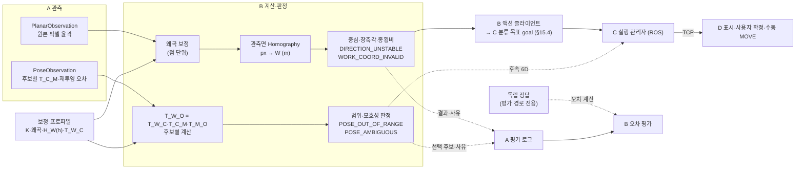
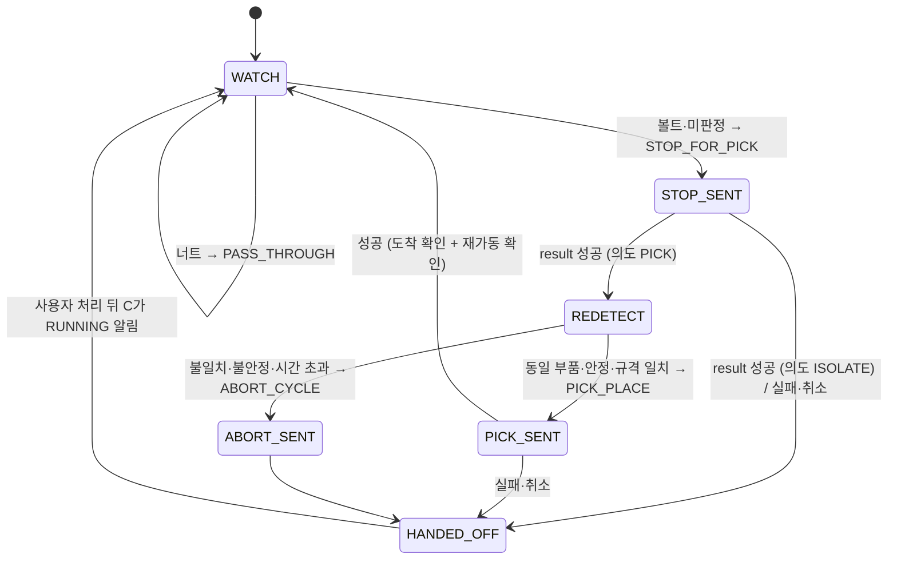

# B 담당 보정·좌표 상세설계

문서 버전 1.4 · 설계 초안 · 2026-11-11, 갱신 2026-11-12

| 버전 | 날짜 | 변경 |
|---|---|---|
| 1.0 | 2026-11-09 | 담당 경계, 좌표계·단위 공통 규약 제안, 보정 프로파일, 평면·6D 계산, 로봇 변환 설정, 독립 정답·오차 평가, 검증과 작업 순서 작성 |
| 1.1 | 2026-11-09 | A 상세설계 1.4와 정합: 평면 입력 윤곽의 관측면을 부품 윗면(`contour_basis = top_face`)으로 명시하고 다른 면이면 계산하지 않음(§2·§6.1·§7.1·§7.2), 면적 검사는 윗면 실제 면적에 대한 건전성 검사이며 관측면 식별·실루엣 거부를 보장하지 않음을 명시하고 파일럿에서 실루엣/윗면 면적 분리 가능성 확인(§7.1·§7.2·§13), 평면 정답 위치를 윗면 중심으로 명시(§10.2), 관측면 검증 항목 추가(§11) |
| 1.2 | 2026-11-09 | 계획서 1.4(전체 7주)와 정합: 5주차를 기존 범위 평가·기준 실행본 확보로, 최종 발표를 7주차로 이동(§12). 6~7주 그리퍼 확장의 B 책임(집기 순서 관리자, 파지 중심 프레임 G·공구 목표·부착 허용 조건, 무효화·복구, MoveIt 공구 설정) 요약 신설(§15). 검토 반영: 확장 실행 모드의 배타 실행·준비 판정(작업별 조건), Planning Scene 부품 물체 전이(§15). 기존 절 번호 유지 |
| 1.3 | 2026-11-10 | 계획서 1.5(전체 5주)와 정합: 1~3주차 볼트 규격 판정·파지점·규격별 개구폭·목적지·격리 좌표·작업 범위, 4~5주차 기준 자세·의도 판정·매핑·작업 범위·필터로 변경(§1·§12·§13·§15). 부품별 관측면·보정 계약 재검토 항목 추가. 6D 계산(§8)은 후속으로 표시하고 내용 유지. 1.2의 B 순서 관리자·실행 슬롯·Planning Scene 실행 책임은 C로 이관(대체) |
| 1.3 (검토 반영) | 2026-11-10 | 클래스별 방향 필요 여부: 장변/단변 1.5 조건은 볼트에만 적용, 너트는 방향 불필요로 θ를 내지 않고 분류(`NUT_PASS`) 결과로 유효(§5.4·§7.2·§11). TCP `PLANAR`의 필수 `theta_deg`는 그대로이며 방향 없는 너트 결과는 `MOVE` 목표가 아님 |
| 1.3 (사용자 확정 반영) | 2026-11-10 | 최종 부품 모델 BOLT_A = M6×12, BOLT_B = M6×40(ISO 4762 육각 홈붙이 볼트), 너트 M6(ISO 4032)은 사용자 확정이며 B 재승인 대상이 아님. B 후속 확인은 길이 판정 기준점(머리 포함 / 축)·허용 범위·관측면·좌표·파지 설정(§12·§13) |
| 1.4 (재설계 정합화) | 2026-11-11 | 사용자 확정 반영: A→B는 WSL 내부 파이프라인(분리 ROS 인터페이스 없음), B→C 자동 분류 목표는 ROS 액션으로 전달(B는 로봇을 직접 제어하지 않음). 경계 원칙·§3·§15 수정. 액션 필드는 B·C 공동 확정 전 제안(그리퍼·로봇 실행 상세설계(당시 별도 문서, 2026-11-11 통합·삭제) §8.5, 컨베이어 분류 상세설계(당시 별도 문서, 2026-11-11 통합·삭제) §3.3) |
| 1.4 (기능 설계 통합) | 2026-11-11 | 2026-11-11 사용자 요청: 별도 기능 설계 3개(그리퍼·로봇 실행, 컨베이어 분류, 사람 자세 제어)를 시스템 계획과 A/B/C/D 상세설계로 통합하고 삭제. §15.1(요약)·§15.2(공구 목표)·§15.3(규격 판정)·§15.4(A→B 전달·재검출 왕복·파이프라인 상태)·§15.5(의도·매핑) 신설 |
| 1.4 (담당 경계 RB) | 2026-11-11 | 2026-11-11 담당 경계 RB-01~03 정리: 구현·수정 책임자/제공 정보/협력 담당 구분. §4 설정 값 범위, §13 미결 3행, §15.2 손목 yaw 후보·선택 구분 |
| 1.5 | 2026-11-12 | 팀 결정 2026-11-12 반영: ① 11/22 팀 통합·11/26 발표 일정으로 §12를 날짜별 일정으로 변경, 11/26까지 범위는 컨베이어 볼트·너트 분류만(사람 자세 제어 §15.5는 11/26 이후) ② 통신 경로: A·B·C는 WSL ROS 안에서 연결, TCP는 C↔D만. **B는 D와 직접 통신하지 않으며** B 결과·보정 상태는 C를 거쳐 D에 전달(§2·§3·§5.5·§7.3·§7.5·§11) ③ A 협업 요청 v0.6의 B 회신(A 제안 수락, B-01~05·B-07·X-01~03) 반영: 원본 픽셀 전달·B 1회 보정 확정(§6.2), 관측면은 `observed_face` 파일럿 결정(§2), §13 확정/미결 구분과 결정 날짜 |
| 1.4 (담당 결정) | 2026-11-11 | 사용자 결정 2026-11-11: common/types.py 관리 A, A·B 파이프라인 실행 진입점 A(계산·액션 어댑터 B), 그리퍼 실행 혼합 설정 최종 관리 C, 동등 파지 후보 계산 B·실행 해 선택 C. B→C PICK_PLACE 목표 계약(제안) 구체화. §4·§13(결정된 미결 3행 제거)·§15.2·§15.4 |
| 1.4 (카메라·표시 경로) | 2026-11-12 | 사용자 결정 2026-11-12(A 측 반영), B 확인 필요: Gazebo 검출 입력은 링크 카메라(로봇 베이스 또는 어깨 고정, 센서 설정은 A 작성·C 통합), Homography·광학 프레임 근거 카메라도 링크 카메라. 어깨 장착이면 1번 관절 각도 조건(제안). 영상은 C가 D GUI로 전송하며 오버레이는 A·B가 영상에 그려 보냄 → B 중심점 주석 영상 발행은 B의 새 작업(B 확인 필요), `axis_overlay_px`·§7.5 역변환의 「D가 그림」 대체. B 결과의 결과·무효화 JSON 토픽 참여 여부는 미결. §2·§6.4·§7.3·§7.5·§13·§15.1 |

## 1. 목적과 적용 범위

담당 B의 목표는 A가 영상에서 얻은 픽셀 관측을 **작업대 좌표계 W의 값(내부 계산·결과 자료형은 m, 장축각은 도. 표시·TCP 경계의 mm 변환은 D가 한 번, §5.5)**으로 바꾸고, 그 값으로 로봇이 쓸 목표를 계산하며, 값이 맞는지 **독립 정답으로 증명**하는 것입니다. 11/26 발표까지(1~3주차)는 렌즈 보정·Homography, 볼트·너트의 위치·장축각, 볼트 규격 판정, 작업 범위, 파지점·규격별 개구폭·목적지·격리 좌표를 제공하고 평가합니다. 11/26 이후(4~5주차)에는 사람 자세의 기준 자세 보정, 의도 판정, 사전 동작 매핑(제어 방식 미확정 시 사전 동작 선택형), 작업 범위·속도 제한 값과 필터를 맡습니다. C가 로봇 목표를 계산할 때 쓰는 작업대·로봇 베이스 변환 설정도 B가 제공합니다. 직접 팔·장치 제어와 실행 슬롯·작업 순서 관리는 B 책임이 아니며 C가 맡습니다.

6D 계산(§8)은 이번 5주 필수 범위에서 후속으로 옮겼고 내용은 후속 작업의 기준으로 유지합니다. 기존 평면 계약(§7, 윗면 `top_face` 관측면)은 단일 판형 부품 기준이므로 볼트 머리·축과 너트에 그대로 보장하지 않습니다. 부품별 관측면·치수 측정·파지 기준과 보정 계약은 1~2주차 재검토 항목입니다(§13).

상위 기준은 [시스템 아키텍처 및 프로젝트 계획](../architecture/시스템_아키텍처_및_프로젝트_계획.md)이며, TCP 필드·값 범위는 [TCP 프로토콜 명세서](../protocol/TCP_프로토콜_명세서.md)를 따릅니다. A와의 자료형·판정 사유 경계는 [A 담당 비전 상세설계](A담당_비전_상세설계.md), 로봇 쪽 변환 적용은 [C 담당 로봇서버 상세설계](C담당_로봇서버_상세설계.md)와 맞춥니다. 이 문서는 세 문서의 규칙을 재정의하지 않습니다.

아래 모듈 이름, 내부 자료형, 설정 파일 형식과 로그 열은 **구현 제안**입니다. 좌표계 원점·축, 중심 정의처럼 1주차 공통 규약에서 확정할 항목은 제안값으로 적고 §13에 남깁니다. 재투영 오차 한계, 모호성 기준, 6D 정확도 목표처럼 실측·파일럿으로 정할 임계값은 확정값처럼 사용하지 않습니다. 이 문서 작성 시점에는 해당 모듈의 실행 코드가 없습니다.

## 2. 담당 경계와 인계

| 작업 | B의 책임 | 다른 담당과의 인계 |
|---|---|---|
| 좌표계·단위 규약 | W의 원점·축·높이 기준, 각도 0°와 양의 방향, 중심 정의, 단위·회전 표현 규칙을 정해 문서와 그림으로 공유 | 전원 1주차 합의. TCP 명세서 §4.2 「위치·자세가 가리키는 점」 표에 중심 정의 기록 |
| 카메라 보정 | 보정판 설계, 보정 실행, 내부 파라미터·왜곡 계수·재투영 오차, 프로파일 생성과 `calibration_id` 발급 | A가 촬영 자료 수집을 지원하고 프로파일 적용 조건을 검사(`CALIBRATION_MISMATCH`) |
| 평면 변환 | 픽셀 기준·왜곡 보정 순서 고정, 관측면 높이의 Homography, 윤곽의 W 변환, 중심·장축각 계산, `DIRECTION_UNSTABLE`·`WORK_COORD_INVALID` 판정 | A가 원본(`raw`) 픽셀 기준 계산용 윤곽과 `observed_face` 제공(A 협업 요청 B-01·B-03 수락). 볼트·너트 관측면은 파일럿으로 정하며, 정해지기 전 `observed_face = None`이면 무효. B 결과는 C로 전달(ROS), D 표시는 C를 거침 |
| 6D 변환 | `T_W_C`(실제)·`T_S_C`(Gazebo) 산출, `T_M_O` 측정, 후보별 `T_W_O` 계산, 범위·모호성 판정과 최종 후보 선택(`POSE_OUT_OF_RANGE`·`POSE_AMBIGUOUS`) | A가 모든 PnP 후보와 품질 제공(A 상세설계 §5.3·§8). B가 고른 결과는 A가 평가 로그에 기록 |
| Gazebo 프레임 | 검출 카메라(링크 카메라)의 `optical_frame_id`, CameraInfo 프레임, `T_S_C`의 기준 축 확인, 물체 정답 pose 토픽 브리지 확인 | A가 링크 카메라 센서 설정·입력 요구 작성, C가 월드·브리지 통합, A·B·C가 토픽·광학 프레임·`CameraInfo` 일치 확인(사용자 결정 2026-11-12, C 회신 C-01 채택). 그리퍼·고정 카메라는 검출·Homography 근거 아님 |
| 중심점 주석 영상 (B 새 작업) | 링크 카메라 프레임에 B 결과의 중심·장축(`axis_overlay_px`)을 그린 중심점 주석 영상 발행(링크 채널 종류 코드 `center`, 사용자 결정 2026-11-12. 이 표시 종류의 `raw`는 §6.2 픽셀 기준 `raw`와 다른 개념). 발행 주체·토픽 이름·형식, B 결과의 결과·무효화 JSON 토픽 참여 여부는 미결(§13) | C가 5종 영상 중 하나로 보유하고 D 요청 시 링크 채널로 D에 전송(A 상세설계 §3, 협업 요청 B-08). 사용자 결정 2026-11-12(A 측 반영), B 확인 필요 |
| 로봇 변환 설정 | `T_S_W`, `T_R_S`, 하향 접근 `R_W_E_planar`, 평면 접근 높이, `workspace_mm`, 실제 베이스·끝단 프레임 이름 기록, 변환 단위 시험값 | C가 서버 목표 계산에 적용. 접근 오프셋 `T_O_E_goal`은 B·C 공동 결정 |
| 독립 정답·오차 평가 | 정답 지그·격자 설계, 정답 불확실성 산정, 평면·6D 비전 오차, Gazebo 정답 기록, 목표 추정 오차·전체 오차 계산 | A가 전원 결과 취합, C가 명령 목표·끝단 자세 로그 제공 |

**경계 원칙.**

- B는 영상을 직접 읽거나 윤곽·마커를 검출하지 않습니다. A가 넘긴 관측만 사용합니다.
- B는 로봇을 직접 제어하지 않습니다(팔·그리퍼·벨트 명령, 계획·실행, 실행 슬롯 없음).
- **통신 경로(팀 결정 2026-11-12):** A·B·C는 WSL의 ROS 안에서 연결하고(A→B는 내부 함수 호출, B→C는 ROS 액션), TCP는 C↔D 사이만 씁니다. **B는 D와 직접 통신하지 않습니다.** D가 표시할 B 결과(좌표·판정·`calibration_id`·보정 상태·식별자)는 B가 C에게 주는 값에 빠짐없이 넣고, C가 D로 전달합니다.
- **자동 분류(사용자 확정 2026-11-11):** `START`(GUI 입력)로 시작한 분류 작업에서 B는 목표 좌표·대상 정보를 **ROS 액션 goal로 C에 전달**합니다. C가 목표를 다시 검증하고 계획·실행·진행·결과·취소를 책임집니다. goal 종류·필드·중복·단절 정책은 제안입니다([C 상세설계 §16.8.5](C담당_로봇서버_상세설계.md)). 재검출 왕복의 파이프라인 사이클 상태(B 소유 제안)는 §15.4에 있습니다.
- **수동 이동(TCP 1.1 `MOVE`):** 기존대로 B의 유효 결과만으로 이동 가능 상태가 되지 않으며, 송신 전 유효 시간·준비 상태 확인과 사용자 확정·송신은 D가 합니다. D가 보는 B 결과는 C를 거쳐 받은 값입니다.
- B의 판정 사유(`DIRECTION_UNSTABLE`, `WORK_COORD_INVALID`, `POSE_OUT_OF_RANGE`, `POSE_AMBIGUOUS`)는 내부 사유이며 **TCP 오류 코드에 추가하지 않습니다**(A 상세설계 §5.4).
- 정답 자세와 정답 파일은 평가 경로에서만 읽습니다. 후보 선택, 범위 판정, 목표 계산에 정답을 쓰지 않습니다.
- 보정 결과를 바꿀 때는 기존 프로파일을 덮어쓰지 않고 새 `calibration_id`를 발급합니다(§6.3).

## 3. 처리 구조

B의 계산은 **입력 관측 → 보정 적용 → 작업 좌표 변환 → 판정**의 순수 함수 묶음으로 둡니다. A와는 WSL의 내부 파이프라인에서 자료형·함수 호출로 연결합니다(분리 ROS 인터페이스 없음, 사용자 확정). B→C ROS 액션 클라이언트는 이 순수 함수 밖의 얇은 어댑터로 둡니다(제안). 계산 함수는 영상·GUI·소켓·ROS에 의존하지 않으므로, 저장된 관측과 알려진 변환으로 단위 시험을 먼저 만들 수 있습니다. 상태(현재 세대, 이전 결과)는 A의 파이프라인이 관리하고, B의 함수는 입력으로 받은 프로파일과 설정 스냅샷만 사용합니다.



평면 경로와 6D 경로는 같은 보정 프로파일을 공유하지만, 평면 경로는 **한 평면에서만 맞는 Homography**를, 6D 경로는 **카메라 외부 변환 `T_W_C`**를 씁니다. 3×3 Homography로 임의 높이·기울기를 변환하지 않습니다(계획서 §8 기술 기준).

## 4. 모듈과 배치 위치

아래 파일은 구현 시 만들 예정인 구성입니다.

| 위치 | 제안 모듈 | 책임 |
|---|---|---|
| `src/eyetoarm/calibration/` | `profile.py` | 보정 프로파일 자료형, 읽기·쓰기, 적용 조건 검사 함수(A가 `CALIBRATION_MISMATCH` 판정에 사용) |
| `src/eyetoarm/calibration/` | `intrinsics.py` | 보정판 코너 수집, `calibrateCamera`, 재투영 오차, 이상 사진 제외 |
| `src/eyetoarm/calibration/` | `extrinsics.py` | 보정판·기준 마커 PnP로 `T_W_C` 산출, 관측면 높이 Homography 생성, 확인점 잔차 |
| `src/eyetoarm/calibration/` | `gazebo.py` | CameraInfo→K·왜곡, SDF 카메라 pose→광학 프레임 기준 `T_S_C` |
| `src/eyetoarm/transforms/` | `se3.py` | 4×4 강체변환, 역변환, 회전행렬↔쿼터니언(`xyzw`, `w ≥ 0`), 상대 회전각 |
| `src/eyetoarm/transforms/` | `planar.py` | 점 왜곡 보정, px→W 변환, 중심·장축각·종횡비, W→px 역표시 |
| `src/eyetoarm/transforms/` | `pose6d.py` | 후보별 `T_W_O` 계산, 범위·모호성 판정, 최종 후보 선택 |
| `config/calibration/` | `<calibration_id>.json` | 소스별 보정 프로파일(§6) |
| `config/robot/` | `frames.yaml` | `T_S_W`, `T_R_S`, `R_W_E_planar`, 접근 높이, `workspace_mm`, `T_M_O`, `T_O_E_goal`, 프레임 이름(§9) |
| `evaluation/ground_truth/` | 평가별 폴더 | 독립 정답·측정 조건·불확실성(§10) |
| `scripts/` | `calibrate_camera.py`, `make_plane_homography.py`, `check_residual.py`, `eval_planar.py`, `eval_pose6d.py`, `record_gazebo_truth.py` | 보정·검증·평가 실행 도구 |
| `tests/unit/` | 변환 단위 시험 | 계획서 §2.3 시험값, 왕복 변환, 각도 주기, 쿼터니언 부호 |

`common/types.py`의 최소형은 A가 작성해 쓰고 있으며, B 결과형(`WorkPlanarResult` 등)은 아직 없습니다. B는 결과형 필드의 의미·단위·유효 조건을 정의하고, 추가·변경은 [공통 자료형 관리 초안](공통_자료형_관리_초안.md) §6 절차로 영향 담당 확인 뒤 파일 관리 담당 A가 반영합니다(사용자 결정 2026-11-11). `config/robot/frames.yaml`의 좌표·기하 수치는 B가 값을 제공·변경하고 키 이름·단위는 C와 함께 정합니다. 같은 폴더의 그리퍼 실행 설정(`grippers/*.yaml`)은 C가 통합·적용·실행 검증하며, B는 그 안의 `T_E_G`·치수·개구폭·간격·허용치 값만 제공합니다([C 상세설계 §16.3.1](C담당_로봇서버_상세설계.md)). 그리퍼 실행 혼합 설정 파일의 최종 관리는 C입니다(사용자 결정 2026-11-11, 계획서 §3 「공통 파일 소유자」).

## 5. 좌표계·단위 공통 규약

### 5.1 프레임

계획서 §2.3의 프레임을 그대로 씁니다.

| 프레임 | 정의 | B가 정할 것 |
|---|---|---|
| C | 입력별 카메라 광학 좌표계 (Z 전방, X 오른쪽, Y 아래) | Gazebo 센서 링크(X 전방)와 혼동하지 않도록 확인 |
| W | 실제 작업대 기준. TCP `frame: work` | 원점·축·높이 기준(§5.2) |
| S | Gazebo 가상 작업대 기준 | W와의 대응 `T_S_W` |
| R | UR5e 베이스 기준 | 실제 베이스 프레임 이름, `T_R_S` |
| M | 마커 좌표계 | A 상세설계 §8의 정의를 그대로 사용(원점 마커 중심, +X 오른쪽, +Y 위, +Z 인쇄면 바깥) |
| O | 물체 기준점 | §5.3 |
| E | UR5e 제어 끝단 | 실제 끝단 프레임 이름(예: `tool0`), 도달 평가 기준점과의 차이 |

`T_A_B`는 B 좌표를 A 좌표로 옮기는 강체변환입니다. 곱은 가운데 글자가 같을 때만 이어 붙입니다(`T_W_C × T_C_M = T_W_M`). 코드의 변수 이름도 같은 규칙(`T_W_C`, `T_C_M`)을 씁니다.

### 5.2 작업대 좌표계 W (제안)

| 항목 | 제안 |
|---|---|
| 원점 | 작업대 상판 표면의 한 모서리(실물에 표식 부착) |
| +X | 상판 긴 변을 따라 원점에서 멀어지는 방향 |
| +Y | 상판 위에서 +X를 반시계 방향으로 90° 돌린 방향 |
| +Z | 상판 표면에서 위쪽 (`Z = X × Y`, 오른손 좌표계) |
| 높이 기준 | 상판 표면 `Z = 0` |

카메라 영상 좌표는 Y가 아래로 커지지만 W는 Y가 앞쪽(위에서 내려다본 영상에서는 대개 위쪽)으로 커집니다. 영상 좌표와 W의 Y축 방향이 반대인 것이 가장 흔한 부호 오류이므로, 1주차에 **좌표계 그림 1장**(원점 표식 사진, 축 화살표, 0°·90° 방향)을 저장소 `docs/`에 함께 올립니다.

### 5.3 물체 기준점 O (제안)

| 항목 | 제안 |
|---|---|
| 원점 | 부품 윗면의 중심 |
| +X | 부품 장축 방향(평면 모드의 θ 방향과 같은 축) |
| +Z | 윗면 바깥쪽 법선 |

O는 6D 목표가 가리키는 점입니다. TCP `POSE_6D`의 `position_mm`·`orientation_xyzw`는 `T_W_O`이며 마커 자세 `T_W_M`이 아닙니다(TCP 명세서 §4.2). 장축의 양 방향(+X와 −X)은 물체 모양으로 구분되지 않을 수 있으므로, 평가에서 동등한 자세로 취급할지 §10.4에서 정합니다. O의 정의를 바꾸면 `T_M_O`와 C의 `T_O_E_goal`을 함께 바꿔야 합니다.

### 5.4 평면 중심과 장축각

| 항목 | 제안 | 이유 |
|---|---|---|
| 중심 | W로 옮긴 윤곽 다각형의 **면적 중심**(모멘트 `m10/m00`, `m01/m00`) | 최소 외접 사각형 중심은 윤곽 가장자리의 작은 돌기·잡음에 크게 흔들림. 직사각형 부품에서는 두 정의가 같은 점을 가리킴 |
| 장축각 θ | W 윤곽의 최소 외접 사각형에서 **긴 변의 방향**, `atan2(dy, dx)`를 도로 바꿔 `[0, 180)`로 정규화 | OpenCV `minAreaRect`의 `angle` 반환 규칙은 버전마다 다르므로 그 값을 직접 쓰지 않음 |
| 0° | +X_W 방향 | |
| 양의 방향 | +Z_W에서 내려다볼 때 반시계 방향 | W가 오른손 좌표계이므로 수학의 각도 방향과 같음 |
| 종횡비 | W 윤곽 최소 외접 사각형의 장변/단변 | 방향이 필요한 클래스(볼트)에서 1.5 미만이면 `DIRECTION_UNSTABLE`. 너트는 적용하지 않음(§7.2) |

중심 정의가 확정되면 TCP 명세서 §4.2 「위치·자세가 가리키는 점」 표의 `PLANAR` 행에 적습니다. 면적 중심과 최소 외접 사각형 중심을 섞어 쓰지 않습니다.

### 5.5 단위와 회전 표현

| 경계 | 위치 | 회전 |
|---|---|---|
| B 내부 계산 | m | 3×3 회전행렬 |
| B → C 결과·목표 (ROS, C가 D로 전달) | m (표시용 mm 변환은 D가 한 번) | 회전행렬 + 쿼터니언 |
| TCP (D가 송신) | mm | `PLANAR`: `theta_deg`, `POSE_6D`: `orientation_xyzw` |
| ROS 2·MoveIt (C) | m | 쿼터니언 |

- mm↔m 변환은 경계에서 **한 번만** 합니다. B 결과 자료형에 같은 값을 mm와 m로 동시에 두지 않습니다.
- 쿼터니언 순서는 `[x, y, z, w]`, 부호는 `w ≥ 0`으로 통일합니다(`q`와 `−q`는 같은 회전). 정규화한 뒤 **반올림하지 않고** 넘깁니다(TCP 명세서 §4.2: 소수 4자리 반올림만으로 크기 허용치 1e-6을 넘음).
- OpenCV `rvec`의 세 성분을 Roll·Pitch·Yaw로 쓰지 않습니다. `cv2.Rodrigues`로 회전행렬로 바꿔 계산합니다.
- GUI 각도 표시용 Euler 변환이 필요하면 B가 축 순서를 명시한 함수 하나를 제공하고(제안: 고정축 X→Y→Z 순, 즉 `R = Rz·Ry·Rx`), 표시에만 씁니다. 평가와 송신에는 쓰지 않습니다.

## 6. 보정 프로파일

### 6.1 프로파일 내용 `CalibrationProfile`

소스·카메라 배치마다 프로파일 하나를 만듭니다. 파일은 `config/calibration/<calibration_id>.json`입니다.

| 필드 | 의미·규칙 |
|---|---|
| `calibration_id` | TCP 식별 문자열 규칙(1~64자, `^[A-Za-z0-9_.-]+$`). 제안 형식 `<source_id>_<width>x<height>_v<번호>` (예: `phone0_1920x1080_v3`) |
| `source_id` | 적용 대상 소스 |
| `width`, `height`, `crop` | 보정 당시 해상도와 크롭. 적용 조건 검사에 사용 |
| `K`, `dist`, `dist_model` | 카메라 행렬, 왜곡 계수, 왜곡 모델(기본 `plumb_bob` 5계수) |
| `pixel_basis` | A가 넘기는 점의 기준. 기본 `raw`(왜곡 보정 전 원본 픽셀, §6.2) |
| `intrinsics_rms_px` | `calibrateCamera`의 전체 재투영 RMS. 사진별 오차와 사용·제외 사진 목록을 함께 저장 |
| `T_W_C` | 카메라→W 변환(m). 6D와 관측면 Homography 생성에 사용. 없으면 6D 불가 |
| `plane_height_m` | 평면 모드 관측면의 W 높이(부품 윗면 높이). A가 넘기는 계산용 윤곽의 물리 면(윗면, A 상세설계 §5.2)과 같아야 함 |
| `H_W_from_undist` | 왜곡 보정한 픽셀 → 관측면의 W `(X, Y)` (m) 3×3 Homography |
| `checkpoint_residual_mm` | 확인점 잔차 요약(평균·최대·점 수, §7.4) |
| `created`, `created_by`, `commit` | 생성 시각·담당·코드 커밋 |
| `status` | `draft` / `verified` / `retired` |

`status = verified`인 프로파일만 이동 목표 계산에 씁니다. `draft`는 표시와 시험에만 씁니다. 판정 함수는 프로파일이 없거나, 해상도·크롭·`source_id`가 프레임과 다르거나, `verified`가 아니면 불일치로 돌려주고 A가 이를 `CALIBRATION_MISMATCH`로 기록합니다.

### 6.2 픽셀 기준과 왜곡 보정 순서 (A 협업 요청 B-01·B-02 수락, 확정 2026-11-12)

1. A는 ROI·표시 축소를 원본 픽셀로 복원한 **원본(왜곡 보정 전) 픽셀 좌표**로 윤곽과 마커 모서리를 넘깁니다(A 상세설계 §7 5단계).
2. B는 영상 전체가 아니라 **점만** `cv2.undistortPoints(pts, K, dist, P=K)`로 왜곡 보정합니다. 결과는 같은 `K`를 쓰는 이상적 핀홀 영상의 픽셀입니다.
3. 평면 경로는 2의 점에 `H_W_from_undist`를 적용합니다. 6D 경로의 PnP는 A가 원본 모서리와 `K`, `dist`로 풀므로, B는 같은 프로파일의 `K`, `dist`를 A에게 제공하고 PnP 결과에 왜곡 보정을 다시 적용하지 않습니다.

확정 범위: A는 원본(`raw`) 픽셀 윤곽을 보내고 ROI·표시 축소는 원본 해상도로 복원해 보내며, B가 왜곡 보정·W 변환을 한 번만 적용합니다. 미결: 프로파일 필드 이름, 불일치 무효 사유 이름(`CALIBRATION_MISMATCH` 제안) — 11/13 코드 이전 시 A와 확정.

이 순서로 같은 보정을 두 번 적용하는 일을 막습니다. A가 나중에 왜곡 보정한 영상에서 검출하기로 바꾸면 `pixel_basis = undistorted`로 표시하고, B는 2단계를 건너뜁니다. 이때 PnP에는 보정 후 내부 파라미터와 0 왜곡을 써야 합니다(계획서 §2.2).

### 6.3 프로파일 생성 절차

**내부 파라미터.**

1. 체스판 또는 ChArUco 보드를 평평한 판에 붙이고, 한 칸 크기를 캘리퍼스로 재서 기록합니다. 인쇄 배율을 그대로 믿지 않습니다.
2. 프로젝트와 **같은 해상도·크롭·초점 설정**으로 15~25장을 찍습니다. 거리와 기울기를 바꾸고, 영상 가장자리와 구석에도 보드가 오게 합니다. 스마트폰의 자동 줌·손떨림 보정이 내부 파라미터를 바꿀 수 있으므로 끌 수 있으면 끄고, 끌 수 없으면 그 사실을 프로파일에 기록합니다.
3. 코너 검출 후 `cornerSubPix`로 정밀화하고 `calibrateCamera`를 실행합니다.
4. 사진별 재투영 오차를 보고 흐림·오검출 사진을 제외한 뒤 다시 실행합니다. 제외 기준과 제외 목록을 남깁니다. 허용할 RMS 한계는 1주차 자료로 정하며, 이 문서에서 수치를 확정하지 않습니다.

**외부 변환과 관측면 Homography.**

1. 카메라를 최종 위치에 고정한 뒤, W에서 위치를 아는 보드(또는 기준 마커)를 상판에 놓고 PnP로 `T_C_B`를 구합니다. 보드의 W 배치 `T_W_B`는 원점 표식·지그로 정합니다. `T_W_C = T_W_B × inverse(T_C_B)`.
2. 관측면 높이 `h`(부품 윗면, m)의 Homography를 `T_C_W = inverse(T_W_C)`의 회전 열 `r1, r2, r3`와 병진 `t`로 만듭니다.

```latex
H_{\mathrm{img}\leftarrow W}(h) = K \,\big[\, r_1 \;\; r_2 \;\; h\,r_3 + t \,\big], \qquad H_{W\leftarrow \mathrm{img}}(h) = H_{\mathrm{img}\leftarrow W}(h)^{-1}
```

3. 대안으로, 부품 윗면 높이에 놓은 높이 블록 위 기준점 4개 이상을 직접 찍어 `findHomography`로 구할 수 있습니다. 두 방법 중 무엇을 쓸지는 2주차에 확인점 잔차로 비교해 정하고, 쓴 방법을 프로파일에 기록합니다.
4. 상판 높이(`h = 0`)의 Homography를 부품 윗면에 그대로 쓰지 않습니다. 윗면은 카메라에 더 가까워서 비스듬한 카메라에서는 위치가 밀려 보입니다(계획서 §6 주의사항).

**변경 규칙.** 카메라 거치, 해상도, 크롭, 줌, 관측면 높이 중 하나라도 바뀌면 새 `calibration_id`를 발급합니다. 기존 파일은 `retired`로 두고 지우지 않습니다. 평가 결과와 로그가 그 ID를 참조하기 때문입니다. 프로파일이 바뀌면 A의 파이프라인이 세대를 올려 이전 결과를 폐기합니다(A 상세설계 §5.4).

### 6.4 Gazebo 카메라 프로파일

- `K`와 왜곡은 CameraInfo(`k`, `d`, `distortion_model`)에서 읽습니다. 체스판 보정을 따로 하지 않지만, 알려진 물체를 놓고 재투영해 값이 맞는지 확인합니다.
- 카메라 SDF에 `<optical_frame_id>`가 지정되어 있고, CameraInfo의 `header.frame_id`가 그 광학 프레임을 가리키는지 1주차에 확인합니다(계획서 §2.2).
- **검출 카메라는 링크 카메라입니다(사용자 결정 2026-11-12(A 측 반영), B 확인 필요).** 링크 카메라는 로봇 베이스 또는 어깨 링크에 고정되므로, 월드의 카메라 pose는 로봇 베이스 pose와 장착 링크→카메라 변환의 연쇄로 정해집니다. 장착 링크는 A가 센서 설정에서 `base_link`를 제안합니다(제안). `shoulder_link`에 장착하면 1번 관절(shoulder_pan) 각도에 따라 `T_S_C`가 바뀌므로 「1번 관절이 정해진 각도일 때만 검출 유효」 규칙이 필요합니다(제안, B 확인 필요). Homography·광학 프레임 확인은 링크 카메라 기준이며 그리퍼·고정 카메라는 쓰지 않습니다.
- `T_S_C`는 월드의 카메라 pose에서 계산하되, Gazebo 센서 링크(X 전방)를 광학 프레임(Z 전방, X 오른쪽, Y 아래)으로 바꾸는 고정 회전을 반드시 곱합니다. 이 회전을 빠뜨리면 축이 90°씩 돌아간 결과가 나오며 재투영으로는 드러나지 않을 수 있습니다.
- 검증: 위치를 아는 상자를 S의 두세 곳에 놓고, `T_S_C`와 `K`로 투영한 점이 영상의 상자 모서리와 맞는지 확인합니다.
- 장면·센서 설정 버전(월드 파일 커밋, 해상도)을 프로파일에 기록합니다.

## 7. 평면 계산

### 7.1 입력

A의 `PlanarObservation`(A 상세설계 §5.2)에서 프레임 식별자(`run_id`, `source_id`, `image_seq`), `capture_generation`, 처리 작업의 `generation`, 검출 설정 식별자, 윤곽 점(원본 픽셀), 윤곽의 관측면 표시(`contour_basis`), 적용 프로파일 ID를 받습니다. A가 이미 무효(`NO_OBJECT`, `TOP_FACE_UNRESOLVED` 등)로 판정한 관측은 계산하지 않고 그 사유를 그대로 넘깁니다.

**관측면 계약.** B는 윗면 높이 `plane_height_m`의 Homography로 모든 윤곽 점을 옮기므로, 입력 윤곽은 부품 **윗면**의 외곽이어야 합니다(A 상세설계 §5.2). 측면·그림자·가림을 포함한 전체 실루엣을 윗면 높이로 옮기면 중심이 밀리고 면적이 커집니다. A 상세설계 §5.2의 기하 반례(100×30×20 mm 직육면체, 카메라 W `(0, −300, 500)` mm)에서 실루엣의 면적 중심은 ≈ `(0, −5.61)` mm, 면적은 ≈ 4117 mm²로 윗면(중심 `(0, 0)`, 3000 mm²)과 다릅니다. 윗면 대응을 확보하는 책임은 A에 있으며, 확보하지 못한 관측은 A가 무효(`TOP_FACE_UNRESOLVED`)로 넘깁니다. B는 §7.2의 선행 조건(`contour_basis`)을 확인하고 면적 검사를 보조 건전성 검사로 수행하지만, 면적만으로 관측면을 식별하거나 모든 전체 실루엣을 거부할 수는 없습니다. 예를 들어 카메라가 정면 위 W `(0, 0, 500)` mm에 있으면 같은 부품의 밑면 꼭짓점이 윗면 높이에서 `x = ±48`, `y = ±14.4` mm로 옮겨져 윗면 안에 들어가므로, 전체 실루엣과 윗면이 같은 외곽·같은 면적(3000 mm²)이 됩니다(기하 예제이며 실행 결과가 아님). B가 영상을 다시 읽어 윗면을 찾지는 않습니다.

### 7.2 처리 순서

1. 프로파일 적용 조건을 확인합니다. 맞지 않으면 계산하지 않습니다(A의 `CALIBRATION_MISMATCH`). `contour_basis`가 `top_face`가 아니거나 없으면 계산하지 않고 `WORK_COORD_INVALID`(관측면 불일치)로 둡니다.
2. 윤곽 점을 왜곡 보정합니다(§6.2).
3. `H_W_from_undist`로 모든 점을 W `(X, Y)`로 옮깁니다. Homography의 세 번째 성분 `w`가 0에 가깝거나 음수인 점(관측면 수평선 너머)이 있으면 `WORK_COORD_INVALID`입니다.
4. W 윤곽에서 면적 중심, 최소 외접 사각형, 장변/단변, 장축각 θ를 계산합니다(§5.4).
5. 판정합니다.

| 검사 | 실패 시 사유 |
|---|---|
| 변환 결과가 모두 유한한가 | `WORK_COORD_INVALID` |
| W 윤곽이 자기교차 없는 다각형이고 면적이 양수인가 | `WORK_COORD_INVALID` |
| W 면적이 부품 윗면 실제 면적의 허용 범위 안인가(윗면 실측값 기준, 범위는 2주차 자료로 결정). 윗면 결과의 건전성 검사이며, 이것만으로 관측면을 식별하거나 전체 실루엣을 거부한다고 보장하지 않음 | `WORK_COORD_INVALID` |
| 중심이 `workspace_mm`의 X·Y 범위 안인가 | `WORK_COORD_INVALID` |
| (방향이 필요한 클래스만) 장변/단변 ≥ 1.5인가 | `DIRECTION_UNSTABLE` |

**면적 범위와 관측면.** 2주차 파일럿에서 정상 윗면 윤곽과 전체 실루엣의 W 면적 분포를 실제 카메라 배치(작업 범위 중앙·구석 포함)에서 함께 기록해, 면적으로 둘이 분리되는지 확인합니다. 분리되지 않으면 면적 범위를 억지로 좁히지 않습니다. 좁히면 정상 윗면까지 거부하기 때문입니다. 그때는 촬영 조건이나 A의 관측면 추출 방식을 보완하거나, 윗면을 확보하지 못한 관측을 A가 무효 처리하는 방식으로 대응합니다. A 상세설계 §5.2의 기울어진 카메라 반례(면적 ≈ 4117 mm², 중심 y ≈ −5.61 mm)는 설계 근거이며, 실제 환경의 면적 범위를 그 수치를 거부하도록 강제로 정하지 않습니다.

`DIRECTION_UNSTABLE`이면 중심 X·Y는 표시용으로 남기되 결과 전체를 무효로 하고, θ를 유효 수치처럼 내보내지 않습니다. 계획서 §2.3의 기본 정책상 로봇은 θ를 쓰지 않지만, TCP `PLANAR`는 `theta_deg`가 필수이고 평가 대상이므로 방향이 불안정한 결과는 송신 후보가 되지 않습니다.

**클래스별 방향 필요 여부.** 판정 소유는 B, 클래스 후보는 A입니다.

| 판정 클래스 | 방향(θ) 필요 | 종횡비 조건 | 결과 |
|---|---|---|---|
| `BOLT_A`·`BOLT_B` | 필요(집기 손목 방향) | 1.5 이상, 미달이면 `DIRECTION_UNSTABLE`로 결과 전체 무효 → 집기 차단·격리 경로 | 위치·θ·규격·파지 목표 |
| `NUT` | 불필요(자연 배출) | 적용하지 않음 | 위치·규격 유효 시 분류 결과로 유효(`NUT_PASS`). θ는 내지 않음(`theta_valid=false`, 제안) |

정상 너트(정육각, 최소 외접 사각형 비 약 1.155)는 이 표에 따라 방향 조건으로 무효가 되지 않습니다. 방향 없는 너트 결과는 TCP `PLANAR`의 필수 `theta_deg`를 채울 수 없으므로 `MOVE` 목표로 쓰지 않으며, TCP 1.1 규칙은 완화하지 않습니다. 너트의 클래스·치수 판정 기준은 볼트 규격 판정과 함께 1주차에 정합니다(§13).

### 7.3 출력 `WorkPlanarResult` (제안)

| 필드 | 의미 |
|---|---|
| 프레임 식별자, `capture_generation`, `generation`, 검출 설정 식별자 | A 관측에서 그대로 복사. B가 새로 만들지 않음 |
| `calibration_id` | 사용한 프로파일 |
| `center_w_m`, `theta_deg` | W 기준 중심(m)과 장축각(`0 ≤ θ < 180`). `theta_deg`는 방향이 필요한 클래스(볼트)에서만 유효하고, 너트는 내지 않음(`theta_valid=false`, 제안, §7.2) |
| `aspect_ratio`, `area_w_m2` | 판정 근거 |
| `contour_w_m` | W 윤곽(평가·디버깅용) |
| `axis_overlay_px` | 중심·장축 화살표 끝점(원본 픽셀, §7.5). 너트는 중심 표시만(선택 필드). B 중심점 주석 영상을 그리는 입력이며 좌표값으로 결과 JSON에 실을 수 있음. 이전의 「D가 원본 영상에 그림」은 사용자 결정 2026-11-12(A 측 반영), B 확인 필요로 대체(오버레이는 B가 영상에 그려 보냄) |
| `valid`, `reason`, `reason_owner` | 유효 여부와 B 판정 사유 |
| `compute_ms` | B 계산 시간(A의 순수 영상처리 시간과 별도 열) |

D는 이 결과를 그대로 표시하고(영상은 C 표시 경로로, 측정값은 결과·무효화 JSON으로 받음. B 결과의 JSON 토픽 참여 여부는 미결, §13), TCP 1.1 수동 이동(`MOVE`) 경로에서는 `x_mm = center_w_m × 1000`으로 바꿔 송신합니다. 방향 없는 너트 결과는 TCP 필수 `theta_deg`를 채울 수 없으므로 송신하지 않습니다. 분류 경로에서는 C의 실행 관리자가 이 결과를 사용합니다. B 결과에는 송신 여부나 `command_id`를 넣지 않습니다.

### 7.4 확인점 잔차 검증

변환에 쓰지 않은 **확인점**으로 변환의 실제 정확도를 봅니다. 변환을 만든 점은 당연히 잘 맞으므로 실력을 알려 주지 않습니다.

1. 관측면 높이에 W 위치를 아는 확인점을 6개 이상 둡니다. 중앙·변 중간·구석을 고르게 포함합니다.
2. 확인점의 영상 위치를 검출(또는 정밀 클릭)하고, §7.2의 2~3단계로 W로 옮깁니다.
3. 점별 거리 오차, 평균, 최대값을 기록하고 위치별로 오차가 쏠리는지 봅니다. 구석만 크면 렌즈 보정, 전체가 한 방향으로 밀리면 관측면 높이나 기준점 입력을 의심합니다.
4. 결과를 프로파일의 `checkpoint_residual_mm`과 `evaluation/`의 보정 검증 기록에 남깁니다.

확인점 잔차는 보정의 품질 지표이고, §10의 부품 위치 정확도를 대신하지 않습니다.

### 7.5 표시용 역변환

B가 중심점 주석 영상에 장축 화살표를 그리려면 W의 점을 다시 원본 픽셀로 보내야 합니다(이전의 「D가 원본 영상 위에 그림」은 사용자 결정 2026-11-12(A 측 반영), B 확인 필요로 대체). B는 `w_to_image(points_w)` 함수를 제공합니다. `T_W_C`가 있으면 관측면 높이의 3D 점을 `cv2.projectPoints(…, K, dist)`로 투영해 왜곡까지 반영하고, 없으면 `H`의 역변환만 적용하되 왜곡 미반영을 결과에 표시합니다. 영상에서 보이는 각도를 W 각도로 쓰지 않는다는 원칙(D 상세설계 GUI-02)에 따라 화살표 방향은 이 역변환으로만 만듭니다.

## 8. 6D 계산 (후속, 이번 5주 필수 아님)

이 절은 후속 6D 확장의 기준으로 유지합니다.

### 8.1 입력

A의 `PoseObservation`(A 상세설계 §5.3): 프레임 식별자·세대, 마커 사전·ID, 네 모서리, 변 길이 `L`(m), 사용한 카메라 파라미터 식별자, **모든** PnP 후보의 `T_C_M`·재투영 오차·카메라 앞 여부. A가 `MARKER_NOT_FOUND`·`PNP_FAILED`로 판정한 관측은 계산하지 않고 사유를 넘깁니다.

### 8.2 후보별 변환

```latex
T_{W\_O}^{(k)} = T_{W\_C} \times T_{C\_M}^{(k)} \times T_{M\_O}
```

- 실제 영상: `T_W_C`는 프로파일 값(§6.3).
- Gazebo 영상: 계획서 §2.3대로 `T_S_O = T_S_C × T_C_M × T_M_O`, `T_W_O = inverse(T_S_W) × T_S_O`.
- `T_M_O`는 §8.4의 측정값입니다. 마커 좌표계 M은 A 상세설계 §8의 정의를 따르며, 같은 정의로 Gazebo 마커 텍스처를 배치합니다.

### 8.3 판정과 최종 후보 선택

1. **카메라 앞 조건**: A가 카메라 뒤로 표시한 후보를 제외합니다.
2. **범위 조건**: 각 후보의 `T_W_O`에 대해 아래를 검사합니다.

   | 검사 | 기준 |
   |---|---|
   | 높이 | O의 Z가 시험 범위 `[z_min, z_max]` 안 |
   | 기울기 | O의 +Z축과 W의 +Z축 사이 각이 `tilt_max` 이하 |
   | 위치 | O가 `workspace_mm` 안 |
   | 재투영 오차 | `reproj_max` 이하 |

   남는 후보가 없으면 `POSE_OUT_OF_RANGE`입니다.
3. **모호성**: 범위를 통과한 후보가 둘 이상이고, 두 후보의 상대 회전각이 `ambiguity_rot_deg`보다 크거나 위치 차이가 `ambiguity_pos_mm`보다 크면서, 재투영 오차의 비(작은 쪽/큰 쪽)가 `ambiguity_ratio`보다 크면(두 후보가 비슷하게 잘 맞으면) `POSE_AMBIGUOUS`입니다.
4. 그렇지 않으면 재투영 오차가 가장 작은 후보를 고릅니다.

`z_min`, `z_max`, `tilt_max`, `reproj_max`, `ambiguity_*`는 후속 6D 착수 시 1~2일차 A·B 파일럿에서 독립 정답을 보고 정합니다(계획서 §10.5, A 상세설계 §8). 결정 전에는 시험용 임시값임을 설정 파일에 표시합니다. **이전 프레임과 비슷한 후보를 고르는 방식으로 모호성을 숨기지 않습니다.** 이전 결과는 후보 선택에 쓰지 않고, 갑작스러운 자세 전환은 평가 기록(§10.3 반복 안정성)으로만 남깁니다.

### 8.4 마커→물체 오프셋 `T_M_O` 측정

1. 마커를 부품에 단단히 고정합니다. 들뜨거나 비틀리면 오프셋이 시험마다 달라집니다.
2. M의 원점(마커 중심)에서 O의 원점(부품 윗면 중심)까지의 X·Y·Z 차이를 캘리퍼스·높이 게이지로 잽니다. M과 O의 축이 평행하게 붙어 있으면 회전은 항등이거나 90°의 배수로 정합니다.
3. 3회 이상 반복 측정해 평균과 흩어짐을 기록합니다. 이 값은 6D 정답 불확실성(§10.4)에 들어갑니다.
4. 결과를 `config/robot/frames.yaml`의 `T_M_O`로 기록하고, Gazebo 마커 모델에도 같은 배치를 적용합니다(A 담당 모델에 B가 값을 제공).

### 8.5 출력 `WorkPoseResult` (제안)

| 필드 | 의미 |
|---|---|
| 프레임 식별자, 세대, 검출 설정 식별자, `calibration_id` | A 관측에서 복사 |
| `T_W_O` | 선택 후보의 물체 자세(m, 회전행렬) |
| `position_w_m`, `orientation_xyzw` | 위 값의 병진과 정규화 쿼터니언(`w ≥ 0`, 반올림 없음) |
| `selected_index`, `candidates` | 선택 후보 번호와 후보별 `T_W_O`·통과한 검사·재투영 오차 |
| `valid`, `reason`, `reason_owner` | 유효 여부와 B 판정 사유 |
| `compute_ms` | B 계산 시간 |

TCP `POSE_6D`에는 이 `T_W_O`를 보냅니다. `T_W_M`을 보내도 형식 검사는 통과하므로, 송신 직전 D와 함께 자료형 이름으로 구분합니다(TCP 명세서 §4.2).

## 9. 로봇 변환 설정 (B → C)

C는 `config/robot/frames.yaml`을 읽어 평면·6D 목표를 계산합니다(C 상세설계 §5). 키 이름은 C와 1주차에 정하고, 아래는 B가 채울 값의 제안 목록입니다.

| 키(제안) | 내용 | 결정 |
|---|---|---|
| `frames.base`, `frames.tool` | 실제 ROS 베이스·끝단 프레임 이름(예: `base_link`, `tool0`). 도달 평가 기준점이 다르면 그 변환 | C 환경 확인 후 B 기록, 1주차 |
| `T_S_W` | 실제 작업대 W → Gazebo 작업대 S | B, 1주차 |
| `T_R_S` | Gazebo 작업대 S → 로봇 베이스 R | B·C, 1주차 |
| `planar.approach_height_m` | 평면 모드 접근 높이(상판 기준) | B·C, 2주차 |
| `planar.R_W_E` | 평면 하향 접근 방향 `R_W_E_planar` | B, 2주차 |
| `planar.use_theta_yaw` | θ를 끝단 yaw에 쓸지(기본 `false`) | 전원, 계획서 §2.3 |
| `workspace_mm` | W 기준 X·Y·Z 최소·최대. TCP 서버 범위 검사에 사용(TCP 명세서 §9) | B, 1주차 초안 → 2주차 확정 |
| `T_M_O` | 마커→물체 | B, 후속 6D 착수 시 |
| `T_O_E_goal` | 물체 기준 끝단 접근 오프셋 | B·C, 후속 6D 착수 시 |

**하향 접근 방향.** 계획서 §2.3 시험 B의 `R_W_E_planar = Rx(180°)`는 끝단 Z축이 작업대를 향하게 하는 예시입니다. 실제 끝단 프레임(`tool0` 등)의 축 정의를 C의 실행 환경에서 확인한 뒤 B가 확정하고, 시험값과 구분해 기록합니다.

**변환 단위 시험 (시험값).** C의 서버 구현과 B의 설정이 같은 결과를 내는지 확인하는 공동 시험입니다. W와 S가 일치하고, S의 원점이 R 기준 `(0.500, 0.100, 0.200) m`이며 S가 R의 Z축 기준으로 +90° 회전했을 때, 검출 위치 `(120, 80) mm`와 접근 높이 `100 mm`의 기대 목표 위치는 R 기준 `(0.420, 0.220, 0.300) m`입니다. 방향은 `R_W_E_planar = I`이면 `(0, 0, 0.7071, 0.7071)`, `Rx(180°)`이면 `(0.7071, 0.7071, 0, 0)`입니다. 이 문서 작성 시 위 세 값을 회전행렬 계산으로 다시 확인했습니다. 시험 코드는 `tests/unit/`에 두고 B와 C가 같은 시험을 통과시킵니다.

설정 값을 바꾸면 변경 이유와 커밋을 기록하고, 영향받는 평가를 다시 실행합니다.

## 10. 독립 정답과 오차 평가

### 10.1 원칙

- 정답은 프로그램과 **독립적으로** 만듭니다. 검출값이나 같은 Homography·PnP에서 역산한 값을 정답으로 쓰지 않습니다(계획서 §7·§10).
- 정답의 측정 불확실성을 함께 보고합니다. 불확실성이 목표 오차와 비슷하면 달성 여부를 단정하지 않습니다.
- 같은 물체를 움직이지 않고 얻은 연속 프레임은 독립 배치가 아닙니다. 정확도는 독립 재배치 단위로 집계합니다.
- 파일럿 자료와 최종 평가 자료를 분리하고, 최종 결과를 보고 유리한 조건·기준만 골라 바꾸지 않습니다.
- 무효 결과를 오차 0으로 평균에 넣지 않습니다. 유효 표본 수와 무효율(사유별)을 함께 보고합니다(A 상세설계 §9).

### 10.2 평면 정답

1. 위치·각도 기준선이 인쇄된 격자 시트 또는 위치결정 핀·각도 가이드가 있는 지그를 만듭니다. 자로 직접 재면 오차가 ±1 mm 수준이라 목표 2 mm와 비슷해지기 때문입니다(계획서 §7).
2. 격자 인쇄 배율을 캘리퍼스로 확인합니다.
3. 격자 시트의 W 배치(원점·축 정렬)를 기록합니다. 정답은 "지그 위치의 W 좌표"이며, 위치 정답은 부품 **윗면 중심**의 W `(X, Y)`, 각도 정답은 윗면 장축의 방향입니다. 지그 기준점이 바닥 모서리 등 다른 점이면 부품 실측 치수로 윗면 중심으로 환산하고 그 식을 평가 기록에 남깁니다. 계산 윤곽(A 상세설계 §5.2)과 같은 면을 정답으로 삼아야 관측면 차이가 오차로 섞이지 않습니다.
4. **불확실성 산정**: 같은 지그 위치에 부품을 10회 놓았다 떼며 독립 측정(캘리퍼스·확대 사진 등 비전과 다른 방법)으로 배치 흩어짐을 잽니다. 인쇄 배율 오차, 시트 정렬 오차와 합쳐 위치·각도 불확실성으로 기록합니다.

**시험 설계(계획서 예시).** 9위치 × 6각도 × 독립 재배치 2회 = 108배치. 위치는 작업 범위를 3×3으로 나눈 칸의 중심, 각도는 예를 들어 0·30·60·90·120·150°입니다.

**평가 열(제안).** `evaluation/ground_truth/<eval_id>/placements.csv`에 정답, 평가 결과에 예측을 기록하고 배치 번호로 연결합니다.

```csv
placement_id,eval_run_id,true_x_mm,true_y_mm,true_theta_deg,run_id,source_id,image_seq,calibration_id,pred_x_mm,pred_y_mm,pred_theta_deg,valid,reason
```

배치 하나에 여러 프레임을 얻었다면 미리 정한 규칙(예: 배치 후 일정 시간이 지난 첫 유효 프레임)으로 하나를 고르고, 그 규칙을 평가 기록에 적습니다.

### 10.3 평면 지표

| 지표 | 정의 |
|---|---|
| 위치 오차 | `sqrt(ΔX² + ΔY²)`의 평균(목표 ≤ 2 mm 제안), 축별 MAE, P95·최대값 |
| 각도 오차 | 180° 주기의 최소 차이 `d = \|θ_pred − θ_true\| mod 180`, `min(d, 180 − d)`의 평균(목표 ≤ 3°) |
| 위치·각도별 분포 | 9위치·6각도별 평균 오차. 구석·특정 각도에 쏠리는지 원인 분석 |
| 유효율 | 유효 결과 배치 수 / 전체 배치 수, 무효 사유별 건수(A·B 판정 주체 구분) |

수치 목표(2 mm·3°)는 계획서의 제안 목표이며, 통과 여부는 소스별 측정값으로 판정합니다. 미달 항목은 원인과 한계를 적고 달성으로 표시하지 않습니다.

### 10.4 6D 정답과 지표

**정답 만들기.** 치수를 확인한 높이 블록과 알려진 각도의 경사·회전 지그로 부품을 놓고, 지그 배치에서 `T_W_O` 정답을 계산합니다. `T_M_O` 측정 불확실성(§8.4)과 지그 각도 오차를 정답 불확실성에 포함합니다. 동일 PnP 결과를 정답으로 쓰지 않습니다.

**시험 설계(계획서 예시).** 3위치 × 2높이 × 6가지 알려진 방향 × 독립 재배치 2회 = 72배치. 6가지 방향에는 실제 기울기 변화가 포함되어야 하며, 높이와 평면 회전만 시험했다면 검증 범위를 그 조건으로 제한해 보고합니다. 표본 수는 4주차 5일차까지 지그 준비 시간을 보고 확정합니다.

| 지표 | 정의 |
|---|---|
| 3D 위치 | `mean(sqrt(ΔX² + ΔY² + ΔZ²))`, 축별 오차, P95·최대값 |
| 3D 회전 | 상대 회전 `R_err = R_trueᵀ R_pred`의 회전각 `arccos((trace(R_err) − 1) / 2)`. Euler 성분별 MAE로 대체하지 않음. `arccos` 입력은 `[−1, 1]`로 자름 |
| 유효 추정률 | 유효 자세 / 전체 시험, 무검출·PnP 실패(A)·범위 밖·모호(B) 별도 집계 |
| 반복 안정성 | 정지 물체의 연속 프레임에서 위치·회전 흩어짐, 갑작스러운 후보 전환 횟수 |
| 범위 명시 | 시험한 높이·기울기·거리, 마커 변 길이와 화면상 픽셀 크기, 카메라·해상도 |

6D 정확도 목표는 후속 6D 착수 후 파일럿과 정답 품질을 보고 정하며, 평면 2 mm·3°를 그대로 적용하지 않습니다(계획서 §10). O의 장축 양 방향이 모양으로 구분되지 않는 부품이면, 정답과 180° 다른 자세를 같은 자세로 볼지 평가 전에 정하고 기록합니다.

### 10.5 Gazebo 정답

- 물체 pose 토픽을 `ros_gz_bridge`로 받아 평가 전용으로 기록합니다. 비전·목표 계산 경로에는 연결하지 않습니다.
- 영상 `Image.header.stamp`(나노초)와 **같은 시뮬레이션 시각**의 pose를 정답으로 씁니다. 가장 가까운 시각의 값을 쓸 때는 시각 차이를 함께 기록하고, 물체가 정지한 배치만 평가합니다.
- pose는 S 기준이므로 `T_W_O_true = inverse(T_S_W) × T_S_O_true`로 W로 바꿉니다. 시뮬레이터 모델 원점이 O와 다르면 그 차이를 모델 정보에서 확인해 적용합니다.
- 실제 영상 결과와 Gazebo 결과는 다른 표로 보고합니다(계획서 §10.1). 장면·센서 설정 버전을 함께 남깁니다.

### 10.6 로봇 도달 평가에서 B의 몫

계획서 §10.2의 전체 경로 시험에서 B는 **정답 접근 목표**를 계산합니다. 독립 정답 `T_W_O_true`(평면은 정답 X·Y와 고정 높이·방향)에 C와 **같은 변환과 접근 오프셋**을 적용해 R 기준 목표를 만들고, C의 명령 목표·실제 끝단 자세와 명령 ID로 연결합니다.

| 오차 | 비교 | 의미 |
|---|---|---|
| 목표 추정 오차 | 정답 목표 ↔ 명령 목표 | 비전·보정의 오차가 로봇 목표에 준 영향 (B 주관) |
| 실행 오차 | 명령 목표 ↔ 실제 끝단 | 계획·제어 오차 (C 주관) |
| 전체 오차 | 정답 목표 ↔ 실제 끝단 | 시스템 전체 (A 취합) |

Gazebo 컨트롤러는 이상적으로 동작해 실행 오차가 거의 0일 수 있으므로, 시스템 정확도의 의미 있는 지표는 목표 추정 오차와 전체 오차라는 점을 보고서에 적습니다(계획서 §10.2).

## 11. 검증 시나리오와 완료 기준

아래는 구현 후 수행할 검증 계획입니다. 이 문서 작성 시점에는 실행 결과가 없습니다.

| 검증 | 기대 결과 |
|---|---|
| 변환 단위 시험(계획서 §2.3) | R 기준 `(0.420, 0.220, 0.300) m`, 쿼터니언 `(0, 0, 0.7071, 0.7071)`·`(0.7071, 0.7071, 0, 0)`과 허용 오차 안에서 일치. B·C 코드가 같은 값 |
| 강체변환 왕복 | `T × inverse(T)`가 단위행렬, 점을 W→C→W로 보내면 원래 점 |
| 쿼터니언 규칙 | 출력이 정규화되고 `w ≥ 0`, 반올림 없음. TCP 스키마의 `\|‖q‖ − 1\| ≤ 1e-6` 통과 |
| 각도 주기 | (179°, 1°)의 차이 2°, θ 출력이 항상 `[0, 180)` |
| Y축 방향 | 영상에서 위쪽으로 움직인 부품이 W에서 +Y로 움직임(좌표계 그림과 일치) |
| 합성 영상 평면 계산 | 알려진 위치·각도로 그린 원근 영상에서 중심·θ가 기대값과 일치 |
| 관측면 높이 | 윗면 높이 Homography를 쓰면 상판 높이 Homography보다 확인점 오차가 작음. 차이를 기록 |
| 관측면 계약 | `contour_basis`가 `top_face`가 아니거나 없는 관측은 계산하지 않고 `WORK_COORD_INVALID`. A의 `TOP_FACE_UNRESOLVED`는 사유를 그대로 전달 |
| 전체 실루엣과 관측면 책임(기하 반례) | A 상세설계 §5.2의 반례 실루엣이 `contour_basis = top_face`인 정상 윗면 윤곽으로 들어오지 않음(A의 `TOP_FACE_UNRESOLVED`로 무효 전달). B 면적 검사가 이 반례를 거부하는지는 보조 확인이며 판정 근거로 삼지 않음 |
| 실루엣과 윗면 면적이 겹치는 배치 | 정면 상부 카메라처럼 실루엣과 윗면의 면적이 같은 배치에서 정상 윗면이 면적 검사로 거부되지 않음. 파일럿 기록에 두 면적 분포와 분리 가능 여부가 남고, 분리되지 않으면 면적 범위를 좁히지 않고 촬영 조건·추출 방식·무효 처리로 대응한 기록이 남음 |
| 정답과 계산 면 일치 | 평면 정답이 윗면 중심으로 환산되어 기록되고, 계산 중심과 같은 면을 비교함 |
| 왜곡 이중 적용 방지 | `pixel_basis = raw`에서 점 왜곡 보정 1회. 보정 영상 경로로 바꾸면 2단계 생략과 PnP 파라미터 교체가 함께 일어남 |
| 프로파일 불일치 | 해상도·크롭·`source_id`·`status` 불일치에서 계산하지 않고 A가 `CALIBRATION_MISMATCH` 기록 |
| 프로파일 변경 | 새 `calibration_id` 발급, 이전 파일 `retired` 보존, 이전 세대 결과 폐기 |
| 확인점 잔차 | 변환에 쓰지 않은 확인점 6개 이상의 점별 오차가 기록되고 위치별 분포 확인 |
| 종횡비 미달 | 정사각형에 가까운 볼트 윤곽에서 `DIRECTION_UNSTABLE`, θ가 유효값으로 나가지 않음 |
| 정상 너트 | 종횡비 약 1.155의 너트가 방향 조건으로 무효가 되지 않고 `NUT`로 유효, θ 미출력, `MOVE` 목표 아님 |
| 작업 범위 밖·수평선 너머 점 | `WORK_COORD_INVALID` |
| Gazebo 광학 프레임 | 위치를 아는 상자의 투영이 영상과 일치. 센서 링크→광학 프레임 회전을 빼면 실패하는 음성 대조 확인 |
| 6D 후보 전달 | A가 넘긴 모든 후보에 대해 `T_W_O`와 검사 결과가 기록됨 |
| 6D 범위·모호성 | 범위 밖 후보만 있으면 `POSE_OUT_OF_RANGE`, 비슷한 오차의 다른 자세 두 개면 `POSE_AMBIGUOUS`. 단일 자세로 강제하지 않음 |
| `T_W_O`와 `T_W_M` 구분 | `T_M_O`가 항등이 아닌 부품에서 송신 값이 마커가 아닌 O의 자세 |
| 마커 면내 회전 | 마커를 0°·90°·180°·270° 돌렸을 때 `T_W_O`의 회전이 그 각도만큼 바뀜(A 시험과 연결) |
| 평가 계산 | 무효 결과가 평균에 0으로 들어가지 않음, 연속 프레임이 독립 배치로 세지지 않음, 파일럿·최종 자료 분리 |
| Gazebo 정답 시각 | 영상 stamp와 정답 pose 시각 차이가 기록되고 정지 배치만 평가 |

평면 완료는 A의 윤곽 → B의 W 중심·θ·판정·목표 → C 실행(→ C를 거친 D 표시) 경로가 재현되고, 확인점 잔차와 평가표(108배치는 일정상 축소 가능, 확정 표본 수는 11/19 평가 전 결정)·정답 불확실성이 남는 것입니다. 6D 완료는 높이·기울기가 바뀌는 마커 부품에서 B가 최종 후보와 무효 사유를 내고, 독립 정답 기준 3D 위치·회전 오차와 유효율이 보고되는 것입니다. 기능 완료와 수치 목표 달성은 별도로 판정합니다.

## 12. 작업 일정 (2026-11-12 팀 일정 기준)

11/22(일) 팀 통합, 11/26(목) 발표(팀 결정 2026-11-12). 11/26까지 범위는 **컨베이어 볼트·너트 분류만**입니다. 사람 자세 제어(§15.5)와 6D(§8)는 11/26 이후 작업입니다. B의 통합 상대는 A(입력)와 C(출력)이며, D와는 직접 연결하지 않습니다(§2).

본문의 「1주차」「2주차」「3주차」 표현은 이 표의 날짜로 읽습니다(1주차 ≈ 11/12~13, 2주차 ≈ 11/14~18, 3주차 ≈ 11/19~22).

| 날짜 | B의 작업 | 산출물 |
|---|---|---|
| 11/12 (목) | A 협업 요청 회신 반영(완료: A 제안 수락), W 원점·축·단위 규약 정리, 부품 치수표 | 좌표계 규약, 부품 치수표 |
| 11/13 (금) | 렌즈 보정·`T_W_C`·높이별 Homography 실습 코드를 `src/eyetoarm/calibration`·`transforms`로 이전, 보정 프로파일 필드 이름을 A와 확정 | `calibration_id` 프로파일, Homography 모듈 |
| 11/14 (토) | 중심(면적 중심)·장축각 θ, 너트 `theta_valid=false`. 부품별 관측면·높이 파일럿(A B-03) | 중심·각도 함수, 관측면 결정 |
| 11/15 (일) | 볼트 길이 측정·규격 판정(BOLT_A / BOLT_B / NUT / `UNRESOLVED`), 머리 포함 여부·허용 범위(A B-04) | 규격 판정 함수, 판정 기준 |
| 11/16 (월) | A `planar.py`와 연결, `PlanarObservation` → `WorkPlanarResult` | A→B 연결 |
| 11/17 (화) | 파지 후보·개구폭·상자·격리 좌표, `frames.yaml` 값. C와 ROS 액션 goal 필드·C에게 넘길 표시용 값(보정 상태·식별자·화살표 여부) 확정 | C로 보낼 목표 |
| 11/18 (수) | 파이프라인 사이클 상태(WATCH → STOP_SENT → REDETECT → PICK_SENT / ABORT_SENT → HANDED_OFF, §15.4) | 상태 흐름 |
| 11/19 (목) | 단위 시험, 확인점 잔차·위치/각도 오차·규격 판정 평가표, 평가 표본 수 확정 | 시험·평가표 |
| 11/20 (금) | A·C와 사전 연결 시험, 결함 수정 | 사전 통합 결과 |
| 11/21 (토) | 예비일 | — |
| 11/22 (일) | **팀 통합** | 통합 실행본 |
| 11/23~25 | 발표 자료(좌표 변환 그림, 오차 표) | 발표 슬라이드 |
| 11/26 (목) | **발표** | |

첫 구현은 합성 영상(알려진 위치·각도의 원근 사진)에서 윤곽 → W 중심·θ가 기대값과 맞는지 확인하는 작은 경로로 시작합니다. 실제 보정·로봇 설정을 한 번에 연결하지 않고, 변환 단위 시험 → 합성 영상 → 실제 확인점 → A 실제 윤곽 순서로 넓힙니다.

## 13. 구현 전 확정할 항목

| 항목 | 결정 담당·시점 |
|---|---|
| W의 원점·축·높이 기준, θ의 0°·양의 방향 | B 제안·전원 합의, 11/12~13 |
| 길이 판정 기준점(머리 포함 전체 길이 / 축 길이)·허용 범위, 미판정(`UNRESOLVED`) 기준. 최종 부품 모델(M6×12·M6×40 볼트, M6 너트)은 사용자 확정이므로 이 표의 결정 대상이 아님 | B(A 확인), 11/15 파일럿(A B-04: 윤곽 범위는 파일럿 비교로 수락) |
| 부품별 관측면·치수 측정·파지 기준과 보정 계약(볼트 머리·축, 너트) | B(A 확인), 11/14 파일럿(A B-03 수락: 파일럿 전 `observed_face = None` 무효) |
| 파지점·규격별 개구폭·간격·접근·상승·배출 높이·상자·격리 좌표·부착 허용치 | B(C 확인), 11/17 |
| 사람 제어 기준 자세·의도 집합·매핑·작업 범위·속도 제한·필터 | B(C 확인), 11/26 이후 |
| 평면 중심 정의(면적 중심 제안)와 TCP 명세서 §4.2 표 반영 | B 제안·전원 합의, 1주차 |
| 물체 기준점 O의 원점·축(부품별) | B·C, 1주차 초안 → 2주차 부품별 관측면 재검토와 함께 확정 |
| 픽셀 기준·왜곡 보정 위치 | **확정**(A B-01 수락, 2026-11-12): 원본 픽셀 전달, B 1회 보정 |
| B 결과 자료형 필드·프로파일 필드 이름·불일치 사유 이름, A→B 식별자 보존(B-07 수락) | A·B, 11/13 |
| B→C 액션 goal 필드, C를 거쳐 D에 갈 표시용 값(보정 상태·식별자·`axis_overlay_px` 사용 여부) | B·C, 11/17 |
| AI 클래스 구성(2클래스 + B 치수 판정 우선, A B-05 수락) | A·B, A 파일럿 결과 후 |
| `config/robot/frames.yaml` 키 이름·단위, 실제 베이스·끝단 프레임 이름 | B·C, 11/17 |
| 보정판 종류(체스판·ChArUco)와 크기 | B, 11/13 |
| 보정 RMS 허용 한계, 확인점 잔차 허용 한계 | B, 2주차 자료 확인 후 |
| 관측면 Homography 생성 방법(외부 변환 유도 / 높이 블록 직접 측정) | B, 2주차 확인점 비교 후 |
| W 윤곽 면적 허용 범위(윗면 실측 기준 건전성 검사)와 실루엣/윗면 면적 분리 가능성 확인 결과 | B, 2주차 파일럿 |
| `workspace_mm` 최종값 | B·C, 2주차 |
| 평면 접근 높이, `R_W_E_planar` | B·C, 2주차 로봇 단독 시험 |
| (후속) 6D 범위·재투영·모호성 기준, 마커 크기 유지·변경 | A·B, 후속 6D 착수 시 |
| (후속) `T_M_O`, `T_O_E_goal` | B(·C), 후속 6D 착수 시 |
| (후속) 6D 정확도 목표, 장축 양 방향 동등 취급 여부 | 전원, 후속 6D 파일럿 후 |
| 중심점 주석 영상 발행(내용·발행 주체(B 모듈 / A 파이프라인 진입점에서 B 함수 호출)·토픽 이름·형식), B 결과의 결과·무효화 JSON 토픽 참여 여부(사용자 결정 2026-11-12(A 측 반영), B 확인 필요, 협업 요청 B-08) | B(A·C 확인), 2주차 통합 전 |
| 링크 카메라 장착 링크(`base_link` A 제안 / `shoulder_link`)와 어깨 장착 시 1번 관절 각도 조건 | A(센서 설정 제안)·C(모델)·B(좌표), 링크 카메라 설정 공유 시(A 상세설계 §11.1 11-15) |
| 평가 배치 선택 규칙, 최종 표본 수 | B 제안·A 총괄, 3주차 분류 평가 전 및 4주차 사람 제어 평가 전 |

위 항목은 이미 합의된 것으로 간주하지 않습니다. 설정을 바꾸면 식별자와 변경 이유를 기록하고 영향받는 시험을 다시 수행합니다.

## 14. 참고 문서

- [시스템 아키텍처 및 프로젝트 계획](../architecture/시스템_아키텍처_및_프로젝트_계획.md) — 좌표 변환 §2.3, 입력·보정 §2.2, 평가 §7·§10
- [TCP 프로토콜 명세서](../protocol/TCP_프로토콜_명세서.md) — `MOVE` 필드·값 범위 §4.2, 설정값 `workspace_mm` §9
- [A 담당 비전 상세설계](A담당_비전_상세설계.md) — 관측 자료형 §5, 판정 사유 §5.4, 마커 좌표계 M §8, 평가 집계 §9
- [C 담당 로봇서버 상세설계](C담당_로봇서버_상세설계.md) — 변환 적용 §5, 결정 목록 §13
- [D 담당 GUI·TCP 상세설계](D담당_GUI_TCP_상세설계.md) — 좌표·화살표 표시 GUI-02, 캘리브레이션 상태 GUI-04
- [OpenCV 카메라 캘리브레이션](https://docs.opencv.org/4.x/dc/dbb/tutorial_py_calibration.html), [Homography](https://docs.opencv.org/4.x/d9/dab/tutorial_homography.html), [PnP 자세추정](https://docs.opencv.org/4.x/d5/d1f/calib3d_solvePnP.html), [카메라 보정·회전 표현 API](https://docs.opencv.org/4.x/d9/d0c/group__calib3d.html)

이 문서는 설계 제안입니다. 보정 실행, 코드 구현, 정답 지그 제작, 평가 측정이 완료됐다는 의미가 아닙니다.

## 15. 컨베이어 분류·사람 자세 제어 — B 담당

기존 §1~§14의 절 번호를 유지하려고 이 절을 참고 문서 뒤에 둡니다. 세부 계약은 [계획서 §2.6](../architecture/시스템_아키텍처_및_프로젝트_계획.md), [계획서 §2.7](../architecture/시스템_아키텍처_및_프로젝트_계획.md), [C 상세설계 §16](C담당_로봇서버_상세설계.md)를 따릅니다.

### 15.1 B 책임 요약

| 작업 | B의 책임 | 인계·협업 |
|---|---|---|
| 규격 판정 | 측정 치수로 `BOLT_A`·`BOLT_B`·`NUT`·`UNRESOLVED` 판정, 클래스와 치수 불일치 판정 | A가 클래스·윤곽, C가 미판정을 격리 경로로 처리 |
| 공구 좌표·목표 값 | 파지 중심 G, `T_E_G`, 파지점, 규격별 개구폭·간격, 사전 접근·상승·운반·배출 좌표, 상자·격리 구역 좌표, 작업 범위(§15.2) | C가 계획·실행에 적용 |
| 부착 허용치 | 위치·방향·간격 허용 값(C 상세설계 §16.7.4). 판정 실행은 C | C |
| 사람 자세 매핑 | 기준 자세, 의도 판정, 사전 동작 ID 매핑, 작업 범위·속도 제한 값, 필터(계획서 §2.7, 이 문서 §15.5) | A가 관절점, C가 실행 제한 적용 |
| 유효성 | 목표·판정의 모호성·유효성, 세대 검사 | C·D |
| 중심점 주석 영상 (새 작업, B 확인 필요) | 링크 카메라 프레임에 중심·장축을 그린 주석 영상 발행(§2, §13) | C가 D에 전송(사용자 결정 2026-11-12(A 측 반영), B 확인 필요) |
| 분류 목표 전달 (사용자 확정: ROS 액션) | 액션 goal 구성(`goal_id`·대상·근거 프레임·좌표 프레임·단위·위치·방향·`calibration_id`·유효성), 같은 `goal_id` 재전송 규칙, 단절 후 새 ID로 즉시 재전송하지 않고 기존 goal 상태 확인 | C가 검증·실행·결과. 필드·goal 종류(`STOP_FOR_PICK`·`PICK_PLACE`·`PASS_THROUGH`)는 B·C 공동 확정(C 상세설계 §16.8.5, §15.4) |

- 1.2까지 B가 맡던 집기 순서 관리자, 확장 실행 모드의 준비 판정·실행 슬롯, Planning Scene 전이 실행은 C로 이관했습니다(대체). B는 직접 팔·장치를 제어하지 않습니다. 자동 분류 목표는 ROS 액션 goal로 C에 전달만 합니다(사용자 확정).
- 계획용 부품 자세는 재검출 결과(B 좌표)에서 만들고, 런타임 시뮬레이션 피드백이나 평가 정답으로 보정하지 않습니다(C 상세설계 §16.7.4·§16.7.5).
- 모델 world 관절점을 로봇·작업대 절대 좌표로 바로 쓰지 않고, 상대 관계로 의도를 판정합니다.
- 공구 설정이 바뀌어도 카메라·영상 조건이 같으면 카메라를 다시 보정하지 않습니다(C 상세설계 §16.5.2).

### 15.2 좌표와 공구 목표 (값은 B, 실행은 C · 구 「그리퍼·로봇 실행 상세설계」 6절)

| 목표 | 정의 |
|---|---|
| 파지 중심 G | 두 손가락 닫힘 축의 중앙. `T_E_G`는 프로파일 값 |
| 파지 목표 `T_W_G_grasp` | 부품별 파지점에 G. 상부 접근(G 접근 축이 W −Z). 손가락 닫힘 축의 W 평면 방향을 `ψ_close`, B가 낸 볼트 축 방향(장축각)을 `θ_bolt`라 하면 목표 상대각은 수직: `ψ_close_goal = θ_bolt + 90°`(180° 주기). 이를 만족하는 방향은 180° 차이로 둘이며 기하학적으로 동등. B는 둘을 **W 기준 G 위치(m)·쿼터니언 후보**로 계산해 전달(아래 「손목 yaw」) |
| 방향 오차 | `e_dir = abs(wrap90(ψ_close − (θ_bolt + 90°)))`, `wrap90`은 각도를 −90°~+90°로 접는 180° 주기 차이. 정상 수직 파지는 `e_dir = 0°`, 평행 파지는 `e_dir = 90°` |
| 사전 접근·상승 | 파지 목표에서 W +Z로 접근 거리·상승 높이만큼 위 |
| 운반·배출 | 규격별 상자 위 배출 높이의 G 목표 |
| 개구폭 | 규격별 부품 폭 + 2 × 간격. 범위 밖이면 목표 무효 |
| 끝단 목표 | `T_W_E = T_W_G × inverse(T_E_G)`. B는 G 목표와 `T_E_G` 값을 제공하고, 이 변환과 W→R 변환의 **적용은 C**(사용자 결정 2026-11-11, C 상세설계 §16.8.5 「C 수신 이후 처리」) |

- 물체 자세 `T_W_O`와 공구 목표를 섞지 않습니다. TCP 1.1의 평면 θ 비사용 정책과 6D `MOVE`의 의미는 바꾸지 않습니다. 손목 yaw는 집기 경로 전용입니다.
- **손목 yaw (사용자 결정 2026-11-11).** B는 볼트 장축에 수직인 닫힘 방향을 기준으로 180° 차이의 **기하학적으로 동등한 파지 방향 후보**를 계산해 B→C goal의 `grasp_pose_candidates`(이름 제안)로 전달합니다. 현재 로봇 상태·IK·관절 제한·충돌·계획 가능성으로 실행할 해를 고르는 일(「현재 손목에서 회전량이 작은 쪽」 등)은 C가 합니다([C 상세설계 §16.8.5](C담당_로봇서버_상세설계.md)). B는 현재 관절 상태를 읽거나 실행 해를 선택하지 않으며, B의 순수 계산 함수는 로봇 상태를 입력으로 받지 않습니다. 이 담당 구분은 더 이상 미결이 아닙니다.
- 부품별 관측면·파지 기준은 B의 재검토 항목입니다(볼트 머리·축, 너트에 기존 `top_face` 계약을 그대로 보장하지 않음).

### 15.3 규격 판정 (제안 · 구 「컨베이어 분류 상세설계」 3.2절)

- 작업 좌표 위치·장축각, 측정 치수(볼트 길이, 너트 맞변), 규격 판정(`BOLT_A`·`BOLT_B`·`NUT`·`UNRESOLVED`), 파지점, 규격별 개구폭, 목적지 상자 좌표를 냅니다.
- 판정 근거가 모호하면(치수가 두 규격 사이, 클래스와 치수 불일치) `UNRESOLVED`로 두고 C가 격리 경로로 처리합니다(C 상세설계 §17.1).
- **클래스별 방향 필요 여부.** 장변/단변 1.5 조건은 볼트에만 적용합니다. 너트는 방향 없이 자연 배출하므로 이 조건으로 무효가 되지 않고(정육각 너트 비 약 1.155), θ를 내지 않습니다. 기준 표는 §7.2 「클래스별 방향 필요 여부」입니다.
- **관측면 계약 재검토.** 기존의 윗면(`top_face`) 윤곽과 높이별 Homography 계약은 단일 판형 부품을 기준으로 했습니다. 볼트(머리·축이 벨트에 누운 자세)와 너트(평면이 위)에 그대로 성립한다고 보장하지 않습니다. 부품별 관측면·치수 측정 기준·파지 기준과 B의 보정 계약은 1~2주차 재검토 항목입니다(§13).

### 15.4 A→B 내부 전달과 B→C 재검출 왕복 (구 「컨베이어 분류 상세설계」 3.3절)

**확정 경계 (사용자 확정 2026-11-11).** A의 입력·검출·추적과 B의 보정·좌표·규격·목표 계산은 WSL의 한 파이프라인에서 자료형·함수 호출로 연결합니다(분리 ROS 인터페이스 없음, 같은 프로세스 제안). 파이프라인 실행 진입점(설정 로딩·영상 입력 연결·A→B 호출 배선·종료 정리)은 A, 계산 함수와 액션 클라이언트 어댑터 구현·수정은 B입니다(사용자 결정 2026-11-11). B는 로봇을 직접 제어하지 않고 판정·목표를 **ROS 액션 goal**로 C에 전달하며, C가 검증·계획·실행·진행·결과·취소를 책임집니다. 액션의 goal 종류·필드·수락 조건은 [C 상세설계 §16.8.5](C담당_로봇서버_상세설계.md)(제안)를 따릅니다.

아래는 그 액션으로 계획서 §2.6.3의 재검출 왕복(정지 → 정지 확인 → 정지 후 새 좌표로 재검출 → 집기)을 이어 붙이는 **제안**입니다. goal 종류·키·시간 한계는 B·C 확정 전 미결입니다(C 상세설계 §16.11).

**상관 키.** `sort_job_id`·`part_track_id`·`sort_cycle_id`·`goal_id`·`stop_goal_id`의 발급 주체와 연결 규칙은 [C 상세설계 §16.8.5](C담당_로봇서버_상세설계.md)의 상관 키·필드·수락 조건을 따릅니다. 이 절은 해당 키를 사용하는 파이프라인 상태 전이에 집중합니다.

**입력 범위와 시간 기준 (제안).** 벨트와 연동하는 분류 작업의 입력은 **Gazebo 카메라(`timestamp_base = SIM_TIME`)** 하나로 둡니다. C의 정지 확인 시각도 같은 `/clock` 기준이라 직접 비교할 수 있습니다. 저장 영상(`VIDEO_POS`)·저장 이미지는 C의 벨트 시각과 대응하지 않으므로 이 제안에서는 라이브 벨트 분류의 입력으로 쓰지 않습니다. 저장 입력을 쓰는 기존 검출 개발·평가 범위(공개 자료·녹화 파일럿, 오프라인 평가, 수동 이동 시험)는 그대로이며 축소하지 않습니다. 서로 다른 시간 기준을 직접 비교하지 않습니다. C는 **새 근거 프레임을 싣는** 분류 goal(`STOP_FOR_PICK`·`PICK_PLACE`·`PASS_THROUGH`)의 `timestamp_base`가 `SIM_TIME`이 아니면 거부합니다. 근거 프레임이 없을 수 있는 `ABORT_CYCLE`에는 이 검사를 적용하지 않습니다. 저장 자료로 분류 순서를 재현하려면 별도 replay 경로와 시각 대응을 따로 정해야 합니다(미결, C 상세설계 §16.11).

**결과 전달 경로.** C 액션 서버는 `STOP_FOR_PICK` result(`belt_stopped`, 정지 확인 시각 `stopped_at`(`SIM_TIME`), 검출부터 정지까지의 벨트 이동량 `belt_travel_m`)를 **그 goal을 보낸 B 액션 클라이언트**에 돌려줍니다. 별도 C→파이프라인 경로는 만들지 않습니다. 파이프라인은 같은 프로세스 안에서 result 콜백으로 사이클 상태를 바꾸고 A 재검출을 시작합니다.

**파이프라인 쪽 사이클 상태 (B 소유 제안).**

| 상태 | 들어가는 조건 | 하는 일 | 다음 |
|---|---|---|---|
| `WATCH` | GUI `START` 뒤 C가 준비 확인 후 파이프라인의 **분류 goal 송신**을 활성화(분류 작업 `RUNNING`). (추가 정책 제안, 사용자 확정 순서 밖: 검출·표시와 수동 이동용 관측은 START 전후와 무관하게 동작) 활성화·STOP 시 비활성화 전달 방식은 C 상세설계 §16.11, 진행 중 사이클 없음 | A 검출·B 판정. 너트면 `PASS_THROUGH` 송신 후 `WATCH` 유지 | 볼트·미판정 검출 → `STOP_SENT` |
| `STOP_SENT` | `STOP_FOR_PICK` 송신(`part_class`, 의도 `PICK`/`ISOLATE`) | result 대기. 다른 부품의 새 사이클 시작 안 함 | 성공 + `PICK` → `REDETECT` / 성공 + `ISOLATE` → `HANDED_OFF` / 실패·취소 → `HANDED_OFF` |
| `REDETECT` | `STOP_FOR_PICK` 성공 | **`stopped_at` 이후 시각의 프레임만** A 재검출. 벨트 정지는 세대 증가 조건이 아니므로(A 상세설계 §5.4) 정지 전후 결과는 같은 `generation`이어야 하고, 순서는 `job_seq`와 시각으로 정합니다. 그 사이 세대가 바뀌면(소스·보정·검출 설정 변경 등) 같은 부품으로 잇지 않고 `ABORT_CYCLE`. B가 예상 위치(정지 전 위치 + `belt_travel_m`)로 같은 부품인지, 정지 안정성, 규격 일치 판정(계획서 §2.6.3) | 통과 → `PICK_SENT` / `REDETECT_MISMATCH`·`SPEC_CHANGED`·`REDETECT_UNSTABLE`(시간 초과 포함) → `ABORT_SENT` |
| `PICK_SENT` | `PICK_PLACE` 송신(재검출 좌표로 계산한 목표, 같은 `sort_cycle_id`, `stop_goal_id`) | result 대기 | 성공(도착 확인) + C 벨트 재가동 확인 → `WATCH` / 실패·취소 → `HANDED_OFF` |
| `ABORT_SENT` | `ABORT_CYCLE` 송신(`part_track_id`·사유 포함, 팔 동작 없음, 새 근거 프레임 불요) | C가 사유 기록, 벨트 정지 유지, 부모 분류 작업을 `ISOLATE_STOP` 정지 종료(`STOPPED`, 슬롯 반환. 확인 불가면 `RECOVERY_REQUIRED`) | `HANDED_OFF` |
| `HANDED_OFF` | 사이클을 C의 실패·격리·복구 경로로 넘김. 부모 분류 작업은 `STOPPED`(`ISOLATE_STOP`) 또는 `RECOVERY_REQUIRED`로 끝나고 goal 송신은 비활성화 | 새 goal을 보내지 않음 | 사용자가 `ISOLATE`·`RELEASE`·`RECOVER`(각각 새 최상위 작업으로 슬롯 확보) 뒤 다시 `START` → 새 `sort_job_id`의 `RUNNING`이면 `WATCH` |



**계획서 §2.6.3 단계와의 대응.**

| 계획서 §2.6.3 단계 | 주체 | 액션 |
|---|---|---|
| `RUNNING`·분기 | A·B 파이프라인 (`WATCH`) | 너트: `PASS_THROUGH` / 볼트·미판정: `STOP_FOR_PICK` |
| `NUT_PASS` | C 도착 감시 | `PASS_THROUGH` result = 너트 상자 도착 확인 |
| `BELT_STOP` | C | `STOP_FOR_PICK` 실행·result |
| `REDETECT`·`TARGET` | A·B 파이프라인 (`REDETECT`) | result 콜백 뒤 시작. 실패 시 `ABORT_CYCLE` |
| `PICK`~`ARRIVAL` | C | `PICK_PLACE` 실행, result는 도착 확인 뒤 |
| `HOME`·`RESTART` | C | `PICK_PLACE` 사이클 안 내부 단계 → 작업 상태로 재가동 알림. 파이프라인은 재가동 확인 전 새 사이클을 시작하지 않음(확인 방법은 미결) |
| `ISOLATE_STOP` | C | `STOP_FOR_PICK`(의도 `ISOLATE`)·`ABORT_CYCLE`·`CYCLE_TIMEOUT`·집기 실패 뒤 부모 분류 작업을 정지 종료하고 슬롯 반환(C 상세설계 §16.8.3). 격리는 그 뒤 사용자 확정 `ISOLATE`가 새 작업으로 슬롯 확보 |

- goal 수락이나 팔 도달은 분류 성공이 아닙니다. `PICK_PLACE`의 성공은 상자 도착 확인 이후이며, 수량은 계획서 §2.6.4대로 도착 확인 이벤트로만 셉니다.

### 15.5 사람 의도 판정·동작 매핑 (구 「사람 자세 제어 상세설계」 2·3·4절)

**일정:** 11/26 발표 이후 작업입니다(§12). 11/26까지는 컨베이어 분류만 합니다.

B의 책임: 기준 자세 보정, 의도 판정(유지 시간·히스테리시스), 의도→사전 동작 ID 매핑(연속형이면 제한된 목표), 작업 범위·속도 제한 값, 필터. 하지 않는 것: 팔·장치 직접 제어, 실행 슬롯 관리. 제어 방식 결정 상태는 [계획서 §2.7](../architecture/시스템_아키텍처_및_프로젝트_계획.md)을 따릅니다.

**좌표 주의.** 모델의 world 관절점은 사람 몸(골반 중심 등) 기준의 좌표입니다. 이를 로봇 베이스나 작업대 W의 절대 좌표로 바로 쓰지 않습니다. 사전 동작 선택형은 관절 사이의 상대 관계로 의도만 판정하고, 연속형도 기준 자세 대비 상대 이동량을 B가 제한된 범위로 바꿉니다.

#### 15.5.1 사전 동작 선택형 (기본 권장안)

1. 의도 집합(제안): 예) 오른손 들기 → 동작 P1, 왼손 들기 → P2, 양손 들기 → P3, 양팔 교차 → 정지. 실제 집합과 자세는 4주차 1일차에 B가 정함
2. 의도 확정 조건: 한 사람만 보임, 관련 관절점 신뢰도가 기준 이상, 입력이 최신, 같은 의도가 유지 시간 동안 지속
3. 의도 하나에 C 명령 하나. 동작 중에는 정지 의도·정지 버튼만 받고, 끝난 뒤 중립 자세를 확인해야 다음 의도를 받음
4. 사전 동작은 그리퍼를 움직이지 않는 팔 동작으로 한정(제안). 물체를 들고 있지 않은 상태에서만 실행

#### 15.5.2 연속형 후보 (5주 필수 아님)

기준 자세 대비 손 이동량을 작은 작업 상자 안의 끝단 목표로 바꾸고, 속도·변화량 제한과 필터를 둡니다. 활성화 스위치를 누르고 있는 동안만 추종합니다. 실제로 진행한다면 평가를 사전 동작 선택형과 따로 둡니다(계획서 §10.4).
