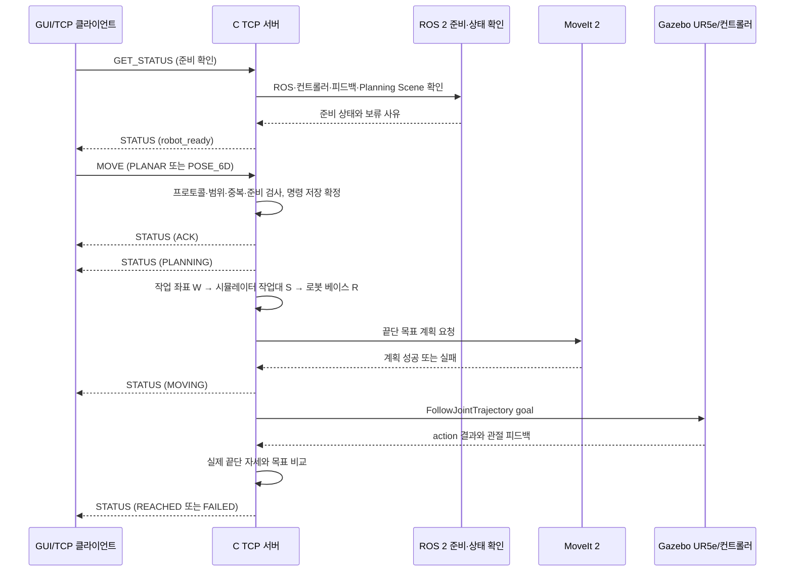
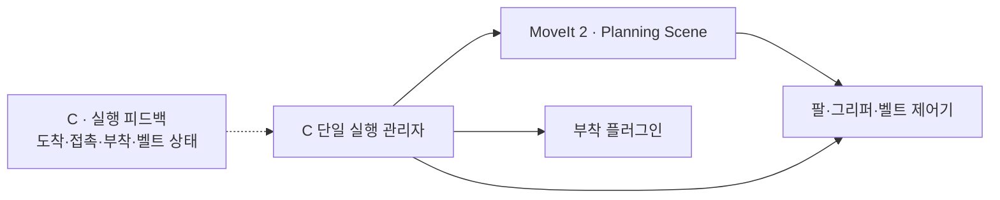

# C 담당 로봇 서버·시뮬레이션 상세설계

문서 버전 1.15 · 설계 초안 · 2026-11-13

| 버전 | 날짜 | 변경 |
|---|---|---|
| 1.12 (일자별 일정·진행사항 재구성) | 2026-11-13 | §11을 11/13~22 일자별 작업과 11/23~25 최종 테스트·발표 준비로 재구성. §12를 주차 구분 없는 협의 대기·완료·부분 완료·예정 진행사항으로 통합 |
| 1.13 (진행사항 표 통합) | 2026-11-13 | §12의 11/6~12 진행 내역을 한 행에 합치고, §11 일자별 예정 작업을 같은 날짜·작업 내용·진행 사항 형식으로 이어서 표시 |
| 1.14 (과거 진행내역 분리) | 2026-11-13 | §12의 11/6~12 내역을 작업별 개별 행으로 나누고 각 행에 대응하는 진행사항을 기록 |
| 1.15 (과거 내역 셀 내 줄바꿈) | 2026-11-13 | §12의 날짜를 11/6~12 한 행으로 두고, 작업 내용과 진행사항을 셀 안에서 대응 순서대로 줄바꿈 |
| 1.11 (주차별 진행사항) | 2026-11-12 | §11의 주차별 작업계획은 유지하고, §12에 확인된 작업 상태를 기록 |
| 1.1 | 2026-11-09 | 계획서 1.4(전체 7주) 기준의 이전 변경 이력. 이후 1.3에서 전체 5주 계획으로 대체 |
| 1.2 | 2026-11-09 | 계획서 1주차 C 작업과 문서 일정을 맞춤: Gazebo 월드 골격(작업대·부품·카메라 배치), UR5e 시험 목표 이동·관절 피드백, 시뮬레이션 RTF 측정 및 기록을 §8.1·§8.2·§11·§12에 명시. 기존 계획의 누락 설명을 보완하며 C 책임 범위는 확대하지 않음 |
| 1.3 | 2026-11-10 | 계획서 1.5(전체 5주)와 정합. **C 업무 증가:** 기존 TCP 서버를 그대로 유지하고, 신규 로봇 실행(경로 계획·실행, 충돌·관절 제한, 그리퍼·부착·Planning Scene, 컨베이어 실행, 분류 순서, 단일 명령 중재, 모드 전환, 정지·복구, 확장 명령 서버 수용·회귀)을 맡음(§1·§2·§11·§12·§13·§15). 1.1의 "6~7주 C 신규 업무 없음"과 C 서버 없는 확장 모드는 대체됨. 6D 기능은 후속(TCP 1.1 정의·구현 유지). main 1.2(PR #10)의 1주차 보완(월드 골격·시험 목표 이동·관절 피드백·카메라 Hz/RTF 측정·환경 기록, §8.1·§11·§12)은 그대로 보존하고 5주 일정의 1주차에 합침 |
| 1.5 (재설계 정합화) | 2026-11-11 | 사용자 확정 반영: D GUI는 Windows, C 서버·로봇은 WSL(GUI↔C TCP는 Windows↔WSL 네트워크 구간). 운전 모드(`IDLE`·`MOVE_TEST`·`AUTO_SORT`·`HUMAN`) 없음, START 시 분류 작업. B→C 자동 분류 목표는 ROS 액션이며 C가 검증·계획·실행·진행·결과·취소 책임. TCP 수동 `MOVE`와 B→C 액션을 단일 실행 관리자에서 중재(분류 중 `MOVE`는 `BUSY`, 제안·미확정). 세부는 실행 설계 §8.1~§8.5·§11 |
| 1.6 (TCP 단일 경로) | 2026-11-11 | 사용자 확정 최신 명세: TCP 서버·수신 포트·GUI 연결 각 하나. `START`·`STOP`·`RECOVER`는 같은 메시지 처리기의 개정 제안(TCP 명세서 부록 A, 미승인), 별도 확장 서버·포트 제거. START 시 C가 준비 확인 후 A/B 파이프라인 활성화. §2·§4·§15·미결 표 수정 |
| 1.6 (기능 설계 통합) | 2026-11-11 | 2026-11-11 사용자 요청: 별도 기능 설계 3개(그리퍼·로봇 실행, 컨베이어 분류, 사람 자세 제어)를 시스템 계획과 A/B/C/D 상세설계로 통합하고 삭제. §16(구 그리퍼·로봇 실행 §3~§5·§7·§8·§10~§12, 하위 번호는 원문+16, 원문 이력 §16.13)·§17(분류 실패·격리·시험)·§18(사람 제어 입력 유실 정지) 신설 |
| 1.6 (실행 피드백 경계) | 2026-11-11 | 2026-11-11 사용자 확정 실행 피드백 경계: A는 카메라 입력·검출·추적·관측 출력과 C 정지 확인 결과를 받은 재검출만, 도착·접촉·부착·보유·벨트 정지·상자 도착 확인의 구성·수신·판정과 수량 집계(센서 설정 포함)는 C. §2·§15 표(실행 피드백 행), §16.5.1, §16.7.4, §16.8.1 구성도, §16.11 갱신 |
| 1.6 (담당 경계 RB) | 2026-11-11 | 2026-11-11 담당 경계 RB-01~03 정리: 구현·수정 책임자/제공 정보/협력 담당 구분. §4 launch 문장, §13 launch·collision·Scene·장애 주입 행, §16.3.1 항목별 제공·통합 표, §16.11 미결 2행 |
| 1.6 (담당 결정) | 2026-11-11 | 사용자 결정 2026-11-11: common/types.py 관리 A, A·B 파이프라인 실행 진입점 A(계산·액션 어댑터 B), 그리퍼 실행 혼합 설정 최종 관리 C, 동등 파지 후보 계산 B·실행 해 선택 C. B→C PICK_PLACE 목표 계약(제안) 구체화. §16.3.1, §16.8.5(필드 표·종류별 표·「C 수신 이후 처리」), §16.11(결정된 미결 2행 제거) |
| 1.7 (명령 로그 모듈 책임 추가) | 2026-11-12 | §9에 `command_log.py`의 저장·점검·오프셋 조회 책임, 명령 상태 관리자 및 재시작 복구 계층과의 호출 관계를 명시 |
| 1.7 (카메라·표시 경로) | 2026-11-12 | 사용자 결정 2026-11-12(A 측 반영), C 확인 필요: Gazebo 카메라 3대(링크·그리퍼·고정 탑뷰), 검출 카메라 = 링크 카메라(센서 설정·입력 요구는 A 작성, C가 월드·브리지 통합 — C 회신 C-01을 사용자가 채택), 그리퍼·고정 카메라 설정 담당 미결. 영상은 C가 D GUI로 전송(5종 보유, D 요청에 따라 링크 채널 하나 + 그리퍼·고정 = 3개 영상, 결과·무효화 JSON 중계) — C 새 작업. 「TCP 하나」는 명령·상태 TCP 규칙이며 표시 경로는 별도(TCP 명세서 §0 유지). C 회신(C-01·C-03·C-04·C-05·C-07, 사용자 전달) 사실 기록. 링크 채널 종류 코드 `raw`·`detect`·`center`(링크 채널에만). §2·§8.1·§12·§15·§16.8.1·§16.11 |
| 1.8 (타 담당 설계·협업 요청 정합) | 2026-11-12 | A 1.9·B 1.4·D 설계 및 A 협업 요청 0.7 반영: 링크 카메라 설정은 A 작성, C 월드·브리지 통합; 링크 센서 초기값과 배치 미결 조건 구분; 3대 카메라·A/B 영상/JSON을 C가 D에 중계하는 표시 경로를 C 작업으로 명시. 명령·상태 TCP와 영상 표시 경로 분리, C-08·B-08 및 전송 세부는 미요청·미결 표시. A 협업 초안에서 C-06이 A 비관련으로 삭제됐지만 C 내부 B→C 파이프라인 활성화 방식 미결은 유지. C-01·03·04·05·07 회신은 계획·조건부 동의이며 실통합·검증 미완료임을 명시 |
| 1.10 (연계 담당 표기 순서) | 2026-11-12 | §4 트리 주석을 `연계: C↔담당 — 역할` 순서로 통일. 파일별 직접 통신과 시험·정보 제공 등 간접 협력을 구분하고, tcp_server.py의 B 직접 연계가 없음을 명시 |
| 1.9 (폴더 구조 담당·연계 주석) | 2026-11-12 | §4 폴더 구조의 파일·디렉터리마다 주 담당과 연결 담당(A/B/D), 인터페이스 역할 및 현재/제안 상태를 주석으로 표시. C→D 영상 표시 중계를 위한 `display_relay.py`를 신규 제안 파일로 추가하고, ROS 패키지 밖 C 소유 launch·월드·URDF 통합 파일도 관계를 표기 |
| 1.4 | 2026-11-11 | 5주 계획과 신규 분류·사람 제어 요구에 맞춰 범위·모듈·시험·일정을 정합화. 실행 관리자·그리퍼·부착·벨트·분류·사람 제어·확장 명령을 구조에 반영하고, 기능별 상세 계약은 관련 설계 문서를 기준으로 연결. 기존 TCP 1.1 서버 설계 유지 |

| 항목 | 내용 |
|---|---|
| 담당 | C |
| 범위 | TCP 1.1 서버 유지와 ROS 2·MoveIt 2·Gazebo 기반 실행 통합. 1~3주차 컨베이어 분류, 4~5주차 사람 자세 제어의 로봇·그리퍼·벨트 실행, 단일 명령 중재(TCP 수동 `MOVE`·TCP 분류 명령·B→C 분류 목표 액션), 정지·복구 포함. 운전 모드 전환은 두지 않음. 기능별 상세 계약은 §14의 기준 문서 참조 |
| 상위 기준 | [README](../../README.md), [시스템 아키텍처 및 프로젝트 계획](../architecture/시스템_아키텍처_및_프로젝트_계획.md), [TCP 프로토콜 명세서](../protocol/TCP_프로토콜_명세서.md) |
| 관련 인계 | A의 비전·자세 관측(카메라 입력 기반), B의 규격·좌표·목표, D의 GUI·TCP 클라이언트·TCP 명세 개정 제안(분류 명령) |
| 신규 실행 | 컨베이어 분류(1~3주)·사람 자세 제어(4~5주)의 로봇 실행 담당(§15, §16) |

이 문서는 C가 구현할 내부 구조와 작업 순서를 제안합니다. TCP 필드·상태·코드·저장 규칙은 TCP 프로토콜 명세서가 단일 기준이며, 이 문서는 이를 새로 정의하지 않습니다. 구현 상태(2026-11-12): robot_server_package의 TCP 프로토콜·서버·명령 관리자·명령 로그 파일을 작성했고, D와 GET_STATUS 왕복을 확인했습니다(사용자 전달). 이는 ROS 이동 실행, B→C 액션, 운영 카메라 통합, C→D 영상 표시 경로의 구현·검증 완료를 뜻하지 않습니다. 아래 모듈 이름과 미결 계약은 구현 전 제안입니다.

## 1. 목적과 완료 범위

C의 목표는 기존 TCP 1.1 로봇 이동 서버를 유지하면서, 모든 팔·그리퍼·벨트 동작을 단일 실행 관리자로 중재하는 것입니다. C는 D의 명령과 A·B가 제공하는 유효 입력을 검증해 Gazebo의 UR5e 동작으로 실행하고, 시뮬레이션 피드백으로 도달·부착·배출·정지 결과를 확인합니다. 비전 검출·규격 판정·사람 의도 해석은 C 범위가 아닙니다.

최종 성공 상태 `REACHED`는 명령을 받았거나 궤적 실행이 성공했다는 뜻이 아닙니다. MoveIt 계획, 컨트롤러 실행, 최종 끝단 위치·방향 허용치 검사를 모두 통과했을 때만 반환합니다. 실패하거나 확인할 수 없으면 해당 실패 코드를 기록하고 `REACHED`로 처리하지 않습니다.

| 단계 | C가 제공할 기능 |
|---|---|
| 1~3주차 기존 TCP 서버(유지) | TCP 서버, 요청 검증·ACK·상태 조회·취소, ROS 2 준비 상태, 고정 높이 평면 접근 목표, UR5e 실행·도달 판정 |
| 1~3주차 컨베이어 분류 (신규) | 벨트·부품 풀·그리퍼 모델·제어기·실행 구성, 벨트 정지 확인, 부착 기반 집기·운반·배출, Planning Scene 전이, 분류 순서, 실패 격리·복구, 단일 명령 중재 |
| 4~5주차 사람 자세 제어 (신규) | 사전 동작 실행, 속도·범위 제한, 입력 유실 정지 판정, 분류 작업과의 슬롯 배타, 분류·TCP 1.1 회귀 |
| 후속 6D | 물체 기준점의 XYZ·쿼터니언 목표 변환, 6D 접근 자세 실행·도달 판정(TCP 1.1 정의 유지, 이번 5주 필수 아님) |

실제 로봇 구동, 접촉·마찰 기반 물리 파지, 움직이는 벨트 위 집기, 그리퍼 4종 교체, 다중 동시 이동은 범위에 포함하지 않습니다. 집기는 Gazebo 부착 기반 시연입니다(제안). 실행 관리자는 TCP 1.1 `MOVE`·분류·사람 제어를 포함해 한 번에 팔 명령 하나만 실행합니다. 분류·사람 제어·모드·TCP 분류 명령(개정 제안)의 세부 동작은 기능별 상세설계를 기준으로 합니다.

## 2. 담당 경계와 인계

| 작업 | C의 책임 | 인계·협업 |
|---|---|---|

| TCP 서버 | LF 구분 JSON 수신, 프로토콜 검증, 상태 응답·알림, 중복 방지, 취소·재접속 처리. Windows GUI에서 접속 가능한 바인딩 주소·포트 확인(미결) | D가 Windows에서 클라이언트와 GUI를 구현하고, A가 시험 시나리오·시험 도구를 제공 |
| 분류 목표 액션 서버 (신규, 제안) | B→C ROS 액션 goal 수락·검증(분류 작업 실행 여부·`sort_job_id`·유효성·좌표·중복 `goal_id`), 계획·실행, feedback·result·취소, 재시작 후 goal 상태 확인 | B가 액션 클라이언트·goal 내용 제공, 필드는 B·C 공동 확정(§16.8.5) |
| 좌표 변환 | B가 제공한 작업대·로봇 베이스 변환과 접근 오프셋을 적용하고 단위·프레임을 점검 | B가 원점·축·프레임 이름·변환·물체 기준점을 확정 |
| 로봇 실행 | MoveIt 2 계획, 궤적 액션 실행·취소, Gazebo 상태 확인 | A가 Gazebo 카메라 영상 입력을 연결(검출 카메라 = 링크 카메라: 센서 설정·입력 요구는 A, 월드·브리지 통합은 C, 2026-11-12 C 회신 C-01을 사용자가 채택. 그리퍼·고정 카메라 설정 담당은 미결), D가 GUI에서 상태 표시 |
| 영상 표시 중계 (경로 결정, 신규 C 작업·세부 계약 미결) | 링크 원본·A 검출 주석·B 중심점 주석·그리퍼 원본·고정 원본을 입력으로 삼는 설계. D 요청에 따라 링크 채널 `raw`·`detect`·`center` 중 하나와 그리퍼·고정 원본을 함께 전송하고 결과·무효화 JSON도 중계(§16.8.1). 실제 토픽·연결·직렬화는 미구현 | A·B 출력 토픽·자료형 및 B-08 확인, D 링크 채널 선택 요청, C→D 연결 방식·포트·직렬화를 C·D가 합의(C-08 미요청, §16.11) |
| 도달 판정 | 관절 피드백으로 끝단 자세 계산, 목표 대비 위치·회전 오차 및 허용치 판정 | B와 평가 기준점·정답 좌표를 확인, A가 전체 평가를 취합 |
| 장애·복구 | 서버 측 로그·장애 주입 자료, 재시작 복구·수동 초기화 절차, 로봇·벨트 정지 확인 판정 | A가 장애 시험 시나리오 실행·결과 취합에 협력(정지 판정은 C) |
| 평가 | 서버 상태·지연·로봇 도달 오차와 실패 기록 제공 | A가 시험 실행·결과 취합, 각 담당은 자기 모듈 결함 수정 |

경계 원칙:

- C 서버가 비전 검출을 수행하거나 새 목표를 만들어내지 않습니다.
- A의 검출 성공만으로 이동을 시작하지 않습니다. 수동 이동은 사용자 확정 후 D가 송신한 TCP 1.1 `MOVE`만 처리합니다. 자동 분류는 `START`(GUI 입력)로 시작한 분류 작업이 실행 중일 때 B가 보낸 액션 goal만 처리하며, C가 다시 검증합니다(사용자 확정: B→C ROS 액션).
- 분류 작업이 슬롯을 점유하는 동안 TCP 1.1 `MOVE`는 `BUSY`로 거부하는 안을 제안합니다(1.1 enum·필드 추가 없음). 다만 명세서 §1의 슬롯 정의(`MOVE` 한 건이 점유)를 바꾸는 결과이므로 C 승인 또는 프로토콜 개정 전에는 미확정입니다.
- D는 서버 상태를 표시하며, 로봇 동작 상태 모델을 별도로 구현하지 않습니다.
- `ACK`는 명령 수락, `REACHED`는 시뮬레이션 끝단의 목표 도달 확인입니다.
- TCP 단절은 취소가 아닙니다. 서버가 이미 수락한 이동은 서버 정책에 따라 계속 처리합니다.

**신규 실행 경계.** C는 기존 TCP 서버의 연결·프레이밍·검증·ID·중복·ACK·STATUS·오류 응답·취소·단절·재시작 복구·서버 로그·회귀 시험을 독립 기능으로 유지하면서, 신규 로봇 실행을 맡습니다(§15). TCP 명세 개정 제안(분류 명령, 미승인)은 D가 초안·클라이언트, C가 서버 수용·실행을 맡아 공동 확정하고 B가 의미·유효성을 협의합니다. TCP 1.1의 `MOVE`/`REACHED` 의미·상태·오류 코드·스키마는 바꾸지 않습니다. 이전 1.1의 "6~7주 C 신규 업무 없음"과 C 서버 없이 B가 실행하는 구조는 대체됐습니다.

## 3. 전체 처리 흐름



1. 서버 시작 후 로그를 검사·복구하고 ROS 2 의존성을 연결합니다.
2. 준비 조회 요청에는 현재 `robot_ready`와 `not_ready_reasons`를 응답합니다.
3. `MOVE` 수신 시 TCP 규약에 따른 형식·값·작업 범위·중복·슬롯·준비 검사를 수행합니다.
4. 명령을 등록하고 저장 확정한 뒤 `ACK`를 보냅니다.
5. 접근 목표를 계산하고 MoveIt 계획을 요청합니다.
6. 계획이 성공하면 상태를 `MOVING`으로 기록·저장 확정한 뒤 컨트롤러 액션을 실행합니다.
7. 실행 결과와 최신 관절 피드백을 확인해 끝단 자세를 계산합니다.
8. 위치·회전 오차가 도달 허용치 안이면 `REACHED`, 아니면 규약에 맞는 `FAILED`를 기록합니다.

## 4. 내부 구성과 배치 제안

ROS 2 패키지명은 `robot_server_package`로 정합니다. 저장소 실행 규칙을 확인한 뒤 아래처럼 책임 경계를 코드 모듈로 나눕니다. 파일 분리는 제안입니다. 로봇 실행 launch·노드 배치의 구현·수정·확정은 C가 하고, A는 영상 입력·A/B 파이프라인 프로세스가 필요로 하는 실행 정보(카메라 토픽·광학 프레임·기동 순서 요구)를 제공합니다. A의 입력 모듈 실행 코드와 C의 로봇 실행 launch는 서로 다른 구현물입니다. 상세 상태 전이와 TCP 분류 명령(개정 제안) 필드는 §14의 기능별 기준 문서를 따릅니다.

```text
robot_ws/src/robot_server_package/ [현재 디렉터리]       # 연계: C↔A·B·D — C ROS 패키지, 하위 파일별 실제 인터페이스 참조
├── package.xml [현재 파일]                              # 연계: C↔A·B — ROS/Gazebo 의존성을 선언해 공통 런타임 환경 구성
├── setup.py [현재 파일]                                 # 연계: C — Python 패키지 설치·실행 엔트리 관리
├── setup.cfg [현재 파일]                                # 연계: C — ROS 2 Python 패키지 설치 경로 설정
├── resource/robot_server_package [현재 파일]            # 연계: C — ament 패키지 인덱스 마커
├── robot_server_package/ [현재 디렉터리]
│   ├── __init__.py [현재 파일]                          # 연계: C — Python 모듈 패키지
│   ├── tcp_server.py [현재 파일]                        # 연계: C↔D (A는 시험 도구로 접속; B 직접 연계 없음) — MOVE·GET_STATUS·CANCEL 요청과 STATUS 응답
│   ├── protocol.py [현재 파일]                          # 연계: C↔D — TCP 요청·응답 검증·직렬화; A·B 통신 모듈은 아님
│   ├── command_manager.py [현재 파일]                   # 연계: C→D — command_id·중복·상태 전이 관리 후 TCP 상태 응답
│   ├── command_log.py [현재 파일]                       # 연계: C→A (시험 분석용 로그 제공; D 파일 직접 접근 없음) — 서버 JSONL 기록·복구 색인
│   ├── readiness.py [현재 파일]                         # 연계: C↔A, C→D — ROS·카메라 준비 정보 판정 후 D STATUS에 반영
│   ├── execution_manager.py [현재 파일]                 # 연계: C↔D·B — D TCP 명령과 B ROS 액션 goal을 단일 실행 슬롯에서 중재
│   ├── sort_action_server.py [제안·미생성]              # 연계: C↔B — C 액션 서버가 B 액션 클라이언트의 분류 goal·취소·결과 처리
│   ├── robot_backend.py [현재 파일]                     # 연계: C↔B — B 목표·좌표를 받아 MoveIt·궤적 컨트롤러로 실행
│   ├── gripper_controller.py [현재 파일]                # 연계: C↔B — B 파지 목표·치수 정보를 C가 그리퍼 동작으로 적용
│   ├── attachment_manager.py [현재 파일]                # 연계: C↔B — 분류 목표 실행 중 Gazebo 부착과 Planning Scene 상태 동기화
│   ├── conveyor_controller.py [현재 파일]               # 연계: C↔B·A — C가 벨트 정지를 확인해 B에 결과 전달, A 재검출 시작 근거 제공
│   ├── sort_manager.py [현재 파일]                      # 연계: C↔B·A — 분류 사이클·격리 관리, B 후속 goal과 A 재검출 흐름 연결
│   ├── human_control.py [현재 파일]                     # 연계: C↔A·D — A 사람 자세 관측과 D 조작 입력을 제한된 로봇 동작으로 연결(4~5주차)
│   ├── transforms.py [현재 파일]                        # 연계: C↔B (A 관측값은 B 변환 결과를 통해 간접 입력) — 프레임·단위 변환 적용
│   ├── reach_check.py [현재 파일]                       # 연계: C↔B·A — 목표 대비 끝단 자세 판정, B 기준 사용·A 평가 취합에 결과 제공
│   ├── recovery.py [현재 파일]                          # 연계: C↔D — D RECOVER 요청과 ROS goal·정지 상태를 바탕으로 복구
│   └── display_relay.py [제안·미생성]                   # 연계: C↔A·B·D — A/B 영상·결과·무효화 입력을 D GUI로 중계; 명령·상태 TCP와 별도
├── config/ [현재 디렉터리]                              # 연계: C↔A·B — ROS 노드 설정과 카메라 입력·목표 실행 조건 통합
├── launch/ [현재 디렉터리]                              # 연계: C↔A·B — C 서버·로봇 기동, A 카메라 요구와 B 입력 순서 반영
└── test/ [현재 디렉터리]                                # 연계: C↔A·B·D — ROS 패키지 단위·통합 인터페이스 시험

scripts/ [현재 디렉터리]                                 # 연계: C — 로봇·시뮬레이션 실행 스크립트
└── sim_sort_cell.launch.py [현재 파일]                  # 연계: C↔A — Gazebo·로봇·제어기 실행 및 A 센서 설정 통합
simulation/ [현재 디렉터리]                              # 연계: C↔A·B·D — Gazebo 자산과 담당별 통합 검증
├── worlds/sort_cell.sdf [현재 파일]                     # 연계: C↔A·B·D — C 월드, A 카메라 통합, B 치수·좌표 확인, D 외형 검토
└── models/ur5e_2f85/ [현재 디렉터리]                    # 연계: C↔A·B — 로봇 모델과 카메라·좌표 프레임 통합
    ├── ur5e_2f85.urdf.xacro [현재 파일]                  # 연계: C↔A·B — UR5e·그리퍼 모델에 A 링크 카메라 조각 통합, B 프레임 확인
    └── controllers.yaml [현재 파일]                     # 연계: C — 팔·그리퍼 ROS 제어기 설정

config/robot/ [현재 디렉터리]                            # 연계: C↔B — B 프레임·변환·작업 범위를 C 로봇 설정에 적용
config/conveyor/ [제안·미생성 디렉터리]                  # 연계: C↔B — C 벨트·상자 설정에 B 목적지·분류 좌표 반영
config/tcp/ [현재 디렉터리]                              # 연계: C↔D — 서버·클라이언트 주소·포트·개정 계약 설정
logs/ [미생성 디렉터리·런타임 생성 예정]                 # 연계: C→A — C 서버 로그를 A 시험 분석에 제공, D는 파일 직접 접근 안 함
tests/unit/ [현재 디렉터리]                              # 연계: C↔B·D — C 단위 시험 및 B 변환·액션, D TCP 규약 회귀
tests/integration/ [현재 디렉터리]                       # 연계: C↔A·B·D — 카메라 입력·액션·GUI/TCP 통합 확인
tests/tcp/ [현재 디렉터리]                               # 연계: C↔D (A 시험 도구·시나리오 지원) — TCP 서버·클라이언트 회귀
evaluation/results/ [현재 디렉터리]                      # 연계: A 취합, C 결과 제공, B 정답·좌표 평가 자료 제공
```

트리 주석의 `담당`은 구현·수정의 주 책임, `연계`는 입출력이나 검증을 주고받는 담당을 뜻합니다. `[현재 파일]`은 경로가 존재한다는 뜻일 뿐 기능 완성을 뜻하지 않습니다. `[제안·미생성]`은 아직 만들지 않은 설계 항목입니다. 디렉터리 항목도 경로 존재 여부를 표시합니다.

`execution_manager`가 로봇 동작의 유일한 진입점입니다. ROS 콜백을 동기 대기로 막지 않고, 소켓 수신·명령 상태 갱신·액션 결과 처리를 분리합니다. A/B의 앱 내부 공통 자료형 초안은 C 실행 자료형이나 TCP 명세 개정 제안(분류 명령)을 정의하지 않으므로 혼합하지 않습니다.


## 5. 주요 내부 자료와 기준

아래 이름은 구현 편의를 위한 제안이며 TCP 필드·의미는 프로토콜 명세를 우선합니다.

| 내부 자료 | 포함 정보 | 주의점 |
|---|---|---|

| `CommandRecord` | command_id, 검증된 요청, 현재/마지막 알림 상태, stage/code, goal ID, 시각 | 로그의 저장 확정 여부와 메모리 상태를 혼동하지 않음 |
| `RobotReadiness` | 준비 bool, 보류 사유 목록, 검사 시각 | 추측이나 타이머로 준비 완료 처리하지 않음 |
| `RobotSnapshot` | controller 상태, action status 최신 여부, joint state와 시각, 현재 끝단 pose, Planning Scene 상태 | 오래되었거나 불완전한 피드백은 준비·도달 근거로 사용하지 않음 |
| `PoseGoal` | ROS 기준 끝단 목표 pose, 원본 command_id, 목표 프레임 | mm→m 변환은 경계에서 한 번만 수행 |
| `ReachResult` | 위치 오차 mm, 상대 회전 오차 도, 설정 허용치, 통과 여부 | controller 성공만으로 통과시키지 않음 |

좌표 변환의 기준은 계획서 §2.3입니다.

- TCP 작업 좌표 `W`의 위치 단위는 mm, 회전은 규약의 도/쿼터니언입니다. ROS 위치는 m입니다.
- 평면 모드는 작업대 기준 XY와 설정한 고정 접근 높이, 고정 끝단 방향을 사용합니다. 기본 정책에서 `theta_deg`는 표시·평가에 쓰고 로봇 yaw에는 적용하지 않습니다.
- 6D 모드는 물체 기준점 `O`의 `T_W_O`를 받습니다. 마커 자세 `T_W_M`을 물체 자세로 오인하지 않습니다.
- 접근 목표는 계획서 정의의 `T_R_E_goal = T_R_S × T_S_W × T_W_O × T_O_E_goal`을 적용합니다. 평면 모드도 합의된 작업대→로봇 변환을 거칩니다.
- 실제 프레임 이름, 변환 방향, 끝단 평가 기준점은 B와 1주차에 확정하며 임의 프레임 이름을 코드에 고정하지 않습니다.

## 6. 준비 상태와 이동 안전 조건

각 작업 진입 전에 해당 작업의 준비 조건을 검사합니다. TCP `MOVE`는 계획서 §2.4.5 및 TCP 명세를, 분류·사람 제어는 §16.8.3 및 기능별 상세설계를 따릅니다. 확인할 수 없는 항목은 준비 완료로 간주하지 않습니다.

| 확인 항목 | 준비 보류 예시 |
|---|---|
| 실행 슬롯이 비었는가 | `COMMAND_ACTIVE` |
| ROS 2·Gazebo 연결 및 `/clock` 진행 | `ROS_DISCONNECTED`, `SIM_PAUSED` |
| 궤적 컨트롤러가 활성인가 | `CONTROLLER_INACTIVE` |
| 최신 action status를 받았고 미종료 goal이 없는가 | `ACTION_STATUS_UNKNOWN`, `TRAJECTORY_ACTIVE` |
| 관절 피드백이 최신인가 | `FEEDBACK_STALE` |
| 제어 관절 속도가 정지 기준 안에서 유지되는가 | `NOT_STOPPED` |
| Planning Scene에 `workbench`가 등록됐는가 | `SCENE_NOT_READY` |
| 재시작 복구와 로그 상태가 정상인가 | `RECOVERING`, `RECOVERY_FAILED`, `LOG_UNAVAILABLE` |

모든 작업은 C 실행 슬롯을 점유합니다. TCP `ACK` 시 슬롯을 점유하고 종료 기록을 저장하며, 분류·복구 작업은 §16.8의 수락·상태 계약을 따릅니다. 슬롯은 실행 종료와 최신 정지 피드백을 확인한 뒤에만 해제합니다. 정확한 피드백 시간, 정지 속도, 확인 구간, 계획·컨트롤러·끝단 도달 허용치는 임의로 정하지 않습니다. 2주차 로봇 단독 시험으로 결정해 설정과 시험 기록에 남깁니다.

## 7. TCP 서버 구현 규칙

TCP 프로토콜 명세서 §2~§9를 그대로 구현합니다. 최소 구현 순서는 아래와 같습니다.

1. TCP 연결 수락 및 연결별 수신 버퍼를 둡니다.
2. UTF-8 JSON 바이트를 LF까지 누적하고, 완성된 줄만 처리합니다. 분할·병합 수신을 지원하며 연결이 끊길 때 미완성 마지막 조각을 버립니다.
3. 중복 JSON 키, 비표준 비유한 수, 정의되지 않은 필드, 스키마·의미·작업 범위 오류를 규약대로 거부합니다.
4. 직접 응답을 요청마다 정확히 하나 보냅니다. 요청의 직접 응답이 상태 알림보다 먼저 송신 대기열에 들어가게 합니다.
5. 명령별 잠금/원자적 상태 갱신으로 동일 ID의 상태가 되돌아가지 않게 합니다.
6. 중복 MOVE는 메모리뿐 아니라 저장 로그 색인에서도 검사합니다. 같은 ID·다른 내용은 `ID_CONFLICT`; 같은 내용은 새 실행 없이 저장된 상태를 응답합니다.
7. 한 개의 실행 슬롯을 유지합니다. 기존 ID 중복 확인은 `BUSY` 판정보다 먼저 합니다.
8. 명령 등록, `MOVING`, 종료 기록의 `flush`+`fsync` 저장 확정 규칙을 따릅니다. 종료 결과는 확정 후에만 알립니다.
9. TCP 연결 종료는 로봇 goal을 취소하지 않습니다. 취소는 기존 command_id의 `CANCEL`로 수행합니다.
10. 재접속 시 같은 명령 ID의 조회와 상태 구독을 지원합니다. 새 명령으로 자동 대체하지 않습니다.

서버가 1.1 초안 명세를 승인하기 전에는 그 초안의 승인 완료를 전제로 쓰지 않습니다. 구현을 시작하기 전에 C·D·A가 승인 여부와 미확정 구현 항목을 확인하고, 결정은 기준 문서에 반영합니다. 승인 후 패킷·상태 의미를 바꾸려면 명세서의 프로토콜 버전 변경 절차를 따릅니다.

## 8. ROS 2·MoveIt·Gazebo 연결

### 8.1 1주차에 실제 환경에서 확인할 것

- ROS 2 Jazzy, Gazebo Harmonic, MoveIt 2, `ros2_control`, UR5e 실행 구성과 시작 명령
- Gazebo 월드 골격에 작업대·부품·카메라가 배치되고 각 요소의 pose·크기가 의도한 기준과 맞는지
- UR5e 모델, planning group, planning frame, 제어 joint 이름, MoveIt이 움직이는 링크와 끝단 평가 링크
- 궤적 컨트롤러 실제 이름 및 `follow_joint_trajectory` 액션 연결
- controller_manager `list_controllers`, `/joint_states`, `/clock`, action status 토픽 연결
- Gazebo 상판과 카메라 거치대의 크기·pose를 확인하고 Planning Scene `workbench` 등록 경로
- 노드 재시작 뒤 action status 목록의 최신 값을 받을 수 있는지
- 액션 클라이언트에서 goal UUID를 사전 지정할 수 있는지
- Gazebo 카메라를 켠 상태에서 카메라 갱신률(Hz)과 시뮬레이션 실시간 비율(RTF)을 측정할 수 있는지
- **링크 카메라 통합(C-01 회신 채택):** 운영 검출 입력은 링크 카메라입니다. A가 센서 SDF 조각·입력 요구를 준비해 C에 공유하고, C가 로봇 모델·월드·브리지에 통합한 뒤 A·B·C가 토픽·광학 프레임·`CameraInfo`를 확인합니다. A §6.1의 `base_link` 장착, `link_cam_link`·`link_cam_optical_frame`, `/link_cam/image`·`/link_cam/camera_info`, 15 Hz·1280×720·hfov 1.0은 초기 제안값이며 `origin`은 미정 자리표시입니다. 모델 입력에서 너트 짧은 변 12 px 기준은 imgsz 640에서 미충족이므로 카메라 배치를 확정값처럼 복사하지 않고 A·B·C가 해결안을 확인합니다. 그리퍼·고정 카메라 설정 담당도 미결입니다. 통합 후 C-05 측정, C-03 시각 동작 재확인, C-04 완료·녹화 일정 재공유를 진행합니다. 회신은 계획/동의이며 통합·실측·검증 완료가 아닙니다.

확인 결과를 `config/robot/` 설정과 실행 설명서에 기록합니다. 문서에 적힌 예시를 현재 실행 환경에서 확인된 값처럼 사용하지 않습니다.

1주차에는 확인에 그치지 않고 Gazebo 월드 골격을 준비하고 UR5e의 알려진 시험 목표 이동을 실행해 계획·컨트롤러 동작·관절 피드백을 확인합니다. 이 시험 이동은 최종 도달 성능 평가와 구분해 시험 조건과 결과를 기록합니다. Gazebo 카메라 갱신률과 RTF도 함께 측정하고, 렌더링 방식·해상도·갱신 설정을 결과와 함께 남깁니다.

### 8.2 목표 계획·실행

- 좌표 변환은 순수 계산 모듈에 두고, 단위·프레임을 확인할 수 있는 테스트 값을 먼저 준비합니다.
- MoveIt에 보낼 목표의 위치는 m, 방향은 정규화된 quaternion으로 맞춥니다.
- Planning Scene 등록 전에는 이동을 허용하지 않습니다. 작업대 충돌 박스는 실제 Gazebo 상판과 같은 위치·방향·크기로 두고, 카메라 거치대가 작업 공간에 있으면 충돌 대상으로 검토합니다.
- 계획 실패는 `PLAN_FAILED`, 실행 실패는 `EXEC_FAILED`, 끝단 허용치 초과는 `REACH_TOLERANCE` 등 TCP 명세의 코드·stage를 사용합니다.
- `MOVING` 기록과 goal ID 저장 확정 순서는 TCP 명세 §7.5 및 계획서 §2.4.5를 따릅니다. 기록이 확정되기 전에 궤적을 실행하지 않습니다.

### 8.3 취소와 실패

- `PLANNING` 중 취소와 계획 결과·궤적 전송의 경합은 TCP 명세 §7.7의 잠금 규칙을 따릅니다.
- `MOVING` 중 취소는 해당 action goal을 취소하고 최종 action 상태와 관절 정지를 확인합니다.
- 취소 요청 송신만으로 `CANCELLED`나 정지를 확정하지 않습니다. goal이 취소되기 전에 성공 완료되면 도달 검사를 수행할 수 있습니다.
- action 결과, 관절 피드백, ROS 연결이 끊기거나 오래되면 `REACHED` 금지, 상태 기록, 준비 보류를 적용합니다.
- 수동 복구가 필요한 불확실한 상태를 시간 경과만으로 자동 해제하지 않습니다.

## 9. 명령 기록과 재시작 복구

TCP 명세 §7.5~§7.8을 구현합니다.

### 9.1 `command_log.py`의 책임과 연계

`command_log.py`는 TCP 명령 이벤트의 영속 저장 계층입니다. 상태 전이나 실행 슬롯을 결정하지 않고, 호출자가 전달한 `REGISTER`·`STATE` 이벤트를 명세된 JSONL 형식으로 기록·점검합니다.

| 책임 | 처리 내용 |
|---|---|
| 이벤트 저장 | `seq`, 이벤트 종류, `command_id`, 요청·상태 및 `MOVING`의 `goal_id`를 JSONL 한 줄로 추가하고 `flush`·`fsync`로 저장 확정 |
| 저장 위치 관리 | 설정된 WSL2 Linux 파일 시스템 경로를 사용하고 `/mnt/c/...` 경로는 거부 |
| 시작 시 로그 점검 | UTF-8 JSONL, 중복 키·비유한 수, 필수 필드, 이벤트 종류, 마지막 LF, `seq` 연속성을 검사하고 손상 시 복구 계층에 실패를 반환 |
| 복구 조회 지원 | 각 레코드의 바이트 오프셋을 제공해 명령 상태 관리자가 전체 `command_id` 색인과 최신 저장 상태를 재구성할 수 있게 함 |
| 쓰기 실패 정리 | 다음 기록 전에 마지막 저장 확정 오프셋까지 잘라내고 다시 `fsync`; 복구 불가 시 로그 사용 불가 상태를 호출자에게 전달 |
| 로그 사용 가능성 확인 | 재시도 간격에 따라 실제 쓰기·저장 확정 가능 여부를 점검하고, 시험용 임시 파일은 점검 뒤 제거 |

호출 흐름은 다음과 같습니다.

1. `tcp_server.py`가 검증된 요청을 명령 상태 관리자(`command_manager.py`)에 전달합니다.
2. 새 `MOVE`는 상태 관리자가 `REGISTER` 저장을 요청하고, 저장 확정 뒤에만 실행 슬롯을 점유한 `ACK`를 대기열에 넣습니다.
3. 계획이 끝나면 `MOVING` 상태와 `goal_id` 저장 확정을 먼저 요청합니다. 저장이 확정되어야만 ROS 궤적 전송을 허용합니다.
4. 종료 상태는 저장 확정 뒤에 구독 연결에 알립니다. 저장 실패 시 마지막 알림 상태와 실행 슬롯을 유지하면서 `log_retry_ms` 간격으로 재시도합니다.
5. 서버 시작 시 `recovery.py`가 로그 점검 결과와 레코드를 받아 색인을 재구성하고, 미종료 명령의 ROS goal 종료·로봇 정지 확인을 진행합니다.

`command_log.py`는 TCP 요청 파싱·응답 생성, 중복 MOVE 내용 비교, 상태 전이, 실행 슬롯, 구독자 관리, ROS goal 취소를 맡지 않습니다. 이 동작은 각각 `protocol.py`, `command_manager.py`·`tcp_server.py`, `execution_manager.py`·`recovery.py`가 담당하며, D는 파일에 직접 접근하지 않고 TCP 상태 응답을 받습니다.

- 로그는 WSL2 Linux 파일 시스템(ext4)의 저장소 `logs/` 아래 JSONL로 둡니다. `/mnt/c/...`에 명령 로그를 두지 않습니다.
- 최초 실행에서 로그 파일이 없는 것을 자동으로 정상 상태로 간주하지 않습니다. 설치 또는 로그 초기화는 명시적 C 절차로 수행합니다.
- 시작 시 전체 로그의 LF·JSON·필수 필드·순번 연속성을 검사하고, 모든 command_id 색인을 복구한 뒤 TCP 수신을 엽니다.
- 비종료 명령이 있으면 controller action 상태를 조사하고 goal 취소·정지 확인 절차를 수행합니다. 종료가 확정되지 않은 명령은 복구 완료 전 새 이동을 받지 않습니다.
- 로그 없음·손상·읽기 실패는 `RECOVERY_FAILED`로 유지하고, 수동 보관·정지 확인·명시적 초기화·재시작 절차를 따릅니다.
- 로그 파일을 삭제하거나 초기화하기 전에는 기존 파일을 보관하고, 사유·시각·확인 내용을 시험 기록에 남깁니다.
- 서버 로그에는 command_id, 상태 전이, stage/code/detail, 목표·변환 요약, goal ID, 저장 결과, 계획·실행·도달 시간과 측정 시계를 남깁니다. 비밀정보는 기록하지 않습니다.

## 10. 검증 시나리오와 완료 기준

실행 전 설계 체크리스트이며, 완료 상태를 뜻하지 않습니다.

| 영역 | 시나리오 | 기대 결과 |
|---|---|---|

| 프로토콜 | `test_vectors.json`의 c2s/s2c·중복 판정 사례 | 명세와 같은 수락·거부 코드 및 의미 |
| 프레이밍 | JSON 한 줄을 여러 조각으로 전송, 여러 줄을 한 번에 전송, 잘린 줄 뒤 연결 종료 | 완성된 줄만 순서대로 처리, 미완성 조각은 폐기 |
| 중복·경합 | 같은 ID·같은 내용 재전송, 같은 ID·다른 내용, 다른 ID 동시 MOVE | 재실행 없음, `ID_CONFLICT`, 단일 슬롯의 `BUSY` |
| 순서 | PLANNING→MOVING 경합 중 GET_STATUS 반복 | 같은 연결에서 상태 역행 없음, ACK가 PLANNING보다 먼저 |
| 준비 상태 | ROS 단절·시뮬레이션 정지·controller 비활성·오래된 피드백·Scene 누락 | `robot_ready=false`, 보류 사유 공개, 새 MOVE 차단 |
| 좌표 변환 | 계획서 §2.3의 알려진 단위 변환 시험과 축 방향 시험 | 기대 m·방향과 일치, 단위 변환 중복 없음 |
| 평면 이동 | 작업 영역 안 여러 XY 점에서 고정 높이 접근 | 계획·실행 후 독립 피드백 기준 도달 판정 |
| 6D 이동 | 서로 다른 높이·기울기의 물체 기준 pose | 접근 위치와 방향이 모두 목표 변환을 따름 |
| 도달 판정 | controller 성공이나 끝단 오차 초과, 오래된 joint state | `REACHED` 금지, 적절한 `FAILED`·사유 기록 |
| 취소 | PLANNING 중, MOVING 중, 완료와 취소가 겹치는 경우 | 명세의 실제 결과 기준 최종 상태, 정지 확인 전 재이동 금지 |
| 지속성 | ACK 직후·MOVING 중·REACHED 직후 강제 재시작, 로그 잘림·삭제 | 로그 복구·`SERVER_RESTARTED`/`RECOVERY_FAILED` 규약 준수 |
| 통신·장애 | 고유 명령 100회, 연결 단절·재접속·중복·잘못된 메시지 | ID 일치 ACK, 실패·재시도·서버 기록을 A 시험 결과와 대조 |
| 실행 중재 | 분류 중 TCP `MOVE`, 분류 중 사람 제어 진입, 실행 중 중복 START, 외부 goal | 단일 슬롯만 실행, `MOVE`는 `BUSY`(제안·미확정), 진입 거부, 새 작업 없이 현재 상태 반환 |
| B→C 액션 | 같은 `goal_id` 재요청(같은/다른 내용), 분류 미실행 중 goal, 액션 단절·서버 재시작 | 기존 상태 반환/충돌 거부, 거부, 자동 재실행 0건·확인 불가 시 `RECOVERY_REQUIRED` |
| Windows↔WSL 접속 | Windows GUI에서 접속·단절·재접속 | 접속 확인, 단절은 취소 아님, 재접속 후 상태 조회 |
| 분류 | 정지 확인·재검출·집기·도착·격리 및 복구 시나리오 | 기능 설계의 기대 상태, 잘못된 상자 집계·자동 재개 없음 |
| 사람 제어 | 입력 유실·오래된 입력·범위 초과 | 제한 적용, 정지 확인, 자동 재개 없음 |
| 회귀 | 확장 기능 통합 후 TCP 1.1 PLANAR 경로 재실행 | 기존 평면 경로·프로토콜 동작 유지, 결과 기록 |

완료 보고에는 기능 시연과 KPI 통과를 구분합니다. 계획 성공, controller 성공, 끝단 도달은 각각 다른 결과로 기록합니다. 도달 허용치와 시험 목표는 실측·파일럿 후 최종 평가 전에 확정하고, 미달 결과를 성공으로 바꾸지 않습니다.

## 11. 일자별 작업 순서

아래 일정은 2026-11-13 기준으로, 확인 완료된 작업은 반복하지 않고 남은 C 작업을 배치한 안입니다. 다른 담당자와 협의·연동할 일은 11월 16일부터 시작합니다. 11월 22일까지 통합 후보를 고정하고, 23~25일은 최종 시험과 발표 준비에 사용합니다.

| 날짜 | 작업 순서 | 완료 기준 |
|---|---|---|
| 11/13 (금) | 현재 C 패키지·실행 구성을 상세설계와 대조하고, 작성된 모듈과 ROS에 연결되지 않은 실행 경로를 구분합니다. | C 단독 미완료 목록과 재현 가능한 실행 순서 정리 |
| 11/14 (토) | 실행 관리자 내부 흐름을 정리합니다: 단일 실행 슬롯, 수락·거부, 상태 전이, 종료 후 슬롯 반환. 기존 `command_manager.py`와 역할을 구분합니다. | TCP 명령 처리와 ROS 실행 계층 사이의 연결 지점 확정 |
| 11/15 (일) | readiness와 로봇 실행 계층의 C 소유 부분을 준비합니다. B 좌표·A 카메라 값 없이 가능한 연결·초기화·로컬 확인을 진행합니다. | 16일부터 외부 입력을 받아 붙일 C 측 기반 준비 |
| 11/16 (월) | B와 좌표·프레임 및 목표 전달 방식 협의, A 카메라 설정·전달 일정 확인, D 분류 명령 개정안의 작성·승인 범위 확인. | 입력값·담당자·전달 날짜와 미결 항목 기록 |
| 11/17 (화) | 받은 A 카메라 설정을 월드·브리지에 통합하고, B와 합의한 목표 인터페이스를 C 실행부에 연결합니다. | 영상 토픽·CameraInfo·프레임 및 B→C 입력 확인(입력 미도착 항목은 대기로 기록) |
| 11/18 (수) | readiness와 Planning Scene을 연결하고 고정 높이 목표의 MoveIt 계획·실행을 통합합니다. | 목표 검증부터 계획·실행 결과 확인까지 연결 |
| 11/19 (목) | 분류 실행 관리자에 벨트 정지 확인, 집기·운반·배출의 기본 순서를 연결합니다. | 분류 단계와 C 상태·실행 피드백 연동 |
| 11/20 (금) | A→B→C 및 C→D 상태 전달을 첫 통합하고, 기본 분류 경로를 실행합니다. | 정상 경로 1회 실행 및 통합 결함 기록 |
| 11/21 (토) | 통합 결함 수정 및 정상 경로 회귀. 그리퍼 부착·Planning Scene 전이 등 아직 검증하지 않은 동작을 확인합니다. | 22일 통합 후보의 차단 결함 제거 또는 미달 기록 |
| 11/22 (일) | 기능 추가를 멈추고 팀 통합 후보를 고정합니다. 설정·실행 절차·알려진 제한·미완료 항목을 정리합니다. | 전원이 시험할 동일 실행본과 실행 안내 |
| 11/23~25 — 최종 테스트 및 발표 준비 | 23일 정상 경로·담당 간 데이터 및 상태 전달, 24일 중복·취소·단절·실패·복구 등 예외 및 반복 시험, 25일 회귀·결과 취합·결함과 제한 정리·시연 경로 확정. | 시험 결과와 서버 로그, 남은 결함, 발표 시연본 및 실행 절차 |

다른 담당자의 입력이 예정일에 도착하지 않으면 임의 값으로 완료 처리하지 않습니다. 해당 연결은 대기 또는 모의 입력 시험으로 구분하고, 실제 입력이 도착한 뒤 재검증합니다.

## 12. 진행사항

진행 상태는 2026-11-13 기준입니다. 11/6~12 작업은 날짜 셀 하나 안에서 내역별로 줄바꿈하고, 작업 내용과 진행사항을 같은 순서로 대응시켰습니다. 이후 작업은 §11 일정별 진행 기준을 표시합니다.

| 날짜 | 작업 내용 | 진행 사항 |
|---|---|---|
| 11/6 (금) ~ 12 (목) | D와 TCP 프로토콜 적용 기준 협의<br>D와 `GET_STATUS` 송수신<br>ROS 2/Gazebo 실행 및 controller·관절 상태 확인<br>UR5e 시험 이동<br>그리퍼 열기·닫기<br>저장소·실행 방법·패키지 기본 파일<br>TCP·명령 관리 모듈 작성<br>실행 관리자<br>Gazebo 월드 확인 | 협의·연동 / 프로토콜 문서를 기준으로 진행하고, 문서에 없는 추가 사항은 필요할 때 협의하기로 함<br>완료 / `GET_STATUS` 요청·응답 왕복 확인<br>완료 / 컨트롤러 3종 active와 `/joint_states` 발행 확인<br>완료 / 시뮬레이션에서 UR5e 이동 확인(정밀도 평가·분류 경로 검증은 별도)<br>완료 / 그리퍼 동작 확인<br>완료 / 저장소·실행 방법 확인 및 `package.xml`, `setup.py`, `setup.cfg` 작성<br>부분 완료 / 관련 파일 작성. ROS 실행·분류 경로 통합 시험은 남음<br>부분 완료 / 구조·골격 마련. ROS 실행 계층, 단일 실행 슬롯과 분류 시퀀스 연결은 남음<br>부분 완료 / 장면 외관 확인. 최종 분류 장면·벨트 구동·카메라 통합은 남음 |
| 11/13 (금) | C 패키지·실행 구성과 ROS 미연결 실행 경로 점검 | 예정 / C 단독 미완료 목록과 재현 가능한 실행 순서 정리 |
| 11/14 (토) | 실행 관리자 내부 흐름과 `command_manager.py` 역할 구분 | 예정 / TCP 명령과 ROS 실행 계층 사이 연결 지점 확정 |
| 11/15 (일) | readiness·로봇 실행 계층의 C 소유 부분 준비 | 예정 / 외부 담당자 입력 없이 가능한 C 측 기반 준비 |
| 11/16 (월) | B 좌표·목표 전달, A 카메라 설정 일정, D TCP 개정 범위 협의 | 예정 / 필요한 입력·담당자·전달 날짜 및 미결 항목 기록 |
| 11/17 (화) | A 카메라 설정 및 B 목표 인터페이스 통합 | 예정 / 영상·CameraInfo·프레임과 B→C 입력 확인 |
| 11/18 (수) | readiness·Planning Scene·고정 높이 MoveIt 목표 연결 | 예정 / 목표 검증부터 계획·실행 결과까지 연결 |
| 11/19 (목) | 벨트 정지·집기·운반·배출 순서 통합 | 예정 / 분류 단계별 실행 피드백 확인 |
| 11/20 (금) | A→B→C 및 C→D 첫 통합 | 예정 / 정상 경로 실행 및 통합 결함 기록 |
| 11/21 (토) | 통합 결함 수정·그리퍼 부착 및 Planning Scene 전이 확인·회귀 | 예정 / 차단 결함 제거 또는 미달 사항 기록 |
| 11/22 (일) | 통합 후보 고정 및 실행 자료 정리 | 예정 / 팀 공통 시험본, 실행 절차, 알려진 제한과 미완료 항목 정리 |
| 11/23~25 — 최종 테스트 및 발표 준비 | 정상·예외·반복·회귀 시험, 결과·제한 정리 및 시연 준비 | 예정 / 시험 기록·로그, 남은 결함, 발표 시연 경로 정리 |
## 13. 구현 전 결정·확인 목록

| 항목 | 결정·확인 담당 | 시점 |
|---|---|---|

| TCP 명세서 1.1 승인 여부 및 C 승인 항목 | C, D, A | 서버 프로토콜 구현 전 |
| 로봇 실행 launch·실행 구성 | C 구현·수정·적용 검증(A는 영상 입력 실행 요구·카메라 정보 제공과 수신 확인) | 1주차 시작 |
| 브랜치·파일 소유 방식 | 전원 합의(A는 현재 저장소 규칙 정보 제공, §11 11/13) | 1주차 시작 |
| UR5e planning group/frame, 관절·끝단 링크, controller 실제 이름 | C | 1주차 환경 확인 |
| `T_S_W`, `T_R_S`, 접근 오프셋 `T_O_E_goal`, 프레임 방향 | B·C | 1주차 인터페이스 합의, 4주차 6D 전 갱신 |
| Gazebo 상판·카메라대 collision 및 Planning Scene 등록 | C 구현·수정·적용 검증(A는 카메라 위치·화각 요구 제공, 영상 수신·광학 프레임 확인 협력) | 1~2주차 통합 전 |
| goal UUID 생성 방식과 action status 최신값 수신 | C | 1주차 action 연결 |
| 피드백 최신성·정지 판정·취소·복구 timeout | C, A 확인 | 2주차 단독 시험 후 |
| 계획·컨트롤러·끝단 도달 허용치 3종 | C, B 검토 | 파일럿 후, 최종 평가 전 고정 |
| 로그 경로·명시적 초기화 실행 절차 | C | 첫 서버 구동 전 |
| A 통신 시험 도구와 C 서버 장애 주입 방법(주입 수단·서버 수정은 C, 도구·시나리오 실행은 A, 클라이언트 재사용 인터페이스는 D) | A·C, D 인터페이스 협력 | 2주차 통합 전 |
| TCP 개정 제안(분류 명령: 메시지·스키마·오류·ID·주기·타임아웃·취소·단절·중복) | D·C(B 협의) | 1주차 |
| 분류 작업 중 TCP 1.1 `MOVE` 거부 표현(`BUSY` 제안, enum 추가 금지. 명세서 §1 슬롯 정의 해석은 C 승인) | C·D | 1주차 |
| B→C 분류 목표 액션 계약(goal 종류·필드·feedback·result·중복·단절·재시작 조회), 인터페이스 패키지 위치 | B·C | 1~2주차 |
| Windows GUI 접속용 바인딩 주소·포트·방화벽(현재 `tcp_server.py`의 `HOST = "127.0.0.1"`) (TCP 서버·포트는 하나, 별도 포트 없음) | C·D | 통합 전 |
| 벨트·부품 풀·그리퍼 모델, 그리퍼 제어기, DetachableJoint 구성(`<self_collide>`·인스턴스 수) | C | 1주차 |
| 사전 동작 집합의 실행 가능성·속도 제한·입력 유실 정지 시간 | C(B·D 확인) | 4주차 1일차 |

## 14. 참고 문서

- [README](../../README.md) — 프로젝트 범위·역할·폴더 구조·실행 환경
- [시스템 아키텍처 및 프로젝트 계획](../architecture/시스템_아키텍처_및_프로젝트_계획.md) — 좌표 변환, readiness, MoveIt·controller·복구 기준
- [TCP 프로토콜 명세서](../protocol/TCP_프로토콜_명세서.md) — 메시지·상태·저장·재시작·취소의 단일 기준
- §16 — 집기·부착·중재·TCP 명세 개정 제안(분류 명령)(C 실행 소유)
- [계획서 §2.6](../architecture/시스템_아키텍처_및_프로젝트_계획.md), [계획서 §2.7](../architecture/시스템_아키텍처_및_프로젝트_계획.md)
- [A 담당 비전 상세설계](A담당_비전_상세설계.md) — 입력·비전·통신 시험 협업 및 주차별 인계

## 15. C 실행 책임 요약

구현 책임을 요약합니다. 세부 계약의 기준은 §16, [계획서 §2.6](../architecture/시스템_아키텍처_및_프로젝트_계획.md), [계획서 §2.7](../architecture/시스템_아키텍처_및_프로젝트_계획.md)입니다.

| 기능 | C의 책임 | 기준 |
|---|---|---|

| 기존 TCP 서버(유지) | 연결·프레이밍·검증·ID·중복·ACK·STATUS·오류 응답·취소·단절·재시작 복구·서버 로그·회귀 시험 | TCP 명세서 1.1, 이 문서 §7~§9 |
| 모델·실행 구성 | UR5e + 2지 그리퍼, 벨트, 부품 풀, 상자의 모델·제어기·launch(외형 메시는 D, 치수는 B, 링크 카메라 센서 설정은 A·통합은 C, 그리퍼·고정 카메라 설정 담당은 미결(2026-11-12), 실행 피드백 센서·시뮬레이터 상태는 C) | 계획서 §2.6.2, 이 문서 §16.7.3 |
| 경로 계획·실행 | MoveIt 계획, 충돌·관절 제한, 끝단 허용치, 속도 배율 | B 상세설계 §15.2, 이 문서 §16.7 |
| 그리퍼·부착 | 간격 닫힘, 비접촉 확인 후 부착, Gazebo–Planning Scene 전이, 해제·열기 | §16.7.2~§16.7.5 |
| 컨베이어·분류 순서 | 벨트 정지·실제 정지 확인·재가동, 재검출 대기, 집기·운반·배출·도착 확인, 실패 격리 | 계획서 §2.6.3, 이 문서 §17.1 |
| 단일 명령 중재 | 실행 슬롯과 분류 작업 상태(운전 모드 없음), 수동 `MOVE`·B→C goal·사람 제어 수락 판정, 외부 goal 감지 | §16.8.2·§16.8.3·§16.8.4 |
| 분류 목표 액션 서버 | goal 검증·실행·feedback·result·취소·중복·단절 처리 | §16.8.5, B 상세설계 §15.4 |
| 실행 피드백 | 벨트 정지, 접촉·비접촉, 부착·보유, 상자 도착·분류 완료 확인의 구성·수신·판정과 수량 집계. 센서가 필요하면 설정·통합도 C(구현 수단은 센서·시뮬레이터 상태 중 제안). A·B는 재검출에 필요한 정지 확인 결과·시각·작업 식별자만 액션 result로 소비 | §16.5.1·§16.7.4·§16.8.5, §17 |
| 정지·복구 | 실패·취소 종료 규칙, `HOLD_UNKNOWN`·`RECOVERY_REQUIRED`, 복구 재기동 | §16.4.3·§16.8.3 |
| 사람 제어 실행 | 사전 동작 실행, 실행 제한, 입력 유실 정지 판정, 자동 재개 금지 | §18 |
| 영상 표시 중계 (경로 결정, 신규 C 작업·세부 계약 미결) | 링크 원본·A 검출 주석·B 중심점 주석·그리퍼 원본·고정 원본 입력을 받아 링크 1종+그리퍼·고정 원본과 결과·무효화 JSON을 D로 중계하는 설계. 실제 수신·전송 구현은 미완료 | §2, §16.8.1, §16.11 |
| TCP 분류 명령 처리 | 같은 TCP 서버·메시지 처리기에서 `START`·`STOP`·`RECOVER`·`GET_STATUS` 확장(개정 제안) 처리, START 시 A/B 파이프라인 활성화, 회귀 시험 | §16.8.4 |

- 기존 TCP 1.1 처리 유지와 분류 명령·실행 관리자 구현이 겹치므로 회귀 부담이 늘어납니다. TCP 1.1 시험 벡터·통신 100회 회귀는 확장 기능을 넣은 뒤에도 다시 확인합니다.
- 런타임 시뮬레이션 피드백(부착 조건·도착 확인)은 실행 판정에만 쓰고 평가 정답과 구분합니다(§16.7.4).

## 16. 로봇 실행 상세: 그리퍼·부착·중재·분류 액션

이 절은 2026-11-11 사용자 요청으로 별도 문서였던 「그리퍼·로봇 실행 상세설계」(0.5)를 C 상세설계에 통합한 것입니다. 하위 절 번호는 원문 절 번호에 16을 붙였습니다(원문 §8.5 → §16.8.5). 원문 §1·§2(범위·담당)는 [계획서 §2.6.1·§2.6.2](../architecture/시스템_아키텍처_및_프로젝트_계획.md), §6(좌표와 공구 목표)은 [B 상세설계 §15.2](B담당_보정_좌표_상세설계.md), §9(일정)는 계획서 §4.1로 옮겼습니다. 원문 변경 이력은 이 절 끝 「§16.13 이관 전 변경 이력」에 보존합니다. 원문 범위: 5주 분류 시나리오의 2지 그리퍼 1종 부착 기반 집기·운반·배출, 실행 관리자의 단일 명령 중재(운전 모드 없음), 사람 제어 명령의 실행 제한, TCP 명령 통합(개정 제안).

이 절은 설계 제안입니다. 그리퍼·벨트 모델, 실행 관리자, GUI 코드는 없으며 실행·실측을 하지 않았습니다. 2026-11-11 재설계 반영분(§16.8.1~§16.8.5)도 문서 정합화일 뿐이며 Windows GUI↔WSL 연결, Windows GUI 영상 표시, TCP 분류 명령·ROS 액션 구현은 검증하지 않았고 mermaid 그림의 렌더링도 확인하지 않았습니다. 자료형·상태·사유 이름은 **구현 제안**이고 수치는 파일럿에서 정합니다. 집기 성공은 아직 확인된 결과가 아닙니다.

### 16.3 그리퍼 프로파일과 기동 상태

#### 16.3.1 프로파일 (2지 1종, 필드는 구현 제안)

`config/robot/grippers/two_finger.yaml`(제안)에 아래 항목을 기록합니다. 한 파일에 여러 담당의 값이 섞이므로 항목별 제공자와 통합 담당을 나눕니다. 파일 분리는 필수가 아니며, 이 파일의 최종 관리(통합·적용·검증·유지)는 **C**입니다(사용자 결정 2026-11-11). B는 치수·변환·개구폭·간격·허용치 등 기하·파지 값을 계산·제공하고, D는 visual 자산 정보·버전을 제공합니다(계획서 §3 「공통 파일 소유자」).

| 항목 | 값 제공 | 실행 설정 통합·적용·실행 검증 |
|---|---|---|

| `gripper_id`, `profile_version`, `profile_hash`, 재현 방법 | C | C |
| 외형 자산 버전·적용 정보 | D | C(모델에 적용) |
| 모델·제어기·관절·mimic 관절, `command_presets`(`open`·`close_to_gap` 명령), 부착 구성(§16.7.3), 런타임 설정 | C | C |
| `T_E_G`, 그리퍼·부품 치수, `opening_range_mm`, 규격별 개구폭·간격, 부착 허용치 | B(기하·치수·파지 값) | C |
| 충돌·관성 참조 | C(형상 치수는 B 값) | C |

#### 16.3.2 런타임 적용 상태

| 상태 | 값(제안) | 의미 |
|---|---|---|

| 외형 `status.visual` (정적) | `설계 중` / `적용 대기` / `적용 확인` | D §A.10 기록. 실행 허용 조건이 아님 |
| 런타임 적용 `apply_state` | `미적용` / `적용 중` / `적용 확인` / `적용 실패` | 현재 실행 세대에서 §16.4의 기동 확인을 통과했는지 |
| 집기 검증 `status.grasp` (정적) | `미검증` / `파일럿 통과` / `평가 완료` | 평가 기록. 실행 허용 조건이 아님 |

`적용 확인` 전에는 집기·분류·사람 제어를 허용하지 않습니다. 외형이 `적용 확인`이어도 런타임 적용으로 표시하지 않습니다.

### 16.4 기동·초기화와 복구 (C)

#### 16.4.1 기동 순서

1. 실행 구성 기동. `apply_state = 적용 중`, 보유 상태 `HOLD_UNKNOWN`
2. **구성 확인** — §16.5.1의 「구성 확인」 열. 동작은 아직 하지 않음
3. **초기화** — §16.4.2. 2가 통과한 경우에만
4. **최종 확인** — §16.5.1의 「최종 확인」 열. 3에서 만든 현재 실행 세대의 초기화 기록을 근거로 사용
5. 2~4가 모두 통과하면 `적용 확인`, 하나라도 실패하면 그 자리에서 멈추고 `적용 실패`(이후 단계 미실행)

#### 16.4.2 초기화 (시작 부착 해제와 초기 배치 확인)

DetachableJoint는 로드 직후 부착 상태로 시작합니다(§16.7.3). 부품 풀의 모든 부착 대상에 대해 다음을 확인합니다.

1. 월드 초기 상태에서 모든 부품이 그리퍼·로봇 링크와 충돌하지 않는 위치(대기 구역)에 있음
2. 상태 토픽을 먼저 구독한 뒤 해제 요청 → 대상별 `detached` 수신
3. 해제 전후 부품 위치·방향 변화가 허용치 이내. 움직였으면 `INIT_OBJECT_MOVED`로 `적용 실패`
4. Planning Scene: 작업대·벨트·상자 충돌 물체 등록, 부착 물체 없음
5. 모두 통과하면 보유 상태 `DETACHED`와 초기화 기록. 실패하면 `HOLD_UNKNOWN` 유지

#### 16.4.3 복구 재기동 (`RECOVER`)

진입 조건은 **다음 중 하나 이상**(OR): `apply_state = 적용 실패` / 보유 `HOLD_UNKNOWN` / `RECOVERY_REQUIRED` 잠금. 여기에 사용자의 복구 확정이 항상 필요합니다(AND). 정상 `HELD`(정지 확인·두 시스템 일치, 잠금 없음)는 진입 조건이 아니며, 잠금이 있으면 보유 상태와 관계없이 확정 후 진입합니다.

1. 팔 명령을 보내지 않고 미종료 goal 취소 요청 → 종료·정지 확인. 확인할 수 없으면 실행 구성 전체를 정상 종료(응답 없으면 프로세스 종료를 기록)
2. 재기동 후 §16.4.1 2~5단계. 부품이 초기 배치로 돌아가는 것은 시험 초기화로 기록하며 해제·집기·분류 결과로 세지 않음
3. 자동 재시도는 하지 않음

### 16.5 정합성과 무효화

#### 16.5.1 기동 정합성

| 확인 대상 | 구성 확인 (초기화 전) | 최종 확인 (초기화 후) |
|---|---|---|

| Gazebo 모델 | 모델 이름·프로파일 식별 태그 | 그대로임 |
| 그리퍼·벨트 제어기 | `list_controllers`의 이름·종류·`active`·관절 | 같음 |
| 부착 플러그인 | 대상별 상태 토픽 구독 성공, 대상 모델·링크 이름 | 현재 세대의 대상별 `detached`·이동 없음 기록 |
| MoveIt | 끝단 링크·`T_E_G`·그리퍼 충돌 형상 | 작업대·벨트·상자 등록, 부착 물체 없음, 허용 충돌 쌍 기본값 |
| 카메라 입력(A) | 카메라 토픽 수신 | 같음 |
| 실행 피드백(C) | 도착 확인·접촉/비접촉 판정 입력(센서 또는 시뮬레이터 상태, 수단은 제안) 수신 | 같음 |
| GUI 선택(D) | — | GUI가 표시하는 프로파일과 실행 관리자 보고가 같음 |

#### 16.5.2 실행 세대

실행 세대 `run_epoch`(제안)는 기동·복구 재기동과 파지 설정 변경(`T_E_G`·간격·허용치) 때 올리는 단조 증가 정수입니다. 목표·스냅샷·계획·작업 기록에 `run_epoch`를 붙이고 현재와 다르면 폐기합니다. 상태 알림에도 넣어 GUI가 옛 세대 알림으로 화면을 덮지 않게 합니다. 비전 세대(A §5.4)는 별도 검사이며 둘 다 현재여야 목표가 유효합니다. 그리퍼 설정이 바뀌어도 카메라·영상 조건이 같으면 카메라를 다시 보정하지 않습니다.

### 16.7 집기와 배출

#### 16.7.1 단계

| 단계(제안) | 동작 | 넘어가는 조건 |
|---|---|---|

| `PRECHECK` | 슬롯 확보 후 §16.8.3 조건 | 모두 확인 |
| `SCENE_PREPARE` | 대상 부품 충돌 물체 등록(§16.7.5) | Scene 조회 확인 |
| `OPEN` | 열기 | 개구폭 허용치 안 |
| `MOVE_PRE`·`DESCEND` | 사전 접근·하강. `DESCEND`부터 손가락–대상 부품 허용 충돌 쌍만 허용 | goal 성공·정지·끝단 허용치 |
| `CLOSE_TO_GAP` | 부품 폭 + 간격까지 위치 제어로 닫음 | 목표 폭 도달(정지로 끝나면 실패) |
| `CHECK_ATTACH` | §16.7.4 | 모두 충족 |
| `ATTACH` | Gazebo 부착 → `attached` 수신 → MoveIt 부착 반영 확인 | 두 시스템 일치 |
| `LIFT` | 수직 상승 | goal 성공, 부품이 따라 상승 |
| `TRANSPORT` | 상자 위 배출 높이로 운반 | goal 성공, 보유 유지 |
| `DROP` | §16.7.5 해제 순서 → 열기 | 두 시스템 분리 확인, 열림 |
| `ARRIVAL` | 상자 도착 확인(계획서 §2.6.4) | 도착 확인 |

닫힘·부착·상승·운반·배출·도착은 각각 따로 기록합니다. 부착 실패·불명·불일치에서는 `LIFT`로 가지 않습니다.

#### 16.7.2 그리퍼 제어기

ROS 2 Jazzy의 `parallel_gripper_action_controller`(단일 관절 액션, `goal_tolerance`·`allow_stalling`·`max_effort` 등)를 1안으로, 두 손가락을 한 관절 + mimic 관절로 구성합니다(`gz_ros2_control`은 mimic 관절 지원, mimic 관절에는 명령 인터페이스를 두지 않음). 접촉 전에 멈추는 위치 목표를 쓰므로 정지(stall)에 의존하지 않습니다. 액션 결과 필드는 C가 1주차에 실제 설치 버전에서 확인합니다.

#### 16.7.3 부착 방법과 알려진 제약

Gazebo Harmonic(gz-sim 8) `DetachableJoint`를 1안으로 둡니다.

| 확인한 동작·제약 | 설계 반영 |
|---|---|
| 부착·재부착은 현재 자세 그대로 고정, 위치·접촉 검사 없음 | 부착 전 조건 확인(§16.7.4). 집기 중 `set_pose`로 부품을 옮기지 않음 |
| 접촉 중 재부착 미지원, 재부착 시 충돌이 없어야 함 | 간격 닫힘과 비접촉 긍정 확인 후 부착 |
| 초기 부착 상태에서 충돌 금지, 로드 직후 부착 | §16.4.2 초기화 |
| 해제 후 부모와 충돌하려면 부모 모델에 `<self_collide>` | C가 1주차에 확인 |
| 결합 결과는 트리, 플러그인 하나에 자식 하나, 한 모델에 여러 플러그인이면 `attach_topic`·`detach_topic`·`output_topic`을 각각 지정해야 함 | 아래 부품 풀 구성 |
| 상태 출력은 전환 시점에만 발행 | 요청 전에 구독, 미수신이면 부착 불명 |

**복수 부품의 부착 대상 구성.** 부품이 반복 공급되므로 단일 `part_0` 고정은 맞지 않습니다. 1안은 **고정 이름의 부품 풀**입니다: 볼트·너트 모델을 정해진 개수(`part_00`~`part_NN`)로 만들고, 그리퍼 모델에 부품마다 DetachableJoint 인스턴스를 하나씩 두며 토픽을 부품별로 지정합니다. 공급기는 대기 구역의 풀 부품을 벨트 시작부로 옮기고(공급 동작이며 집기가 아님), 배출·도착 후 회수합니다. 풀 크기, 대기 구역 배치, 인스턴스 수가 물리 성능에 주는 영향은 C의 1주차 확인 항목이며, 동적 생성 부품에 부착 대상을 붙이는 대안은 확인 전에는 쓰지 않습니다. Planning Scene 충돌 물체 ID도 같은 부품 ID를 씁니다.

#### 16.7.4 부착 조건

1. 팔: `DESCEND` goal 성공, 정지 구간 동안 정지
2. 위치: 대상 부품 파지점과 G의 상대 위치 오차 허용치 이내. 손가락 사이 영역 밖이면 빈 집기
3. 방향: B 상세설계 §15.2의 방향 오차 `e_dir`(목표 상대각 90° 기준)가 허용치 이내. 닫힘 축과 볼트 축의 단순 각도 차로 판정하지 않음
4. 개구폭: `CLOSE_TO_GAP`이 목표 폭 도달
5. 비접촉: 그리퍼·로봇과 부품 사이 접촉 없음과 최소 간격을 긍정 확인(입력 구성·수신·판정 모두 C. 접촉 센서 또는 시뮬레이터 상태 중 수단은 제안). 확인 불가면 미충족
6. 부착 상태: 대상 Gazebo `detached`, Scene 부착 물체 없음
7. 세대: `run_epoch`와 목표 세대 현재, 벨트 정지 확인 유지

**런타임 시뮬레이션 피드백과 평가 정답.** 2·3·5번과 도착 확인은 C가 구성·수신한 실행 피드백(시뮬레이터 상태)으로 판정합니다. 이것은 부착 기반 시연을 위한 설계 선택이며 사용자 확정이 아닙니다. 런타임 피드백은 실행 판정에만 쓰고 비전·목표·계획용 부품 자세·`MOVE`에 넣지 않습니다. 평가 정답(공급 순서표, 계획서 §10.1의 정답 기록)은 평가에만 쓰고 런타임 판정을 정답으로 재사용하지 않습니다. 실제 로봇에서는 이 판정을 그대로 쓸 수 없다는 한계를 보고합니다.

#### 16.7.5 Gazebo 부착과 Planning Scene

| 항목 | 계약(제안) |
|---|---|
| 물체 ID·형상 | 부품 풀 ID, 규격별 치수의 단순 형상(B 치수) |
| 계획용 자세 출처 | 재검출 결과(B 좌표)와 벨트 상판 높이. 런타임 피드백·정답으로 보정하지 않음 |
| 허용 충돌 쌍 | `DESCEND`~`ATTACH` 동안 손가락 링크 ↔ 대상 부품만. `LIFT` 전 touch links로 대체 |
| 부착 순서 | Gazebo `attached` → MoveIt world→부착 전환 → 조회 확인 → 일치 시 `LIFT` |
| 해제 순서 | Gazebo `detached` → MoveIt 부착→world 복원(또는 상자 투입 후 제거) → 조회 확인 → 허용 충돌 쌍 원복 |
| 불일치·시간 초과 | `FAILED`(`SCENE_ATTACH_MISMATCH`), 보유 `HOLD_UNKNOWN`, 이동 차단, 복구는 §16.4.3 |

#### 16.7.6 실패 처리

| 상황 | 판정(제안) | 처리 | 하지 않는 것 |
|---|---|---|
---|
| 빈 집기 | `EMPTY_GRASP` | 부착하지 않음, 그 자리 정지 | 자동 재집기 |
| 닫힘 도중 정지 | `GRIPPER_BLOCKED` | 부착 요청 없음 | 접촉 중 부착 |
| 부착 조건 불일치 | `ATTACH_CONDITION_UNMET` | 부착 요청 없음 | 강제 부착, 순간이동 |
| `attached` 미수신 | `ATTACH_UNCONFIRMED`, `HOLD_UNKNOWN` | 이동 차단, 복구 §16.4.3 | 상승 |
| 두 시스템 부착 불일치 | `SCENE_ATTACH_MISMATCH` | §16.7.5 | 상승 |
| 상승·운반 실패 | `LIFT_FAILED`·`TRANSPORT_FAILED` | 보유 유지·정지 확인 | 자동 해제 |
| 운반 중 보유 상실 | `HOLD_LOST` | 부품 위치 기록, 벨트 정지 유지 | 자동 재집기 |
| `DROP` 분리 전 실패·취소 | `RELEASE_FAILED`·`CANCELLED` | §16.8.3 종료 규칙. 정지 확인·두 시스템 부착 일치면 `HELD`로 슬롯 반환 | 자동 재해제 |
| `detached` 미수신 | `DETACH_UNCONFIRMED`, `HOLD_UNKNOWN` | 복구 §16.4.3 | 분리로 간주 |
| 분리 후 Scene 복원 실패 | `SCENE_ATTACH_MISMATCH`, `HOLD_UNKNOWN` | 복구 §16.4.3 | 다음 이동 |
| 분리·복원 후 열기 실패 | `OPEN_FAILED`, 보유 기록 `DETACHED` | 허용 충돌 쌍 원복 후 `RECOVERY_REQUIRED` 잠금 | 닫힌 손가락으로 다음 작업 |
| 상자 도착 미확인 | `ARRIVAL_UNCONFIRMED` | 수량 증가 없음, 벨트 정지 유지 | 성공 처리 |
| 사용자 취소 | `CANCELLED` | goal 취소 → 종료·정지 확인, 보유 상태 보고 | 자동 개방·해제 |
| GUI 단절 (분류 작업·수동 `MOVE`·복구 작업) | 취소 아님. 작업 계속, 슬롯 유지 | 재접속 후 조회 | 자동 재요청 |
| `HUMAN` 입력 유실·오래된 입력·하트비트 타임아웃(GUI 단절 포함) | `FAILED`(`INPUT_LOST`) | §18의 입력 생존성·정지·재활성화 규칙 적용. 분류 작업의 단절/수락 후 무효화 규칙보다 우선 | 자동 재개·개방 |
| ROS·Gazebo 단절, 피드백 손실 | `ROS_DISCONNECTED`·`FEEDBACK_LOST`, `HOLD_UNKNOWN` | 이동 차단 | 성공 처리 |
| 실행 관리자 재시작 | 작업 기록으로 미종료 작업 확인 → goal 종료·정지·부착·Scene 확인 후 `MANAGER_RESTARTED`, 확인 못 하면 `RECOVERY_REQUIRED` | 사용자 복구 | 자동 재실행 |
| 수락 후 부품 비전 가림·무효화(분류 작업의 정적 부품 관측) | 수락된 작업에 영향 없음. `HUMAN` 동작에는 적용하지 않음(위 행) | 화면 표시 | 비전 무효화만으로 자동 취소 |

수락 전(송신 직전·수락 대기)에는 A §5.4와 D §A.6의 무효화·재전송 중단 규칙을 그대로 적용합니다.

#### 16.7.7 복귀·해제·시험 초기화·격리

모두 사용자가 명시적으로 실행하는 슬롯 작업이며 성공·분류 결과로 세지 않습니다. 시작 조건은 §16.8.3 표를 따릅니다.

1. **`RELEASE`** — 정지 확인·두 시스템 부착 일치 `HELD`에서 사용자 확정 시, 해제 높이로 내린 뒤 §16.7.5 해제 순서 → 열기 → 허용 충돌 쌍 원복. 도중 실패·취소는 §16.7.6·§16.8.3
2. **`HOME`** — `DETACHED`·Scene 부착 물체 없음에서 복귀
3. **`RESET_TRIAL`** — `DETACHED`·부착 물체 없음·비접촉 확인 상태에서만 시뮬레이터 배치 이동으로 부품을 대기 구역·초기 배치로 되돌리고 Scene 갱신, 기록
4. **`ISOLATE`** — 실패·미판정 볼트를 격리 구역으로. 시작 조건은 `DETACHED`·잠금 없음이며, `HOLD_UNKNOWN`·`RECOVERY_REQUIRED`이면 먼저 사용자가 확정한 `RECOVER`(§16.4.3)로 분리·정지를 확인해야 함. 집을 수 있으면 집기·운반으로, 아니면 3과 같은 조건(`DETACHED`·비접촉)에서 배치 이동으로 옮기고 실패로 집계(§17.1)

### 16.8 제어와 통신

#### 16.8.1 구성

전체 배치·구성도는 [계획서 §2.1](../architecture/시스템_아키텍처_및_프로젝트_계획.md)을 기준으로 합니다. C의 TCP 처리기와 B→C 액션 서버는 같은 실행 관리자로 들어오며, 팔·벨트·그리퍼의 실제 명령은 C만 실행합니다. 작업 중재는 §16.8.2~§16.8.3, TCP 메시지 연결은 §16.8.4, 분류 액션은 §16.8.5에서 정의합니다.

아래는 실행 관리자와 별도 영상 표시 중계의 관계를 함께 나타냅니다. 운영 검출 영상 입력은 A가 구독하고, A→B 관측·목표 흐름과 C→D GUI 표시 흐름은 별개입니다. 도착·접촉·부착·벨트 상태 같은 실행 피드백은 C가 구성·수신·판정합니다(§16.7.4).



**영상 표시 경로(경로 결정, 전송 계약 미결; A 상세설계 1.9·B 상세설계 1.4 및 협업 요청 0.7 반영).** C는 링크 원본(Gazebo), A 검출 주석 영상, B 중심점 주석 영상, 그리퍼 원본, 고정 탑뷰 원본 등 5종 입력을 받아 D에 중계하는 신규 역할을 맡습니다. D 요청에 따라 링크 채널 `raw`(원본)·`detect`(A 주석)·`center`(B 주석) 중 하나와 그리퍼·고정 원본, 결과·무효화 JSON을 전달해 GUI에 3개 영상을 표시하는 흐름은 결정됐습니다. A 검출 주석과 B 중심점 주석 영상의 생성 담당 경계는 설계에 반영됐으나 B-08은 아직 미요청이며 실제 발행은 미구현입니다. 결과·무효화 JSON은 영상 표시 경로로 C를 거쳐 D에 갑니다. 이 경로는 표시용이며 실행 관리자의 입력이 아닙니다. 명령·상태 TCP 1개 규칙과 분리된 경로이며 TCP 1.1 소켓에 영상을 넣지 않습니다. 세부 전송 방식은 미확정입니다. A 제안은 A·B→C ROS 토픽, JSON 한 토픽·reliable QoS, C→D 별도 표시 연결 1개이며 WebSocket은 후보입니다. 토픽명·메시지 형식·영상 직렬화/압축·포트·링크 선택 요청 형식·재접속 재동기화는 C·D 및 A·B 토픽 협의에서 정합니다(C-08 미요청). 링크 프레임 timestamp=`SIM_TIME` 상관과 주석 입력 중단 시 원본 자동 전환 기준도 제안 상태입니다.

**영상 분류 코드(사용자 결정 2026-11-12(A 측 반영), C 확인 필요).** 링크 채널 종류 코드는 `raw`(원본)·`detect`(A 검출 주석 영상, 'yolo' 대신. 운영 검출기가 OpenCV여도 같은 코드이며 실제 검출기 종류는 영상 표기·결과 JSON에 따로 적음)·`center`(B 중심점 주석 영상)이고 `original`이 아닌 `raw`로 확정입니다. 종류 선택은 링크 채널에만 있고 그리퍼·고정 채널은 원본만 있어 종류 코드가 없습니다. D→C 선택 요청은 링크 채널 종류 하나만 대상입니다. 이 `raw`는 픽셀 좌표 기준 `raw`(B-01, 왜곡 보정 전 픽셀)와 다른 개념입니다. 제안(확정 아님): 카메라 `source_id` `gz_link`·`gz_gripper`·`gz_fixed`, 표시 채널 코드 `link`·`gripper`·`fixed`(C·D가 확정), 조합 표기 `link/raw`·`link/detect`·`link/center`([A 상세설계](A담당_비전_상세설계.md) §3).

Windows↔WSL 명령·상태 접속 미결과 C→D 영상 표시 연결의 미결은 별도 항목으로 §16.11을 따릅니다. 영상 표시 경로는 TCP 명세서 §0에 따라 명령·상태 TCP와 분리합니다(초안: [TCP 명세서 부록 B](../protocol/TCP_프로토콜_명세서.md), A 초안·미승인). 이전 0.2의 C 서버 없는 실행 구조와 B의 직접 실행은 쓰지 않습니다.

#### 16.8.2 작업과 명령 출처 (운전 모드 없음)

0.3의 모드 표(`IDLE`·`MOVE_TEST`·`AUTO_SORT`·`HUMAN`)와 `SET_MODE` 모드 전환은 **대체**합니다(사용자 확정: 별도 자동운전 모드 없음). C는 모드 대신 **실행 슬롯 점유자와 분류 작업 상태(§16.8.4)**로 판정합니다. TCP `MOVE`의 `mode`(`PLANAR`·`POSE_6D`)는 좌표 표현이고, 사람 자세 제어는 4~5주 기능 경로이며, 둘 다 운전 모드가 아닙니다(계획서 §2.1 「'모드'의 구분」).

| 작업(제안 이름) | 팔 명령 출처 | 시작 | 슬롯 점유 기간(제안) |
|---|---|---|
---|
| 분류 작업 (기본 작업) | B→C 분류 목표 액션 goal(§16.8.5)과 C의 분류 순서(계획서 §2.6.3) | `START`(GUI에서 입력, START 뒤 동작 순서와 함께 사용자 확정. TCP 개정 메시지 세부는 제안) | START 수락부터 정지 확인(`STOPPED`) 또는 복구 잠금까지. 부품 사이 대기 중에도 점유 |
| 수동 이동 | TCP 1.1 `MOVE`(기존 접근 목표 이동·통신 시험, GUI 수동 이동) | `MOVE` 1건 | 기존 그대로 `ACK`부터 종료 기록까지(TCP 명세서 §1) |
| 사람 자세 제어 (4~5주 기능 경로) | 사람 제어 사전 동작(B 상세설계 §15.5) | 동의·활성화 | 활성화부터 비활성화·정지 확인까지 |
| 복구·시험 작업 | `RECOVER`·`RELEASE`·`HOME`·`RESET_TRIAL`·`ISOLATE` | 사용자 확정 요청 | 수락부터 §16.8.3 종료 규칙 완료까지 |

- 한 번에 한 작업만 슬롯을 점유합니다.
- 사람 자세 제어 진입은 분류 작업이 정지 확인된 상태·슬롯 비어 있음·미종료 goal 없음·관절 정지·보유 `DETACHED`에서만 수락하고 `HELD`·`HOLD_UNKNOWN`에서는 거부합니다(0.3의 전환 조건을 진입 조건으로 유지). 자동 분류와 사람 제어가 동시에 팔 명령을 내지 않습니다. 이는 모드 전환이 아니라 슬롯·작업 상태에 따른 수락 판정입니다.

**분류 중 수동 `MOVE` (제안, 미확정).**

- 기본안: 분류 작업이 슬롯을 점유하는 동안 수동 `MOVE`를 거부합니다. 거부 코드와 수락 조건은 TCP 개정 명세(부록 A)에서 정합니다. 후보로 기존 `BUSY`가 있으나, 그것만으로 의미가 호환된다고 보지 않습니다(아래 「슬롯 소유자와 상태 조회」).
- **슬롯 소유자와 상태 조회 (R4, 개정안 과제).** 1.1에서 `not_ready_reasons`의 `COMMAND_ACTIVE`는 `active_command_id`가 반드시 있고 그것이 `MOVE`의 `command_id`라는 뜻입니다(명세서 §4.6~§4.7). 분류 작업은 `sort_job_id`를 갖고 `MOVE` `command_id`가 없으므로, 분류 작업 점유를 1.1 응답 그대로(`active_command_id=null` 또는 `sort_job_id`를 끼워 넣기)로 표현할 수 없습니다. 개정안은 다음을 정의해야 합니다: 슬롯 소유자 종류(없음/수동 `MOVE`/분류 작업/사람 제어/복구 작업)와 그 ID(`command_id`·`sort_job_id`·작업 ID), 무ID `GET_STATUS`가 소유자를 알리는 필드, ID 지정 조회의 대상(명령 ID는 `MOVE`, 작업 ID는 분류·복구 작업), 취소 대상(`CANCEL`은 `MOVE`만, 분류 작업은 `STOP`). 분류 목표 goal ID는 C 내부·액션 경로의 ID이며 TCP 조회·취소 대상이 아닙니다(제안).
- 근거: 자동/수동 모드 전환 개념 없이 슬롯 하나로 설명되고, 부품 보유·벨트 정지 중 수동 이동이 끼어들어 보유·Scene·도착 집계가 어긋나는 것을 막습니다.
- 대안(채택 안 함): "정지 후 허용"(`MOVE` 수신 시 분류를 멈추고 이동)은 수동 이동 1건이 암묵적 STOP이 되어 STOP의 접수·정지 확인 구분이 흐려집니다. 수동 이동이 필요하면 사용자가 STOP → 정지 확인 → `MOVE` 순서로 합니다.
- **미확정 표시:** 이 안은 TCP 명세서 §1의 슬롯 정의("명령 `MOVE` 한 건이 `ACK`부터 종료 기록까지 점유")를 분류 작업까지 넓히므로 TCP 개정안에서 다룰 사항입니다. C 승인 전에는 확정이 아니며, 1.1 원문·스키마·시험 벡터와 `state` enum·`not_ready_reasons`에 새 값을 넣지 않습니다. 결정 담당 C(승인)·D(작성).
- TCP 1.1 `CANCEL`은 기존대로 수동 `MOVE`의 취소이고, 분류 정지는 `STOP`입니다. 서로 대신하지 않습니다.

#### 16.8.3 실행 슬롯과 작업별 조건

- 실행 관리자는 슬롯을 원자적으로 확보한 뒤 조건을 확인하고, 종료 기록·goal 종료·정지·보유 상태 확정 후에만 반환합니다. 성공과 실패·취소 모두 같은 종료 규칙을 따르며, 성공 조건을 못 채웠다고 슬롯을 계속 점유하지 않습니다.
- **공통 기반 조건(B1~B8):** B1 슬롯 확보 · B2 실행 관리자 외 명령 출처 없음(외부 goal 감지 시 `ARBITRATION_CONFLICT`) · B3 ROS 2·Gazebo 연결과 `/clock` · B4 팔·그리퍼·벨트 제어기 `active` · B5 미종료 goal 없음 · B6 피드백 최신·정지 · B7 재시작 복구 완료(`RECOVERY_REQUIRED` 아님) · B8 작업 기록 저장 가능
- **슬롯 소유권 상속 (R3, 제안).** 슬롯은 **최상위 작업**(분류 작업 `sort_job_id`, 수동 `MOVE` `command_id`, 사람 자세 제어 활성 구간, 복구·시험 작업)이 소유합니다. 분류 작업 안의 내부 단계(분류 목표 goal 처리, 벨트 정지, 집기·운반·배출, 복귀, 재가동)는 슬롯을 다시 확보하지 않고 부모 작업의 소유권을 이어 씁니다. 따라서 내부 단계의 B1은 "슬롯 소유자가 현재 분류 작업이고 그 작업이 `RUNNING`"으로 읽습니다. B5의 "미종료 goal"은 **로봇 컨트롤러 하위 goal**(궤적·그리퍼 액션)만 가리키며, 현재 처리 중인 상위 분류 목표 goal(B→C 액션)과 부모 분류 작업 자체는 세지 않습니다. 다른 최상위 작업(수동 `MOVE`, 사람 제어, `RELEASE` 등 복구 작업)은 분류 작업이 슬롯을 놓을 때까지 경합으로 거부합니다.
- **분류 사이클 중단과 슬롯 인계 (제안).** 사이클이 격리·실패로 끝나면(`STOP_FOR_PICK` 의도 `ISOLATE` 성공, `ABORT_CYCLE` 수락, `CYCLE_TIMEOUT`, 집기·운반·배출 실패) C는 부모 분류 작업을 **`ISOLATE_STOP` 사유의 정지 종료**로 끝냅니다. 순서: ① 파이프라인 goal 송신 비활성화·새 goal 거부 ② 벨트 정지 유지 ③ 컨트롤러 하위 goal 종료·관절 정지·보유 상태 확인(§16.8.3 실패·취소 종료 규칙) ④ 확인되면 분류 작업 상태 `STOPPED`(사유 `ISOLATE_STOP`·대상 `part_track_id` 기록), **슬롯 반환** ⑤ 확인할 수 없으면 `RECOVERY_REQUIRED` 잠금(슬롯은 `RECOVER`만 인수). 이후 `ISOLATE`·`RELEASE`·`RECOVER`는 반환된 슬롯을 **새 최상위 작업으로 B1 확보**하며, 격리 작업이 부모 분류 슬롯을 물려받지 않습니다. 격리·회수 뒤 분류는 사용자가 다시 `START`해 새 `sort_job_id`로 시작합니다. B1 검사를 우회하는 예외는 두지 않습니다.

| 작업 | 공통 | 작업별 조건 | 거부 사유(제안) |
|---|---|---|
---|
| 분류 시작 `START`(기존 `SORT_START`) | B1~B8 | `적용 확인`, 분류 작업 없음(중복 START는 현재 상태 반환), `DETACHED`, Scene 정상 | `NOT_APPLIED`·`HOLD_UNKNOWN`·`RECOVERY_REQUIRED` |
| 분류 목표 goal(B→C 액션, §16.8.5) | 슬롯 소유자 = 현재 분류 작업, `RUNNING` | 공통: `sort_job_id` 일치, 같은 `goal_id`·다른 내용 아님. 종류별 조건은 §16.8.5 「종류별 필수 필드·수락 조건」 | `SORT_NOT_RUNNING`·`TARGET_INVALID`(좌표 목표 goal만)·`GOAL_ID_CONFLICT`·`GOAL_FIELD_MISSING`·`CYCLE_MISMATCH` |
| 분류 집기(내부 단계, `PICK_PLACE` 처리) | 부모 소유권 상속(B1 = 소유자가 현재 분류 작업), B2~B4·B6~B8, B5는 컨트롤러 하위 goal만 | 벨트 정지 확인, 재검출 목표 유효, `DETACHED` | `BELT_STOP_UNCONFIRMED`·`TARGET_INVALID` |
| `RELEASE` | B1~B8 | `적용 확인`, 정지 확인·두 시스템 부착 일치 `HELD`, 사용자 요청 | `NOT_HOLDING`·`HOLD_UNKNOWN`·`SCENE_ATTACH_MISMATCH` |
| `HOME` | B1~B8 | `DETACHED`, 부착 물체 없음 | `HOLDING_OBJECT`·`HOLD_UNKNOWN` |
| `RESET_TRIAL` | B1~B8 | `DETACHED`, 부착 물체 없음, 비접촉 | `HOLDING_OBJECT`·`HOLD_UNKNOWN`·`CONTACT_UNCONFIRMED` |
| `ISOLATE` | B1~B8 | 벨트 정지, 보유 `DETACHED`, 잠금 없음, 사용자 확정. 배치 이동을 쓰면 비접촉 확인 추가 | `CONFIRMATION_REQUIRED`·`HOLD_UNKNOWN`(→ `RECOVER` 선행)·`CONTACT_UNCONFIRMED` |
| `HUMAN_MOTION` | B1~B8 | 사람 자세 제어 활성화, 분류 작업 없음, 입력 최신·유효, `DETACHED` | `INPUT_STALE`·`NOT_ENABLED` |
| TCP 1.1 `MOVE`(수동 이동) | 기존 준비 조건 | 슬롯 비어 있음(분류 작업 미점유), `DETACHED` | 기존 TCP 1.1 코드(분류 중 거부 코드는 개정안에서, §16.8.2) |
| `RECOVER` | B2·B8 (B1은 잠금 인수) | §16.4.3의 OR 진입 조건 + 사용자 확정 | `CONFIRMATION_REQUIRED` |
| 취소·상태 조회 | 없음 | 대상 일치 | `UNKNOWN_JOB` |

- **실패·취소 종료 규칙:** ① 종료 기록 ② goal 취소 요청과 B5·B6 재확인 ③ ②가 확인된 경우에만 두 시스템 모두 부착이면 `HELD`, 모두 분리면 `DETACHED`, 그 밖은 `HOLD_UNKNOWN`. ②를 확인할 수 없으면 일치해도 `HOLD_UNKNOWN`으로 기록(일치 여부는 사유에 남김) ④ 슬롯 반환. ②를 확인할 수 없거나 그리퍼 상태를 신뢰할 수 없으면 반환하지 않고 `RECOVERY_REQUIRED`로 잠가 `RECOVER`만 인수
- **진행 중 작업의 취소·정지·상태 조회는 보유 상태와 관계없이 항상 허용합니다**(운반 중 `HELD` 포함). 아래 제한은 작업이 끝나고 정지 확인·슬롯 반환이 된 뒤의 **새 작업**에만 적용합니다.
- 슬롯 반환 후 `HELD`에서는 새 작업으로 `RELEASE`만, `HOLD_UNKNOWN`·잠금에서는 `RECOVER`만 허용합니다. 자동 재해제·자동 개방·자동 재집기·자동 재개는 하지 않습니다.
- 상태 조회는 공통 조건 결과와 작업별 허용 여부·거부 사유를 돌려주고, D는 이 값으로만 버튼을 활성화합니다.

#### 16.8.4 TCP 명령 통합 (개정 제안, TCP 1.1 원문 변경 없음)

**확정 범위(사용자 확정 2026-11-11).** GUI가 `START`·`STOP`·`RECOVER`를 보내며, 이 명령은 기존 TCP 서버·포트·연결·메시지 처리기로 받습니다. 이 규칙은 명령·상태 TCP에 한정되며 영상 표시 경로(§16.8.1)를 바꾸지 않습니다(2026-11-12). 별도 확장 listener·포트·클라이언트·별도 계약(`ext-cmd/0.1`)은 두지 않습니다.

**버전과 명세 (미확정).**

- TCP 1.1 명세서 원문·스키마(`c2s`·`s2c`)·시험 벡터는 승인 없이 새 요구에 맞춰 바꾸지 않습니다. TCP 1.1에는 분류 작업용 `START`·`STOP`·`RECOVER`가 없으므로, 이 메시지들은 명세서의 **「부록 A. 개정 제안 (미승인)」**에만 둡니다.
- 메시지 추가는 명세서 §0.1에 따라 프로토콜 버전 변경입니다. 새 버전 번호·필드·코드·스키마·시험 벡터는 미확정이며 C 승인·D 작성으로 정합니다(§16.11). 승인 후에는 서버·클라이언트를 함께 배포하고, 구버전 병행 서비스용 별도 포트·처리기는 두지 않습니다.

**분류 작업 상태 (제안).**

| 상태 | 뜻 |
|---|---|
| `IDLE` | 분류 작업 없음. 슬롯 비어 있으면 수동 `MOVE` 가능(옛 '모드' `IDLE`이 아님) |
| `STARTING` | START 수락. 공통 조건(B1~B8)·기동 확인(§16.4.1) 후 A/B 파이프라인 활성화 중 |
| `RUNNING` | 분류 작업 실행 중. 분류 목표 goal 수락 가능. 정상 사이클은 부품별 재승인 없이 반복 |
| `STOPPING` | STOP 접수. 새 goal 차단, 진행 중 동작 정지·종료 처리 중 |
| `STOPPED` | 정지 확인 완료(goal 종료·관절 정지·벨트 정지·보유 상태 확인), 슬롯 반환. 사유: 사용자 `STOP` 또는 `ISOLATE_STOP`(사이클 격리·실패, §16.8.3). 다시 분류하려면 `START` |
| `RECOVERY_REQUIRED` | 정지·goal 종료·보유 상태 중 하나 이상 확인 불가, 또는 오류 잠금. 자동 재개 없음 |
| `RECOVERING` | 사용자 확정 `RECOVER` 진행 중 |

**명령과 실행 절의 연결.** GUI 명령의 의미·응답·중복·재접속 규칙은 [TCP 명세서 부록 A.2~A.3](../protocol/TCP_프로토콜_명세서.md)를 기준으로 합니다. 이 절은 실행 관리자 상태와 파이프라인에 적용할 조건을 정의합니다.

| 명령 | 실행 관리자 기준 절 |
|---|---|
| `START` | §16.4의 기동 확인, §16.8.3의 준비 조건과 슬롯 확보. 수락 후 새 `sort_job_id`로 분류 goal 송신 활성화 |
| `STOP` | §16.8.3의 정지·보유 확인과 슬롯 반환. 처리 중에는 `STOPPING`, 확인 후 `STOPPED` |
| `RECOVER` | §16.4.3 진입·재기동 절차. 성공 후에도 분류는 다시 `START` |
| `GET_STATUS` | 위 작업 상태, §16.8.2 슬롯 소유자, §16.8.3 작업별 허용 조건을 조회 응답에 연결(필드 미확정) |

**파이프라인 정책(제안).** 검출·표시와 수동 이동용 관측은 START 전후와 무관하게 동작하며, START/STOP은 분류 goal 송신을 활성화/비활성화합니다. 이는 사용자 확정 순서에 더한 제안입니다. 활성화 전달 방식은 §16.11에서 정하고, 라이브 분류 입력의 범위와 시각 기준은 [B 상세설계 §15.4](B담당_보정_좌표_상세설계.md)을 따릅니다.

#### 16.8.5 B→C 분류 목표 액션 (사용자 확정 경계 + 제안 계약)

**확정 경계.** B는 로봇을 직접 제어하지 않고 목표 좌표·대상 정보를 ROS 액션 goal로 전달합니다. C가 목표를 검증하고 ROS/MoveIt으로 계획·실행하며 진행·결과·취소와 로봇 상태를 책임집니다. 아래 goal 종류·필드·상태 이름은 B·C 공동 확정 전 **제안**이며, 메시지 패키지 위치(예: `robot_ws/src/eyetoarm_interfaces`)와 빌드 방식도 B·C가 정합니다.

**goal 종류 (안 1, 제안).** 재검출 계약(정지 후 새 좌표, 계획서 §2.6.3)을 지키려면 C가 벨트를 멈춘 뒤 B가 정지 후 재검출 좌표로 목표를 다시 계산해야 하므로, 같은 액션 타입에 `goal_kind`를 둡니다.

| `goal_kind` | 보내는 때 | C의 처리·성공 기준 |
|---|---|---|

| `STOP_FOR_PICK` | 볼트·미판정 검출(의도 `PICK`/`ISOLATE`) | 벨트 정지 → 실제 정지 확인까지. result에 `belt_stopped`·`stopped_at`·`belt_travel_m`(`stopped_at`은 `SIM_TIME` — 2026-11-12 C 회신 C-07 동의, 실제 연결 후 재검출 프레임 시각 대응 검증 남음) |
| `PICK_PLACE` | 정지 후 재검출로 계산한 파지·목적지 목표 | 집기·운반·배출·**상자 도착 확인**까지. 이후 HOME·벨트 재가동 |
| `PASS_THROUGH` | 너트 검출 | 벨트 정지 없음, 너트 상자 도착 확인. 팔을 쓰지 않으므로 도착 감시만 병행 |
| `ABORT_CYCLE` | 재검출 불일치·불안정·시간 초과 | 팔 동작 없음. 사유 기록, 벨트 정지 유지, 부모 분류 작업을 `ISOLATE_STOP` 정지 종료·슬롯 반환(§16.8.3) |

대안(안 2): goal 1개(`SORT_PART`)를 받고 C가 분류 순서를 끝까지 소유하는 방식입니다. C가 벨트를 멈춘 뒤 feedback 등으로 재검출 필요를 알리고 파이프라인이 새 좌표를 돌려줘야 합니다. 사용자 확정 범위(A→B 내부 전달, B→C 목표는 ROS 액션, C의 실행 책임)는 이 방식을 막지 않습니다. 비교하면 다음과 같습니다.

| 기준 | 안 1 (goal 여러 종류) | 안 2 (`SORT_PART` 1개) |
|---|---|---|

| C의 분류 순서 소유 | C가 각 goal을 실행하지만 사이클의 다음 단계 시작은 B의 다음 goal | C가 한 goal 안에서 순서 전체를 소유 |
| 재검출 상호작용 | `STOP_FOR_PICK` result → B가 재검출 → 새 goal. 표준 액션 그대로 | 진행 중 goal에 새 좌표를 넣을 수 없어 별도 채널(서비스·토픽 등)이나 goal 취소·재송신이 필요 |
| 계약 부담 | goal 종류·사이클 ID·선행 goal ID·`CYCLE_TIMEOUT` | 실행 중 좌표 갱신 채널·그 시간 한계·중복 규칙 |
| 실패 통지 | `ABORT_CYCLE`로 명시 | 갱신 채널의 실패 응답 |

표준 ROS 액션 기능만으로 재검출 좌표를 전달할 수 있어 안 1을 제안하지만, 확정 사항은 아니며 B·C가 정합니다(§16.11). 재검출 왕복의 상관 키·결과 전달·파이프라인 상태는 [B 상세설계 §15.4](B담당_보정_좌표_상세설계.md)에 둡니다.

**상관 키 발급·연결 (제안).**

| 키 | 발급 | 쓰임 |
|---|---|---|

| `sort_job_id` | C (START 수락 시) | 모든 goal에 실음. 현재 분류 작업과 다르면 C가 거부 |
| `part_track_id` | A (검출 구역 진입 시) | 같은 부품의 정지 전·후 관측 연결 |
| `sort_cycle_id` | B (그 부품의 첫 goal을 보낼 때) | 한 사이클의 goal 전체를 묶음 |
| `goal_id` | B (goal마다 새로) | goal 하나. `PICK_PLACE`·`ABORT_CYCLE`은 `stop_goal_id`에 앞 `STOP_FOR_PICK`의 `goal_id`를 실음 |

**goal 필드 (안).**

| 필드 | 내용 |
|---|---|
| `goal_id` | goal마다 새 고유 ID(UUID). ROS 액션 goal UUID와 같게 둘지 별도 필드로 둘지는 C 확인(C 상세설계 「goal UUID 사전 지정」) |
| `goal_kind` | 위 표 |
| `sort_job_id` | START로 생성된 분류 작업. 현재 작업과 다르면 거부 |
| `sort_cycle_id`, `stop_goal_id` | 한 부품 사이클의 goal을 묶는 ID, 후속 goal이 가리키는 앞 `STOP_FOR_PICK`의 `goal_id` |
| `part_track_id`, `part_class` | 대상 추적 ID, 규격 판정(`BOLT_A`·`BOLT_B`·`NUT`·`UNRESOLVED`) |
| `source_id`, `image_seq`, `capture_generation`, `timestamp_ms`, `timestamp_base` | 근거 프레임과 시각(공통 자료형 이름 유지) |
| `generation`, `job_seq` | 근거 결과의 처리 세대와 처리 순번(A 상세설계 §5.4). 같은 사이클의 goal은 같은 `generation`이어야 하며, 세대가 바뀌면 B는 `PICK_PLACE` 대신 `ABORT_CYCLE`을 보냄(제안) |
| `run_epoch` | B가 목표 계산에 쓴 실행 세대(§16.5.2). C는 현재 `run_epoch`와 다르면 거부(제안) |
| `frame`, 단위 | 좌표 프레임은 작업 좌표 W(이름은 B 확정). 길이 m, 회전은 쿼터니언 `[x, y, z, w]`(정규화·`w ≥ 0`, B §5.5 규약) |
| `grasp_pose_candidates`(이름 제안, `PICK_PLACE` 필수) | 파지 후보 목록. 각 원소는 **W 기준 파지 중심 G**의 위치(m)와 방향 쿼터니언 `[x, y, z, w]`. 물체 기준점 O(`T_W_O`)나 로봇 끝단 E가 아님. 볼트는 장축에 수직인 닫힘 방향을 기준으로 **180° 차이의 기하학적으로 동등한 후보 둘**을 B가 계산해 넣음(B §15.2). 너트는 방향 불필요 규칙(B §7.2)에 따라 후보 구성을 B가 정함. 「현재 손목에서 회전량이 작은 쪽」 같은 실행 해 선택은 C 범위 (사용자 결정 2026-11-11) |
| 그리퍼 값 (`PICK_PLACE`) | 규격별 목표 개구폭·간격, 길이 m(이름 제안 `opening_width_m`·`gap_m`). 설정 파일의 기존 `*_mm` 항목(예: `opening_range_mm`)은 단위를 유지하고 C 경계에서 변환하며, 이름만 바꿔 의미를 뒤집지 않음 |
| 배출 목표 (`PICK_PLACE`) | 목적지 상자 ID와 **W 기준 배출 목표**(상자 위 배출 높이에서의 파지 중심 G 위치(m)·방향, B §15.2 「운반·배출」). 상자 위치·영역(설정 값, B 제공·C 통합)과 G 목표를 구분 |
| `calibration_id`, `transform_config_id` | 보정·변환 설정 식별자 |
| 유효성 | `valid`, 무효 사유, 목표 유효 기한(이름 제안 `valid_until_ms`, 근거 프레임과 같은 `timestamp_base`=`SIM_TIME` 기준 ms 정수. C는 같은 `/clock` 기준과만 비교하고 다른 시계와 비교하지 않음). **좌표 목표가 있는 `PICK_PLACE`에만 필수**이며 무효면 보내지 않음(C도 다시 검사). 다른 종류는 아래 종류별 표 |

**feedback·result (안).** feedback 단계는 `ACCEPTED` → `PLANNING` → `EXECUTING`(세부: `BELT_STOPPING`·`PICK`·`TRANSPORT`·`DROP`·`ARRIVAL_WAIT` 등 계획서 §2.6.3 단계 이름 재사용). result는 `SUCCEEDED`·`FAILED`·`CANCELED`와 사유(§17.1·§16.7.6 사유 재사용)이며, ROS 액션 표준 종료 상태와의 대응은 C가 정합니다. **goal 수락이나 팔 도달은 분류 성공이 아닙니다.** `PICK_PLACE`의 `SUCCEEDED`는 상자 도착 확인 이벤트가 기록된 뒤에만 반환하고, 수량은 기존대로 도착 확인 이벤트로만 셉니다(계획서 §2.6.4).

**종류별 필수 필드·수락 조건 (R2, 제안).** 좌표 목표의 유효성과, 정지·통과·실패 통지의 대상·작업·사이클 유효성을 나눕니다. 실패 통지를 위해 이전 좌표를 유효한 척 채우지 않습니다.

| `goal_kind` | 필수 필드 | 좌표 목표 | C의 수락 조건 |
|---|---|---|
---|
| `STOP_FOR_PICK` | 공통 ID, `part_track_id`, `part_class`(`UNRESOLVED` 허용), 의도 `PICK`/`ISOLATE`, 근거 프레임·`generation`·`job_seq`, 정지 전 관측 위치(벨트 이동 예상용, `ISOLATE`는 선택) | 없음(집기 목표가 아님) | `RUNNING`, 진행 중 사이클 없음, 근거 시각이 너무 오래되지 않음 |
| `PICK_PLACE` | 공통 ID, `sort_cycle_id`, `stop_goal_id`, `part_track_id`, 재검출 근거 프레임(`source_id`·`image_seq`·`capture_generation`·`timestamp_ms`·`timestamp_base`)·`generation`·`job_seq`, `grasp_pose_candidates`, 그리퍼 값, 배출 목표, `calibration_id`·`transform_config_id`, `run_epoch`, `valid`·유효 기한 | **필수**·유효·만료 전 | 아래 사이클 조건 + 아래 「C 수신 이후 처리」 |
| `PASS_THROUGH` | 공통 ID, `part_track_id`, `part_class = NUT`, 근거 프레임 | 없음 | `RUNNING` |
| `ABORT_CYCLE` | 공통 ID, `sort_cycle_id`, `stop_goal_id`, `part_track_id`, 사유(`REDETECT_MISMATCH`·`SPEC_CHANGED`·`REDETECT_UNSTABLE`·세대 변경 등). **새 근거 프레임·`frame`·`timestamp_base`는 요구하지 않음**(재검출이 실패해 새 근거가 없을 수 있음). 마지막으로 본 프레임 정보는 선택 | **없음**(`valid`·좌표 검사 대상 아님) | 아래 사이클 조건만. 수락하면 부모 분류 작업을 `ISOLATE_STOP` 정지 종료(§16.8.3) |

공통 ID는 `goal_id`·`goal_kind`·`sort_job_id`입니다. 후속 goal(`PICK_PLACE`·`ABORT_CYCLE`)은 추가로 `sort_cycle_id`·`stop_goal_id`·`part_track_id`가 필수이며, 셋 중 하나라도 없으면 C는 사이클 조건을 판정하지 않고 `GOAL_FIELD_MISSING`(제안)으로 거부하며, 값이 있으나 선행 `STOP_FOR_PICK` 기록과 맞지 않으면 아래 `CYCLE_MISMATCH`로 거부합니다. **사이클 조건:** ① `stop_goal_id`가 이 작업에서 성공한 `STOP_FOR_PICK`이고 같은 `sort_cycle_id`, 그리고 goal의 `part_track_id`가 C가 `stop_goal_id`로 조회한 `STOP_FOR_PICK` 기록의 `part_track_id`와 일치 ② 그 뒤 벨트가 계속 정지 ③ 이 사이클에 아직 후속 goal이 없음. 어긋나면 `CYCLE_MISMATCH`로 거부합니다. 안전망으로 `STOP_FOR_PICK` 성공 뒤 정해진 시간 안에 후속 goal이 없으면 C는 벨트 정지를 유지한 채 `CYCLE_TIMEOUT`으로 격리 대기합니다(시간 값은 파일럿). 팔을 쓰는 goal은 한 번에 하나만 처리합니다. **근거 시각 규칙:** `timestamp_base = SIM_TIME` 검사(B 상세설계 §15.4, 제안)는 새 근거 프레임을 싣는 `STOP_FOR_PICK`·`PICK_PLACE`·`PASS_THROUGH`에만 적용하고 `ABORT_CYCLE`에는 적용하지 않습니다.

파지 후보·그리퍼 값·배출 목표는 `PICK_PLACE`에만 요구합니다. `STOP_FOR_PICK`·`PASS_THROUGH`·`ABORT_CYCLE`에는 파지 후보를 요구하지 않으며, `ABORT_CYCLE`의 새 좌표·새 근거 프레임 불요와 ID 누락(`GOAL_FIELD_MISSING`)·불일치(`CYCLE_MISMATCH`) 구분은 그대로입니다.

**C 수신 이후 처리 (`PICK_PLACE`, 제안 순서).** 변환·해 선택·계획·실행의 적용 주체는 C입니다 (사용자 결정 2026-11-11).

1. **상관·유효 검사:** 요청·부품·작업·세대(`run_epoch`·`generation`)·유효 기한·벨트 정지·선행 `STOP_FOR_PICK` 상관관계(위 사이클 조건)를 검사합니다.
2. **좌표 변환(C):** 각 후보의 W 기준 G 목표를 끝단 목표로 바꿉니다: `T_W_E = T_W_G × inverse(T_E_G)`, 이어서 계획서 §2.3의 W→R 변환(`T_R_S × T_S_W`)으로 로봇 베이스 기준 `T_R_E`를 만듭니다(`T_A_B` 규약). `T_E_G`·변환 값은 B가 제공하고 C가 적용합니다. TCP 수동 `MOVE`는 물체 목표와 기존 접근 오프셋 규약(`T_O_E_goal`)을 그대로 씁니다.
3. **후보별 검증(C):** 후보마다 IK·관절 제한·충돌·계획 가능성을 확인합니다.
4. **실행 해 선택(C):** 실행 가능한 후보 중 현재 로봇 상태 기준 이동량 등으로 하나를 고릅니다. 비용 기준·동률 처리 세부는 C 실행 정책 제안이며 수치는 정하지 않았습니다.
5. **실행·결과:** 계획 → 집기 → 운반 → 배출 → 도착 확인 뒤 result를 반환합니다. 실행 가능한 후보가 없으면 C가 실패 사유(이름 제안 `NO_FEASIBLE_GRASP`)로 반환합니다. goal 수락이나 팔 도달만으로 분류 성공·수량 증가로 보지 않습니다.

**중복·단절·복구 (안).**

| 상황 | 처리 |
|---|---|
| 같은 `goal_id`·같은 내용 재요청 | 새 실행 없음, 기존 goal 상태 반환 |
| 같은 `goal_id`·다른 내용 | 충돌 거부(`GOAL_ID_CONFLICT`) |
| 액션 연결 단절(클라이언트 재시작 포함) | 단절은 취소가 아님. C는 수락한 goal을 정책대로 계속 처리. 파이프라인은 새 ID로 즉시 재전송하지 않고 기존 `goal_id` 상태를 C에서 확인 |
| 기존 goal 상태 확인 불가 | 파이프라인은 새 goal을 보내지 않음. C는 분류 작업을 `RECOVERY_REQUIRED`로 두고 새 goal 거부, 사용자 `RECOVER` 대상 |
| C 서버 재시작 | 재시작 복구(계획서 §2.4.5, 이 문서 §16.7.6 「실행 관리자 재시작」). 분류 작업은 자동 재개하지 않음. 재시작 후 이전 goal 조회 방법은 §16.11 |

### 16.10 검증 계획 (모두 계획·미실행)

| 영역 | 시나리오 | 기대 결과 |
|---|---|---|

| 기동 순서 | 첫 기동, 구성 확인 실패·`detached` 미수신·물체 이동 주입 | 구성 확인 → 초기화 → 최종 확인 순서, 실패 단계 이후 미실행, `적용 실패`·`HOLD_UNKNOWN` |
| 부품 풀 | 풀 전체 초기 해제, 반복 공급·회수 | 대상별 `detached`, 부품 ID와 Scene ID 일치 |
| 정상 집기·배출 | 볼트 A·B 각각 | 단계별 기록, 해당 상자 도착 |
| 빈 집기·접촉·불일치 | 부품 없음, 간격 0 이하·관통, 위치·방향 오프셋 | 부착 요청 0건 |
| 부착 불명·불일치 | `attached` 미수신, Gazebo만·MoveIt만 부착, 복원 실패 | 상승 0건, 이동 차단 |
| 해제 실패·취소 | 분리 전 하강 실패·취소, `detached` 미수신, 열기 실패, 취소 후 정지 미확인 + 부착 일치 | §16.7.6·§16.8.3대로: `HELD` 반환 후 `RELEASE` 재요청만 수락 / `HOLD_UNKNOWN`·잠금이면 확정한 `RECOVER`만 |
| 단일 중재 | 분류 중 TCP `MOVE`, 분류 중 사람 제어 진입, 외부 goal 주입 | 수동 `MOVE` 거부(코드는 개정안, §16.8.2), 진입 거부, `ARBITRATION_CONFLICT` |
| 작업 배타 | 벨트 가동 중·보유 중·불명에서 사람 제어 진입 요청, 분류 실행 중 중복 START | 진입 거부, 새 작업 없이 현재 상태 반환 |
| STOP·GUI 단절 | 분류 중 STOP, 분류 중 GUI 단절 | STOP 접수와 정지 확인 별도 알림, 단절만으로 작업 취소 없음 |
| B→C goal 중복·단절 | 같은 `goal_id` 재요청(같은/다른 내용), 액션 연결 단절 후 재접속 | 기존 상태 반환 / 충돌 거부, 새 ID 재전송 0건, 상태 확인 불가 시 `RECOVERY_REQUIRED` |
| 취소·단절·재시작 | 각 단계 | §16.7.6대로, 자동 재실행 0건 |
| 파지 방향 게이트 | 볼트 축 0°에 닫힘 축 90°(정상 수직), 닫힘 축 0°(평행), 수직에서 허용치 직전·직후 | 수직은 통과(`e_dir`=0°), 평행은 `ATTACH_CONDITION_UNMET`(`e_dir`=90°), 경계는 허용치 기준대로 통과/거부 |
| `HUMAN` 수락 후 유실·단절 | 사전 동작 수락 후 사람 가림, 오래된 입력, GUI 하트비트 끊김 | 즉시 취소 → 정지 확인, `INPUT_LOST`, `HUMAN` 비활성, 자동 재활성화 0건. 같은 상황의 분류 작업은 부품 가림·GUI 단절로 취소되지 않음 |
| 진행 중 취소와 종료 후 `HELD` | 운반 중(`HELD`) 취소·정지·조회, 작업 종료·슬롯 반환 후 `HELD`에서 새 작업 요청 | 운반 중 취소·정지·조회는 수락, 종료 후 `HELD`는 `RELEASE`만 수락 |
| 불명 상태 격리 | `HOLD_UNKNOWN`에서 `ISOLATE`·`RESET_TRIAL` 요청 → 확정한 `RECOVER` → `ISOLATE` | 앞의 두 요청 거부, 복구 후에만 격리 수락. 복구 초기 배치는 분류 성공으로 세지 않음 |
| TCP 1.1 회귀 | 기존 명세 시험 벡터, 통신 100회 | 기존 판정 그대로 |

### 16.11 미확정·확인 항목

| 항목 | 담당 | 시점 |
|---|---|---|

| TCP 개정안(부록 A): 새 버전 번호, `START`·`STOP`·`RECOVER`·`GET_STATUS` 확장의 필드·응답·오류 코드·ID·타임아웃·단절·중복 규칙, 스키마·시험 벡터. 1.1 원문은 승인 전 미수정 | D 작성, C 승인(B 협의) | 1주차 목표, 지연 중 |
| 분류 작업 중 수동 `MOVE` 거부 코드·수락 조건(`BUSY` 재사용 후보, 슬롯 정의 확장), 명세서 §2.1·§9의 `127.0.0.1` "WSL2 단일 구성" 문구 정리 — 모두 개정안에서 | C 승인, D 작성 | 개정안 확정 시 |
| `STOPPED`/`IDLE` 구분, `RECOVER` 후 상태, 재개 = 다시 `START` 표현 | C·D, 사용자 확인 | 개정안 확정 시 |
| GUI 단절 중 분류 작업 계속 여부·시간 한계 | C·D | 2주차 |
| B→C 액션 안 1/안 2, goal 종류(`ABORT_CYCLE` 포함)·필드·단위·상관 키·`CYCLE_TIMEOUT` 값, 메시지 패키지 위치, `goal_id`와 ROS goal UUID 관계 | B·C | 1~2주차 |
| START 시 C가 A/B 파이프라인을 활성화·STOP 시 비활성화하는 전달 방식, 파이프라인이 사이클 뒤 재가동 확인·격리 처리 뒤 재개를 아는 방법(C 상태 토픽·서비스 등. A→B 사이에는 ROS 인터페이스를 만들지 않음). A 협업 요청 0.5에서 C-06 요청은 A 비관련으로 제거됐으나, B→C 분류 goal 운영을 위한 C 내부 설계 결정은 남음 | B·C(A 협의) | 2주차 |
| 슬롯 소유자 표현(R4): 소유자 종류·ID, 무ID `GET_STATUS`의 소유자 필드, ID 지정 조회·`CANCEL`·`STOP` 대상 연결(1.1 `COMMAND_ACTIVE`는 `MOVE` `active_command_id` 전제) | C 승인, D 작성 | 개정안 확정 시 |
| 분류 입력 범위(Gazebo `SIM_TIME` 한정 제안)와 저장 자료 replay 경로·시각 대응, goal의 `generation`·`job_seq`·`run_epoch` 검증 방법 | A·B·C | 2주차 |
| ROS 액션 목표·결과 필드, 중복·단절 처리, 액션 서버 재시작 후 기존 goal 상태 조회 방법과 작업 기록 연결(§16.8.5는 제안) | B·C | 2주차 |
| Windows GUI→WSL C 접속 방식(WSL localhost 전달 / mirrored / WSL IP), 바인딩 주소(현재 명세서·`config/gui/client.json`·`tcp_server.py` 모두 `127.0.0.1`)·방화벽, 단절·재접속(WSL 재시작·절전·주소 변경) 후 상태 조회 동기화 실측 | C·D, A(시험) | 통합 전 |
| 영상 표시 연결(표시 경로 결정, 프로토콜 미결·C-08 미요청; 초안: [TCP 명세서 부록 B](../protocol/TCP_프로토콜_명세서.md), A 초안·미승인): C→D 연결 방식·포트·영상 직렬화/압축, A·B→C 5종 영상 및 결과·무효화 토픽 이름·형식·QoS, D 링크 채널 선택 요청 형식, 링크 프레임 timestamp 상관 키, 주석 영상 중단 시 원본 자동 전환 여부·기준과 재접속 재동기화. B-08 중심점 주석 영상 발행 주체·토픽·형식 및 결과/무효화 JSON 참여도 B 확인 전 | C·D(A·B 토픽, B-08) | 2주차 통합 전 |
| A 링크 카메라 SDF의 자리표시 `origin` 확정(모델 입력 너트 짧은 변 12 px 잠정 기준·화면 범위·팔 가림 확인 후), `base_link` 제안과 URDF 병합 뒤 실제 `header.frame_id`·CameraInfo 검증. 그리퍼·고정 탑뷰 카메라 센서 설정 담당은 별도 결정 | A·B·C | A 설정 공유·월드 통합 시 |
| 부품 풀 크기·대기 구역, DetachableJoint 인스턴스 수 영향, `<self_collide>` | C | 1주차 |
| 그리퍼 제어기 액션 결과 필드, 실행 피드백 구성과 구현 수단(도착·접촉 센서 / 시뮬레이터 상태) | C | 1주차 |
| 간격·허용치·접근·상승·배출 높이 | B | 2주차 파일럿 |
| 부품별 관측면·파지 기준 | B(A 확인) | 1~2주차 |

**결정되어 미결에서 뺀 항목 (사용자 결정 2026-11-11).** 그리퍼 실행 혼합 설정 파일의 최종 관리는 C(§16.3.1), 파지 실행 해 선택은 C(§16.8.5 「C 수신 이후 처리」), 동등 파지 후보 계산은 B(B §15.2). B→C goal 필드 이름·직렬화·ROS 인터페이스 패키지·세부 상태 코드는 여전히 위 표의 미결입니다.

### 16.12 참고 자료

- [Gazebo Harmonic Detachable Joints 튜토리얼](https://gazebosim.org/api/sim/8/detachablejoints.html), [DetachableJoint API](https://gazebosim.org/api/sim/8/classgz_1_1sim_1_1systems_1_1DetachableJoint.html), [gz-sim8 소스](https://github.com/gazebosim/gz-sim/tree/gz-sim8/src/systems/detachable_joint)
- [MoveIt Task Constructor pick and place 예제](https://moveit.picknik.ai/main/doc/tutorials/pick_and_place_with_moveit_task_constructor/pick_and_place_with_moveit_task_constructor.html)
- [ros2_controllers Jazzy Parallel Gripper Action Controller](https://control.ros.org/jazzy/doc/ros2_controllers/parallel_gripper_controller/doc/userdoc.html)
- [gz_ros2_control (Jazzy)](https://control.ros.org/jazzy/doc/gz_ros2_control/doc/index.html)
- [ros_gz_bridge (Jazzy)](https://github.com/gazebosim/ros_gz/tree/jazzy/ros_gz_bridge)

위 자료는 2026-11-09에 확인했습니다. 실제 설치 버전의 동작은 1주차 확인 항목입니다.

### 16.13 이관 전 변경 이력 (원문 「그리퍼·로봇 실행 상세설계」, 절 번호는 원문 기준)

| 버전 | 날짜 | 변경 |
|---|---|---|

| 0.1 | 2026-11-09 | 7주 계획(기본 5주 + 그리퍼 확장 2주)의 6~7주 그리퍼 선택·최소 집기 확장으로 최초 작성 |
| 0.2 | 2026-11-09 | 검토 반영: 상태 전이와 적용 경로, 기준/확장 실행 모드 배타(확장 모드에서 C 서버 미기동, B 순서 관리자 직접 MoveIt 실행), DetachableJoint 제약을 반영한 간격 닫힘·비접촉 부착, Gazebo–Planning Scene 전이, 작업별 준비 조건, 실패·취소 종료 규칙과 `HOLD_UNKNOWN` 복구 |
| 0.3 | 2026-11-10 | 사용자 확정(전체 5주, 1~3주차 볼트·너트 분류, 4~5주차 사람 자세 제어, C가 신규 로봇 실행 담당)에 따라 재구성. **0.1~0.2의 "C 신규 업무 없음", C 서버 없는 확장 실행 모드, B 순서 관리자의 직접 MoveIt 실행은 대체됨(이력으로만 보존).** 실행 소유자를 C로 일치, 4종 교체·6~7주 일정은 후속으로 이동, 2지 1종 고정, 복수 부품의 부착 대상 구성, 분류·사람 제어·TCP 1.1 경로의 단일 중재와 모드 전환, 확장 명령 계약 `ext-cmd/0.1`(제안) |
| 0.4 (재설계 정합화) | 2026-11-11 | 사용자 확정(Windows D GUI·WSL A/B/C, 자동운전 모드 없음·START 분류, B→C 자동 분류 목표 ROS 액션, GUI↔C TCP 재사용) 반영. §8.1 구성도(C 서버 한 프로세스 안의 TCP 1.1 listener·확장 listener·액션 서버), §8.2 모드 표를 작업·명령 출처·슬롯 점유 표로 대체(`IDLE`·`MOVE_TEST`·`AUTO_SORT`·`HUMAN`·`SET_MODE` 폐기 제안)와 분류 중 TCP `MOVE` `BUSY` 거부(제안·미확정), §8.3 `SORT_START`→`START`, §8.4 확장 명령 START·STOP·RECOVER·상태 조회(제안), §8.5 B→C 분류 목표 액션(제안), §11 미결 |
| 0.4 (사용자 확정 반영) | 2026-11-11 | START·STOP·RECOVER는 GUI에서 보냄(사용자 확정). TCP 1.1에 분류용 명령이 없으므로 확장 명령 경로는 계속 필요하며 형식·별도 포트는 제안·미결. §11의 START 입력 주체 미결 행 해소(삭제) |
| 0.5 (TCP 단일 경로) | 2026-11-11 | 사용자 확정 최신 명세: GUI↔C는 TCP 서버·수신 포트·GUI 연결 각 하나로 통합. 별도 확장 listener·포트·클라이언트와 `ext-cmd/0.1` 별도 계약 제거, START·STOP·RECOVER는 기존 TCP 메시지 처리기의 개정 제안(TCP 명세서 부록 A, 미승인). START 시 C가 준비 확인 후 A/B 파이프라인 활성화. §8.1·§8.2·§8.4·§10·§11 수정 |
| 0.5 (재검토 반영) | 2026-11-11 | 독립 재검토 R2~R5: goal 종류별 필수 필드·수락 조건(실패 통지에 좌표 불요), 슬롯 소유권 상속과 B1·B5 범위, 슬롯 소유자 표현(`COMMAND_ACTIVE`의 `active_command_id` 전제), 안 2 배제 근거를 장단점 비교로 교체. goal에 `generation`·`job_seq`·`run_epoch`, 분류 입력 `SIM_TIME` 한정 제안, START는 분류 goal 송신 활성화(§8.2·§8.3·§8.4·§8.5·§11) |
| 0.5 (재검토 반영 2) | 2026-11-11 | `ABORT_CYCLE` 필수 필드에 `part_track_id`, C가 `stop_goal_id` 기록과 대조, 새 근거 프레임·`SIM_TIME` 검사 제외. 사이클 격리·실패 시 부모 분류 작업을 `ISOLATE_STOP` 정지 종료·슬롯 반환하고 `ISOLATE`·`RELEASE`·`RECOVER`는 새 최상위 작업으로 B1 확보(§8.3·§8.4·§8.5). 추가 정책 제안 표시 구분 |
| 0.5 (중복 정리) | 2026-11-11 | 담당 문서는 유지하고 상세 규칙을 기존 기준 절로 통합. 절 번호·확정/제안 구분·시험 범위는 유지하며 중복 표·구성도·처리 설명을 참조로 대체 |
| 0.3 (검토 반영) | 2026-11-10 | 파지 방향 기준축·상대각 정의 통일(§6·§7.4), 수락 후 비전 무효화와 사람 입력 유실 정책의 적용 범위 분리(§7.6), 진행 중 취소·정지·조회와 종료 후 `HELD`의 신규 작업 제한 구분, `ISOLATE`의 `RECOVER` 선행(§7.7·§8.3), 시험 추가(§10) |

## 17. 분류 실패·격리와 검증 (구 「컨베이어 분류 상세설계」 5절)

공통 분류 사이클은 [계획서 §2.6.3](../architecture/시스템_아키텍처_및_프로젝트_계획.md), 파이프라인 재검출 왕복은 [B 상세설계 §15.4](B담당_보정_좌표_상세설계.md)에 있습니다. 이 절은 C가 실행하는 실패 처리·격리와 그 시험입니다.

### 17.1 실패와 격리

실패한 볼트가 너트 상자로 흘러가지 않게 하는 것이 우선입니다. 볼트·미판정 부품에 관련된 실패에서는 벨트를 멈춘 채로 두고, 자동 재가동·자동 재집기·자동 개방을 하지 않습니다.

| 상황 | 판정(제안) | 처리 |
|---|---|---|

| 검출 구역 통과 후 검출 없음 | `MISSED_DETECTION` | 너트 상자에 검출 기록 없는 물체가 도착하면 벨트 정지, 이상 기록 |
| 규격 미판정·클래스/치수 불일치 | `UNRESOLVED` | `ISOLATE_STOP`: 벨트 정지 → 사용자 확인 후 격리 |
| 벨트 정지 미확인 | `BELT_STOP_UNCONFIRMED` | 집기 금지, 벨트 정지 명령 유지, 사용자 복구 |
| 재검출 불일치(다른 물체·규격 변경·정지 불안정) | `REDETECT_MISMATCH`·`SPEC_CHANGED`·`REDETECT_UNSTABLE` | 집기 금지 → `ISOLATE_STOP`. 예상 범위 안의 벨트 이동은 해당 없음 |
| 집기 실패(빈 집기·조건 불일치·부착 불명 등) | §16.7.6 | 벨트 정지 유지. 보유 상태별 다음 작업은 §16.8.3 |
| 운반 중 보유 상실 | `HOLD_LOST` | 벨트 정지 유지, 물체 위치 기록, 사용자 복구 |
| 상자 도착 미확인 | `ARRIVAL_UNCONFIRMED` | 수량 증가 없음, 벨트 정지 유지, 사용자 확인 |
| 너트 상자에 볼트·미판정 물체 도착 | `WRONG_BIN` | 벨트 정지, 실패 집계 |

**격리 절차(`ISOLATE`).** 사용자가 확정한 명시 작업으로만 실행하며, 시작 조건은 보유 `DETACHED`·잠금 없음입니다(§16.8.3).

1. 보유 상태가 `HOLD_UNKNOWN`이거나 `RECOVERY_REQUIRED`로 잠겨 있으면 격리·배치 이동을 하지 않고, 먼저 사용자가 확정한 `RECOVER`(§16.4.3)로 분리·정지와 초기화를 확인합니다. 결합이 남아 있을 수 있는 상태에서 물체를 배치 이동으로 옮기지 않습니다.
2. `RECOVER`의 재기동으로 부품이 초기 배치(대기 구역)로 돌아가면 그 부품은 **실패(복구 회수)**로 기록하며 분류 성공으로 세지 않습니다. 벨트 위에 남은 부품이 있으면 3으로 갑니다.
3. `DETACHED`에서 로봇이 집을 수 있으면 격리 구역으로 옮기고, 집을 수 없으면 비접촉 확인 후 배치 이동(§16.7.7 3과 같은 조건)으로 옮깁니다. 격리된 부품은 실패로 집계합니다.
4. 격리·회수가 기록된 뒤 사용자가 다시 `START`해야 `RUNNING`으로 돌아갑니다(제안, 계획서 §2.6.3 승인 범위).

### 17.2 분류 검증 시나리오 (계획·미실행)

| 시나리오 | 기대 결과 |
|---|---|
| 검출 후 정지까지 벨트가 예상 거리만큼 이동한 같은 볼트 | 같은 부품으로 연계, 정지 후 새 좌표로 목표 계산, 정상 집기 |
| 예상 위치 밖의 다른 물체가 정지 구역에 있음 | `REDETECT_MISMATCH`, 집기 0건, 격리 경로 |
| 정지 전 `BOLT_A`, 정지 후 `BOLT_B` 판정 | `SPEC_CHANGED`, 집기 0건 |
| 정지 후 흔들림 지속 | 대기 후 시간 초과 시 `REDETECT_UNSTABLE` |
| `ATTACH_UNCONFIRMED` 후 `ISOLATE` 요청 | 거부(`HOLD_UNKNOWN`), 확정한 `RECOVER` 후에만 격리. 복구 회수는 실패로 집계 |
| 너트 상자에 볼트 도착 주입 | `WRONG_BIN`, 벨트 정지 |
| 정상 너트(종횡비 약 1.155) | 방향 조건으로 무효가 되지 않고 `NUT`, `NUT_PASS` → 너트 상자 도착 확인 |
| 종횡비 1.5 미만으로 측정된 볼트(방향 불안정) | `DIRECTION_UNSTABLE`로 무효, 집기 0건, `ISOLATE_STOP` |
| 시작 승인 후 정상 볼트 2개 연속 공급 | 첫 볼트의 `BELT_STOP`·집기·배출·`RESTART`와 두 번째 볼트 처리가 추가 사용자 승인 없이 진행 |
| 오류(예: `REDETECT_MISMATCH`)·사용자 정지 후 | 벨트 정지 유지, 사용자 `START` 전 재가동 0건. `START` 후에만 `RUNNING` |
| 실행 중 중복 `START`, 분류 중 TCP 수동 `MOVE` | 새 작업 0건·현재 상태 반환, `MOVE`는 `BUSY`(제안, TCP 1.1 슬롯 정의를 바꾸므로 C 승인·프로토콜 개정 전 미확정) |
| `STOP_FOR_PICK` 성공 뒤 재검출 불일치·시간 초과 | `PICK_PLACE` 송신 0건, `ABORT_CYCLE` 또는 C `CYCLE_TIMEOUT`로 벨트 정지 유지·격리 대기(제안) |
| 앞 `STOP_FOR_PICK`과 다른 `sort_cycle_id`·`part_track_id`의 `PICK_PLACE` | C가 거부(`CYCLE_MISMATCH`, 제안), 팔 동작 0건 |
| `part_track_id`·`sort_cycle_id`·`stop_goal_id` 중 하나가 없는 `PICK_PLACE`·`ABORT_CYCLE` | C가 거부(`GOAL_FIELD_MISSING`, 제안), 팔 동작 0건 |
| `PICK_PLACE` goal 수락 후 도착 미확인 | goal 결과는 성공 아님(`ARRIVAL_UNCONFIRMED`), 수량 증가 0건 |

## 18. 사람 자세 제어의 실행 제한·입력 유실 정지 (구 「사람 자세 제어 상세설계」 5절)

범위·방식 결정은 [계획서 §2.7](../architecture/시스템_아키텍처_및_프로젝트_계획.md), 의도·매핑은 [B 상세설계 §15.5](B담당_보정_좌표_상세설계.md)에 있습니다.

- 진입·작업 배타·슬롯·보유 상태 조건은 §16.8.2·§16.8.3를 따릅니다. 이 기능은 사용자 동의와 명시적 활성화 뒤에만 동작하며, 아래 입력 생존성 규칙을 추가로 적용합니다.
- 추적 유실·오래된 입력·여러 사람·신뢰도 저하·GUI 하트비트 타임아웃: 새 동작을 막고, **이미 수락된 동작도** C가 정지 판정(취소 요청 → goal 종료·정지 확인)합니다. 이 입력 생존성 정책은 분류 작업의 "수락 후 부품 비전 무효화는 영향 없음"·"GUI 단절은 취소 아님" 규칙보다 우선하며, `HUMAN` 동작에만 적용합니다. 자동 재개·자동 개방 없음. 사용자의 명시적 재활성화가 있어야 다시 받습니다.
- 입력 유실 판정 시간·갱신 주기는 TCP 명세 개정 제안(분류 명령)의 타임아웃으로 D·C가 1주차에 정합니다.

이 문서는 설계 제안입니다. 코드 구현, 패키지 설치, 서버·Gazebo 실행, 로봇 이동 시험 및 성능 측정이 완료됐다는 의미가 아닙니다.
