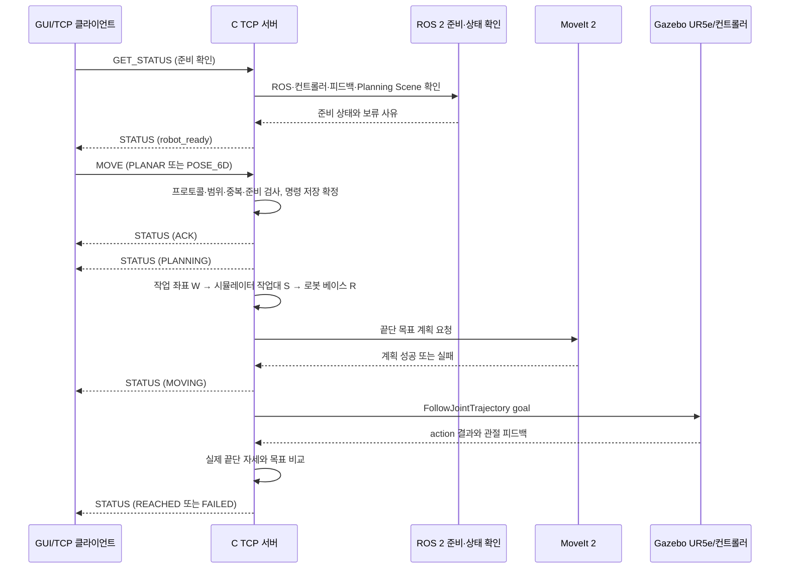

# C 담당 로봇 서버·시뮬레이션 상세설계

문서 버전 1.4 · 설계 초안 · 2026-11-11

| 버전 | 날짜 | 변경 |
|---|---|---|
| 1.1 | 2026-11-09 | 계획서 1.4(전체 7주) 기준의 이전 변경 이력. 이후 1.3에서 전체 5주 계획으로 대체 |
| 1.2 | 2026-11-09 | 계획서 1주차 C 작업과 문서 일정을 맞춤: Gazebo 월드 골격(작업대·부품·카메라 배치), UR5e 시험 목표 이동·관절 피드백, 시뮬레이션 RTF 측정 및 기록을 §8.1·§8.2·§11·§12에 명시. 기존 계획의 누락 설명을 보완하며 C 책임 범위는 확대하지 않음 |
| 1.3 | 2026-11-10 | 계획서 1.5(전체 5주)와 정합. **C 업무 증가:** 기존 TCP 서버를 그대로 유지하고, 신규 로봇 실행(경로 계획·실행, 충돌·관절 제한, 그리퍼·부착·Planning Scene, 컨베이어 실행, 분류 순서, 단일 명령 중재, 모드 전환, 정지·복구, 확장 명령 서버 수용·회귀)을 맡음(§1·§2·§11·§12·§13·§15). 1.1의 "6~7주 C 신규 업무 없음"과 C 서버 없는 확장 모드는 대체됨. 6D 기능은 후속(TCP 1.1 정의·구현 유지). main 1.2(PR #10)의 1주차 보완(월드 골격·시험 목표 이동·관절 피드백·카메라 Hz/RTF 측정·환경 기록, §8.1·§11·§12)은 그대로 보존하고 5주 일정의 1주차에 합침 |
| 1.4 | 2026-11-11 | 5주 계획과 신규 분류·사람 제어 요구에 맞춰 범위·모듈·시험·일정을 정합화. 실행 관리자·그리퍼·부착·벨트·분류·사람 제어·확장 명령을 구조에 반영하고, 기능별 상세 계약은 관련 설계 문서를 기준으로 연결. 기존 TCP 1.1 서버 설계 유지 |

| 항목 | 내용 |
|---|---|
| 담당 | C |
| 범위 | TCP 1.1 서버 유지와 ROS 2·MoveIt 2·Gazebo 기반 실행 통합. 1~3주차 컨베이어 분류, 4~5주차 사람 자세 제어의 로봇·그리퍼·벨트 실행, 단일 명령 중재, 모드 전환, 정지·복구 포함. 기능별 상세 계약은 §14의 기준 문서 참조 |
| 상위 기준 | [README](../../README.md), [시스템 아키텍처 및 프로젝트 계획](../architecture/시스템_아키텍처_및_프로젝트_계획.md), [TCP 프로토콜 명세서](../protocol/TCP_프로토콜_명세서.md) |
| 관련 인계 | A의 비전·자세·센서 입력, B의 규격·좌표·목표, D의 GUI·TCP 클라이언트·확장 명령 계약 |
| 신규 실행 | 컨베이어 분류(1~3주)·사람 자세 제어(4~5주)의 로봇 실행 담당(§15, [그리퍼·로봇 실행 상세설계](그리퍼_확장_상세설계.md)) |

이 문서는 C가 구현할 내부 구조와 작업 순서를 제안합니다. TCP 필드·상태·코드·저장 규칙은 TCP 프로토콜 명세서가 단일 기준이며, 이 문서는 이를 새로 정의하지 않습니다. 현재 저장소는 설계 단계이며 실제 서버·ROS 2 패키지·Gazebo 통합과 검증은 아직 수행되지 않은 것으로 전제합니다. 아래 모듈 이름은 구현을 위한 제안입니다.

## 1. 목적과 완료 범위

C의 목표는 기존 TCP 1.1 로봇 이동 서버를 유지하면서, 모든 팔·그리퍼·벨트 동작을 단일 실행 관리자로 중재하는 것입니다. C는 D의 명령과 A·B가 제공하는 유효 입력을 검증해 Gazebo의 UR5e 동작으로 실행하고, 시뮬레이션 피드백으로 도달·부착·배출·정지 결과를 확인합니다. 비전 검출·규격 판정·사람 의도 해석은 C 범위가 아닙니다.

최종 성공 상태 `REACHED`는 명령을 받았거나 궤적 실행이 성공했다는 뜻이 아닙니다. MoveIt 계획, 컨트롤러 실행, 최종 끝단 위치·방향 허용치 검사를 모두 통과했을 때만 반환합니다. 실패하거나 확인할 수 없으면 해당 실패 코드를 기록하고 `REACHED`로 처리하지 않습니다.

| 단계 | C가 제공할 기능 |
|---|---|
| 1~3주차 기존 TCP 서버(유지) | TCP 서버, 요청 검증·ACK·상태 조회·취소, ROS 2 준비 상태, 고정 높이 평면 접근 목표, UR5e 실행·도달 판정 |
| 1~3주차 컨베이어 분류 (신규) | 벨트·부품 풀·그리퍼 모델·제어기·실행 구성, 벨트 정지 확인, 부착 기반 집기·운반·배출, Planning Scene 전이, 분류 순서, 실패 격리·복구, 단일 명령 중재 |
| 4~5주차 사람 자세 제어 (신규) | 사전 동작 실행, 속도·범위 제한, 입력 유실 정지 판정, `HUMAN` 모드 전환·배타, 분류·TCP 1.1 회귀 |
| 후속 6D | 물체 기준점의 XYZ·쿼터니언 목표 변환, 6D 접근 자세 실행·도달 판정(TCP 1.1 정의 유지, 이번 5주 필수 아님) |

실제 로봇 구동, 접촉·마찰 기반 물리 파지, 움직이는 벨트 위 집기, 그리퍼 4종 교체, 다중 동시 이동은 범위에 포함하지 않습니다. 집기는 Gazebo 부착 기반 시연입니다(제안). 실행 관리자는 TCP 1.1 `MOVE`·분류·사람 제어를 포함해 한 번에 팔 명령 하나만 실행합니다. 분류·사람 제어·모드·확장 명령의 세부 동작은 기능별 상세설계를 기준으로 합니다.

## 2. 담당 경계와 인계

| 작업 | C의 책임 | 인계·협업 |
|---|---|---|
| TCP 서버 | LF 구분 JSON 수신, 프로토콜 검증, 상태 응답·알림, 중복 방지, 취소·재접속 처리 | D가 클라이언트와 GUI를 구현하고, A가 시험 시나리오·시험 도구를 제공 |
| 좌표 변환 | B가 제공한 작업대·로봇 베이스 변환과 접근 오프셋을 적용하고 단위·프레임을 점검 | B가 원점·축·프레임 이름·변환·물체 기준점을 확정 |
| 로봇 실행 | MoveIt 2 계획, 궤적 액션 실행·취소, Gazebo 상태 확인 | A가 Gazebo 카메라·월드·마커 모델을 연결, D가 GUI에서 상태 표시 |
| 도달 판정 | 관절 피드백으로 끝단 자세 계산, 목표 대비 위치·회전 오차 및 허용치 판정 | B와 평가 기준점·정답 좌표를 확인, A가 전체 평가를 취합 |
| 장애·복구 | 서버 측 로그·장애 주입 자료, 재시작 복구·수동 초기화 절차 | A와 장애 시험 및 로봇 정지 확인 협력 |
| 평가 | 서버 상태·지연·로봇 도달 오차와 실패 기록 제공 | A가 시험 실행·결과 취합, 각 담당은 자기 모듈 결함 수정 |

경계 원칙:

- C 서버가 비전 검출을 수행하거나 새 목표를 만들어내지 않습니다.
- A의 검출 성공만으로 이동을 시작하지 않습니다. 사용자 확정 후 D가 송신한 요청만 처리합니다.
- D는 서버 상태를 표시하며, 로봇 동작 상태 모델을 별도로 구현하지 않습니다.
- `ACK`는 명령 수락, `REACHED`는 시뮬레이션 끝단의 목표 도달 확인입니다.
- TCP 단절은 취소가 아닙니다. 서버가 이미 수락한 이동은 서버 정책에 따라 계속 처리합니다.

**신규 실행 경계.** C는 기존 TCP 서버의 연결·프레이밍·검증·ID·중복·ACK·STATUS·오류 응답·취소·단절·재시작 복구·서버 로그·회귀 시험을 독립 기능으로 유지하면서, 신규 로봇 실행을 맡습니다(§15). 확장 명령 계약(제안)은 D가 초안·클라이언트, C가 서버 수용·실행을 맡아 공동 확정하고 B가 의미·유효성을 협의합니다. TCP 1.1의 `MOVE`/`REACHED` 의미·상태·오류 코드·스키마는 바꾸지 않습니다. 이전 1.1의 "6~7주 C 신규 업무 없음"과 C 서버 없이 B가 실행하는 구조는 대체됐습니다.

## 3. 전체 처리 흐름



1. 서버 시작 후 로그를 검사·복구하고 ROS 2 의존성을 연결합니다.
2. 준비 조회 요청에는 현재 `robot_ready`와 `not_ready_reasons`를 응답합니다.
3. `MOVE` 수신 시 TCP 규약에 따른 형식·값·작업 범위·중복·슬롯·준비 검사를 수행합니다.
4. 명령을 등록하고 저장 확정한 뒤 `ACK`를 보냅니다.
5. 접근 목표를 계산하고 MoveIt 계획을 요청합니다.
6. 계획이 성공하면 상태를 `MOVING`으로 기록·저장 확정한 뒤 컨트롤러 액션을 실행합니다.
7. 실행 결과와 최신 관절 피드백을 확인해 끝단 자세를 계산합니다.
8. 위치·회전 오차가 도달 허용치 안이면 `REACHED`, 아니면 규약에 맞는 `FAILED`를 기록합니다.

## 4. 내부 구성과 배치 제안

ROS 2 패키지명은 `robot_server_package`로 정합니다. 저장소 실행 규칙을 확인한 뒤 아래처럼 책임 경계를 코드 모듈로 나눕니다. 파일 분리는 제안이며 launch·노드 배치는 A·C가 1주차에 확정합니다. 상세 상태 전이와 확장 명령 필드는 §14의 기능별 기준 문서를 따릅니다.

```text
robot_ws/src/robot_server_package/
├── package.xml
├── setup.py
├── setup.cfg
├── resource/robot_server_package
├── robot_server_package/
│   ├── tcp_server.py          # TCP 1.1 연결·LF 프레이밍·직접 응답
│   ├── protocol.py            # TCP 1.1 및 확장 명령 검증·변환
│   ├── command_manager.py     # TCP command_id·중복·기록 상태
│   ├── execution_manager.py   # 공용 단일 슬롯·모드 중재·정지·복구
│   ├── robot_backend.py       # MoveIt·컨트롤러·관절 피드백 어댑터
│   ├── gripper_controller.py  # 그리퍼 개폐·상태 확인
│   ├── attachment_manager.py  # Gazebo 부착과 Planning Scene 동기화
│   ├── conveyor_controller.py # 벨트 제어·정지 및 속도 확인
│   ├── sort_manager.py        # 분류 순서·도착 확인·격리 이벤트
│   ├── human_control.py       # 사전 동작·실행 제한·입력 유실 정지
│   ├── readiness.py           # 작업별 준비 상태와 보류 사유
│   ├── transforms.py          # B가 합의한 프레임·단위 변환
│   ├── reach_check.py         # 끝단 실제 자세와 목표 비교
│   ├── command_log.py         # TCP 명령 JSONL 저장·색인
│   └── recovery.py            # 시작 복구와 명시적 RECOVER 지원
├── config/                    # 패키지별 ROS 파라미터
├── launch/                    # 통합 실행 구성
└── test/                      # ROS 패키지 시험

config/robot/                  # 프레임·작업 범위·로봇·그리퍼 기준
config/conveyor/               # 벨트·상자·격리 설정
config/tcp/                    # 공통 TCP 설정
logs/                          # WSL2 ext4 로컬 실행 로그, Git 제외
tests/unit/                    # 프로토콜·변환·상태 전이 단위 시험
tests/integration/             # TCP·ROS·Gazebo 기능 통합 시험
tests/tcp/                     # TCP 1.1 회귀 시험
evaluation/results/            # 선별된 평가 자료
```

`execution_manager`가 로봇 동작의 유일한 진입점입니다. ROS 콜백을 동기 대기로 막지 않고, 소켓 수신·명령 상태 갱신·액션 결과 처리를 분리합니다. A/B의 앱 내부 공통 자료형 초안은 C 실행 자료형이나 확장 명령 계약을 정의하지 않으므로 혼합하지 않습니다.


## 5. 주요 내부 자료와 기준

아래 이름은 구현 편의를 위한 제안이며 TCP 필드·의미는 프로토콜 명세를 우선합니다.

| 내부 자료 | 포함 정보 | 주의점 |
|---|---|---|
| `CommandRecord` | command_id, 검증된 요청, 현재/마지막 알림 상태, stage/code, goal ID, 시각 | 로그의 저장 확정 여부와 메모리 상태를 혼동하지 않음 |
| `RobotReadiness` | 준비 bool, 보류 사유 목록, 검사 시각 | 추측이나 타이머로 준비 완료 처리하지 않음 |
| `RobotSnapshot` | controller 상태, action status 최신 여부, joint state와 시각, 현재 끝단 pose, Planning Scene 상태 | 오래되었거나 불완전한 피드백은 준비·도달 근거로 사용하지 않음 |
| `PoseGoal` | ROS 기준 끝단 목표 pose, 원본 command_id, 목표 프레임 | mm→m 변환은 경계에서 한 번만 수행 |
| `ReachResult` | 위치 오차 mm, 상대 회전 오차 도, 설정 허용치, 통과 여부 | controller 성공만으로 통과시키지 않음 |

좌표 변환의 기준은 계획서 §2.3입니다.

- TCP 작업 좌표 `W`의 위치 단위는 mm, 회전은 규약의 도/쿼터니언입니다. ROS 위치는 m입니다.
- 평면 모드는 작업대 기준 XY와 설정한 고정 접근 높이, 고정 끝단 방향을 사용합니다. 기본 정책에서 `theta_deg`는 표시·평가에 쓰고 로봇 yaw에는 적용하지 않습니다.
- 6D 모드는 물체 기준점 `O`의 `T_W_O`를 받습니다. 마커 자세 `T_W_M`을 물체 자세로 오인하지 않습니다.
- 접근 목표는 계획서 정의의 `T_R_E_goal = T_R_S × T_S_W × T_W_O × T_O_E_goal`을 적용합니다. 평면 모드도 합의된 작업대→로봇 변환을 거칩니다.
- 실제 프레임 이름, 변환 방향, 끝단 평가 기준점은 B와 1주차에 확정하며 임의 프레임 이름을 코드에 고정하지 않습니다.

## 6. 준비 상태와 이동 안전 조건

각 작업 진입 전에 해당 작업의 준비 조건을 검사합니다. TCP `MOVE`는 계획서 §2.4.5 및 TCP 명세를, 분류·사람 제어는 실행 설계 §8.3 및 기능별 상세설계를 따릅니다. 확인할 수 없는 항목은 준비 완료로 간주하지 않습니다.

| 확인 항목 | 준비 보류 예시 |
|---|---|
| 실행 슬롯이 비었는가 | `COMMAND_ACTIVE` |
| ROS 2·Gazebo 연결 및 `/clock` 진행 | `ROS_DISCONNECTED`, `SIM_PAUSED` |
| 궤적 컨트롤러가 활성인가 | `CONTROLLER_INACTIVE` |
| 최신 action status를 받았고 미종료 goal이 없는가 | `ACTION_STATUS_UNKNOWN`, `TRAJECTORY_ACTIVE` |
| 관절 피드백이 최신인가 | `FEEDBACK_STALE` |
| 제어 관절 속도가 정지 기준 안에서 유지되는가 | `NOT_STOPPED` |
| Planning Scene에 `workbench`가 등록됐는가 | `SCENE_NOT_READY` |
| 재시작 복구와 로그 상태가 정상인가 | `RECOVERING`, `RECOVERY_FAILED`, `LOG_UNAVAILABLE` |

모든 작업은 C 실행 슬롯을 점유합니다. TCP `ACK` 시 슬롯을 점유하고 종료 기록을 저장하며, 확장 작업은 실행 설계의 수락·상태 계약을 따릅니다. 슬롯은 실행 종료와 최신 정지 피드백을 확인한 뒤에만 해제합니다. 정확한 피드백 시간, 정지 속도, 확인 구간, 계획·컨트롤러·끝단 도달 허용치는 임의로 정하지 않습니다. 2주차 로봇 단독 시험으로 결정해 설정과 시험 기록에 남깁니다.

## 7. TCP 서버 구현 규칙

TCP 프로토콜 명세서 §2~§9를 그대로 구현합니다. 최소 구현 순서는 아래와 같습니다.

1. TCP 연결 수락 및 연결별 수신 버퍼를 둡니다.
2. UTF-8 JSON 바이트를 LF까지 누적하고, 완성된 줄만 처리합니다. 분할·병합 수신을 지원하며 연결이 끊길 때 미완성 마지막 조각을 버립니다.
3. 중복 JSON 키, 비표준 비유한 수, 정의되지 않은 필드, 스키마·의미·작업 범위 오류를 규약대로 거부합니다.
4. 직접 응답을 요청마다 정확히 하나 보냅니다. 요청의 직접 응답이 상태 알림보다 먼저 송신 대기열에 들어가게 합니다.
5. 명령별 잠금/원자적 상태 갱신으로 동일 ID의 상태가 되돌아가지 않게 합니다.
6. 중복 MOVE는 메모리뿐 아니라 저장 로그 색인에서도 검사합니다. 같은 ID·다른 내용은 `ID_CONFLICT`; 같은 내용은 새 실행 없이 저장된 상태를 응답합니다.
7. 한 개의 실행 슬롯을 유지합니다. 기존 ID 중복 확인은 `BUSY` 판정보다 먼저 합니다.
8. 명령 등록, `MOVING`, 종료 기록의 `flush`+`fsync` 저장 확정 규칙을 따릅니다. 종료 결과는 확정 후에만 알립니다.
9. TCP 연결 종료는 로봇 goal을 취소하지 않습니다. 취소는 기존 command_id의 `CANCEL`로 수행합니다.
10. 재접속 시 같은 명령 ID의 조회와 상태 구독을 지원합니다. 새 명령으로 자동 대체하지 않습니다.

서버가 1.1 초안 명세를 승인하기 전에는 그 초안의 승인 완료를 전제로 쓰지 않습니다. 구현을 시작하기 전에 C·D·A가 승인 여부와 미확정 구현 항목을 확인하고, 결정은 기준 문서에 반영합니다. 승인 후 패킷·상태 의미를 바꾸려면 명세서의 프로토콜 버전 변경 절차를 따릅니다.

## 8. ROS 2·MoveIt·Gazebo 연결

### 8.1 1주차에 실제 환경에서 확인할 것

- ROS 2 Jazzy, Gazebo Harmonic, MoveIt 2, `ros2_control`, UR5e 실행 구성과 시작 명령
- Gazebo 월드 골격에 작업대·부품·카메라가 배치되고 각 요소의 pose·크기가 의도한 기준과 맞는지
- UR5e 모델, planning group, planning frame, 제어 joint 이름, MoveIt이 움직이는 링크와 끝단 평가 링크
- 궤적 컨트롤러 실제 이름 및 `follow_joint_trajectory` 액션 연결
- controller_manager `list_controllers`, `/joint_states`, `/clock`, action status 토픽 연결
- Gazebo 상판과 카메라 거치대의 크기·pose를 확인하고 Planning Scene `workbench` 등록 경로
- 노드 재시작 뒤 action status 목록의 최신 값을 받을 수 있는지
- 액션 클라이언트에서 goal UUID를 사전 지정할 수 있는지
- Gazebo 카메라를 켠 상태에서 카메라 갱신률(Hz)과 시뮬레이션 실시간 비율(RTF)을 측정할 수 있는지

확인 결과를 `config/robot/` 설정과 실행 설명서에 기록합니다. 문서에 적힌 예시를 현재 실행 환경에서 확인된 값처럼 사용하지 않습니다.

1주차에는 확인에 그치지 않고 Gazebo 월드 골격을 준비하고 UR5e의 알려진 시험 목표 이동을 실행해 계획·컨트롤러 동작·관절 피드백을 확인합니다. 이 시험 이동은 최종 도달 성능 평가와 구분해 시험 조건과 결과를 기록합니다. Gazebo 카메라 갱신률과 RTF도 함께 측정하고, 렌더링 방식·해상도·갱신 설정을 결과와 함께 남깁니다.

### 8.2 목표 계획·실행

- 좌표 변환은 순수 계산 모듈에 두고, 단위·프레임을 확인할 수 있는 테스트 값을 먼저 준비합니다.
- MoveIt에 보낼 목표의 위치는 m, 방향은 정규화된 quaternion으로 맞춥니다.
- Planning Scene 등록 전에는 이동을 허용하지 않습니다. 작업대 충돌 박스는 실제 Gazebo 상판과 같은 위치·방향·크기로 두고, 카메라 거치대가 작업 공간에 있으면 충돌 대상으로 검토합니다.
- 계획 실패는 `PLAN_FAILED`, 실행 실패는 `EXEC_FAILED`, 끝단 허용치 초과는 `REACH_TOLERANCE` 등 TCP 명세의 코드·stage를 사용합니다.
- `MOVING` 기록과 goal ID 저장 확정 순서는 TCP 명세 §7.5 및 계획서 §2.4.5를 따릅니다. 기록이 확정되기 전에 궤적을 실행하지 않습니다.

### 8.3 취소와 실패

- `PLANNING` 중 취소와 계획 결과·궤적 전송의 경합은 TCP 명세 §7.7의 잠금 규칙을 따릅니다.
- `MOVING` 중 취소는 해당 action goal을 취소하고 최종 action 상태와 관절 정지를 확인합니다.
- 취소 요청 송신만으로 `CANCELLED`나 정지를 확정하지 않습니다. goal이 취소되기 전에 성공 완료되면 도달 검사를 수행할 수 있습니다.
- action 결과, 관절 피드백, ROS 연결이 끊기거나 오래되면 `REACHED` 금지, 상태 기록, 준비 보류를 적용합니다.
- 수동 복구가 필요한 불확실한 상태를 시간 경과만으로 자동 해제하지 않습니다.

## 9. 명령 기록과 재시작 복구

TCP 명세 §7.5~§7.8을 구현합니다.

- 로그는 WSL2 Linux 파일 시스템(ext4)의 저장소 `logs/` 아래 JSONL로 둡니다. `/mnt/c/...`에 명령 로그를 두지 않습니다.
- 최초 실행에서 로그 파일이 없는 것을 자동으로 정상 상태로 간주하지 않습니다. 설치 또는 로그 초기화는 명시적 C 절차로 수행합니다.
- 시작 시 전체 로그의 LF·JSON·필수 필드·순번 연속성을 검사하고, 모든 command_id 색인을 복구한 뒤 TCP 수신을 엽니다.
- 비종료 명령이 있으면 controller action 상태를 조사하고 goal 취소·정지 확인 절차를 수행합니다. 종료가 확정되지 않은 명령은 복구 완료 전 새 이동을 받지 않습니다.
- 로그 없음·손상·읽기 실패는 `RECOVERY_FAILED`로 유지하고, 수동 보관·정지 확인·명시적 초기화·재시작 절차를 따릅니다.
- 로그 파일을 삭제하거나 초기화하기 전에는 기존 파일을 보관하고, 사유·시각·확인 내용을 시험 기록에 남깁니다.
- 서버 로그에는 command_id, 상태 전이, stage/code/detail, 목표·변환 요약, goal ID, 저장 결과, 계획·실행·도달 시간과 측정 시계를 남깁니다. 비밀정보는 기록하지 않습니다.

## 10. 검증 시나리오와 완료 기준

실행 전 설계 체크리스트이며, 완료 상태를 뜻하지 않습니다.

| 영역 | 시나리오 | 기대 결과 |
|---|---|---|
| 프로토콜 | `test_vectors.json`의 c2s/s2c·중복 판정 사례 | 명세와 같은 수락·거부 코드 및 의미 |
| 프레이밍 | JSON 한 줄을 여러 조각으로 전송, 여러 줄을 한 번에 전송, 잘린 줄 뒤 연결 종료 | 완성된 줄만 순서대로 처리, 미완성 조각은 폐기 |
| 중복·경합 | 같은 ID·같은 내용 재전송, 같은 ID·다른 내용, 다른 ID 동시 MOVE | 재실행 없음, `ID_CONFLICT`, 단일 슬롯의 `BUSY` |
| 순서 | PLANNING→MOVING 경합 중 GET_STATUS 반복 | 같은 연결에서 상태 역행 없음, ACK가 PLANNING보다 먼저 |
| 준비 상태 | ROS 단절·시뮬레이션 정지·controller 비활성·오래된 피드백·Scene 누락 | `robot_ready=false`, 보류 사유 공개, 새 MOVE 차단 |
| 좌표 변환 | 계획서 §2.3의 알려진 단위 변환 시험과 축 방향 시험 | 기대 m·방향과 일치, 단위 변환 중복 없음 |
| 평면 이동 | 작업 영역 안 여러 XY 점에서 고정 높이 접근 | 계획·실행 후 독립 피드백 기준 도달 판정 |
| 6D 이동 | 서로 다른 높이·기울기의 물체 기준 pose | 접근 위치와 방향이 모두 목표 변환을 따름 |
| 도달 판정 | controller 성공이나 끝단 오차 초과, 오래된 joint state | `REACHED` 금지, 적절한 `FAILED`·사유 기록 |
| 취소 | PLANNING 중, MOVING 중, 완료와 취소가 겹치는 경우 | 명세의 실제 결과 기준 최종 상태, 정지 확인 전 재이동 금지 |
| 지속성 | ACK 직후·MOVING 중·REACHED 직후 강제 재시작, 로그 잘림·삭제 | 로그 복구·`SERVER_RESTARTED`/`RECOVERY_FAILED` 규약 준수 |
| 통신·장애 | 고유 명령 100회, 연결 단절·재접속·중복·잘못된 메시지 | ID 일치 ACK, 실패·재시도·서버 기록을 A 시험 결과와 대조 |
| 실행 중재 | TCP MOVE·분류·사람 제어 동시 요청 및 모드 전환 | 단일 슬롯만 실행, 허용되지 않은 전환 거부 |
| 분류 | 정지 확인·재검출·집기·도착·격리 및 복구 시나리오 | 기능 설계의 기대 상태, 잘못된 상자 집계·자동 재개 없음 |
| 사람 제어 | 입력 유실·오래된 입력·범위 초과 | 제한 적용, 정지 확인, 자동 재개 없음 |
| 회귀 | 확장 기능 통합 후 TCP 1.1 PLANAR 경로 재실행 | 기존 평면 경로·프로토콜 동작 유지, 결과 기록 |

완료 보고에는 기능 시연과 KPI 통과를 구분합니다. 계획 성공, controller 성공, 끝단 도달은 각각 다른 결과로 기록합니다. 도달 허용치와 시험 목표는 실측·파일럿 후 최종 평가 전에 확정하고, 미달 결과를 성공으로 바꾸지 않습니다.

## 11. 주차별 작업 순서

| 주차 | C의 작업 순서 | 주말 산출물 |
|---|---|---|
| 1주차 — 환경·월드·서버 골격 | A와 저장소·실행 방법·기본 틀 확인 → ROS/Gazebo/MoveIt/UR5e 실행 구성·프레임·controller 인터페이스 확인 → Gazebo 월드에 작업대·부품·카메라 배치 골격 구성(분류 장면의 벨트·부품 풀·상자·2지 그리퍼 모델 골격 포함) → UR5e 시험 목표 이동과 관절 피드백 확인 → Gazebo 카메라 갱신률(Hz)·RTF 측정 → 그리퍼 제어기·DetachableJoint 확인 → B와 좌표·로봇 프레임 합의 → D와 TCP 1.1 규약 확인, 확장 명령 계약 공동 초안 → 서버 골격에서 명세의 메시지·오류 코드 처리 착수 및 테스트 요청·응답 확인 → 실행 관리자 구조 | 환경·패키지 버전·실행 기록, Gazebo 월드 골격(분류 장면 포함), UR5e 시험 이동·관절 피드백 기록, 카메라 Hz·RTF 기록, 좌표·프레임 합의, TCP 서버 골격 및 테스트 응답, 그리퍼·부착 확인 기록, 실행 관리자 구조·계약 초안 |
| 2주차 — TCP·준비 상태·분류 통합 1 | LF 프레이밍·검증·중복·로그 구현 → readiness 조건과 Planning Scene 연결 → B의 평면 XY 및 좌표 설정 인계 → 고정 높이 목표 계획·실행 → A·D 통합시험과 응답 지연 측정 → 실행 관리자 기동·초기화, 벨트 정지 확인, 집기·운반·배출, Planning Scene 전이, 분류 순서 1차 | 평면 MOVE 통합 경로, 명령 로그, 준비 조회·거부·기본 실패 처리, 미해결 항목 기록, 분류 실행 1차 경로 |
| 3주차 — 분류 평가·안정화·중간 발표 | 고유 명령 100회·중복·재접속·취소·장애 시험에서 서버 로그 제공 → 위치별 목표·끝단 오차와 시간 분석 → 결함 수정·평면 회귀 → 재시작 처리 확인 → 분류 반복·실패 격리·복구, 분류 실행본 고정, 중간 발표 | 평면 로봇 도달 평가 자료, 서버 측 로그·장애 기록, 기본 실행 절차와 미달 사항, 분류 실행본 |
| 4주차 — 사람 제어 실행 | 사전 동작 정의·계획·실행 → 속도·범위 제한 → 입력 유실·오래된 입력 정지 판정 → `HUMAN` 모드 전환·배타 → 분류 회귀 | 사람 제어 실행 경로, 정지 시험 기록 |
| 5주차 — 반복·오류·회귀·발표 | A와 분류·사람 제어 반복 시험 → 오류·정지 복구 → TCP 1.1·분류·사람 제어 회귀 → 시연 환경 고정·실행 설명서 → 리허설·발표 | 실행 관리자 회귀 결과, 로그·실패 사례, 복구·실행 설명서 |

1~3주차에는 TCP 1.1 서버 유지와 §4의 분류 실행(모델·제어기·실행 구성, 벨트·집기·배출, 분류 순서, 중재)이 겹쳐 C의 부하가 가장 큽니다. 2주차 말 진척으로 범위를 다시 판정합니다(계획서 §12). 최종 발표는 5주차입니다. 평가 도구와 100회 시험의 실행·취합은 A가 주관합니다. C는 서버·로봇 기능, 서버 측 기록과 장애 주입 결과를 제공하고 관련 결함을 수정합니다.

## 12. 첫 주에 C가 바로 할 일

1. A에게 현재 기본틀, 실행 명령, 브랜치·파일 소유 규칙, 이미 결정된 API를 확인합니다. 기존 구조가 있으면 그 구조를 이어서 사용합니다.
2. 팀의 절차대로 WSL2에서 ROS 2 Jazzy, Gazebo Harmonic, MoveIt 2, UR5e 실행 구성을 확인합니다. 실패하면 단계와 오류를 기록해 공유합니다.
3. Gazebo 월드 골격에 작업대·부품·카메라를 배치하고, 크기·위치·방향이 계획한 기준과 맞는지 확인합니다.
4. UR5e에 알려진 시험 목표를 보내 계획·궤적 실행·관절 피드백이 연결되는지 확인합니다. 이는 시험 이동이며 최종 도달 평가와 구분해 기록합니다.
5. Gazebo 카메라 갱신률(Hz)과 시뮬레이션 RTF를 측정합니다. 해상도·갱신률·렌더링 방식도 결과와 함께 남깁니다.
6. B와 작업 좌표 W, Gazebo 작업대 S, 로봇 베이스 R, 끝단 E의 프레임·변환 방향·단위를 합의합니다.
7. D와 TCP 명세의 승인 상태, C 승인 범위 및 미확정값을 검토합니다. 규약 변경은 D·A와 기준 문서에 함께 반영합니다.
8. TCP 서버 골격에서 명세의 메시지·오류 코드 처리를 시작하고, D의 테스트 좌표로 접속·요청·ACK/STATUS 왕복을 확인합니다. 테스트 응답은 실제 이동 도달을 뜻하지 않습니다.
9. 확인한 환경·월드·시험 이동·카메라 성능·좌표 규약·서버 상태와 남은 항목을 팀에 공유합니다.
10. 분류 시나리오용으로 벨트·부품 풀·상자·2지 그리퍼 모델 골격과 그리퍼 제어기·DetachableJoint 동작(`<self_collide>`·인스턴스 구성)을 확인하고, 실행 관리자 구조와 확장 명령 계약 초안을 D와 정리합니다(§15, 그리퍼·로봇 실행 상세설계 §9). 확인 결과는 실제 집기·분류 성공을 뜻하지 않습니다.

## 13. 구현 전 결정·확인 목록

| 항목 | 결정·확인 담당 | 시점 |
|---|---|---|
| TCP 명세서 1.1 승인 여부 및 C 승인 항목 | C, D, A | 서버 프로토콜 구현 전 |
| launch·실행 구성·브랜치/파일 소유 방식 | A·C | 1주차 시작 |
| UR5e planning group/frame, 관절·끝단 링크, controller 실제 이름 | C | 1주차 환경 확인 |
| `T_S_W`, `T_R_S`, 접근 오프셋 `T_O_E_goal`, 프레임 방향 | B·C | 1주차 인터페이스 합의, 4주차 6D 전 갱신 |
| Gazebo 상판·카메라대 collision 및 Planning Scene 등록 | A·C | 1~2주차 통합 전 |
| goal UUID 생성 방식과 action status 최신값 수신 | C | 1주차 action 연결 |
| 피드백 최신성·정지 판정·취소·복구 timeout | C, A 확인 | 2주차 단독 시험 후 |
| 계획·컨트롤러·끝단 도달 허용치 3종 | C, B 검토 | 파일럿 후, 최종 평가 전 고정 |
| 로그 경로·명시적 초기화 실행 절차 | C | 첫 서버 구동 전 |
| A 통신 시험 도구와 C 서버 장애 주입 방법 | A·C, D 인터페이스 협력 | 2주차 통합 전 |
| 확장 명령 계약(전송·스키마·오류·ID·주기·타임아웃·취소·단절·중복) | D·C(B 협의) | 1주차 |
| 다른 모드에서 TCP 1.1 `MOVE` 거부 표현(기존 `BUSY`·`NOT_READY` 의미 내, enum 추가 금지) | C·D | 1주차 |
| 벨트·부품 풀·그리퍼 모델, 그리퍼 제어기, DetachableJoint 구성(`<self_collide>`·인스턴스 수) | C | 1주차 |
| 사전 동작 집합의 실행 가능성·속도 제한·입력 유실 정지 시간 | C(B·D 확인) | 4주차 1일차 |

## 14. 참고 문서

- [README](../../README.md) — 프로젝트 범위·역할·폴더 구조·실행 환경
- [시스템 아키텍처 및 프로젝트 계획](../architecture/시스템_아키텍처_및_프로젝트_계획.md) — 좌표 변환, readiness, MoveIt·controller·복구 기준
- [TCP 프로토콜 명세서](../protocol/TCP_프로토콜_명세서.md) — 메시지·상태·저장·재시작·취소의 단일 기준
- [그리퍼·로봇 실행 상세설계](그리퍼_확장_상세설계.md) — 집기·부착·중재·모드 전환·확장 명령 계약(C 실행 소유)
- [컨베이어 분류 상세설계](컨베이어_분류_상세설계.md), [사람 자세 제어 상세설계](사람_자세_제어_상세설계.md)
- [A 담당 비전 상세설계](A담당_비전_상세설계.md) — 입력·비전·통신 시험 협업 및 주차별 인계

## 15. C 실행 책임 요약

구현 책임을 요약합니다. 세부 계약의 기준은 [그리퍼·로봇 실행 상세설계](그리퍼_확장_상세설계.md)(이하 "실행 설계"), [컨베이어 분류 상세설계](컨베이어_분류_상세설계.md), [사람 자세 제어 상세설계](사람_자세_제어_상세설계.md)입니다.

| 기능 | C의 책임 | 기준 |
|---|---|---|
| 기존 TCP 서버(유지) | 연결·프레이밍·검증·ID·중복·ACK·STATUS·오류 응답·취소·단절·재시작 복구·서버 로그·회귀 시험 | TCP 명세서 1.1, 이 문서 §7~§9 |
| 모델·실행 구성 | UR5e + 2지 그리퍼, 벨트, 부품 풀, 상자의 모델·제어기·launch(외형 메시는 D, 치수는 B, 센서는 A) | 실행 설계 §2·§7.3 |
| 경로 계획·실행 | MoveIt 계획, 충돌·관절 제한, 끝단 허용치, 속도 배율 | 실행 설계 §6·§7 |
| 그리퍼·부착 | 간격 닫힘, 비접촉 확인 후 부착, Gazebo–Planning Scene 전이, 해제·열기 | 실행 설계 §7.2~§7.5 |
| 컨베이어·분류 순서 | 벨트 정지·실제 정지 확인·재가동, 재검출 대기, 집기·운반·배출·도착 확인, 실패 격리 | 컨베이어 분류 상세설계 §4·§5 |
| 단일 명령 중재·모드 전환 | 실행 슬롯, `IDLE`·`MOVE_TEST`·`AUTO_SORT`·`HUMAN` 전환 판정, 외부 goal 감지 | 실행 설계 §8.2·§8.3 |
| 정지·복구 | 실패·취소 종료 규칙, `HOLD_UNKNOWN`·`RECOVERY_REQUIRED`, 복구 재기동 | 실행 설계 §4.3·§8.3 |
| 사람 제어 실행 | 사전 동작 실행, 실행 제한, 입력 유실 정지 판정, 자동 재개 금지 | 사람 자세 제어 상세설계 §5 |
| 확장 명령 서버 | 확장 명령 수용·실행, 확장 서버 회귀 시험 | 실행 설계 §8.4 |

- 기존 TCP 서버 유지와 확장 서버·실행 관리자 구현이 겹치므로 회귀 부담이 늘어납니다. TCP 1.1 시험 벡터·통신 100회 회귀는 확장 기능을 넣은 뒤에도 다시 확인합니다.
- 런타임 시뮬레이션 피드백(부착 조건·도착 확인)은 실행 판정에만 쓰고 평가 정답과 구분합니다(실행 설계 §7.4).

이 문서는 설계 제안입니다. 코드 구현, 패키지 설치, 서버·Gazebo 실행, 로봇 이동 시험 및 성능 측정이 완료됐다는 의미가 아닙니다.
