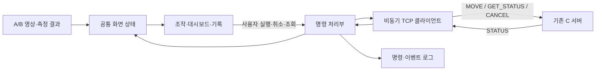

# 부록 A. GUI·대시보드·TCP 연결 및 로봇 외형 설계

2026-11-07 · 사용자 요청에 따른 추가 설계 초안 

2026-11-09 정합 수정: A 상세설계 1.4 §5.4의 비전 처리 오류·후보 무효화 이벤트를 표시·실행 가능 상태·송신 전 확정 스냅샷에 반영하고, ACK 대기 중 원래 목표에 적용되는 무효화가 오면 자동 재전송을 중단(TCP 명세서 §8.3 조건 2)(§A.3·§A.6·§A.8).

2026-11-09 정합 수정 2: 계획서 1.4의 전체 7주 계획(기본 5주 + 그리퍼 확장 2주)에 맞춰 6~7주 D 책임(4종 외형·선택/적용/검증 상태 GUI, 프로파일 설정 버전, 확장 명령·상태 규약, 기존 이동과 집기 요청의 공통 접수·실행 슬롯)을 §A.11에 추가하고 §A.1·§A.10의 5주 기준·C 확인 문구와 연결. 검토 반영으로 §A.11에 프로파일 준비·런타임 적용 상태 분리와 허용 동작, 기준/확장 실행 모드 표시를 추가. TCP 1.1은 변경하지 않음. 세부 계약은 [그리퍼 확장 상세설계](그리퍼_확장_상세설계.md).

## A.1 적용 기준

기준 문서는 사용자 제공 `PROJECT09_5주계획_아키텍처_v1.1_GitHub.md`이다. 이 부록은 원문을 수정하지 않고 **D(사용자)의 GUI·대시보드·TCP 클라이언트 및 로봇팔·그리퍼 외형 설계**를 구체화한다. 사용자의 추가 지시로 로봇 외형 설계를 D의 GUI 담당 산출물에 포함한다(§A.10). 원문 본문의 역할표와 로봇 구성·5주 일정·평가 기준·메시지 스키마·오류 코드·재시도 정책은 변경하지 않으며, 기존 기구·제어 담당과 외형 전달 경계를 구분한다. 이전 Codex v1.2에서 수정한 본문을 이 부록의 기준으로 사용하지 않는다.

TCP 버전은 원문의 `1.1`이며 새 명령·필드·상태를 추가하지 않는다. 아래 화면 배치와 앱 내부 구성은 설계 제안이고, 원문에 없는 연결 값·시간 한계·데이터 경로는 미정으로 남긴다. 원문과 해석이 겹치면 원문 해당 절을 먼저 확인한다.

현재 팀 계획은 [프로젝트 계획](../architecture/시스템_아키텍처_및_프로젝트_계획.md) 1.4의 전체 7주(기본 5주 + 그리퍼 확장 2주)다. §A.1~§A.10의 "원문 5주 일정" 표현은 1~5주 기본 범위를 가리키며, 6~7주 확장의 D 업무는 §A.11에서 다룬다. 확장 집기 명령은 TCP 1.1에 넣지 않고 별도 제안 계약으로 정의한다.

## A.2 GUI 화면 구성

사용자 지정 [PickWiz V1.8.2 비전 설정 화면](https://docs.dexforce.com/PickWiz/V1.8.2/qlzr643s/)과 [생산 화면](https://docs.dexforce.com/PickWiz/V1.8.2/2klk147j/)에서 확인한 큰 영상 영역, 오른쪽 설정, 아래 로그, 상단 상태·지표 배치를 참고한다. 어두운 중성 배경과 파란 선택 강조를 사용하며 제품의 상표·이미지·아이콘을 앱 자산으로 복제하지 않는다.

원문 §2.1·2.5의 PySide6/WSLg 앱 안에서 `조작·설정 / 운영 대시보드 / 평가·기록`으로 화면을 구성한다. 영상·통신·명령 상태는 화면 간 공유한다. 같은 앱 안에서 탭을 바꾸어도 연결이나 진행 중 명령이 초기화되지 않는다. 조작·설정 안에는 §A.10의 로봇 외형 미리보기·모델 정보 패널을 함께 둔다.

### A.2.1 사용자 지정 GUI 필수 화면 — 4항목

사용자가 명시한 아래 목록은 **필수 요구사항**이다. 조작·설정 기본 화면에 네 항목을 함께 배치하며, 운영 대시보드·평가 화면·로봇 외형 패널을 추가하더라도 이를 대체하거나 생략하지 않는다.

1. **영상 · 검출 ROI · 장축 방향 화살표**
2. **px·mm 좌표와 회전각 표시**
3. **가상 로봇 송수신 기록**
4. **캘리브레이션 상태 표시**

| ID | 필수 항목 | 표시·동작 기준 | 검수 기준 |
|---|---|---|---|
| GUI-01 | 영상 · 검출 ROI · 장축 방향 화살표 | 현재 영상 위에 검출 ROI·중심·장축 방향 화살표를 겹쳐 표시. 같은 source_id·image_seq의 결과를 사용 | 유효 검출은 ROI와 화살표가 해당 물체/프레임에 대응. 무검출·방향 불가이면 사유를 표시하고 이전 화살표를 현재 결과로 남기지 않음 |
| GUI-02 | px·mm 좌표와 회전각 표시 | 같은 검출 중심의 `(u, v) px`, 작업 좌표 W의 `(X, Y) mm`, 작업평면 장축각 `θ (°)`를 구분해 함께 표시. POSE_6D에서는 px 표시를 유지하고 XYZ/3D 회전 표시를 추가 | 영상 확대/축소만으로 px 측정값이 바뀌지 않음. A/B가 제공한 같은 프레임/보정의 수치와 일치. 보정 불가·결과 무효이면 mm/θ를 유효 수치처럼 표시하거나 전송하지 않음 |
| GUI-03 | 가상 로봇 송수신 기록 | `TX/송신`의 MOVE·GET_STATUS·CANCEL과 `RX/수신`의 STATUS를 구분. 시각·command_id(있는 경우)·목표/응답 내용·상태·오류를 표시하고 기록 | 명령/응답을 ID로 추적 가능. 미전송·송신 처리·ACK 수락·REACHED 도달을 혼동하지 않음. 상세 기록에서 실제 송수신 필드를 확인 가능 |
| GUI-04 | 캘리브레이션 상태 표시 | calibration_id와 현재 소스·해상도·크롭의 적용 상태를 텍스트로 표시. `미설정 / 확인 중 / 유효 / 불일치 / 오류`와 확인된 사유를 구분 | 유효 확인 전 MOVE 차단. 불일치/오류를 색상만으로 표시하지 않으며 프로파일 변경 시 이전 결과 무효화. 유효한 px 검출은 보정 불가 상태에서도 표시 가능 |

`GUI-04`의 상태 문구는 GUI 로컬 표시이며 TCP state/code에 추가하지 않는다. 캘리브레이션 계산·재보정 마법사, ROI 편집기, 새 로봇 명령을 이 목록에 자동 추가하지 않는다.

**좌표·화살표의 해석**

- px는 화면 위젯의 확대/축소 픽셀이 아니라 A/B가 정의한 영상 좌표의 검출 중심이다. 원본/크롭/왜곡보정 영상 중 기준이 무엇인지, 원점·축 방향과 해상도를 함께 명시한다. 표시 영상과 기준 영상이 다르면 해당 좌표 매핑으로 오버레이를 정렬한다.
- mm는 같은 검출 중심을 보정해 얻은 작업 좌표 W이다. θ는 W 기준의 180° 주기 장축각 `0 ≤ θ < 180°`이며, 0° 기준축과 양의 회전 방향은 B의 좌표 규약을 표시한다. 영상에서 보이는 각도를 그대로 작업평면 각도로 사용하지 않는다.
- 화살표는 장축 방향을 나타내며 물체의 앞뒤, 이동 방향 또는 회전 동작을 뜻하지 않는다. 보정된 장축을 영상에 표시할 때는 영상 좌표로 대응시킨 방향을 사용한다. 동일 장축의 θ와 θ+180°를 다른 물체 방향으로 판정하지 않는다.
- 보정 전/불일치 또는 해당 결과가 무효이면 mm/작업평면 θ는 `— (보정 필요)` 또는 확인된 무효 사유로 표시한다. 0으로 채우지 않고 이전 유효값을 현재값처럼 표시하지 않는다. 영상/px 검출이 유효한 경우 그 정보는 계속 확인할 수 있다.
- 6D에서 평면 θ를 3D 방향의 대용으로 쓰지 않는다. 기존 XYZ/쿼터니언 표시 및 각도로 표현할 때의 축·회전 순서 규칙을 따른다. px 내부 데이터 전달 필드명과 보정 상태 판정 결과의 연결은 A/B/D가 확인하며, 로봇 MOVE에 px 필드를 새로 넣지 않는다.

```text
PROJECT09  [조작·설정] [운영 대시보드] [평가·기록]  [정지/취소]
입력 소스 · PLANAR/POSE_6D · 보정 ID │ TCP 연결 │ 로봇 준비 여부
┌────────────────────────────────┬────────────────────────┐
│ 원본 영상 / 검출 결과           │ 입력·보정 설정         │
│ ROI·중심·장축 화살표 / XYZ 축   │ px(u,v)·mm(X,Y)·θ(°)  │
│ source_id · image_seq · 경과시간│ 보정 상태·무효 사유     │
│                                │ [현재 목표로 이동]     │
├────────────────────────────────┼────────────────────────┤
│ 가상 로봇 TX/RX·이벤트 기록     │ 확정한 명령 목표       │
│ 시간·명령 ID·송수신 내용·오류   │ ACK→계획→이동→도달    │
└────────────────────────────────┴────────────────────────┘
```

### 조작·설정

| 영역 | 표시·조작 | 데이터 기준 |
|---|---|---|
| 입력 | 소스·모드·해상도·크롭·보정 프로파일 | 원문 §2.2 공통 프레임과 소스별 보정 |
| 영상 | 원본/검출 보기, 검출 ROI·윤곽·중심·장축 방향 화살표, 6D XYZ 축 | GUI-01. 표시 영상의 image_seq에 대응하는 검출·추정 결과 |
| 현재 측정 | `(u,v) px`와 PLANAR의 `(X,Y) mm·θ(°)` 병기. POSE_6D의 XYZ/쿼터니언 추가, 유효·무효 원인 | GUI-02. A/B 모듈의 같은 대상·프레임 결과. GUI가 좌표 추정을 별도로 수행하지 않음 |
| 가상 로봇 송수신 기록 | TX/MOVE·GET_STATUS·CANCEL, RX/STATUS, 시각·ID·내용·상태·오류 | GUI-03. 실제 송수신 기록과 로컬 전송/미전송 상태 구분 |
| 캘리브레이션 상태 | 프로파일 ID·적용 조건·미설정/확인 중/유효/불일치/오류·사유 | GUI-04. 보정 유효 확인 전 mm/θ 기반 이동 차단 |
| 실행 | 현재 목표 재검증·사용자 확정·MOVE 1건 | 원문 §2.1 및 §2.4.1 |
| 확정 목표 | 전송한 목표·command_id·source_id·image_seq·calibration_id | 실제 송신한 명령 스냅샷. 이후 새 검출값과 분리 |
| 정지/취소 | 진행 명령 CANCEL, 미전송·확인 중·결과 표시 | 원문 §2.4.4. 모든 화면에 계속 표시 |
| 연결 설정 | 호스트·포트, 접속/연결 해제, 접속 결과 | WSL 내부 127.0.0.1 및 팀 설정 포트 |
| 로봇 외형 | 미리보기·모델 이름/버전·적용 확인 상태 | D의 외형 산출물, C와 확인한 Gazebo 적용 기록. 실시간 자세와 구분 |

연결 해제나 GUI 종료는 로봇 정지를 보장하지 않는다. 진행 중 명령이 있으면 해당 사실과 마지막 확인 상태를 화면에 표시한다. 종료/단절을 `CANCELLED`로 바꾸지 않는다.

### 운영 대시보드

상단에는 입력 소스, TCP 연결, `robot_ready`, `not_ready_reasons`, `active_command_id`를 놓는다. 중앙은 영상·최근 측정과 현재 명령 진행 상태, 오른쪽은 최근 오류·알람, 아래는 명령별 기록으로 구성한다.

- 고유 명령의 최초 ACK, REACHED, FAILED, 거부, 수락/실행 미확인을 각각 집계한다.
- 재전송 횟수와 재전송으로 복구된 ACK를 정상 최초 ACK와 구분한다. GET_STATUS로 복원한 과거 ACK도 최초 수락 ACK 지표에 다시 더하지 않는다.
- ACK는 수락이며 이동 완료가 아니다. `FAILED`도 새 이동 가능을 뜻하지 않는다.
- 서버가 아직 제공하지 않은 값은 `미측정` 또는 `연계 미정`으로 표시한다. 0으로 채우지 않는다.
- 명령 상태·통신 연결·로봇 준비 여부는 별도 항목으로 표시한다.

### 평가·기록

원문 §7·§10의 평가를 화면에 표시하는 기능이며 평가 목표나 표본 수를 변경하지 않는다.

| 표시 | 구분 원칙 |
|---|---|
| 시험 선택 | 시험 ID·소스·모드·설정/데이터 버전·표본 수 |
| 통신 | 고유 최초 ACK·재전송·거부·미확인·실패 분류 |
| 시간 | 처리 시작→로컬 송신, GUI 실행→ACK, ACK→최종, 촬영→수신을 분리 |
| 평가 결과 | 원문 정의의 비전 추정·로봇 실행·전체 오차. 정답/결과가 있는 시험만 표시 |
| 내보내기 | 현재 선택한 시험의 명령/이벤트·결과 CSV. 화면과 같은 원시 기록 사용 |

서로 다른 시계의 숫자를 직접 빼서 지연을 계산하지 않는다. `PC_RECEIVE`는 촬영 시각이 아니므로 촬영→수신 지연을 포함했다고 표시하지 않는다. 로그 화면 비우기는 표시만 지우고 평가·감사 기록 파일을 삭제하지 않는다.

## A.3 표시값과 갱신 규칙

| 데이터 | 화면 갱신 방법 |
|---|---|
| 영상 | 최신 프레임 우선. 오래된 화면 대기열을 쌓지 않고 프레임 순번·소스를 표시 |
| 측정값 | px·mm·회전각을 같은 대상·source_id·image_seq·calibration_id로 매칭. 늦게 온 다른 소스/보정 결과를 새 화면에 적용하지 않음. 단위·기준 프레임을 표시 |
| 캘리브레이션 상태 | 소스·해상도·크롭·프로파일 변경 시 이전 유효 표시/결과를 무효화. 확인된 적용 결과와 사유만 표시 |
| 비전 처리 오류·후보 무효화 | A의 후보 무효화 이벤트(A 상세설계 §5.4: 모델 로딩 실패·설정 오류·추론 예외·작업 중단·세대 변경)를 받으면 현재 측정의 실행 가능 상태와 아직 송신하지 않은 확정 스냅샷을 무효로 바꾸고 원인을 표시. 관측 결과가 오지 않은 실패도 이 이벤트로 반영. 이벤트의 세대가 현재보다 오래됐거나, 같은 세대에서 오류 작업보다 나중에 시작한 작업(`job_seq`가 큼)의 결과에는 적용하지 않음. 오류 이후 시작한 작업의 정상 결과가 실행 전 검사를 통과할 때까지 실행 버튼을 다시 켜지 않음 |
| 송신 목표 | 실행 직전 확정한 값으로 보관. 최신 측정 갱신과 독립 |
| 명령 상태 | C의 STATUS를 command_id에 맞춰 적용. 정상 진행·실패·거부를 구분 |
| 준비 상태 | STATUS의 robot_ready·사유·active_command_id 사용. TCP 연결만으로 준비 완료 처리 금지 |
| 도달 오차 | 원문에 있는 reach_error를 REACHED/REACH_CHECK 실패 때 표시 |
| 실제 관절·현재 끝단 자세 | 원문 §3은 C의 피드백/FK를 기준으로 하지만 §2.4에는 전달 필드가 없음. 전달 경로 합의 전 GUI 수치·차트를 약속하지 않고 `연계 미정` 표시 |

원문의 ROS 영상·Gazebo 화면을 그대로 활용하며 별도 3D 엔진/관절 제어 경로를 이 부록에서 요구하지 않는다. 영상 소켓을 로봇 명령 TCP에 추가하지 않는다.

## A.4 GUI와 통신의 내부 연결

아래 구성은 **앱 내부 설계**이며 TCP 메시지 이름이나 담당 역할의 변경이 아니다.



| 구성 | 책임 | 구현 후보 |
|---|---|---|
| 화면 | 영상/숫자/버튼/상태 표시, 사용자 입력 | PySide6 위젯·탭·분할 패널 |
| 공통 상태 | 현재 측정, 확정 명령, 연결/준비/명령 상태를 분리 보관 | 앱 내부 상태 객체와 신호 |
| 명령 처리부 | 실행 전 검사, ID 발급, 동일 명령 재시도/조회·취소의 상태 관리 | Qt 신호/슬롯과 QTimer 기반 처리 후보 |
| TCP 클라이언트 | 접속·부분 송수신·LF 버퍼·JSON 처리·오류 통지 | QTcpSocket 비동기 API 후보 |
| 입력 작업 | 영상 수신·처리 결과 전달 | 원문 입력 모듈과 연결. GUI 스레드에서 무거운 처리 금지 |
| 기록 | 송수신·상태 전이·오류·측정 ID 기록/CSV | 파일 기반 기록. 별도 DB 추가 없음 |

GUI 이벤트 루프에서 blocking recv/connect/sleep로 기다리지 않는다. TCP 연결은 한 곳에서 소유하고 대시보드는 같은 상태를 읽는다. QTcpSocket을 별도 작업 스레드에 둘 경우 생성·접속·사용·종료를 동일 소유 스레드에서 처리하는지 구현 시 확인한다. 이 문서에서 스레드 수나 갱신 주기를 확정하지 않는다.

## A.5 TCP 접속과 송수신 설계

### 연결 순서

1. 원문 설정의 호스트·포트를 읽고 비동기 접속한다. 잘못된 주소/포트는 원인과 함께 표시한다.
2. 소켓 연결 성공 시 GUI의 TCP 상태만 `연결됨`으로 바꾸고, 로봇 준비는 `조회 중`으로 둔다.
3. `command_id` 없는 GET_STATUS로 준비 상태를 확인한다. 추적 중인 이전 명령이 있으면 그 ID의 GET_STATUS도 수행한다.
4. STATUS를 검증해 준비/명령 상태를 적용한다. 준비 응답이 없거나 해석되지 않으면 이동을 활성화하지 않는다.
5. 명령의 push STATUS를 처리한다. 필요한 조회의 주기/timeout은 팀 합의값을 사용하며 새 heartbeat 명령을 만들지 않는다.

접속 중/연결됨/재접속 중/조회 중 등의 문구는 GUI 로컬 상태다. 서버의 `state` enum에 추가하지 않는다.

### 메시지 경계

- 원문대로 UTF-8 JSON 한 객체에 LF 하나를 붙인다. 한 write가 전체 송신 완료나 ACK를 뜻하지 않는다.
- **로컬 송신 완료 계측 제안:** 연결별 송신 큐에서 각 JSON+LF의 바이트 구간을 기록하고, `bytesWritten` 누계가 해당 메시지의 끝까지 도달한 시각을 D의 단조 시계로 남긴다. 부분 write·다른 조회 메시지·각 재시도는 자기 바이트 구간으로 구분한다. Qt는 소켓에 쓰인 바이트를 알리는 신호를 제공하므로 이를 이용하는 설계이며, 서버의 수신/수락은 ACK로 별도 확인한다. P95의 원문 목표는 바꾸지 않는다. [Qt QAbstractSocket](https://doc.qt.io/qtforpython-6/PySide6/QtNetwork/QAbstractSocket.html), [Qt QIODevice.bytesWritten](https://doc.qt.io/qtforpython-6/PySide6/QtCore/QIODevice.html#PySide6.QtCore.QIODevice.bytesWritten)
- 수신 바이트를 버퍼에 누적하고 LF까지 완성된 줄만 분리해 UTF-8/JSON으로 해석한다. 분할된 UTF-8 문자와 마지막 미완성 줄은 다음 수신까지 보관한다.
- 한 번의 수신에 여러 줄이 있으면 순서대로 처리한다. 연결이 종료되면 남은 미완성 조각은 그 연결의 오류 기록으로 남기고 새 연결 데이터와 합치지 않는다.
- 메시지 종류/버전·필드·수치 등을 원문 계약으로 검증한 뒤 UI 상태에 적용한다. 잘못된 응답을 `REACHED`나 준비 true로 보정하지 않는다.
- 줄 길이/전체 버퍼 상한과 미완성 메시지 timeout은 C/D가 합의할 값이다. 무한 대기열을 허용하는 설계로 두지 않으며 임의 숫자를 팀 확정값으로 넣지 않는다.

### 기존 메시지의 사용

| 요청/응답 | 사용 조건 |
|---|---|
| MOVE | 사용자가 유효 목표를 확정하고 준비 확인 후 신규 UUID v4로 1건 |
| GET_STATUS, ID 없음 | 새 이동 가능 여부 조회 |
| GET_STATUS, ID 있음 | 해당 명령의 진행/최종 상태 확인·재접속 복구 |
| CANCEL | 정지 버튼으로 기존 command_id 대상 요청. 취소용 신규 ID를 발급하지 않음 |
| STATUS | 원문 state/code·준비/보류·활성 명령·reach_error를 각각 반영 |

MOVE의 필드·단위는 원문 §2.4.1을 사용한다. 공통 필드는 `version`, `type`, `command_id`, `mode`, `frame`, `source_id`, `image_seq`, `timestamp_ms`, `timestamp_base`, `calibration_id`, `valid`, `position_mm`이다. PLANAR는 `theta_deg`, POSE_6D는 `orientation_xyzw`를 사용한다. 새 hello, joint 명령, 별도 좌표 단위 또는 프로토콜 버전은 도입하지 않는다.

## A.6 실행·취소·재접속의 GUI 흐름

### 목표 실행

1. 사용자 조작 시 현재 화면의 목표와 source_id/image_seq/calibration_id·모드·시간 기준을 하나의 스냅샷으로 고정한다.
2. 원문 §2.2에 따라 보정/해상도/크롭·유효 시간·유효성을 검사한다. 사용자 실행 직전 원래 결과가 여전히 유효한지 다시 확인한다.
3. 무ID GET_STATUS로 robot_ready를 확인한다. 조회 이후에도 서버 상태는 바뀔 수 있으므로 최종 수락은 서버 ACK/거부를 따른다.
4. 준비 조회 응답을 받은 뒤 실제 MOVE 송신 직전에 그 스냅샷의 유효 시간·소스·보정과, 확정 이후 그 스냅샷에 적용되는 A의 후보 무효화 이벤트(§A.3)가 없었는지 다시 검사한다. 준비 조회 응답을 기다리는 동안 무효화되었다면 응답이 `robot_ready = true`여도 송신하지 않는다. 대기 중 만료/변경되었으면 송신하지 않고 새 검출 결과로 자동 대체하지 않는다. 유효한 경우 신규 UUID v4와 스냅샷을 보관해 MOVE를 보낸다. 대기 중 연속 클릭으로 새 명령이 쌓이지 않게 한다.
5. `ACK → PLANNING → MOVING → REACHED` 또는 `FAILED`를 표시한다. 화면 렌더 완료나 socket write 완료를 ACK로 세지 않는다.
6. 명령 종료 후에도 원문 준비 조건이 충족되어야 새 목표 실행을 허용한다.

### 오류와 연결 변화

| 조건 | 화면·클라이언트 처리 |
|---|---|
| ACK timeout, 같은 연결/원래 유효 목표 | 원문 §2.4.4대로 같은 ID/내용으로 기본 추가 최대2회 재전송. 횟수/시간은 설정값 |
| 원래 목표 만료·소스/보정 변경·seek·원래 목표에 적용되는 비전 무효화 | 자동 재전송 중단, `수락 미확인`. 새 ID 자동 발급 금지. 비전 무효화의 적용 여부는 A 상세설계 §5.4 규칙(세대·`job_seq`)으로 판단 |
| 비전 처리 오류(후보 무효화 이벤트) | 아직 송신하지 않은 확정 스냅샷은 송신하지 않고 `비전 오류로 송신 안 함`과 원인 표시. 첫 MOVE를 보낸 뒤 같은 연결에서 ACK를 기다리는 중이면, 원래 목표에 적용되는 무효화일 때 ACK 타이머가 끝나도 MOVE를 추가 전송하지 않고 수락이 확인되지 않았으면 `수락 미확인` 표시(TCP 명세서 §8.3 조건 2). 새 command_id를 자동 발급하지 않음. 이미 송신한 명령의 기록·원본 바이트·ID와 서버 상태 수신·GET_STATUS 조회 경로는 유지하고, 늦게 온 같은 ID의 ACK·STATUS는 정상 반영. 자동 CANCEL·자동 FAILED 표시·검출 방식 자동 전환은 하지 않음. 원래 목표와 무관한 이전 세대·이전 작업의 지연 오류로는 재전송 조건을 바꾸지 않음 |
| BUSY/ID_CONFLICT/NOT_READY, state 없음 | 거부 이유 표시. 진행 중 원래 명령의 state를 FAILED로 덮지 않음 |
| TCP 단절 | 결과 미확인·마지막 명령 표시. 수락한 동작이 계속될 수 있음을 표시 |
| 재접속 | MOVE 재전송 없이 GET_STATUS. 응답에 따라 기존 명령 표시 |
| UNKNOWN_COMMAND | `명령 기록 없음 · 실행 여부 미확인`. 무ID 준비 조회 true + 사용자 현재 목표 재확정 후에만 새 ID |
| CANCEL_UNCONFIRMED/RECOVERY_FAILED | 확인 불가·수동 복구 필요 표시. 준비 false 동안 새 이동 차단 |

원문 §7의 재접속 후 같은 MOVE를 보내는 시험과 §2.4.4의 운영 재접속 정책은 해석 확인 대상으로 남긴다. **GUI 운영 경로는 §2.4.4의 GET_STATUS-only를 그대로 따르며**, §7 시험을 GUI의 자동 재전송 기능으로 구현하지 않는다. 원문 문구는 수정하지 않는다.

### 취소

정지/취소 버튼은 항상 보인다. 취소 대상 command_id가 없으면 실행 불가 상태와 이유를 표시한다. TCP 연결 시 대상 명령 ID로 CANCEL을 보내고 `요청 전송 → 종료·정지 확인 중 → 결과`를 표시한다. 수락/계획 중 계획 폐기와 실행 중 goal 종결·관절 정지 판단은 원문 서버 동작을 따른다. GUI는 취소 요청 전송만으로 정지 완료를 표시하지 않는다.

TCP가 끊겨 있으면 `연결 끊김 — 취소 요청을 보낼 수 없음`, 누른 요청은 `미전송`으로 표시한다. 재접속 후 자동 전송하지 않고 GET_STATUS로 확인한 뒤 사용자 확인을 거쳐 요청한다. 종료된 명령의 상태를 임의 변경하지 않는다. 소프트웨어 취소 버튼을 실물 비상정지 장치로 표현하지 않는다.

## A.7 로그와 설정 항목

클라이언트 로그에는 command_id·source_id·image_seq·calibration_id·모드, 사용자 실행·송신·수신 시각과 해당 시계, 시도 횟수, state/stage/code/detail, 준비/활성 명령, 최종 결과를 연결한다. 계산한 지연의 시작/끝 이벤트를 함께 기록한다. 서버 단조 시각은 별도 값으로 보관한다. 카메라 주소의 인증정보·비밀은 로그에 노출하지 않는다.

필수 화면 GUI-03에는 송신(TX)/수신(RX) 방향, MOVE/GET_STATUS/CANCEL/STATUS 종류, 실제 요청·응답 필드의 상세 내용을 기록한다. MOVE 목표와 수신 STATUS의 state/code/detail·reach_error(제공된 경우)를 확인할 수 있어야 한다. 무ID 준비 조회에는 command_id를 임의로 만들지 않고 `준비 조회`로 표시한다. 명령 생성·전송 시도·로컬 송신 완료·서버 수락을 별도 사건으로 취급하며, 실패/미전송/수신 미확인을 성공 기록으로 보정하지 않는다. TCP 바이트 스트림 전체나 비밀정보를 무조건 저장하라는 요구는 아니다.

설정에는 원문 endpoint, ACK/상태조회 관련 대기값, 재전송 상한, 입력 소스별 유효 시간과 보정 정보를 연결한다. **포트·시간값·프레이밍 상한을 이 부록에서 임의 확정하지 않는다.** 변경 중 이전 목표 무효화와 실행 직전 검사 규칙은 원문을 따른다.

## A.8 GUI·TCP 연결 검증 항목

아래는 구현 후 확인할 설계 검증 목록이다. 실행 결과가 아니며 원문 시험·평가 기준을 대체하지 않는다.

| 확인 항목 | 기대 결과 | 현재 |
|---|---|---|
| GUI-01 영상·ROI·장축 화살표 | 기본 화면에서 함께 확인, 같은 대상/프레임과 정렬. 무검출/방향 불가 때 이전 화살표 제거·사유 표시 | 미실행 |
| GUI-02 px·mm·회전각 | 유효한 같은 결과의 단위/좌표계별 값 병기, 화면 확대에도 px 유지. 보정 불가이면 mm/θ 미사용·MOVE 차단 | 미실행 |
| GUI-03 가상 로봇 송수신 기록 | TX/RX·종류·시각·ID·내용/결과 확인, ACK와 도달 구분, 무ID 조회·미전송/미확인 구분 | 미실행 |
| GUI-04 캘리브레이션 상태 | 미설정/확인 중/유효/불일치/오류와 사유 표시, 잘못된 프로파일에서 실행 차단, 변경 시 이전 결과 폐기 | 미실행 |
| 최초 접속·준비 조회 | TCP 연결과 robot_ready가 별개로 표시 | 미실행 |
| 영상·측정 매칭 | 소스/순번/보정이 맞고 이전 결과가 새 화면을 덮지 않음 | 미실행 |
| 정상 MOVE | 사용자 확정 1회→UUID 1개→원문 상태 전이 | 미실행 |
| 무효·만료·보정 불일치 | 송신 전 차단·원인 표시 | 미실행 |
| 정상 결과 뒤 추론 예외 | 원본 프레임 유효 시간 안이어도 실행 버튼 비활성·원인 표시. 관측 결과 없이 무효화 이벤트만 와도 적용 | 미실행 |
| 같은 프레임 재처리 실패 | 이전 세대 결과가 실행 가능 상태로 되살아나지 않음 | 미실행 |
| 준비 조회 대기 중 비전 오류 | 무효화 이후 `robot_ready = true` 응답을 받아도 MOVE 미송신, `비전 오류로 송신 안 함` 표시 | 미실행 |
| 이전 세대의 지연 오류 | 새 세대의 정상 결과와 실행 가능 상태를 유지, 기록만 함 | 미실행 |
| 비전 오류 후 복구 | 오류 이후 시작한 작업의 정상 결과가 실행 전 검사를 통과한 뒤에만 실행 재허용. 이미 송신한 명령은 자동 취소하지 않음 | 미실행 |
| ACK 대기 중 비전 무효화 | 첫 MOVE 송신 → 원래 목표에 적용되는 무효화 → ACK timeout에서 추가 MOVE 0건, `수락 미확인`, 새 ID 0건 | 미실행 |
| 무효화 뒤 늦은 ACK/STATUS | 위 상황에서 같은 ID의 ACK·STATUS가 늦게 오면 정상 반영하고 원본 송신 기록·ID 유지. 자동 CANCEL·자동 FAILED 없음 | 미실행 |
| 무관한 옛 오류와 재전송 | 원래 목표보다 이전 세대이거나 이전 작업(`job_seq`가 작음)의 지연 오류로는 재전송 조건·횟수가 바뀌지 않음 | 미실행 |
| TCP 분할/병합·잘못된 응답 | 완성된 유효 응답만 처리, UI 멈춤/가짜 도달 없음 | 미실행 |
| ACK 유실·재시도 | 같은 연결/유효 목표/동일 ID·내용/상한 준수 | 미실행 |
| 끊김·재접속 | MOVE 자동 재전송 없이 조회, 미확인 표현 유지 | 미실행 |
| state 없는 거부 | 기존 명령 상태를 덮지 않음 | 미실행 |
| 계획/실행 중 취소 | 서버 확인 상태를 표시, 전송만으로 정지 완료 금지 | 미실행 |
| 끊긴 상태의 취소 | 미전송 표시, 자동 재전송 없음 | 미실행 |
| GUI·대시보드 일관성 | 같은 ID·상태·지표, 통신 지연 중에도 조작 가능 | 미실행 |
| 표시·기록·내보내기 | 표/CSV 수치 일치, 표본 없으면 미측정 | 미실행 |
| 접근성·창 크기 | 키보드/색 외 상태표시·대비, 1280×720/1920×1080·150~200% 배율에서 실행/취소·오류 가시 | 미실행 |

## A.9 원문을 유지한 채 확인할 연결 사항

다음은 원문 변경 제안이 아니라 구현 전 확인 목록이다. 미정 상태를 임의 API로 채우지 않는다.

1. 실제 TCP 포트, ACK/조회 시간·주기, 프레이밍 상한과 부분 메시지 종료 처리.
2. 무ID GET_STATUS 응답에서 state의 유무, 오류/거부 응답의 필드 적용과 요청 상관관계. 기존 enum에 READY 등을 추가하지 않음.
3. 원문에 전달 필드가 없는 현재 관절/끝단 데이터의 실제 연계 경로. 합의 전 기본 STATUS만으로 해당 값을 수신한다고 가정하지 않음.
4. 소스/보정 변경·seek·시뮬레이션 재시작 때 화면 결과 무효화와 서버 상태 동기화의 연결 방법. 별도 세대 필드 임의 추가 없음.
5. 원문 §7의 중복 방어 시험을 운영 GUI의 재접속 기능과 어떻게 분리할지 팀 확인.

이 부록은 **설계 내용 추가**만 수행한 자료다. 기존 문서의 승인 상태를 바꾸지 않으며 실제 앱 구현·패키지 설치·TCP 서버 접속·Gazebo 실행·실측을 수행하지 않았다.

## A.10 사용자 담당 — 로봇팔·그리퍼 외형 설계

**사용자 D의 담당 범위는 TCP 클라이언트 + GUI·대시보드 + 가상 로봇 외형 설계다.** 외형 설계는 GUI에 로봇 사진을 넣는 데서 끝나지 않고, Gazebo에서 사용할 수 있도록 정리한 로봇팔·그리퍼의 시각 모델을 산출물에 포함한다. 기존 UR5e 모델을 기준으로 삼더라도 D의 외형 설계·정리 책임을 생략하지 않는다.

### 외형 설계 범위

- 로봇 베이스, 관절부, 팔 링크/커버, 손목·말단 및 그리퍼의 외관을 설계한다. 형태·색상·재질과 필요한 텍스처를 정리한다. 구체 스타일·색·그리퍼 형상은 아직 확정하지 않는다.
- 기존 UR5e의 링크·관절 축·기준 치수·부착 프레임을 확인하고, 움직이는 링크별로 외형을 나누어 적용할 수 있게 제작한다. 전체 팔을 고정된 단일 메시로 붙여 관절 움직임과 외형이 어긋나게 하지 않는다.
- 그리퍼 **외관**도 D의 모델링 산출물에 포함한다. 그리퍼 개폐·접촉·집기/놓기 동작은 이번 외형 추가로 새로 요구하지 않는다. 말단 부착 위치와 tool 기준은 1~5주 범위에서는 C와 확인한다. 6~7주 그리퍼 4종 외형의 기능 적용 확인 상대는 A(시뮬레이션 모델·제어기)·B(공구 좌표·MoveIt)이며 C에 새 확인 업무를 두지 않는다(§A.11).
- 편집 가능한 원본과 Gazebo에서 검증할 내보내기 파일을 함께 준비한다. Blender 또는 팀의 기존 모델링 도구를 후보로 사용하되 도구·내보내기 포맷은 실제 환경/모델 호환 확인 후 고정한다. 이번 문서 보완에서 도구 설치나 모델 제작을 실행하지 않았다.

### 외형과 기존 제어의 연결

D는 외형 메시·재질·텍스처와 링크별 적용 정보를 준비하고, **C와 함께 기존 로봇 설명에 적용되는지 확인**한다. C의 기구/관절·MoveIt·컨트롤러·Gazebo 실행 역할을 D의 외형 업무로 대체하지 않는다. 별도의 로봇 조작 TCP 명령도 만들지 않는다.

Gazebo 모델에서 visual(보이는 형상), collision(충돌 형상), inertial(질량·관성)은 구분된다. 외형 변경이 충돌이나 물리를 자동으로 갱신한 것으로 간주하지 않는다. [Gazebo 공식 모델 구성 설명](https://gazebosim.org/docs/harmonic/building_robot/)

| D가 전달할 항목 | C와 확인할 내용 |
|---|---|
| 링크별 visual 메시·재질·텍스처 | 기존 링크 이름/부착 위치·축·크기에 맞는지 |
| local origin·축·스케일·부착 변환 표 | 내보내기 단위와 ROS/Gazebo의 m 기준 변환, 원점/축 정렬 |
| 그리퍼 외관·말단 부착 정보 | tool frame 및 접근 오프셋과 외관 끝점의 관계 |
| 외형의 외곽 치수·변경 목록 | 기존 collision을 벗어나지 않는지. 벗어나면 C와 충돌 형상/Planning Scene 영향 검토 |
| 모델 버전·리소스 경로·적용 설명 | 상대 경로/패키지 경로, 팀 PC에서 재현, 사용 모델 버전 식별 |

관절 origin/axis/limit·기구학·collision/inertial·제어 설정·tool frame은 외형을 맞추기 위해 임의로 수정하지 않는다. 변경 필요가 발견되면 영향과 담당을 기록해 C 및 관련 좌표 담당과 확인한다. 부피가 커진 커버나 그리퍼가 기존 충돌 형상 밖으로 나가면 외형만 완성됐다고 Gazebo 통합 완료로 표시하지 않는다.

### 외형 산출물

| 산출물 | 포함할 내용 |
|---|---|
| 외형 설계안 | 정면·측면·사시도, 부위 이름, 주요 치수, 색·재질 방향 |
| 편집 원본 | 사용 도구의 원본 파일, 링크별 오브젝트/계층, 편집 가능한 재질 |
| 실행용 visual 자산 | 검증할 링크별 메시·재질/텍스처, 팀과 확인한 포맷·경로 |
| 적용 명세 | 링크→외형 파일 매핑, local origin/축/단위·변환, 그리퍼 부착, 모델 버전·재현 방법 |
| GUI 미리보기 자료 | 동일 버전 모델의 이미지와 설명, 정적 미리보기임을 나타내는 표기 |
| 검증·출처 기록 | Gazebo 적용 화면·관절 동작 시 외형 정렬·충돌 비교 기록, 기존 자산 출처/라이선스·수정 내용 |

이 표는 앞으로 제작할 산출물의 정의다. 현재 생성된 3D 모델·메시·렌더 결과가 있다는 뜻은 아니다. 기존 모델/메시를 재사용하면 원본과 라이선스를 보존하고 배포 가능 범위를 확인한다.

### GUI 표시와 Gazebo 적용

조작·설정의 로봇 외형 패널에 모델 이름·버전, 미리보기 이미지, `설계 중 / 적용 대기 / 적용 확인`을 표시한다. 이 표시는 외형 자산의 준비 상태로, 서버 STATUS의 로봇 준비나 이동 상태와 다르다. 적용 확인은 C와 검증한 실행 구성/기록을 근거로 하며 GUI에서 임의로 만들지 않는다.

정적 외형 미리보기는 실제 관절 자세/로봇 움직임을 나타내지 않는다. 움직이는 외형은 **동일 버전 자산이 적용된 Gazebo의 기존 관절 동작**으로 확인한다. GUI에 새 3D 엔진·Gazebo 창 삽입 또는 실시간 관절 데이터 통신을 자동 추가하지 않는다. 외형 적용은 실행 구성에서 먼저 확인하며, 운전 중 모델을 즉시 바꾸는 기능은 이번 설계에 넣지 않는다.

### 제작·연결 순서

1. C의 기준 UR5e 링크/툴 프레임·치수·실행 구성 확보 → D가 외형 설계안과 적용 부위 정리.
2. 기본 형상으로 링크별 원점·축·스케일·그리퍼 부착을 확인 → 외형/재질 상세화.
3. 편집 원본·내보내기 자산·적용 명세 전달 → C와 Gazebo 적용·충돌/관성 영향 확인.
4. 적용 버전으로 GUI 미리보기·모델 정보를 연결 → 기존 목표 이동에서 외형 정렬·가시성 확인.

이는 D의 1~5주 추가 업무 순서이며 원문 5주 일정이나 다른 팀원의 마감일을 변경하지 않는다. 6~7주 그리퍼 4종 외형 작업은 §A.11을 따른다. 외형 상세화의 작업량과 C의 적용 확인 시점은 기존 일정 안에서 팀과 맞춘다.

### 외형 설계의 확인 항목

| 확인 항목 | 기대 결과 | 현재 |
|---|---|---|
| 원본·내보내기·출처 | 편집 가능 원본/자산/버전·라이선스 기록이 연결됨 | 미실행 |
| 메시·재질 로딩 | 팀 환경에서 메시/텍스처 누락 없이 같은 외형이 보임 | 미실행 |
| 링크·단위·정렬 | 링크별 m 기준 스케일·local origin/축·그리퍼 부착 일치 | 미실행 |
| 관절 동작과 외형 | 기존 홈/목표 이동에서 메시가 제 링크를 따르고 이탈·관절부 시각 간섭이 없음 | 미실행 |
| 충돌·물리 영향 | 외형과 collision 차이를 C와 검토하고 기구/관성/제어의 무단 변경 없음 | 미실행 |
| GUI·Gazebo 버전 일치 | 정적 미리보기와 적용 자산 버전 일치, 준비 상태와 실제 로봇 상태 구분, 렌더링 영향 기록 | 미실행 |

이번 사용자 요청에 따라 **외형 설계를 D의 책임과 산출물에 추가**했다. 원문 바이트와 TCP1.1 계약은 유지하며 실제 모델 제작·GUI 구현·Gazebo 검증은 후속 작업이다.

## A.11 그리퍼 선택·적용 상태와 집기 요청 연동 (6~7주)

세부 계약은 [그리퍼 선택·최소 집기 확장 상세설계](그리퍼_확장_상세설계.md)(이하 "확장 설계")를 따른다. 이 절은 D의 책임만 요약한다.

| 작업 | D의 책임 | 인계·협업 |
|---|---|---|
| 4종 외형 | 마그네틱·5지·3지·2지 외형 자산과 버전(§A.10 산출물 형식 재사용) | A가 받아 기능 적용 |
| 상태 GUI | 종류별 외형(`설계 중/적용 대기/적용 확인`)·프로파일 준비(`미지원/준비`)·런타임 적용(`미적용/적용 중/적용 확인/적용 실패`)·집기 검증(`해당 없음/미검증/파일럿 통과/평가 완료`)을 **따로** 표시. 버튼 활성 여부는 확장 설계 §3.2의 허용 동작표 하나만 따름 | 적용 확인 근거는 A·B 기록. GUI에서 임의로 만들지 않음 |
| 설정 버전 | 선택 대기·적용 대상·적용 완료 프로파일(`gripper_id`·`profile_version`)과 `tool_epoch` 표시, 옛 `tool_epoch` 알림은 기록만 하고 화면에 적용하지 않음(확장 설계 §5.2) | B의 순서 관리자가 세대 발급 |
| 확장 계약 | `grip-ext/0.1`(제안)의 전송 방식·메시지(6주차 1일차)·스키마·시험 벡터(6주차 3일차) 정의(확장 설계 §8.4). TCP 1.1의 enum·필드·`REACHED` 의미를 바꾸지 않음 | B가 의미 확인 |
| 실행 모드·공통 접수 | 현재 실행 모드(기준/확장)를 표시하고 그 모드의 경로 하나로만 요청을 보냄. 확장 모드에서는 기존 `MOVE` 버튼 비활성화·"기준 실행 모드 아님" 표시, 기준 모드에서는 적용·집기 요청 비활성화. 모드 전환은 사용자 확정 후 A/B의 정상 종료·재시작 절차로만 진행(확장 설계 §2·§4.1) | 배타 보장은 실행 구성과 B의 실행 슬롯이 맡음(확장 설계 §8.3). GUI 차단은 화면 일관성용 |
| 집기 단계·보유 표시 | 단계(확장 설계 §7.1), 결과·실패 사유(확장 설계 §7.6), 보유 상태(`DETACHED`/`HELD`/`HOLD_UNKNOWN`), 확장 준비 사유 목록과 "부착 기반 시연" 표기 | — |

- GUI 이벤트 루프에서 집기 순서를 직접 실행하지 않는다. 사용자 확정 → 확장 계약 요청 → B의 순서 관리자 실행 → 상태 표시 순서로만 연결한다.
- `준비` 프로파일은 적용 시도를 허용하고, 현재 `tool_epoch`에서 `적용 확인`이 된 뒤에만 집기 요청을 허용한다. `미지원` 프로파일은 적용·집기 모두 차단한다. `적용 실패` 후에는 재적용만 허용한다(확장 설계 §3.2). 적용 중에는 구성 확인 → 확장 초기화 → 최종 확인 중 현재 단계를 표시한다(확장 설계 §4.1).
- 적용·집기·해제·복귀·초기화 버튼은 순서 관리자가 `GET_GRASP_STATUS`로 돌려준 작업별 허용 여부·거부 사유(확장 설계 §8.3 작업별 준비 조건 표)로만 활성화한다. `HELD`에서는 해제만, `DETACHED`에서는 집기·복귀·초기화·교체만, `HOLD_UNKNOWN`에서는 "복구 재적용"만 활성화하고 사용자 확정을 한 번 더 받는다. GUI가 보유 상태를 추정해 버튼을 여는 일은 없다.
- 교체 요청은 실행 슬롯이 비어 있고 미종료 goal이 없으며 보유 상태 `DETACHED`가 확인됐을 때만 보낼 수 있다. GUI는 동작 강제 종료나 보유 물체 자동 해제를 요청하지 않는다(확장 설계 §4.2).
- 집기 요청의 송신 직전·수락 대기에는 §A.6의 비전 무효화 규칙을 그대로 적용한다. 수락된 집기 작업은 비전 가림·무효화만으로 자동 취소하지 않으며, 실패 후 새 `job_id`로 자동 재집기하지 않는다.
- 연결 단절은 취소가 아니다. 순서 관리자의 실행 슬롯은 단절 중에도 유지되며, GUI는 재접속 후 `job_id`로 상태를 조회한다.

| 확인 항목 | 기대 결과 | 현재 |
|---|---|---|
| 4종 표시·허용 동작 | 4종이 상태와 함께 보임. `준비` 2지는 적용 버튼 활성·집기 버튼 비활성, 적용 확인 후 집기 버튼 활성. `미지원`은 적용·집기 비활성 | 미실행 |
| 적용 실패·재적용 | `적용 실패` 표시 중 집기 비활성·재적용만 활성, 재적용 후 `적용 확인` 전까지 집기 비활성 | 미실행 |
| 상태 분리 | 외형 `적용 확인`만으로 프로파일 준비·런타임 적용·집기 검증이 바뀌지 않음 | 미실행 |
| 교체 차단 | 보유 중·작업 진행 중 교체 버튼 비활성, 거부 사유 표시 | 미실행 |
| 이전 설정 폐기 | 교체·파지 설정 변경 후 이전 목표·스냅샷으로 송신 0건, 옛 `tool_epoch` 알림이 화면을 덮지 않음 | 미실행 |
| 실행 모드 | 확장 모드에서 `MOVE` 송신 0건, 기준 모드에서 집기·적용 요청 0건, 모드 표시가 실제 기동 구성과 일치 | 미실행 |
| 작업별 버튼 | `HELD`에서 해제만 활성, `DETACHED`에서 해제 비활성, `HOLD_UNKNOWN`에서 해제·복귀·초기화·교체 비활성·복구 재적용만 활성, 거부 사유가 순서 관리자 응답과 일치 | 미실행 |
| 실행 슬롯 응답 | 같은 `job_id` 재요청 시 새 작업 0건(기존 상태 표시), 슬롯 점유 중 새 요청은 `BUSY` 표시 | 미실행 |
| 단절·재접속 | 단절 중 자동 재요청 없음, 재접속 후 `job_id` 조회로 상태 복원 | 미실행 |
