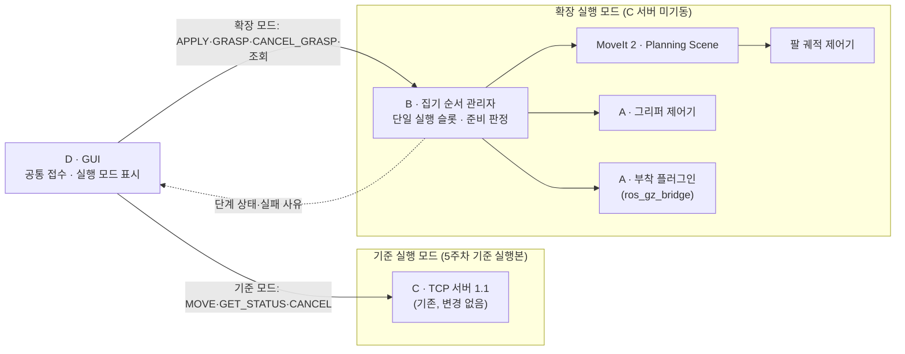

# 그리퍼 선택·최소 집기 확장 상세설계 (6~7주차)

문서 버전 0.2 · 설계 초안 · 2026-11-09

| 항목 | 내용 |
|---|---|
| 담당 | A·B·D (C 신규 업무 없음, §2) |
| 범위 | 그리퍼 4종(마그네틱·5지·3지·2지) 프로파일·선택 구조, 실행 전 선택 후 재시작 방식의 적용, 2지 1종의 부착 기반 최소 집기(접근→닫기→조건 확인→부착→수직 상승→유지 확인) |
| 상위 기준 | [시스템 아키텍처 및 프로젝트 계획](../architecture/시스템_아키텍처_및_프로젝트_계획.md) §2·§4·§9.1·§9.2·§10.3, [TCP 프로토콜 명세서](../protocol/TCP_프로토콜_명세서.md) 1.1 |
| 관련 문서 | [A 상세설계](A담당_비전_상세설계.md) §13, [B 상세설계](B담당_보정_좌표_상세설계.md) §15, [C 상세설계](C담당_로봇서버_상세설계.md) §2 「확장 인계 경계」, [D 상세설계](D담당_GUI_TCP_상세설계.md) §A.11 |

| 버전 | 날짜 | 변경 |
|---|---|---|
| 0.1 | 2026-11-09 | 사용자 요청(기간 추정 후 설계 적용)에 따라 최초 작성: 전체 7주(기본 5주 + 확장 2주) 중 6~7주 확장 범위, A/B/D 분담, 프로파일·교체 적용·정합성·무효화·좌표·동작·제어/통신·성공/복구 계약, 시험·평가 계획 |
| 0.2 | 2026-11-09 | 검토 반영(G1~G4, G1-a·G1-b): 적용 검증 순서를 구성 확인 → 확장 초기화 → 최종 정합성 확인으로 분리(§4.1·§5.1), 작업별 준비 조건 표(공통 기반 조건 + APPLY·GRASP·RELEASE·HOME·RESET_TRIAL별 조건, HOLD_UNKNOWN 복구 경로)(§8.3), 슬롯 작업의 실패·취소 종료 규칙(정지 미확인 시 `HOLD_UNKNOWN`, 잠금 시 복구 진입 우선)과 RELEASE 단계별 실패 처리(분리 전 실패·취소, 분리 미확인, Scene 복원 실패, 열기 실패)(§7.6·§7.7·§8.3), 프로파일 준비·런타임 적용·집기 검증의 상태 전이표와 최초 기동·교체·재적용 경로 분리(§3.2·§4), 기준 실행 모드와 확장 실행 모드를 실행 구성 수준에서 배타로 분리하고 순서 관리자의 단일 실행 슬롯·확장 준비 조건 정의, 운영 안내식 중재 삭제(§2·§8.3), DetachableJoint의 알려진 제약(접촉 중 재부착 미지원, 시작 부착 상태의 충돌 금지)을 반영한 간격 닫힘·비접촉 부착 조건과 빈 집기 판정(§7.2~§7.4), Gazebo 부착과 MoveIt Planning Scene 물체 상태의 전이 계약(§7.5), 런타임 시뮬레이션 피드백과 평가 정답의 역할 구분(§7.4), 시험표 보강(§10.1) |

이 문서는 설계 제안입니다. 그리퍼 모델·제어기·순서 관리자·GUI 코드는 아직 없으며, 모델 제작·의존성 설치·실제 집기 실행·성능 측정을 수행하지 않았습니다. 아래 자료형·필드·상태·사유 이름은 **구현 제안**이고, 위치·시간·폭 같은 수치는 6주차 파일럿에서 정합니다. 문서에 적은 성공 조건은 아직 달성된 결과가 아닙니다.

## 1. 목적과 범위

### 1.1 일정 전제

전체 계획은 **기존 5주 기본 범위 + 그리퍼 확장·통합·평가 2주 = 총 7주**입니다. 확장에 필요한 기간을 추가 1~2주(총 6~7주)로 추정했으나 실측 전 추정이며, 문서의 기준 일정은 여유를 포함한 **7주**입니다. 6주차 알려진 좌표 파일럿(§9) 결과로 6주 단축 가능성을 판단하되, 단축을 보장하거나 이 추정을 실측 견적으로 기록하지 않습니다. 단축해도 기존 필수 평가와 확장 회귀 시험을 생략하지 않습니다.

1~5주차의 평면 기본 범위(OpenCV/AI 비교와 3주차 말 채택 결정), 6D ArUco·PnP와 평면·6D 정량 평가는 그대로 유지합니다. 5주차 말에는 기존 범위의 평가와 **기준 실행본**(TCP 1.1 접근 목표 이동)을 고정하고, 확장 작업은 이 실행본을 깨지 않는 별도 실행 구성에서 진행합니다.

### 1.2 이번 확장에 포함하는 것

| 항목 | 이번 범위 |
|---|---|
| 그리퍼 종류 | 마그네틱·5지·3지·2지 4종의 프로파일·선택 구조와 종류별 상태 표시. 준비되지 않은 종류의 실행 차단 |
| 교체 방식 | **실행 전** 종류를 선택한 뒤 시뮬레이션과 관련 노드를 정상 종료·재시작하고, 적용 정합성을 확인한 다음 실행 허용 |
| 집기 검증 대상 | 2지 1종, 부품 1종(기존 대상 부품), 고정 높이 작업대, 상부 접근, 정해진 개폐 동작 |
| 집기 목표 | 사전 접근 → 하강 → 닫기 → 부착 조건 확인 → 부착 → 수직 상승 → 유지 확인 |
| 집기 방식 | **부착 기반 시연.** 조건을 확인한 뒤 시뮬레이터의 고정 결합(§7.3)으로 물체를 그리퍼에 붙임. 접촉·마찰로 물체를 들어 올리는 물리 파지로 보고하지 않음 |
| 시험 지원 | 반복 시험을 위한 복귀·해제·초기화 절차(§7.7) |

### 1.3 후속·범위 밖

- 실행 중 그리퍼 모델·제어기 교체(핫스왑), 로봇의 자동 도킹·공구 교환
- 정상 운반·정밀 놓기. 시험 초기화를 위한 해제(§7.7)는 운반·놓기 성능으로 보고하지 않음
- 3지·5지 집기와 손가락 독립 제어, 마그네틱 자력 물리 모델 검증
- 실물 로봇 구동, 접촉·마찰 기반 물리 파지
- 6D 자세를 집기 목표에 쓰는 경로. 이번 집기 목표의 입력은 알려진 좌표 또는 평면 결과(§6)이며, 6D 경로는 기존 접근 목표 이동으로만 평가

4종 사이의 12개 방향 전환(4×3)은 장래 실행 중 교체를 설계할 때의 참고 목록입니다. 이번에는 실제로 지원하는 **초기화/재시작 전환**만 검증하며(§10), 핫스왑 시험은 요구하지 않습니다.

## 2. 담당과 C 경계

사용자가 적용을 요청한 분담입니다. **C에는 신규 업무를 배정하지 않습니다.**

| 담당 | 확장 책임 |
|---|---|
| A | 그리퍼 실행 프로파일과 시뮬레이션 적용(Gazebo 모델·그리퍼 제어기·부착 플러그인 구성, 확장 실행 구성), 확장 초기화(시작 부착 해제 확인), 2지 개폐·부착·보유 검출, 검출/파지 시험 도구와 결과 취합. D의 외형 산출물을 받아 기능을 적용 |
| B | 확장 동작 순서 총괄(**집기 순서 관리자**, §8), 확장 실행 모드의 준비 판정·실행 슬롯, 파지점·파지 중심 프레임 G·사전 접근/파지/상승 목표·부착 허용 조건, 목표·계획 무효화와 복구, MoveIt 계획 환경(작업대·부품 충돌 물체·부착 물체·허용 충돌 쌍) 연동 |
| D | 4종 외형 자산, 선택/적용/검증 상태 GUI, 프로파일 설정 버전 관리, 확장 명령·상태 규약(§8.4), 실행 모드 전환과 기존 이동·새 집기 요청의 공통 접수 연동 |
| C | 기존 TCP 서버·팔 이동·취소·상태·서버 로그를 유지(1~5주 산출물). 그리퍼 제어·교체·집기 순서·새 통신 기능을 C의 후속 작업으로 넘기지 않음 |

**기준 실행 모드와 확장 실행 모드.** 기존 C 서버를 고치지 않고 팔을 한 주체만 움직이게 하려고 실행 구성을 두 가지로 나눕니다(§8.3).

| 모드 | 기동하는 구성 | 팔 명령 주체 | 그리퍼 |
|---|---|---|---|
| 기준 실행 모드 | 5주차 기준 실행본 그대로(C TCP 서버 포함) | C TCP 서버(TCP 1.1 `MOVE`) | 없음(기준 실행본의 기존 구성) |
| 확장 실행 모드 | 확장 실행 구성(A): Gazebo + UR5e·그리퍼 + 제어기 + MoveIt + 집기 순서 관리자(B). **C TCP 서버를 기동하지 않음** | 집기 순서 관리자 하나 | 선택한 프로파일 하나 |

모드 전환은 그리퍼 교체와 같은 "정상 종료 → 재시작" 방식이며(§4), 두 모드를 동시에 실행하지 않습니다. 기준 실행 모드를 끝낼 때 C 서버는 기존 절차대로 정상 종료하고 로그를 보존합니다. 다시 기준 실행 모드로 돌아갈 때도 기존 시작·복구 절차(계획서 §2.4.5)를 그대로 따릅니다. 이 전환은 A/B/D가 실행하며 C 코드 수정이나 C의 새 기능을 요구하지 않습니다.

**기존 C 기능 재사용의 한계.** 기존 팔 제어 인터페이스(TCP 1.1 `MOVE`, 서버의 준비·복구 규칙)가 집기 확장에 충분하다는 실행 근거는 아직 없습니다. 확장 실행 모드는 C 서버를 쓰지 않으므로, 그 모드에서 필요한 준비 판정·작업대 충돌 물체 등록·명령 기록은 B의 순서 관리자가 맡습니다(§8.3). 확장에 필요한 실행 구성(launch)·로봇 설명(URDF/xacro)·공용 코드 수정의 소유자는 아래와 같습니다. 기존 C 파일은 고치지 않고 확장 실행 구성에서 별도로 구성합니다. 그래도 기존 C 코드를 고쳐야 한다는 결론이 나면 수정 소유자는 A/B/D이며 기준 실행본 회귀(§10)를 그 소유자가 확인합니다. C의 검토 협조는 요청할 수 있으나 일정의 전제로 두지 않습니다.

| 확장에 필요한 공용 작업 | 소유자 | 비고 |
|---|---|---|
| UR5e + 그리퍼 로봇 설명(xacro) 조합, Gazebo 모델·플러그인 | A | 외형 메시는 D 산출물(§A.10). 관절·충돌·관성은 A가 정의하고 B가 MoveIt 측면을 확인 |
| 그리퍼 제어기 설정(`ros2_control` 하드웨어 태그·제어기 YAML) | A | §7.2 |
| 확장 실행 구성(launch)과 프로파일별 재시작·확장 초기화 절차 | A(실행)·B(순서 관리자 기동) | 기준 실행본 launch와 분리. C TCP 서버 미포함 |
| 확장 실행 모드의 MoveIt 계획 환경: `workbench`·부품 충돌 물체·부착 물체·허용 충돌 쌍(SRDF·Planning Scene) | B | 기준 실행 모드의 `workbench` 등록(C 기존 기능)과 같은 치수·자세 설정(B의 `frames` 설정)을 사용 |
| 확장 실행 모드의 준비 판정·실행 슬롯·작업 기록 | B | §8.3 |
| 확장 명령·상태 규약의 메시지 정의·스키마·벡터 | D | §8.4 |
| 집기 순서 관리자(ROS 2 노드) | B | §8 |

**연동 확인 항목.** 아래 항목이 성립하지 않으면 C의 추가 구현을 전제하지 않고, 대안과 일정 영향을 기록합니다.

| ID | 확인 항목 | 담당 | 시점 | 성립하지 않을 때 |
|---|---|---|---|---|
| X-1 | 기존 TCP 1.1 `MOVE`로 집기 경로의 공구 목표(손목 방향·높이·사전 접근/파지/상승)를 표현할 수 있는가(§6.4) | B(목표)·D(규약) | 6주차 1일차 | 결론과 무관하게 확장 실행 모드에서는 순서 관리자 직접 계획(§8.2)을 쓰며, 이 확인은 TCP 1.1을 바꾸지 않는다는 근거 기록용 |
| X-2 | 확장 실행 구성이 C 서버 없이 MoveIt·팔 제어기·그리퍼 제어기·`/clock`·관절 피드백을 갖추고, 순서 관리자가 `workbench`를 등록·확인할 수 있는가 | A(실행 구성)·B(준비 판정·Scene) | 6주차 1일차 | 확장 실행 모드 준비가 되지 않음 → 집기 차단, 원인·일정 영향 기록. C 서버를 확장 모드에 끼워 넣는 대안은 쓰지 않음 |
| X-3 | 기준 실행 모드 ↔ 확장 실행 모드 전환 뒤 각 모드가 정상 준비 상태가 되는가(기준 복귀 시 C 서버의 기존 시작 복구가 `robot_ready=true`에 이르는가) | A·B | 6주차 1~2일차 | 기준 실행 모드 복귀가 안 되면 기준 실행본을 별도 PC·별도 작업공간에서 보존하고 확장 모드와 분리 시연 |
| X-4 | 그리퍼 제어기와 부착 플러그인의 실제 동작(§7.2·§7.3) | A | 6주차 1~2일차 | 2지 파일럿 지연·미완료로 기록(§9) |

X-1~X-4 결과는 확인자·날짜·절차·결과·증거 경로와 함께 기록합니다. 기록 전에는 "미확인"으로 표시합니다.

## 3. 그리퍼 프로파일

### 3.1 프로파일 내용 (필드 이름은 구현 제안)

프로파일 파일은 `config/robot/grippers/<gripper_id>.yaml`(제안) 하나에 한 종류를 기록하고, 내용이 바뀌면 `profile_version`을 올립니다.

| 구분 | 필드(제안) | 내용 |
|---|---|---|
| 식별 | `gripper_id`, `kind`, `profile_version`, `profile_hash` | `kind`는 `magnetic`·`five_finger`·`three_finger`·`two_finger`. `profile_hash`는 프로파일과 참조 파일 내용의 해시 |
| 외형(D) | `visual_asset_id`, `visual_asset_version` | D의 외형 자산 식별자(§A.10). 외형 자산의 버전은 기능 프로파일 버전과 별개 |
| 모델·제어기(A) | `model_ref`, `controller_name`, `controller_type`, `joints`, `mimic_joints`, `command_presets` | `command_presets`는 정해진 `open`·`close` 동작의 목표값·최대 힘·속도. 2지 외에는 비워 둘 수 있음 |
| 공구 좌표(B) | `T_E_G`, `opening_range_mm`, `finger_closing_axis_G` | 끝단 E(`tool0` 등)에서 파지 중심 G로의 고정 변환, 개구폭 범위, G 기준 손가락 닫힘 축 |
| 충돌·물리(A·B) | `collision_ref`, `inertial_ref`, `contact_params` | 충돌 형상·질량·관성. 마찰 등 접촉 값은 부착 기반 시연에서 성공 근거가 아니며 기록용 |
| 부착(A) | `attach.method`, `attach.topics`, `attach.child_model`, `attach.child_link` | 부착 기반 집기의 플러그인 구성(§7.3). 2지 외에는 비움 |
| 기능 지원 | `capabilities` | `select`(선택 가능), `apply`(시뮬레이션 기능 적용 가능), `grasp`(집기 순서 지원) 각각 참/거짓 |
| 상태 | `status.visual`, `status.profile`, `status.grasp` | §3.2의 정적 상태. 근거 기록 경로를 함께 둠. 런타임 적용 상태 `apply_state`는 프로파일 파일에 쓰지 않고 순서 관리자가 현재 실행 기준으로 보고 |
| 재현 | `reproduce` | 실행 구성 이름·인자, 사용 패키지 버전/커밋, 자산 경로, 적용 확인 명령 |

### 3.2 상태와 전이

외형 선택·모델 적용·집기 성공을 같은 완료 상태로 취급하지 않습니다. **프로파일에 기록하는 정적 상태**와 **현재 실행에서의 적용 상태**를 나눕니다. 정적 상태가 실행을 허용하는 것이 아니라, 현재 `tool_epoch`(§5.2)의 적용 확인만 집기를 허용합니다.

| 상태 | 값(제안) | 의미·근거 | 소유 |
|---|---|---|---|
| 외형 `status.visual` (정적) | `설계 중` / `적용 대기` / `적용 확인` | D §A.10의 외형 확인 기록 | D |
| 프로파일 준비 `status.profile` (정적) | `미지원` / `준비` | `미지원`: 기능 파일이 없거나 `capabilities.apply=false`. `준비`: 모델·제어기·공구 좌표·충돌 형상 파일이 있고 형식 검사를 통과해 **적용을 시도할 수 있음**. 동작을 보장하지 않음. 과거 적용 확인 기록은 참고로 연결 | A(모델·제어기)·B(공구 좌표) |
| 런타임 적용 `apply_state` (현재 실행) | `미적용` / `적용 중` / `적용 확인` / `적용 실패` | 현재 `tool_epoch`에서 §5.1 정합성 확인과 확장 초기화(§4.3)를 통과했는지 | A·B 판정, D 표시 |
| 집기 검증 `status.grasp` (정적) | `해당 없음` / `미검증` / `파일럿 통과` / `평가 완료` | §10.2 평가 기록(확인자·날짜·절차·결과·증거 경로). **실행 허용 조건이 아님** | A 취합, B 판정 |

**허용 동작표.** 모든 판단은 같은 표를 씁니다(§4, D §A.11, §10.1).

| 프로파일 준비 | 런타임 적용 | 선택 | 적용 시도 | 집기 요청 |
|---|---|---|---|---|
| `미지원` | (항상 `미적용`) | 표시만 | 차단 | 차단 |
| `준비` | `미적용` | 허용 | 허용(§4의 경로별 검사 통과 시) | 차단 |
| `준비` | `적용 중` | 차단 | 차단(진행 중) | 차단 |
| `준비` | `적용 확인` | 허용(다른 종류로 교체) | 허용(교체·재적용) | `capabilities.grasp=true`일 때만 허용 |
| `준비` | `적용 실패` | 허용 | 허용(재적용 경로, §4.4) | 차단 |

**전이.** `미적용` → (적용 확정) → `적용 중` → (§5.1 정합성·§4.3 확장 초기화 모두 통과) → `적용 확인`. `적용 중`에서 어느 확인이라도 실패하거나 시간 초과면 `적용 실패`. `적용 확인`이나 `적용 실패`에서 새 적용을 확정하면 `tool_epoch`를 올리고 다시 `적용 중`. 시뮬레이션·순서 관리자 재시작이나 모드 전환은 `미적용`으로 되돌립니다. 집기 검증 기록은 이 전이에 영향을 주지 않습니다(파일럿 전 첫 집기를 허용하기 위함).

이번 범위의 목표 상태(현재 상태 아님): 2지는 `준비` → 첫 적용으로 `적용 확인` → 파일럿·평가 후 `파일럿 통과`·`평가 완료`. 마그네틱·5지·3지는 `미지원` 또는 `준비`이고 `capabilities.grasp=false`이므로 `적용 확인`까지 가더라도 집기는 차단됩니다. 현재는 4종 모두 기록이 없어 외형 `설계 중`, 프로파일 `미지원`, 집기 `해당 없음`/`미검증`입니다. 외형이 `적용 확인`이어도 프로파일 준비·런타임 적용으로 표시하지 않습니다.

## 4. 적용 절차

적용은 시작 상태에 따라 세 경로로 나눕니다. 어느 경로든 동작을 강제 종료하거나 보유 물체를 자동 해제하지 않으며, 확인할 수 없는 상태를 정상(미보유·정지)으로 간주하지 않습니다.

### 4.1 최초 기동 (기준 실행 모드 → 확장 실행 모드)

기준 실행 모드에는 그리퍼·부착 상태가 없으므로 "미보유"를 검사할 대상이 없습니다. 이것을 미보유 확인으로 간주하지 않고, 아래 순서로 닫습니다.

1. **기준 실행 모드 정지 조건** — C 서버의 명령 ID 없는 `GET_STATUS`(기존 기능 조회)로 `active_command_id == null`, 궤적 액션 상태 목록에 미종료 goal 없음, 관절 정지를 확인. 확인할 수 없거나 `RECOVERY_FAILED`이면 전환하지 않고 기존 수동 복구 절차(계획서 §2.4.5)를 먼저 끝냄
2. **정상 종료** — C 서버를 기존 절차로 정상 종료(로그 보존, 명시적 초기화 아님), 이어서 Gazebo·MoveIt·제어기 종료
3. **확장 실행 구성 기동** — 선택한 `gripper_id`·`profile_version`으로 기동. `apply_state = 적용 중`. 이 시점의 보유 상태는 `HOLD_UNKNOWN`
4. **구성 확인** — §5.1 표의 「구성 확인」 열. 초기화 결과를 요구하지 않으며 해제 요청 등 동작은 아직 하지 않음
5. **확장 초기화** — §4.3. 4가 통과한 경우에만 실행
6. **최종 정합성 확인** — §5.1 표의 「최종 확인」 열. 5에서 만든 현재 `tool_epoch`의 초기화 기록(해제 확인·물체 이동 없음·Scene 초기화)을 근거로 사용
7. 4~6이 모두 통과하면 `적용 확인`. 하나라도 실패하면 그 자리에서 멈추고 `적용 실패`(이후 단계 미실행). 7 이전에는 집기를 허용하지 않음

**적용 작업의 실행 주체.** 3~7단계는 하나의 적용 작업으로 기록합니다. 정상 종료·기동은 A의 확장 실행 도구가 하고, 기동한 순서 관리자(B)는 작업 기록의 진행 중 적용 작업을 이어받아 4~7단계를 실행합니다. 이 이어받기는 예정된 재기동이므로 `RECOVERY_REQUIRED`로 잠그지 않습니다. 적용 작업 기록이 없거나 손상됐으면 잠급니다.

### 4.2 교체 (확장 실행 모드에서 적용 확인 상태 → 다른 프로파일)

1. **교체 전 검사** — 순서 관리자의 실행 슬롯이 비어 있음(§8.3), 팔·그리퍼 제어기 액션 상태 목록에 미종료 goal 없음, 관절 정지, 보유 상태 `DETACHED`가 현재 실행에서 확인됨(§7.4), Planning Scene에 부착 물체 없음. 보유 중이면 `HOLDING_OBJECT`, 확인할 수 없으면 `HOLD_UNKNOWN`으로 거부
2. **무효화** — `tool_epoch`를 올리고 이전 공구로 만든 집기 목표·미송신 스냅샷·계획을 폐기(§5.2)
3. **정상 종료** — 순서 관리자·그리퍼 제어기·Gazebo·MoveIt 관련 노드를 정상 종료
4. **재시작·확인** — 선택한 프로파일로 4.1의 3~7단계(기동 → 구성 확인 → 확장 초기화 → 최종 정합성 확인 → 판정)를 수행

### 4.3 확장 초기화 (시작 부착 해제와 초기 배치 확인)

DetachableJoint는 로드 직후 부착 상태로 시작합니다(§7.3). 이 상태를 미보유로 보지 않고 다음을 확인합니다.

1. **기동 전 배치 조건(A)** — 월드 초기 상태에서 부품이 그리퍼·로봇 링크와 충돌하지 않는 위치에 있음(공식 문서의 "초기 부착 상태에서 부모·자식 모델이 충돌하지 않아야 함"). 이 조건은 월드·홈 자세 설정으로 보장하고 설정 버전에 기록
2. **부착 상태 구독** — 상태 토픽을 먼저 구독한 뒤 해제 요청 → `detached` 수신(미수신이면 `적용 실패`)
3. **물체 이동 검사** — 해제 전후와 월드 초기 배치를 비교해 부품 위치·방향 변화가 허용치 이내인지 확인. 시작 부착 때문에 물체가 끌려가거나 움직였으면 정상 집기 초기 상태로 인정하지 않고 `적용 실패`(`INIT_OBJECT_MOVED`). 시험 초기화(§7.7)로 되돌린 뒤 다시 확인
4. **Planning Scene 초기화(B)** — `workbench` 등록 확인, 부착 물체 없음, 부품 world 물체는 아직 등록하지 않거나 초기 배치 기준으로 등록(§7.5)
5. 2~4를 통과하면 보유 상태 `DETACHED`와 현재 `tool_epoch`의 초기화 기록을 남김. 하나라도 실패하면 `적용 실패`이며 보유 상태는 `HOLD_UNKNOWN` 유지. 이 절차의 해제 요청은 확장 초기화 전용이며 `RELEASE` 작업이 아님

### 4.4 적용 실패 뒤 재적용

`적용 실패`에서는 그리퍼·부착·제어기 상태를 신뢰할 수 없다고 봅니다.

1. 미종료 goal이 있으면 취소 요청 후 종료·정지를 확인. 확인할 수 없으면 확장 실행 구성 전체를 정상 종료(응답이 없으면 프로세스 종료를 기록)
2. 보유 상태는 `HOLD_UNKNOWN`으로 두고, 재기동 후 4.3 확장 초기화로만 `DETACHED`를 다시 확인
3. 사용자가 같은 프로파일 재적용 또는 이전 프로파일 재적용을 다시 확정하면 4.1의 3~7단계를 수행. 자동 재시도·자동 되돌림은 하지 않음

**`HOLD_UNKNOWN` 복구.** 부착 불명·두 시스템 부착 불일치·순서 관리자 재시작 후 확인 실패로 `HOLD_UNKNOWN`이 되면 일반 `RELEASE`·`RESET_TRIAL`로 풀지 않습니다(§8.3 작업별 조건). 복구는 사용자가 명시적으로 확정한 이 절의 재적용(확장 실행 구성 전체의 정상 종료·재기동 → 확장 초기화)으로만 합니다. 재기동으로 부품이 월드 초기 배치로 돌아가는 것은 시험 초기화로 기록하며 해제·집기 결과로 세지 않습니다.

재시작 중 Gazebo가 다시 기동하면 물체는 월드 초기 자세로 돌아가고 부착은 초기화됩니다. 이 상태는 시험 초기화와 같은 기록으로 남기며 집기 결과로 세지 않습니다. `적용 실패` 동안은 집기와 확장 경로의 팔 이동을 모두 차단합니다.

## 5. 정합성과 무효화

### 5.1 적용 정합성

정합성 확인은 두 번에 나눕니다. **구성 확인**(§4.1 4단계)은 확장 초기화를 시작해도 되는지, **최종 확인**(§4.1 6단계)은 초기화 결과까지 포함해 같은 프로파일로 맞는지를 봅니다. 모든 항목이 같은 `gripper_id`·`profile_version`(또는 `profile_hash`)을 가리키고 두 열을 모두 통과할 때만 `적용 확인`입니다.

| 확인 대상 | 구성 확인 (초기화 전) | 최종 확인 (초기화 후) | 담당 |
|---|---|---|---|
| Gazebo 모델 | 기동한 모델 이름과 프로파일 식별 태그 | 구성 확인 값이 그대로임 | A |
| 그리퍼 제어기 | `list_controllers`에서 이름·종류·`active`·관절 목록이 프로파일과 일치 | 같음 | A |
| 부착 플러그인 | 부착 상태 토픽 구독 성공, 부착 대상 모델·링크 이름이 프로파일과 일치 | 현재 `tool_epoch`의 §4.3 해제 확인(`detached`)과 물체 이동 없음 기록이 있음 | A |
| MoveIt 끝단·충돌 | 로봇 설명의 끝단 링크·`T_E_G`·그리퍼 충돌 형상이 프로파일과 일치 | `workbench` 등록, 부착 물체 없음, 이전 프로파일의 허용 충돌 쌍 없음(§4.3 4단계 기록) | B |
| 실행 모드 | 확장 실행 모드이며 C TCP 서버가 기동되지 않음(§8.3의 1·2번) | 같음 | B |
| GUI 선택 | — | GUI의 적용 대상 프로파일과 순서 관리자가 보고한 프로파일이 같음 | D |

외형만 바꾼 경우(모델·제어기·MoveIt이 이전 프로파일)는 정합성 불일치이며 `적용 확인`이 아닙니다.

### 5.2 무효화와 식별 규칙

- 적용 세대 `tool_epoch`(제안)는 적용을 확정할 때(§4.1 3단계 직전, §4.2 2단계, §4.4 3단계) 올리는 단조 증가 정수입니다. 종류·`profile_version`·파지 설정(`T_E_G`, 접근·상승 높이, 부착 허용 조건)이 바뀌면 항상 새 세대가 됩니다.
- 집기 목표·확정 스냅샷·계획·집기 작업 기록에는 만들 때의 `tool_epoch`와 `profile_hash`를 붙입니다. 현재 세대와 다르면 실행하지 않고 폐기합니다.
- 순서 관리자의 모든 상태 알림에는 `job_id`와 `tool_epoch`를 넣습니다. GUI는 현재보다 오래된 `tool_epoch`의 알림을 기록만 하고 화면 상태에 적용하지 않습니다. 같은 `tool_epoch` 안에서는 `job_id`와 단계 순번으로 순서를 판단합니다.
- 비전 쪽 세대(A §5.4의 `generation`·`job_seq`)는 별도 검사입니다. 집기 목표는 비전 세대와 `tool_epoch`가 모두 현재일 때만 유효합니다.
- **카메라 보정은 공구 교체마다 다시 하지 않습니다.** 카메라 자세·센서 설정·해상도·크롭·월드의 카메라 배치 버전이 그대로이면 기존 `calibration_id`를 유지합니다. 재시작 뒤 이 값들이 같은지 확인하고, 다르면 기존 규칙(계획서 §2.2)대로 재확인합니다. 그리퍼가 카메라 시야를 가리는 문제는 보정이 아니라 관측 가능성 문제로 따로 기록합니다.

## 6. 좌표와 공구 목표

### 6.1 프레임

| 프레임 | 정의 |
|---|---|
| E | UR5e 제어 끝단(`tool0` 등, 기존 정의) |
| G | 파지 중심. 2지 손가락 닫힘 축의 중앙, 손가락 끝 접촉 높이. `T_E_G`는 프로파일 값 |
| O | 물체 기준점(윗면 중심, 기존 정의) |

### 6.2 목표 구분

기존 물체 자세 `T_W_O`와 새 공구 목표를 섞지 않습니다. `T_W_O`는 "물체가 어디 있는가"이고, 아래 목표는 "G를 어디에 둘 것인가"입니다.

| 목표 | 기호(제안) | 정의 |
|---|---|---|
| 파지 목표 | `T_W_G_grasp` | O 기준 파지점에 G를 둠. 상부 접근이므로 G의 접근 축은 W의 −Z. 손목 yaw는 손가락 닫힘 축이 부품 단축 방향과 맞도록 장축각 θ에서 계산하고, θ와 θ+180°가 같은 장축이므로 현재 손목에서 회전량이 작은 쪽을 고름. 높이는 고정 작업대 상판 + 부품 높이 기준의 파지 깊이 |
| 사전 접근 목표 | `T_W_G_pre` | 파지 목표에서 W +Z로 접근 거리만큼 위 |
| 상승 목표 | `T_W_G_lift` | 파지 목표에서 W +Z로 상승 높이만큼 위(수직 상승) |
| 끝단 목표 | `T_W_E_* = T_W_G_* × inverse(T_E_G)` | MoveIt에 넘기는 값. R 기준 변환은 기존 `T_R_S × T_S_W` 사용 |
| 개구폭 | `opening_mm` | 열기 폭은 부품 폭 + 여유. 부품 폭이 `opening_range_mm`를 벗어나면 목표 무효(`WIDTH_OUT_OF_RANGE`) |

접근 거리·파지 깊이·상승 높이·개구 여유는 6주차 파일럿에서 정합니다(B). 6D 결과를 집기 목표에 쓰지 않으므로 이번 파지 목표는 상부 접근 고정 자세이며 물체 기울기를 반영하지 않습니다.

### 6.3 기존 평면 θ 정책과의 관계

기존 TCP 1.1 평면 `MOVE`의 θ 비사용 정책(계획서 §2.3, `planar_use_theta_yaw` 기본값)은 바꾸지 않습니다. 집기 경로의 손목 yaw는 순서 관리자가 계산하는 집기 전용 목표에만 쓰며, 기존 평면 `MOVE`의 동작이나 설정 기본값을 바꾸지 않습니다.

### 6.4 기존 MOVE의 표현 가능성 (확인 과제 X-1)

| 기존 경로 | 집기 목표 표현의 문제 | 판단 |
|---|---|---|
| 평면 `MOVE` | 고정 접근 높이·고정 방향이라 사전 접근/파지/상승 높이와 손목 yaw를 단계별로 바꿀 수 없음. θ yaw 선택 기능은 설정 하나로 전체 평면 이동에 적용 | 그대로는 부족할 가능성이 큼 |
| 6D `MOVE` | 필드 의미가 물체 기준점 자세 `T_W_O`(명세서 §4.2)이고 서버가 고정 오프셋 `T_O_E_goal`을 붙임. 단계마다 다른 공구 목표를 보내려면 `T_W_O`가 아닌 값을 넣어야 함 | **사용하지 않음.** 의미 위반 |

X-1 확인은 B가 목표 정의 측면, D가 규약 측면을 맡아 6주차 1일차에 결론을 기록합니다. 기본안은 순서 관리자가 MoveIt으로 공구 목표를 직접 계획·실행하는 경로(§8.2)이며, X-1에서 기존 `MOVE`로 충분하다는 근거가 나와도 6D 필드에 공구 목표를 넣는 방식은 쓰지 않습니다.

## 7. 집기 동작

### 7.1 진행 순서

먼저 **알려진 좌표**(지그로 놓은 부품 위치·장축각을 손으로 입력한 값)에서 개폐 → 부착 → 상승을 확인하고, 그다음 비전 결과와 GUI를 연결합니다.

| 단계(제안) | 동작 | 넘어가는 조건 |
|---|---|---|
| `PRECHECK` | 실행 슬롯 확보 후 확장 준비 조건(§8.3)·`tool_epoch`·목표 유효성·보유 상태 `DETACHED` 확인 | 모두 확인 |
| `SCENE_PREPARE` | 부품 world 충돌 물체 등록·갱신(§7.5) | Planning Scene에서 등록 확인 |
| `OPEN` | `command_presets.open` 실행 | 그리퍼 goal 성공, 개구폭이 열기 폭 허용치 안 |
| `MOVE_PRE` | 사전 접근 목표로 이동 | 팔 goal 종료(`SUCCEEDED`)·관절 정지·끝단 허용치 통과 |
| `DESCEND` | 파지 목표로 하강. 손가락–부품 허용 충돌 쌍만 이 단계부터 허용(§7.5) | 같음 |
| `CLOSE_TO_GAP` | `command_presets.close_to_gap`: 부품 폭 + 양쪽 간격까지 위치 제어로 닫음(§7.3) | 그리퍼 goal이 목표 폭에 도달(정지(stall)로 끝나면 실패) |
| `CHECK_ATTACH` | 부착 조건 확인(§7.4) | 모든 조건 충족 |
| `ATTACH` | Gazebo 부착 요청 → `attached` 수신 → MoveIt 부착 반영 확인(§7.5) | 두 시스템 모두 부착 확인 |
| `LIFT` | 상승 목표로 수직 상승 | 팔 goal 종료·끝단 허용치 통과, 물체가 G를 따라 상승 |
| `HOLD_CHECK` | 유지 시간 동안 보유 확인 | 부착 상태 유지, 상대 위치 허용치 유지 |
| `DONE` | `HELD`(보유 중 정지)로 종료 | — |

닫힘 성공, 부착 성공, 상승 성공, 유지 확인은 각각 따로 기록하며 앞 단계의 성공을 뒤 단계의 성공으로 간주하지 않습니다. 부착 실패·부착 불명·두 시스템 부착 불일치 상태에서는 `LIFT`로 넘어가지 않습니다.

### 7.2 2지 그리퍼 제어기 (A, 확인 과제 X-4)

- ROS 2 Jazzy 문서 기준으로 `parallel_gripper_action_controller`가 단일 관절(`joint`)을 액션으로 제어하며 `goal_tolerance`, `allow_stalling`, `stall_velocity_threshold`, `stall_timeout`, `max_effort`, `max_velocity` 설정이 있습니다. 기존 `position_controllers/GripperActionController`·`effort_controllers/GripperActionController`는 제거 예정으로 표시되어 있습니다.
- `gz_ros2_control`은 mimic 관절을 지원하며, mimic 관절에는 명령 인터페이스를 두지 않고 상태 인터페이스만 둘 수 있습니다. 두 손가락을 한 관절 + mimic으로 구성하는 방식을 1안으로 둡니다.
- 이번 1안은 **접촉 전에 멈추는 위치 목표**(§7.3)를 쓰므로 `allow_stalling`에 의존하지 않습니다. 목표 폭에 도달하지 못하고 정지하면 무언가에 닿은 것으로 보고 실패로 처리합니다.
- 액션 결과에 정지 여부·도달 여부·현재 위치가 어떻게 담기는지는 확인하지 못했습니다. 도달 판정은 `/joint_states`의 손가락 관절 위치(개구폭)로도 확인하며, 액션 정의는 6주차 1일차에 A가 확인합니다.

### 7.3 부착 방법과 알려진 제약 (A, 확인 과제 X-4)

Gazebo Harmonic(gz-sim 8)의 `DetachableJoint` 시스템 플러그인을 1안으로 둡니다. 공식 튜토리얼·API 문서와 gz-sim8 소스에서 확인한 내용입니다.

| 확인한 동작·제약 | 출처 | 설계 반영 |
|---|---|---|
| 필수 인자 `parent_link`·`child_model`·`child_link`, 선택 인자 `attach_topic`·`detach_topic`·`output_topic`. 요청은 `gz.msgs.Empty`, 상태 출력은 `"attached"`/`"detached"` | API·소스 | ROS 쪽은 `ros_gz_bridge`(`std_msgs/msg/Empty` ↔ `gz.msgs.Empty`). 토픽 이름은 프로파일 `attach.topics`에 명시 |
| 부착·재부착은 자식 모델을 **현재 자세 그대로** 고정. 물체를 옮기거나 근접·접촉을 검사하지 않음. 특정 자세 재부착이 필요하면 미리 `set_pose`로 배치하라고 안내 | 튜토리얼·소스 | 위치 조건은 순서 관리자가 부착 요청 **전에** 확인(§7.4). 집기 중 `set_pose`로 물체를 그리퍼에 옮기지 않음(순간이동 금지). `set_pose`는 시험 초기화(§7.7)에만 사용 |
| **부모·자식이 접촉 중일 때 재부착은 지원하지 않으며, 재부착 시 충돌이 없어야 함** | 튜토리얼 | 손가락이 부품에 닿기 전에 멈추는 **간격 닫힘**을 1안으로 함. 접촉·관통 상태에서는 부착 요청 0건(§7.4 조건 5) |
| **초기(부착) 상태에서 부모·자식 모델이 충돌하지 않아야 함**(기본 물리 엔진 DART 문제) | 튜토리얼 | 확장 초기화의 배치 조건·물체 이동 검사(§4.3) |
| 기본값은 로드 직후 부착 | 튜토리얼·소스 | 확장 초기화에서 해제 확인 전 집기 차단(§4.3) |
| 해제된 모델이 부모와 충돌하려면 부모 모델에 `<self_collide>`가 필요 | 튜토리얼 | 해제 후 부품과 그리퍼·로봇의 충돌이 동작하는지 A가 6주차 1일차에 확인 |
| 결합 결과는 트리여야 함(기구 루프 미지원), 플러그인 하나에 자식 하나 | 튜토리얼·소스 | 부품 1종을 그리퍼 링크 하나에 붙이는 구성으로 제한 |
| 상태 출력은 전환 시점에만 발행 | 소스 | 요청 전에 구독하고, 수신 없으면 `부착 불명`(§7.6) |

**간격 닫힘과 부품 폭·빈 집기 판정의 양립.** 1안에서는 손가락을 부품 폭 + 양쪽 간격(`grip_gap_mm`, 파일럿 결정, 0보다 큼)까지 위치 제어로 닫습니다. 손가락이 부품에 닿지 않으므로 개구폭은 부품 유무를 알려 주지 않습니다. 그래서 다음처럼 역할을 나눕니다.

- 개구폭: 목표 폭(부품 폭 + 2 × 간격)에 도달했는지만 판정. 목표 폭보다 넓은 상태에서 정지하면 접촉 의심 → `GRIPPER_BLOCKED`, 부착 요청 없음
- 부품 유무·정렬: §7.4의 런타임 시뮬레이션 피드백(부품과 G의 상대 위치·방향)으로 판정. 부품이 손가락 사이 영역 밖에 있으면 `EMPTY_GRASP`, 영역 안이지만 허용치를 벗어나면 `ATTACH_CONDITION_UNMET`
- 비접촉: §7.4 조건 5로 판정

**2안(파일럿 확인 항목, 보장 아님).** 손가락이 부품에 닿는 모습이 필요하거나 간격 닫힘이 불안정하면, 손가락–부품 사이 충돌만 비활성화(충돌 비트마스크 등)하고 손가락을 부품 폭까지 닫는 방식을 A가 6주차 2일차까지 시험합니다. 이 경우 DetachableJoint가 비활성화된 충돌을 "접촉"으로 다루지 않는지, 해제 후 충돌이 복원되는지는 미확인이므로 확인 전에는 쓰지 않습니다. 정지(stall)로 접촉을 감지하는 방식은 접촉 중 재부착 제약과 맞지 않으므로 1안·2안 어디에도 쓰지 않습니다. 두 안이 모두 안정적이지 않으면 파일럿 미완료로 기록합니다(§9).

### 7.4 부착 조건

부착은 아래 조건을 **모두** 확인했을 때만 요청합니다. 허용치 수치는 6주차 파일럿에서 정합니다(B).

1. 팔: `DESCEND` goal이 `SUCCEEDED`로 끝났고 관절이 정지 판정 구간 동안 정지
2. 위치: 부품 파지점과 G의 상대 위치 오차가 허용치 이내(수평·수직 각각). 손가락 사이 영역 밖이면 빈 집기
3. 방향: 손가락 닫힘 축과 부품 단축 방향의 각도 차가 허용치 이내(180° 주기)
4. 개구폭: `CLOSE_TO_GAP`이 목표 폭에 도달(정지로 끝나지 않음)
5. 비접촉: 그리퍼·로봇 링크와 부품 사이 접촉이 없고 간격이 최소 간격 이상임을 **긍정적으로 확인**. 확인 수단(손가락 링크의 접촉 센서 출력, 또는 링크 자세·형상으로 계산한 최소 거리)은 A가 6주차 1일차에 정함. 확인할 수 없으면 조건 미충족
6. 부착 상태: Gazebo `detached`이고 Planning Scene에 부착 물체 없음
7. 세대: `tool_epoch`와 목표의 세대가 현재

**런타임 시뮬레이션 피드백의 역할 (설계 선택·한계).** 2·3·5번은 시뮬레이터의 부품·그리퍼 링크 상태로 판정합니다. 이것은 부착 기반 시연을 위한 builder의 설계 선택이며 사용자가 따로 확정한 결정이 아닙니다. 같은 시뮬레이터 자세를 쓰더라도 용도를 다음처럼 구분합니다.

| 용도 | 사용하는 곳 | 금지 |
|---|---|---|
| 런타임 시뮬레이션 피드백 | 순서 관리자의 부착 조건·보유 확인·확장 초기화의 물체 이동 검사 판정에만 사용하고 판정 결과와 함께 작업 기록에 남김 | 비전·PnP 결과, 집기 목표(§6), Planning Scene 부품 자세(§7.5), TCP `MOVE`의 계산이나 보정에 사용 |
| 평가 정답 | 계획서 §10.1의 평가 전용 기록(영상 stamp 동기). 비전 평가와 집기 평가의 높이·유지 지표 계산 | 런타임 판정 결과를 정답으로 재사용하거나, 정답으로 비전·목표를 보정 |

계획서 §2.1·§2.3의 "정답 자세는 평가에만 사용" 원칙은 비전·목표·이동 명령에 대한 것이며, 런타임 시뮬레이션 피드백은 그 원칙의 예외가 아니라 별도 역할입니다. 실제 로봇에서는 이 판정을 그대로 쓸 수 없다는 한계를 결과 보고에 적습니다.

### 7.5 Gazebo 부착과 Planning Scene 물체 상태 (B)

Gazebo의 고정 결합은 MoveIt의 부착 충돌 물체를 만들지 않습니다. 두 시스템을 B의 순서 관리자가 따로 바꾸고, 둘 다 확인된 뒤에만 다음 단계로 갑니다.

| 항목 | 계약(제안) |
|---|---|
| 물체 ID·형상 | 부품 1종의 충돌 물체 ID `part_0`(제안), 형상은 부품 실측 치수의 박스. 치수는 B의 부품 설정에 기록 |
| 계획용 자세 출처 | 집기 목표와 같은 출처(알려진 좌표 또는 비전 평면 결과 + 고정 작업대 높이). 런타임 시뮬레이션 피드백이나 평가 정답으로 보정하지 않음 |
| 허용 충돌 쌍 | `DESCEND`~`ATTACH` 동안 손가락 링크 ↔ `part_0`만 허용. 로봇 다른 링크·`workbench`로 확대하지 않음. `LIFT` 시작 전 부착 물체의 접촉 허용 링크(touch links)로 대체 |
| world 등록 | `SCENE_PREPARE`에서 `part_0`을 world 충돌 물체로 등록·갱신하고 Planning Scene 조회로 확인 |
| 부착 순서 | ① Gazebo 부착 요청 → `attached` 수신 ② MoveIt에서 `part_0`을 world → 그리퍼 링크 부착 물체로 전환(touch links = 손가락 링크) ③ Planning Scene 조회로 world 목록에 없고 부착 목록에 있음을 확인 ④ 두 시스템 일치 시 `LIFT` 허용 |
| 해제·초기화 순서 | ① Gazebo 해제 요청 → `detached` 수신 ② MoveIt에서 부착 → world 복원(복원 자세는 해제 시점 G 기준 계산값) 또는 시험 초기화 시 제거 ③ 조회로 확인 ④ 허용 충돌 쌍 원복 |
| 불일치·시간 초과 | Gazebo만 부착, MoveIt만 부착, 복원 실패, 조회 시간 초과 → `FAILED`(`SCENE_ATTACH_MISMATCH`), 확장 경로 팔 이동 차단, 보유 상태는 `HOLD_UNKNOWN`(두 시스템이 일치하지 않으므로 `HELD`로 표시하지 않음, Gazebo 상태는 사유에 기록), 복구는 §4.4 |
| 교체·재시작 | 부품·부착 물체와 허용 충돌 쌍을 지우고 확장 초기화(§4.3)에서 다시 확인 |

Gazebo 쪽 제약(부착 시 비접촉)과 MoveIt 쪽 정책(계획용 허용 충돌 쌍)은 서로 다른 계층입니다. MoveIt에서 접촉을 허용했다고 Gazebo 부착 조건(§7.4 조건 5)을 생략하지 않습니다.

### 7.6 성공·실패 처리

| 상황 | 판정(제안) | 처리 | 하지 않는 것 |
|---|---|---|---|
| 빈 집기(부품이 손가락 사이 영역 밖) | `FAILED`(`EMPTY_GRASP`, `CHECK_ATTACH`) | 부착하지 않음. 그리퍼는 그 자리에 정지 | 자동 재집기, 새 `job_id` 자동 발급 |
| 닫힘 도중 정지(목표 폭 미도달) | `FAILED`(`GRIPPER_BLOCKED`, `CLOSE_TO_GAP`) | 부착 요청 없음, 접촉 의심 기록 | 접촉 상태에서 부착 |
| 부착 조건 불일치(위치·방향·비접촉 미확인) | `FAILED`(`ATTACH_CONDITION_UNMET`, `CHECK_ATTACH`), 어떤 조건인지 기록 | 부착 요청 없음 | 강제 부착, 물체 순간이동 |
| 부착 요청 후 `attached` 미수신 | `FAILED`(`ATTACH_UNCONFIRMED`, `ATTACH`), 보유 상태 `HOLD_UNKNOWN` | 팔 이동 차단, 사용자 복구 필요 표시(복구는 §4.4) | `detached`로 간주, 자동 해제, 상승 |
| Gazebo·MoveIt 부착 불일치 | `FAILED`(`SCENE_ATTACH_MISMATCH`) | §7.5 | 상승 |
| 상승 중 팔 계획·실행 실패 | `FAILED`(`LIFT_FAILED`, `LIFT`) | 보유 중이면 보유 상태 유지·정지 확인 | 자동 개방·자동 해제 |
| 상승 후 물체가 따라오지 않음 | `FAILED`(`LIFT_NOT_FOLLOWED`, `LIFT`) | 부착 상태와 상대 위치를 기록 | 성공 처리 |
| 유지 중 상대 위치 이탈·`detached` 수신 | `FAILED`(`HOLD_LOST`, `HOLD_CHECK`) | 물체 위치 기록, Planning Scene 불일치 처리(§7.5) | 자동 재집기 |
| 사용자 취소 | `FAILED`(`CANCELLED`, 해당 단계) | 진행 중 팔·그리퍼 goal 취소 요청 → goal 종료·정지 확인. 보유 상태는 그대로 보고 | 자동 개방·해제 |
| `RELEASE` 분리 전 실패·취소(해제 높이로 하강 실패, Gazebo 해제 요청 전 취소) | `FAILED`(`RELEASE_FAILED` 또는 `CANCELLED`, `RELEASE`) | §8.3 실패·취소 종료 규칙. 두 시스템 모두 부착이 일치하면 `HELD`로 슬롯 반환, 사용자가 `RELEASE`를 다시 명시 요청 가능 | 자동 재해제, 자동 개방 |
| `RELEASE` 해제 요청 후 `detached` 미수신 | `FAILED`(`DETACH_UNCONFIRMED`, `RELEASE`), 보유 `HOLD_UNKNOWN` | 이동 차단, 복구는 §4.4 | `detached`로 간주 |
| `RELEASE` Gazebo `detached` 후 Scene world 복원 실패 | `FAILED`(`SCENE_ATTACH_MISMATCH`, `RELEASE`), 보유 `HOLD_UNKNOWN` | §7.5 불일치 처리, 복구는 §4.4 | 다음 이동 |
| `RELEASE` 분리·복원 후 열기 실패 | `FAILED`(`OPEN_FAILED`, `RELEASE`). 보유 기록은 `DETACHED`(두 시스템 모두 분리 확인) | 허용 충돌 쌍 원복 후 그리퍼 상태를 신뢰할 수 없으므로 슬롯을 `RECOVERY_REQUIRED`로 잠금, 복구는 §4.4 | 닫힌 손가락으로 `HOME`·`RESET_TRIAL`·`GRASP` 진행 |
| GUI–순서 관리자 연결 단절 | 단절은 취소가 아님. 작업은 순서 관리자 규칙대로 계속되고 슬롯은 작업 종료까지 유지. GUI는 재접속 뒤 `job_id`로 상태 조회 | 단절 표시 | 자동 재전송으로 새 작업 생성 |
| 순서 관리자–ROS·Gazebo 단절, 피드백 손실 | `FAILED`(`ROS_DISCONNECTED`·`FEEDBACK_LOST`), 보유 상태 `HOLD_UNKNOWN` | 확장 경로 팔 이동 차단 | 성공 처리 |
| 순서 관리자 재시작 | 작업 기록에서 미종료 작업 확인 → 팔·그리퍼 goal 종료와 정지, Gazebo 부착 상태, Planning Scene 부착 물체를 확인한 뒤 `FAILED`(`MANAGER_RESTARTED`). 확인 못 하면 `RECOVERY_REQUIRED`로 슬롯 잠금 유지 | 사용자 복구 | 자동 재실행, 확인 없이 슬롯 해제 |
| 시뮬레이션 재시작 | 진행 작업 무효, `apply_state = 미적용`, 물체·부착 초기화는 시험 초기화로 기록 | 적용 절차 재수행(§4) | 이전 작업 결과 사용 |
| 수락 후 비전 가림·비전 무효화 | 수락된 작업에 영향 없음. 화면에만 표시 | — | 비전 무효화만으로 수락된 작업 자동 취소 |

**ACK 대기 규칙과의 관계.** 집기 요청이 순서 관리자에게 수락되기 전(송신 직전·수락 대기)에는 A §5.4의 무효화 규칙과 D §A.6을 그대로 적용합니다. 수락 대기 중 원래 목표에 적용되는 무효화가 오면 자동 재전송을 멈추고, 취소·실패로 확정하지 않으며 늦게 온 수락·상태는 정상 반영합니다. 수락 뒤에는 위 표의 마지막 행처럼 비전 무효화로 작업을 자동 취소하지 않습니다.

### 7.7 복귀·해제·시험 초기화

반복 시험을 위해 사용자가 명시적으로 실행하는 절차입니다. 집기 성공이나 놓기 성능으로 세지 않습니다. 각 절차도 실행 슬롯을 확보한 하나의 작업으로 실행하며, 시작 조건은 §8.3의 작업별 준비 조건 표를 따릅니다. 정상 순서는 `GRASP`(→ `HELD`) → `RELEASE`(→ `DETACHED`) → `HOME` → `RESET_TRIAL` → 다음 `GRASP`입니다.

1. **해제(`RELEASE`)** — Gazebo·Planning Scene 모두 부착이 확인된 `HELD`에서 사용자가 확정하면, 상판 바로 위 정해진 해제 높이로 내린 뒤 §7.5 해제 순서(Gazebo `detached` 확인 → MoveIt 복원 확인) → 열기 → 허용 충돌 쌍 원복. 이 확인이 끝날 때까지 슬롯을 유지하고, 끝나면 `DETACHED`. 도중 실패·취소는 단계별로 §7.6 표와 §8.3 실패·취소 종료 규칙을 따르며, 분리 전이면 `HELD`로 돌아가 사용자가 다시 요청할 수 있음. 해제 높이·순서는 파일럿에서 정함
2. **복귀(`HOME`)** — `DETACHED`이고 Planning Scene에 부착 물체가 없을 때 홈 자세로 이동
3. **물체 초기화(`RESET_TRIAL`)** — `DETACHED`·Planning Scene 부착 물체 없음·그리퍼가 물체에서 떨어져 비접촉이 확인된 상태에서만 시뮬레이터 `set_pose`로 물체를 초기 배치로 되돌리고, Planning Scene의 `part_0`을 제거하거나 초기 배치로 갱신. 초기화 기록(시각·배치 번호·이유)을 남기고 다음 시도의 시작점으로만 사용
4. **확인** — Gazebo `detached`, Planning Scene 부착 물체 없음, 그리퍼 열림, 팔 정지, 물체 배치를 확인한 뒤 다음 시도 허용. 재부착은 반드시 비접촉 상태에서 시작함(§7.3)

## 8. 제어와 통신

### 8.1 구성 요소와 책임

| 구성 요소 | 책임 | 받는 명령 | 돌려주는 것 |
|---|---|---|---|
| GUI(D) | 사용자 확정, 공통 접수(현재 실행 모드의 경로로만 보냄), 실행 모드·슬롯 표시, 상태 표시. GUI 이벤트 루프에서 집기 순서를 직접 실행하지 않음 | 사용자 조작 | 기준 모드: TCP 1.1 요청 / 확장 모드: 확장 계약 요청 |
| 순서 관리자(B) | 확장 모드의 유일한 팔 명령 주체. 실행 슬롯·준비 판정, 집기 단계 진행, 목표 계산, 부착 조건 판정, Planning Scene 전이, 실패 처리, 작업 기록 | 확장 계약 요청 | 단계 상태·실패 사유·보유 상태 |
| 그리퍼 제어·부착(A) | 개폐 액션, 부착·해제, 상태 출력 | 순서 관리자 요청 | 액션 결과·관절 상태·부착 상태 |
| TCP 서버(C, 기존) | 기준 모드의 이동·취소·상태·서버 로그 | 기존 TCP 1.1 | 기존 `STATUS` |

### 8.2 팔 이동 경로

확장 실행 모드의 팔 이동은 순서 관리자가 MoveIt 2로 공구 목표(§6.2)를 계획하고 팔 궤적 제어기로 실행합니다. 계획 허용치·관절 실행 허용치·끝단 도달 허용치의 3종 구분(계획서 §2.3)은 같은 원칙을 쓰되, 집기 경로의 끝단 판정은 G 기준으로 순서 관리자가 수행하며 TCP `REACHED`로 보고하지 않습니다. 기존 TCP 1.1 `MOVE`의 의미는 바꾸지 않습니다.

### 8.3 배타 실행과 실행 슬롯

팔은 한 번에 한 주체만 움직입니다. GUI 버튼 차단이나 "다른 클라이언트를 실행하지 말라"는 운영 안내는 중재 근거로 쓰지 않고, 아래 강제 수단으로 보장합니다. 운영 안내는 보조 설명으로만 남깁니다.

1. **실행 구성 수준의 배타(A·B)** — 확장 실행 구성에는 C TCP 서버가 없으므로 기존 TCP 1.1 경로가 확장 모드에서 명령을 수락·실행할 수 없습니다. 다른 클라이언트의 `MOVE`는 접속 자체가 거부됩니다. C 서버의 재시작 복구(계획서 §2.4.5의 전체 goal 취소)도 확장 모드에서는 실행되지 않아 집기 goal에 간섭하지 않습니다.
2. **배타 상태의 감시(B)** — 순서 관리자는 기동 시와 매 작업의 `PRECHECK`, 매 팔 이동 직전에 C 서버 노드가 없고 TCP 서버 포트가 열려 있지 않음을 확인합니다. 위반이면 확장 준비 상태를 내리고(`EXCLUSIVE_MODE_VIOLATION`) 새 작업을 받지 않습니다. 진행 중이면 그 단계 뒤 이동을 멈춥니다.
3. **순서 관리자 밖 goal 감지(B)** — 팔·그리퍼 제어기의 액션 상태 목록에 순서 관리자가 보내지 않은 goal이 보이면 `FAILED`(`ARBITRATION_CONFLICT`)로 멈추고 새 goal을 보내지 않습니다. ROS 액션은 같은 컴퓨터의 다른 프로세스가 직접 보낼 수 있으므로 이 감지는 확장 모드의 남은 위험을 드러내는 검사이며, 시험 도구·명령줄 도구로 팔 액션에 직접 goal을 보내는 것은 시험 모드의 장애 주입에서만 허용합니다.
4. **단일 실행 슬롯(B)** — 순서 관리자는 프로세스 안에서 원자적으로 슬롯을 확보한 뒤에 준비 조건을 확인합니다. 슬롯은 `job_id`가 종료 상태로 기록되고, 미종료 goal 없음·관절 정지·보유 상태가 다시 확인될 때까지 유지합니다. 성공과 실패·취소 모두 이 규칙으로 끝나며(아래 「실패·취소 종료 규칙」), 어떤 작업도 성공 조건을 채우지 못했다는 이유로 슬롯을 계속 점유하지 않습니다. 슬롯이 차 있으면 새 요청은 `BUSY`(제안), 같은 `job_id`·같은 내용의 재요청은 기존 작업 상태를 돌려주고 새 작업을 만들지 않습니다. 해제·복귀·초기화(§7.7)·적용(§4)도 같은 슬롯을 씁니다. 통신 단절에도 슬롯은 유지되고, 순서 관리자 재시작 시에는 작업 기록에서 슬롯을 복원해 확인 전까지 `RECOVERY_REQUIRED`로 잠급니다.
5. **확장 준비 조건(B)** — C 서버의 `robot_ready`를 쓰지 않고 순서 관리자가 직접 판정합니다. 모든 작업에 같은 조건을 요구하지 않고, **공통 기반 조건**과 **작업별 조건**으로 나눕니다. 수치(피드백 경과 시간·정지 임계값)는 기존 2주차 결정값을 재사용하고 다르게 쓰면 기록합니다.

   - **공통 기반 조건(B1~B8)** — 팔·그리퍼를 움직이는 모든 슬롯 작업의 전제입니다. B1 슬롯 확보(4번) · B2 배타 상태(2번) · B3 ROS 2·Gazebo 연결과 `/clock` 진행 · B4 팔·그리퍼 제어기 `active` · B5 두 제어기의 액션 상태 목록 수신·미종료 goal 없음(외부 goal 없음) · B6 관절 피드백 최신·정지 · B7 재시작 복구 완료(`RECOVERY_REQUIRED` 아님) · B8 작업 기록 저장 가능

   | 작업 | 공통 기반 조건 | 작업별 조건 | 거부 사유(제안) | 슬롯 해제 시점 |
   |---|---|---|---|---|
   | `APPLY_GRIPPER` — 교체(§4.2) | B1~B8 | `apply_state = 적용 확인`, 보유 `DETACHED`, Scene 부착 물체 없음 | `HOLDING_OBJECT`·`HOLD_UNKNOWN`·`COMMAND_ACTIVE` | §4.1 7단계 판정 기록 후 |
   | `APPLY_GRIPPER` — 재적용·`HOLD_UNKNOWN` 복구(§4.4) | B2·B8만(B1은 아래 인수 규칙) | 진입 조건은 **다음 중 하나 이상**(OR): `apply_state = 적용 실패` / 보유 `HOLD_UNKNOWN`(`apply_state`가 `적용 확인`이어도 해당) / `RECOVERY_REQUIRED` 잠금. 여기에 사용자의 복구 확정이 항상 필요(AND). 보유 `HELD`(두 시스템 일치)는 진입 조건이 아니며 일반 교체와 마찬가지로 거부. 단 이 거부는 `RECOVERY_REQUIRED` 잠금이 없는 정상 보유에만 적용하며, 잠금이 있으면 보유 상태와 관계없이 사용자 확정 후 진입(잠금 조건이 우선). **적용 확인을 요구하지 않음.** 팔 명령을 보내지 않고 미종료 goal 취소 요청 → 확장 실행 구성 전체 정상 종료·재기동 | `CONFIRMATION_REQUIRED` | §4.1 7단계 판정 기록 후 |
   | `APPLY_GRIPPER` — 최초 기동(§4.1) | (순서 관리자 기동 전) | 기준 실행 모드 정지 조건(§4.1 1단계). 확장 모드 진입 후 B1~B8은 4단계 구성 확인에서 확인 | 기준 모드 사유 그대로 | §4.1 7단계 판정 기록 후 |
   | `GRASP` | B1~B8 | `apply_state = 적용 확인`(현재 `tool_epoch`), `capabilities.grasp=true`, 보유 `DETACHED`, Scene `workbench` 등록·부착 물체 없음, 목표 유효·세대 일치 | `NOT_APPLIED`·`GRASP_UNSUPPORTED`·`HOLDING_OBJECT`·`HOLD_UNKNOWN`·`TARGET_INVALID` | 종료 기록 + B5·B6 재확인 + 보유 상태 확정(`HELD` 또는 `DETACHED` 또는 `HOLD_UNKNOWN`) 후 |
   | `RELEASE` | B1~B8 | `apply_state = 적용 확인`, 보유 `HELD`이고 Gazebo `attached`와 Scene 부착 물체가 **일치**, 사용자의 명시 요청. 부착 물체 없음 조건은 요구하지 않음 | `NOT_HOLDING`(`DETACHED`)·`HOLD_UNKNOWN`·`SCENE_ATTACH_MISMATCH` | 성공: Gazebo `detached` + Scene world 복원 + 허용 충돌 쌍 원복 + 열기 확인 후(`DETACHED`). 실패·취소: 아래 실패·취소 종료 규칙과 §7.6의 `RELEASE` 행 |
   | `HOME` | B1~B8 | `apply_state = 적용 확인`, 보유 `DETACHED`, Scene 부착 물체 없음 | `HOLDING_OBJECT`·`HOLD_UNKNOWN` | 이동 종료 + B5·B6 재확인 후 |
   | `RESET_TRIAL` | B1~B8 | `apply_state = 적용 확인`, 보유 `DETACHED`, Scene 부착 물체 없음, 그리퍼–부품 비접촉 확인 | `HOLDING_OBJECT`·`HOLD_UNKNOWN`·`CONTACT_UNCONFIRMED` | 물체 배치·Scene 갱신 확인(§7.7 4단계) 후 |
   | `CANCEL_GRASP` | 없음(슬롯 작업 아님) | 진행 중 작업의 `job_id`와 일치 | `UNKNOWN_JOB` | — |
   | `GET_GRASP_STATUS` | 없음 | — | — | — |

   - **실패·취소 종료 규칙(모든 슬롯 작업 공통).** 작업이 `FAILED`·`CANCELLED`로 끝나면 ① 종료 기록 ② 진행 중 goal 취소 요청과 B5·B6(goal 종료·관절 정지) 재확인 ③ 보유 상태 확정: ②가 확인된 경우에만 Gazebo와 Planning Scene이 모두 부착으로 일치하면 `HELD`, 모두 분리로 일치하면 `DETACHED`, 그 밖은 `HOLD_UNKNOWN`. ②를 확인할 수 없으면 두 시스템이 일치하더라도 `HELD`·`DETACHED`로 확정하지 않고 `HOLD_UNKNOWN`으로 기록하며 일치 여부는 사유에 남김(팔이 움직이고 있을 수 있어 정상 보유로 볼 수 없음) ④ 슬롯 반환. ②를 확인할 수 없거나, 열기 실패처럼 그리퍼 상태를 신뢰할 수 없으면 슬롯을 반환하지 않고 `RECOVERY_REQUIRED`로 잠가 §4.4 복구 재적용만 인수하게 합니다. 반환 뒤에는 확정된 보유 상태에 따라 아래 규칙대로 다음 요청을 판단하며, 자동 재해제·자동 개방·자동 재집기는 하지 않습니다.
   - `HELD`(정상 집기 후 또는 `RELEASE` 분리 전 실패·취소 후)에서는 `RELEASE`만 허용하고 `GRASP`·`HOME`·`RESET_TRIAL`·교체를 거부합니다. `HOLD_UNKNOWN`에서는 `RELEASE`·`HOME`·`RESET_TRIAL`·교체를 모두 거부하고 위 표의 재적용·복구 경로만 허용합니다. `RECOVERY_REQUIRED`로 잠긴 슬롯은 이 복구 경로만 인수할 수 있고(잠금 사유와 인수를 작업 기록에 남김), 다른 작업은 `RECOVERY_REQUIRED`로 거부합니다. 확인할 수 없는 보유 상태를 `DETACHED`로 간주하지 않습니다.
   - `GET_GRASP_STATUS`(`job_id` 없음)는 공통 기반 조건별 결과와 작업별 허용 여부·거부 사유를 함께 돌려줍니다. D는 이 값으로 버튼 활성 여부와 사유를 표시합니다.
6. **GUI 공통 접수(D)** — GUI는 현재 실행 모드의 경로 하나로만 요청을 보냅니다. 확장 모드에서는 기존 `MOVE` 버튼을 비활성화하고 "기준 실행 모드 아님"을 표시하며, 기준 모드에서는 집기·적용 요청을 비활성화합니다. 이것은 화면 일관성을 위한 것이며 배타 보장은 1~5번이 맡습니다.

### 8.4 확장 계약 (별도 제안, TCP 1.1 변경 없음)

- 기존 TCP 1.1의 `REACHED` 의미, `state` enum, 오류 코드, 스키마에 그리퍼·집기 필드를 넣지 않습니다. 기존 `MOVE`·`STATUS`는 기준 실행본과 같은 의미로만 씁니다.
- 새 계약은 **그리퍼 확장 계약 `grip-ext/0.1`(제안)** 으로 따로 정의합니다. 요청 후보: `APPLY_GRIPPER`(`request_id`, `gripper_id`, `profile_version`), `GRASP`(`job_id`, `tool_epoch`, 목표 출처 `known`/`vision`, 목표 값 또는 비전 결과 참조), `RELEASE`·`HOME`·`RESET_TRIAL`(§7.7, `job_id`), `CANCEL_GRASP`(`job_id`), `GET_GRASP_STATUS`(`job_id` 선택, 없으면 공통 기반 조건 결과와 작업별 허용 여부, §8.3). 상태 후보: 단계(§7.1), 결과·실패 사유(§7.6), 보유 상태(`DETACHED`/`HELD`/`HOLD_UNKNOWN`), `apply_state`, `tool_epoch`, 적용 프로파일, 확장 준비 사유 목록.
- 전송 방식은 ROS 2 액션·서비스(GUI가 이미 `rclpy`로 영상을 받음) 1안, 별도 포트 JSON 2안입니다. 기존 TCP 서버 포트에 섞지 않습니다.
- 결정·확정 담당은 D(메시지 정의·스키마·시험 벡터), B(순서 관리자 쪽 의미 확인)이며, **6주차 1일차에 전송 방식과 0.1 메시지 목록**, **6주차 3일차에 스키마·벡터 확정**을 목표로 합니다. 확정 전까지 위 이름은 제안입니다.

## 9. 일정 (6~7주차)

C는 기존 5주 산출물 완료 후 확장 주차 신규 업무를 받지 않습니다. 6~7주 통합·회귀와 기준 실행본 재검증은 A/B/D가 맡습니다.

| 주차·일차 | A | B | D |
|---|---|---|---|
| 6주차 1일차 | X-2·X-4 확인 착수, 그리퍼 제어기·부착 플러그인 기본 동작 | X-1·X-2·X-3 확인, 순서 관리자 골격 | 확장 계약 전송 방식·메시지 목록, 4종 프로파일 등록 화면 |
| 6주차 2~3일차 | 2지 모델·제어기 적용, 재시작 전후 정합성, 알려진 좌표 개폐·부착·상승 파일럿 | `T_E_G`·목표 계산, MoveIt 끝단·충돌, 부착 허용치 초안 | 선택/적용/검증 상태 GUI, 스키마·벡터 |
| 6주차 4~5일차 | 파일럿 기록·실패 사유 정리 | 순서 관리자와 GUI 연결, 무효화·중재 | 공통 슬롯·집기 요청 연동 |
| 6주차 말 | 파일럿 판정(§10.3)과 6주 단축 가능성 판단을 A·B·D가 기록 | | |
| 7주차 1~2일차 | 비전 결과 연결, 오류/복구 시험, 기존 평면/6D 회귀 | 같음 | 같음 |
| 7주차 3일차 | 확장 평가 취합, 시연본 고정 | 평가 판정 | 시연 화면 고정 |
| 7주차 4~5일차 | 리허설·발표(전원) | | |

4종 전체 집기 완료는 7주 산출물이 아닙니다. 파일럿이 실패하거나 지연되면 지연·미완료를 기록하고 기준 실행본(접근 목표 이동)을 보존해 시연합니다. 필수 집기 목표를 달성하지 못했으면 "7주 확장 완료"로 표현하지 않습니다.

## 10. 검증 계획

### 10.1 시험 항목

아래는 모두 **계획·미실행**입니다.

| 영역 | 시나리오 | 기대 결과 | 현재 |
|---|---|---|---|
| 프로파일·전이 | 4종 로드, `준비` 2지의 첫 적용 → 정합성·확장 초기화 → 집기 요청, `미지원` 종류 선택·적용·집기 | 4종 모두 표시. `준비` 2지는 적용 시도 가능하고 `적용 확인` 후에만 집기 허용. `미지원`은 적용·집기 모두 차단(§3.2 허용 동작표) | 미실행 |
| 첫 적용 순서 | 적용 기록·부착 상태가 없는 첫 실행, 구성 확인 실패 주입, 확장 초기화 중 `detached` 미수신·물체 이동 주입 | 기동 → 구성 확인 → 확장 초기화 → 최종 확인 순서로 기록, 초기화 전 집기 거부, 어느 단계 실패든 이후 단계 미실행·`적용 실패`·`HOLD_UNKNOWN` 유지 | 미실행 |
| 작업별 준비 조건 | 정상 `GRASP`→`HELD`→`RELEASE`→`DETACHED`→`HOME`→`RESET_TRIAL`→`GRASP`, `HELD`에서 `GRASP`·`HOME`·`RESET_TRIAL`·교체 요청, `DETACHED`에서 `RELEASE`, `HOLD_UNKNOWN`에서 `RELEASE`·`RESET_TRIAL`·교체 요청 후 복구 확정 | 정상 순서 모두 수락, `HELD`에서는 `RELEASE`만 수락, `DETACHED`의 `RELEASE`는 `NOT_HOLDING`, `HOLD_UNKNOWN`에서는 재적용·복구만 수락, `RELEASE` 슬롯은 world 복원 확인까지 유지 | 미실행 |
| `RELEASE` 실패·취소 | `HELD`에서 `RELEASE` 중 ① 해제 높이 하강 실패 ② Gazebo 해제 요청 전 취소 ③ `detached` 미수신 ④ 분리·복원 후 열기 실패를 각각 주입하고, 이어서 `RELEASE`·`GRASP`·`HOME`·`RESET_TRIAL`·교체·복구 재적용 요청 | ①② 종료 기록 후 슬롯 반환·`HELD` 유지, 다시 요청한 `RELEASE`만 수락(`BUSY` 아님), `GRASP`·`HOME`·`RESET_TRIAL`·교체·복구 재적용은 거부 ③ `HOLD_UNKNOWN`, 일반 요청 거부·확정한 복구 재적용만 수락 ④ `DETACHED` 기록·`RECOVERY_REQUIRED` 잠금, 확정한 복구 재적용만 인수. 모든 경우 자동 재해제·자동 개방 0건 | 미실행 |
| `RELEASE` 취소 후 정지 미확인 + 두 시스템 부착 일치 | `HELD`에서 `RELEASE` 중 취소 주입, goal 종료·관절 정지 확인 실패를 함께 주입(Gazebo `attached`·Scene 부착 물체 유지), 이어서 `RELEASE`·`HOME`·`RESET_TRIAL`·교체 요청과 복구 재적용(확정 없음 / 확정) | 보유 `HOLD_UNKNOWN`(사유에 부착 일치 기록), 슬롯 `RECOVERY_REQUIRED` 잠금. 일반 `RELEASE`·`HOME`·`RESET_TRIAL`·교체는 거부, 확정 없는 복구 요청은 `CONFIRMATION_REQUIRED`, 확정한 복구 재적용만 슬롯을 인수해 §4.4 경로 진행 | 미실행 |
| 적용 확인 중 부착 불명 복구 | `적용 확인` 상태에서 `GRASP` 중 `attached` 미수신 주입(`ATTACH_UNCONFIRMED`) → `RELEASE`·`RESET_TRIAL`·교체 요청 → 복구 재적용 요청(확정 없음 / 확정) | 작업은 `FAILED`, `apply_state`는 `적용 확인` 유지, 보유 `HOLD_UNKNOWN`. 일반 해제·초기화·교체 거부, 확정 없는 복구 요청은 `CONFIRMATION_REQUIRED`, 확정 후에만 복구 재적용 수락 → 전체 재기동 → §4.1 4~7단계 | 미실행 |
| 적용 실패·재적용 | 정합성 확인 중 제어기 이름 불일치 주입 → 재적용 | `적용 실패`에서 집기·팔 이동 차단, 보유 `HOLD_UNKNOWN`, 재기동·확장 초기화 후에만 `적용 확인` | 미실행 |
| 적용 정합성 | 2지 적용 후 재시작, 다른 종류로 교체, 외형만 변경 | §5.1 항목이 모두 같은 프로파일일 때만 `적용 확인`. 외형만 바뀐 경우 불일치 | 미실행 |
| 최초 기동·확장 초기화 | 기준 모드 → 확장 모드 전환, 기동 직후 시작 부착 | 기준 모드 정지 조건 확인 전 전환 없음, `detached` 확인·물체 이동 없음 확인 전 집기 차단, 물체가 움직인 실행은 `INIT_OBJECT_MOVED` | 미실행 |
| 교체 차단 | 보유 중 교체, 작업 진행 중 교체, 미종료 goal 존재 | 교체 거부, 동작 강제 종료·자동 해제 없음 | 미실행 |
| 배타 실행 | 확장 모드에서 TCP 1.1 `MOVE` 송신, 확장 모드 중 C 서버 노드 기동 주입, 시험 모드에서 팔 액션에 외부 goal 주입(작업 시작 직전·단계 사이) | `MOVE` 접속 거부, `EXCLUSIVE_MODE_VIOLATION`으로 새 작업 거부·진행 중 이동 정지, `ARBITRATION_CONFLICT` 후 순서 관리자 goal 추가 0건 | 미실행 |
| 실행 슬롯 | 같은 `job_id` 동시 2회, 다른 `job_id` 동시 요청, 작업 종료 직후 요청, 단절 중 요청 | 새 작업 1건만, 나머지 `BUSY` 또는 기존 상태 반환, 슬롯은 goal 종료·정지·보유 확인 후에만 해제 | 미실행 |
| 무효화 | 목표 확정 후 교체·파지 설정 변경, 옛 `tool_epoch` 지연 알림 | 이전 목표·스냅샷·계획 폐기, 옛 알림이 화면 상태를 덮지 않음 | 미실행 |
| 보정 유지 | 공구 교체 후 카메라 설정 불변 / 변경 | 불변이면 기존 `calibration_id` 유지, 변경이면 재확인 | 미실행 |
| 2지 정상 | 알려진 좌표 → 비전 결과 | 단계별 기록과 `HELD`, 상승 중 이동 물체가 계획 충돌 검사에 반영 | 미실행 |
| 빈 집기 | 물체 없는 위치 | `EMPTY_GRASP`, 부착 요청 0건 | 미실행 |
| 조건 불일치·접촉 | 위치·방향 오프셋 목표, 간격 0 이하 설정·관통 배치, 닫힘 중 정지 | `ATTACH_CONDITION_UNMET`·`GRIPPER_BLOCKED`, 부착 요청 0건, 물체 이동 없음 | 미실행 |
| 부착 불명·불일치 | `attached` 미수신 주입, Gazebo만 부착, MoveIt만 부착, 해제 후 복원 실패 | 상승 0건, 다음 이동 차단, `HOLD_UNKNOWN`/`SCENE_ATTACH_MISMATCH` | 미실행 |
| 반복 재부착 | 해제 → 열기 → 초기화 → 재집기 반복 | 매 시도 비접촉 확인 후 부착, Gazebo·Planning Scene 상태가 시도마다 초기화 | 미실행 |
| 상승·보유 실패 | 상승 경로 차단, 유지 중 해제 주입 | `LIFT_FAILED`·`HOLD_LOST`, 자동 개방·해제 없음 | 미실행 |
| 취소·단절·재시작 | 각 단계에서 취소, GUI 단절, 순서 관리자 재시작, 시뮬레이션 재시작 | §7.6 표대로. 단절은 취소가 아님, 재시작 후 `RECOVERY_REQUIRED` 또는 확인 후 `MANAGER_RESTARTED`, 자동 재실행 없음 | 미실행 |
| 시험 초기화 | §7.7 반복 | 초기화 기록이 성공 집계에 들어가지 않음 | 미실행 |
| 모드 복귀·기존 회귀 | 확장 모드 → 기준 모드 복귀 후 평면/6D 경로, TCP 1.1 벡터 | C 서버 기존 시작 복구로 `robot_ready=true`, 기존 결과와 같은 판정, 벡터 통과 | 미실행 |

### 10.2 평가 지표

| 지표 | 정의 |
|---|---|
| 부착 기반 집기 성공률 | `DONE`(`HELD`) 시도 수 / `PRECHECK`를 통과해 시작한 전체 시도 수. 시작 전 거부는 분모와 분리해 사유별 집계 |
| 단계별 결과 | 닫힘·부착·상승·유지 각각의 성공/실패 수와 실패 사유 |
| 높이·유지 | 상승 후 물체 높이 변화, 유지 시간 동안 상대 위치 변화 최대값 |
| 시간 | 단계별 소요 시간과 전체 시간. 서로 다른 구간을 합쳐 하나로 보고하지 않음 |
| 근거 | 작업 기록·부착 상태 기록·관절 상태 기록 경로 |

모든 평가 결과에는 확인자·날짜·절차·결과·증거 경로를 붙이고, 실제 수행 전에는 "계획/미실행"으로 표시합니다. 결과 보고에는 "부착 기반 시연"임과 시뮬레이션 상태를 부착 판정에 썼다는 한계(§7.4)를 함께 적습니다. 표본 수와 합격 기준은 6주차 파일럿 후 7주차 평가 전에 고정합니다(A·B).

### 10.3 파일럿 판정 (6주차 말)

- 알려진 좌표에서 2지 정상 집기가 단계별로 기록되고, 빈 집기·조건 불일치에서 부착 요청이 없음을 확인하면 파일럿 통과로 기록합니다.
- 통과하지 못하면 원인·남은 작업·7주차 영향을 기록하고, 7주차에는 비전 연결보다 파일럿 목표 달성과 기준 실행본 보존을 우선합니다.

## 11. 미확정·확인 항목

| 항목 | 담당 | 시점 |
|---|---|---|
| X-1~X-4 (§2) | 표 참조 | 6주차 1~2일차 |
| 확장 계약 전송 방식·메시지·스키마·벡터 | D(B 확인) | 6주차 1일차 / 3일차 |
| 2지 형상·개구폭 범위·`T_E_G`·충돌 형상, 부품 충돌 물체 치수 | A(형상·모델)·B(공구 좌표·Scene)·D(외형) | 6주차 1~2일차 |
| 간격 `grip_gap_mm`, 비접촉 확인 수단·최소 간격, `<self_collide>` 동작 | A | 6주차 1일차 |
| 2안(손가락–부품 충돌 비활성화) 사용 여부 | A | 6주차 2일차 |
| 접근 거리·파지 깊이·상승 높이·부착 허용치·유지 시간, 초기 물체 이동 허용치 | B | 6주차 파일럿 |
| 확장 준비 조건의 수치(기존 값 재사용 여부) | B | 6주차 1일차 |
| 해제 높이·초기화 절차·초기 배치 | A·B | 6주차 파일럿 |
| 집기 평가 표본 수·합격 기준 | A·B | 7주차 평가 전 |
| 6주 단축 여부 | A·B·D | 6주차 말 |

## 12. 참고 자료

- [Gazebo Harmonic(gz-sim 8) Detachable Joints 튜토리얼 — 접촉 중 재부착 미지원·초기 부착 상태 충돌 금지·`self_collide`·트리 구조](https://gazebosim.org/api/sim/8/detachablejoints.html)
- [MoveIt Task Constructor pick and place 예제 — 손·물체 충돌 허용, 닫기, 물체 부착, 상승의 단계 분리](https://moveit.picknik.ai/main/doc/tutorials/pick_and_place_with_moveit_task_constructor/pick_and_place_with_moveit_task_constructor.html)
- [Gazebo Harmonic(gz-sim 8) DetachableJoint API](https://gazebosim.org/api/sim/8/classgz_1_1sim_1_1systems_1_1DetachableJoint.html), [gz-sim8 소스](https://github.com/gazebosim/gz-sim/tree/gz-sim8/src/systems/detachable_joint), [예제 월드](https://github.com/gazebosim/gz-sim/blob/gz-sim8/examples/worlds/detachable_joint.sdf)
- [ros_gz_bridge (Jazzy)](https://github.com/gazebosim/ros_gz/tree/jazzy/ros_gz_bridge)
- [ros2_controllers Jazzy Parallel Gripper Action Controller](https://control.ros.org/jazzy/doc/ros2_controllers/parallel_gripper_controller/doc/userdoc.html), [Gripper Action Controller(제거 예정)](https://control.ros.org/jazzy/doc/ros2_controllers/gripper_controllers/doc/userdoc.html)
- [gz_ros2_control (Jazzy) · mimic 관절](https://control.ros.org/jazzy/doc/gz_ros2_control/doc/index.html)
- [Gazebo Harmonic과 ROS 2 설치 조합](https://gazebosim.org/docs/harmonic/ros_installation/)

위 자료는 2026-11-09에 확인했습니다. 실제 설치 버전에서 동작이 같은지는 X-4에서 확인합니다.
