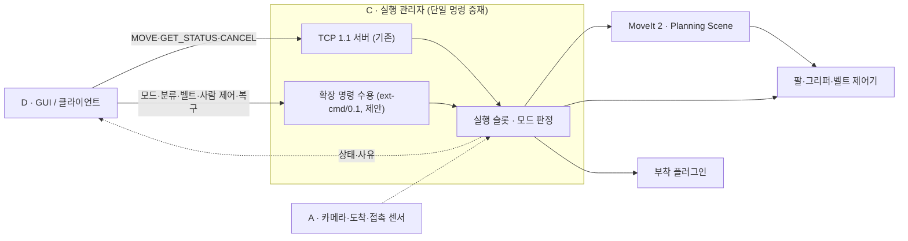

# 그리퍼·로봇 실행 상세설계 (집기·중재·확장 명령 계약)

문서 버전 0.3 · 설계 초안 · 2026-11-10

| 항목 | 내용 |
|---|---|
| 담당 | C(실행 소유: 로봇·그리퍼·부착·Planning Scene·벨트 실행, 분류 순서, 단일 명령 중재, 모드 전환·정지·복구), A(센서 입력), B(치수·좌표·목표·허용 값), D(외형·GUI·확장 명령 계약 초안) |
| 범위 | 5주 분류 시나리오의 2지 그리퍼 1종 부착 기반 집기·운반·배출, 실행 관리자의 단일 명령 중재와 모드 전환, 사람 제어 명령의 실행 제한, 확장 명령 계약(제안) |
| 상위 기준 | [시스템 아키텍처 및 프로젝트 계획](../architecture/시스템_아키텍처_및_프로젝트_계획.md) §2·§3·§4·§10.3·§10.4, [TCP 프로토콜 명세서](../protocol/TCP_프로토콜_명세서.md) 1.1 |
| 관련 문서 | [컨베이어 분류 상세설계](컨베이어_분류_상세설계.md), [사람 자세 제어 상세설계](사람_자세_제어_상세설계.md), [A](A담당_비전_상세설계.md) §13, [B](B담당_보정_좌표_상세설계.md) §15, [C](C담당_로봇서버_상세설계.md) §15, [D](D담당_GUI_TCP_상세설계.md) §A.11 |

| 버전 | 날짜 | 변경 |
|---|---|---|
| 0.1 | 2026-11-09 | 7주 계획(기본 5주 + 그리퍼 확장 2주)의 6~7주 그리퍼 선택·최소 집기 확장으로 최초 작성 |
| 0.2 | 2026-11-09 | 검토 반영: 상태 전이와 적용 경로, 기준/확장 실행 모드 배타(확장 모드에서 C 서버 미기동, B 순서 관리자 직접 MoveIt 실행), DetachableJoint 제약을 반영한 간격 닫힘·비접촉 부착, Gazebo–Planning Scene 전이, 작업별 준비 조건, 실패·취소 종료 규칙과 `HOLD_UNKNOWN` 복구 |
| 0.3 | 2026-11-10 | 사용자 확정(전체 5주, 1~3주차 볼트·너트 분류, 4~5주차 사람 자세 제어, C가 신규 로봇 실행 담당)에 따라 재구성. **0.1~0.2의 "C 신규 업무 없음", C 서버 없는 확장 실행 모드, B 순서 관리자의 직접 MoveIt 실행은 대체됨(이력으로만 보존).** 실행 소유자를 C로 일치, 4종 교체·6~7주 일정은 후속으로 이동, 2지 1종 고정, 복수 부품의 부착 대상 구성, 분류·사람 제어·TCP 1.1 경로의 단일 중재와 모드 전환, 확장 명령 계약 `ext-cmd/0.1`(제안) |
| 0.3 (검토 반영) | 2026-11-10 | 파지 방향 기준축·상대각 정의 통일(§6·§7.4), 수락 후 비전 무효화와 사람 입력 유실 정책의 적용 범위 분리(§7.6), 진행 중 취소·정지·조회와 종료 후 `HELD`의 신규 작업 제한 구분, `ISOLATE`의 `RECOVER` 선행(§7.7·§8.3), 시험 추가(§10) |

이 문서는 설계 제안입니다. 그리퍼·벨트 모델, 실행 관리자, GUI 코드는 없으며 실행·실측을 하지 않았습니다. 자료형·상태·사유 이름은 **구현 제안**이고 수치는 파일럿에서 정합니다. 집기 성공은 아직 확인된 결과가 아닙니다.

## 1. 범위

### 1.1 이번 5주 범위

| 항목 | 내용 | 상태 |
|---|---|---|
| 그리퍼 | 2지 1종 고정 | 5주 최소 구현안(제안) |
| 집기 방식 | **부착 기반 시연.** 조건 확인 후 시뮬레이터 고정 결합으로 부품을 붙임. 접촉·마찰 물리 파지로 보고하지 않음 | 제안 |
| 대상 | 정지한 벨트 위의 볼트 1개(한 번에 하나, 겹침 없음) | 제안 |
| 동작 | 사전 접근 → 하강 → 간격 닫힘 → 부착 조건 확인 → 부착 → 상승 → 운반 → 상자 위 해제 → 열기 → 복귀 | 제안 |
| 실행 | C의 실행 관리자 하나가 팔·그리퍼·부착·벨트에 명령. 자동 분류·사람 제어·TCP 1.1 `MOVE`를 같은 슬롯으로 중재 | 제안 |
| 시험 지원 | 복귀·해제·시험 초기화·격리 절차 | 제안 |

### 1.2 후속 (범위 축소)

그리퍼 4종(마그네틱·5지·3지·2지) 선택·교체, 실행 중 교체, 움직이는 벨트 위 연속 집기, 실물·마찰 파지, 6D 결과를 쓰는 집기, 3지·5지 손가락 독립 제어. 0.1~0.2의 4종 프로파일 구조는 후속 설계의 출발점으로 이력에 남깁니다. 이번 5주에 이 범위를 줄인 것은 우선순위 제안이며 사용자 확정이 아닙니다. 단 6D ArUco·PnP 자체를 후속으로 옮긴 것은 사용자 확정입니다(계획서 §2).

## 2. 담당과 공용 작업 소유자

C의 업무가 늘어납니다. C는 기존 TCP 서버(연결·프레이밍·검증·ID·중복·ACK·STATUS·오류 응답·취소·단절·재시작 복구·서버 로그·회귀 시험)를 그대로 유지하고, 아래 신규 로봇 실행 업무를 맡습니다.

| 담당 | 이 문서 범위의 책임 |
|---|---|
| C | 실행 관리자: 경로 계획·실행, 충돌·관절 제한, 그리퍼 제어, 부착·해제, Planning Scene 전이, 벨트 실행, 분류 순서, 단일 명령 중재, 모드 전환, 정지·복구, 확장 명령의 서버 수용·실행, 확장 서버 회귀 시험 |
| A | 카메라·도착 감지·접촉 센서 입력 구성과 출력, 시험 순서표·결과 취합 |
| B | 부품·그리퍼 치수, `T_E_G`, 파지점·규격별 개구폭·간격, 사전 접근·상승·운반·배출 좌표, 부착 허용치, 작업 범위. 직접 제어·실행 슬롯은 B 책임이 아님 |
| D | 그리퍼·벨트·상자 외형 자산, 상태 GUI, 확장 명령 계약 초안·클라이언트 |

| 공용 작업 | 소유자 |
|---|---|
| UR5e + 그리퍼 로봇 설명(xacro), Gazebo 모델·플러그인, 벨트 모델·제어기, 실행 구성(launch) | C (외형 메시는 D, 치수는 B) |
| 그리퍼 제어기 설정 | C |
| MoveIt 끝단·충돌·부품 충돌 물체·허용 충돌 쌍 | C (치수·자세 값은 B) |
| 카메라·도착 감지·접촉 센서 설정 | A |
| 확장 명령 계약 문서·스키마·시험 벡터 | D 초안, C 공동 확정, B 의미·유효성 협의 |

## 3. 그리퍼 프로파일과 기동 상태

### 3.1 프로파일 (2지 1종, 필드는 구현 제안)

`config/robot/grippers/two_finger.yaml`(제안)에 `gripper_id`, `profile_version`, `profile_hash`, 외형 자산 버전(D), 모델·제어기·관절·mimic 관절, `command_presets`(`open`·`close_to_gap`), `T_E_G`, `opening_range_mm`, 충돌·관성 참조, 부착 구성(§7.3), 재현 방법을 기록합니다.

### 3.2 런타임 적용 상태

| 상태 | 값(제안) | 의미 |
|---|---|---|
| 외형 `status.visual` (정적) | `설계 중` / `적용 대기` / `적용 확인` | D §A.10 기록. 실행 허용 조건이 아님 |
| 런타임 적용 `apply_state` | `미적용` / `적용 중` / `적용 확인` / `적용 실패` | 현재 실행 세대에서 §4의 기동 확인을 통과했는지 |
| 집기 검증 `status.grasp` (정적) | `미검증` / `파일럿 통과` / `평가 완료` | 평가 기록. 실행 허용 조건이 아님 |

`적용 확인` 전에는 집기·분류·사람 제어를 허용하지 않습니다. 외형이 `적용 확인`이어도 런타임 적용으로 표시하지 않습니다.

## 4. 기동·초기화와 복구 (C)

### 4.1 기동 순서

1. 실행 구성 기동. `apply_state = 적용 중`, 보유 상태 `HOLD_UNKNOWN`
2. **구성 확인** — §5.1의 「구성 확인」 열. 동작은 아직 하지 않음
3. **초기화** — §4.2. 2가 통과한 경우에만
4. **최종 확인** — §5.1의 「최종 확인」 열. 3에서 만든 현재 실행 세대의 초기화 기록을 근거로 사용
5. 2~4가 모두 통과하면 `적용 확인`, 하나라도 실패하면 그 자리에서 멈추고 `적용 실패`(이후 단계 미실행)

### 4.2 초기화 (시작 부착 해제와 초기 배치 확인)

DetachableJoint는 로드 직후 부착 상태로 시작합니다(§7.3). 부품 풀의 모든 부착 대상에 대해 다음을 확인합니다.

1. 월드 초기 상태에서 모든 부품이 그리퍼·로봇 링크와 충돌하지 않는 위치(대기 구역)에 있음
2. 상태 토픽을 먼저 구독한 뒤 해제 요청 → 대상별 `detached` 수신
3. 해제 전후 부품 위치·방향 변화가 허용치 이내. 움직였으면 `INIT_OBJECT_MOVED`로 `적용 실패`
4. Planning Scene: 작업대·벨트·상자 충돌 물체 등록, 부착 물체 없음
5. 모두 통과하면 보유 상태 `DETACHED`와 초기화 기록. 실패하면 `HOLD_UNKNOWN` 유지

### 4.3 복구 재기동 (`RECOVER`)

진입 조건은 **다음 중 하나 이상**(OR): `apply_state = 적용 실패` / 보유 `HOLD_UNKNOWN` / `RECOVERY_REQUIRED` 잠금. 여기에 사용자의 복구 확정이 항상 필요합니다(AND). 정상 `HELD`(정지 확인·두 시스템 일치, 잠금 없음)는 진입 조건이 아니며, 잠금이 있으면 보유 상태와 관계없이 확정 후 진입합니다.

1. 팔 명령을 보내지 않고 미종료 goal 취소 요청 → 종료·정지 확인. 확인할 수 없으면 실행 구성 전체를 정상 종료(응답 없으면 프로세스 종료를 기록)
2. 재기동 후 §4.1 2~5단계. 부품이 초기 배치로 돌아가는 것은 시험 초기화로 기록하며 해제·집기·분류 결과로 세지 않음
3. 자동 재시도는 하지 않음

## 5. 정합성과 무효화

### 5.1 기동 정합성

| 확인 대상 | 구성 확인 (초기화 전) | 최종 확인 (초기화 후) |
|---|---|---|
| Gazebo 모델 | 모델 이름·프로파일 식별 태그 | 그대로임 |
| 그리퍼·벨트 제어기 | `list_controllers`의 이름·종류·`active`·관절 | 같음 |
| 부착 플러그인 | 대상별 상태 토픽 구독 성공, 대상 모델·링크 이름 | 현재 세대의 대상별 `detached`·이동 없음 기록 |
| MoveIt | 끝단 링크·`T_E_G`·그리퍼 충돌 형상 | 작업대·벨트·상자 등록, 부착 물체 없음, 허용 충돌 쌍 기본값 |
| 센서 입력(A) | 카메라·도착 감지 토픽 수신 | 같음 |
| GUI 선택(D) | — | GUI가 표시하는 프로파일과 실행 관리자 보고가 같음 |

### 5.2 실행 세대

실행 세대 `run_epoch`(제안)는 기동·복구 재기동과 파지 설정 변경(`T_E_G`·간격·허용치) 때 올리는 단조 증가 정수입니다. 목표·스냅샷·계획·작업 기록에 `run_epoch`를 붙이고 현재와 다르면 폐기합니다. 상태 알림에도 넣어 GUI가 옛 세대 알림으로 화면을 덮지 않게 합니다. 비전 세대(A §5.4)는 별도 검사이며 둘 다 현재여야 목표가 유효합니다. 그리퍼 설정이 바뀌어도 카메라·영상 조건이 같으면 카메라를 다시 보정하지 않습니다.

## 6. 좌표와 공구 목표 (값은 B, 실행은 C)

| 목표 | 정의 |
|---|---|
| 파지 중심 G | 두 손가락 닫힘 축의 중앙. `T_E_G`는 프로파일 값 |
| 파지 목표 `T_W_G_grasp` | 부품별 파지점에 G. 상부 접근(G 접근 축이 W −Z). 손가락 닫힘 축의 W 평면 방향을 `ψ_close`, B가 낸 볼트 축 방향(장축각)을 `θ_bolt`라 하면 목표 상대각은 수직: `ψ_close_goal = θ_bolt + 90°`(180° 주기). 손목 yaw는 이 목표를 만족하는 두 해 중 현재 손목에서 회전량이 작은 쪽 |
| 방향 오차 | `e_dir = abs(wrap90(ψ_close − (θ_bolt + 90°)))`, `wrap90`은 각도를 −90°~+90°로 접는 180° 주기 차이. 정상 수직 파지는 `e_dir = 0°`, 평행 파지는 `e_dir = 90°` |
| 사전 접근·상승 | 파지 목표에서 W +Z로 접근 거리·상승 높이만큼 위 |
| 운반·배출 | 규격별 상자 위 배출 높이의 G 목표 |
| 개구폭 | 규격별 부품 폭 + 2 × 간격. 범위 밖이면 목표 무효 |
| 끝단 목표 | `T_W_E = T_W_G × inverse(T_E_G)` |

- 물체 자세 `T_W_O`와 공구 목표를 섞지 않습니다. TCP 1.1의 평면 θ 비사용 정책과 6D `MOVE`의 의미는 바꾸지 않습니다. 손목 yaw는 집기 경로 전용입니다.
- 부품별 관측면·파지 기준은 B의 재검토 항목입니다(볼트 머리·축, 너트에 기존 `top_face` 계약을 그대로 보장하지 않음).

## 7. 집기와 배출

### 7.1 단계

| 단계(제안) | 동작 | 넘어가는 조건 |
|---|---|---|
| `PRECHECK` | 슬롯 확보 후 §8.3 조건 | 모두 확인 |
| `SCENE_PREPARE` | 대상 부품 충돌 물체 등록(§7.5) | Scene 조회 확인 |
| `OPEN` | 열기 | 개구폭 허용치 안 |
| `MOVE_PRE`·`DESCEND` | 사전 접근·하강. `DESCEND`부터 손가락–대상 부품 허용 충돌 쌍만 허용 | goal 성공·정지·끝단 허용치 |
| `CLOSE_TO_GAP` | 부품 폭 + 간격까지 위치 제어로 닫음 | 목표 폭 도달(정지로 끝나면 실패) |
| `CHECK_ATTACH` | §7.4 | 모두 충족 |
| `ATTACH` | Gazebo 부착 → `attached` 수신 → MoveIt 부착 반영 확인 | 두 시스템 일치 |
| `LIFT` | 수직 상승 | goal 성공, 부품이 따라 상승 |
| `TRANSPORT` | 상자 위 배출 높이로 운반 | goal 성공, 보유 유지 |
| `DROP` | §7.5 해제 순서 → 열기 | 두 시스템 분리 확인, 열림 |
| `ARRIVAL` | 상자 도착 확인(컨베이어 분류 상세설계 §6) | 도착 확인 |

닫힘·부착·상승·운반·배출·도착은 각각 따로 기록합니다. 부착 실패·불명·불일치에서는 `LIFT`로 가지 않습니다.

### 7.2 그리퍼 제어기

ROS 2 Jazzy의 `parallel_gripper_action_controller`(단일 관절 액션, `goal_tolerance`·`allow_stalling`·`max_effort` 등)를 1안으로, 두 손가락을 한 관절 + mimic 관절로 구성합니다(`gz_ros2_control`은 mimic 관절 지원, mimic 관절에는 명령 인터페이스를 두지 않음). 접촉 전에 멈추는 위치 목표를 쓰므로 정지(stall)에 의존하지 않습니다. 액션 결과 필드는 C가 1주차에 실제 설치 버전에서 확인합니다.

### 7.3 부착 방법과 알려진 제약

Gazebo Harmonic(gz-sim 8) `DetachableJoint`를 1안으로 둡니다.

| 확인한 동작·제약 | 설계 반영 |
|---|---|
| 부착·재부착은 현재 자세 그대로 고정, 위치·접촉 검사 없음 | 부착 전 조건 확인(§7.4). 집기 중 `set_pose`로 부품을 옮기지 않음 |
| 접촉 중 재부착 미지원, 재부착 시 충돌이 없어야 함 | 간격 닫힘과 비접촉 긍정 확인 후 부착 |
| 초기 부착 상태에서 충돌 금지, 로드 직후 부착 | §4.2 초기화 |
| 해제 후 부모와 충돌하려면 부모 모델에 `<self_collide>` | C가 1주차에 확인 |
| 결합 결과는 트리, 플러그인 하나에 자식 하나, 한 모델에 여러 플러그인이면 `attach_topic`·`detach_topic`·`output_topic`을 각각 지정해야 함 | 아래 부품 풀 구성 |
| 상태 출력은 전환 시점에만 발행 | 요청 전에 구독, 미수신이면 부착 불명 |

**복수 부품의 부착 대상 구성.** 부품이 반복 공급되므로 단일 `part_0` 고정은 맞지 않습니다. 1안은 **고정 이름의 부품 풀**입니다: 볼트·너트 모델을 정해진 개수(`part_00`~`part_NN`)로 만들고, 그리퍼 모델에 부품마다 DetachableJoint 인스턴스를 하나씩 두며 토픽을 부품별로 지정합니다. 공급기는 대기 구역의 풀 부품을 벨트 시작부로 옮기고(공급 동작이며 집기가 아님), 배출·도착 후 회수합니다. 풀 크기, 대기 구역 배치, 인스턴스 수가 물리 성능에 주는 영향은 C의 1주차 확인 항목이며, 동적 생성 부품에 부착 대상을 붙이는 대안은 확인 전에는 쓰지 않습니다. Planning Scene 충돌 물체 ID도 같은 부품 ID를 씁니다.

### 7.4 부착 조건

1. 팔: `DESCEND` goal 성공, 정지 구간 동안 정지
2. 위치: 대상 부품 파지점과 G의 상대 위치 오차 허용치 이내. 손가락 사이 영역 밖이면 빈 집기
3. 방향: §6의 방향 오차 `e_dir`(목표 상대각 90° 기준)가 허용치 이내. 닫힘 축과 볼트 축의 단순 각도 차로 판정하지 않음
4. 개구폭: `CLOSE_TO_GAP`이 목표 폭 도달
5. 비접촉: 그리퍼·로봇과 부품 사이 접촉 없음과 최소 간격을 긍정 확인(접촉 센서는 A, 판정은 C). 확인 불가면 미충족
6. 부착 상태: 대상 Gazebo `detached`, Scene 부착 물체 없음
7. 세대: `run_epoch`와 목표 세대 현재, 벨트 정지 확인 유지

**런타임 시뮬레이션 피드백과 평가 정답.** 2·3·5번과 도착 감지는 시뮬레이터 상태로 판정합니다. 이것은 부착 기반 시연을 위한 설계 선택이며 사용자 확정이 아닙니다. 런타임 피드백은 실행 판정에만 쓰고 비전·목표·계획용 부품 자세·`MOVE`에 넣지 않습니다. 평가 정답(공급 순서표, 계획서 §10.1의 정답 기록)은 평가에만 쓰고 런타임 판정을 정답으로 재사용하지 않습니다. 실제 로봇에서는 이 판정을 그대로 쓸 수 없다는 한계를 보고합니다.

### 7.5 Gazebo 부착과 Planning Scene

| 항목 | 계약(제안) |
|---|---|
| 물체 ID·형상 | 부품 풀 ID, 규격별 치수의 단순 형상(B 치수) |
| 계획용 자세 출처 | 재검출 결과(B 좌표)와 벨트 상판 높이. 런타임 피드백·정답으로 보정하지 않음 |
| 허용 충돌 쌍 | `DESCEND`~`ATTACH` 동안 손가락 링크 ↔ 대상 부품만. `LIFT` 전 touch links로 대체 |
| 부착 순서 | Gazebo `attached` → MoveIt world→부착 전환 → 조회 확인 → 일치 시 `LIFT` |
| 해제 순서 | Gazebo `detached` → MoveIt 부착→world 복원(또는 상자 투입 후 제거) → 조회 확인 → 허용 충돌 쌍 원복 |
| 불일치·시간 초과 | `FAILED`(`SCENE_ATTACH_MISMATCH`), 보유 `HOLD_UNKNOWN`, 이동 차단, 복구는 §4.3 |

### 7.6 실패 처리

| 상황 | 판정(제안) | 처리 | 하지 않는 것 |
|---|---|---|---|
| 빈 집기 | `EMPTY_GRASP` | 부착하지 않음, 그 자리 정지 | 자동 재집기 |
| 닫힘 도중 정지 | `GRIPPER_BLOCKED` | 부착 요청 없음 | 접촉 중 부착 |
| 부착 조건 불일치 | `ATTACH_CONDITION_UNMET` | 부착 요청 없음 | 강제 부착, 순간이동 |
| `attached` 미수신 | `ATTACH_UNCONFIRMED`, `HOLD_UNKNOWN` | 이동 차단, 복구 §4.3 | 상승 |
| 두 시스템 부착 불일치 | `SCENE_ATTACH_MISMATCH` | §7.5 | 상승 |
| 상승·운반 실패 | `LIFT_FAILED`·`TRANSPORT_FAILED` | 보유 유지·정지 확인 | 자동 해제 |
| 운반 중 보유 상실 | `HOLD_LOST` | 부품 위치 기록, 벨트 정지 유지 | 자동 재집기 |
| `DROP` 분리 전 실패·취소 | `RELEASE_FAILED`·`CANCELLED` | §8.3 종료 규칙. 정지 확인·두 시스템 부착 일치면 `HELD`로 슬롯 반환 | 자동 재해제 |
| `detached` 미수신 | `DETACH_UNCONFIRMED`, `HOLD_UNKNOWN` | 복구 §4.3 | 분리로 간주 |
| 분리 후 Scene 복원 실패 | `SCENE_ATTACH_MISMATCH`, `HOLD_UNKNOWN` | 복구 §4.3 | 다음 이동 |
| 분리·복원 후 열기 실패 | `OPEN_FAILED`, 보유 기록 `DETACHED` | 허용 충돌 쌍 원복 후 `RECOVERY_REQUIRED` 잠금 | 닫힌 손가락으로 다음 작업 |
| 상자 도착 미확인 | `ARRIVAL_UNCONFIRMED` | 수량 증가 없음, 벨트 정지 유지 | 성공 처리 |
| 사용자 취소 | `CANCELLED` | goal 취소 → 종료·정지 확인, 보유 상태 보고 | 자동 개방·해제 |
| GUI 단절 (`AUTO_SORT`·`MOVE_TEST`·복구 작업) | 취소 아님. 작업 계속, 슬롯 유지 | 재접속 후 조회 | 자동 재요청 |
| `HUMAN` 입력 유실·오래된 입력·하트비트 타임아웃(GUI 단절 포함) | `FAILED`(`INPUT_LOST`) | 수락된 동작도 즉시 취소 요청 → goal 종료·정지 확인, `HUMAN` 활성화 해제. 이 정책이 아래 행(수락 후 무효화 영향 없음)보다 우선 | 자동 재개, 자동 재활성화, 자동 개방 |
| ROS·Gazebo 단절, 피드백 손실 | `ROS_DISCONNECTED`·`FEEDBACK_LOST`, `HOLD_UNKNOWN` | 이동 차단 | 성공 처리 |
| 실행 관리자 재시작 | 작업 기록으로 미종료 작업 확인 → goal 종료·정지·부착·Scene 확인 후 `MANAGER_RESTARTED`, 확인 못 하면 `RECOVERY_REQUIRED` | 사용자 복구 | 자동 재실행 |
| 수락 후 부품 비전 가림·무효화(`AUTO_SORT`의 정적 부품 관측) | 수락된 작업에 영향 없음. `HUMAN` 동작에는 적용하지 않음(위 행) | 화면 표시 | 비전 무효화만으로 자동 취소 |

수락 전(송신 직전·수락 대기)에는 A §5.4와 D §A.6의 무효화·재전송 중단 규칙을 그대로 적용합니다.

### 7.7 복귀·해제·시험 초기화·격리

모두 사용자가 명시적으로 실행하는 슬롯 작업이며 성공·분류 결과로 세지 않습니다. 시작 조건은 §8.3 표를 따릅니다.

1. **`RELEASE`** — 정지 확인·두 시스템 부착 일치 `HELD`에서 사용자 확정 시, 해제 높이로 내린 뒤 §7.5 해제 순서 → 열기 → 허용 충돌 쌍 원복. 도중 실패·취소는 §7.6·§8.3
2. **`HOME`** — `DETACHED`·Scene 부착 물체 없음에서 복귀
3. **`RESET_TRIAL`** — `DETACHED`·부착 물체 없음·비접촉 확인 상태에서만 시뮬레이터 배치 이동으로 부품을 대기 구역·초기 배치로 되돌리고 Scene 갱신, 기록
4. **`ISOLATE`** — 실패·미판정 볼트를 격리 구역으로. 시작 조건은 `DETACHED`·잠금 없음이며, `HOLD_UNKNOWN`·`RECOVERY_REQUIRED`이면 먼저 사용자가 확정한 `RECOVER`(§4.3)로 분리·정지를 확인해야 함. 집을 수 있으면 집기·운반으로, 아니면 3과 같은 조건(`DETACHED`·비접촉)에서 배치 이동으로 옮기고 실패로 집계(컨베이어 분류 상세설계 §5)

## 8. 제어와 통신

### 8.1 구성

C의 실행 관리자가 팔·그리퍼·부착·벨트에 명령하는 유일한 주체입니다. 이전 0.2의 "C 서버 없는 확장 모드"와 B의 직접 실행은 쓰지 않습니다. 기존 TCP 1.1 서버를 유지하면서 확장 명령 수용과 실행을 추가하므로 C의 구현·회귀 부담이 늘어납니다(계획서 §12).

### 8.2 모드

| 모드(제안) | 팔 명령 출처 |
|---|---|
| `IDLE` | 없음 |
| `MOVE_TEST` | TCP 1.1 `MOVE`(기존 접근 목표 이동·통신 시험) |
| `AUTO_SORT` | 분류 순서(컨베이어 분류 상세설계 §4) |
| `HUMAN` | 사람 제어 사전 동작(사람 자세 제어 상세설계 §3) |

모드 전환은 사용자가 요청하고 C가 판정합니다. 전환 조건: 벨트 정지 확인, 슬롯 비어 있음, 미종료 goal 없음, 관절 정지, 보유 `DETACHED` 확인. `HUMAN` 진입은 추가로 사용자 동의·활성화가 필요하며 `HELD`·`HOLD_UNKNOWN`에서는 거부합니다. 자동 분류와 사람 제어가 동시에 팔 명령을 내지 않습니다.

**TCP 1.1과의 관계.** `MOVE_TEST`가 아닌 모드에서 TCP 1.1 `MOVE`를 거부하는 방법은 기존 의미 안에서 정합니다(예: 기존 `BUSY`·`NOT_READY`의 정의에 맞는지). TCP 1.1의 `state` enum·`not_ready_reasons`·스키마에 새 값을 몰래 넣지 않으며, 기존 의미로 표현할 수 없으면 명세서 개정 제안으로 따로 올립니다. 결정 담당 C·D, 1주차.

### 8.3 실행 슬롯과 작업별 조건

- 실행 관리자는 슬롯을 원자적으로 확보한 뒤 조건을 확인하고, 종료 기록·goal 종료·정지·보유 상태 확정 후에만 반환합니다. 성공과 실패·취소 모두 같은 종료 규칙을 따르며, 성공 조건을 못 채웠다고 슬롯을 계속 점유하지 않습니다.
- **공통 기반 조건(B1~B8):** B1 슬롯 확보 · B2 실행 관리자 외 명령 출처 없음(외부 goal 감지 시 `ARBITRATION_CONFLICT`) · B3 ROS 2·Gazebo 연결과 `/clock` · B4 팔·그리퍼·벨트 제어기 `active` · B5 미종료 goal 없음 · B6 피드백 최신·정지 · B7 재시작 복구 완료(`RECOVERY_REQUIRED` 아님) · B8 작업 기록 저장 가능

| 작업 | 공통 | 작업별 조건 | 거부 사유(제안) |
|---|---|---|---|
| 분류 시작 `SORT_START` | B1~B8 | `적용 확인`, `AUTO_SORT`, `DETACHED`, Scene 정상 | `NOT_APPLIED`·`MODE_MISMATCH`·`HOLD_UNKNOWN` |
| 분류 집기(내부 작업) | B1~B8 | 벨트 정지 확인, 재검출 목표 유효, `DETACHED` | `BELT_STOP_UNCONFIRMED`·`TARGET_INVALID` |
| `RELEASE` | B1~B8 | `적용 확인`, 정지 확인·두 시스템 부착 일치 `HELD`, 사용자 요청 | `NOT_HOLDING`·`HOLD_UNKNOWN`·`SCENE_ATTACH_MISMATCH` |
| `HOME` | B1~B8 | `DETACHED`, 부착 물체 없음 | `HOLDING_OBJECT`·`HOLD_UNKNOWN` |
| `RESET_TRIAL` | B1~B8 | `DETACHED`, 부착 물체 없음, 비접촉 | `HOLDING_OBJECT`·`HOLD_UNKNOWN`·`CONTACT_UNCONFIRMED` |
| `ISOLATE` | B1~B8 | 벨트 정지, 보유 `DETACHED`, 잠금 없음, 사용자 확정. 배치 이동을 쓰면 비접촉 확인 추가 | `CONFIRMATION_REQUIRED`·`HOLD_UNKNOWN`(→ `RECOVER` 선행)·`CONTACT_UNCONFIRMED` |
| `HUMAN_MOTION` | B1~B8 | `HUMAN`, 활성화, 입력 최신·유효, `DETACHED` | `INPUT_STALE`·`NOT_ENABLED` |
| TCP 1.1 `MOVE` | 기존 준비 조건 | `MOVE_TEST`, `DETACHED` | 기존 TCP 1.1 코드(§8.2) |
| `RECOVER` | B2·B8 (B1은 잠금 인수) | §4.3의 OR 진입 조건 + 사용자 확정 | `CONFIRMATION_REQUIRED` |
| 취소·상태 조회 | 없음 | 대상 일치 | `UNKNOWN_JOB` |

- **실패·취소 종료 규칙:** ① 종료 기록 ② goal 취소 요청과 B5·B6 재확인 ③ ②가 확인된 경우에만 두 시스템 모두 부착이면 `HELD`, 모두 분리면 `DETACHED`, 그 밖은 `HOLD_UNKNOWN`. ②를 확인할 수 없으면 일치해도 `HOLD_UNKNOWN`으로 기록(일치 여부는 사유에 남김) ④ 슬롯 반환. ②를 확인할 수 없거나 그리퍼 상태를 신뢰할 수 없으면 반환하지 않고 `RECOVERY_REQUIRED`로 잠가 `RECOVER`만 인수
- **진행 중 작업의 취소·정지·상태 조회는 보유 상태와 관계없이 항상 허용합니다**(운반 중 `HELD` 포함). 아래 제한은 작업이 끝나고 정지 확인·슬롯 반환이 된 뒤의 **새 작업**에만 적용합니다.
- 슬롯 반환 후 `HELD`에서는 새 작업으로 `RELEASE`만, `HOLD_UNKNOWN`·잠금에서는 `RECOVER`만 허용합니다. 자동 재해제·자동 개방·자동 재집기·자동 재개는 하지 않습니다.
- 상태 조회는 공통 조건 결과와 작업별 허용 여부·거부 사유를 돌려주고, D는 이 값으로만 버튼을 활성화합니다.

### 8.4 확장 명령 계약 `ext-cmd/0.1` (제안, TCP 1.1 변경 없음)

- TCP 1.1의 `MOVE`/`REACHED`를 집기·분류 완료의 의미로 바꾸지 않습니다. 사람·분류·벨트·그리퍼·모드 명령은 이 별도 계약으로 정의합니다.
- 요청 후보: `SET_MODE`, `SORT_START`·`SORT_STOP`, `BELT_STOP`·`BELT_RESUME`(시험용), `RELEASE`·`HOME`·`RESET_TRIAL`·`ISOLATE`, `HUMAN_ENABLE`·`HUMAN_INTENT`·`HUMAN_DISABLE`·하트비트, `RECOVER`, `CANCEL_JOB`, `GET_EXEC_STATUS`
- 상태 후보: 모드, 작업 단계·결과·사유, 보유 상태, `apply_state`, `run_epoch`, 벨트 상태, 상자별 도착 수량, 공통 조건 결과·작업별 허용 여부
- 전송 방식·스키마·오류 코드·ID 규칙·갱신 주기·타임아웃·취소·단절·중복 정책: **D·C 소유**, B는 의미·유효성 협의. **1주차 확정 목표.** 확정 전까지 위 이름은 제안
- 단절은 취소가 아니고, 같은 ID·같은 내용 재요청은 새 작업을 만들지 않는 원칙은 TCP 1.1과 같게 둡니다(세부는 계약에서 확정).

## 9. 일정

| 주차 | C | A | B | D |
|---|---|---|---|---|
| 1주차 | 그리퍼·벨트·부품 풀 모델 골격, 제어기·부착 플러그인 확인(`<self_collide>`·풀 구성), 실행 관리자 구조, 확장 계약 공동 초안, 기존 TCP 서버 골격 | 카메라·도착·접촉 센서 입력 | 치수·`T_E_G`·좌표 초안 | 계약 초안·외형 자산 |
| 2주차 | 기동·초기화, 집기·운반·배출, Scene 전이, 분류 순서 1차 | 센서 출력 고정 | 파지점·개구폭·간격·허용치 초안 | 상태 GUI·클라이언트 |
| 3주차 | 실패·격리·복구, 분류 실행본 고정 | 결과 취합 | 허용치 고정 | 시연 화면 |
| 4~5주차 | 사람 제어 사전 동작 실행·입력 유실 정지, 분류 회귀 | 회귀 취합 | 매핑 값 | 사람 제어 화면 |

## 10. 검증 계획 (모두 계획·미실행)

| 영역 | 시나리오 | 기대 결과 |
|---|---|---|
| 기동 순서 | 첫 기동, 구성 확인 실패·`detached` 미수신·물체 이동 주입 | 구성 확인 → 초기화 → 최종 확인 순서, 실패 단계 이후 미실행, `적용 실패`·`HOLD_UNKNOWN` |
| 부품 풀 | 풀 전체 초기 해제, 반복 공급·회수 | 대상별 `detached`, 부품 ID와 Scene ID 일치 |
| 정상 집기·배출 | 볼트 A·B 각각 | 단계별 기록, 해당 상자 도착 |
| 빈 집기·접촉·불일치 | 부품 없음, 간격 0 이하·관통, 위치·방향 오프셋 | 부착 요청 0건 |
| 부착 불명·불일치 | `attached` 미수신, Gazebo만·MoveIt만 부착, 복원 실패 | 상승 0건, 이동 차단 |
| 해제 실패·취소 | 분리 전 하강 실패·취소, `detached` 미수신, 열기 실패, 취소 후 정지 미확인 + 부착 일치 | §7.6·§8.3대로: `HELD` 반환 후 `RELEASE` 재요청만 수락 / `HOLD_UNKNOWN`·잠금이면 확정한 `RECOVER`만 |
| 단일 중재 | 분류 중 TCP `MOVE`, 분류 중 사람 제어 진입, 외부 goal 주입 | 거부, 진입 거부, `ARBITRATION_CONFLICT` |
| 모드 전환 | 벨트 가동 중·보유 중·불명에서 전환 요청 | 거부 |
| 취소·단절·재시작 | 각 단계 | §7.6대로, 자동 재실행 0건 |
| 파지 방향 게이트 | 볼트 축 0°에 닫힘 축 90°(정상 수직), 닫힘 축 0°(평행), 수직에서 허용치 직전·직후 | 수직은 통과(`e_dir`=0°), 평행은 `ATTACH_CONDITION_UNMET`(`e_dir`=90°), 경계는 허용치 기준대로 통과/거부 |
| `HUMAN` 수락 후 유실·단절 | 사전 동작 수락 후 사람 가림, 오래된 입력, GUI 하트비트 끊김 | 즉시 취소 → 정지 확인, `INPUT_LOST`, `HUMAN` 비활성, 자동 재활성화 0건. 같은 상황의 `AUTO_SORT`는 부품 가림·GUI 단절로 취소되지 않음 |
| 진행 중 취소와 종료 후 `HELD` | 운반 중(`HELD`) 취소·정지·조회, 작업 종료·슬롯 반환 후 `HELD`에서 새 작업 요청 | 운반 중 취소·정지·조회는 수락, 종료 후 `HELD`는 `RELEASE`만 수락 |
| 불명 상태 격리 | `HOLD_UNKNOWN`에서 `ISOLATE`·`RESET_TRIAL` 요청 → 확정한 `RECOVER` → `ISOLATE` | 앞의 두 요청 거부, 복구 후에만 격리 수락. 복구 초기 배치는 분류 성공으로 세지 않음 |
| TCP 1.1 회귀 | 기존 명세 시험 벡터, 통신 100회 | 기존 판정 그대로 |

## 11. 미확정·확인 항목

| 항목 | 담당 | 시점 |
|---|---|---|
| 확장 명령 계약 전송·스키마·오류·ID·주기·타임아웃·취소·단절·중복 | D·C(B 협의) | 1주차 |
| 다른 모드에서 TCP 1.1 `MOVE` 거부 표현(기존 의미 내) | C·D | 1주차 |
| 부품 풀 크기·대기 구역, DetachableJoint 인스턴스 수 영향, `<self_collide>` | C | 1주차 |
| 그리퍼 제어기 액션 결과 필드, 접촉 센서 구성 | C·A | 1주차 |
| 간격·허용치·접근·상승·배출 높이 | B | 2주차 파일럿 |
| 부품별 관측면·파지 기준 | B(A 확인) | 1~2주차 |

## 12. 참고 자료

- [Gazebo Harmonic Detachable Joints 튜토리얼](https://gazebosim.org/api/sim/8/detachablejoints.html), [DetachableJoint API](https://gazebosim.org/api/sim/8/classgz_1_1sim_1_1systems_1_1DetachableJoint.html), [gz-sim8 소스](https://github.com/gazebosim/gz-sim/tree/gz-sim8/src/systems/detachable_joint)
- [MoveIt Task Constructor pick and place 예제](https://moveit.picknik.ai/main/doc/tutorials/pick_and_place_with_moveit_task_constructor/pick_and_place_with_moveit_task_constructor.html)
- [ros2_controllers Jazzy Parallel Gripper Action Controller](https://control.ros.org/jazzy/doc/ros2_controllers/parallel_gripper_controller/doc/userdoc.html)
- [gz_ros2_control (Jazzy)](https://control.ros.org/jazzy/doc/gz_ros2_control/doc/index.html)
- [ros_gz_bridge (Jazzy)](https://github.com/gazebosim/ros_gz/tree/jazzy/ros_gz_bridge)

위 자료는 2026-11-09에 확인했습니다. 실제 설치 버전의 동작은 1주차 확인 항목입니다.
