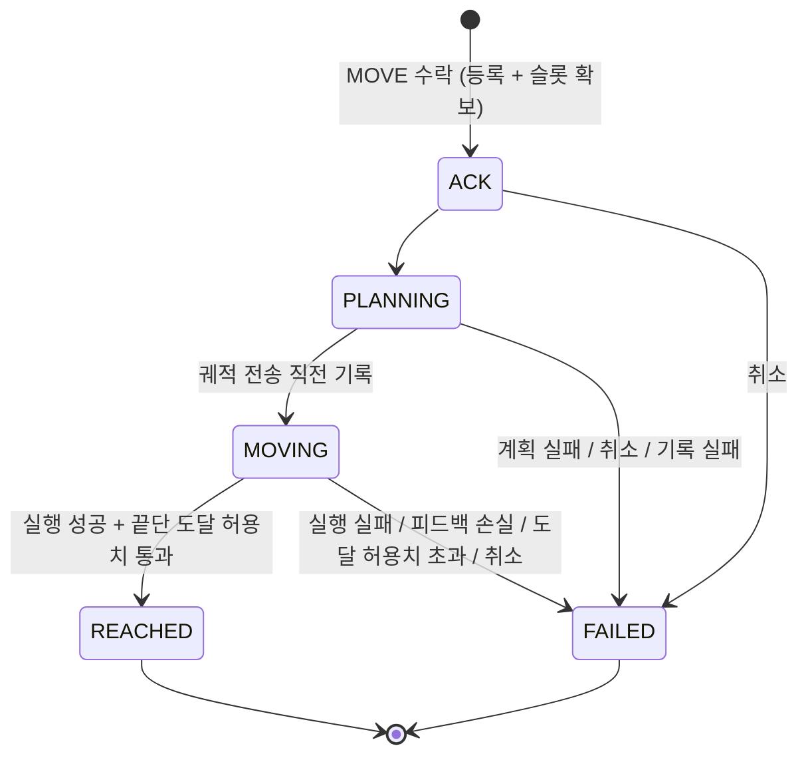
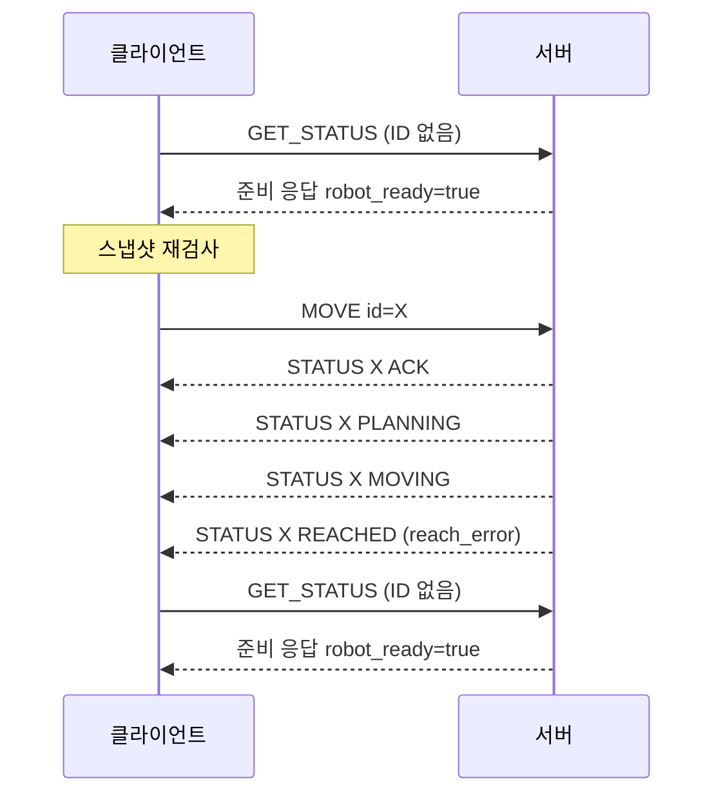
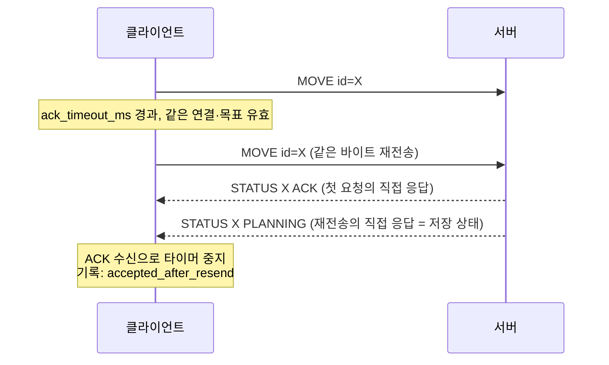
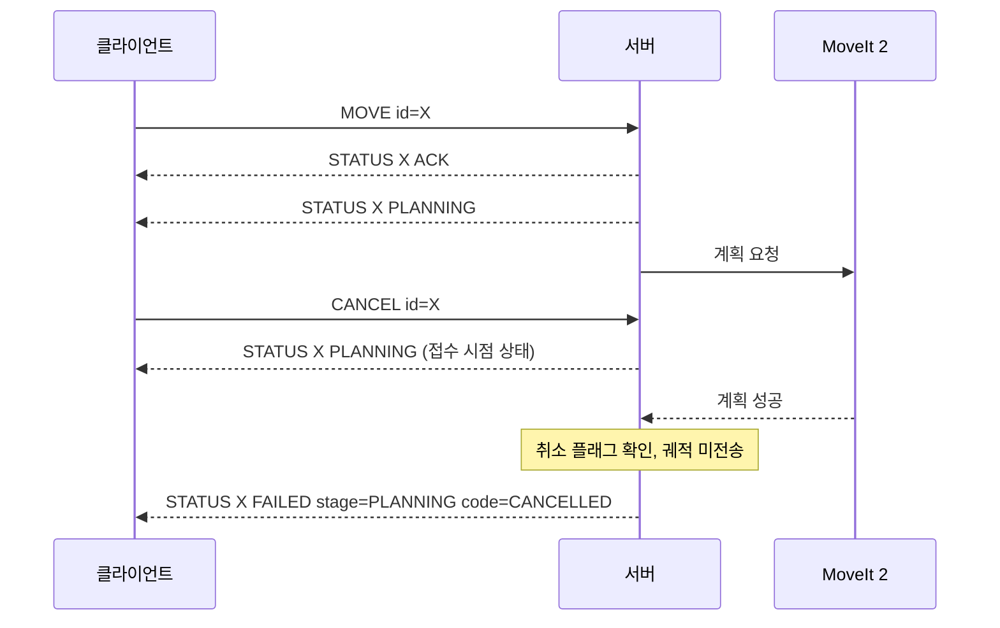
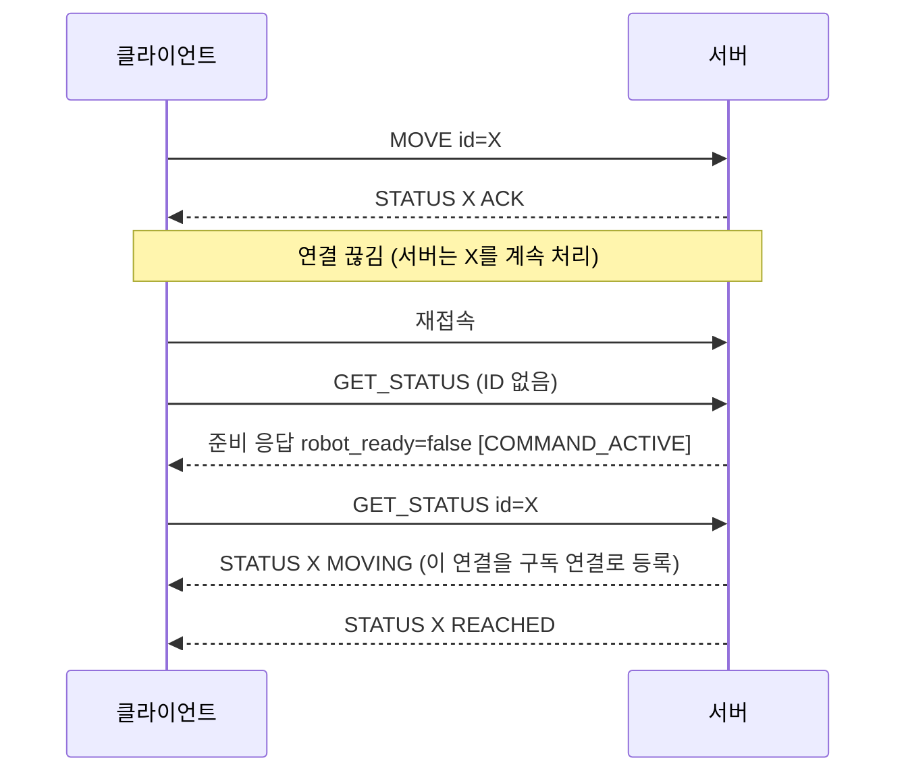
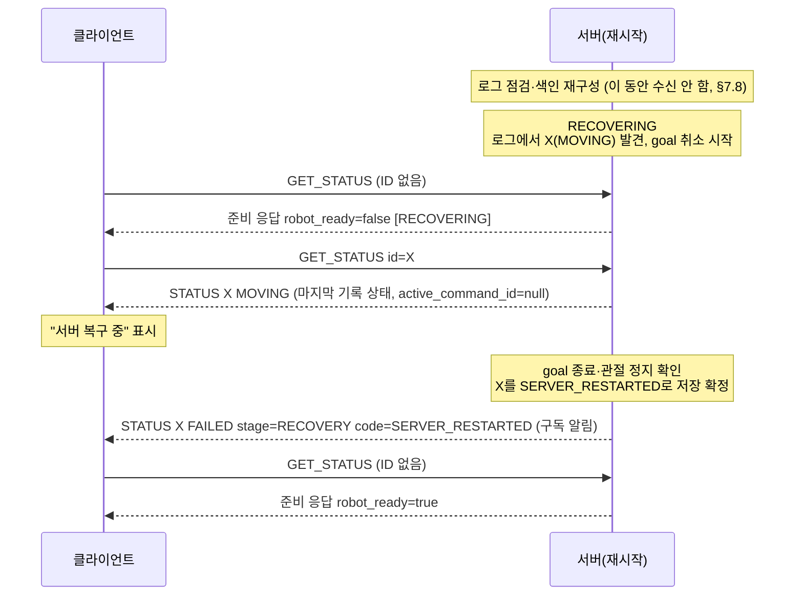

# EyetoArm — TCP 패킷 정의서

문서 버전 1.0 (초안) · 프로토콜 버전 `"1.1"` · 2026-11-07

| 항목 | 내용 |
|---|---|
| 기준 문서 | [시스템 아키텍처와 5주 계획](../architecture/시스템_아키텍처_및_프로젝트_계획.md) §2.4 |
| 작성·유지 | D (제안, 팀 확정 필요) |
| 승인 | C — 서버 동작(§5 상태 전이, §6 코드, §7 서버 규칙) |
| 검토 | A — 통신 100회 시험·장애 시험 관점 |
| 함께 제공 | [요청 스키마](c2s.schema.json), [응답 스키마](s2c.schema.json)(JSON Schema 2020-12), [적합성 시험 벡터](test_vectors.json) |

| 초안 개정 | 내용 |
|---|---|
| 1.0 초안 1차 | 최초 작성 |
| 1.0 초안 2차 | 검토 반영: 준비 조회 시간 초과 시 재접속, 중복 검사에 저장 로그 포함, 취소와 완료가 겹칠 때의 판정, 형식·값 오류 분류 기준과 우선순위, 쿼터니언 중복 판정 정규화, 중복 판정 시험 벡터 추가 (§10) |
| 1.0 초안 3차 | 검토 반영: `ACK` 이후 로그 기록 실패 처리와 코드 `LOG_WRITE_FAILED`·`LOG_UNAVAILABLE` 추가, 같은 명령의 상태 역행 방지 (§10) |
| 1.0 초안 4차 | 검토 반영: `NOT_READY`는 등록 기록 실패에만 적용, 종료 상태는 로그 기록 후에만 알림 (§10) |
| 1.0 초안 5차 | 저장 확정 기준(§7.5.2) 신설: `fsync` 완료 후 다음 단계, 로그 위치·형식·점검, 손상 시 `RECOVERY_FAILED` (§10) |
| 1.0 초안 문서 정리 | §10을 검토 이력과 기준 절 참조로 축약, 프로젝트명에 맞춰 파일명·경로 안내 정리 |
| 1.0 초안 설계 검토 | 위치·자세가 가리키는 점(§4.2), 쿼터니언 성분 범위와 시험 벡터 c2s-051(§4.2·§6.1), 재시작 직후·복구 중 응답(§7.8)과 통합 시험 항목(§13.1) 추가, 로그 경로 예시와 스키마 `$id`의 옛 프로젝트명 정리(§7.5.2·§9) |
| 1.0 초안 설계 검토 2차 | 숫자 표현 범위(§2.3·§4.1·§6.1·§8.8)와 시험 벡터 c2s-052~058·s2c-038~039, 로그 유실·손상 복구 정책: 파일 없음도 `RECOVERY_FAILED`, 명시적 초기화 절차와 보장 범위(§7.5·§7.5.2·§7.8·§13.1) |
| 1.0 초안 부록 B | 2026-11-12 부록 B 「영상 표시 경로」 추가(A 초안, 미승인 제안, 사용자 결정 2026-11-12 「1안으로 하고 A가 초안 작성」). §0에 부록 B 참고 한 줄. §0~§13·부록 A·스키마·시험 벡터와 프로토콜 버전 `"1.1"`은 변경 없음 |

## 0. 이 문서의 위치

- 이 정의서는 GUI·시험 도구(클라이언트)와 TCP 서버 사이 명령·상태 메시지의 **단일 기준**입니다. 계획서 §2.4와 내용이 다르면 이 정의서를 따르고, 계획서는 요약으로 유지합니다.
- 프로토콜 버전 `"1.1"`의 메시지 종류와 필드를 그대로 씁니다. **새 메시지나 필드는 추가하지 않았습니다.** 계획서 v1.1에서 정의가 모호했던 부분만 확정했습니다(§10 초안 검토 이력).
- 영상은 이 TCP로 보내지 않습니다. ROS 2 토픽 또는 앱 내부 대기열을 사용합니다.
- (참고) Windows GUI 영상 표시 경로는 [부록 B](#부록-b-영상-표시-경로-a-초안--미승인--프로토콜-11-아님)(미승인 제안)를 따릅니다.

### 0.1 변경 규칙

| 변경 종류 | 예 | 처리 |
|---|---|---|
| 설명 보완 | 문구, 예시, 시퀀스 추가 | 문서 버전만 올림 (1.0 → 1.1) |
| 설정 초기값 변경 | 대기 시간, 재전송 횟수 | §9 표 수정, 문서 버전 올림 |
| 메시지 형식·의미 변경 | 필드 추가·삭제, 코드 추가, 상태 전이 변경 | 프로토콜 버전 변경(`"1.1"` → `"1.2"`), C 승인과 C·D·A 확인 후 적용. 서버와 클라이언트를 함께 배포 |

서버는 자신이 지원하는 버전 문자열과 정확히 같은 `version`만 받습니다. 하위 호환 모드는 두지 않습니다.

이 규칙은 **C가 정의서를 승인한 뒤부터** 적용합니다. 승인 전 초안 개정(코드 값 추가 포함)은 아직 구현된 서버·클라이언트가 없으므로 프로토콜 버전 `"1.1"` 안에서 처리합니다.

## 1. 용어

| 용어 | 의미 |
|---|---|
| 클라이언트 | TCP로 요청을 보내는 쪽. D의 GUI, A의 시험 도구 |
| 서버 | C의 TCP 서버. ROS 2·MoveIt 2·궤적 컨트롤러와 연결 |
| 명령 | `MOVE` 한 건. `command_id`로 식별 |
| 실행 슬롯 | 서버 전체에 1개. `ACK`부터 종료 상태(`REACHED`·`FAILED`)가 **로그에 기록될 때**까지 한 명령이 점유. 종료 기록 성공, 슬롯 해제, 종료 알림 대기열 등록은 같은 잠금 안에서 처리(§7.5.1). 서버 재시작 후 종료 기록이 없는 이전 명령은 슬롯을 점유하지 않고 복구 대상으로 처리(§7.8) |
| 준비 상태 | `robot_ready`. 새 `MOVE`를 지금 수락할 수 있는지 (계획서 §2.4.5) |
| 직접 응답 | 요청 1건에 대해 서버가 반드시 보내는 응답 1건 |
| 상태 알림 | 명령 상태가 바뀔 때 서버가 요청 없이 보내는 `STATUS` |

## 2. 전송 규칙

### 2.1 연결

- TCP, 서버는 설정 파일의 주소·포트에 바인딩합니다. 기본 주소 `127.0.0.1` (WSL2 단일 구성), 포트는 §9 설정값.
- 동시 연결은 허용합니다. 단, 실행 슬롯은 서버 전체에 1개이므로 두 클라이언트가 동시에 `MOVE`를 보내면 늦은 쪽은 `BUSY`를 받습니다. 운영 중에는 GUI 또는 시험 도구 중 하나만 접속하는 것을 원칙으로 합니다.
- 연결 직후 인사 메시지(hello)나 별도 하트비트 메시지는 없습니다. 연결 확인과 준비 확인은 `command_id` 없는 `GET_STATUS`로 합니다(§8.1).

### 2.2 프레이밍

- 메시지 1개 = UTF-8(BOM 없음) JSON 객체 1개 + LF(`0x0A`) 1개.
- 송신 측은 LF만 붙입니다. 수신 측은 줄 끝의 CR(`0x0D`) 1개를 제거하고 해석해도 됩니다.
- JSON 객체 안에는 줄바꿈 문자를 넣지 않습니다(직렬화 시 들여쓰기 금지).
- 한 줄의 최대 길이는 §9의 `max_line_bytes`(LF 제외)입니다. 넘으면 수신 측은 다음 LF까지 버리고, 서버는 `BAD_FORMAT`을 직접 응답합니다.
- 수신 측은 받은 바이트를 버퍼에 쌓고 **LF까지 완성된 줄만** 해석합니다. 한 번에 여러 줄이 오면 순서대로 처리합니다. 분할된 UTF-8 문자는 다음 수신까지 보관합니다.
- **연결이 끊기면 LF로 끝나지 않은 마지막 조각은 해석하지 않고 버립니다.** 새 연결의 데이터와 합치지 않습니다. 서버가 이 규칙을 지켜야, 클라이언트가 일부만 보낸 `MOVE`가 실행되지 않습니다.

### 2.3 JSON 해석 규칙

수신 측(서버와 클라이언트 모두)은 다음을 지킵니다. 위반하면 서버는 `BAD_FORMAT`을 응답하고, 클라이언트는 그 줄을 기록만 하고 상태에 반영하지 않습니다.

- 최상위는 객체여야 합니다.
- 중복 키를 거부합니다. (Python `json`은 기본적으로 마지막 값을 쓰므로 `object_pairs_hook`으로 검사합니다.)
- `NaN`, `Infinity`, `-Infinity`를 거부합니다. (Python `json.loads`는 기본적으로 받아들이므로 `parse_constant`로 거부합니다. 송신 시 `json.dumps(..., allow_nan=False)`.) binary64로 바꾸면 비유한 수가 되는 숫자(`1e400`, 범위를 넘는 거대 정수 리터럴)도 같은 위반입니다. Python은 `1e400`을 조용히 `inf`로 읽으므로 `parse_float`로 검사합니다. 세부 규칙은 §4.1 「숫자 표현 범위」.
- **정의되지 않은 필드는 무시하지 않고 거부합니다.** 오타 필드(`theta_degree` 등)가 조용히 무시되는 것을 막기 위해서입니다.
- 정수 필드는 소수점·지수 표기 없는 JSON 정수여야 합니다(`1532`는 허용, `1532.0`·`1.532e3`은 거부).

## 3. 메시지 종류

| 방향 | `type` | 용도 |
|---|---|---|
| 클라이언트 → 서버 | `MOVE` | 이동 명령 1건 |
| 클라이언트 → 서버 | `GET_STATUS` | 명령 상태 조회(`command_id` 있음) 또는 준비 상태 조회(없음) |
| 클라이언트 → 서버 | `CANCEL` | 명령 취소 요청 |
| 서버 → 클라이언트 | `STATUS` | 모든 응답과 상태 알림 |

모든 메시지에 `version`(`"1.1"`)과 `type`이 있습니다.

## 4. 필드 정의

### 4.1 공통 값 형식

| 형식 | 규칙 |
|---|---|
| UUID | UUID v4, 소문자 16진수, 하이픈 포함 36자. 정규식 `^[0-9a-f]{8}-[0-9a-f]{4}-4[0-9a-f]{3}-[89ab][0-9a-f]{3}-[0-9a-f]{12}$` |
| 식별 문자열 | `source_id`, `calibration_id`: 1~64자, `^[A-Za-z0-9_.-]+$` |
| 정수 ms | 0 이상 2^53−1 이하 JSON 정수 |
| 실수 | binary64로 바꿨을 때 유한한 JSON 숫자(아래 「숫자 표현 범위」). 단위는 필드 이름에 표시(`_mm`, `_deg`) |

**숫자 표현 범위.** 모든 요청과 응답의 숫자 필드에 적용합니다. 정수 필드는 `image_seq`, `timestamp_ms`, `server_time_ms`이고, 그 밖의 숫자 필드는 실수 필드입니다.

1. 실수 필드는 IEEE 754 binary64로 바꿨을 때 유한한 값이어야 합니다.
2. `NaN`, `Infinity`, `-Infinity`, 그리고 `1e400`처럼 바꾼 결과가 비유한 수가 되는 값은 `BAD_FORMAT`입니다.
3. 실수 필드에 정수 표기를 써도 같은 조건을 적용합니다. binary64의 유한 범위를 넘는 거대 정수는 `BAD_FORMAT`입니다.
4. 정수 필드는 부동소수점으로 바꾸지 않고 정수 그대로 검사합니다. 소수점·지수 표기는 `BAD_FORMAT`, 허용 범위 위반은 `BAD_VALUE`입니다. 2^53−1을 넘는 정수를 float으로 바꾸면 값이 뭉개져 범위 검사가 틀리기 때문입니다.
5. 유한한 숫자라도 필드별 범위를 위반하면 `BAD_VALUE`입니다. 쿼터니언은 성분 범위와 크기 허용치를 각각 검사합니다(§4.2).
6. 형식 위반과 값 위반이 함께 있으면 `BAD_FORMAT`이 우선합니다(§7.2.1).
7. 클라이언트는 위 규칙을 위반한 응답을 기록만 하고, 화면 상태와 이동 허용 판단에 반영하지 않습니다(§8.8).

| 입력 | 결과 | 시험 벡터 |
|---|---|---|
| `position_mm: [1e400, 0]` | `BAD_FORMAT` | c2s-052 |
| 실수 필드에 binary64 범위를 넘는 정수 | `BAD_FORMAT` | c2s-055 |
| `image_seq: 1.0` 또는 `1e0` | `BAD_FORMAT` | c2s-014, c2s-058 |
| `image_seq`가 허용 최댓값 초과 | `BAD_VALUE` | c2s-057 |
| 쿼터니언 성분 `1e308` | `BAD_VALUE` | c2s-053 |
| 응답 `reach_error`에 `1e400`·거대 정수 | 반영하지 않음 | s2c-038, s2c-039 |

### 4.2 `MOVE`

| 필드 | 타입 | 필수 | 규칙 |
|---|---|---|---|
| `version` | 문자열 | 필수 | `"1.1"` |
| `type` | 문자열 | 필수 | `"MOVE"` |
| `command_id` | UUID | 필수 | 사용자 실행 1회마다 새로 발급 |
| `mode` | 문자열 | 필수 | `"PLANAR"` 또는 `"POSE_6D"` |
| `frame` | 문자열 | 필수 | `"work"` (작업 좌표계 W) |
| `source_id` | 식별 문자열 | 필수 | 입력 소스 |
| `image_seq` | 정수 | 필수 | 0 이상. 결과를 만든 프레임의 앱 내부 순번 |
| `timestamp_ms` | 정수 ms | 필수 | 결과의 기준 프레임 시각. 의미는 `timestamp_base`에 따름(§4.3) |
| `timestamp_base` | 문자열 | 필수 | `"PC_RECEIVE"`, `"PHONE_CAPTURE"`, `"SIM_TIME"`, `"VIDEO_POS"` |
| `calibration_id` | 식별 문자열 | 필수 | 적용한 보정 프로파일 |
| `valid` | 불리언 | 필수 | `true`여야 함. `false`면 `BAD_VALUE` |
| `position_mm` | 실수 배열 | 필수 | `PLANAR`: `[x, y]`, `POSE_6D`: `[x, y, z]`. W 기준 mm. 가리키는 점은 아래 「위치·자세가 가리키는 점」 |
| `theta_deg` | 실수 | `PLANAR`만 필수 | `0 ≤ θ < 180`. `POSE_6D`에서는 넣지 않음 |
| `orientation_xyzw` | 실수 배열 4개 | `POSE_6D`만 필수 | W 기준 단위 쿼터니언 `[x, y, z, w]`, `\|‖q‖ − 1\| ≤ 1e-6`, `w ≥ 0`. 성분 범위 `x, y, z ∈ [−1, 1]`, `w ∈ [0, 1]`은 크기 허용치와 **별도로** 검사함(예: `[0, 0, 0, 1.0000005]`는 `‖q‖ − 1 = 5e-7`이지만 `w > 1`이라 `BAD_VALUE`, 벡터 c2s-051). `PLANAR`에서는 넣지 않음. 클라이언트는 송신 직전에 정규화하고 **반올림하지 않고** 보냄(소수 4자리 반올림만으로도 허용치를 넘음) |

**위치·자세가 가리키는 점.** 형식 검사로는 잡을 수 없으므로 송신 측(B의 계산, D의 송신)이 지킵니다.

| 모드 | `position_mm` | 방향 필드 |
|---|---|---|
| `PLANAR` | 작업 평면으로 옮긴 부품 윤곽의 중심 X·Y (계획서 §2.3 평면 모드). 중심의 정의(면적 중심 또는 최소 외접 사각형 중심)는 B가 1주차 공통 규약에서 정하고 이 표에 적습니다 | `theta_deg` — 같은 윤곽의 장축각 |
| `POSE_6D` | **물체 기준점 O**의 위치, 즉 `T_W_O`의 병진 (계획서 §2.3) | `orientation_xyzw` — `T_W_O`의 회전 |

- `POSE_6D`에 마커 자세 `T_W_M`을 넣지 않습니다. 마커→물체 변환 `T_M_O`는 송신 전에 적용하고, 서버는 받은 값을 `T_W_O`로 보고 끝단 접근 오프셋 `T_O_E_goal`을 곱합니다. `T_W_M`을 보내도 형식 검사는 통과하므로, 이 차이는 `T_M_O`만큼 목표가 어긋나는 조용한 오류가 됩니다.

작업 범위 검사는 서버 설정 `workspace_mm`(W 기준 X·Y·Z 최소·최대, 값은 B 제공)으로 합니다. `PLANAR`는 Z를 보내지 않으며 서버가 고정 접근 높이를 적용합니다(계획서 §2.3).

### 4.3 `timestamp_ms`의 의미

| `timestamp_base` | `timestamp_ms`의 의미 | 원점 |
|---|---|---|
| `PC_RECEIVE` | 클라이언트 PC 단조 시계의 프레임 수신 시각 | 임의(예: Python `time.monotonic_ns() // 1_000_000`) |
| `PHONE_CAPTURE` | PC와 동기화된 촬영 시각 | Unix epoch |
| `SIM_TIME` | Gazebo `/clock` 기준 `Image.header.stamp` | 시뮬레이션 시작 |
| `VIDEO_POS` | 저장 영상의 재생 위치 | 파일 시작 |

**서버는 `timestamp_ms`로 만료를 판정하지 않습니다.** 원점이 서로 다른 시계라 서버 시계와 비교할 수 없기 때문입니다. 만료 판정은 클라이언트가 송신 전에 합니다(계획서 §2.2). 서버는 기록과 중복 판정에만 씁니다.

### 4.4 `GET_STATUS`

| 필드 | 타입 | 필수 | 규칙 |
|---|---|---|---|
| `version` | 문자열 | 필수 | `"1.1"` |
| `type` | 문자열 | 필수 | `"GET_STATUS"` |
| `command_id` | UUID | 선택 | 있으면 그 명령의 상태, 없으면 준비 상태만 조회 |

### 4.5 `CANCEL`

| 필드 | 타입 | 필수 | 규칙 |
|---|---|---|---|
| `version` | 문자열 | 필수 | `"1.1"` |
| `type` | 문자열 | 필수 | `"CANCEL"` |
| `command_id` | UUID | 필수 | 취소할 기존 명령. 취소용 새 ID를 만들지 않음 |

### 4.6 `STATUS`

| 필드 | 타입 | 포함 조건 | 규칙 |
|---|---|---|---|
| `version` | 문자열 | 항상 | `"1.1"` |
| `type` | 문자열 | 항상 | `"STATUS"` |
| `command_id` | UUID | §4.7 표 | 대상 명령 |
| `state` | 문자열 | §4.7 표 | `ACK`, `PLANNING`, `MOVING`, `REACHED`, `FAILED` |
| `stage` | 문자열 | `state = FAILED`일 때만 | `PLANNING`, `EXECUTION`, `REACH_CHECK`, `RECOVERY` |
| `code` | 문자열 | `state = FAILED` 또는 거부·형식 오류일 때만 | §6 |
| `detail` | 문자열 | 선택 | 사람이 읽는 설명, 최대 256자. 클라이언트는 해석하지 않음 |
| `robot_ready` | 불리언 | 항상 | 이 메시지를 만든 시점의 준비 상태 |
| `not_ready_reasons` | 문자열 배열 | 항상 | `robot_ready = true`이면 빈 배열. 코드는 §6.3 |
| `active_command_id` | UUID 또는 `null` | 항상 | 실행 슬롯을 점유한 명령 |
| `server_time_ms` | 정수 ms | 항상 | 서버 단조 시계. 클라이언트 시계와 빼서 지연을 계산하지 않음 |
| `reach_error` | 객체 | `REACHED`, 또는 `FAILED`이면서 `stage = REACH_CHECK`일 때만 | `{"position_mm": 실수 ≥ 0, "rotation_deg": 실수 ≥ 0}` |

**준비 상태 필드의 일관성.** `robot_ready = true`이면 `not_ready_reasons`는 빈 배열이고 `active_command_id`는 `null`입니다. `robot_ready = false`이면 보류 사유가 하나 이상 있어야 합니다. `active_command_id`가 있으면 `robot_ready = false`이며 사유에 `COMMAND_ACTIVE`가 있어야 하고, `COMMAND_ACTIVE`가 있으면 `active_command_id`도 있어야 합니다. 실패 코드와 `stage`의 조합은 §6.2를 따릅니다. 어긋난 응답은 클라이언트가 상태에 반영하지 않습니다(§8.8).

### 4.7 `STATUS`의 네 가지 종류

클라이언트는 **필드가 있는지 없는지만으로** 응답 종류를 구분합니다. `type`이 모두 `STATUS`라 다른 방법이 없기 때문입니다.

| 종류 | `command_id` | `state` | `code` | 언제 |
|---|---|---|---|---|
| **명령 상태** | 있음 | 있음 | `FAILED`일 때만 | `MOVE` 수락(`ACK`), 상태 알림, `GET_STATUS`(ID) 응답, 중복 `MOVE` 응답, `CANCEL` 응답 |
| **거부** | 있음 | 없음 | 있음 | `BUSY`, `ID_CONFLICT`, `NOT_READY`, `UNKNOWN_COMMAND`, `BAD_VALUE`, `OUT_OF_WORKSPACE`, ID를 읽을 수 있는 `BAD_FORMAT` |
| **형식 오류** | 없음 | 없음 | 있음 (`BAD_FORMAT`) | 요청의 `command_id`를 읽을 수 없음 |
| **준비 응답** | 없음 | 없음 | 없음 | `command_id` 없는 `GET_STATUS`의 응답 |

판별 순서: `state`가 있으면 명령 상태 → 없고 `code`가 있으면 거부 또는 형식 오류 → 둘 다 없으면 준비 응답.

거부 응답은 **해당 명령의 기존 상태를 바꾸지 않습니다.** 예를 들어 진행 중 명령 X가 있을 때 새 명령 Y가 `BUSY`를 받아도 X의 상태 표시는 그대로입니다.

## 5. 명령 상태 전이



- 상태는 앞으로만 진행하며 되돌아가지 않습니다. `REACHED`와 `FAILED`는 종료 상태이며 바뀌지 않습니다.
- 종료 상태는 로그에 기록된 뒤에만 알립니다(§7.5.1). 따라서 클라이언트가 한 번 받은 종료 상태는 서버를 재시작해도 바뀌지 않습니다.
- 서버가 재시작 후 종료 기록이 없는 명령을 찾으면, 복구 절차를 마친 뒤 `FAILED`(`SERVER_RESTARTED`, `stage = RECOVERY`)로 기록합니다(계획서 §2.4.5).
- **검증 단계의 거부는 상태 전이가 아닙니다.** `BAD_FORMAT`, `BAD_VALUE`, `OUT_OF_WORKSPACE`로 거부된 `MOVE`는 등록되지 않으며 `state`를 갖지 않습니다(§7.2).
- 명령이 종료 상태가 돼도 `robot_ready`가 곧바로 `true`가 되지는 않습니다. 정지 확인이 끝나야 합니다. 클라이언트는 `REACHED`나 `FAILED`를 보고 준비 상태를 추정하지 않고 준비 응답으로 확인합니다.

## 6. 코드

### 6.1 거부·형식 오류 코드 (`state` 없음, 명령 미등록)

| 코드 | 상황 |
|---|---|
| `BAD_FORMAT` | 형식 위반(§7.2.1): UTF-8·JSON 해석 실패, 최상위가 객체 아님, 중복 키, `NaN`·`Infinity`, binary64로 비유한 수가 되는 실수(§4.1), 정수 필드의 소수점·지수 표기, 알 수 없는 `type`, 지원하지 않는 `version`, 필수 필드 누락, 정의되지 않은 필드, 타입 불일치(정수 자리에 실수 등), 열거형 필드(`mode`, `frame`, `timestamp_base`)의 정의되지 않은 값, UUID·식별 문자열 형식 위반, 모드에 맞지 않는 필드(`PLANAR`에 `orientation_xyzw` 등), 줄 길이 초과. **값 위반과 함께 있어도 이 코드가 우선** |
| `BAD_VALUE` | 형식 위반 없이 값 위반만 있음(§7.2.1): `theta_deg` 범위 밖, 쿼터니언 비정규·`w < 0`·성분 범위 밖, `position_mm`·`orientation_xyzw` 길이 불일치, `valid = false`, 음수 `image_seq` |
| `OUT_OF_WORKSPACE` | 위치가 `workspace_mm` 밖 |
| `ID_CONFLICT` | 같은 `command_id`의 명령이 있는데 내용이 다름 |
| `BUSY` | 실행 슬롯이 다른 명령으로 차 있음 |
| `NOT_READY` | 슬롯은 비었지만 다른 준비 조건 미충족. `not_ready_reasons`에 사유 |
| `UNKNOWN_COMMAND` | `GET_STATUS`·`CANCEL` 대상 ID의 기록이 메모리와 로그 어디에도 없음. **실행되지 않았다는 뜻은 아님** |

### 6.2 명령 실패 코드 (`state = FAILED`)

| 코드 | `stage` | 상황 |
|---|---|---|
| `PLAN_FAILED` | `PLANNING` | IK 해 없음, 충돌, 계획 시간 초과 |
| `CANCELLED` | `PLANNING` | `ACK`·`PLANNING` 중 취소. 계획 결과를 폐기하고 궤적을 보내지 않음 |
| `EXEC_FAILED` | `EXECUTION` | 컨트롤러 실행 오류, 실행 시간 초과 |
| `FEEDBACK_LOST` | `EXECUTION` | ROS 2·Gazebo 연결 또는 관절 피드백 손실 |
| `CANCELLED` | `EXECUTION` | `MOVING` 중 취소, goal 최종 상태 `CANCELED`와 관절 정지 확인. `ABORTED`·`SUCCEEDED`로 끝난 경우는 §7.7 |
| `CANCEL_UNCONFIRMED` | `EXECUTION` | 취소 요청 후 대기 시간 안에 goal 종료와 관절 정지를 모두 확인하지 못함 |
| `REACH_TOLERANCE` | `REACH_CHECK` | 실행은 성공했지만 끝단 도달 허용치 초과. `reach_error` 포함 |
| `SERVER_RESTARTED` | `RECOVERY` | 서버 재시작 전 종료 기록이 없던 명령 |
| `LOG_WRITE_FAILED` | `PLANNING` | 궤적을 보내기 전의 상태 기록에 실패해 궤적을 보내지 않음(§7.5.1) |

### 6.3 준비 보류 사유 (`not_ready_reasons`)

| 코드 | 조건 (계획서 §2.4.5) |
|---|---|
| `COMMAND_ACTIVE` | 실행 슬롯이 차 있음 |
| `ROS_DISCONNECTED` | ROS 2·Gazebo 연결 이상 |
| `SIM_PAUSED` | `/clock` 정지 |
| `CONTROLLER_INACTIVE` | 궤적 컨트롤러 비활성 |
| `TRAJECTORY_ACTIVE` | 액션 상태 목록에 종료되지 않은 goal 있음 |
| `ACTION_STATUS_UNKNOWN` | 액션 상태 목록을 받지 못함 |
| `FEEDBACK_STALE` | 관절 피드백이 오래됨 |
| `NOT_STOPPED` | 관절 속도가 정지 임계값을 넘음 |
| `SCENE_NOT_READY` | Planning Scene에 `workbench` 미등록 |
| `RECOVERING` | 재시작 복구 진행 중 |
| `RECOVERY_FAILED` | 재시작 복구 실패, 수동 복구 필요 |
| `LOG_UNAVAILABLE` | 기록하지 못한 명령 로그가 남아 있음(§7.5.1) |

여러 사유가 동시에 있을 수 있으며 순서는 의미가 없습니다.

## 7. 서버 규칙 (C)

### 7.1 직접 응답과 순서

- 완성된 줄 1개마다 직접 응답을 **정확히 1개** 보냅니다.

  | 요청 | 직접 응답 |
  |---|---|
  | 해석 불가 줄 | 형식 오류 또는 거부(`BAD_FORMAT`) |
  | `MOVE` 신규 수락 | 명령 상태 `ACK` |
  | `MOVE` 중복(같은 ID·같은 내용) | 명령 상태 — 저장된 현재 상태(`PLANNING` 등). 새 실행 없음 |
  | `MOVE` 거부 | 거부 |
  | `GET_STATUS` (ID 있음) | 명령 상태, 또는 거부(`UNKNOWN_COMMAND`) |
  | `GET_STATUS` (ID 없음) | 준비 응답 |
  | `CANCEL` | 명령 상태 — 취소 접수 시점의 현재 상태, 또는 거부(`UNKNOWN_COMMAND`) |

- 한 연결 안에서는 요청을 받은 순서대로 직접 응답을 보냅니다. 요청 처리로 생긴 상태 알림은 그 요청의 직접 응답 **뒤에** 보냅니다(`ACK` 다음에 `PLANNING`).
- **같은 명령의 상태가 연결에서 뒤로 가지 않게 합니다.** 서버는 연결마다 송신 대기열을 하나 두고, 명령 상태를 **읽는 일과 그 상태를 담은 메시지를 대기열에 넣는 일을 그 명령의 잠금 안에서 함께** 처리합니다. 상태 전이와 알림 대기열 등록도 같은 잠금 안에서 합니다. 이렇게 하면 `GET_STATUS`가 `PLANNING`을 읽은 뒤 `MOVING` 알림이 먼저 대기열에 들어가는 일이 생기지 않습니다.
- `CANCEL`의 직접 응답은 "취소 완료"가 아닙니다. 취소 결과는 이후의 최종 상태로 판단하며, 취소와 완료가 겹치면 §7.7을 따릅니다.

### 7.2 `MOVE` 처리 순서

1. 줄 해석과 JSON 규칙(§2.3) → 실패 시 `BAD_FORMAT`
2. 스키마 검사와 의미 검사 → 위반이 있으면 §7.2.1의 분류로 `BAD_FORMAT` 또는 `BAD_VALUE`
3. 작업 범위 검사 → `OUT_OF_WORKSPACE`
4. 같은 `command_id`의 기록을 **메모리와 저장 로그 모두에서** 찾습니다(§7.5). 있으면: 내용이 같으면 저장된 상태를 응답, 다르면 `ID_CONFLICT`. 새 실행은 하지 않습니다.
5. 실행 슬롯이 차 있으면 `BUSY`
6. 다른 준비 조건 미충족이면 `NOT_READY`
7. 명령 등록(로그 기록 포함), 슬롯 확보, `active_command_id` 설정, `ACK` 응답 — **하나의 잠금 안에서** 처리

4번을 5번보다 먼저 확인하므로, 실행 중인 자기 명령의 재전송은 `BUSY`가 아니라 현재 상태를 받습니다. 4번이 저장 로그까지 확인하므로, 메모리 보관 한도를 넘긴 뒤나 서버를 재시작한 뒤에 같은 `MOVE`가 와도 다시 실행되지 않습니다.

#### 7.2.1 형식 위반과 값 위반의 분류

한 요청에서 위반을 **모두** 모은 뒤 다음 규칙으로 코드 하나를 정합니다.

| 분류 | 해당 위반 |
|---|---|
| **값 위반 → `BAD_VALUE`** | 스키마 키워드 `minimum`, `maximum`, `exclusiveMaximum`, `minItems`, `maxItems` 위반(숫자 범위, `θ` 범위, `w < 0`, 배열 길이) / 의미 검사: `valid = false`, 쿼터니언 정규성 |
| **형식 위반 → `BAD_FORMAT`** | 그 밖의 모든 위반: §2.3 해석 규칙, `type`, `required`, `additionalProperties`, `const`, `enum`, `pattern`, `minLength`, `maxLength`, `not`(모드에 맞지 않는 필드) |

- **형식 위반이 하나라도 있으면 `BAD_FORMAT`**, 값 위반만 있으면 `BAD_VALUE`입니다. 예: `theta_deg = 180`과 정의되지 않은 필드가 함께 있으면 `BAD_FORMAT`.
- 스키마 분류는 위반한 키워드 이름만으로 정합니다. Python `jsonschema`에서는 `iter_errors()`가 돌려주는 오류마다 `error.validator`(키워드 이름)를 보고 분류합니다. `allOf`·`if/then`·`$ref` 안의 위반도 안쪽 키워드 이름으로 보고됩니다.
- 이 분류를 키워드만으로 할 수 있도록, `valid`는 스키마에서 불리언 타입만 검사하고 `false` 여부는 의미 검사로 확인합니다. `const`는 프로토콜 고정값(`version`, `type`, `frame`)에만 씁니다.
- `detail`에는 첫 번째 위반 하나를 적으면 충분합니다. 클라이언트는 `code`로만 판단합니다.

### 7.3 같은 내용의 판정

같은 `command_id`의 두 `MOVE`는 다음을 모두 만족하면 같은 내용입니다.

- `mode`, `frame`, `source_id`, `image_seq`, `timestamp_ms`, `timestamp_base`, `calibration_id`, `valid`가 정확히 같음
- `position_mm` 각 성분 차이 ≤ 0.01 mm
- `theta_deg`: 180° 주기 차이 `min(|a−b|, 180−|a−b|)` ≤ 0.01°
- `orientation_xyzw`: **두 쿼터니언을 각각 정규화한 뒤** 상대 회전각 `2·acos(min(1, |q̂₁·q̂₂|))` ≤ 0.01°. 내적의 절댓값을 쓰므로 `q`와 `−q`가 같은 회전으로 처리됩니다.
  - 정규화를 빼면 허용 범위 안의 쿼터니언을 자기 자신과 비교해도 실패할 수 있습니다. 예: `[0, 0, 0, 0.9999995]`는 `‖q‖ − 1 = −5e-7`로 허용되지만, 정규화 없이 자기 자신과 비교하면 내적이 `0.999999`라 약 0.162°가 나와 0.01°를 넘습니다.
  - `acos`는 1 근처에서 수치 오차에 민감하므로, 구현은 `4·atan2(‖q̂₁ − s·q̂₂‖, ‖q̂₁ + s·q̂₂‖)`(`s = sign(q̂₁·q̂₂)`, 0이면 1)로 계산해도 됩니다. 두 식은 같은 회전각을 냅니다(쿼터니언 사이 4차원 각도의 2배가 회전각이므로 계수는 4).
- 중복 판정은 순수 함수이므로 `test_vectors.json`의 `dedupe` 항목으로 구현을 확인합니다(§13).

### 7.4 상태 알림 대상

- 서버는 명령마다 **구독 연결** 목록을 둡니다. 그 명령의 `MOVE`, `GET_STATUS`(ID), `CANCEL`을 보낸 연결이 자동으로 등록됩니다.
- 상태가 바뀌면 살아 있는 구독 연결 모두에 상태 알림을 보냅니다. 끊긴 연결은 목록에서 뺍니다.
- 따라서 재접속한 클라이언트는 `GET_STATUS`(ID)를 한 번 보내면 이후 알림을 다시 받습니다.

### 7.5 기록

- 명령 상태가 바뀔 때마다 명령 로그 파일에 즉시 기록합니다. 다음 세 기록은 **저장 확정(§7.5.2)이 끝난 뒤에만** 다음 단계로 넘어갑니다.
  1. **등록 기록** — 명령 내용 전체. 저장 확정 후 `ACK` 응답
  2. **`MOVING` 기록** — goal ID 포함(계획서 §2.4.5). 저장 확정 후 궤적 전송
  3. **종료 기록** — `REACHED`·`FAILED`와 그 내용. 저장 확정 후 종료 알림(§7.5.1)

  "기록 성공"은 이 문서 어디에서나 **저장 확정**을 뜻합니다. 프로그램 버퍼나 OS 캐시에만 쓴 상태는 성공이 아닙니다.
- **등록 기록이 실패한 경우에만** 명령을 등록하지 않고 `NOT_READY`(`LOG_UNAVAILABLE`)로 거부합니다. 이 명령에는 `ACK`가 나가지 않았으므로 상태가 없습니다. 2·3번 기록의 실패는 이미 `ACK`한 명령의 일이므로 §7.5.1을 따르며, `NOT_READY`로 응답하지 않습니다.
- 메모리에는 최근 `record_retention`건(§9)의 상세를 둡니다. 그와 별도로 **로그에 있는 모든 `command_id`의 색인**(ID → 내용·최종 상태의 로그 위치)을 유지합니다. 메모리에서 밀려난 명령도 이 색인으로 `GET_STATUS`, `CANCEL`, `MOVE` 중복 검사에 응답합니다.
- 명령 로그는 프로젝트 기간 동안 지우지 않습니다(`command_log_retention`, §9). 서버는 시작할 때 로그 전체를 읽어 색인을 다시 만듭니다.
- **시작할 때 명령 로그 파일이 없거나, 읽을 수 없거나, 일부만 남았거나 손상된 기록이 있으면**(§7.5.2 점검) 중복 검사와 종료 결과 복구를 보장할 수 없으므로 `RECOVERY_FAILED`로 보류합니다(계획서 §2.4.5). **파일이 없다는 것을 최초 실행으로 자동 판단하지 않습니다.** 최초 설치를 포함해 새 로그로 시작하려면 §7.8의 명시적 초기화 절차를 거칩니다.

#### 7.5.1 `ACK` 이후 로그 기록에 실패할 때

**핵심 규칙: 종료 상태(`REACHED`·`FAILED`)는 로그에 기록된 뒤에만 클라이언트에 알립니다.** 알린 종료 결과는 서버를 재시작해도 로그에서 그대로 복구되므로, 같은 ID에 서로 다른 최종 결과가 전달되지 않습니다. `LOG_WRITE_FAILED`도 종료 상태이므로 같은 규칙을 따릅니다.

| 실패한 기록 | 궤적 전송 | 서버 처리 | 클라이언트가 보는 것 |
|---|---|---|---|
| `MOVING` 기록 — 궤적을 보내기 **전** | **0건** | 계획 결과를 폐기하고 명령의 결과를 `FAILED`(`LOG_WRITE_FAILED`, `stage = PLANNING`)로 **내부에서 정함**(종료 기록이 저장 확정되기 전이므로 아직 알리지 않음). 실패한 `MOVING` 기록은 버리고 다시 쓰지 않음 | 종료 기록이 써질 때까지 마지막으로 알린 상태(`PLANNING`) 유지. 기록되면 `FAILED`(`LOG_WRITE_FAILED`) 알림 |
| goal ID 사후 기록(수락 직후 기록 방식일 때) — 궤적을 보낸 **후** | 이미 보냄 | 실행을 계속하고 정상 판정. goal ID 기록은 대기열에서 다시 씀 | `MOVING` 이후 정상 진행 |
| 종료 기록 | — | 결과를 메모리에 두고 기록을 다시 시도 | 기록될 때까지 마지막으로 알린 상태(`MOVING` 또는 `PLANNING`) 유지. 기록되면 그 결과를 알림 |

**종료 기록 전까지의 서버 상태**

- 실행 슬롯을 계속 점유합니다(`active_command_id` = 그 명령). 슬롯 해제는 종료 기록이 성공하는 순간입니다(§1).
- `not_ready_reasons`에 `COMMAND_ACTIVE`와 `LOG_UNAVAILABLE`을 넣습니다. 따라서 새 ID의 `MOVE`는 `BUSY`를 받습니다(§7.2 순서).
- 그 명령의 `GET_STATUS`·중복 `MOVE`에는 **마지막으로 알린 상태**를 응답합니다. 기록되지 않은 종료 결과는 어떤 응답에도 넣지 않습니다.
- 그 명령의 `CANCEL`은 접수만 하고 아무것도 바꾸지 않습니다(이미 내부적으로 끝났으므로). 직접 응답은 마지막으로 알린 상태입니다.

**다시 쓰기**

- 기록하지 못한 내용은 명령별 대기열에 두고 `log_retry_ms`(§9)마다 순서대로 다시 씁니다. 대기열에는 실제로 일어난 일만 남깁니다. 궤적을 보내지 않은 명령의 `MOVING` 기록처럼 실제 이력과 맞지 않게 된 기록은 버립니다.
- 등록 기록 실패처럼 다시 쓸 기록이 없는 경우에는 같은 간격으로 시험 쓰기를 해서 로그가 다시 쓸 수 있게 됐는지 확인합니다.
- 대기열이 비고 시험 쓰기가 성공하면 `LOG_UNAVAILABLE`을 뺍니다. 계속 실패하면 C가 원인(디스크 공간, 경로 권한)을 해결합니다.
- 해결하지 못한 채 서버를 재시작하면, 로그에는 마지막으로 기록된 비종료 상태만 남아 있습니다. 재시작 복구 절차는 이 명령을 `SERVER_RESTARTED`로 처리합니다. 클라이언트는 그 명령의 종료 상태를 받은 적이 없으므로 결과가 바뀌는 일이 없습니다.

**궤적을 보낸 뒤 기록 실패로 궤적을 취소하지 않는 이유:** 이미 움직이는 로봇을 기록 문제 때문에 멈추면 취소와 완료의 경합(§7.7)이 하나 더 생깁니다. 결과는 메모리에 남아 있고, 알리는 시점만 늦추면 일관성이 유지됩니다.

GUI는 `LOG_UNAVAILABLE`을 "서버 기록 실패 — 결과 확정·새 이동 보류"로 표시합니다. 이 상태가 오래 계속되면 진행 표시가 멈춰 보일 수 있으므로, 사유를 함께 보여 줍니다.

#### 7.5.2 저장 확정의 기준

**저장 확정**은 서버 프로세스가 비정상 종료되거나 WSL2·PC가 갑자기 꺼진 뒤에도, 재시작한 서버가 그 기록을 다시 읽을 수 있는 상태를 말합니다.

**기록 방식**

- 명령 로그는 추가 전용 파일이며, 기록 1건 = JSON 객체 1개 + LF 1개입니다. 기존 줄을 고쳐 쓰지 않습니다.
- 모든 기록에 1부터 1씩 늘어나는 `seq`를 넣습니다. 시작할 때 이 번호로 빠진 기록을 찾습니다.
- 한 기록은 한 번의 쓰기 호출로 씁니다.

**저장 확정 절차** (Python 예)

```python
f.write(line_bytes)        # JSON + b"\n", 파일은 "ab"(바이너리 추가) 모드
f.flush()                  # 프로그램 버퍼 → OS
os.fsync(f.fileno())       # OS 캐시 → 디스크. 반환되면 저장 확정
```

- `flush()`만 하고 `fsync()`를 하지 않은 상태, `fsync()`가 예외를 낸 상태는 **확정이 아닙니다**. 이때는 기록 실패로 보고 §7.5.1을 따릅니다.
- 로그 파일을 새로 만들었을 때는 그 디렉터리도 한 번 `fsync`합니다. 그래야 파일의 존재 자체가 남습니다.
- 세 확정 기록(등록, `MOVING`, 종료)이 아닌 기록도 같은 방식으로 씁니다. 다만 그 기록들은 확정을 기다리지 않고 다음 단계로 넘어가도 됩니다.
- **쓰기나 `fsync`가 실패한 뒤 다시 쓰기 전에** 파일을 마지막으로 저장 확정된 위치(바이트 오프셋)까지 잘라내고(`truncate`) `fsync`합니다. 실패한 쓰기가 파일에 조각을 남겼을 수 있는데, 그 뒤에 다음 기록을 이어 쓰면 로그 중간이 손상되기 때문입니다. 잘라내기에 실패하면 `LOG_UNAVAILABLE`을 유지합니다. 서버는 저장 확정할 때마다 그 위치를 기억합니다.

**로그 위치**

- 로그는 **WSL2 리눅스 파일 시스템(ext4)** 안에 둡니다. 저장소 루트의 `logs/`(Git 제외 경로)를 씁니다. 예: `~/EyetoArm/logs/command_log.jsonl`.
- Windows 드라이브를 연결한 경로(`/mnt/c/...`)는 쓰지 않습니다. 이 경로는 WSL2와 Windows 사이 파일 공유 계층을 거치므로 `fsync`의 보장 수준과 속도를 이 프로젝트에서 확인하지 않았기 때문입니다.
- `fsync` 시간은 `ACK` 지연에 그대로 더해집니다. 2주차에 "사용자 실행 → `ACK`" 시간을 잴 때 `fsync` 시간도 따로 기록합니다.

**시작할 때 로그 점검**

서버는 색인을 만들기 전에 로그 전체를 점검합니다. 다음 중 하나라도 있으면 **일부만 남았거나 손상된 로그**로 판정합니다.

- 마지막 줄이 LF로 끝나지 않음
- JSON으로 읽을 수 없는 줄, 필수 필드가 빠진 줄
- `seq`가 건너뛰거나 중복됨

이 경우 자동 복구하지 않고 **`RECOVERY_FAILED`로 새 이동을 보류**합니다(§7.5, 계획서 §2.4.5). 어떤 명령의 종료 기록이 일부만 남았는지 서버가 확실히 판단할 수 없기 때문입니다.

- 참고: 서버는 저장 확정 후에만 다음 단계로 넘어가므로, **마지막 줄만** 일부 남은 경우 그 기록에 해당하는 `ACK`·궤적 전송·종료 알림은 바깥으로 나가지 않았습니다. C가 수동 복구할 때 이 점을 판단 근거로 쓸 수 있습니다.
- C의 수동 복구는 §7.8의 명시적 초기화 절차를 따릅니다: 손상된 로그를 보관용으로 옮김 → 판단 근거와 함께 시험 기록에 남김 → goal 종료·관절 정지 확인 → 빈 로그로 초기화·저장 확정 → 서버 재시작. 유효한 부분만 골라 새 로그로 옮기지 않습니다. 어디까지 유효한지 서버가 확실히 판단할 수 없기 때문입니다.

### 7.6 연결이 끊길 때

- LF로 끝나지 않은 마지막 조각은 버립니다(§2.2).
- 진행 중인 명령은 연결이 끊겨도 계속 처리합니다. 연결 끊김을 취소로 간주하지 않습니다.

### 7.7 취소와 완료가 겹칠 때

취소 요청과 정상 완료는 거의 같은 순간에 일어날 수 있습니다. 서버는 "취소를 요청했는가"가 아니라 **실제로 일어난 결과**로 최종 코드를 정합니다.

**`ACK`·`PLANNING` 중 취소** — 취소 플래그 확인과 궤적 전송을 같은 잠금 안에서 처리합니다.

| 잠금 안에서 확인한 순서 | 결과 |
|---|---|
| 궤적 전송 전에 취소 플래그를 봄 | 궤적을 보내지 않음 → `FAILED`(`CANCELLED`, `PLANNING`) |
| 궤적을 이미 보낸 뒤 취소가 들어옴 | 상태는 이미 `MOVING`이므로 아래 `MOVING` 중 취소로 처리 |

**`MOVING` 중 취소** — goal에 취소를 요청한 뒤, 궤적 액션 goal의 **최종 상태**로 분기합니다.

| goal 최종 상태 | 의미 | 서버 처리 | 최종 기록 |
|---|---|---|---|
| `CANCELED` | 취소 완료 | 관절 정지 확인 | `FAILED`(`CANCELLED`, `EXECUTION`) |
| `ABORTED` | 실행 실패 (취소 요청과 무관하게 컨트롤러가 중단) | 관절 정지 확인 | `FAILED`(`EXEC_FAILED`, `EXECUTION`), `detail`에 "취소 요청 후 중단" |
| `SUCCEEDED` | 취소가 반영되기 전에 궤적이 끝남 | **정상 완료와 같은 끝단 도달 판정**을 수행 | 통과하면 `REACHED`, 넘으면 `FAILED`(`REACH_TOLERANCE`, `REACH_CHECK`). `detail`에 "취소 요청 전 완료" |
| 대기 시간 안에 최종 상태 없음 | 확인 불가 | 수동 복구 대상 | `FAILED`(`CANCEL_UNCONFIRMED`, `EXECUTION`), `robot_ready = false` 유지 |

- 클라이언트는 취소 요청 후 `REACHED`를 받을 수 있습니다. 이때 GUI는 "취소 요청 전에 이동이 완료됨"으로 표시하고 오류로 취급하지 않습니다.
- 실행 성공 없이 끝단 판정을 하지 않으며, `CANCELED`·`ABORTED`를 `REACHED`로 바꾸지 않습니다.
- 어느 경우든 종료 후 다음 이동은 계획서 §2.4.5의 준비 조건을 따릅니다.

### 7.8 재시작 직후와 복구 중 응답

**색인을 만들기 전에는 연결을 받지 않습니다.** 서버는 시작할 때 로그 점검(§7.5.2)과 색인 재구성(§7.5)을 끝낸 뒤에 TCP 수신을 시작합니다. 색인 없이 `GET_STATUS`(ID)에 `UNKNOWN_COMMAND`를 보내면, 클라이언트는 "실행 여부 미확인"을 표시하고 사용자가 새 ID로 다시 보낼 수 있습니다(§8.6). 로그가 남아 있는 명령을 그렇게 다시 실행하는 일을 막기 위해서입니다. 그동안 클라이언트는 접속 실패로 보고 재접속합니다.

**복구 중(`RECOVERING`) 응답** — 계획서 §2.4.5의 재시작 복구 절차가 진행되는 동안입니다. 이 동안 실행 슬롯은 비어 있습니다(`active_command_id = null`, `COMMAND_ACTIVE` 없음). 종료 기록이 없는 이전 명령은 서버가 실행하는 명령이 아니라 복구 대상이기 때문입니다.

| 요청 | 대상 명령의 로그 상태 | 직접 응답 | 이후 |
|---|---|---|---|
| `GET_STATUS`(ID) | 종료 기록 있음 | 기록된 종료 상태 | — |
| `GET_STATUS`(ID) | 비종료(`ACK`·`PLANNING`·`MOVING`)만 있음 | 마지막으로 기록된 상태 | 구독 연결로 등록(§7.4). 복구가 끝나 `FAILED`(`SERVER_RESTARTED`)가 저장 확정되면 알림 |
| `GET_STATUS`(ID) | 기록 없음 | `UNKNOWN_COMMAND` | — |
| `CANCEL` | 비종료만 있음 | 마지막으로 기록된 상태 | 아무것도 바꾸지 않음. 복구 절차가 이미 goal을 취소함 |
| `CANCEL` | 종료 기록 있음 / 기록 없음 | 종료 상태 / `UNKNOWN_COMMAND` | — |
| `MOVE` | 같은 ID 기록 있음 | §7.2 4단계 그대로(같은 내용 → 마지막 기록 상태, 다름 → `ID_CONFLICT`) | 새 실행 없음 |
| `MOVE` | 새 ID | `NOT_READY`(`RECOVERING`) | — |

- 마지막으로 기록된 상태는 클라이언트가 받은 상태보다 앞 단계일 수 있습니다. 확정 기록이 아닌 `PLANNING` 기록은 저장 확정을 기다리지 않고 알리기 때문입니다(§7.5.2). 클라이언트는 §8.8에 따라 기록만 하고 화면을 되돌리지 않습니다.
- 클라이언트는 `active_command_id = null`인데 비종료 상태가 온 이 응답을 "서버 복구 중"으로 표시합니다. 진행 중으로 표시하지 않습니다.

**로그 상태별 시작 동작.** 로그 부재를 최초 실행으로 자동 판단하지 않습니다. 파일이 없는 것과 기존 기록이 유실된 것을 서버가 구분할 수 없고, 유실을 최초 실행으로 오인하면 같은 `MOVE`의 중복 방어(§7.2 4단계)가 조용히 사라지기 때문입니다.

| 로그 상태 | 시작 동작 |
|---|---|
| 정상 로그 | 점검·색인 재구성 후 수신 시작, 계획서 §2.4.5의 재시작 복구 절차 수행 |
| 파일 없음 | `RECOVERY_FAILED`, 새 이동 차단 |
| 손상·읽기 불가(§7.5.2 점검 실패) | `RECOVERY_FAILED`, 새 이동 차단 |
| 명시적 초기화 완료 | 빈 로그의 저장 확정을 확인한 뒤 계획서 §2.4.5의 준비 조건 검사 |

**로그를 신뢰할 수 없는 동안(`RECOVERY_FAILED`)** — 색인을 만들지 않고 수신을 시작합니다. GUI가 "수동 복구 필요"를 표시하려면 연결이 필요하기 때문입니다. 실행 슬롯은 비워 두고(`active_command_id = null`), `robot_ready = false`, `not_ready_reasons`에 `RECOVERY_FAILED`를 유지합니다.

| 요청 | 응답 |
|---|---|
| `GET_STATUS` — ID 없음 | 준비 응답: `robot_ready = false`와 보류 사유 |
| `GET_STATUS` — ID 있음 | `UNKNOWN_COMMAND` |
| `CANCEL` | `UNKNOWN_COMMAND` |
| 형식·값·작업 범위 검사(§7.2 1~3단계)를 통과한 `MOVE` | `NOT_READY`(`RECOVERY_FAILED`). 4단계에서 기록을 찾지 못해도 6단계에서 반드시 거부되므로 실행되지 않음 |

`UNKNOWN_COMMAND`는 명령이 실행되지 않았다는 뜻도, 로봇이 정지했다는 뜻도 아닙니다(§6.1). 서버는 TCP 요청 처리와 별도로 계획서 §2.4.5의 복구 절차에 따라 남은 goal의 취소·종료와 최신 관절 피드백의 정지를 확인합니다. 이 확인이 끝나도 `RECOVERY_FAILED`는 해제되지 않습니다.

**명시적 초기화 절차 (C, 실행 설명서에 기록)**

1. 최초 설치인지 기존 기록 유실인지 확인하고 사유를 기록합니다.
2. 남아 있는 손상 로그는 삭제하거나 덮어쓰기 전에 보관용 위치로 옮깁니다.
3. 종료되지 않은 goal이 없고 최신 관절 피드백이 정지 상태임을 확인합니다.
4. 초기화를 명시적으로 실행해 빈 로그를 만듭니다. 파일과 부모 디렉터리의 저장 확정(§7.5.2)을 완료합니다.
5. 서버를 다시 시작하고 준비 조건(계획서 §2.4.5)을 모두 확인한 뒤 새 이동을 허용합니다.

초기화에 실패하면 `RECOVERY_FAILED`를 유지합니다. 정지 확인이나 시간 경과만으로 자동 해제하지 않습니다. 초기화는 서버의 TCP 명령이나 자동 동작이 아니라, C가 서버 밖에서 실행하는 별도 절차(도구·명령)로 둡니다.

**초기화 이후의 보장 범위.** 유실된 명령의 실행 이력과 중복 판정 정보는 복원되지 않습니다. 클라이언트와 시험 도구는 초기화 이전의 `MOVE`를 재전송하지 않습니다. 새 이동은 사용자가 현재 목표를 다시 확정한 뒤 새 명령 ID로 만듭니다(§8.6).

## 8. 클라이언트 규칙 (D, A)

### 8.1 연결과 준비 확인

1. 접속에 성공하면 "TCP 연결됨"만 표시하고, 로봇 준비는 "조회 중"으로 둡니다.
2. `command_id` 없는 `GET_STATUS`를 보냅니다. **이 조회는 한 연결에서 한 번에 하나만** 보냅니다. 준비 응답을 받기 전에는 다음 무ID 조회를 보내지 않습니다.
   - **`readiness_timeout_ms` 안에 준비 응답이 오지 않으면 그 연결을 더 이상 쓰지 않습니다.** 준비 응답에는 어느 조회의 답인지 구분할 값이 없으므로, 늦게 온 답을 다음 조회의 답으로 오인할 수 있기 때문입니다.
   - 처리 순서: 새 `MOVE` 차단 → "준비 확인 불가" 표시 → 연결 해제(§8.5) → 재접속(§8.6) → 새 연결에서 준비 조회를 처음부터 시작.
   - 끊은 연결에서 늦게 도착한 `robot_ready = true`는 버리며, 새 이동 허용의 근거로 쓰지 않습니다. 진행 중인 명령이 있었다면 재접속 후 `GET_STATUS`(ID)로 다시 확인합니다.
3. 추적 중인 명령이 있으면 그 ID로 `GET_STATUS`를 보냅니다.
4. 대기 중에는 `readiness_poll_ms`(§9) 간격으로 무ID 조회를 반복합니다. 이것이 연결 확인 역할도 합니다.

### 8.2 `MOVE` 송신

1. 사용자 실행 시 목표를 스냅샷으로 고정합니다.
2. 무ID 조회로 `robot_ready = true`를 확인합니다. 이 조회가 시간 초과되면 송신하지 않고 §8.1의 재접속 절차로 넘어갑니다. 이 경우 스냅샷은 폐기하고, 재접속 후 사용자가 다시 확정해야 합니다.
3. 준비 응답을 받은 뒤, 송신 직전에 스냅샷의 유효 시간·소스·보정을 다시 검사합니다. 만료·변경됐으면 보내지 않습니다.
4. 새 UUID v4를 발급하고, **직렬화한 줄(바이트)을 보관한 뒤** 보냅니다. 재전송은 이 바이트를 그대로 다시 보냅니다. 같은 내용 판정(§7.3)의 허용 오차에 기대지 않기 위해서입니다.
5. 송신 대기 중 연속 클릭으로 명령이 쌓이지 않게 합니다.

### 8.3 ACK 타이머와 재전송

- `MOVE`를 보내면 `ack_timeout_ms` 타이머를 시작합니다.
- 다음 중 하나를 받으면 **타이머를 멈추고 재전송하지 않습니다.**
  - 같은 `command_id`의 명령 상태(`ACK`, `PLANNING`, `MOVING`, `REACHED`, `FAILED` 중 무엇이든)
  - 같은 `command_id`의 거부
- 타이머가 끝나면 다음 조건을 **모두** 만족할 때만 같은 바이트를 재전송합니다(최대 `max_resend`회).
  1. 처음 보낸 TCP 연결이 유지됨
  2. 원래 목표가 아직 유효함 (소스·보정 변경, 재생 위치 이동, 유효 시간 초과 없음)
- 조건이 깨지거나 재전송 상한에 도달하면 재전송을 멈추고 "수락 미확인"을 표시합니다. 새 ID를 자동으로 발급하지 않습니다.

### 8.4 수락 기록의 구분 (평가 로그)

| 기록 | 정의 |
|---|---|
| `first_ack` | 첫 송신에 대한 직접 응답으로 `ACK`를 받음 (재전송 없음) |
| `accepted_after_resend` | 재전송 후에 그 ID의 명령 상태를 받음 |
| `accepted_by_status` | 직접 응답 대신 상태 알림이나 조회로 수락을 확인 (예: 재접속 후 `GET_STATUS`가 `PLANNING`) |
| `unconfirmed` | 수락 여부를 확인하지 못함 |

통신 KPI의 "최초 수락 ACK"는 `first_ack`만 셉니다. 나머지는 따로 집계합니다(계획서 §7).

### 8.5 연결을 끊을 때 (사용자 해제, 앱 종료)

1. 앱의 송신 대기열을 먼저 비웁니다.
2. Qt 소켓 버퍼에 아직 OS로 넘어가지 않은 바이트가 있으면 `abort()`로 닫습니다. 없으면 `disconnectFromHost()`로 닫아도 됩니다. `disconnectFromHost()`는 남은 데이터를 모두 보낸 뒤 닫으므로 대기 중인 `MOVE`가 나갈 수 있습니다.
3. 메시지별 `bytesWritten` 기록으로 각 메시지를 분류합니다.

| 상태 | 판정 | 표시 |
|---|---|---|
| 앱 대기열에만 있었음 | 송신 안 됨 | 미전송 |
| Qt 버퍼에 있었고 OS로 한 바이트도 안 넘어감 | `abort()`로 폐기 | 미전송 |
| 일부 또는 전부가 OS로 넘어감 | 서버 도착 여부 알 수 없음 | **결과 미확인** → 재접속 후 `GET_STATUS` |

OS로 넘어간 바이트는 `abort()`로도 회수할 수 없습니다. 일부만 넘어간 메시지는 서버가 §2.2 규칙으로 버리지만, 클라이언트는 이를 확인할 수 없으므로 "결과 미확인"으로 둡니다.

- 연결 해제나 앱 종료는 로봇을 정지시키지 않습니다. 진행 중인 명령이 있으면 종료 전에 확인 창으로 알립니다.

### 8.6 재접속

- `MOVE`를 다시 보내지 않습니다. 무ID 조회와 추적 중 명령의 `GET_STATUS`만 보냅니다.
- `UNKNOWN_COMMAND`를 받으면 "명령 기록 없음 · 실행 여부 미확인"을 표시합니다. `robot_ready = true`를 확인하고 사용자가 현재 목표를 다시 확정할 때만 새 ID로 보냅니다.
- 서버의 중복 방어를 확인하려고 재접속 후 같은 `MOVE`를 보내는 것은 **시험 도구의 시험 항목**입니다. GUI 운영 경로에서는 하지 않습니다.

### 8.7 취소

- 정지 버튼은 대상 명령의 `command_id`로 `CANCEL`을 보냅니다. 표시는 "요청 전송 → 종료·정지 확인 중 → 결과" 순입니다. 직접 응답만으로 정지 완료를 표시하지 않습니다.
- 취소 요청 후 `REACHED`나 `REACH_TOLERANCE`가 오면 "취소 요청 전에 이동이 완료됨"으로 표시합니다(§7.7).
- 연결이 끊겨 있으면 "연결 끊김 — 취소 요청을 보낼 수 없음"을 표시하고, 누른 요청은 "미전송"으로 둡니다. 재접속 후 자동으로 보내지 않고, `GET_STATUS`로 진행 중임을 확인한 뒤 사용자 확인을 거쳐 보냅니다.

### 8.8 수신 처리

- 받은 `STATUS`를 §2.3 해석 규칙(§4.1 숫자 표현 범위 포함)과 스키마로 검사합니다. 통과하지 못하면 기록만 하고 상태에 반영하지 않습니다. 잘못된 응답을 `REACHED`나 `robot_ready = true`로 해석하지 않습니다.
- 명령 상태는 `command_id`로 맞춰 적용합니다. **같은 ID에 대해 지금 표시 중인 상태보다 앞 단계의 상태가 오면 기록만 하고 화면에는 반영하지 않습니다.** 단계 순서는 `ACK` < `PLANNING` < `MOVING` < 종료(`REACHED`·`FAILED`)입니다. 같은 단계가 다시 오는 것은 정상입니다(중복 `MOVE` 응답, 조회 응답). 이미 종료 상태인 명령에 다른 종료 상태가 오면 처음 받은 종료 상태를 유지하고 불일치로 기록합니다.
- 서버가 §7.1의 순서를 지키면 상태가 뒤로 가는 응답은 오지 않아야 합니다. 클라이언트 규칙은 서버 버그나 연결 경계에서 생길 수 있는 경우를 막는 안전장치이며, 이런 응답이 기록되면 C에게 알립니다.
- 명령 진행 중에는 상태 알림을 기본으로 쓰고, `status_watchdog_ms`(§9) 동안 알림이 없으면 `GET_STATUS`(ID)로 확인합니다. 이 대기 시간이 지나도 실패로 간주하지 않습니다.

## 9. 설정값

아래는 초기값입니다. 2주차 시험 후 C·D가 확정하고 이 표를 고칩니다. 서버와 클라이언트는 같은 설정 파일을 읽습니다.

| 이름 | 초기값 | 쓰는 쪽 | 비고 |
|---|---|---|---|
| `host` | `127.0.0.1` | 양쪽 | WSL2 단일 구성 |
| `port` | `47090` | 양쪽 | C가 1주차에 확정 |
| `max_line_bytes` | 4096 | 양쪽 | `MOVE` 1건은 약 400바이트 |
| `ack_timeout_ms` | 1000 | 클라이언트 | `ACK`는 등록 직후 보내므로 계획 시간과 무관 |
| `max_resend` | 2 | 클라이언트 | 첫 송신 제외 |
| `readiness_poll_ms` | 1000 | 클라이언트 | 대기 중 무ID 조회 간격 |
| `readiness_timeout_ms` | 1000 | 클라이언트 | 무ID 조회 응답 대기 |
| `status_watchdog_ms` | 2000 | 클라이언트 | 진행 중 알림이 없을 때 조회 |
| `record_retention` | 1000 | 서버 | 메모리에 상세를 두는 명령 수. 넘긴 명령은 로그 색인으로 조회 |
| `command_log_retention` | 프로젝트 기간 전체 | 서버 | 명령 로그는 지우지 않음. 중복 검사의 근거 |
| `log_retry_ms` | 1000 | 서버 | 기록하지 못한 로그를 다시 쓰는 간격 |
| `command_log_path` | `<저장소 루트>/logs/command_log.jsonl` (예: `~/EyetoArm/logs/command_log.jsonl`) | 서버 | WSL2 ext4 안. `/mnt/c/...` 금지(§7.5.2) |
| 저장 확정 방식 | `flush` + `fsync` (끌 수 없음) | 서버 | 설정으로 끄지 않음. 시험 중에도 동일 |
| `workspace_mm` | B 제공 | 서버 | W 기준 X·Y·Z 최소·최대 |
| 취소·복구 대기 시간, 정지 판정값 | 계획서 §2.4.5 | 서버 | 2주차 확정 |

## 10. 초안 검토 이력

아래는 승인 전 초안에서 정리한 항목의 이력입니다. 현재 규칙은 각 기준 절에 반영되어 있으며, 이 표는 별도 규약이나 미완료 작업 목록이 아닙니다. C의 승인 여부는 문서 상단을 따릅니다.

| 검토 항목 | 현재 기준 절 |
|---|---|
| 검증 거부와 명령 상태 구분, 응답 필드 일관성 | §4.6~4.7·§5·§6 |
| 시간 기준별 시각 정의와 단조 시계 예시 수정 | §4.3·§11 |
| JSON 해석·형식과 값 위반 분류·프레이밍 | §2.2~2.3·§7.2.1 |
| 중복 검사 순서, 쿼터니언 정규화와 상대 회전각 비교 | §7.2~7.3 |
| 직접 응답·구독 알림·상태 역행 방지 | §7.1·§7.4·§8.8 |
| 슬롯 해제, 로그 보관·기록 실패·저장 확정 | §1·§7.5~7.5.2 |
| 취소와 완료 경합, 준비 조회 시간 초과, 재접속 운영과 시험 구분 | §7.7·§8.1·§8.6~8.7 |
| 위치·자세 기준점, 쿼터니언 성분 범위, 재시작 직후·복구 중 응답 | §4.2·§6.1·§7.8 |
| 숫자 표현 범위, 로그 유실·손상 시 명시적 초기화 | §2.3·§4.1·§7.5·§7.8 |

## 11. 메시지 예시

```json
{"version":"1.1","type":"MOVE","command_id":"3f2b8c1e-6a4d-4e0b-9a51-2c7d9e0f1a23","mode":"PLANAR","frame":"work","source_id":"phone0","image_seq":1532,"timestamp_ms":8412337,"timestamp_base":"PC_RECEIVE","calibration_id":"phone0_1080p_v3","valid":true,"position_mm":[120.0,80.0],"theta_deg":35.2}
{"version":"1.1","type":"MOVE","command_id":"9c1d7a52-0b3e-4f8a-a6d2-5e4b3c2a1f00","mode":"POSE_6D","frame":"work","source_id":"gz_cam0","image_seq":88,"timestamp_ms":125400,"timestamp_base":"SIM_TIME","calibration_id":"gz_cam0_v2","valid":true,"position_mm":[150.0,60.0,42.5],"orientation_xyzw":[0.0,0.0,0.3826834,0.9238795]}
{"version":"1.1","type":"GET_STATUS"}
{"version":"1.1","type":"GET_STATUS","command_id":"3f2b8c1e-6a4d-4e0b-9a51-2c7d9e0f1a23"}
{"version":"1.1","type":"CANCEL","command_id":"3f2b8c1e-6a4d-4e0b-9a51-2c7d9e0f1a23"}
```

```json
{"version":"1.1","type":"STATUS","robot_ready":true,"not_ready_reasons":[],"active_command_id":null,"server_time_ms":5523011}
{"version":"1.1","type":"STATUS","command_id":"3f2b8c1e-6a4d-4e0b-9a51-2c7d9e0f1a23","state":"ACK","robot_ready":false,"not_ready_reasons":["COMMAND_ACTIVE"],"active_command_id":"3f2b8c1e-6a4d-4e0b-9a51-2c7d9e0f1a23","server_time_ms":5523040}
{"version":"1.1","type":"STATUS","command_id":"3f2b8c1e-6a4d-4e0b-9a51-2c7d9e0f1a23","state":"REACHED","robot_ready":false,"not_ready_reasons":["NOT_STOPPED"],"active_command_id":null,"server_time_ms":5527310,"reach_error":{"position_mm":0.42,"rotation_deg":0.11}}
{"version":"1.1","type":"STATUS","command_id":"7e0a1b2c-3d4e-4f50-8a6b-7c8d9e0f1a2b","code":"BUSY","robot_ready":false,"not_ready_reasons":["COMMAND_ACTIVE"],"active_command_id":"3f2b8c1e-6a4d-4e0b-9a51-2c7d9e0f1a23","server_time_ms":5524001}
{"version":"1.1","type":"STATUS","command_id":"3f2b8c1e-6a4d-4e0b-9a51-2c7d9e0f1a23","state":"FAILED","stage":"PLANNING","code":"CANCELLED","detail":"cancelled before trajectory dispatch","robot_ready":true,"not_ready_reasons":[],"active_command_id":null,"server_time_ms":5524120}
{"version":"1.1","type":"STATUS","code":"BAD_FORMAT","detail":"invalid JSON","robot_ready":true,"not_ready_reasons":[],"active_command_id":null,"server_time_ms":5524500}
```

`REACHED` 알림 시점에 슬롯은 해제되지만(`active_command_id = null`), 정지 확인 구간이 끝나기 전이면 `NOT_STOPPED`로 아직 준비 상태가 아닙니다. 이때 새 `MOVE`는 `BUSY`가 아니라 `NOT_READY`를 받습니다. 계획 중 취소는 로봇이 움직이지 않았으므로 바로 준비 상태일 수 있습니다.

## 12. 시퀀스

### 12.1 정상 이동



### 12.2 ACK 지연과 재전송



### 12.3 계획 중 취소



### 12.4 연결 끊김과 재접속



### 12.5 서버 재시작



## 13. 적합성 시험

`test_vectors.json`에는 두 묶음이 있습니다.

- `vectors`: 줄 단위 입력과 기대 결과 (아래 표)
- `dedupe`: §7.3 같은 내용 판정용 `MOVE` 쌍. 필드는 `id`, `a`, `b`(각각 한 줄), `expect`(`same` → 저장된 상태 응답, `conflict` → `ID_CONFLICT`), `note`

`vectors`의 필드:

| 필드 | 의미 |
|---|---|
| `id` | 벡터 번호 |
| `direction` | `c2s`(서버가 받는 요청) 또는 `s2c`(클라이언트가 받는 응답) |
| `raw` | 실제로 오가는 한 줄(LF 제외). 일부러 깨진 JSON도 포함 |
| `expect` | `accept` 또는 `reject` |
| `expect_code` | 서버가 거부할 때 응답할 코드 (`c2s`의 `reject`만) |
| `layer` | 어느 단계에서 걸러지는지: `parse`(JSON 해석·§2.3), `schema`(JSON Schema), `semantic`(스키마로 못 잡는 규칙: `valid = false`, 쿼터니언 정규성) |
| `note` | 설명 |

- C의 서버, A의 시험 도구, D의 클라이언트는 각자 언어로 이 벡터를 읽어 기대 결과가 나오는지 확인합니다. Python에서는 `jsonschema` 패키지의 `Draft202012Validator`로 `c2s`는 `c2s.schema.json`, `s2c`는 `s2c.schema.json`에 대해 검사합니다.
- `layer = schema`인 벡터는 스키마 검사만으로 판정됩니다. `parse`와 `semantic`은 구현 코드에서 따로 검사해야 합니다.
- 거부 코드는 §7.2.1 규칙(위반 키워드로 분류, 형식 위반 우선)으로 정합니다. 벡터의 `expect_code`는 이 규칙으로 계산한 값과 일치하도록 검증했으며, 형식 위반과 값 위반이 함께 있는 벡터도 들어 있습니다.

### 13.1 통합 시험 항목

서버 상태나 시간에 따라 결과가 달라지는 동작은 벡터로 확인할 수 없으므로, 계획서 §6·§7의 통합 시험에 아래 항목을 포함합니다.

| 시험 | 기대 결과 |
|---|---|
| 준비 조회 시간 초과 후 늦게 온 `robot_ready = true` (서버 응답을 인위적으로 지연) | 클라이언트가 그 연결을 버리고 재접속. 늦은 응답으로 `MOVE`가 나가지 않음 |
| 메모리 보관 한도(`record_retention`)를 넘긴 뒤 오래된 ID로 같은 `MOVE` | 새 실행 없이 저장된 최종 상태 응답 |
| 같은 경우 내용을 바꾼 `MOVE` | `ID_CONFLICT` |
| 서버 재시작 후 재시작 전 ID로 같은 `MOVE` | 새 실행 없이 저장된 최종 상태 응답 |
| 명령 로그를 손상시킨 뒤 서버 시작 | `RECOVERY_FAILED`, 새 `MOVE`는 `NOT_READY` |
| 궤적 종료 직전에 `CANCEL` (goal이 `SUCCEEDED`로 끝남) | 끝단 판정 결과에 따라 `REACHED` 또는 `REACH_TOLERANCE`, `CANCELLED`로 기록되지 않음 |
| 이동 중 `CANCEL` (goal이 `CANCELED`로 끝남) | `FAILED`(`CANCELLED`, `EXECUTION`) |
| 궤적 전송과 `CANCEL`이 겹침 | `CANCELLED`(`PLANNING`)이면 goal 전송 0건, 아니면 `MOVING` 취소 경로로 처리 |
| `BUSY`, 실행 중 자기 명령 재전송 | 다른 ID는 `BUSY`, 같은 ID·같은 내용은 현재 상태 |
| `PLANNING`→`MOVING` 전이 순간에 `GET_STATUS`(ID)를 반복 (서버에 지연을 넣어 경합 유도) | 한 연결에서 받은 같은 ID의 상태가 뒤로 가지 않음. 클라이언트 화면도 뒤로 가지 않음 |
| 클라이언트에 앞 단계 상태를 인위적으로 주입 (`MOVING` 표시 중 `PLANNING`) | 기록만 하고 화면은 `MOVING` 유지 |
| 등록 기록 실패 (첫 `MOVE` 전에 로그 경로를 쓰기 금지로 바꿈) | `ACK` 없이 `NOT_READY`(`LOG_UNAVAILABLE`), 명령 미등록. 쓰기 복구 후 시험 쓰기가 성공하면 해제 |
| 궤적 전송 전 `MOVING` 기록 실패 (`PLANNING` 중 쓰기 금지로 바꿈) | goal 전송 0건. 쓰기 복구 전에는 `PLANNING` 유지·새 ID는 `BUSY`. 복구 후 `FAILED`(`LOG_WRITE_FAILED`, `PLANNING`). 로그에 그 명령의 `MOVING` 기록이 없음. `NOT_READY`로 응답한 적 없음 |
| 최종 결과 기록 실패 후 쓰기 복구 | 복구 전에는 `MOVING` 유지(`REACHED` 미전송), `COMMAND_ACTIVE`·`LOG_UNAVAILABLE`. 복구 후 `REACHED` 알림, 슬롯 해제 |
| **이동 완료 → 최종 기록 실패 → 쓰기 복구 전 서버 재시작** (한 시험으로 연속 실행) | 재시작 전 클라이언트가 받은 그 ID의 상태에 `REACHED`가 없음. 재시작 후 `FAILED`(`SERVER_RESTARTED`). 클라이언트 로그 전체에서 그 ID의 종료 상태가 하나뿐임 |
| `PLANNING` 중 기록 실패 → 쓰기 복구 전 서버 재시작 | 같은 확인. 그 ID의 종료 상태는 `SERVER_RESTARTED` 하나뿐, goal 전송 0건 |
| 클라이언트가 `ACK`를 받은 직후 서버 강제 종료(`kill -9`) → 재시작 | 그 ID의 `GET_STATUS`가 `UNKNOWN_COMMAND`가 아님(등록 기록이 남아 있음). 복구 절차 후 `SERVER_RESTARTED` 또는 기록된 종료 상태 |
| 클라이언트가 `REACHED`를 받은 직후 서버 강제 종료 → 재시작 | 그 ID의 `GET_STATUS`가 `REACHED`, `reach_error`도 같음 |
| goal 전송 직후 서버 강제 종료 → 재시작 | 로그에 그 명령의 `MOVING` 기록과 goal ID가 있음. 그 goal ID로 취소·종료 확인 |
| 로그 마지막 줄을 일부 잘라낸 뒤 서버 시작 | `RECOVERY_FAILED`, 새 `MOVE`는 `NOT_READY`. 자동으로 해제되지 않음 |
| 로그 중간 줄을 손상시키거나 `seq`를 건너뛰게 만든 뒤 서버 시작 | `RECOVERY_FAILED` |
| 쓰기 실패를 일으킨 뒤 복구 (파일에 조각이 남도록 유도) | 다시 쓰기 전에 마지막 확정 위치로 잘라냄. 이후 재시작해도 로그 점검 통과 |
| 로그 경로를 `/mnt/c/...`로 설정하고 서버 시작 | 서버가 시작을 거부하거나 경고 후 `RECOVERY_FAILED` (C가 구현 시 택일하고 기록) |
| 큰 로그로 서버를 시작하고 색인 재구성 중 접속 시도 | 재구성이 끝나기 전에는 연결이 거부됨. 끝난 뒤 그 ID의 `GET_STATUS`가 `UNKNOWN_COMMAND`가 아님 (§7.8) |
| `MOVING` 중 서버 재시작 → `RECOVERING` 동안 그 ID로 `GET_STATUS`·`CANCEL`·같은 `MOVE` | 마지막 기록 상태, `active_command_id = null`, 새 실행 없음. 복구 후 `SERVER_RESTARTED` 알림이 그 연결로 옴 (§7.8) |
| `RECOVERING` 동안 새 ID의 `MOVE` | `NOT_READY`(`RECOVERING`), `BUSY` 아님 (§7.8) |
| 손상된 로그로 시작 → 이전 ID로 `GET_STATUS`·`CANCEL`·같은 `MOVE` | `UNKNOWN_COMMAND` / `UNKNOWN_COMMAND` / `NOT_READY`(`RECOVERY_FAILED`). 실행 없음, `active_command_id = null` (§7.8) |
| 로그 파일을 지운 뒤 서버 시작 (`MOVING` 중 재시작 포함) | 최초 실행으로 보지 않고 `RECOVERY_FAILED`. 전체 goal 취소·정지가 확인돼도, 시간이 지나도 해제되지 않음 (§7.8) |
| 명시적 초기화 후 서버 시작 | 빈 로그 저장 확정 확인 → 준비 조건 충족 시 `robot_ready = true`. 초기화 이전 ID 조회는 `UNKNOWN_COMMAND` (§7.8) |
| 초기화 도중 실패 (부모 디렉터리 `fsync` 실패 등) | `RECOVERY_FAILED` 유지 (§7.8) |

**계획서에서 통합한 시스템 장애·복구 시나리오(기존 시험 범위).** 아래 시험의 ROS 준비·정지 조건은 [시스템 계획 §2.4.5](../architecture/시스템_아키텍처_및_프로젝트_계획.md)를 따릅니다. A가 실행·집계하고 서버 장애 주입·로봇 상태 확인은 C와 협력합니다.

**연결 복구 시험.** 서버가 명령을 수락한 직후 GUI의 TCP 연결을 끊고, 재접속 후 같은 ID로 상태를 조회합니다. 별도로 **시험 도구**에서 같은 ID의 `MOVE`를 다시 보내 궤적 실행 요청이 한 번만 기록되는지 확인합니다. 이는 서버의 중복 방어 시험이며, GUI 운영 경로는 재접속 후 `GET_STATUS`만 보냅니다(§8.6).

| 시험 | 기대 결과 |
|---|---|
| 관절 피드백 손실 | `REACHED` 없이 `FAILED`(`FEEDBACK_LOST`), 새 `MOVE`는 `NOT_READY` |
| 실행 시간 초과 | `REACHED` 없이 `FAILED`(`EXEC_FAILED`) |
| 재시작 복구 중 액션 상태 목록 수신 불가 또는 goal 미종료 | `RECOVERY_FAILED`로 `robot_ready=false` 유지, 시간이 지나도 자동 해제되지 않음. GUI에 "수동 복구 필요" → 수동 복구 절차 후 서버 재시작으로 해제 |
| 빈 궤적만 보내고 액션 종료는 확인하지 않음 (음성 대조) | 관절이 정지해도 goal이 종료 상태가 아니면 `robot_ready=false` 유지 |
| 연결만 복구되고 피드백이 오래됨 | 새 `MOVE`는 `NOT_READY`(`FEEDBACK_STALE`) |
| `PLANNING` 중 `robot_ready` 조회 | `robot_ready=false`, `not_ready_reasons`에 `COMMAND_ACTIVE`, `active_command_id`에 진행 중 ID |
| TCP 끊긴 상태에서 정지 버튼 | GUI에 "미전송" 표시, 재접속 후 자동 전송 없음 |
| 연결 끊김 후 재접속 | `MOVE` 재전송 없이 `GET_STATUS`만 송신. `UNKNOWN_COMMAND`이면 "명령 기록 없음 · 실행 여부 미확인" 표시, `robot_ready=true` 확인과 사용자 재확정 후에만 새 ID |
| 실행 슬롯 비어 있음·goal 모두 종료·최신 정지 피드백 확인 | `robot_ready=true`, 새 ID의 `MOVE` 수락 |

---

## 부록 A. 개정 제안 (미승인 · 프로토콜 1.1 아님)

> **이 부록은 규범이 아닙니다.** 위 §0~§13은 프로토콜 `"1.1"`의 원문이며 이 부록 때문에 바뀌지 않습니다. 서버·클라이언트는 C 승인 전까지 이 부록의 메시지를 구현 기준으로 쓰지 않습니다. 스키마(`c2s.schema.json`·`s2c.schema.json`)와 시험 벡터(`test_vectors.json`)도 1.1 그대로입니다. 2026-11-11 사용자 확정 요구에 따라 D가 작성 위치를 마련한 초안이며, 승인되면 §0.1의 "메시지 형식·의미 변경" 절차(프로토콜 버전 변경, C 승인과 C·D·A 확인, 서버·클라이언트 동시 배포)로 새 버전 명세를 만듭니다.

### A.1 확정된 요구 (사용자 확정 2026-11-11)

- 운영 GUI는 Windows, C 서버는 WSL에서 실행합니다. GUI↔C는 **TCP 서버 하나·수신 포트 하나·GUI 연결 하나**입니다.
- GUI가 분류 작업의 `START`·`STOP`·`RECOVER`를 보냅니다. 이 명령은 기존 `MOVE`·`GET_STATUS`·`CANCEL`과 같은 메시지 처리기에서 공통 검증·응답·로그·재접속 경로로 처리합니다.
- 별도 확장 listener·포트·클라이언트·별도 계약은 두지 않습니다. 구버전 병행 서비스를 위한 별도 포트·처리기도 두지 않습니다.
- 자동 분류 목표는 이 TCP가 아니라 B→C ROS 액션입니다. 영상은 이 TCP로 보내지 않습니다(§0 유지).

### A.2 제안 메시지 (이름·필드 미확정)

GUI 입력은 사용자 확정이며, 아래 메시지 이름·필드·응답은 개정 제안입니다. 실행 상태와 준비·정지·복구 절차는 [C 상세설계 §16.4·§16.8.2·§16.8.4](../design/C담당_로봇서버_상세설계.md)를 따릅니다.

| 요청 | 의미·처리 |
|---|---|
| `START` | 분류 작업 시작. C 상세설계 §16.8.3~§16.8.4의 준비·활성화 조건을 적용하고 새 `sort_job_id` 생성. 수락 시 `STARTING`→`RUNNING` 알림, 거부 시 사유. 모드 선택이 아님. 검출 상시 동작·라이브 입력 범위는 C 상세설계 §16.8.4와 B 상세설계 §15.4의 **추가 제안**이며 확정 요구가 아님 |
| 중복 `START` | 이미 `STARTING`·`RUNNING`이면 새 작업·파이프라인을 만들지 않고 현재 상태와 기존 `sort_job_id`를 반환 |
| `STOP` | 신규 목표 차단 → 진행 중 작업 정지 처리 → 벨트 정지 → 파이프라인 비활성화. **요청 접수**(`STOPPING`)와 **goal 종료·관절/벨트 정지·보유 상태 확인**(`STOPPED`)을 별도 응답·알림으로 구분. 확인 불가면 `RECOVERY_REQUIRED`. 운반 중(`HELD`) 부품은 C 상세설계 §16.8.3 종료 규칙 |
| `RECOVER` | 사용자 확정과 C의 안전 확인 전제(C 상세설계 §16.4.3 진입 조건). goal 종료·관절 정지·벨트 정지·그리퍼/부품 보유 상태를 확인하고, 하나라도 확인할 수 없으면 `RECOVERY_REQUIRED` 유지. **성공은 분류 자동 재개가 아니며** `IDLE`(또는 `STOPPED`) 복귀까지. 분류는 사용자가 다시 `START` |
| `GET_STATUS` 확장 | 분류 작업 상태·`sort_job_id`·`run_epoch`, 슬롯 점유자, 현재 분류 goal 요약, 벨트·그리퍼·보유 상태, 상자별 도착 수량, B1~B8 결과, 작업별 허용 여부·거부 사유. 1.1의 무ID `GET_STATUS` 응답(`robot_ready`)을 넓힐지 새 필드·메시지로 둘지는 개정안에서 정함 |

- **시작 승인 단일화:** 기존 `SORT_START`와 `START`는 같은 동작이므로 `START` 하나로 통합하고, 같은 시작에 두 번 승인을 요구하지 않습니다. 정상 사이클의 벨트 정지·재가동은 START 승인 아래 C가 자동 실행합니다. 사용자 STOP, 오류·격리·복구 뒤에는 다시 `START`합니다.
- 구 그리퍼·로봇 실행 상세설계 0.3의 후보 정리: `SET_MODE` 폐기, `SORT_START`·`SORT_STOP` → `START`·`STOP`, `GET_EXEC_STATUS` → `GET_STATUS` 확장. `RELEASE`·`HOME`·`RESET_TRIAL`·`ISOLATE`, 사람 제어 명령(`HUMAN_ENABLE`·`HUMAN_INTENT`·`HUMAN_DISABLE`·하트비트), `CANCEL_JOB`, 시험용 벨트 명령은 같은 TCP 개정안의 후보로 유지(확정 아님).
- TCP 1.1 `CANCEL`은 수동 `MOVE` 취소, 분류 정지는 `STOP`입니다. `MOVE`/`REACHED`를 집기·분류 완료의 의미로 바꾸지 않습니다. 자동 분류 목표는 TCP가 아니라 [C 상세설계 §16.8.5](../design/C담당_로봇서버_상세설계.md)의 B→C ROS 액션입니다.

### A.3 공통 규칙 재사용 (제안)

- 프레이밍·JSON 해석·숫자 범위(§2)는 그대로 씁니다.
- 요청 ID의 중복 판정은 §7.3과 같은 원칙입니다. 같은 ID·같은 내용은 기존 상태를 반환하고, 같은 ID·다른 내용은 충돌로 거부합니다.
- 기록·저장 확정(§7.5)과 재시작 복구(§7.8)를 분류 명령에도 적용합니다.
- 연결이 끊겨도 취소나 정지 완료가 아닙니다(§7.6). 재접속 뒤에는 상태 조회로 동기화하고 이전 요청을 자동 재전송하지 않습니다(§8).

### A.4 1.1과 겹치는 부분 — 1.2 후보 권고 (C 결정 대기)

| 항목 | 1.1 | 1.2 후보 권고 | 근거 |
|---|---|---|---|
| 실행 슬롯(§1) | `MOVE` 한 건이 점유 | **최상위 작업**이 점유: 수동 `MOVE`, 분류 작업(`START` 수락부터 `STOPPED` 또는 복구 잠금까지), `RECOVER`. 분류 내부 단계는 부모 소유권을 이어 씀 | [C 상세설계 §16.8.2·§16.8.3](../design/C담당_로봇서버_상세설계.md) R3 |
| 슬롯 소유자 표현 | `active_command_id`(= `MOVE` ID)와 `COMMAND_ACTIVE`가 서로 필수 | 새 필드 `slot_owner`(`{"kind","id"}` 또는 `null`). `kind`: `MOVE`·`SORT_RUN`·`RECOVER`·`LOCKED`(복구 잠금, `id = null`). `COMMAND_ACTIVE` ⇔ `slot_owner ≠ null`. `active_command_id`는 `kind = MOVE`일 때만 값, 그 밖에는 `null` | §4.6 일관성 규칙을 이렇게 바꾸는 것이 1.2의 의미 변경 |
| 분류 중 `MOVE` | 해당 없음 | 거부. 슬롯이 다른 작업 소유면 `BUSY`(기존 코드). 슬롯이 비어도 보유 `HELD`·`HOLD_UNKNOWN`, 실행 상태 미확인이면 `NOT_READY`(A.6.6 새 사유) | C §16.8.2 기본안·§16.8.3 `MOVE` 행(`DETACHED` 필요) |
| `CANCEL`과 `STOP` | `CANCEL`은 `MOVE` 취소 | 그대로. `CANCEL`에 `sort_job_id`를 넣으면 명령 로그에 없으므로 `UNKNOWN_COMMAND`. 분류 정지는 `STOP`만 | C §16.8.2 |
| 주소 | §2.1·§9 기본 `127.0.0.1`("WSL2 단일 구성") | 변경 없음. Windows GUI→WSL2 접속에서 `127.0.0.1`이 동작할지는 WSL localhost 전달·mirrored 네트워킹 등 실제 방식에 달려 **검증 전**. 실측 뒤 주소·바인딩·방화벽과 §2.1·§9 설명을 반영 | 같은 TCP 서버·포트·연결(A.1) |

### A.5 초안 점검표 마감

A.5의 이전 미결 목록을 아래처럼 닫습니다. "권고"는 D 초안이며, 확정은 모두 C 승인 뒤입니다.

| 이전 미결 | 이 후보의 권고 | 남은 결정 (담당) |
|---|---|---|
| 새 버전 번호 | `"1.2"`, 하위 호환 모드 없음 | 번호 승인 (C) |
| 메시지·필드 | A.6.5~A.6.6 | 이름(`request_id`·`RUN_STATUS`·필드명) (C) |
| `state`·코드 | 분류 상태는 `run_state`(A.6.4), 코드는 A.6.6 표 | 코드 이름 (C) |
| `not_ready_reasons` 추가 | `HOLDING_OBJECT`·`HOLD_UNKNOWN`·`RUN_LOCKED`·`RUN_STATE_UNKNOWN`(A.6.6) | 추가 여부 (C) |
| `BAD_FORMAT`/`BAD_VALUE` | §7.2.1 그대로 적용(A.6.5) | 없음 |
| 시간 초과·재전송 | A.6.11 후보 값 | 값 확정, 정지·복구 대기 시간 (C, 2주차 시험) |
| 시험 벡터 | A.6.13 시나리오 | 벡터 작성(D), 시험(A) |
| 후속 명령 | **보류**: `HUMAN_ENABLE`·`HUMAN_INTENT`·`HUMAN_DISABLE`·하트비트, `RELEASE`·`HOME`·`RESET_TRIAL`·`ISOLATE`, `CANCEL_JOB`, 시험용 벨트 명령 | 별도 개정 |
| 부품별 결과 | **제외**: 부품별 분류 판단·결과·상자별 수량·도착 집계는 1.2 후보에 넣지 않음(사용자 확정 2026-11-24 「실행 우선」) | 필요하면 별도 개정. 전달 경로·사건 필드는 C가 정함 |

### A.6 TCP 1.2 후보: `START`·`STOP`·`RECOVER`·`GET_STATUS` (D 통합 초안 2026-11-24 · 미승인 · C 검토용)

> **규범이 아닙니다.** 프로토콜 `"1.1"`(§0~§13), 스키마, 시험 벡터, 서버·클라이언트 코드는 이 절 때문에 바뀌지 않습니다. 이 문서는 1.0 초안이며, 1.1 원문과 이 절 모두 C 승인 기록이 이 문서에 없습니다. **승인과 실제 적용(스키마·벡터·구현·배포)은 모두 대기 중입니다.**
>
> **우선순위.** 이 1.2 후보에서는 A.4~A.6이 A.1~A.3과 다른 부분에 우선합니다(예: A.2의 `STOPPING` → `STOP_REQUESTED`, `STARTING`은 전송 상태 아님, `GET_STATUS` 확장은 A.6.6 범위로 축소, 부품별 결과 제외). A.1~A.3은 이전 제안 기록으로 그대로 둡니다. 이름·필드·코드·값은 모두 **제안**이며, A.6.2에 "확인"으로 적은 것만 소스·설계 문서에서 읽은 사실입니다.

#### A.6.1 범위

| 포함 | 제외·보류 |
|---|---|
| `START`·`STOP`·`RECOVER` 요청과 `RUN_STATUS` 응답·알림 | 부품별 분류 판단·결과·수량(A.5) |
| 무ID `GET_STATUS` 응답 확장(실행 상태·슬롯 소유자·보유 상태·허용 명령) | 후속 명령 전부(A.5) |
| 수동 `MOVE`·`CANCEL`과 분류 작업의 슬롯 공유(A.4) | 영상 경로(부록 B) |
| 재전송·재접속·중복 방어, 시간 초과 후보, 시험 시나리오 | 실제 장비, 사람 자세 제어 |

모든 요청은 기존 TCP 서버·포트·연결·메시지 처리기로 받습니다(A.1).

#### A.6.2 현재 소스·설계 확인 (2026-11-24, 읽기만)

| 위치 | 확인한 동작 |
|---|---|
| `robot_ws/src/robot_server_package/robot_server_package/tcp_server.py` `_handle_line`·`_readiness` | `GET_STATUS`·`MOVE`·`CANCEL`만 분기하고 그 밖의 `type`은 거부(§6.1 `BAD_FORMAT`). 준비 판정에 분류 실행을 참조하는 코드가 없음. 분류 중 `MOVE`가 실제로 어떻게 판정되는지는 **미검증** |
| `sort_manager.py` `SortGoalReceiver.__init__` | `~/start_run`·`~/stop_run`(`std_srvs/Trigger`), `~/get_run`(`GetSortRun`)은 `--run-state`가 있을 때만 생성. `run_epoch`는 `next_epoch`로 **노드 기동마다 1 증가**(SQLite 저장). `sort_job_id`와 복구 필요 표시(`_recovery_required`)는 메모리에만 있어 **노드 재기동 뒤 빈 값·해제 상태**로 시작 |
| `_start_run` | 실행 잠금을 기다리지 않고 잡으려 하며, 못 잡으면 `success=false`·`BUSY`. 이 잠금은 진행 중 `SortPart` goal과 동시에 들어온 다른 `start_run`이 함께 써서 `BUSY`는 둘을 구분하지 않음. 복구 필요면 `RECOVERY_REQUIRED`. 공급기가 있고 실행 중이면 `ALREADY_RUNNING`. 그 밖에는 새 `sort_job_id`, `run_epoch`는 **직전 작업이 남아 있거나 처리한 goal 기록이 있을 때만** 증가, `RUN_STARTED`. 따라서 같은 `run_epoch`에 다른 `sort_job_id`가 생길 수 있음. 공급기 없는 구성에서는 실행 중 `start_run`이 새 작업을 만듦 |
| `_stop_run` | 잠금 없이 정지 플래그·`sort_job_id` 비움·공급기 정지 호출 뒤 **즉시** `STOP_REQUESTED`. 정지 확인을 기다리지 않고, 실행 중이 아니거나 복구 필요 상태여도 같은 응답 |
| `_feed` | 공급기 예외 시 내부에서 `_stop_run` 호출. 이를 알리는 서비스·토픽 없음 |
| `_get_run` | `active`·`sort_job_id`·`run_epoch`만. 시작 전·정지 요청 후·복구 필요를 구분하지 않음. 정지 확인·보유 상태·변경 순번 없음 |
| `_execute`·`gazebo_sort_executor.py` | 진행 중 goal은 정지 플래그를 보고 `ROBOT_STOP_CONFIRMED` 또는 `STOP_UNCONFIRMED`(→ 복구 필요). `STOP_UNCONFIRMED` 뒤에는 자동 귀환을 하지 않음(`NO_HOME_AFTER`). 결과는 액션 클라이언트(B)에게 가며 TCP 서버가 받는 경로는 확인하지 못함 |
| `robot_server_package` 전체 | `HELD`·`HOLD_UNKNOWN`·`DETACHED`, `apply_state`, `RECOVER` 구현 없음(문자열 검색 기준) |
| C 상세설계 §16.4.1~§16.4.3, §16.8.2~§16.8.4 | 보유 상태·적용 확인·복구 재기동·슬롯 상속·작업별 조건·분류 작업 상태는 **설계 제안**이며 위 구현과 차이가 있음 |
| `dashboard-client/src/eyetoarm/gui/sort_demo.py`(모의) | `STARTING`·`STOPPING`·`RECOVERING`, 자체 `epoch`·`seq`, 모의 정지 확인. 시험용 내부 값이며 이 계약과 다름. 실제 모드 `START`·`STOP`·`RECOVER`는 비활성 |

**현재 `Trigger` 서비스만으로는 보장할 수 없는 것:** 요청에 인자가 없어 C가 "어느 시점의 상태를 보고 보낸 `START`인지" 알 수 없습니다. 시간 초과된 `start_run`이 C에 늦게 도착하면, 그 사이 처리된 `stop_run` 뒤에 실행을 다시 켤 수 있습니다. TCP 서버 안에서 직렬화해도 이미 보낸 호출은 회수하지 못합니다.

#### A.6.3 C 측 실행 권한·순번 (C 결정 대기)

1. **단일 판정자.** C 실행 관리 노드가 `START`·`STOP`·`RECOVER`·내부 정지 판정을 짧은 제어 잠금 하나로 직렬화합니다. goal 실행 잠금과 분리해 `STOP`이 진행 중 goal이나 미해결 `START`를 기다리지 않게 합니다.
2. **식별자.** `c_session_id`(C 실행 구성 기동마다 새 UUID)와 `run_revision`(같은 기동 안에서 단조 증가하는 정수). **상태가 바뀔 때만** 1 증가합니다: 시작, 정지 접수, 내부 정지, 정지 확인(`STOPPED`), 복구 필요 진입, 복구 시작. 상태가 바뀌지 않는 응답(`ALREADY_RUNNING`·`STALE_REVISION`·`STOP_ALREADY_REQUESTED`·`NO_ACTIVE_RUN`·`ALREADY_RECOVERING`)은 올리지 않습니다.
3. **조건부 요청.** `START`·`RECOVER`는 `expected_session`·`expected_revision`을 담고, 현재 값과 같을 때만 처리합니다. 다르면 `STALE_REVISION`. `STOP`이 먼저 처리되면 순번이 올라가므로 늦게 도착한 `START`는 언제 도착하든 거부됩니다.
4. **`STOP` 우선·반복 무해.** `STOP`은 조건 없이 받아 신규 목표를 막습니다. `RUNNING`에서만 상태를 바꾸고(`STOP_REQUESTED`, 순번 +1), `STOP_REQUESTED`에서 다시 온 `STOP`은 상태·순번을 바꾸지 않고 `STOP_ALREADY_REQUESTED`로 답합니다. 그래서 `STOP`을 반복해 눌러도 진행 중인 정지 확인(A.6.8의 순번 일치 검사)이 무효화되거나 늦어지지 않습니다. 복구 필요 상태는 그대로 둡니다.
5. **서비스 형태.** 인자·응답 필드가 있는 서비스가 필요합니다(요청 `request_id`·`expected_session`·`expected_revision`, 응답은 A.6.6 스냅샷). 이름·패키지·기존 `start_run`·`stop_run`·`get_run`과의 병행 여부는 C 결정입니다.

C가 다른 방식을 고르더라도 "`STOP` 처리 뒤 그 이전 시점의 `START`는 실행을 켤 수 없다"는 성질을 C가 보장해야 이 후보를 승인할 수 있습니다.

#### A.6.4 실행 상태 모델 (C §16.8.4 기반 제안)

| `run_state` | 뜻 | 슬롯 소유자 | 허용 명령 |
|---|---|---|---|
| `IDLE` | 분류 작업 없음 | 없음 또는 `MOVE` | `START`(조건 충족 시), 수동 `MOVE` |
| `RUNNING` | 분류 실행 중 | `SORT_RUN` | `STOP` |
| `STOP_REQUESTED` | 정지 접수, 새 goal 차단, 정지 확인 전 | `SORT_RUN` | `STOP`(무해 반복) |
| `STOPPED` | 정지 확인(A.6.8), 슬롯 반환. `stop_cause` 기록 | 없음 | `START`(조건 충족 시), 수동 `MOVE` |
| `RECOVERY_REQUIRED` | 정지·goal 종료·보유 상태 중 확인 불가 또는 오류 잠금 | `LOCKED` | `RECOVER`, `STOP`(무해) |
| `RECOVERING` | 사용자 확정 `RECOVER` 진행 중(A.6.9) | `RECOVER` | 없음(`STOP`은 무해 응답) |
| `UNAVAILABLE` | 실행 관리 서비스 없음(`--run-state` 없음 등) | 알 수 없음 | 없음 |
| `UNKNOWN` | 스냅샷 수신 실패·오래됨(A.6.7) | 알 수 없음 | `STOP`만 송신 가능, 결과는 `UNKNOWN`일 수 있음 |

전이(모두 C가 판정, 상태가 바뀔 때마다 `run_revision` +1):

```
IDLE / STOPPED --START 수락--> RUNNING
RUNNING --STOP 또는 내부 정지(공급 실패·ISOLATE_STOP)--> STOP_REQUESTED
STOP_REQUESTED --A.6.8 모두 확인, 순번 불변--> STOPPED
RUNNING / STOP_REQUESTED --확인 불가·STOP_UNCONFIRMED--> RECOVERY_REQUIRED
RECOVERY_REQUIRED (또는 C §16.4.3 진입 조건) --RECOVER 수락--> RECOVERING
RECOVERING --재기동 후 §16.4.1 2~5 통과--> 새 c_session_id의 IDLE
RECOVERING --실패--> RECOVERY_REQUIRED
```

`STARTING`은 전송 상태로 두지 않습니다. `start_run`은 동기 판정이며, GUI는 응답 전 "요청 중"만 표시합니다.

**보유 상태 `hold_state`.** `DETACHED`·`HELD`·`HOLD_UNKNOWN`(C §16.4.1·§16.8.3). C가 보고하며 현재 구현에는 없습니다(A.6.2).

- `START`는 `DETACHED`에서만 수락합니다(C §16.8.3 `START` 행).
- 정지 확인 뒤 정상 `HELD`(정지 확인·두 시스템 일치·잠금 없음)는 `RECOVER` 진입 조건이 아니며(C §16.4.3), C 설계상 새 작업은 `RELEASE`만 허용됩니다(C §16.8.3). `RELEASE`는 이 후보에서 **보류**이므로, 1.2 후보에는 `HELD`를 해소하는 TCP 명령이 없습니다. GUI는 "부품 보유 중 — 해제 명령 미제공"을 표시하고 `START`·`MOVE`를 막습니다. 이 후보는 해제·이동 동작을 새로 정의하지 않으며, 그 사이 처리 절차는 C가 정합니다.
- `HOLD_UNKNOWN`은 `RECOVER` 진입 조건입니다.

#### A.6.5 요청 (제안)

```json
{"version":"1.2","type":"START","request_id":"0b6f2e4a-1c3d-4e5f-8a9b-0c1d2e3f4a5b","expected_session":"c1d2e3f4-a5b6-4c7d-8e9f-0a1b2c3d4e5f","expected_revision":12}
{"version":"1.2","type":"STOP","request_id":"7d8e9f0a-1b2c-4d3e-9f4a-5b6c7d8e9f0a"}
{"version":"1.2","type":"RECOVER","request_id":"3c4d5e6f-7a8b-4c9d-8e0f-1a2b3c4d5e6f","expected_session":"c1d2e3f4-a5b6-4c7d-8e9f-0a1b2c3d4e5f","expected_revision":16,"user_confirmed":true}
{"version":"1.2","type":"GET_STATUS"}
```

| 필드 | 규칙 |
|---|---|
| `request_id` | 필수. 사용자 조작 한 번마다 새 UUID(§4.1). `MOVE` `command_id`·`sort_job_id`와 겹치면 안 됨. 1.1 `command_id`는 `MOVE`·슬롯을 가리키므로 이름을 나눔 |
| `expected_session`·`expected_revision` | `START`·`RECOVER` 필수, `STOP`에는 없음. GUI가 마지막으로 반영한 스냅샷 값. TCP 서버는 고치지 않고 C에 넘김 |
| `user_confirmed` | `RECOVER` 필수, 값은 `true`만. C §16.4.3의 사용자 확정. GUI는 확인 창을 거친 뒤에만 보냄 |
| `GET_STATUS` | 요청 형식은 1.1과 같음(`command_id` 선택). 무ID 응답만 확장(A.6.6) |

- 오류 분류는 §7.2.1 그대로: 필수 필드 누락, 정의되지 않은 필드, UUID 형식 위반, `user_confirmed ≠ true`, `STOP`에 `expected_*` 포함은 `BAD_FORMAT`. `expected_revision`이 음수이면 `BAD_VALUE`. C §16.8.3의 `CONFIRMATION_REQUIRED`는 이 형식 검사로 대신합니다(제안).
- 모드·속도 등 다른 필드 없음.

#### A.6.6 응답·스냅샷 (제안)

새 응답 종류 `RUN_STATUS`. 1.1 `STATUS`의 `state`는 `MOVE` 상태라 섞지 않습니다.

- **요청 결과**(`outcome`·`code`·`detail`): 그 `request_id`에 처음 확정한 값. 재전송에도 바뀌지 않습니다. `outcome`: `ACCEPTED`·`REJECTED`·`PENDING`·`UNKNOWN`. `detail`은 1.1과 같이 최대 256자.
- **스냅샷**(`snapshot`): 응답 시점에 TCP 서버가 가진 C의 최신 권한 스냅샷(A.6.7). 요청 결과와 다를 수 있으며 화면 상태는 이것으로만 바꿉니다. 받을 수 없으면 `null`.

스냅샷 필드: `c_session_id`, `run_revision`, `run_state`, `sort_job_id`(`STOP_REQUESTED`·`STOPPED`에서는 직전 작업 ID), `run_epoch`, `hold_state`, `stop_cause`(`USER_STOP`·`FEED_FAILED`·`ISOLATE_STOP`·`null`, 값은 C 결정), `slot_owner`(A.4), `allowed`(지금 받을 수 있는 명령 이름 배열; D는 이것으로만 버튼을 켬, C §16.8.3).

예시 (같은 C 기동, 순번이 이어짐):

```json
{"version":"1.2","type":"RUN_STATUS","request_id":"0b6f2e4a-1c3d-4e5f-8a9b-0c1d2e3f4a5b","outcome":"ACCEPTED","code":"RUN_STARTED","detail":null,"snapshot":{"c_session_id":"c1d2e3f4-a5b6-4c7d-8e9f-0a1b2c3d4e5f","run_revision":13,"run_state":"RUNNING","sort_job_id":"5a1c9e2b-3d4f-4a6b-8c0d-1e2f3a4b5c6d","run_epoch":7,"hold_state":"DETACHED","stop_cause":null,"slot_owner":{"kind":"SORT_RUN","id":"5a1c9e2b-3d4f-4a6b-8c0d-1e2f3a4b5c6d"},"allowed":["STOP"]},"server_time_ms":5527310}
{"version":"1.2","type":"RUN_STATUS","request_id":"7d8e9f0a-1b2c-4d3e-9f4a-5b6c7d8e9f0a","outcome":"ACCEPTED","code":"STOP_REQUESTED","detail":null,"snapshot":{"c_session_id":"c1d2e3f4-a5b6-4c7d-8e9f-0a1b2c3d4e5f","run_revision":14,"run_state":"STOP_REQUESTED","sort_job_id":"5a1c9e2b-3d4f-4a6b-8c0d-1e2f3a4b5c6d","run_epoch":7,"hold_state":"DETACHED","stop_cause":"USER_STOP","slot_owner":{"kind":"SORT_RUN","id":"5a1c9e2b-3d4f-4a6b-8c0d-1e2f3a4b5c6d"},"allowed":["STOP"]},"server_time_ms":5529001}
{"version":"1.2","type":"RUN_STATUS","request_id":"9a0b1c2d-3e4f-4a5b-8c6d-7e8f9a0b1c2d","outcome":"ACCEPTED","code":"STOP_ALREADY_REQUESTED","detail":null,"snapshot":{"c_session_id":"c1d2e3f4-a5b6-4c7d-8e9f-0a1b2c3d4e5f","run_revision":14,"run_state":"STOP_REQUESTED","sort_job_id":"5a1c9e2b-3d4f-4a6b-8c0d-1e2f3a4b5c6d","run_epoch":7,"hold_state":"DETACHED","stop_cause":"USER_STOP","slot_owner":{"kind":"SORT_RUN","id":"5a1c9e2b-3d4f-4a6b-8c0d-1e2f3a4b5c6d"},"allowed":["STOP"]},"server_time_ms":5529400}
{"version":"1.2","type":"RUN_STATUS","request_id":null,"outcome":null,"code":null,"detail":null,"snapshot":{"c_session_id":"c1d2e3f4-a5b6-4c7d-8e9f-0a1b2c3d4e5f","run_revision":15,"run_state":"STOPPED","sort_job_id":"5a1c9e2b-3d4f-4a6b-8c0d-1e2f3a4b5c6d","run_epoch":7,"hold_state":"DETACHED","stop_cause":"USER_STOP","slot_owner":null,"allowed":["START"]},"server_time_ms":5531050}
{"version":"1.2","type":"RUN_STATUS","request_id":"2e3f4a5b-6c7d-4e8f-9a0b-1c2d3e4f5a6b","outcome":"UNKNOWN","code":"RUN_SERVICE_TIMEOUT","detail":null,"snapshot":null,"server_time_ms":5533200}
```

| 요청 | 경우 | `outcome` | `code` | 순번 |
|---|---|---|---|---|
| `START` | 활성화 | `ACCEPTED` | `RUN_STARTED` | +1 |
| `START` | 이미 실행 중 | `ACCEPTED` | `ALREADY_RUNNING` | 그대로 |
| `START`·`RECOVER` | 순번·세션 불일치 | `REJECTED` | `STALE_REVISION` | 그대로 |
| `START` | 슬롯이 다른 작업 소유 | `REJECTED` | `BUSY` | 그대로 |
| `START` | 적용 미확인·보유·보유 불명·복구 필요 | `REJECTED` | `NOT_APPLIED`·`HOLDING_OBJECT`·`HOLD_UNKNOWN`·`RECOVERY_REQUIRED` | 그대로 |
| `STOP` | `RUNNING` | `ACCEPTED` | `STOP_REQUESTED` | +1 |
| `STOP` | `STOP_REQUESTED` | `ACCEPTED` | `STOP_ALREADY_REQUESTED` | 그대로 |
| `STOP` | `IDLE`·`STOPPED`·`RECOVERY_REQUIRED`·`RECOVERING` | `ACCEPTED` | `NO_ACTIVE_RUN`(상태 유지, 복구 필요 해제 안 함) | 그대로 |
| `RECOVER` | C §16.4.3 진입 조건 충족 | `ACCEPTED` | `RECOVER_STARTED` | +1 |
| `RECOVER` | 진입 조건 없음(정상 `HELD`, `DETACHED`의 `IDLE` 등) | `REJECTED` | `RECOVER_NOT_APPLICABLE` | 그대로 |
| `RECOVER` | 이미 복구 중 | `ACCEPTED` | `ALREADY_RECOVERING` | 그대로 |
| 모두 | 서비스 없음 | `REJECTED` | `RUN_SERVICE_UNAVAILABLE` | — |
| 모두 | C 호출 시간 초과·연결 오류 | `UNKNOWN` | `RUN_SERVICE_TIMEOUT`. **실행되지 않았다는 뜻이 아님** | — |
| 모두 | 해석할 수 없는 C 답 | `UNKNOWN` | `RUN_UNEXPECTED_REPLY`, 원문은 `detail`·로그 | — |
| 모두 | 중복 기록만 있고 결과 대기 | `PENDING` | `null` | — |

**무ID `GET_STATUS` 응답 확장.** 1.1 필드(`robot_ready`·`not_ready_reasons`·`active_command_id`·`server_time_ms`)에 `slot_owner`와 `run`(위 스냅샷, 받을 수 없으면 `null`)을 더합니다. 새 `not_ready_reasons` 후보:

| 코드 | 조건 |
|---|---|
| `HOLDING_OBJECT` | `hold_state = HELD` |
| `HOLD_UNKNOWN` | `hold_state = HOLD_UNKNOWN` |
| `RUN_LOCKED` | `run_state = RECOVERY_REQUIRED` 또는 `RECOVERING` |
| `RUN_STATE_UNKNOWN` | 스냅샷이 `UNKNOWN`·`null`. 슬롯이 비었는지 확인할 수 없으므로 준비 아님 |

분류 작업이 슬롯을 가지면 `COMMAND_ACTIVE`(A.4 정의)입니다. `UNAVAILABLE`(`--run-state` 없는 구성)은 분류 작업이 없다는 뜻이므로 `MOVE` 준비를 막지 않습니다(1.1 회귀 유지). 이 구성에서 B 분류 goal과 수동 `MOVE`가 겹치는 문제는 1.1과 같이 이 후보에서 풀지 않습니다(A.6.15 2). 준비 응답은 C 서비스 호출을 기다리지 않고 캐시된 스냅샷으로 만듭니다(A.6.7). 1.1 `readiness_timeout_ms`(1000)를 지키기 위해서입니다.

#### A.6.7 권한 스냅샷 전달 (C 결정 대기)

1. **기본 경로.** C가 `run_revision`이 바뀔 때마다 스냅샷 전체를 ROS 토픽으로 냅니다(신뢰성 `RELIABLE`, 내구성 `TRANSIENT_LOCAL`, 깊이 1 제안). 늦게 붙은 TCP 서버도 마지막 스냅샷을 받습니다. 요청 서비스 응답에도 같은 스냅샷을 담습니다.
2. **캐시와 알림.** TCP 서버는 같은 `c_session_id`에서 순번이 더 큰 스냅샷만 캐시에 반영하고, 반영할 때마다 연결된 모든 클라이언트에 `RUN_STATUS`(`request_id = null`, 요청 결과 필드 `null`)를 보냅니다. `c_session_id`가 바뀌면 순번과 관계없이 새 스냅샷으로 바꿉니다.
3. **제한된 대체 경로.** 마지막 수신 뒤 `run_snapshot_max_age_ms`가 지나면 TCP 서버가 조회 서비스(확장된 `get_run`)를 `run_service_timeout_ms`로 부릅니다. 같은 간격으로 최대 `run_poll_fail_limit`회 연속 실패하면 캐시를 `UNKNOWN`으로 바꾸고 알립니다. 이후에도 같은 간격으로 조회를 계속하되, 성공 전까지 `UNKNOWN`을 유지합니다. 마지막 값으로 추정하지 않습니다.
4. **클라이언트 반영 규칙.** 같은 `c_session_id`에서 `run_revision`이 표시 중인 값보다 클 때만 반영, 같으면 무시, 작으면 기록만 합니다. `run_epoch`로는 순서를 판정하지 않습니다(같은 `run_epoch`에 다른 `sort_job_id`가 생길 수 있음, A.6.2). `c_session_id`가 바뀌면 이전 표시를 버리고 새 스냅샷으로 맞춥니다.

#### A.6.8 `STOPPED` 확인

`STOP_REQUESTED`는 정지 확인이 아닙니다. C는 아래를 **모두** 확인한 뒤, 제어 잠금 안에서 현재 `c_session_id`·`run_revision`이 그 정지 접수 때 값 그대로인지 확인하고, 그대로일 때만 `run_revision`을 한 번 올려 `STOPPED` 스냅샷을 냅니다. 그 사이 순번이 바뀌었으면 그 확인은 쓰지 않습니다. 반복 `STOP`은 순번을 바꾸지 않으므로(A.6.3 4) 이 검사를 방해하지 않습니다. TCP 서버는 이 스냅샷으로만 `STOPPED`를 보냅니다.

1. 신규 목표 차단(현재 구현: `sort_job_id` 비움 → 이후 목표는 `SORT_RUN_MISMATCH`).
2. 진행 중 `SortPart` goal과 컨트롤러 하위 goal 종료(C §16.8.3 B5).
3. 관절 정지 확인(§6.3 `NOT_STOPPED`와 같은 기준).
4. 벨트 정지 관측(공급기 정지 호출만으로는 부족).
5. 보유 상태 확정: C §16.8.3 실패·취소 종료 규칙 ③. 2를 확인할 수 없으면 `HOLD_UNKNOWN`.

하나라도 확인할 수 없거나 `STOP_UNCONFIRMED`이면 `RECOVERY_REQUIRED`. 이미 복구 필요 상태에서 받은 `STOP`은 그 상태를 지우지 않습니다. 정지 확인 결과가 `HELD`이면 `STOPPED`·`hold_state = HELD`이며 A.6.4 보유 규칙을 따릅니다.

#### A.6.9 `RECOVER` 안전 규칙과 현재 한계

C §16.4.3을 그대로 따르며 새 동작을 정의하지 않습니다.

- **진입:** (`apply_state = 적용 실패` 또는 `HOLD_UNKNOWN` 또는 `RECOVERY_REQUIRED` 잠금) **그리고** 사용자 확정(`user_confirmed = true`). 정상 `HELD`는 진입 조건이 아닙니다.
- **절차:** ① 팔 명령 없이 미종료 goal 취소 요청 → 종료·정지 확인, 확인할 수 없으면 실행 구성 전체 정상 종료(응답 없으면 프로세스 종료를 기록) ② 재기동 뒤 §16.4.1 2~5단계(구성 확인·초기화·최종 확인) ③ 자동 재시도 없음.
- **결과:** 성공하면 새 `c_session_id`의 `IDLE`이며 **분류를 자동 재개하지 않습니다**(사용자가 다시 `START`). 실패하면 `RECOVERY_REQUIRED`. 부품이 초기 배치로 돌아가는 것은 시험 초기화로 기록하며 결과로 세지 않습니다.
- **관리 시뮬레이션 재기동 경계(제안).** "실행 구성 재기동"은 `sort_goal_receiver`와 Gazebo 실행 구성의 재기동을 뜻합니다. TCP 서버가 같은 재기동 범위에 들면 연결이 끊기며, 클라이언트는 재접속 뒤 스냅샷으로 다시 맞춥니다. `MOVE` 명령 로그 복구(§7.8)와 분류 실행 상태 복구는 서로 다른 기록입니다. 재기동 주체와 범위는 C 결정입니다.
- **현재 구현과의 차이(A.6.2):** `RECOVER`·보유 상태·`apply_state`가 없고, 복구 필요 표시가 메모리에만 있어 노드를 재기동하면 §16.4.1 확인 없이 풀립니다. 1.2 적용 전 C가 잠금을 저장하거나 재기동 시 §16.4.1 확인을 거치게 해야 합니다.

#### A.6.10 재전송·재접속·중복 방어

- **중복 판정(§7.3 원칙).** 같은 `request_id`·같은 내용이면 C를 다시 부르지 않고 처음 결과와 **현재** 스냅샷으로 답합니다. 같은 ID·다른 내용, 또는 `MOVE` `command_id`와 같은 값이면 `ID_CONFLICT`.
- **저장.** 요청 기록은 C 호출 **전에** 저장 확정합니다(§7.5.2와 같은 기준, 보존은 `command_log_retention`과 같게). 결과가 없으면 `PENDING`. 기록이 남은 채 TCP 서버가 재시작되면 `PENDING`이던 요청은 C를 다시 부르지 않고 `UNKNOWN`으로 확정합니다. 기록이 없어진 ID는 새 요청으로 처리되지만, 옛 `START`·`RECOVER`는 A.6.3 순번 검사에서 거부됩니다. 기록 저장 실패는 1.1과 같이 `NOT_READY`(`LOG_UNAVAILABLE`)로 거부하고 C를 부르지 않습니다.
- **재전송.** 같은 연결 안에서만, 보관한 같은 바이트로(§8.2 4단계) `run_max_resend`회까지. 새 ID로 다시 보내지 않습니다.
- **재접속.** 이전 `START`·`STOP`·`RECOVER`를 자동으로 다시 보내지 않습니다(§8.6, A.3). 무ID `GET_STATUS`로 맞춘 뒤 사용자가 다시 누르면 새 `request_id`입니다. 연결이 끊겨도 `STOP`이 아니며 분류는 계속될 수 있습니다(§7.6).
- **판정 순서.** 그 `request_id`에 C의 확정 답이 먼저 기록되면 그 값, 시간 초과가 먼저면 `UNKNOWN`으로 확정합니다. 늦은 C 답은 로그와 다음 스냅샷에만 반영합니다.

#### A.6.11 시간 초과 후보 (§9 추가 후보, C 결정)

| 이름 | 후보 | 쓰는 쪽 | 근거 |
|---|---|---|---|
| `run_service_timeout_ms` | 2000 | 서버 | 같은 WSL 안 ROS 서비스 왕복. 클라이언트 대기보다 짧아야 클라이언트가 자기 시간 초과 대신 `UNKNOWN` 응답을 받음 |
| `run_reply_timeout_ms` | 3000 | 클라이언트 | `run_service_timeout_ms` + 1000 여유 |
| `run_max_resend` | 2 | 클라이언트 | 1.1 `max_resend`와 같음 |
| `run_snapshot_max_age_ms` | 2000 | 서버 | 1.1 `status_watchdog_ms`와 같음 |
| `run_poll_fail_limit` | 3 | 서버 | 연속 실패 3회(약 6초 + 호출 시간) 뒤 `UNKNOWN`. 일시 지연과 실제 단절을 구분하는 최소 횟수 |
| `stop_confirm_timeout_ms` | 숫자 없음 | C | 1.1 §9의 "취소·복구 대기 시간, 정지 판정값"(2주차 확정)을 재사용. 넘으면 `RECOVERY_REQUIRED` |
| 복구 대기 시간 | 숫자 없음 | C | 같은 2주차 확정 항목 |

#### A.6.12 GUI 표시 (D 제안)

| 수신 | 표시 | 버튼 |
|---|---|---|
| 요청 응답 대기·`PENDING`·`UNKNOWN` | "요청 결과 미확인" | `START`·`RECOVER` 비활성, **`STOP`은 연결 시 활성** |
| `RUNNING` | "분류 실행 중" + `sort_job_id`·`run_epoch` | `allowed`에 따름 |
| `STOP_REQUESTED` | "정지 요청 접수 — 정지 확인 전". **"정지됨"으로 표시하지 않음** | `STOP` 활성(반복 무해) |
| `STOPPED` | "정지 확인됨" + `stop_cause` | `allowed`에 따름 |
| `hold_state = HELD` | "부품 보유 중 — 해제 명령 미제공" | `START`·`MOVE` 비활성 |
| `RECOVERY_REQUIRED`·`HOLD_UNKNOWN` | "복구 필요" | `RECOVER`(확인 창 뒤), `STOP` |
| `RECOVERING` | "복구 진행 중 — 자동 재개 없음" | 없음 |
| `UNAVAILABLE`·`UNKNOWN`·연결 끊김 | "C 실행 상태 미확인". 마지막 상태를 확정으로 표시하지 않음 | `STOP`은 연결 시 활성 |
| `outcome = REJECTED` | "거부: `code`" + `detail` | 스냅샷에 따름 |

`STOP`은 미해결 요청 때문에 비활성화하지 않습니다.

#### A.6.13 시험 시나리오 (벡터·통합 시험 후보)

**회귀.** §13의 `vectors`·`dedupe`와 §13.1 통합 시험 전부를 `version`만 `"1.2"`로 바꿔 다시 실행해 같은 결과가 나와야 합니다. 예외는 A.4·A.6.6의 의미 변경(무ID 응답의 추가 필드, `COMMAND_ACTIVE`와 `slot_owner`의 관계)뿐입니다.

**새 벡터 후보(`c2s`·`s2c`).** `START`·`STOP`·`RECOVER` 정상 형식, 필수 필드 누락·정의되지 않은 필드·UUID 위반·`user_confirmed = false`·`STOP`에 `expected_revision` → `BAD_FORMAT`, `expected_revision = -1` → `BAD_VALUE`, `"1.1"` 버전의 `START` → `BAD_FORMAT`. `RUN_STATUS`의 `outcome`·`snapshot` 조합 일관성, 무ID 응답의 `slot_owner`·`active_command_id`·`COMMAND_ACTIVE` 일관성.

**통합 시험 후보.**

| 시험 | 기대 결과 |
|---|---|
| `START` 서비스 호출을 지연시켜 시간 초과 → 그 사이 `STOP` → 지연된 `START` 도착 | `START` 결과 `UNKNOWN`, C는 `STALE_REVISION`으로 거부, 실행 재개 없음 |
| `STOP_REQUESTED` 중 `STOP` 반복(정지 확인 지연 주입) | `STOP_ALREADY_REQUESTED`, 순번 불변, `STOPPED` 도착 시각이 반복 없을 때와 같음 |
| 정지 확인 중 새 `START`(옛 순번) | `STALE_REVISION`, 확인 결과 폐기 없이 `STOPPED` 정상 |
| `STOP_UNCONFIRMED` 주입 | `RECOVERY_REQUIRED`, 자동 귀환 없음, 이어진 `STOP`은 `NO_ACTIVE_RUN`이고 잠금 유지 |
| 분류 실행 중 수동 `MOVE` | `BUSY`, 분류 상태 불변 |
| `HELD`로 정지 확인 뒤 `START`·`MOVE`·`RECOVER` | `HOLDING_OBJECT`·`NOT_READY`(`HOLDING_OBJECT`)·`RECOVER_NOT_APPLICABLE` |
| `HOLD_UNKNOWN`에서 `RECOVER`(확정) | `RECOVERING` → 새 `c_session_id`의 `IDLE` 또는 `RECOVERY_REQUIRED`. 자동 `START` 없음 |
| 스냅샷 토픽 중단 | `run_snapshot_max_age_ms` 뒤 조회, `run_poll_fail_limit`회 실패 뒤 `UNKNOWN` 알림, 무ID 응답에 `RUN_STATE_UNKNOWN` |
| C 실행 구성 재기동 | 새 `c_session_id` 스냅샷으로 교체, 옛 순번 기반 `START`는 `STALE_REVISION` |
| TCP 서버를 `PENDING` 중 강제 종료 → 재시작 → 같은 `request_id` 재전송 | C 재호출 없음, `UNKNOWN` |
| 재접속 | `START`·`STOP`·`RECOVER` 자동 재전송 없음, 무ID `GET_STATUS`로 동기화 |
| `--run-state` 없는 C 구성 | `START`·`STOP`·`RECOVER`는 `RUN_SERVICE_UNAVAILABLE`, `MOVE` 경로는 1.1과 같음 |

#### A.6.14 서버 결과와 영상의 경계

`outcome`·`snapshot`은 C 서버 보고만 근거로 합니다. GUI는 영상(부록 B)이나 검출 결과로 실행 상태를 추정하거나 덮어쓰지 않습니다. 영상이 멈추거나 로봇이 멈춰 보여도 `STOPPED`가 아닙니다. 부품별 분류 결과는 이 후보 범위 밖입니다(A.5).

#### A.6.15 승인 관문과 C 결정 대기

1. **C 결정:** A.6.3 순번·조건부 요청·반복 `STOP` 규칙(또는 같은 성질의 대안)과 서비스 형태, A.6.7 스냅샷 전달 방식(토픽 QoS·조회 대체 경로), A.4 슬롯 소유자 표현, A.6.4 상태·전이, A.6.6 이름·코드·`not_ready_reasons`, A.6.8 확인 항목, A.6.9 재기동 주체·범위와 잠금 저장, A.6.11 값, `HELD` 정지 후 처리 절차, `RECOVERING` 중 `STOP` 처리.
2. **C 확인(현재 동작):** 공급기 없는 구성의 실행 중 `start_run`, 복구 필요 상태의 `stop_run` 응답, `BUSY`의 두 원인, 복구 필요 표시의 비저장, 분류 중 `MOVE`의 실제 판정(A.6.2), `--run-state` 없는 구성의 분류 goal과 `MOVE` 경합.
3. **C 승인 뒤 C·D·A 확인(§0.1).** A는 시험 관점.
4. **그 뒤에만** 스키마·시험 벡터·서버·클라이언트 구현과 동시 배포. 지금은 미승인이며 구현·실통신이 없습니다.


## 부록 B. 영상 표시 경로 (A 초안 · 미승인 · 프로토콜 1.1 아님)

> **이 부록은 규범이 아닙니다.** 위 §0~§13은 프로토콜 `"1.1"`의 원문이며 이 부록 때문에 바뀌지 않습니다. 스키마(`c2s.schema.json`·`s2c.schema.json`)와 시험 벡터(`test_vectors.json`)도 1.1 그대로입니다. 표시 연결은 명령 TCP와 **별개 연결**이며 TCP 1.1 메시지와 프레이밍(§2.2 `max_line_bytes`)을 쓰지 않습니다. §0 「영상은 이 TCP로 보내지 않습니다」는 그대로입니다.
>
> - **작성:** A 초안(2026-11-12, 사용자 결정 「1안으로 하고 A가 초안 작성」). **확인:** C(서버·중계 구현), D(클라이언트·표시). 승인 전 구현은 시험용으로만 씁니다.
> - **구분:** B.1은 사용자 확정 사항입니다. B.2~B.9의 구성·이름·값·규칙은 모두 **A 제안**이며 확정이 아닙니다(아래 구분 표).

| 구분 | 내용 | 근거 |
|---|---|---|
| 사용자 확정(2026-11-12) | C가 5종 영상 보유(U4), D 요청으로 link 종류 선택 + gripper·fixed = 3개 영상(U5), 결과·무효화 JSON 동봉(U6), link 종류 코드 `raw`·`detect`·`center`, 종류 선택은 link에만(gripper·fixed는 원본만·종류 코드 없음), §0 유지(영상은 명령 TCP 금지) | [A 상세설계](../design/A담당_비전_상세설계.md) §3 「영상 표시 경로」·「영상 분류 코드」 |
| A 제안 | ROS 토픽 형식·QoS, 표시 연결 전송 방식(WebSocket 1안), 메시지 종류·필드 이름, 채널 코드 `link`·`gripper`·`fixed`, `source_id` `gz_link`·`gz_gripper`·`gz_fixed`, 순서·폐기·단절·재접속 규칙, 시험 아이디어 | 이 부록 B.2~B.9 |

### B.1 확정된 요구 (사용자 확정 2026-11-12)

- 영상은 서버(C)단에서 D GUI로 보냅니다. C는 다음 5종을 가집니다: link 원본(`raw`), link 검출 주석 영상(`detect`, A가 만듦), link 중심점 주석 영상(`center`, B가 만듦), gripper 원본, fixed(탑뷰) 원본.
- C는 D의 요청에 따라 link 채널의 종류를 `raw`·`detect`·`center` 중 하나로 정하고, gripper·fixed 영상을 더해 **3개 영상**을 D에게 보냅니다.
- 결과·무효화 JSON도 함께 보냅니다(D의 측정값 표시와 수동 `MOVE` 송신 전 검사용).
- 종류 선택은 **link 채널에만** 있습니다. gripper·fixed는 원본만 있어 종류 선택·종류 코드가 없습니다. `detect`는 운영 검출기가 OpenCV여도 같은 코드이며, 실제 검출기 종류는 영상 표기·결과 JSON에 따로 적습니다. 여기의 `raw`는 픽셀 좌표 기준 이름 `raw`(왜곡 보정 전 원본 픽셀)와 글자만 같고 다른 개념입니다.
- 영상은 명령 TCP로 보내지 않습니다(§0 유지).

### B.2 구성 (A 제안)

1. **A·B → C: ROS 토픽.** A의 `detect` 주석 영상, B의 `center` 주석 영상, 결과·무효화 JSON을 C가 구독합니다. A→B는 기존대로 내부 호출이며 분리 ROS 인터페이스를 만들지 않습니다.
2. **C ↔ D: 표시 연결.** C가 영상 3개와 JSON을 D에게 보내고, D가 link 종류 선택을 요청합니다. 명령 TCP와 다른 연결입니다.

### B.3 ROS 토픽 (A 제안, 토픽 이름은 예시·미결)

| 내용 | 형식(제안) | 토픽 이름 예시(미결) |
|---|---|---|
| link `raw` | C-01로 통합할 링크 카메라의 `sensor_msgs/Image` 토픽 그대로 | 링크 카메라 Image 토픽(C 통합 값) |
| link `detect`(A) | `sensor_msgs/CompressedImage`(JPEG). `header.stamp`는 원본 프레임 stamp를 그대로 복사 | `/eyetoarm/display/link/detect` |
| link `center`(B) | `sensor_msgs/CompressedImage`(JPEG). `header.stamp`는 원본 프레임 stamp를 그대로 복사 | `/eyetoarm/display/link/center` |
| gripper·fixed 원본 | 각 카메라의 `sensor_msgs/Image` 토픽 그대로 | 각 카메라 Image 토픽(설정 담당 미결) |
| 결과·무효화 | **토픽 하나**, `std_msgs/String`(JSON 1건 = 메시지 1건). QoS reliable·keep_last(깊이 미결) | `/eyetoarm/display/events` |

결과와 무효화를 한 토픽에 두는 이유는 두 사건의 순서를 C가 받은 순서대로 보존하기 위해서입니다(무효화가 결과보다 늦게 도착해 옛 결과가 현재값으로 보이는 일을 막음).

### B.4 표시 연결 전송 (A 제안)

- **연결 1개, WebSocket(1안).** 텍스트 프레임 = JSON 메시지 1건, 바이너리 프레임 = 영상 1장(앞에 헤더 + JPEG 본문). 헤더는 고정 길이 이진 헤더 또는 길이 접두 JSON 헤더 중에서 고릅니다(미결).
- **대안(2안):** MJPEG over HTTP(채널별 스트림) + 별도 JSON 연결. 브라우저·표준 위젯으로 보기 쉽지만 연결이 여러 개가 되고 영상과 JSON의 순서·단절 판정을 따로 맞춰야 합니다.
- 주소·포트는 **설정 값**으로 둡니다(하드코딩 금지, 기본값 미결). Windows→WSL 접속 방식은 명령 TCP와 같은 미결([C 상세설계 §16.11](../design/C담당_로봇서버_상세설계.md))을 따릅니다.

### B.5 메시지 (A 제안, 모든 이름·필드는 제안)

| 방향 | 종류 | 필드(제안) |
|---|---|---|
| C→D | 연결 직후 상태 | 프로토콜 식별자·버전 문자열(예 `display/0.1`), 사용 가능 채널(`link`·`gripper`·`fixed`), link 현재 종류(기본값 미결, 제안 `raw`), 현재 세대 |
| C→D | 영상 프레임 헤더 | `channel`(`link`/`gripper`/`fixed`), `view`(**`channel = link`일 때만** `raw`/`detect`/`center`. gripper·fixed 프레임에는 이 필드를 두지 않음), `source_id`(제안 `gz_link`·`gz_gripper`·`gz_fixed`), `stamp_ns`(`SIM_TIME`), `width`·`height`, `encoding`(`jpeg`) |
| C→D | 결과 | A·B 결과 JSON을 **내용 변경 없이** 중계. 필드는 [공통 자료형 초안](../design/공통_자료형_관리_초안.md), [B 상세설계 §5.5](../design/B담당_보정_좌표_상세설계.md)(단위 m), [A 상세설계 §5.2·§13.1](../design/A담당_비전_상세설계.md)을 따르며 이 부록에서 새로 정의하지 않음 |
| C→D | 무효화 | [A 상세설계 §5.4](../design/A담당_비전_상세설계.md)의 후보 무효화 이벤트를 그대로 중계 |
| C→D | 종류 전환 알림 | D 요청의 처리 결과(적용/거부와 사유), 또는 주석 영상 중단 시 `raw` 자동 전환(제안)·복귀 |
| D→C | link 종류 선택 | `{"channel": "link", "view": "raw" \| "detect" \| "center"}`. `channel`이 `link`가 아니거나 `view`가 세 값 밖이면 거부(오류 알림), 현재 종류 유지 |

### B.6 규칙 (A 제안)

1. **JSON은 버리지 않습니다.** 결과·무효화·알림은 C가 받은 순서대로 모두 보냅니다.
2. **영상은 최신만 유지합니다.** D가 느리면 C가 오래된 영상 프레임을 버려도 됩니다. D도 화면에는 채널별 최신 프레임만 둡니다.
3. **대응 키는 `stamp_ns`입니다.** 결과와 link 영상은 `stamp_ns`(원본 `header.stamp`, `SIM_TIME`)로 맞춥니다. A 내부 식별자(`run_id`·`image_seq`·`generation`·`job_seq`)는 결과 JSON 안의 기록용입니다.
4. **표시 연결이 끊기면 수동 `MOVE` 송신을 허용하지 않습니다.** D는 최신 결과·무효화를 확인할 수 없기 때문입니다([D 상세설계 §A.3·§A.6](../design/D담당_GUI_TCP_상세설계.md)과 연결). 명령 TCP의 ACK·STATUS 수신과 `CANCEL`은 계속 동작합니다.
5. **재접속하면 C가 현재 상태를 다시 보냅니다**(세대, link 종류). D는 그 전의 측정·확정 스냅샷을 현재값으로 쓰지 않습니다(협업 요청 D-03 「재접속 뒤 맞추기」 제안).
6. **JSON 숫자는 §4.1의 유한값 규칙을 따릅니다**(제안). 비유한 수·거대 정수는 표시·송신 판단에 반영하지 않습니다.

### B.7 1.1과의 관계

- 「명령 TCP 서버·포트·연결·처리기 하나」 규칙(부록 A.1, [계획서 §2.1](../architecture/시스템_아키텍처_및_프로젝트_계획.md))은 **명령·상태 TCP에 한정**됩니다. 표시 연결은 그 규칙의 대상이 아닙니다(사용자 결정 2026-11-12 기록과 일치).
- 표시 연결의 메시지는 TCP 1.1 메시지가 아니며, 1.1의 `MOVE`·`STATUS`·`CANCEL` 의미와 상태 전이를 바꾸지 않습니다.

### B.8 미결

전송 방식 최종(WebSocket / MJPEG HTTP + JSON), 포트·기본 주소, 영상 프레임 헤더 형식, 해상도·압축·주기, 토픽 이름·QoS 깊이, link 기본 종류, 주석 영상 중단 시 자동 전환 기준 시간, 결과·무효화 JSON 필드 최종([공통 자료형 초안](../design/공통_자료형_관리_초안.md) §6 절차), B 결과의 JSON 토픽 참여 방식, gripper·fixed 카메라 설정 담당, 채널 코드·`source_id` 확정(C·D).

### B.9 시험 아이디어 (A 제안, 적합성 벡터 아님)

- link 종류 전환 왕복(`raw`→`detect`→`center`→`raw`)과 전환 알림
- 잘못된 선택 거부: `channel`이 `gripper`·`fixed`이거나 `view`가 세 값 밖이면 거부, 현재 종류 유지
- 주석 영상 중단 → `raw` 자동 전환 알림 → 복귀
- 표시 연결 단절 중 수동 `MOVE` 차단, 명령 TCP의 `CANCEL`은 동작
- 결과·무효화 순서 역전 없음(같은 토픽·같은 연결에서 순서 유지)
