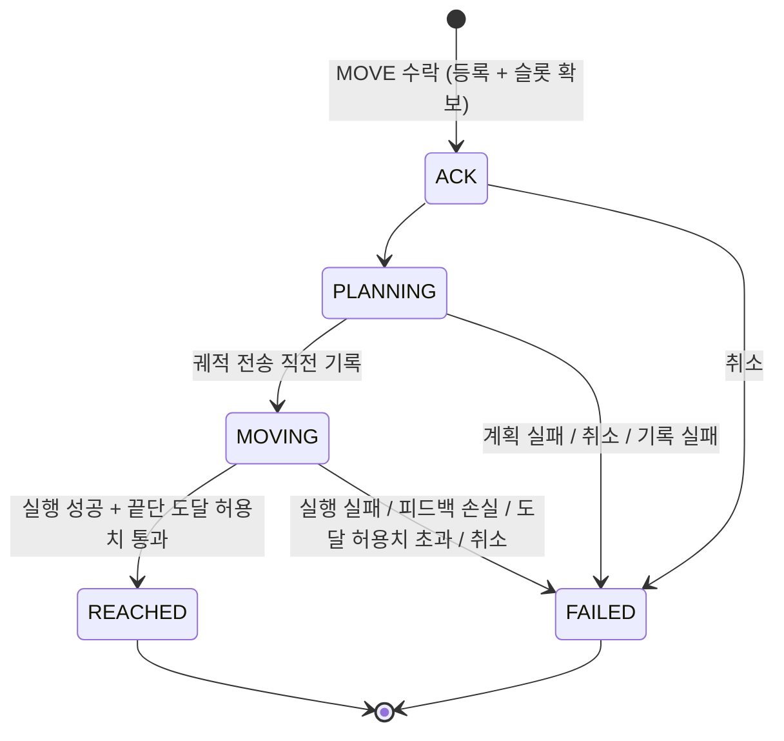
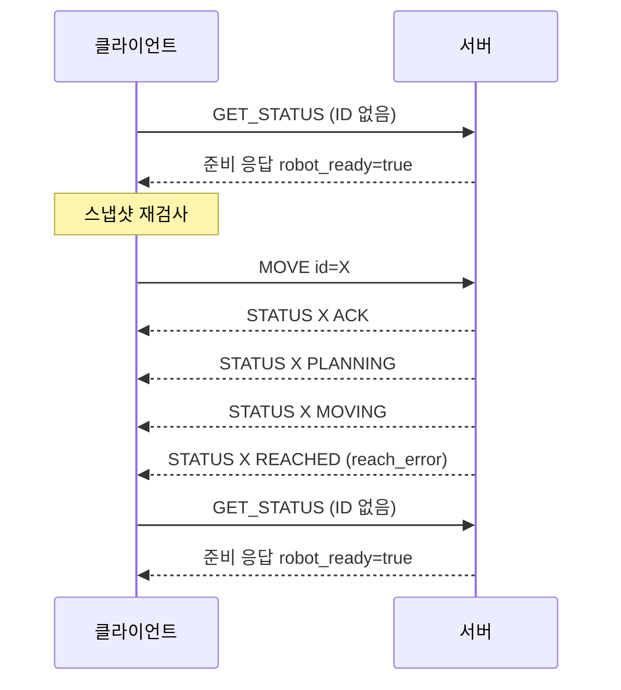
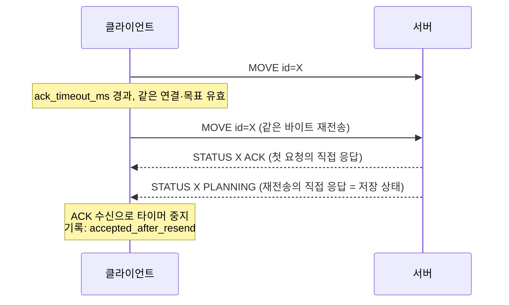
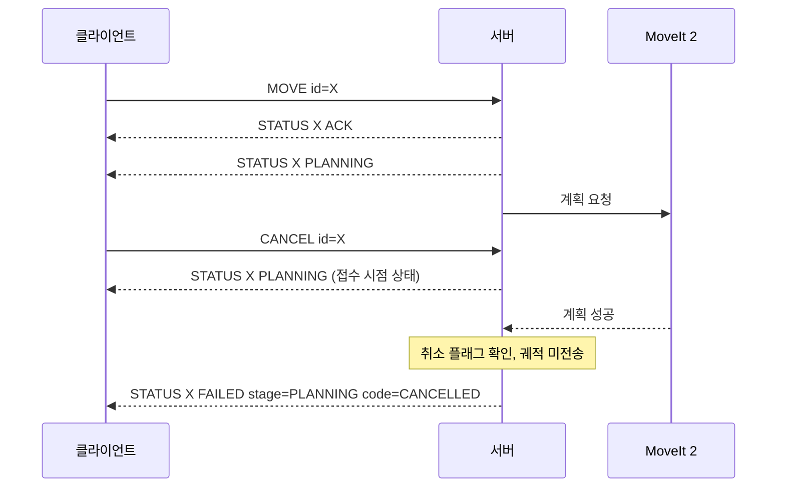
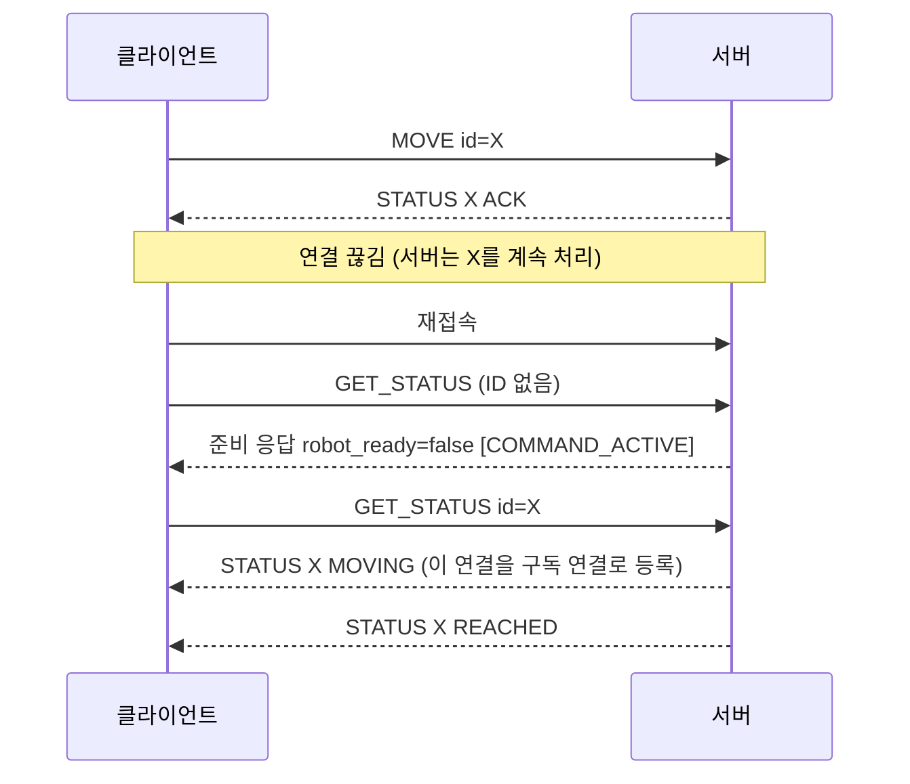
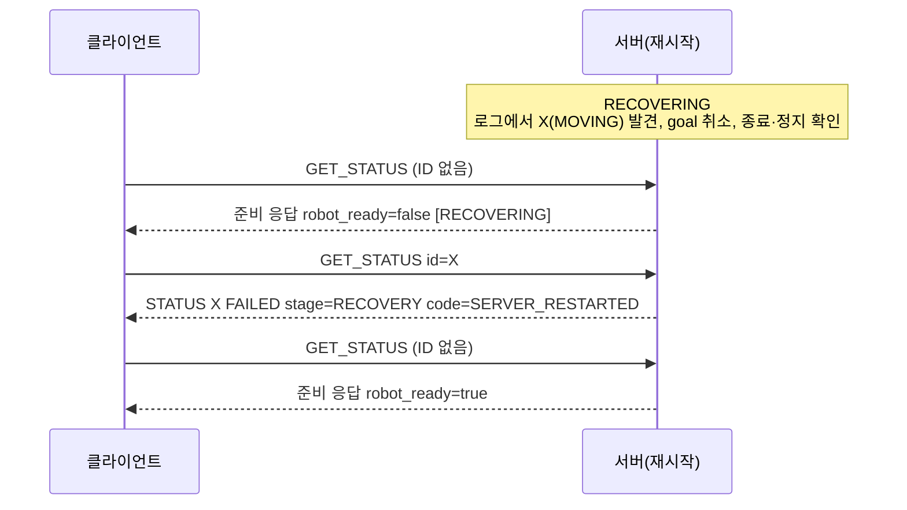

# EyetoArm — TCP 패킷 정의서

문서 버전 1.0 (초안) · 프로토콜 버전 `"1.1"` · 2026-11-07

| 항목 | 내용 |
|---|---|
| 기준 문서 | [시스템 아키텍처와 5주 계획](../architecture/시스템_아키텍처_및_프로젝트_계획.md) §2.4 |
| 작성·유지 | D (제안, 팀 확정 필요) |
| 승인 | C — 서버 동작(§5 상태 전이, §6 코드, §7 서버 규칙) |
| 검토 | A — 통신 100회 시험·장애 시험 관점 |
| 함께 제공 | [요청 스키마](c2s.schema.json), [응답 스키마](s2c.schema.json)(JSON Schema 2020-12), [적합성 시험 벡터](test_vectors.json) |

| 초안 개정 | 내용 |
|---|---|
| 1.0 초안 1차 | 최초 작성 |
| 1.0 초안 2차 | 검토 반영: 준비 조회 시간 초과 시 재접속, 중복 검사에 저장 로그 포함, 취소와 완료가 겹칠 때의 판정, 형식·값 오류 분류 기준과 우선순위, 쿼터니언 중복 판정 정규화, 중복 판정 시험 벡터 추가 (§10) |
| 1.0 초안 3차 | 검토 반영: `ACK` 이후 로그 기록 실패 처리와 코드 `LOG_WRITE_FAILED`·`LOG_UNAVAILABLE` 추가, 같은 명령의 상태 역행 방지 (§10) |
| 1.0 초안 4차 | 검토 반영: `NOT_READY`는 등록 기록 실패에만 적용, 종료 상태는 로그 기록 후에만 알림 (§10) |
| 1.0 초안 5차 | 저장 확정 기준(§7.5.2) 신설: `fsync` 완료 후 다음 단계, 로그 위치·형식·점검, 손상 시 `RECOVERY_FAILED` (§10) |
| 1.0 초안 문서 정리 | §10을 검토 이력과 기준 절 참조로 축약, 프로젝트명에 맞춰 파일명·경로 안내 정리 |

## 0. 이 문서의 위치

- 이 정의서는 GUI·시험 도구(클라이언트)와 TCP 서버 사이 명령·상태 메시지의 **단일 기준**입니다. 계획서 §2.4와 내용이 다르면 이 정의서를 따르고, 계획서는 요약으로 유지합니다.
- 프로토콜 버전 `"1.1"`의 메시지 종류와 필드를 그대로 씁니다. **새 메시지나 필드는 추가하지 않았습니다.** 계획서 v1.1에서 정의가 모호했던 부분만 확정했습니다(§10 초안 검토 이력).
- 영상은 이 TCP로 보내지 않습니다. ROS 2 토픽 또는 앱 내부 대기열을 사용합니다.

### 0.1 변경 규칙

| 변경 종류 | 예 | 처리 |
|---|---|---|
| 설명 보완 | 문구, 예시, 시퀀스 추가 | 문서 버전만 올림 (1.0 → 1.1) |
| 설정 초기값 변경 | 대기 시간, 재전송 횟수 | §9 표 수정, 문서 버전 올림 |
| 메시지 형식·의미 변경 | 필드 추가·삭제, 코드 추가, 상태 전이 변경 | 프로토콜 버전 변경(`"1.1"` → `"1.2"`), C 승인과 C·D·A 확인 후 적용. 서버와 클라이언트를 함께 배포 |

서버는 자신이 지원하는 버전 문자열과 정확히 같은 `version`만 받습니다. 하위 호환 모드는 두지 않습니다.

이 규칙은 **C가 정의서를 승인한 뒤부터** 적용합니다. 승인 전 초안 개정(코드 값 추가 포함)은 아직 구현된 서버·클라이언트가 없으므로 프로토콜 버전 `"1.1"` 안에서 처리합니다.

## 1. 용어

| 용어 | 의미 |
|---|---|
| 클라이언트 | TCP로 요청을 보내는 쪽. D의 GUI, A의 시험 도구 |
| 서버 | C의 TCP 서버. ROS 2·MoveIt 2·궤적 컨트롤러와 연결 |
| 명령 | `MOVE` 한 건. `command_id`로 식별 |
| 실행 슬롯 | 서버 전체에 1개. `ACK`부터 종료 상태(`REACHED`·`FAILED`)가 **로그에 기록될 때**까지 한 명령이 점유. 종료 기록 성공, 슬롯 해제, 종료 알림 대기열 등록은 같은 잠금 안에서 처리(§7.5.1) |
| 준비 상태 | `robot_ready`. 새 `MOVE`를 지금 수락할 수 있는지 (계획서 §2.4.5) |
| 직접 응답 | 요청 1건에 대해 서버가 반드시 보내는 응답 1건 |
| 상태 알림 | 명령 상태가 바뀔 때 서버가 요청 없이 보내는 `STATUS` |

## 2. 전송 규칙

### 2.1 연결

- TCP, 서버는 설정 파일의 주소·포트에 바인딩합니다. 기본 주소 `127.0.0.1` (WSL2 단일 구성), 포트는 §9 설정값.
- 동시 연결은 허용합니다. 단, 실행 슬롯은 서버 전체에 1개이므로 두 클라이언트가 동시에 `MOVE`를 보내면 늦은 쪽은 `BUSY`를 받습니다. 운영 중에는 GUI 또는 시험 도구 중 하나만 접속하는 것을 원칙으로 합니다.
- 연결 직후 인사 메시지(hello)나 별도 하트비트 메시지는 없습니다. 연결 확인과 준비 확인은 `command_id` 없는 `GET_STATUS`로 합니다(§8.1).

### 2.2 프레이밍

- 메시지 1개 = UTF-8(BOM 없음) JSON 객체 1개 + LF(`0x0A`) 1개.
- 송신 측은 LF만 붙입니다. 수신 측은 줄 끝의 CR(`0x0D`) 1개를 제거하고 해석해도 됩니다.
- JSON 객체 안에는 줄바꿈 문자를 넣지 않습니다(직렬화 시 들여쓰기 금지).
- 한 줄의 최대 길이는 §9의 `max_line_bytes`(LF 제외)입니다. 넘으면 수신 측은 다음 LF까지 버리고, 서버는 `BAD_FORMAT`을 직접 응답합니다.
- 수신 측은 받은 바이트를 버퍼에 쌓고 **LF까지 완성된 줄만** 해석합니다. 한 번에 여러 줄이 오면 순서대로 처리합니다. 분할된 UTF-8 문자는 다음 수신까지 보관합니다.
- **연결이 끊기면 LF로 끝나지 않은 마지막 조각은 해석하지 않고 버립니다.** 새 연결의 데이터와 합치지 않습니다. 서버가 이 규칙을 지켜야, 클라이언트가 일부만 보낸 `MOVE`가 실행되지 않습니다.

### 2.3 JSON 해석 규칙

수신 측(서버와 클라이언트 모두)은 다음을 지킵니다. 위반하면 서버는 `BAD_FORMAT`을 응답하고, 클라이언트는 그 줄을 기록만 하고 상태에 반영하지 않습니다.

- 최상위는 객체여야 합니다.
- 중복 키를 거부합니다. (Python `json`은 기본적으로 마지막 값을 쓰므로 `object_pairs_hook`으로 검사합니다.)
- `NaN`, `Infinity`, `-Infinity`를 거부합니다. (Python `json.loads`는 기본적으로 받아들이므로 `parse_constant`로 거부합니다. 송신 시 `json.dumps(..., allow_nan=False)`.)
- **정의되지 않은 필드는 무시하지 않고 거부합니다.** 오타 필드(`theta_degree` 등)가 조용히 무시되는 것을 막기 위해서입니다.
- 정수 필드는 소수점 없는 JSON 정수여야 합니다(`1532`는 허용, `1532.0`은 거부).

## 3. 메시지 종류

| 방향 | `type` | 용도 |
|---|---|---|
| 클라이언트 → 서버 | `MOVE` | 이동 명령 1건 |
| 클라이언트 → 서버 | `GET_STATUS` | 명령 상태 조회(`command_id` 있음) 또는 준비 상태 조회(없음) |
| 클라이언트 → 서버 | `CANCEL` | 명령 취소 요청 |
| 서버 → 클라이언트 | `STATUS` | 모든 응답과 상태 알림 |

모든 메시지에 `version`(`"1.1"`)과 `type`이 있습니다.

## 4. 필드 정의

### 4.1 공통 값 형식

| 형식 | 규칙 |
|---|---|
| UUID | UUID v4, 소문자 16진수, 하이픈 포함 36자. 정규식 `^[0-9a-f]{8}-[0-9a-f]{4}-4[0-9a-f]{3}-[89ab][0-9a-f]{3}-[0-9a-f]{12}$` |
| 식별 문자열 | `source_id`, `calibration_id`: 1~64자, `^[A-Za-z0-9_.-]+$` |
| 정수 ms | 0 이상 2^53−1 이하 JSON 정수 |
| 실수 | 유한한 JSON 숫자. 단위는 필드 이름에 표시(`_mm`, `_deg`) |

### 4.2 `MOVE`

| 필드 | 타입 | 필수 | 규칙 |
|---|---|---|---|
| `version` | 문자열 | 필수 | `"1.1"` |
| `type` | 문자열 | 필수 | `"MOVE"` |
| `command_id` | UUID | 필수 | 사용자 실행 1회마다 새로 발급 |
| `mode` | 문자열 | 필수 | `"PLANAR"` 또는 `"POSE_6D"` |
| `frame` | 문자열 | 필수 | `"work"` (작업 좌표계 W) |
| `source_id` | 식별 문자열 | 필수 | 입력 소스 |
| `image_seq` | 정수 | 필수 | 0 이상. 결과를 만든 프레임의 앱 내부 순번 |
| `timestamp_ms` | 정수 ms | 필수 | 결과의 기준 프레임 시각. 의미는 `timestamp_base`에 따름(§4.3) |
| `timestamp_base` | 문자열 | 필수 | `"PC_RECEIVE"`, `"PHONE_CAPTURE"`, `"SIM_TIME"`, `"VIDEO_POS"` |
| `calibration_id` | 식별 문자열 | 필수 | 적용한 보정 프로파일 |
| `valid` | 불리언 | 필수 | `true`여야 함. `false`면 `BAD_VALUE` |
| `position_mm` | 실수 배열 | 필수 | `PLANAR`: `[x, y]`, `POSE_6D`: `[x, y, z]`. W 기준 mm |
| `theta_deg` | 실수 | `PLANAR`만 필수 | `0 ≤ θ < 180`. `POSE_6D`에서는 넣지 않음 |
| `orientation_xyzw` | 실수 배열 4개 | `POSE_6D`만 필수 | W 기준 단위 쿼터니언 `[x, y, z, w]`, `\|‖q‖ − 1\| ≤ 1e-6`, `w ≥ 0`. `PLANAR`에서는 넣지 않음. 클라이언트는 송신 직전에 정규화하고 **반올림하지 않고** 보냄(소수 4자리 반올림만으로도 허용치를 넘음) |

작업 범위 검사는 서버 설정 `workspace_mm`(W 기준 X·Y·Z 최소·최대, 값은 B 제공)으로 합니다. `PLANAR`는 Z를 보내지 않으며 서버가 고정 접근 높이를 적용합니다(계획서 §2.3).

### 4.3 `timestamp_ms`의 의미

| `timestamp_base` | `timestamp_ms`의 의미 | 원점 |
|---|---|---|
| `PC_RECEIVE` | 클라이언트 PC 단조 시계의 프레임 수신 시각 | 임의(예: Python `time.monotonic_ns() // 1_000_000`) |
| `PHONE_CAPTURE` | PC와 동기화된 촬영 시각 | Unix epoch |
| `SIM_TIME` | Gazebo `/clock` 기준 `Image.header.stamp` | 시뮬레이션 시작 |
| `VIDEO_POS` | 저장 영상의 재생 위치 | 파일 시작 |

**서버는 `timestamp_ms`로 만료를 판정하지 않습니다.** 원점이 서로 다른 시계라 서버 시계와 비교할 수 없기 때문입니다. 만료 판정은 클라이언트가 송신 전에 합니다(계획서 §2.2). 서버는 기록과 중복 판정에만 씁니다.

### 4.4 `GET_STATUS`

| 필드 | 타입 | 필수 | 규칙 |
|---|---|---|---|
| `version` | 문자열 | 필수 | `"1.1"` |
| `type` | 문자열 | 필수 | `"GET_STATUS"` |
| `command_id` | UUID | 선택 | 있으면 그 명령의 상태, 없으면 준비 상태만 조회 |

### 4.5 `CANCEL`

| 필드 | 타입 | 필수 | 규칙 |
|---|---|---|---|
| `version` | 문자열 | 필수 | `"1.1"` |
| `type` | 문자열 | 필수 | `"CANCEL"` |
| `command_id` | UUID | 필수 | 취소할 기존 명령. 취소용 새 ID를 만들지 않음 |

### 4.6 `STATUS`

| 필드 | 타입 | 포함 조건 | 규칙 |
|---|---|---|---|
| `version` | 문자열 | 항상 | `"1.1"` |
| `type` | 문자열 | 항상 | `"STATUS"` |
| `command_id` | UUID | §4.7 표 | 대상 명령 |
| `state` | 문자열 | §4.7 표 | `ACK`, `PLANNING`, `MOVING`, `REACHED`, `FAILED` |
| `stage` | 문자열 | `state = FAILED`일 때만 | `PLANNING`, `EXECUTION`, `REACH_CHECK`, `RECOVERY` |
| `code` | 문자열 | `state = FAILED` 또는 거부·형식 오류일 때만 | §6 |
| `detail` | 문자열 | 선택 | 사람이 읽는 설명, 최대 256자. 클라이언트는 해석하지 않음 |
| `robot_ready` | 불리언 | 항상 | 이 메시지를 만든 시점의 준비 상태 |
| `not_ready_reasons` | 문자열 배열 | 항상 | `robot_ready = true`이면 빈 배열. 코드는 §6.3 |
| `active_command_id` | UUID 또는 `null` | 항상 | 실행 슬롯을 점유한 명령 |
| `server_time_ms` | 정수 ms | 항상 | 서버 단조 시계. 클라이언트 시계와 빼서 지연을 계산하지 않음 |
| `reach_error` | 객체 | `REACHED`, 또는 `FAILED`이면서 `stage = REACH_CHECK`일 때만 | `{"position_mm": 실수 ≥ 0, "rotation_deg": 실수 ≥ 0}` |

**준비 상태 필드의 일관성.** `robot_ready = true`이면 `not_ready_reasons`는 빈 배열이고 `active_command_id`는 `null`입니다. `robot_ready = false`이면 보류 사유가 하나 이상 있어야 합니다. `active_command_id`가 있으면 `robot_ready = false`이며 사유에 `COMMAND_ACTIVE`가 있어야 하고, `COMMAND_ACTIVE`가 있으면 `active_command_id`도 있어야 합니다. 실패 코드와 `stage`의 조합은 §6.2를 따릅니다. 어긋난 응답은 클라이언트가 상태에 반영하지 않습니다(§8.8).

### 4.7 `STATUS`의 네 가지 종류

클라이언트는 **필드가 있는지 없는지만으로** 응답 종류를 구분합니다. `type`이 모두 `STATUS`라 다른 방법이 없기 때문입니다.

| 종류 | `command_id` | `state` | `code` | 언제 |
|---|---|---|---|---|
| **명령 상태** | 있음 | 있음 | `FAILED`일 때만 | `MOVE` 수락(`ACK`), 상태 알림, `GET_STATUS`(ID) 응답, 중복 `MOVE` 응답, `CANCEL` 응답 |
| **거부** | 있음 | 없음 | 있음 | `BUSY`, `ID_CONFLICT`, `NOT_READY`, `UNKNOWN_COMMAND`, `BAD_VALUE`, `OUT_OF_WORKSPACE`, ID를 읽을 수 있는 `BAD_FORMAT` |
| **형식 오류** | 없음 | 없음 | 있음 (`BAD_FORMAT`) | 요청의 `command_id`를 읽을 수 없음 |
| **준비 응답** | 없음 | 없음 | 없음 | `command_id` 없는 `GET_STATUS`의 응답 |

판별 순서: `state`가 있으면 명령 상태 → 없고 `code`가 있으면 거부 또는 형식 오류 → 둘 다 없으면 준비 응답.

거부 응답은 **해당 명령의 기존 상태를 바꾸지 않습니다.** 예를 들어 진행 중 명령 X가 있을 때 새 명령 Y가 `BUSY`를 받아도 X의 상태 표시는 그대로입니다.

## 5. 명령 상태 전이



- 상태는 앞으로만 진행하며 되돌아가지 않습니다. `REACHED`와 `FAILED`는 종료 상태이며 바뀌지 않습니다.
- 종료 상태는 로그에 기록된 뒤에만 알립니다(§7.5.1). 따라서 클라이언트가 한 번 받은 종료 상태는 서버를 재시작해도 바뀌지 않습니다.
- 서버가 재시작 후 종료 기록이 없는 명령을 찾으면, 복구 절차를 마친 뒤 `FAILED`(`SERVER_RESTARTED`, `stage = RECOVERY`)로 기록합니다(계획서 §2.4.5).
- **검증 단계의 거부는 상태 전이가 아닙니다.** `BAD_FORMAT`, `BAD_VALUE`, `OUT_OF_WORKSPACE`로 거부된 `MOVE`는 등록되지 않으며 `state`를 갖지 않습니다(§7.2).
- 명령이 종료 상태가 돼도 `robot_ready`가 곧바로 `true`가 되지는 않습니다. 정지 확인이 끝나야 합니다. 클라이언트는 `REACHED`나 `FAILED`를 보고 준비 상태를 추정하지 않고 준비 응답으로 확인합니다.

## 6. 코드

### 6.1 거부·형식 오류 코드 (`state` 없음, 명령 미등록)

| 코드 | 상황 |
|---|---|
| `BAD_FORMAT` | 형식 위반(§7.2.1): UTF-8·JSON 해석 실패, 최상위가 객체 아님, 중복 키, `NaN`·`Infinity`, 알 수 없는 `type`, 지원하지 않는 `version`, 필수 필드 누락, 정의되지 않은 필드, 타입 불일치(정수 자리에 실수 등), 열거형 필드(`mode`, `frame`, `timestamp_base`)의 정의되지 않은 값, UUID·식별 문자열 형식 위반, 모드에 맞지 않는 필드(`PLANAR`에 `orientation_xyzw` 등), 줄 길이 초과. **값 위반과 함께 있어도 이 코드가 우선** |
| `BAD_VALUE` | 형식 위반 없이 값 위반만 있음(§7.2.1): `theta_deg` 범위 밖, 쿼터니언 비정규·`w < 0`, `position_mm`·`orientation_xyzw` 길이 불일치, `valid = false`, 음수 `image_seq` |
| `OUT_OF_WORKSPACE` | 위치가 `workspace_mm` 밖 |
| `ID_CONFLICT` | 같은 `command_id`의 명령이 있는데 내용이 다름 |
| `BUSY` | 실행 슬롯이 다른 명령으로 차 있음 |
| `NOT_READY` | 슬롯은 비었지만 다른 준비 조건 미충족. `not_ready_reasons`에 사유 |
| `UNKNOWN_COMMAND` | `GET_STATUS`·`CANCEL` 대상 ID의 기록이 메모리와 로그 어디에도 없음. **실행되지 않았다는 뜻은 아님** |

### 6.2 명령 실패 코드 (`state = FAILED`)

| 코드 | `stage` | 상황 |
|---|---|---|
| `PLAN_FAILED` | `PLANNING` | IK 해 없음, 충돌, 계획 시간 초과 |
| `CANCELLED` | `PLANNING` | `ACK`·`PLANNING` 중 취소. 계획 결과를 폐기하고 궤적을 보내지 않음 |
| `EXEC_FAILED` | `EXECUTION` | 컨트롤러 실행 오류, 실행 시간 초과 |
| `FEEDBACK_LOST` | `EXECUTION` | ROS 2·Gazebo 연결 또는 관절 피드백 손실 |
| `CANCELLED` | `EXECUTION` | `MOVING` 중 취소, goal 최종 상태 `CANCELED`와 관절 정지 확인. `ABORTED`·`SUCCEEDED`로 끝난 경우는 §7.7 |
| `CANCEL_UNCONFIRMED` | `EXECUTION` | 취소 요청 후 대기 시간 안에 goal 종료와 관절 정지를 모두 확인하지 못함 |
| `REACH_TOLERANCE` | `REACH_CHECK` | 실행은 성공했지만 끝단 도달 허용치 초과. `reach_error` 포함 |
| `SERVER_RESTARTED` | `RECOVERY` | 서버 재시작 전 종료 기록이 없던 명령 |
| `LOG_WRITE_FAILED` | `PLANNING` | 궤적을 보내기 전의 상태 기록에 실패해 궤적을 보내지 않음(§7.5.1) |

### 6.3 준비 보류 사유 (`not_ready_reasons`)

| 코드 | 조건 (계획서 §2.4.5) |
|---|---|
| `COMMAND_ACTIVE` | 실행 슬롯이 차 있음 |
| `ROS_DISCONNECTED` | ROS 2·Gazebo 연결 이상 |
| `SIM_PAUSED` | `/clock` 정지 |
| `CONTROLLER_INACTIVE` | 궤적 컨트롤러 비활성 |
| `TRAJECTORY_ACTIVE` | 액션 상태 목록에 종료되지 않은 goal 있음 |
| `ACTION_STATUS_UNKNOWN` | 액션 상태 목록을 받지 못함 |
| `FEEDBACK_STALE` | 관절 피드백이 오래됨 |
| `NOT_STOPPED` | 관절 속도가 정지 임계값을 넘음 |
| `SCENE_NOT_READY` | Planning Scene에 `workbench` 미등록 |
| `RECOVERING` | 재시작 복구 진행 중 |
| `RECOVERY_FAILED` | 재시작 복구 실패, 수동 복구 필요 |
| `LOG_UNAVAILABLE` | 기록하지 못한 명령 로그가 남아 있음(§7.5.1) |

여러 사유가 동시에 있을 수 있으며 순서는 의미가 없습니다.

## 7. 서버 규칙 (C)

### 7.1 직접 응답과 순서

- 완성된 줄 1개마다 직접 응답을 **정확히 1개** 보냅니다.

  | 요청 | 직접 응답 |
  |---|---|
  | 해석 불가 줄 | 형식 오류 또는 거부(`BAD_FORMAT`) |
  | `MOVE` 신규 수락 | 명령 상태 `ACK` |
  | `MOVE` 중복(같은 ID·같은 내용) | 명령 상태 — 저장된 현재 상태(`PLANNING` 등). 새 실행 없음 |
  | `MOVE` 거부 | 거부 |
  | `GET_STATUS` (ID 있음) | 명령 상태, 또는 거부(`UNKNOWN_COMMAND`) |
  | `GET_STATUS` (ID 없음) | 준비 응답 |
  | `CANCEL` | 명령 상태 — 취소 접수 시점의 현재 상태, 또는 거부(`UNKNOWN_COMMAND`) |

- 한 연결 안에서는 요청을 받은 순서대로 직접 응답을 보냅니다. 요청 처리로 생긴 상태 알림은 그 요청의 직접 응답 **뒤에** 보냅니다(`ACK` 다음에 `PLANNING`).
- **같은 명령의 상태가 연결에서 뒤로 가지 않게 합니다.** 서버는 연결마다 송신 대기열을 하나 두고, 명령 상태를 **읽는 일과 그 상태를 담은 메시지를 대기열에 넣는 일을 그 명령의 잠금 안에서 함께** 처리합니다. 상태 전이와 알림 대기열 등록도 같은 잠금 안에서 합니다. 이렇게 하면 `GET_STATUS`가 `PLANNING`을 읽은 뒤 `MOVING` 알림이 먼저 대기열에 들어가는 일이 생기지 않습니다.
- `CANCEL`의 직접 응답은 "취소 완료"가 아닙니다. 취소 결과는 이후의 최종 상태로 판단하며, 취소와 완료가 겹치면 §7.7을 따릅니다.

### 7.2 `MOVE` 처리 순서

1. 줄 해석과 JSON 규칙(§2.3) → 실패 시 `BAD_FORMAT`
2. 스키마 검사와 의미 검사 → 위반이 있으면 §7.2.1의 분류로 `BAD_FORMAT` 또는 `BAD_VALUE`
3. 작업 범위 검사 → `OUT_OF_WORKSPACE`
4. 같은 `command_id`의 기록을 **메모리와 저장 로그 모두에서** 찾습니다(§7.5). 있으면: 내용이 같으면 저장된 상태를 응답, 다르면 `ID_CONFLICT`. 새 실행은 하지 않습니다.
5. 실행 슬롯이 차 있으면 `BUSY`
6. 다른 준비 조건 미충족이면 `NOT_READY`
7. 명령 등록(로그 기록 포함), 슬롯 확보, `active_command_id` 설정, `ACK` 응답 — **하나의 잠금 안에서** 처리

4번을 5번보다 먼저 확인하므로, 실행 중인 자기 명령의 재전송은 `BUSY`가 아니라 현재 상태를 받습니다. 4번이 저장 로그까지 확인하므로, 메모리 보관 한도를 넘긴 뒤나 서버를 재시작한 뒤에 같은 `MOVE`가 와도 다시 실행되지 않습니다.

#### 7.2.1 형식 위반과 값 위반의 분류

한 요청에서 위반을 **모두** 모은 뒤 다음 규칙으로 코드 하나를 정합니다.

| 분류 | 해당 위반 |
|---|---|
| **값 위반 → `BAD_VALUE`** | 스키마 키워드 `minimum`, `maximum`, `exclusiveMaximum`, `minItems`, `maxItems` 위반(숫자 범위, `θ` 범위, `w < 0`, 배열 길이) / 의미 검사: `valid = false`, 쿼터니언 정규성 |
| **형식 위반 → `BAD_FORMAT`** | 그 밖의 모든 위반: §2.3 해석 규칙, `type`, `required`, `additionalProperties`, `const`, `enum`, `pattern`, `minLength`, `maxLength`, `not`(모드에 맞지 않는 필드) |

- **형식 위반이 하나라도 있으면 `BAD_FORMAT`**, 값 위반만 있으면 `BAD_VALUE`입니다. 예: `theta_deg = 180`과 정의되지 않은 필드가 함께 있으면 `BAD_FORMAT`.
- 스키마 분류는 위반한 키워드 이름만으로 정합니다. Python `jsonschema`에서는 `iter_errors()`가 돌려주는 오류마다 `error.validator`(키워드 이름)를 보고 분류합니다. `allOf`·`if/then`·`$ref` 안의 위반도 안쪽 키워드 이름으로 보고됩니다.
- 이 분류를 키워드만으로 할 수 있도록, `valid`는 스키마에서 불리언 타입만 검사하고 `false` 여부는 의미 검사로 확인합니다. `const`는 프로토콜 고정값(`version`, `type`, `frame`)에만 씁니다.
- `detail`에는 첫 번째 위반 하나를 적으면 충분합니다. 클라이언트는 `code`로만 판단합니다.

### 7.3 같은 내용의 판정

같은 `command_id`의 두 `MOVE`는 다음을 모두 만족하면 같은 내용입니다.

- `mode`, `frame`, `source_id`, `image_seq`, `timestamp_ms`, `timestamp_base`, `calibration_id`, `valid`가 정확히 같음
- `position_mm` 각 성분 차이 ≤ 0.01 mm
- `theta_deg`: 180° 주기 차이 `min(|a−b|, 180−|a−b|)` ≤ 0.01°
- `orientation_xyzw`: **두 쿼터니언을 각각 정규화한 뒤** 상대 회전각 `2·acos(min(1, |q̂₁·q̂₂|))` ≤ 0.01°. 내적의 절댓값을 쓰므로 `q`와 `−q`가 같은 회전으로 처리됩니다.
  - 정규화를 빼면 허용 범위 안의 쿼터니언을 자기 자신과 비교해도 실패할 수 있습니다. 예: `[0, 0, 0, 0.9999995]`는 `‖q‖ − 1 = −5e-7`로 허용되지만, 정규화 없이 자기 자신과 비교하면 내적이 `0.999999`라 약 0.162°가 나와 0.01°를 넘습니다.
  - `acos`는 1 근처에서 수치 오차에 민감하므로, 구현은 `4·atan2(‖q̂₁ − s·q̂₂‖, ‖q̂₁ + s·q̂₂‖)`(`s = sign(q̂₁·q̂₂)`, 0이면 1)로 계산해도 됩니다. 두 식은 같은 회전각을 냅니다(쿼터니언 사이 4차원 각도의 2배가 회전각이므로 계수는 4).
- 중복 판정은 순수 함수이므로 `test_vectors.json`의 `dedupe` 항목으로 구현을 확인합니다(§13).

### 7.4 상태 알림 대상

- 서버는 명령마다 **구독 연결** 목록을 둡니다. 그 명령의 `MOVE`, `GET_STATUS`(ID), `CANCEL`을 보낸 연결이 자동으로 등록됩니다.
- 상태가 바뀌면 살아 있는 구독 연결 모두에 상태 알림을 보냅니다. 끊긴 연결은 목록에서 뺍니다.
- 따라서 재접속한 클라이언트는 `GET_STATUS`(ID)를 한 번 보내면 이후 알림을 다시 받습니다.

### 7.5 기록

- 명령 상태가 바뀔 때마다 명령 로그 파일에 즉시 기록합니다. 다음 세 기록은 **저장 확정(§7.5.2)이 끝난 뒤에만** 다음 단계로 넘어갑니다.
  1. **등록 기록** — 명령 내용 전체. 저장 확정 후 `ACK` 응답
  2. **`MOVING` 기록** — goal ID 포함(계획서 §2.4.5). 저장 확정 후 궤적 전송
  3. **종료 기록** — `REACHED`·`FAILED`와 그 내용. 저장 확정 후 종료 알림(§7.5.1)

  "기록 성공"은 이 문서 어디에서나 **저장 확정**을 뜻합니다. 프로그램 버퍼나 OS 캐시에만 쓴 상태는 성공이 아닙니다.
- **등록 기록이 실패한 경우에만** 명령을 등록하지 않고 `NOT_READY`(`LOG_UNAVAILABLE`)로 거부합니다. 이 명령에는 `ACK`가 나가지 않았으므로 상태가 없습니다. 2·3번 기록의 실패는 이미 `ACK`한 명령의 일이므로 §7.5.1을 따르며, `NOT_READY`로 응답하지 않습니다.
- 메모리에는 최근 `record_retention`건(§9)의 상세를 둡니다. 그와 별도로 **로그에 있는 모든 `command_id`의 색인**(ID → 내용·최종 상태의 로그 위치)을 유지합니다. 메모리에서 밀려난 명령도 이 색인으로 `GET_STATUS`, `CANCEL`, `MOVE` 중복 검사에 응답합니다.
- 명령 로그는 프로젝트 기간 동안 지우지 않습니다(`command_log_retention`, §9). 서버는 시작할 때 로그 전체를 읽어 색인을 다시 만듭니다.
- **시작할 때 명령 로그를 읽을 수 없거나, 일부만 남았거나 손상된 기록이 있으면**(§7.5.2 점검) 중복 검사와 종료 결과 복구를 보장할 수 없으므로 `RECOVERY_FAILED`로 보류합니다(계획서 §2.4.5). C가 손상된 로그를 보관용으로 옮기고 새 로그로 시작하는 절차를 실행 설명서에 적고, 그 사실을 시험 기록에 남깁니다.

#### 7.5.1 `ACK` 이후 로그 기록에 실패할 때

**핵심 규칙: 종료 상태(`REACHED`·`FAILED`)는 로그에 기록된 뒤에만 클라이언트에 알립니다.** 알린 종료 결과는 서버를 재시작해도 로그에서 그대로 복구되므로, 같은 ID에 서로 다른 최종 결과가 전달되지 않습니다. `LOG_WRITE_FAILED`도 종료 상태이므로 같은 규칙을 따릅니다.

| 실패한 기록 | 궤적 전송 | 서버 처리 | 클라이언트가 보는 것 |
|---|---|---|---|
| `MOVING` 기록 — 궤적을 보내기 **전** | **0건** | 계획 결과를 폐기하고 명령의 결과를 `FAILED`(`LOG_WRITE_FAILED`, `stage = PLANNING`)로 **내부에서 정함**(종료 기록이 저장 확정되기 전이므로 아직 알리지 않음). 실패한 `MOVING` 기록은 버리고 다시 쓰지 않음 | 종료 기록이 써질 때까지 마지막으로 알린 상태(`PLANNING`) 유지. 기록되면 `FAILED`(`LOG_WRITE_FAILED`) 알림 |
| goal ID 사후 기록(수락 직후 기록 방식일 때) — 궤적을 보낸 **후** | 이미 보냄 | 실행을 계속하고 정상 판정. goal ID 기록은 대기열에서 다시 씀 | `MOVING` 이후 정상 진행 |
| 종료 기록 | — | 결과를 메모리에 두고 기록을 다시 시도 | 기록될 때까지 마지막으로 알린 상태(`MOVING` 또는 `PLANNING`) 유지. 기록되면 그 결과를 알림 |

**종료 기록 전까지의 서버 상태**

- 실행 슬롯을 계속 점유합니다(`active_command_id` = 그 명령). 슬롯 해제는 종료 기록이 성공하는 순간입니다(§1).
- `not_ready_reasons`에 `COMMAND_ACTIVE`와 `LOG_UNAVAILABLE`을 넣습니다. 따라서 새 ID의 `MOVE`는 `BUSY`를 받습니다(§7.2 순서).
- 그 명령의 `GET_STATUS`·중복 `MOVE`에는 **마지막으로 알린 상태**를 응답합니다. 기록되지 않은 종료 결과는 어떤 응답에도 넣지 않습니다.
- 그 명령의 `CANCEL`은 접수만 하고 아무것도 바꾸지 않습니다(이미 내부적으로 끝났으므로). 직접 응답은 마지막으로 알린 상태입니다.

**다시 쓰기**

- 기록하지 못한 내용은 명령별 대기열에 두고 `log_retry_ms`(§9)마다 순서대로 다시 씁니다. 대기열에는 실제로 일어난 일만 남깁니다. 궤적을 보내지 않은 명령의 `MOVING` 기록처럼 실제 이력과 맞지 않게 된 기록은 버립니다.
- 등록 기록 실패처럼 다시 쓸 기록이 없는 경우에는 같은 간격으로 시험 쓰기를 해서 로그가 다시 쓸 수 있게 됐는지 확인합니다.
- 대기열이 비고 시험 쓰기가 성공하면 `LOG_UNAVAILABLE`을 뺍니다. 계속 실패하면 C가 원인(디스크 공간, 경로 권한)을 해결합니다.
- 해결하지 못한 채 서버를 재시작하면, 로그에는 마지막으로 기록된 비종료 상태만 남아 있습니다. 재시작 복구 절차는 이 명령을 `SERVER_RESTARTED`로 처리합니다. 클라이언트는 그 명령의 종료 상태를 받은 적이 없으므로 결과가 바뀌는 일이 없습니다.

**궤적을 보낸 뒤 기록 실패로 궤적을 취소하지 않는 이유:** 이미 움직이는 로봇을 기록 문제 때문에 멈추면 취소와 완료의 경합(§7.7)이 하나 더 생깁니다. 결과는 메모리에 남아 있고, 알리는 시점만 늦추면 일관성이 유지됩니다.

GUI는 `LOG_UNAVAILABLE`을 "서버 기록 실패 — 결과 확정·새 이동 보류"로 표시합니다. 이 상태가 오래 계속되면 진행 표시가 멈춰 보일 수 있으므로, 사유를 함께 보여 줍니다.

#### 7.5.2 저장 확정의 기준

**저장 확정**은 서버 프로세스가 비정상 종료되거나 WSL2·PC가 갑자기 꺼진 뒤에도, 재시작한 서버가 그 기록을 다시 읽을 수 있는 상태를 말합니다.

**기록 방식**

- 명령 로그는 추가 전용 파일이며, 기록 1건 = JSON 객체 1개 + LF 1개입니다. 기존 줄을 고쳐 쓰지 않습니다.
- 모든 기록에 1부터 1씩 늘어나는 `seq`를 넣습니다. 시작할 때 이 번호로 빠진 기록을 찾습니다.
- 한 기록은 한 번의 쓰기 호출로 씁니다.

**저장 확정 절차** (Python 예)

```python
f.write(line_bytes)        # JSON + b"\n", 파일은 "ab"(바이너리 추가) 모드
f.flush()                  # 프로그램 버퍼 → OS
os.fsync(f.fileno())       # OS 캐시 → 디스크. 반환되면 저장 확정
```

- `flush()`만 하고 `fsync()`를 하지 않은 상태, `fsync()`가 예외를 낸 상태는 **확정이 아닙니다**. 이때는 기록 실패로 보고 §7.5.1을 따릅니다.
- 로그 파일을 새로 만들었을 때는 그 디렉터리도 한 번 `fsync`합니다. 그래야 파일의 존재 자체가 남습니다.
- 세 확정 기록(등록, `MOVING`, 종료)이 아닌 기록도 같은 방식으로 씁니다. 다만 그 기록들은 확정을 기다리지 않고 다음 단계로 넘어가도 됩니다.
- **쓰기나 `fsync`가 실패한 뒤 다시 쓰기 전에** 파일을 마지막으로 저장 확정된 위치(바이트 오프셋)까지 잘라내고(`truncate`) `fsync`합니다. 실패한 쓰기가 파일에 조각을 남겼을 수 있는데, 그 뒤에 다음 기록을 이어 쓰면 로그 중간이 손상되기 때문입니다. 잘라내기에 실패하면 `LOG_UNAVAILABLE`을 유지합니다. 서버는 저장 확정할 때마다 그 위치를 기억합니다.

**로그 위치**

- 로그는 **WSL2 리눅스 파일 시스템(ext4)** 안에 둡니다. 예: `~/project09/logs/command_log.jsonl`.
- Windows 드라이브를 연결한 경로(`/mnt/c/...`)는 쓰지 않습니다. 이 경로는 WSL2와 Windows 사이 파일 공유 계층을 거치므로 `fsync`의 보장 수준과 속도를 이 프로젝트에서 확인하지 않았기 때문입니다.
- `fsync` 시간은 `ACK` 지연에 그대로 더해집니다. 2주차에 "사용자 실행 → `ACK`" 시간을 잴 때 `fsync` 시간도 따로 기록합니다.

**시작할 때 로그 점검**

서버는 색인을 만들기 전에 로그 전체를 점검합니다. 다음 중 하나라도 있으면 **일부만 남았거나 손상된 로그**로 판정합니다.

- 마지막 줄이 LF로 끝나지 않음
- JSON으로 읽을 수 없는 줄, 필수 필드가 빠진 줄
- `seq`가 건너뛰거나 중복됨

이 경우 자동 복구하지 않고 **`RECOVERY_FAILED`로 새 이동을 보류**합니다(§7.5, 계획서 §2.4.5). 어떤 명령의 종료 기록이 일부만 남았는지 서버가 확실히 판단할 수 없기 때문입니다.

- 참고: 서버는 저장 확정 후에만 다음 단계로 넘어가므로, **마지막 줄만** 일부 남은 경우 그 기록에 해당하는 `ACK`·궤적 전송·종료 알림은 바깥으로 나가지 않았습니다. C가 수동 복구할 때 이 점을 판단 근거로 쓸 수 있습니다.
- C의 수동 복구 절차: 손상된 로그를 보관용으로 옮김 → 판단 근거와 함께 시험 기록에 남김 → 유효한 부분만 새 로그로 옮기거나 새 로그로 시작 → 서버 재시작. 이 절차는 실행 설명서에 적습니다.

### 7.6 연결이 끊길 때

- LF로 끝나지 않은 마지막 조각은 버립니다(§2.2).
- 진행 중인 명령은 연결이 끊겨도 계속 처리합니다. 연결 끊김을 취소로 간주하지 않습니다.

### 7.7 취소와 완료가 겹칠 때

취소 요청과 정상 완료는 거의 같은 순간에 일어날 수 있습니다. 서버는 "취소를 요청했는가"가 아니라 **실제로 일어난 결과**로 최종 코드를 정합니다.

**`ACK`·`PLANNING` 중 취소** — 취소 플래그 확인과 궤적 전송을 같은 잠금 안에서 처리합니다.

| 잠금 안에서 확인한 순서 | 결과 |
|---|---|
| 궤적 전송 전에 취소 플래그를 봄 | 궤적을 보내지 않음 → `FAILED`(`CANCELLED`, `PLANNING`) |
| 궤적을 이미 보낸 뒤 취소가 들어옴 | 상태는 이미 `MOVING`이므로 아래 `MOVING` 중 취소로 처리 |

**`MOVING` 중 취소** — goal에 취소를 요청한 뒤, 궤적 액션 goal의 **최종 상태**로 분기합니다.

| goal 최종 상태 | 의미 | 서버 처리 | 최종 기록 |
|---|---|---|---|
| `CANCELED` | 취소 완료 | 관절 정지 확인 | `FAILED`(`CANCELLED`, `EXECUTION`) |
| `ABORTED` | 실행 실패 (취소 요청과 무관하게 컨트롤러가 중단) | 관절 정지 확인 | `FAILED`(`EXEC_FAILED`, `EXECUTION`), `detail`에 "취소 요청 후 중단" |
| `SUCCEEDED` | 취소가 반영되기 전에 궤적이 끝남 | **정상 완료와 같은 끝단 도달 판정**을 수행 | 통과하면 `REACHED`, 넘으면 `FAILED`(`REACH_TOLERANCE`, `REACH_CHECK`). `detail`에 "취소 요청 전 완료" |
| 대기 시간 안에 최종 상태 없음 | 확인 불가 | 수동 복구 대상 | `FAILED`(`CANCEL_UNCONFIRMED`, `EXECUTION`), `robot_ready = false` 유지 |

- 클라이언트는 취소 요청 후 `REACHED`를 받을 수 있습니다. 이때 GUI는 "취소 요청 전에 이동이 완료됨"으로 표시하고 오류로 취급하지 않습니다.
- 실행 성공 없이 끝단 판정을 하지 않으며, `CANCELED`·`ABORTED`를 `REACHED`로 바꾸지 않습니다.
- 어느 경우든 종료 후 다음 이동은 계획서 §2.4.5의 준비 조건을 따릅니다.

## 8. 클라이언트 규칙 (D, A)

### 8.1 연결과 준비 확인

1. 접속에 성공하면 "TCP 연결됨"만 표시하고, 로봇 준비는 "조회 중"으로 둡니다.
2. `command_id` 없는 `GET_STATUS`를 보냅니다. **이 조회는 한 연결에서 한 번에 하나만** 보냅니다. 준비 응답을 받기 전에는 다음 무ID 조회를 보내지 않습니다.
   - **`readiness_timeout_ms` 안에 준비 응답이 오지 않으면 그 연결을 더 이상 쓰지 않습니다.** 준비 응답에는 어느 조회의 답인지 구분할 값이 없으므로, 늦게 온 답을 다음 조회의 답으로 오인할 수 있기 때문입니다.
   - 처리 순서: 새 `MOVE` 차단 → "준비 확인 불가" 표시 → 연결 해제(§8.5) → 재접속(§8.6) → 새 연결에서 준비 조회를 처음부터 시작.
   - 끊은 연결에서 늦게 도착한 `robot_ready = true`는 버리며, 새 이동 허용의 근거로 쓰지 않습니다. 진행 중인 명령이 있었다면 재접속 후 `GET_STATUS`(ID)로 다시 확인합니다.
3. 추적 중인 명령이 있으면 그 ID로 `GET_STATUS`를 보냅니다.
4. 대기 중에는 `readiness_poll_ms`(§9) 간격으로 무ID 조회를 반복합니다. 이것이 연결 확인 역할도 합니다.

### 8.2 `MOVE` 송신

1. 사용자 실행 시 목표를 스냅샷으로 고정합니다.
2. 무ID 조회로 `robot_ready = true`를 확인합니다. 이 조회가 시간 초과되면 송신하지 않고 §8.1의 재접속 절차로 넘어갑니다. 이 경우 스냅샷은 폐기하고, 재접속 후 사용자가 다시 확정해야 합니다.
3. 준비 응답을 받은 뒤, 송신 직전에 스냅샷의 유효 시간·소스·보정을 다시 검사합니다. 만료·변경됐으면 보내지 않습니다.
4. 새 UUID v4를 발급하고, **직렬화한 줄(바이트)을 보관한 뒤** 보냅니다. 재전송은 이 바이트를 그대로 다시 보냅니다. 같은 내용 판정(§7.3)의 허용 오차에 기대지 않기 위해서입니다.
5. 송신 대기 중 연속 클릭으로 명령이 쌓이지 않게 합니다.

### 8.3 ACK 타이머와 재전송

- `MOVE`를 보내면 `ack_timeout_ms` 타이머를 시작합니다.
- 다음 중 하나를 받으면 **타이머를 멈추고 재전송하지 않습니다.**
  - 같은 `command_id`의 명령 상태(`ACK`, `PLANNING`, `MOVING`, `REACHED`, `FAILED` 중 무엇이든)
  - 같은 `command_id`의 거부
- 타이머가 끝나면 다음 조건을 **모두** 만족할 때만 같은 바이트를 재전송합니다(최대 `max_resend`회).
  1. 처음 보낸 TCP 연결이 유지됨
  2. 원래 목표가 아직 유효함 (소스·보정 변경, 재생 위치 이동, 유효 시간 초과 없음)
- 조건이 깨지거나 재전송 상한에 도달하면 재전송을 멈추고 "수락 미확인"을 표시합니다. 새 ID를 자동으로 발급하지 않습니다.

### 8.4 수락 기록의 구분 (평가 로그)

| 기록 | 정의 |
|---|---|
| `first_ack` | 첫 송신에 대한 직접 응답으로 `ACK`를 받음 (재전송 없음) |
| `accepted_after_resend` | 재전송 후에 그 ID의 명령 상태를 받음 |
| `accepted_by_status` | 직접 응답 대신 상태 알림이나 조회로 수락을 확인 (예: 재접속 후 `GET_STATUS`가 `PLANNING`) |
| `unconfirmed` | 수락 여부를 확인하지 못함 |

통신 KPI의 "최초 수락 ACK"는 `first_ack`만 셉니다. 나머지는 따로 집계합니다(계획서 §7).

### 8.5 연결을 끊을 때 (사용자 해제, 앱 종료)

1. 앱의 송신 대기열을 먼저 비웁니다.
2. Qt 소켓 버퍼에 아직 OS로 넘어가지 않은 바이트가 있으면 `abort()`로 닫습니다. 없으면 `disconnectFromHost()`로 닫아도 됩니다. `disconnectFromHost()`는 남은 데이터를 모두 보낸 뒤 닫으므로 대기 중인 `MOVE`가 나갈 수 있습니다.
3. 메시지별 `bytesWritten` 기록으로 각 메시지를 분류합니다.

| 상태 | 판정 | 표시 |
|---|---|---|
| 앱 대기열에만 있었음 | 송신 안 됨 | 미전송 |
| Qt 버퍼에 있었고 OS로 한 바이트도 안 넘어감 | `abort()`로 폐기 | 미전송 |
| 일부 또는 전부가 OS로 넘어감 | 서버 도착 여부 알 수 없음 | **결과 미확인** → 재접속 후 `GET_STATUS` |

OS로 넘어간 바이트는 `abort()`로도 회수할 수 없습니다. 일부만 넘어간 메시지는 서버가 §2.2 규칙으로 버리지만, 클라이언트는 이를 확인할 수 없으므로 "결과 미확인"으로 둡니다.

- 연결 해제나 앱 종료는 로봇을 정지시키지 않습니다. 진행 중인 명령이 있으면 종료 전에 확인 창으로 알립니다.

### 8.6 재접속

- `MOVE`를 다시 보내지 않습니다. 무ID 조회와 추적 중 명령의 `GET_STATUS`만 보냅니다.
- `UNKNOWN_COMMAND`를 받으면 "명령 기록 없음 · 실행 여부 미확인"을 표시합니다. `robot_ready = true`를 확인하고 사용자가 현재 목표를 다시 확정할 때만 새 ID로 보냅니다.
- 서버의 중복 방어를 확인하려고 재접속 후 같은 `MOVE`를 보내는 것은 **시험 도구의 시험 항목**입니다. GUI 운영 경로에서는 하지 않습니다.

### 8.7 취소

- 정지 버튼은 대상 명령의 `command_id`로 `CANCEL`을 보냅니다. 표시는 "요청 전송 → 종료·정지 확인 중 → 결과" 순입니다. 직접 응답만으로 정지 완료를 표시하지 않습니다.
- 취소 요청 후 `REACHED`나 `REACH_TOLERANCE`가 오면 "취소 요청 전에 이동이 완료됨"으로 표시합니다(§7.7).
- 연결이 끊겨 있으면 "연결 끊김 — 취소 요청을 보낼 수 없음"을 표시하고, 누른 요청은 "미전송"으로 둡니다. 재접속 후 자동으로 보내지 않고, `GET_STATUS`로 진행 중임을 확인한 뒤 사용자 확인을 거쳐 보냅니다.

### 8.8 수신 처리

- 받은 `STATUS`를 스키마로 검사합니다. 통과하지 못하면 기록만 하고 상태에 반영하지 않습니다. 잘못된 응답을 `REACHED`나 `robot_ready = true`로 해석하지 않습니다.
- 명령 상태는 `command_id`로 맞춰 적용합니다. **같은 ID에 대해 지금 표시 중인 상태보다 앞 단계의 상태가 오면 기록만 하고 화면에는 반영하지 않습니다.** 단계 순서는 `ACK` < `PLANNING` < `MOVING` < 종료(`REACHED`·`FAILED`)입니다. 같은 단계가 다시 오는 것은 정상입니다(중복 `MOVE` 응답, 조회 응답). 이미 종료 상태인 명령에 다른 종료 상태가 오면 처음 받은 종료 상태를 유지하고 불일치로 기록합니다.
- 서버가 §7.1의 순서를 지키면 상태가 뒤로 가는 응답은 오지 않아야 합니다. 클라이언트 규칙은 서버 버그나 연결 경계에서 생길 수 있는 경우를 막는 안전장치이며, 이런 응답이 기록되면 C에게 알립니다.
- 명령 진행 중에는 상태 알림을 기본으로 쓰고, `status_watchdog_ms`(§9) 동안 알림이 없으면 `GET_STATUS`(ID)로 확인합니다. 이 대기 시간이 지나도 실패로 간주하지 않습니다.

## 9. 설정값

아래는 초기값입니다. 2주차 시험 후 C·D가 확정하고 이 표를 고칩니다. 서버와 클라이언트는 같은 설정 파일을 읽습니다.

| 이름 | 초기값 | 쓰는 쪽 | 비고 |
|---|---|---|---|
| `host` | `127.0.0.1` | 양쪽 | WSL2 단일 구성 |
| `port` | `47090` | 양쪽 | C가 1주차에 확정 |
| `max_line_bytes` | 4096 | 양쪽 | `MOVE` 1건은 약 400바이트 |
| `ack_timeout_ms` | 1000 | 클라이언트 | `ACK`는 등록 직후 보내므로 계획 시간과 무관 |
| `max_resend` | 2 | 클라이언트 | 첫 송신 제외 |
| `readiness_poll_ms` | 1000 | 클라이언트 | 대기 중 무ID 조회 간격 |
| `readiness_timeout_ms` | 1000 | 클라이언트 | 무ID 조회 응답 대기 |
| `status_watchdog_ms` | 2000 | 클라이언트 | 진행 중 알림이 없을 때 조회 |
| `record_retention` | 1000 | 서버 | 메모리에 상세를 두는 명령 수. 넘긴 명령은 로그 색인으로 조회 |
| `command_log_retention` | 프로젝트 기간 전체 | 서버 | 명령 로그는 지우지 않음. 중복 검사의 근거 |
| `log_retry_ms` | 1000 | 서버 | 기록하지 못한 로그를 다시 쓰는 간격 |
| `command_log_path` | `~/project09/logs/command_log.jsonl` | 서버 | WSL2 ext4 안. `/mnt/c/...` 금지(§7.5.2) |
| 저장 확정 방식 | `flush` + `fsync` (끌 수 없음) | 서버 | 설정으로 끄지 않음. 시험 중에도 동일 |
| `workspace_mm` | B 제공 | 서버 | W 기준 X·Y·Z 최소·최대 |
| 취소·복구 대기 시간, 정지 판정값 | 계획서 §2.4.5 | 서버 | 2주차 확정 |

## 10. 초안 검토 이력

아래는 승인 전 초안에서 정리한 항목의 이력입니다. 현재 규칙은 각 기준 절에 반영되어 있으며, 이 표는 별도 규약이나 미완료 작업 목록이 아닙니다. C의 승인 여부는 문서 상단을 따릅니다.

| 검토 항목 | 현재 기준 절 |
|---|---|
| 검증 거부와 명령 상태 구분, 응답 필드 일관성 | §4.6~4.7·§5·§6 |
| 시간 기준별 시각 정의와 단조 시계 예시 수정 | §4.3·§11 |
| JSON 해석·형식과 값 위반 분류·프레이밍 | §2.2~2.3·§7.2.1 |
| 중복 검사 순서, 쿼터니언 정규화와 상대 회전각 비교 | §7.2~7.3 |
| 직접 응답·구독 알림·상태 역행 방지 | §7.1·§7.4·§8.8 |
| 슬롯 해제, 로그 보관·기록 실패·저장 확정 | §1·§7.5~7.5.2 |
| 취소와 완료 경합, 준비 조회 시간 초과, 재접속 운영과 시험 구분 | §7.7·§8.1·§8.6~8.7 |

## 11. 메시지 예시

```json
{"version":"1.1","type":"MOVE","command_id":"3f2b8c1e-6a4d-4e0b-9a51-2c7d9e0f1a23","mode":"PLANAR","frame":"work","source_id":"phone0","image_seq":1532,"timestamp_ms":8412337,"timestamp_base":"PC_RECEIVE","calibration_id":"phone0_1080p_v3","valid":true,"position_mm":[120.0,80.0],"theta_deg":35.2}
{"version":"1.1","type":"MOVE","command_id":"9c1d7a52-0b3e-4f8a-a6d2-5e4b3c2a1f00","mode":"POSE_6D","frame":"work","source_id":"gz_cam0","image_seq":88,"timestamp_ms":125400,"timestamp_base":"SIM_TIME","calibration_id":"gz_cam0_v2","valid":true,"position_mm":[150.0,60.0,42.5],"orientation_xyzw":[0.0,0.0,0.3826834,0.9238795]}
{"version":"1.1","type":"GET_STATUS"}
{"version":"1.1","type":"GET_STATUS","command_id":"3f2b8c1e-6a4d-4e0b-9a51-2c7d9e0f1a23"}
{"version":"1.1","type":"CANCEL","command_id":"3f2b8c1e-6a4d-4e0b-9a51-2c7d9e0f1a23"}
```

```json
{"version":"1.1","type":"STATUS","robot_ready":true,"not_ready_reasons":[],"active_command_id":null,"server_time_ms":5523011}
{"version":"1.1","type":"STATUS","command_id":"3f2b8c1e-6a4d-4e0b-9a51-2c7d9e0f1a23","state":"ACK","robot_ready":false,"not_ready_reasons":["COMMAND_ACTIVE"],"active_command_id":"3f2b8c1e-6a4d-4e0b-9a51-2c7d9e0f1a23","server_time_ms":5523040}
{"version":"1.1","type":"STATUS","command_id":"3f2b8c1e-6a4d-4e0b-9a51-2c7d9e0f1a23","state":"REACHED","robot_ready":false,"not_ready_reasons":["NOT_STOPPED"],"active_command_id":null,"server_time_ms":5527310,"reach_error":{"position_mm":0.42,"rotation_deg":0.11}}
{"version":"1.1","type":"STATUS","command_id":"7e0a1b2c-3d4e-4f50-8a6b-7c8d9e0f1a2b","code":"BUSY","robot_ready":false,"not_ready_reasons":["COMMAND_ACTIVE"],"active_command_id":"3f2b8c1e-6a4d-4e0b-9a51-2c7d9e0f1a23","server_time_ms":5524001}
{"version":"1.1","type":"STATUS","command_id":"3f2b8c1e-6a4d-4e0b-9a51-2c7d9e0f1a23","state":"FAILED","stage":"PLANNING","code":"CANCELLED","detail":"cancelled before trajectory dispatch","robot_ready":true,"not_ready_reasons":[],"active_command_id":null,"server_time_ms":5524120}
{"version":"1.1","type":"STATUS","code":"BAD_FORMAT","detail":"invalid JSON","robot_ready":true,"not_ready_reasons":[],"active_command_id":null,"server_time_ms":5524500}
```

`REACHED` 알림 시점에 슬롯은 해제되지만(`active_command_id = null`), 정지 확인 구간이 끝나기 전이면 `NOT_STOPPED`로 아직 준비 상태가 아닙니다. 이때 새 `MOVE`는 `BUSY`가 아니라 `NOT_READY`를 받습니다. 계획 중 취소는 로봇이 움직이지 않았으므로 바로 준비 상태일 수 있습니다.

## 12. 시퀀스

### 12.1 정상 이동



### 12.2 ACK 지연과 재전송



### 12.3 계획 중 취소



### 12.4 연결 끊김과 재접속



### 12.5 서버 재시작



## 13. 적합성 시험

`test_vectors.json`에는 두 묶음이 있습니다.

- `vectors`: 줄 단위 입력과 기대 결과 (아래 표)
- `dedupe`: §7.3 같은 내용 판정용 `MOVE` 쌍. 필드는 `id`, `a`, `b`(각각 한 줄), `expect`(`same` → 저장된 상태 응답, `conflict` → `ID_CONFLICT`), `note`

`vectors`의 필드:

| 필드 | 의미 |
|---|---|
| `id` | 벡터 번호 |
| `direction` | `c2s`(서버가 받는 요청) 또는 `s2c`(클라이언트가 받는 응답) |
| `raw` | 실제로 오가는 한 줄(LF 제외). 일부러 깨진 JSON도 포함 |
| `expect` | `accept` 또는 `reject` |
| `expect_code` | 서버가 거부할 때 응답할 코드 (`c2s`의 `reject`만) |
| `layer` | 어느 단계에서 걸러지는지: `parse`(JSON 해석·§2.3), `schema`(JSON Schema), `semantic`(스키마로 못 잡는 규칙: `valid = false`, 쿼터니언 정규성) |
| `note` | 설명 |

- C의 서버, A의 시험 도구, D의 클라이언트는 각자 언어로 이 벡터를 읽어 기대 결과가 나오는지 확인합니다. Python에서는 `jsonschema` 패키지의 `Draft202012Validator`로 `c2s`는 `c2s.schema.json`, `s2c`는 `s2c.schema.json`에 대해 검사합니다.
- `layer = schema`인 벡터는 스키마 검사만으로 판정됩니다. `parse`와 `semantic`은 구현 코드에서 따로 검사해야 합니다.
- 거부 코드는 §7.2.1 규칙(위반 키워드로 분류, 형식 위반 우선)으로 정합니다. 벡터의 `expect_code`는 이 규칙으로 계산한 값과 일치하도록 검증했으며, 형식 위반과 값 위반이 함께 있는 벡터도 들어 있습니다.

### 13.1 통합 시험 항목

서버 상태나 시간에 따라 결과가 달라지는 동작은 벡터로 확인할 수 없으므로, 계획서 §6·§7의 통합 시험에 아래 항목을 포함합니다.

| 시험 | 기대 결과 |
|---|---|
| 준비 조회 시간 초과 후 늦게 온 `robot_ready = true` (서버 응답을 인위적으로 지연) | 클라이언트가 그 연결을 버리고 재접속. 늦은 응답으로 `MOVE`가 나가지 않음 |
| 메모리 보관 한도(`record_retention`)를 넘긴 뒤 오래된 ID로 같은 `MOVE` | 새 실행 없이 저장된 최종 상태 응답 |
| 같은 경우 내용을 바꾼 `MOVE` | `ID_CONFLICT` |
| 서버 재시작 후 재시작 전 ID로 같은 `MOVE` | 새 실행 없이 저장된 최종 상태 응답 |
| 명령 로그를 손상시킨 뒤 서버 시작 | `RECOVERY_FAILED`, 새 `MOVE`는 `NOT_READY` |
| 궤적 종료 직전에 `CANCEL` (goal이 `SUCCEEDED`로 끝남) | 끝단 판정 결과에 따라 `REACHED` 또는 `REACH_TOLERANCE`, `CANCELLED`로 기록되지 않음 |
| 이동 중 `CANCEL` (goal이 `CANCELED`로 끝남) | `FAILED`(`CANCELLED`, `EXECUTION`) |
| 궤적 전송과 `CANCEL`이 겹침 | `CANCELLED`(`PLANNING`)이면 goal 전송 0건, 아니면 `MOVING` 취소 경로로 처리 |
| `BUSY`, 실행 중 자기 명령 재전송 | 다른 ID는 `BUSY`, 같은 ID·같은 내용은 현재 상태 |
| `PLANNING`→`MOVING` 전이 순간에 `GET_STATUS`(ID)를 반복 (서버에 지연을 넣어 경합 유도) | 한 연결에서 받은 같은 ID의 상태가 뒤로 가지 않음. 클라이언트 화면도 뒤로 가지 않음 |
| 클라이언트에 앞 단계 상태를 인위적으로 주입 (`MOVING` 표시 중 `PLANNING`) | 기록만 하고 화면은 `MOVING` 유지 |
| 등록 기록 실패 (첫 `MOVE` 전에 로그 경로를 쓰기 금지로 바꿈) | `ACK` 없이 `NOT_READY`(`LOG_UNAVAILABLE`), 명령 미등록. 쓰기 복구 후 시험 쓰기가 성공하면 해제 |
| 궤적 전송 전 `MOVING` 기록 실패 (`PLANNING` 중 쓰기 금지로 바꿈) | goal 전송 0건. 쓰기 복구 전에는 `PLANNING` 유지·새 ID는 `BUSY`. 복구 후 `FAILED`(`LOG_WRITE_FAILED`, `PLANNING`). 로그에 그 명령의 `MOVING` 기록이 없음. `NOT_READY`로 응답한 적 없음 |
| 최종 결과 기록 실패 후 쓰기 복구 | 복구 전에는 `MOVING` 유지(`REACHED` 미전송), `COMMAND_ACTIVE`·`LOG_UNAVAILABLE`. 복구 후 `REACHED` 알림, 슬롯 해제 |
| **이동 완료 → 최종 기록 실패 → 쓰기 복구 전 서버 재시작** (한 시험으로 연속 실행) | 재시작 전 클라이언트가 받은 그 ID의 상태에 `REACHED`가 없음. 재시작 후 `FAILED`(`SERVER_RESTARTED`). 클라이언트 로그 전체에서 그 ID의 종료 상태가 하나뿐임 |
| `PLANNING` 중 기록 실패 → 쓰기 복구 전 서버 재시작 | 같은 확인. 그 ID의 종료 상태는 `SERVER_RESTARTED` 하나뿐, goal 전송 0건 |
| 클라이언트가 `ACK`를 받은 직후 서버 강제 종료(`kill -9`) → 재시작 | 그 ID의 `GET_STATUS`가 `UNKNOWN_COMMAND`가 아님(등록 기록이 남아 있음). 복구 절차 후 `SERVER_RESTARTED` 또는 기록된 종료 상태 |
| 클라이언트가 `REACHED`를 받은 직후 서버 강제 종료 → 재시작 | 그 ID의 `GET_STATUS`가 `REACHED`, `reach_error`도 같음 |
| goal 전송 직후 서버 강제 종료 → 재시작 | 로그에 그 명령의 `MOVING` 기록과 goal ID가 있음. 그 goal ID로 취소·종료 확인 |
| 로그 마지막 줄을 일부 잘라낸 뒤 서버 시작 | `RECOVERY_FAILED`, 새 `MOVE`는 `NOT_READY`. 자동으로 해제되지 않음 |
| 로그 중간 줄을 손상시키거나 `seq`를 건너뛰게 만든 뒤 서버 시작 | `RECOVERY_FAILED` |
| 쓰기 실패를 일으킨 뒤 복구 (파일에 조각이 남도록 유도) | 다시 쓰기 전에 마지막 확정 위치로 잘라냄. 이후 재시작해도 로그 점검 통과 |
| 로그 경로를 `/mnt/c/...`로 설정하고 서버 시작 | 서버가 시작을 거부하거나 경고 후 `RECOVERY_FAILED` (C가 구현 시 택일하고 기록) |
